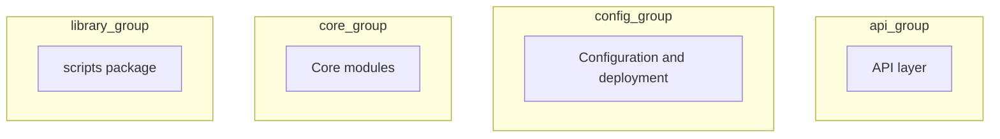

# Architecture report: fmhy/edit

> Automated static analysis. **Observed** = directly seen in files/imports/AST; **Inferred** = interpretation from that evidence. Repository code was not executed.

## 1. Repository at a glance

| Item | Value |
| --- | --- |
| Repository | fmhy/edit |
| Description | Make changes to FMHY |
| Language | JavaScript |
| Stars | 12818 |
| Licence | Not detected |
| Analysed commit / branch | 0450bd41abe146ff23887131105489f5139ac730 / main |
| Framework(s) | Vue |
| Files analysed | 318 |
| Components | 4 |

## 2. Architecture in one minute

fmhy/edit - Make changes to FMHY. This repository was analysed statically from 318 file(s) (0 Python). Detected technologies (observed from imports/manifests): GitHub Actions, Vue, Docker, Docker Compose, TypeScript. Files are grouped into 4 component(s): API layer, Configuration and deployment, Core modules, scripts package. Findings below distinguish observed facts from inferred interpretation.

## 3. High-level block diagram

## 4. Main components

### API layer (`api_layer`)

- **Kind:** api
- **Status:** Observed
- **Confidence:** 0.85
- **Responsibility:** Groups 5 file(s) under api layer (observed from repository paths and static analysis).
- **Paths:** `api/middleware/cors.ts`, `api/middleware/ratelimit.ts`, `api/routes/feedback.post.ts`, `api/routes/index.ts`, `api/routes/single-page.ts`
- **Evidence:** [api/middleware/cors.ts](https://github.com/fmhy/edit/blob/0450bd41abe146ff23887131105489f5139ac730/api/middleware/cors.ts); [api/middleware/ratelimit.ts](https://github.com/fmhy/edit/blob/0450bd41abe146ff23887131105489f5139ac730/api/middleware/ratelimit.ts); [api/routes/feedback.post.ts](https://github.com/fmhy/edit/blob/0450bd41abe146ff23887131105489f5139ac730/api/routes/feedback.post.ts); [api/routes/index.ts](https://github.com/fmhy/edit/blob/0450bd41abe146ff23887131105489f5139ac730/api/routes/index.ts); [api/routes/single-page.ts](https://github.com/fmhy/edit/blob/0450bd41abe146ff23887131105489f5139ac730/api/routes/single-page.ts)

### Configuration and deployment (`config`)

- **Kind:** config
- **Status:** Observed
- **Confidence:** 0.85
- **Responsibility:** Groups 7 file(s) under configuration and deployment (observed from repository paths and static analysis).
- **Paths:** `Dockerfile`, `api/tsconfig.json`, `docker-compose.yaml`, `package.json`, `pnpm-workspace.yaml`, `tsconfig.json`, `wrangler.toml`
- **Evidence:** [Dockerfile](https://github.com/fmhy/edit/blob/0450bd41abe146ff23887131105489f5139ac730/Dockerfile); [api/tsconfig.json](https://github.com/fmhy/edit/blob/0450bd41abe146ff23887131105489f5139ac730/api/tsconfig.json); [docker-compose.yaml](https://github.com/fmhy/edit/blob/0450bd41abe146ff23887131105489f5139ac730/docker-compose.yaml); [package.json](https://github.com/fmhy/edit/blob/0450bd41abe146ff23887131105489f5139ac730/package.json); [pnpm-workspace.yaml](https://github.com/fmhy/edit/blob/0450bd41abe146ff23887131105489f5139ac730/pnpm-workspace.yaml); [tsconfig.json](https://github.com/fmhy/edit/blob/0450bd41abe146ff23887131105489f5139ac730/tsconfig.json); [wrangler.toml](https://github.com/fmhy/edit/blob/0450bd41abe146ff23887131105489f5139ac730/wrangler.toml)

### Core modules (`core`)

- **Kind:** core
- **Status:** Observed
- **Confidence:** 0.85
- **Responsibility:** Groups 3 file(s) under core modules (observed from repository paths and static analysis).
- **Paths:** `eslint.config.js`, `nitro.config.ts`, `unocss.config.ts`
- **Evidence:** [eslint.config.js](https://github.com/fmhy/edit/blob/0450bd41abe146ff23887131105489f5139ac730/eslint.config.js); [nitro.config.ts](https://github.com/fmhy/edit/blob/0450bd41abe146ff23887131105489f5139ac730/nitro.config.ts); [unocss.config.ts](https://github.com/fmhy/edit/blob/0450bd41abe146ff23887131105489f5139ac730/unocss.config.ts)

### scripts package (`scripts`)

- **Kind:** library
- **Status:** Observed
- **Confidence:** 0.85
- **Responsibility:** Groups 5 file(s) under scripts package (observed from repository paths and static analysis).
- **Paths:** `scripts/generate-removed.js`, `scripts/generate-single-page.js`, `scripts/lint-markdown.js`, `scripts/mirror-links.test.mjs`, `scripts/pre-commit.sh`
- **Evidence:** [scripts/generate-removed.js](https://github.com/fmhy/edit/blob/0450bd41abe146ff23887131105489f5139ac730/scripts/generate-removed.js); [scripts/generate-single-page.js](https://github.com/fmhy/edit/blob/0450bd41abe146ff23887131105489f5139ac730/scripts/generate-single-page.js); [scripts/lint-markdown.js](https://github.com/fmhy/edit/blob/0450bd41abe146ff23887131105489f5139ac730/scripts/lint-markdown.js); [scripts/mirror-links.test.mjs](https://github.com/fmhy/edit/blob/0450bd41abe146ff23887131105489f5139ac730/scripts/mirror-links.test.mjs); [scripts/pre-commit.sh](https://github.com/fmhy/edit/blob/0450bd41abe146ff23887131105489f5139ac730/scripts/pre-commit.sh)

## 5. Execution flow

**Observed** entry point(s):

- [api/routes/index.ts](https://github.com/fmhy/edit/blob/0450bd41abe146ff23887131105489f5139ac730/api/routes/index.ts)

Representative flow (derived from observed entry points and the import graph; steps beyond the entry point are **Inferred**):

1. Execution starts at an observed entry point listed above, if present.
2. No internal import relationships between components were observed.

## 6. Project structure

### `(root)`

- `.dockerignore` - container (199 bytes)
- `.editorconfig` - config (216 bytes)
- `.lintstagedrc.format.json` - config (55 bytes)
- `.prettierignore` - other (52 bytes)
- `.prettierrc.yaml` - config (390 bytes)
- `Dockerfile` - container (549 bytes)
- `docker-compose.yaml` - container (218 bytes)
- `eslint.config.js` - source, JavaScript (1522 bytes)
- `flake.lock` - other (569 bytes)
- `flake.nix` - other (553 bytes)
- `nitro.config.ts` - source, TypeScript (1021 bytes)
- `package.json` - manifest (3141 bytes)
- `pnpm-workspace.yaml` - config (204 bytes)
- `tsconfig.json` - config (622 bytes)
- `unocss.config.ts` - source, TypeScript (2866 bytes)
- `wrangler.toml` - config (785 bytes)

### `.devcontainer`

- `.devcontainer/devcontainer.json` - config (198 bytes)

### `.github`

- `.github/CODEOWNERS` - other (79 bytes)
- `.github/CONTRIBUTING.md` - docs (8008 bytes)
- `.github/ISSUE_TEMPLATE/wiki.yml` - config (1744 bytes)
- `.github/POST_TEMPLATE.md` - docs (1179 bytes)
- `.github/README.md` - docs (1700 bytes)
- `.github/assets/bluesky.svg` - other (676 bytes)
- `.github/assets/discord.svg` - other (1055 bytes)
- `.github/assets/firefish.svg` - other (815 bytes)
- `.github/assets/github.svg` - other (681 bytes)
- `.github/assets/nginx.conf` - other (768 bytes)
- `.github/labeler.yml` - config (233 bytes)
- `.github/workflows/deploy-api.yml` - ci, YAML (1224 bytes)
- `.github/workflows/deploy-gh-pages.yml` - ci, YAML (1272 bytes)
- `.github/workflows/labeler.yml` - ci, YAML (228 bytes)
- `.github/workflows/pr-checks.yml` - ci, YAML (3718 bytes)

### `api`

- `api/README.md` - docs (165 bytes)
- `api/middleware/cors.ts` - source, TypeScript (963 bytes)
- `api/middleware/ratelimit.ts` - source, TypeScript (1736 bytes)
- `api/routes/feedback.post.ts` - source, TypeScript (7450 bytes)
- `api/routes/index.ts` - source, TypeScript (694 bytes)
- `api/routes/single-page.ts` - source, TypeScript (2852 bytes)
- `api/tsconfig.json` - config (120 bytes)

### `docs`

- `docs/.vitepress/LICENSE` - docs (568 bytes)
- `docs/.vitepress/README.md` - docs (173 bytes)
- `docs/.vitepress/config.mts` - docs (9108 bytes)
- `docs/.vitepress/constants.ts` - docs (15800 bytes)
- `docs/.vitepress/hooks/index.ts` - docs (756 bytes)
- `docs/.vitepress/hooks/meta.ts` - docs (3645 bytes)
- `docs/.vitepress/hooks/opengraph.ts` - docs (7770 bytes)
- `docs/.vitepress/hooks/rss.ts` - docs (2158 bytes)
- `docs/.vitepress/markdown/emoji.ts` - docs (1855 bytes)
- `docs/.vitepress/markdown/headers.ts` - docs (3273 bytes)
- `docs/.vitepress/markdown/localLinks.ts` - docs (1168 bytes)
- `docs/.vitepress/markdown/toggleStarred.ts` - docs (1615 bytes)
- `docs/.vitepress/notes/1337x-ranks.md` - docs (200 bytes)
- `docs/.vitepress/notes/1shows-note.md` - docs (124 bytes)
- `docs/.vitepress/notes/CodeRabbit.md` - docs (172 bytes)
- `docs/.vitepress/notes/TGTG.md` - docs (220 bytes)
- `docs/.vitepress/notes/advanced-logic-calculators.md` - docs (425 bytes)
- `docs/.vitepress/notes/alt-twitch-player-extensions.md` - docs (100 bytes)
- `docs/.vitepress/notes/alt-warp-clients.md` - docs (245 bytes)
- `docs/.vitepress/notes/android-spotify-note.md` - docs (127 bytes)
- `docs/.vitepress/notes/anyrun-note.md` - docs (105 bytes)
- `docs/.vitepress/notes/apkmirror-extensions.md` - docs (288 bytes)
- `docs/.vitepress/notes/applock.md` - docs (161 bytes)
- `docs/.vitepress/notes/audiobookbay-critical.md` - docs (534 bytes)
- `docs/.vitepress/notes/aurora-note.md` - docs (291 bytes)
- `docs/.vitepress/notes/better-reasoning.md` - docs (75 bytes)
- `docs/.vitepress/notes/bookmarkeddit.md` - docs (111 bytes)
- `docs/.vitepress/notes/buster-note.md` - docs (294 bytes)
- `docs/.vitepress/notes/bypass-freedlink.md` - docs (226 bytes)
- `docs/.vitepress/notes/captcha-4pda.md` - docs (651 bytes)
- `docs/.vitepress/notes/cinebytv-note.md` - docs (108 bytes)
- `docs/.vitepress/notes/clipboard2file-addons.md` - docs (124 bytes)
- `docs/.vitepress/notes/cofi-note.md` - docs (149 bytes)
- `docs/.vitepress/notes/crystaldiskinfo-critical.md` - docs (59 bytes)
- `docs/.vitepress/notes/csrin-search.md` - docs (180 bytes)
- `docs/.vitepress/notes/cute-save-button-icon.md` - docs (265 bytes)
- `docs/.vitepress/notes/deezer-availability.md` - docs (558 bytes)
- `docs/.vitepress/notes/devanced-image-critical.md` - docs (114 bytes)
- `docs/.vitepress/notes/dodi-critical.md` - docs (248 bytes)
- `docs/.vitepress/notes/dolby-access-atmos-note.md` - docs (314 bytes)
- `docs/.vitepress/notes/driver-note.md` - docs (165 bytes)
- `docs/.vitepress/notes/eaglercraft-note.md` - docs (81 bytes)
- `docs/.vitepress/notes/eruda.md` - docs (311 bytes)
- `docs/.vitepress/notes/file-converter-critical.md` - docs (371 bytes)
- `docs/.vitepress/notes/filebin-critical.md` - docs (127 bytes)
- `docs/.vitepress/notes/filelu-critical.md` - docs (158 bytes)
- `docs/.vitepress/notes/filezilla-critical.md` - docs (331 bytes)
- `docs/.vitepress/notes/fluffle-note.md` - docs (122 bytes)
- `docs/.vitepress/notes/forest-extensions.md` - docs (208 bytes)
- `docs/.vitepress/notes/foxit-critical.md` - docs (145 bytes)
- `docs/.vitepress/notes/freegogpcgames-note.md` - docs (700 bytes)
- `docs/.vitepress/notes/gemai.md` - docs (131 bytes)
- `docs/.vitepress/notes/general-tweak-critical.md` - docs (175 bytes)
- `docs/.vitepress/notes/glitchwave-note.md` - docs (279 bytes)
- `docs/.vitepress/notes/google-song-identification.md` - docs (126 bytes)
- `docs/.vitepress/notes/google-translate-note.md` - docs (318 bytes)
- `docs/.vitepress/notes/hagezi.md` - docs (222 bytes)
- `docs/.vitepress/notes/hugging-face-warning.md` - docs (589 bytes)
- `docs/.vitepress/notes/insta-android-critical.md` - docs (212 bytes)
- `docs/.vitepress/notes/introhd-critical.md` - docs (255 bytes)
- `docs/.vitepress/notes/irc-highway-note.md` - docs (183 bytes)
- `docs/.vitepress/notes/limit-bypass-note.md` - docs (522 bytes)
- `docs/.vitepress/notes/liteapk-modyolo-critical.md` - docs (203 bytes)
- `docs/.vitepress/notes/malware-removal-forums.md` - docs (175 bytes)
- `docs/.vitepress/notes/megabasterd-note.md` - docs (73 bytes)
- `docs/.vitepress/notes/mobilism-ranks.md` - docs (105 bytes)
- `docs/.vitepress/notes/modelscope.md` - docs (394 bytes)
- `docs/.vitepress/notes/mori-note.md` - docs (490 bytes)
- `docs/.vitepress/notes/movie-web-sources.md` - docs (645 bytes)
- `docs/.vitepress/notes/mp-opensubs.md` - docs (471 bytes)
- `docs/.vitepress/notes/mvsep-note.md` - docs (79 bytes)
- `docs/.vitepress/notes/nekoweb.md` - docs (140 bytes)
- `docs/.vitepress/notes/neocities.md` - docs (102 bytes)
- `docs/.vitepress/notes/oneclick-note.md` - docs (243 bytes)
- `docs/.vitepress/notes/openasar.md` - docs (170 bytes)
- `docs/.vitepress/notes/pahe-note.md` - docs (163 bytes)
- `docs/.vitepress/notes/pangu7-critical.md` - docs (135 bytes)
- `docs/.vitepress/notes/parsec.md` - docs (73 bytes)
- `docs/.vitepress/notes/partitioned-cookies.md` - docs (207 bytes)
- `docs/.vitepress/notes/piko.md` - docs (209 bytes)
- `docs/.vitepress/notes/pixeldrain.md` - docs (134 bytes)
- `docs/.vitepress/notes/pollinations-limits.md` - docs (854 bytes)
- `docs/.vitepress/notes/popup-blockers.md` - docs (410 bytes)
- `docs/.vitepress/notes/printeditwe-addons.md` - docs (180 bytes)
- `docs/.vitepress/notes/rdc.md` - docs (94 bytes)
- `docs/.vitepress/notes/reaper-note.md` - docs (120 bytes)
- `docs/.vitepress/notes/redditfilter-note.md` - docs (158 bytes)
- `docs/.vitepress/notes/rethink-note.md` - docs (93 bytes)
- `docs/.vitepress/notes/sanet-critical.md` - docs (310 bytes)
- `docs/.vitepress/notes/savepagewe.md` - docs (170 bytes)
- `docs/.vitepress/notes/scrollanywhere-addons.md` - docs (262 bytes)
- `docs/.vitepress/notes/sd-maid.md` - docs (367 bytes)
- `docs/.vitepress/notes/sh-note.md` - docs (204 bytes)
- `docs/.vitepress/notes/site-favicon-dl.md` - docs (195 bytes)
- `docs/.vitepress/notes/soft98-note.md` - docs (346 bytes)
- `docs/.vitepress/notes/spacebar.md` - docs (223 bytes)
- `docs/.vitepress/notes/spacewar.md` - docs (198 bytes)
- `docs/.vitepress/notes/spicetify-note.md` - docs (183 bytes)
- `docs/.vitepress/notes/steam-controller-support.md` - docs (166 bytes)
- `docs/.vitepress/notes/steam-currency-converter-note.md` - docs (228 bytes)
- `docs/.vitepress/notes/strawberry-note.md` - docs (153 bytes)
- `docs/.vitepress/notes/tabiverse-extensions.md` - docs (157 bytes)
- `docs/.vitepress/notes/tautulli-note.md` - docs (146 bytes)
- `docs/.vitepress/notes/teamspeak-critical.md` - docs (117 bytes)
- `docs/.vitepress/notes/thunderbird.md` - docs (299 bytes)
- `docs/.vitepress/notes/tinyurl-note.md` - docs (137 bytes)
- `docs/.vitepress/notes/tld-list-note.md` - docs (108 bytes)
- `docs/.vitepress/notes/tobari.md` - docs (104 bytes)
- `docs/.vitepress/notes/twitchnosub.md` - docs (83 bytes)
- `docs/.vitepress/notes/ubo-lite.md` - docs (202 bytes)
- `docs/.vitepress/notes/video-downloadhelper.md` - docs (170 bytes)
- `docs/.vitepress/notes/vorapis.md` - docs (276 bytes)
- `docs/.vitepress/notes/welib-note.md` - docs (273 bytes)
- `docs/.vitepress/notes/winrar-critical.md` - docs (197 bytes)
- `docs/.vitepress/notes/yet-another-call-blocker-note.md` - docs (370 bytes)
- `docs/.vitepress/notes/youtube-tweaks.md` - docs (172 bytes)
- `docs/.vitepress/notes/yts-yify-critical.md` - docs (324 bytes)
- `docs/.vitepress/shared.ts` - docs (8994 bytes)
- `docs/.vitepress/theme/Layout.vue` - docs (11799 bytes)
- `docs/.vitepress/theme/PostLayout.vue` - docs (587 bytes)
- `docs/.vitepress/theme/Posts.vue` - docs (4183 bytes)
- `docs/.vitepress/theme/components/Announcement.vue` - docs (358 bytes)
- `docs/.vitepress/theme/components/AppearancePanel.vue` - docs (3609 bytes)
- `docs/.vitepress/theme/components/Authors.vue` - docs (983 bytes)
- `docs/.vitepress/theme/components/Base64Dialog.vue` - docs (6491 bytes)
- `docs/.vitepress/theme/components/CardField.vue` - docs (337 bytes)
- `docs/.vitepress/theme/components/ColorPicker.vue` - docs (5578 bytes)
- `docs/.vitepress/theme/components/CriticalBadge.vue` - docs (4387 bytes)
- `docs/.vitepress/theme/components/CriticalDialog.vue` - docs (5084 bytes)
- `docs/.vitepress/theme/components/Feedback.vue` - docs (19072 bytes)
- `docs/.vitepress/theme/components/GradientCard.vue` - docs (2791 bytes)
- `docs/.vitepress/theme/components/InputField.vue` - docs (769 bytes)
- `docs/.vitepress/theme/components/LinkCard.vue` - docs (1194 bytes)
- `docs/.vitepress/theme/components/LinkInline.vue` - docs (272 bytes)
- `docs/.vitepress/theme/components/SidebarCard.vue` - docs (1230 bytes)
- `docs/.vitepress/theme/components/Switch.vue` - docs (1638 bytes)
- `docs/.vitepress/theme/components/Tag.vue` - docs (1566 bytes)
- `docs/.vitepress/theme/components/ThemeDropdown.vue` - docs (2644 bytes)
- `docs/.vitepress/theme/components/ToggleIndexes.vue` - docs (967 bytes)
- `docs/.vitepress/theme/components/ToggleStarred.vue` - docs (883 bytes)
- `docs/.vitepress/theme/components/Tooltip.vue` - docs (2884 bytes)
- `docs/.vitepress/theme/components/VPLocalSearchBox.vue` - docs (103328 bytes)
- `docs/.vitepress/theme/components/VPNav.vue` - docs (4370 bytes)
- `docs/.vitepress/theme/components/VideoFrame.vue` - docs (474 bytes)
- `docs/.vitepress/theme/components/WallpaperCard.vue` - docs (974 bytes)
- `docs/.vitepress/theme/components/startpage/Bookmarks.vue` - docs (22874 bytes)
- `docs/.vitepress/theme/components/startpage/Clock.vue` - docs (761 bytes)
- `docs/.vitepress/theme/components/startpage/SearchBar.vue` - docs (5605 bytes)
- `docs/.vitepress/theme/components/startpage/Startpage.vue` - docs (1323 bytes)
- `docs/.vitepress/theme/composables/criticalNotes.ts` - docs (1329 bytes)
- `docs/.vitepress/theme/composables/criticalRegistry.ts` - docs (534 bytes)
- `docs/.vitepress/theme/composables/nprogress.ts` - docs (1331 bytes)
- `docs/.vitepress/theme/composables/rateLimit.ts` - docs (1224 bytes)
- `docs/.vitepress/theme/composables/sanitize.ts` - docs (1273 bytes)
- `docs/.vitepress/theme/composables/searchFromQuery.ts` - docs (1376 bytes)
- `docs/.vitepress/theme/composables/searchScroll.ts` - docs (9115 bytes)
- `docs/.vitepress/theme/index.ts` - docs (6276 bytes)
- `docs/.vitepress/theme/posts.data.ts` - docs (1378 bytes)
- `docs/.vitepress/theme/style.scss` - docs (27086 bytes)
- `docs/.vitepress/theme/themes/README.md` - docs (3858 bytes)
- `docs/.vitepress/theme/themes/configs/catppuccin.ts` - docs (4133 bytes)
- `docs/.vitepress/theme/themes/configs/christmas.ts` - docs (4252 bytes)
- `docs/.vitepress/theme/themes/configs/colors.ts` - docs (4452 bytes)
- `docs/.vitepress/theme/themes/configs/halloween.ts` - docs (3570 bytes)
- `docs/.vitepress/theme/themes/configs/index.ts` - docs (1178 bytes)
- `docs/.vitepress/theme/themes/configs/monochrome.ts` - docs (3379 bytes)
- `docs/.vitepress/theme/themes/configs/monolith.ts` - docs (3604 bytes)
- `docs/.vitepress/theme/themes/themeHandler.ts` - docs (11115 bytes)
- `docs/.vitepress/theme/themes/themeTransition.ts` - docs (3809 bytes)
- `docs/.vitepress/theme/themes/types.ts` - docs (2332 bytes)
- `docs/.vitepress/theme/utils/colors.ts` - docs (2720 bytes)
- `docs/.vitepress/transformer.ts` - docs (11730 bytes)
- `docs/.vitepress/transformer/constants.ts` - docs (1731 bytes)
- `docs/.vitepress/transformer/core.ts` - docs (2204 bytes)
- `docs/.vitepress/transformer/headers.json` - config (3433 bytes)
- `docs/.vitepress/types/Feedback.ts` - docs (1553 bytes)
- `docs/.vitepress/utils.ts` - docs (950 bytes)
- `docs/.vitepress/utils/markdown.ts` - docs (4707 bytes)
- `docs/.vitepress/utils/tooltips.ts` - docs (1193 bytes)
- `docs/.vitepress/vue-shim.d.ts` - docs (3583 bytes)
- `docs/ai.md` - docs (48772 bytes)
- `docs/audio.md` - docs (98965 bytes)
- `docs/beginners-guide.md` - docs (12844 bytes)
- `docs/developer-tools.md` - docs (114258 bytes)
- `docs/downloading.md` - docs (19729 bytes)
- `docs/educational.md` - docs (192813 bytes)
- `docs/feedback.md` - docs (11606 bytes)
- `docs/file-tools.md` - docs (43992 bytes)
- `docs/gaming-tools.md` - docs (134288 bytes)
- `docs/gaming.md` - docs (111475 bytes)
- `docs/image-tools.md` - docs (77117 bytes)
- `docs/index.md` - docs (10135 bytes)
- `docs/internet-tools.md` - docs (87865 bytes)
- `docs/linux-macos.md` - docs (89481 bytes)
- `docs/misc.md` - docs (170456 bytes)
- `docs/mobile.md` - docs (154628 bytes)
- `docs/non-english.md` - docs (112102 bytes)
- `docs/other/FAQ.md` - docs (2069 bytes)
- `docs/other/backups.md` - docs (2971 bytes)
- `docs/other/contributing.md` - docs (149 bytes)
- `docs/other/selfhosting.md` - docs (5725 bytes)
- `docs/other/wallpapers.md` - docs (1254 bytes)
- `docs/posts.md` - docs (219 bytes)
- `docs/posts/FCC.md` - docs (1129 bytes)
- `docs/posts/Internet-Archive.md` - docs (549 bytes)
- `docs/posts/KeepAndroidOpen.md` - docs (4339 bytes)
- `docs/posts/Nov-2025.md` - docs (5971 bytes)
- `docs/posts/WWH.md` - docs (2019 bytes)
- `docs/posts/april-2023.md` - docs (2303 bytes)
- `docs/posts/april-2024.md` - docs (4106 bytes)
- `docs/posts/april-2025.md` - docs (3687 bytes)
- `docs/posts/april-2026.md` - docs (6592 bytes)
- `docs/posts/aug-2023.md` - docs (3834 bytes)
- `docs/posts/aug-2024.md` - docs (4875 bytes)
- `docs/posts/aug-2025.md` - docs (6280 bytes)
- `docs/posts/aug-2026.md` - docs (4755 bytes)
- `docs/posts/changelog-sites.md` - docs (705 bytes)
- `docs/posts/dec-2023.md` - docs (4155 bytes)
- `docs/posts/dec-2024.md` - docs (4257 bytes)
- `docs/posts/dec-2025.md` - docs (3953 bytes)
- `docs/posts/discord.md` - docs (220 bytes)
- `docs/posts/feb-2024.md` - docs (4904 bytes)
- `docs/posts/feb-2025.md` - docs (3363 bytes)
- `docs/posts/feb-2026.md` - docs (6024 bytes)
- `docs/posts/jan-2024.md` - docs (5396 bytes)
- `docs/posts/jan-2025.md` - docs (2840 bytes)
- `docs/posts/jan-2026.md` - docs (7433 bytes)
- `docs/posts/july-2023.md` - docs (2741 bytes)
- `docs/posts/july-2024.md` - docs (5567 bytes)
- `docs/posts/july-2025.md` - docs (5464 bytes)
- `docs/posts/july-2026.md` - docs (4646 bytes)
- `docs/posts/jun-2023.md` - docs (3198 bytes)
- `docs/posts/june-2024.md` - docs (4520 bytes)
- `docs/posts/june-2025.md` - docs (5774 bytes)
- `docs/posts/june-2026.md` - docs (6739 bytes)
- `docs/posts/love.md` - docs (3844 bytes)
- `docs/posts/mar-2025.md` - docs (3226 bytes)
- `docs/posts/mar-2026.md` - docs (3852 bytes)
- `docs/posts/march-2024.md` - docs (3372 bytes)
- `docs/posts/may-2023.md` - docs (2577 bytes)
- `docs/posts/may-2024.md` - docs (4311 bytes)
- `docs/posts/may-2025.md` - docs (5573 bytes)
- `docs/posts/may-2026.md` - docs (6097 bytes)
- `docs/posts/new-site.md` - docs (941 bytes)
- `docs/posts/nov-2023.md` - docs (5286 bytes)
- `docs/posts/nov-2024.md` - docs (4119 bytes)
- `docs/posts/nov-2026.md` - docs (7426 bytes)
- `docs/posts/oct-2023.md` - docs (3570 bytes)
- `docs/posts/oct-2024.md` - docs (3589 bytes)
- `docs/posts/oct-2025.md` - docs (4635 bytes)
- `docs/posts/oct-2026.md` - docs (7789 bytes)
- `docs/posts/search.md` - docs (1262 bytes)
- `docs/posts/sept-2023.md` - docs (4751 bytes)
- `docs/posts/sept-2024.md` - docs (4976 bytes)
- `docs/posts/sept-2025.md` - docs (4513 bytes)
- `docs/posts/sept-2026.md` - docs (7758 bytes)
- `docs/privacy.md` - docs (54449 bytes)
- `docs/public/_headers` - docs (273 bytes)
- `docs/public/key.txt` - docs (33 bytes)
- `docs/public/logo-uwu.svg` - docs (47135 bytes)
- `docs/public/manifest.json` - config (878 bytes)
- `docs/public/note.svg` - docs (496 bytes)
- `docs/public/robots.txt` - docs (96 bytes)
- `docs/reading.md` - docs (86266 bytes)
- `docs/sandbox.md` - docs (531 bytes)
- `docs/social-media-tools.md` - docs (69067 bytes)
- `docs/startpage.md` - docs (194 bytes)
- `docs/storage.md` - docs (30250 bytes)
- `docs/system-tools.md` - docs (50161 bytes)
- `docs/text-tools.md` - docs (53057 bytes)
- `docs/torrenting.md` - docs (14781 bytes)
- `docs/unsafe.md` - docs (8419 bytes)
- `docs/video-tools.md` - docs (50241 bytes)
- `docs/video.md` - docs (117246 bytes)

### `scripts`

- `scripts/generate-removed.js` - source, JavaScript (28228 bytes)
- `scripts/generate-single-page.js` - source, JavaScript (1267 bytes)
- `scripts/lint-markdown.js` - source, JavaScript (38592 bytes)
- `scripts/mirror-links.test.mjs` - source, JavaScript (3952 bytes)
- `scripts/pre-commit.sh` - source, Shell (1652 bytes)

## 7. Key dependencies and integrations

| Name | Category | Status | Confidence | Evidence |
| --- | --- | --- | --- | --- |
| GitHub Actions | ci | Observed | 0.90 | [.github/workflows/deploy-api.yml](https://github.com/fmhy/edit/blob/0450bd41abe146ff23887131105489f5139ac730/.github/workflows/deploy-api.yml); [.github/workflows/deploy-gh-pages.yml](https://github.com/fmhy/edit/blob/0450bd41abe146ff23887131105489f5139ac730/.github/workflows/deploy-gh-pages.yml); [.github/workflows/labeler.yml](https://github.com/fmhy/edit/blob/0450bd41abe146ff23887131105489f5139ac730/.github/workflows/labeler.yml); [.github/workflows/pr-checks.yml](https://github.com/fmhy/edit/blob/0450bd41abe146ff23887131105489f5139ac730/.github/workflows/pr-checks.yml) |
| Vue | framework | Observed | 0.85 | [package.json:29](https://github.com/fmhy/edit/blob/0450bd41abe146ff23887131105489f5139ac730/package.json#L29) |
| Docker | tooling | Observed | 0.85 | [Dockerfile](https://github.com/fmhy/edit/blob/0450bd41abe146ff23887131105489f5139ac730/Dockerfile) |
| Docker Compose | tooling | Observed | 0.85 | [docker-compose.yaml](https://github.com/fmhy/edit/blob/0450bd41abe146ff23887131105489f5139ac730/docker-compose.yaml) |
| TypeScript | tooling | Observed | 0.85 | [package.json:85](https://github.com/fmhy/edit/blob/0450bd41abe146ff23887131105489f5139ac730/package.json#L85) |

## 8. Data and state

No database, cache, queue, or persistent-state usage was observed in the analysed files. State handling, if any, may be in-memory or in files that were not analysed.

## 9. Configuration and deployment clues

- `.devcontainer/devcontainer.json` (config)
- `.dockerignore` (container)
- `.editorconfig` (config)
- `.github/ISSUE_TEMPLATE/wiki.yml` (config)
- `.github/labeler.yml` (config)
- `.github/workflows/deploy-api.yml` (ci)
- `.github/workflows/deploy-gh-pages.yml` (ci)
- `.github/workflows/labeler.yml` (ci)
- `.github/workflows/pr-checks.yml` (ci)
- `.lintstagedrc.format.json` (config)
- `.prettierrc.yaml` (config)
- `Dockerfile` (container)
- `api/tsconfig.json` (config)
- `docker-compose.yaml` (container)
- `docs/.vitepress/transformer/headers.json` (config)
- `docs/public/manifest.json` (config)
- `package.json` (manifest)
- `pnpm-workspace.yaml` (config)
- `tsconfig.json` (config)
- `wrangler.toml` (config)

## 10. Design observations

- An entry/API layer is separated from other code (Inferred from paths and decorators).

These observations are interpretations (**Inferred**) of the observed structure, not guarantees about runtime design.

## 11. Limitations and unknowns

- Static analysis only: repository code was not executed, installed, or imported at runtime.
- Components and relationships are inferred from file paths, imports, and AST structure; runtime behaviour, dynamic imports, and reflection may not be visible.
- 1 file(s) were skipped during inventory (1 x likely secret file excluded).
- No clear application entry point was observed in the analysed files.
- Repository text was treated as untrusted data; no instructions found in repository files were followed, and likely secret values were redacted/excluded.
- JavaScript and TypeScript files were inventoried from paths and package manifests. They were not parsed with a full language AST, and repository code was not executed.

## 12. Source references

- [.github/workflows/deploy-api.yml](https://github.com/fmhy/edit/blob/0450bd41abe146ff23887131105489f5139ac730/.github/workflows/deploy-api.yml)
- [.github/workflows/deploy-gh-pages.yml](https://github.com/fmhy/edit/blob/0450bd41abe146ff23887131105489f5139ac730/.github/workflows/deploy-gh-pages.yml)
- [.github/workflows/labeler.yml](https://github.com/fmhy/edit/blob/0450bd41abe146ff23887131105489f5139ac730/.github/workflows/labeler.yml)
- [.github/workflows/pr-checks.yml](https://github.com/fmhy/edit/blob/0450bd41abe146ff23887131105489f5139ac730/.github/workflows/pr-checks.yml)
- [Dockerfile](https://github.com/fmhy/edit/blob/0450bd41abe146ff23887131105489f5139ac730/Dockerfile)
- [api/middleware/cors.ts](https://github.com/fmhy/edit/blob/0450bd41abe146ff23887131105489f5139ac730/api/middleware/cors.ts)
- [api/middleware/ratelimit.ts](https://github.com/fmhy/edit/blob/0450bd41abe146ff23887131105489f5139ac730/api/middleware/ratelimit.ts)
- [api/routes/feedback.post.ts](https://github.com/fmhy/edit/blob/0450bd41abe146ff23887131105489f5139ac730/api/routes/feedback.post.ts)
- [api/routes/index.ts](https://github.com/fmhy/edit/blob/0450bd41abe146ff23887131105489f5139ac730/api/routes/index.ts)
- [api/routes/single-page.ts](https://github.com/fmhy/edit/blob/0450bd41abe146ff23887131105489f5139ac730/api/routes/single-page.ts)
- [api/tsconfig.json](https://github.com/fmhy/edit/blob/0450bd41abe146ff23887131105489f5139ac730/api/tsconfig.json)
- [docker-compose.yaml](https://github.com/fmhy/edit/blob/0450bd41abe146ff23887131105489f5139ac730/docker-compose.yaml)
- [eslint.config.js](https://github.com/fmhy/edit/blob/0450bd41abe146ff23887131105489f5139ac730/eslint.config.js)
- [nitro.config.ts](https://github.com/fmhy/edit/blob/0450bd41abe146ff23887131105489f5139ac730/nitro.config.ts)
- [package.json](https://github.com/fmhy/edit/blob/0450bd41abe146ff23887131105489f5139ac730/package.json)
- [package.json:29](https://github.com/fmhy/edit/blob/0450bd41abe146ff23887131105489f5139ac730/package.json#L29)
- [package.json:85](https://github.com/fmhy/edit/blob/0450bd41abe146ff23887131105489f5139ac730/package.json#L85)
- [pnpm-workspace.yaml](https://github.com/fmhy/edit/blob/0450bd41abe146ff23887131105489f5139ac730/pnpm-workspace.yaml)
- [scripts/generate-removed.js](https://github.com/fmhy/edit/blob/0450bd41abe146ff23887131105489f5139ac730/scripts/generate-removed.js)
- [scripts/generate-single-page.js](https://github.com/fmhy/edit/blob/0450bd41abe146ff23887131105489f5139ac730/scripts/generate-single-page.js)
- [scripts/lint-markdown.js](https://github.com/fmhy/edit/blob/0450bd41abe146ff23887131105489f5139ac730/scripts/lint-markdown.js)
- [scripts/mirror-links.test.mjs](https://github.com/fmhy/edit/blob/0450bd41abe146ff23887131105489f5139ac730/scripts/mirror-links.test.mjs)
- [scripts/pre-commit.sh](https://github.com/fmhy/edit/blob/0450bd41abe146ff23887131105489f5139ac730/scripts/pre-commit.sh)
- [tsconfig.json](https://github.com/fmhy/edit/blob/0450bd41abe146ff23887131105489f5139ac730/tsconfig.json)
- [unocss.config.ts](https://github.com/fmhy/edit/blob/0450bd41abe146ff23887131105489f5139ac730/unocss.config.ts)
- [wrangler.toml](https://github.com/fmhy/edit/blob/0450bd41abe146ff23887131105489f5139ac730/wrangler.toml)
