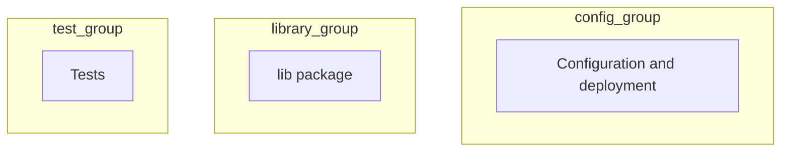

# Architecture report: foreversd/forever

> Automated static analysis. **Observed** = directly seen in files/imports/AST; **Inferred** = interpretation from that evidence. Repository code was not executed.

## 1. Repository at a glance

| Item | Value |
| --- | --- |
| Repository | foreversd/forever |
| Description | A simple CLI tool for ensuring that a given script runs continuously (i.e. forever) |
| Language | JavaScript |
| Stars | 13816 |
| Licence | MIT |
| Analysed commit / branch | 2ba8489f8d53f823494035e58fa4184749917084 / master |
| Framework(s) | None detected |
| Files analysed | 41 |
| Components | 3 |

## 2. Architecture in one minute

foreversd/forever - A simple CLI tool for ensuring that a given script runs continuously (i.e. forever). This repository was analysed statically from 41 file(s) (0 Python). Detected technologies (observed from imports/manifests): no known frameworks/libraries. Files are grouped into 3 component(s): Configuration and deployment, lib package, Tests. Findings below distinguish observed facts from inferred interpretation.

## 3. High-level block diagram

## 4. Main components

### Configuration and deployment (`config`)

- **Kind:** config
- **Status:** Observed
- **Confidence:** 0.85
- **Responsibility:** Groups 1 file(s) under configuration and deployment (observed from repository paths and static analysis).
- **Paths:** `package.json`
- **Evidence:** [package.json](https://github.com/foreversd/forever/blob/2ba8489f8d53f823494035e58fa4184749917084/package.json)

### lib package (`lib`)

- **Kind:** library
- **Status:** Observed
- **Confidence:** 0.85
- **Responsibility:** Groups 5 file(s) under lib package (observed from repository paths and static analysis).
- **Paths:** `lib/forever.js`, `lib/forever/cli.js`, `lib/forever/worker.js`, `lib/util/config-utils.js`, `lib/util/utils.js`
- **Evidence:** [lib/forever.js](https://github.com/foreversd/forever/blob/2ba8489f8d53f823494035e58fa4184749917084/lib/forever.js); [lib/forever/cli.js](https://github.com/foreversd/forever/blob/2ba8489f8d53f823494035e58fa4184749917084/lib/forever/cli.js); [lib/forever/worker.js](https://github.com/foreversd/forever/blob/2ba8489f8d53f823494035e58fa4184749917084/lib/forever/worker.js); [lib/util/config-utils.js](https://github.com/foreversd/forever/blob/2ba8489f8d53f823494035e58fa4184749917084/lib/util/config-utils.js); [lib/util/utils.js](https://github.com/foreversd/forever/blob/2ba8489f8d53f823494035e58fa4184749917084/lib/util/utils.js)

### Tests (`tests`)

- **Kind:** test
- **Status:** Observed
- **Confidence:** 0.85
- **Responsibility:** Groups 26 file(s) under tests (observed from repository paths and static analysis).
- **Paths:** `test/cli-test`, `test/core/daemonic-inheritance-test.js`, `test/core/start-stop-json-array-test.js`, `test/core/start-stop-json-obj-test.js`, `test/core/start-stop-relative-test.js`, `test/core/stopall-peaceful-test.js`, `test/core/stopbypid-peaceful-test.js`, `test/core/tail-stopall-test.js`, `test/core/uptime-test.js`, `test/fixtures/cluster-fork-mode.js`, `test/fixtures/log-on-interval.js`, `test/fixtures/server.js`, `test/fixtures/server.json`, `test/fixtures/servers.json`, `test/fixtures/start-daemon.js`, `test/helpers/index.js`, `test/helpers/macros.js`, `test/helpers/mocks/child-process.js`, `test/helpers/mocks/monitor.js`, `test/helpers/mocks/stream.js`, `test/helpers/utils.js`, `test/mocha/cli/cli.spec.js`, `test/mocha/cli/scripts/dir with spaces/script_name.js`, `test/mocha/util/config-utils.spec.js`, `test/worker/multiple-workers-test.js`, `test/worker/simple-test.js`
- **Evidence:** [test/cli-test](https://github.com/foreversd/forever/blob/2ba8489f8d53f823494035e58fa4184749917084/test/cli-test); [test/core/daemonic-inheritance-test.js](https://github.com/foreversd/forever/blob/2ba8489f8d53f823494035e58fa4184749917084/test/core/daemonic-inheritance-test.js); [test/core/start-stop-json-array-test.js](https://github.com/foreversd/forever/blob/2ba8489f8d53f823494035e58fa4184749917084/test/core/start-stop-json-array-test.js); [test/core/start-stop-json-obj-test.js](https://github.com/foreversd/forever/blob/2ba8489f8d53f823494035e58fa4184749917084/test/core/start-stop-json-obj-test.js); [test/core/start-stop-relative-test.js](https://github.com/foreversd/forever/blob/2ba8489f8d53f823494035e58fa4184749917084/test/core/start-stop-relative-test.js); [test/core/stopall-peaceful-test.js](https://github.com/foreversd/forever/blob/2ba8489f8d53f823494035e58fa4184749917084/test/core/stopall-peaceful-test.js); [test/core/stopbypid-peaceful-test.js](https://github.com/foreversd/forever/blob/2ba8489f8d53f823494035e58fa4184749917084/test/core/stopbypid-peaceful-test.js); [test/core/tail-stopall-test.js](https://github.com/foreversd/forever/blob/2ba8489f8d53f823494035e58fa4184749917084/test/core/tail-stopall-test.js)

## 5. Execution flow

**Observed** entry point(s):

- [bin/forever](https://github.com/foreversd/forever/blob/2ba8489f8d53f823494035e58fa4184749917084/bin/forever)

Representative flow (derived from observed entry points and the import graph; steps beyond the entry point are **Inferred**):

1. Execution starts at an observed entry point listed above, if present.
2. No internal import relationships between components were observed.

## 6. Project structure

### `(root)`

- `.eslintrc.js` - source, JavaScript (478 bytes)
- `.gitignore` - other (100 bytes)
- `.prettierrc` - other (100 bytes)
- `CHANGELOG.md` - docs (77709 bytes)
- `LICENSE` - docs (1077 bytes)
- `README.md` - docs (12559 bytes)
- `package.json` - manifest (1785 bytes)

### `.circleci`

- `.circleci/config.yml` - ci, YAML (1458 bytes)

### `bin`

- `bin/forever` - other (60 bytes)
- `bin/monitor` - other (2307 bytes)

### `lib`

- `lib/forever.js` - source, JavaScript (29168 bytes)
- `lib/forever/cli.js` - source, JavaScript (19029 bytes)
- `lib/forever/worker.js` - source, JavaScript (4251 bytes)
- `lib/util/config-utils.js` - source, JavaScript (821 bytes)
- `lib/util/utils.js` - source, JavaScript (909 bytes)

### `test`

- `test/cli-test` - test (1128 bytes)
- `test/core/daemonic-inheritance-test.js` - test, JavaScript (1865 bytes)
- `test/core/start-stop-json-array-test.js` - test, JavaScript (1996 bytes)
- `test/core/start-stop-json-obj-test.js` - test, JavaScript (1437 bytes)
- `test/core/start-stop-relative-test.js` - test, JavaScript (1467 bytes)
- `test/core/stopall-peaceful-test.js` - test, JavaScript (2292 bytes)
- `test/core/stopbypid-peaceful-test.js` - test, JavaScript (2139 bytes)
- `test/core/tail-stopall-test.js` - test, JavaScript (1315 bytes)
- `test/core/uptime-test.js` - test, JavaScript (874 bytes)
- `test/fixtures/cluster-fork-mode.js` - test, JavaScript (95 bytes)
- `test/fixtures/log-on-interval.js` - test, JavaScript (77 bytes)
- `test/fixtures/server.js` - test, JavaScript (462 bytes)
- `test/fixtures/server.json` - test (99 bytes)
- `test/fixtures/servers.json` - test (303 bytes)
- `test/fixtures/start-daemon.js` - test, JavaScript (383 bytes)
- `test/helpers/index.js` - test, JavaScript (658 bytes)
- `test/helpers/macros.js` - test, JavaScript (2313 bytes)
- `test/helpers/mocks/child-process.js` - test, JavaScript (351 bytes)
- `test/helpers/mocks/monitor.js` - test, JavaScript (557 bytes)
- `test/helpers/mocks/stream.js` - test, JavaScript (436 bytes)
- `test/helpers/utils.js` - test, JavaScript (125 bytes)
- `test/mocha/cli/cli.spec.js` - test, JavaScript (1821 bytes)
- `test/mocha/cli/scripts/dir with spaces/script_name.js` - test, JavaScript (25 bytes)
- `test/mocha/util/config-utils.spec.js` - test, JavaScript (901 bytes)
- `test/worker/multiple-workers-test.js` - test, JavaScript (2705 bytes)
- `test/worker/simple-test.js` - test, JavaScript (2315 bytes)

## 7. Key dependencies and integrations

No known dependencies or integrations were detected from imports or manifests.

## 8. Data and state

No database, cache, queue, or persistent-state usage was observed in the analysed files. State handling, if any, may be in-memory or in files that were not analysed.

## 9. Configuration and deployment clues

- `.circleci/config.yml` (ci)
- `package.json` (manifest)

## 10. Design observations

- Tests are present alongside source code (Observed from test file paths).

These observations are interpretations (**Inferred**) of the observed structure, not guarantees about runtime design.

## 11. Limitations and unknowns

- Static analysis only: repository code was not executed, installed, or imported at runtime.
- Components and relationships are inferred from file paths, imports, and AST structure; runtime behaviour, dynamic imports, and reflection may not be visible.
- No clear application entry point was observed in the analysed files.
- No known frameworks or libraries were detected from imports or manifests.
- Repository text was treated as untrusted data; no instructions found in repository files were followed, and likely secret values were redacted/excluded.
- JavaScript and TypeScript files were inventoried from paths and package manifests. They were not parsed with a full language AST, and repository code was not executed.

## 12. Source references

- [bin/forever](https://github.com/foreversd/forever/blob/2ba8489f8d53f823494035e58fa4184749917084/bin/forever)
- [lib/forever.js](https://github.com/foreversd/forever/blob/2ba8489f8d53f823494035e58fa4184749917084/lib/forever.js)
- [lib/forever/cli.js](https://github.com/foreversd/forever/blob/2ba8489f8d53f823494035e58fa4184749917084/lib/forever/cli.js)
- [lib/forever/worker.js](https://github.com/foreversd/forever/blob/2ba8489f8d53f823494035e58fa4184749917084/lib/forever/worker.js)
- [lib/util/config-utils.js](https://github.com/foreversd/forever/blob/2ba8489f8d53f823494035e58fa4184749917084/lib/util/config-utils.js)
- [lib/util/utils.js](https://github.com/foreversd/forever/blob/2ba8489f8d53f823494035e58fa4184749917084/lib/util/utils.js)
- [package.json](https://github.com/foreversd/forever/blob/2ba8489f8d53f823494035e58fa4184749917084/package.json)
- [test/cli-test](https://github.com/foreversd/forever/blob/2ba8489f8d53f823494035e58fa4184749917084/test/cli-test)
- [test/core/daemonic-inheritance-test.js](https://github.com/foreversd/forever/blob/2ba8489f8d53f823494035e58fa4184749917084/test/core/daemonic-inheritance-test.js)
- [test/core/start-stop-json-array-test.js](https://github.com/foreversd/forever/blob/2ba8489f8d53f823494035e58fa4184749917084/test/core/start-stop-json-array-test.js)
- [test/core/start-stop-json-obj-test.js](https://github.com/foreversd/forever/blob/2ba8489f8d53f823494035e58fa4184749917084/test/core/start-stop-json-obj-test.js)
- [test/core/start-stop-relative-test.js](https://github.com/foreversd/forever/blob/2ba8489f8d53f823494035e58fa4184749917084/test/core/start-stop-relative-test.js)
- [test/core/stopall-peaceful-test.js](https://github.com/foreversd/forever/blob/2ba8489f8d53f823494035e58fa4184749917084/test/core/stopall-peaceful-test.js)
- [test/core/stopbypid-peaceful-test.js](https://github.com/foreversd/forever/blob/2ba8489f8d53f823494035e58fa4184749917084/test/core/stopbypid-peaceful-test.js)
- [test/core/tail-stopall-test.js](https://github.com/foreversd/forever/blob/2ba8489f8d53f823494035e58fa4184749917084/test/core/tail-stopall-test.js)
