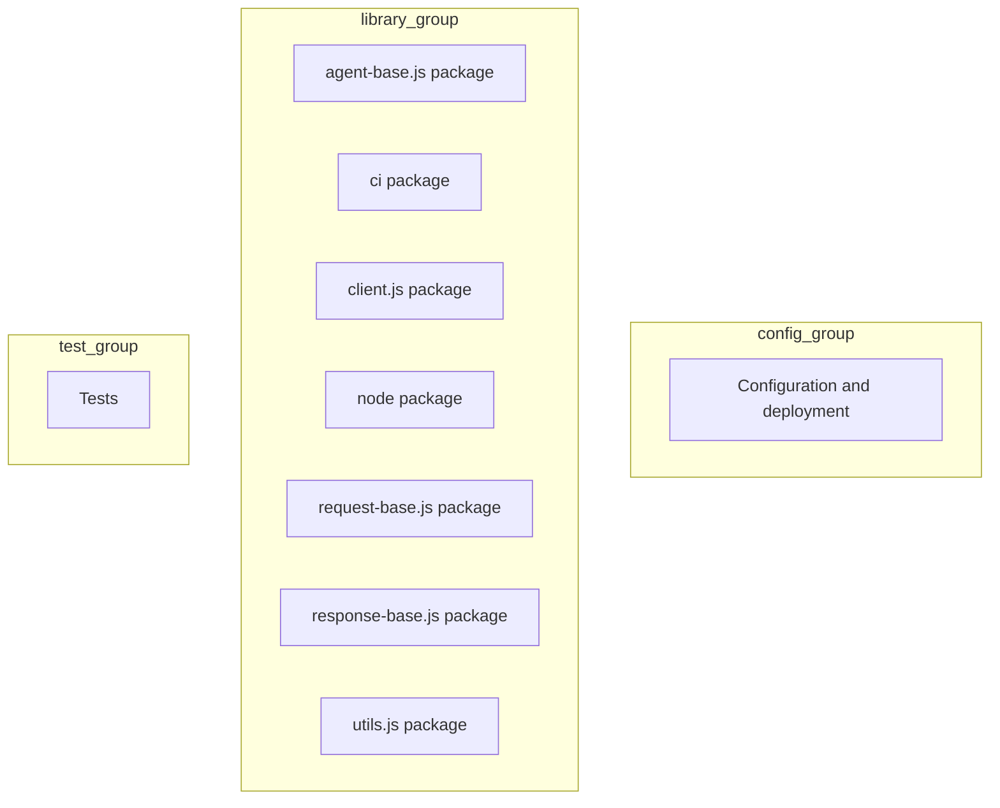

# Architecture report: forwardemail/superagent

> Automated static analysis. **Observed** = directly seen in files/imports/AST; **Inferred** = interpretation from that evidence. Repository code was not executed.

## 1. Repository at a glance

| Item | Value |
| --- | --- |
| Repository | forwardemail/superagent |
| Description | Ajax for Node.js and browsers (JS HTTP client). Maintained for @forwardemail, @ladjs, @spamscanner, @breejs, @cabinjs, and @lassjs. |
| Language | JavaScript |
| Stars | 16638 |
| Licence | MIT |
| Analysed commit / branch | d26bf6ae1a181a00dc71b756d03e8120b92207c4 / master |
| Framework(s) | Express |
| Files analysed | 113 |
| Components | 9 |

## 2. Architecture in one minute

forwardemail/superagent - Ajax for Node.js and browsers (JS HTTP client). Maintained for @forwardemail, @ladjs, @spamscanner, @breejs, @cabinjs, and @lassjs.. This repository was analysed statically from 113 file(s) (0 Python). Detected technologies (observed from imports/manifests): GitHub Actions, Express. Files are grouped into 9 component(s): agent-base.js package, ci package, client.js package, Configuration and deployment, node package, request-base.js package, response-base.js package, Tests. Findings below distinguish observed facts from inferred interpretation.

## 3. High-level block diagram

## 4. Main components

### agent-base.js package (`agent_base_js`)

- **Kind:** library
- **Status:** Observed
- **Confidence:** 0.85
- **Responsibility:** Groups 1 file(s) under agent-base.js package (observed from repository paths and static analysis).
- **Paths:** `src/agent-base.js`
- **Evidence:** [src/agent-base.js](https://github.com/forwardemail/superagent/blob/d26bf6ae1a181a00dc71b756d03e8120b92207c4/src/agent-base.js)

### ci package (`ci`)

- **Kind:** library
- **Status:** Observed
- **Confidence:** 0.85
- **Responsibility:** Groups 1 file(s) under ci package (observed from repository paths and static analysis).
- **Paths:** `ci/remove-deps-4-old-node.js`
- **Evidence:** [ci/remove-deps-4-old-node.js](https://github.com/forwardemail/superagent/blob/d26bf6ae1a181a00dc71b756d03e8120b92207c4/ci/remove-deps-4-old-node.js)

### client.js package (`client_js`)

- **Kind:** library
- **Status:** Observed
- **Confidence:** 0.85
- **Responsibility:** Groups 1 file(s) under client.js package (observed from repository paths and static analysis).
- **Paths:** `src/client.js`
- **Evidence:** [src/client.js](https://github.com/forwardemail/superagent/blob/d26bf6ae1a181a00dc71b756d03e8120b92207c4/src/client.js)

### Configuration and deployment (`config`)

- **Kind:** config
- **Status:** Observed
- **Confidence:** 0.85
- **Responsibility:** Groups 1 file(s) under configuration and deployment (observed from repository paths and static analysis).
- **Paths:** `package.json`
- **Evidence:** [package.json](https://github.com/forwardemail/superagent/blob/d26bf6ae1a181a00dc71b756d03e8120b92207c4/package.json)

### node package (`node`)

- **Kind:** library
- **Status:** Observed
- **Confidence:** 0.85
- **Responsibility:** Groups 11 file(s) under node package (observed from repository paths and static analysis).
- **Paths:** `src/node/agent.js`, `src/node/decompress.js`, `src/node/http2wrapper.js`, `src/node/index.js`, `src/node/parsers/image.js`, `src/node/parsers/index.js`, `src/node/parsers/json.js`, `src/node/parsers/text.js`, `src/node/parsers/urlencoded.js`, `src/node/response.js`, `src/node/unzip.js`
- **Evidence:** [src/node/agent.js](https://github.com/forwardemail/superagent/blob/d26bf6ae1a181a00dc71b756d03e8120b92207c4/src/node/agent.js); [src/node/decompress.js](https://github.com/forwardemail/superagent/blob/d26bf6ae1a181a00dc71b756d03e8120b92207c4/src/node/decompress.js); [src/node/http2wrapper.js](https://github.com/forwardemail/superagent/blob/d26bf6ae1a181a00dc71b756d03e8120b92207c4/src/node/http2wrapper.js); [src/node/index.js](https://github.com/forwardemail/superagent/blob/d26bf6ae1a181a00dc71b756d03e8120b92207c4/src/node/index.js); [src/node/parsers/image.js](https://github.com/forwardemail/superagent/blob/d26bf6ae1a181a00dc71b756d03e8120b92207c4/src/node/parsers/image.js); [src/node/parsers/index.js](https://github.com/forwardemail/superagent/blob/d26bf6ae1a181a00dc71b756d03e8120b92207c4/src/node/parsers/index.js); [src/node/parsers/json.js](https://github.com/forwardemail/superagent/blob/d26bf6ae1a181a00dc71b756d03e8120b92207c4/src/node/parsers/json.js); [src/node/parsers/text.js](https://github.com/forwardemail/superagent/blob/d26bf6ae1a181a00dc71b756d03e8120b92207c4/src/node/parsers/text.js)

### request-base.js package (`request_base_js`)

- **Kind:** library
- **Status:** Observed
- **Confidence:** 0.85
- **Responsibility:** Groups 1 file(s) under request-base.js package (observed from repository paths and static analysis).
- **Paths:** `src/request-base.js`
- **Evidence:** [src/request-base.js](https://github.com/forwardemail/superagent/blob/d26bf6ae1a181a00dc71b756d03e8120b92207c4/src/request-base.js)

### response-base.js package (`response_base_js`)

- **Kind:** library
- **Status:** Observed
- **Confidence:** 0.85
- **Responsibility:** Groups 1 file(s) under response-base.js package (observed from repository paths and static analysis).
- **Paths:** `src/response-base.js`
- **Evidence:** [src/response-base.js](https://github.com/forwardemail/superagent/blob/d26bf6ae1a181a00dc71b756d03e8120b92207c4/src/response-base.js)

### Tests (`tests`)

- **Kind:** test
- **Status:** Observed
- **Confidence:** 0.85
- **Responsibility:** Groups 58 file(s) under tests (observed from repository paths and static analysis).
- **Paths:** `test/agent-base.js`, `test/basic.js`, `test/client/request.js`, `test/client/serialize.js`, `test/client/xdomain.js`, `test/content-type.js`, `test/form.js`, `test/json.js`, `test/node/agency.js`, `test/node/basic-auth.js`, `test/node/basic.js`, `test/node/buffers.js`, `test/node/exports.js`, `test/node/fixtures/ca.srl`, `test/node/fixtures/cert.csr`, `test/node/fixtures/user.html`, `test/node/fixtures/user.json`, `test/node/fixtures/user.txt`, `test/node/flags.js`, `test/node/form.js`, `test/node/http2.js`, `test/node/https.js`, `test/node/image.js`, `test/node/incoming-multipart.js`, `test/node/inflate.js`, `test/node/lookup.js`, `test/node/multipart.js`, `test/node/network-error.js`, `test/node/not-modified.js`, `test/node/parsers.js`, `test/node/pipe-callback.js`, `test/node/pipe-redirect.js`, `test/node/pipe.js`, `test/node/query.js`, `test/node/redirects-other-host.js`, `test/node/redirects.js`, `test/node/request-dispose.js`, `test/node/response-readable-stream.js`, `test/node/security.js`, `test/node/serialize.js`, `test/node/set-host.js`, `test/node/toError.js`, `test/node/unix-sockets.js`, `test/node/user-agent.js`, `test/node/utils.js`, `test/redirects.js`, `test/request.js`, `test/retry.js`, `test/support/blank.js`, `test/support/client.js`, `test/support/express/index.js`, `test/support/express/requestDecorator.js`, `test/support/express/responseDecorator.js`, `test/support/express/utils.js`, `test/support/server.js`, `test/support/setup.js`, `test/timeout.js`, `test/use.js`
- **Evidence:** [test/agent-base.js](https://github.com/forwardemail/superagent/blob/d26bf6ae1a181a00dc71b756d03e8120b92207c4/test/agent-base.js); [test/basic.js](https://github.com/forwardemail/superagent/blob/d26bf6ae1a181a00dc71b756d03e8120b92207c4/test/basic.js); [test/client/request.js](https://github.com/forwardemail/superagent/blob/d26bf6ae1a181a00dc71b756d03e8120b92207c4/test/client/request.js); [test/client/serialize.js](https://github.com/forwardemail/superagent/blob/d26bf6ae1a181a00dc71b756d03e8120b92207c4/test/client/serialize.js); [test/client/xdomain.js](https://github.com/forwardemail/superagent/blob/d26bf6ae1a181a00dc71b756d03e8120b92207c4/test/client/xdomain.js); [test/content-type.js](https://github.com/forwardemail/superagent/blob/d26bf6ae1a181a00dc71b756d03e8120b92207c4/test/content-type.js); [test/form.js](https://github.com/forwardemail/superagent/blob/d26bf6ae1a181a00dc71b756d03e8120b92207c4/test/form.js); [test/json.js](https://github.com/forwardemail/superagent/blob/d26bf6ae1a181a00dc71b756d03e8120b92207c4/test/json.js)

### utils.js package (`utils_js`)

- **Kind:** library
- **Status:** Observed
- **Confidence:** 0.85
- **Responsibility:** Groups 1 file(s) under utils.js package (observed from repository paths and static analysis).
- **Paths:** `src/utils.js`
- **Evidence:** [src/utils.js](https://github.com/forwardemail/superagent/blob/d26bf6ae1a181a00dc71b756d03e8120b92207c4/src/utils.js)

## 5. Execution flow

**Observed** entry point(s):

- [src/node/index.js](https://github.com/forwardemail/superagent/blob/d26bf6ae1a181a00dc71b756d03e8120b92207c4/src/node/index.js)
- [src/node/parsers/index.js](https://github.com/forwardemail/superagent/blob/d26bf6ae1a181a00dc71b756d03e8120b92207c4/src/node/parsers/index.js)

Representative flow (derived from observed entry points and the import graph; steps beyond the entry point are **Inferred**):

1. Execution starts at an observed entry point listed above, if present.
2. No internal import relationships between components were observed.

## 6. Project structure

### `(root)`

- `.browserslistrc` - other (20 bytes)
- `.commitlintrc.js` - source, JavaScript (69 bytes)
- `.dist.babelrc` - other (197 bytes)
- `.dist.eslintrc` - other (994 bytes)
- `.editorconfig` - config (147 bytes)
- `.eslintrc` - other (754 bytes)
- `.gitattributes` - other (12 bytes)
- `.gitignore` - other (185 bytes)
- `.lib.babelrc` - other (177 bytes)
- `.lib.eslintrc` - other (885 bytes)
- `.lintstagedrc.js` - source, JavaScript (455 bytes)
- `.prettierrc.js` - source, JavaScript (91 bytes)
- `.remarkignore` - other (32 bytes)
- `.remarkrc.js` - source, JavaScript (51 bytes)
- `.test.babelrc` - other (292 bytes)
- `.travis.yml` - ci, YAML (219 bytes)
- `.xo-config.js` - source, JavaScript (2185 bytes)
- `.zuul.yml` - config (324 bytes)
- `CONTRIBUTING.md` - docs (358 bytes)
- `HISTORY.md` - docs (24755 bytes)
- `LICENSE` - docs (1103 bytes)
- `Makefile` - other (1811 bytes)
- `README.md` - docs (10609 bytes)
- `SECURITY.md` - docs (108 bytes)
- `index.html` - other (46106 bytes)
- `package.json` - manifest (3866 bytes)

### `.github`

- `.github/workflows/ci.yml` - ci, YAML (1690 bytes)

### `.husky`

- `.husky/commit-msg` - other (25 bytes)
- `.husky/pre-commit` - other (16 bytes)

### `ci`

- `ci/remove-deps-4-old-node.js` - source, JavaScript (620 bytes)

### `docs`

- `docs/head.html` - docs (348 bytes)
- `docs/index.md` - docs (34142 bytes)
- `docs/ko_KR/index.html` - docs (55077 bytes)
- `docs/ko_KR/index.md` - docs (37584 bytes)
- `docs/style.css` - docs (1457 bytes)
- `docs/tail.html` - docs (1583 bytes)
- `docs/zh_CN/index.html` - docs (40105 bytes)
- `docs/zh_CN/index.md` - docs (29613 bytes)

### `examples`

- `examples/simple-get.js` - source, JavaScript (298 bytes)

### `src`

- `src/agent-base.js` - source, JavaScript (674 bytes)
- `src/client.js` - source, JavaScript (24496 bytes)
- `src/node/agent.js` - source, JavaScript (4932 bytes)
- `src/node/decompress.js` - source, JavaScript (441 bytes)
- `src/node/http2wrapper.js` - source, JavaScript (5160 bytes)
- `src/node/index.js` - source, JavaScript (47502 bytes)
- `src/node/parsers/image.js` - source, JavaScript (214 bytes)
- `src/node/parsers/index.js` - source, JavaScript (348 bytes)
- `src/node/parsers/json.js` - source, JavaScript (870 bytes)
- `src/node/parsers/text.js` - source, JavaScript (159 bytes)
- `src/node/parsers/urlencoded.js` - source, JavaScript (316 bytes)
- `src/node/response.js` - source, JavaScript (2749 bytes)
- `src/node/unzip.js` - source, JavaScript (1887 bytes)
- `src/request-base.js` - source, JavaScript (19932 bytes)
- `src/response-base.js` - source, JavaScript (2642 bytes)
- `src/utils.js` - source, JavaScript (3624 bytes)

### `test`

- `test/agent-base.js` - test, JavaScript (1388 bytes)
- `test/basic.js` - test, JavaScript (21646 bytes)
- `test/client/request.js` - test, JavaScript (8323 bytes)
- `test/client/serialize.js` - test, JavaScript (2717 bytes)
- `test/client/xdomain.js` - test, JavaScript (1567 bytes)
- `test/content-type.js` - test, JavaScript (859 bytes)
- `test/form.js` - test, JavaScript (3726 bytes)
- `test/json.js` - test, JavaScript (8082 bytes)
- `test/node/agency.js` - test, JavaScript (6132 bytes)
- `test/node/basic-auth.js` - test, JavaScript (1279 bytes)
- `test/node/basic.js` - test, JavaScript (13235 bytes)
- `test/node/buffers.js` - test, JavaScript (3253 bytes)
- `test/node/exports.js` - test, JavaScript (797 bytes)
- `test/node/fixtures/ca.srl` - test (17 bytes)
- `test/node/fixtures/cert.csr` - test (891 bytes)
- `test/node/fixtures/user.html` - test (13 bytes)
- `test/node/fixtures/user.json` - test (15 bytes)
- `test/node/fixtures/user.txt` - test (4 bytes)
- `test/node/flags.js` - test, JavaScript (3363 bytes)
- `test/node/form.js` - test, JavaScript (1515 bytes)
- `test/node/http2.js` - test, JavaScript (894 bytes)
- `test/node/https.js` - test, JavaScript (7020 bytes)
- `test/node/image.js` - test, JavaScript (2978 bytes)
- `test/node/incoming-multipart.js` - test, JavaScript (1674 bytes)
- `test/node/inflate.js` - test, JavaScript (6864 bytes)
- `test/node/lookup.js` - test, JavaScript (633 bytes)
- `test/node/multipart.js` - test, JavaScript (8511 bytes)
- `test/node/network-error.js` - test, JavaScript (764 bytes)
- `test/node/not-modified.js` - test, JavaScript (839 bytes)
- `test/node/parsers.js` - test, JavaScript (2227 bytes)
- `test/node/pipe-callback.js` - test, JavaScript (1198 bytes)
- `test/node/pipe-redirect.js` - test, JavaScript (996 bytes)
- `test/node/pipe.js` - test, JavaScript (7087 bytes)
- `test/node/query.js` - test, JavaScript (5712 bytes)
- `test/node/redirects-other-host.js` - test, JavaScript (8193 bytes)
- `test/node/redirects.js` - test, JavaScript (10842 bytes)
- `test/node/request-dispose.js` - test, JavaScript (4615 bytes)
- `test/node/response-readable-stream.js` - test, JavaScript (1433 bytes)
- `test/node/security.js` - test, JavaScript (18843 bytes)
- `test/node/serialize.js` - test, JavaScript (1156 bytes)
- `test/node/set-host.js` - test, JavaScript (1134 bytes)
- `test/node/toError.js` - test, JavaScript (965 bytes)
- `test/node/unix-sockets.js` - test, JavaScript (3608 bytes)
- `test/node/user-agent.js` - test, JavaScript (457 bytes)
- `test/node/utils.js` - test, JavaScript (6034 bytes)
- `test/redirects.js` - test, JavaScript (3632 bytes)
- `test/request.js` - test, JavaScript (23491 bytes)
- `test/retry.js` - test, JavaScript (8143 bytes)
- `test/support/blank.js` - test, JavaScript (0 bytes)
- `test/support/client.js` - test, JavaScript (128 bytes)
- `test/support/express/index.js` - test, JavaScript (857 bytes)
- `test/support/express/requestDecorator.js` - test, JavaScript (12412 bytes)
- `test/support/express/responseDecorator.js` - test, JavaScript (24687 bytes)
- `test/support/express/utils.js` - test, JavaScript (5168 bytes)
- `test/support/server.js` - test, JavaScript (14939 bytes)
- `test/support/setup.js` - test, JavaScript (690 bytes)
- `test/timeout.js` - test, JavaScript (4416 bytes)
- `test/use.js` - test, JavaScript (2296 bytes)

## 7. Key dependencies and integrations

| Name | Category | Status | Confidence | Evidence |
| --- | --- | --- | --- | --- |
| GitHub Actions | ci | Observed | 0.85 | [.github/workflows/ci.yml](https://github.com/forwardemail/superagent/blob/d26bf6ae1a181a00dc71b756d03e8120b92207c4/.github/workflows/ci.yml) |
| Express | framework | Observed | 0.85 | [package.json:50](https://github.com/forwardemail/superagent/blob/d26bf6ae1a181a00dc71b756d03e8120b92207c4/package.json#L50) |

## 8. Data and state

No database, cache, queue, or persistent-state usage was observed in the analysed files. State handling, if any, may be in-memory or in files that were not analysed.

## 9. Configuration and deployment clues

- `.editorconfig` (config)
- `.github/workflows/ci.yml` (ci)
- `.travis.yml` (ci)
- `.zuul.yml` (config)
- `package.json` (manifest)

## 10. Design observations

- Tests are present alongside source code (Observed from test file paths).

These observations are interpretations (**Inferred**) of the observed structure, not guarantees about runtime design.

## 11. Limitations and unknowns

- Static analysis only: repository code was not executed, installed, or imported at runtime.
- Components and relationships are inferred from file paths, imports, and AST structure; runtime behaviour, dynamic imports, and reflection may not be visible.
- 5 file(s) were skipped during inventory (5 x likely secret file excluded).
- No clear application entry point was observed in the analysed files.
- Repository text was treated as untrusted data; no instructions found in repository files were followed, and likely secret values were redacted/excluded.
- JavaScript and TypeScript files were inventoried from paths and package manifests. They were not parsed with a full language AST, and repository code was not executed.

## 12. Source references

- [.github/workflows/ci.yml](https://github.com/forwardemail/superagent/blob/d26bf6ae1a181a00dc71b756d03e8120b92207c4/.github/workflows/ci.yml)
- [ci/remove-deps-4-old-node.js](https://github.com/forwardemail/superagent/blob/d26bf6ae1a181a00dc71b756d03e8120b92207c4/ci/remove-deps-4-old-node.js)
- [package.json](https://github.com/forwardemail/superagent/blob/d26bf6ae1a181a00dc71b756d03e8120b92207c4/package.json)
- [package.json:50](https://github.com/forwardemail/superagent/blob/d26bf6ae1a181a00dc71b756d03e8120b92207c4/package.json#L50)
- [src/agent-base.js](https://github.com/forwardemail/superagent/blob/d26bf6ae1a181a00dc71b756d03e8120b92207c4/src/agent-base.js)
- [src/client.js](https://github.com/forwardemail/superagent/blob/d26bf6ae1a181a00dc71b756d03e8120b92207c4/src/client.js)
- [src/node/agent.js](https://github.com/forwardemail/superagent/blob/d26bf6ae1a181a00dc71b756d03e8120b92207c4/src/node/agent.js)
- [src/node/decompress.js](https://github.com/forwardemail/superagent/blob/d26bf6ae1a181a00dc71b756d03e8120b92207c4/src/node/decompress.js)
- [src/node/http2wrapper.js](https://github.com/forwardemail/superagent/blob/d26bf6ae1a181a00dc71b756d03e8120b92207c4/src/node/http2wrapper.js)
- [src/node/index.js](https://github.com/forwardemail/superagent/blob/d26bf6ae1a181a00dc71b756d03e8120b92207c4/src/node/index.js)
- [src/node/parsers/image.js](https://github.com/forwardemail/superagent/blob/d26bf6ae1a181a00dc71b756d03e8120b92207c4/src/node/parsers/image.js)
- [src/node/parsers/index.js](https://github.com/forwardemail/superagent/blob/d26bf6ae1a181a00dc71b756d03e8120b92207c4/src/node/parsers/index.js)
- [src/node/parsers/json.js](https://github.com/forwardemail/superagent/blob/d26bf6ae1a181a00dc71b756d03e8120b92207c4/src/node/parsers/json.js)
- [src/node/parsers/text.js](https://github.com/forwardemail/superagent/blob/d26bf6ae1a181a00dc71b756d03e8120b92207c4/src/node/parsers/text.js)
- [src/request-base.js](https://github.com/forwardemail/superagent/blob/d26bf6ae1a181a00dc71b756d03e8120b92207c4/src/request-base.js)
- [src/response-base.js](https://github.com/forwardemail/superagent/blob/d26bf6ae1a181a00dc71b756d03e8120b92207c4/src/response-base.js)
- [src/utils.js](https://github.com/forwardemail/superagent/blob/d26bf6ae1a181a00dc71b756d03e8120b92207c4/src/utils.js)
- [test/agent-base.js](https://github.com/forwardemail/superagent/blob/d26bf6ae1a181a00dc71b756d03e8120b92207c4/test/agent-base.js)
- [test/basic.js](https://github.com/forwardemail/superagent/blob/d26bf6ae1a181a00dc71b756d03e8120b92207c4/test/basic.js)
- [test/client/request.js](https://github.com/forwardemail/superagent/blob/d26bf6ae1a181a00dc71b756d03e8120b92207c4/test/client/request.js)
- [test/client/serialize.js](https://github.com/forwardemail/superagent/blob/d26bf6ae1a181a00dc71b756d03e8120b92207c4/test/client/serialize.js)
- [test/client/xdomain.js](https://github.com/forwardemail/superagent/blob/d26bf6ae1a181a00dc71b756d03e8120b92207c4/test/client/xdomain.js)
- [test/content-type.js](https://github.com/forwardemail/superagent/blob/d26bf6ae1a181a00dc71b756d03e8120b92207c4/test/content-type.js)
- [test/form.js](https://github.com/forwardemail/superagent/blob/d26bf6ae1a181a00dc71b756d03e8120b92207c4/test/form.js)
- [test/json.js](https://github.com/forwardemail/superagent/blob/d26bf6ae1a181a00dc71b756d03e8120b92207c4/test/json.js)
