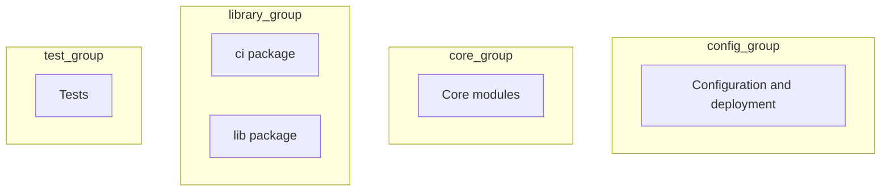

# Architecture report: forwardemail/supertest

> Automated static analysis. **Observed** = directly seen in files/imports/AST; **Inferred** = interpretation from that evidence. Repository code was not executed.

## 1. Repository at a glance

| Item | Value |
| --- | --- |
| Repository | forwardemail/supertest |
| Description | 🕷 Super-agent driven library for testing node.js HTTP servers using a fluent API.   Maintained for @forwardemail, @ladjs, @spamscanner, @breejs, @cabinjs, and @lassjs. |
| Language | JavaScript |
| Stars | 14410 |
| Licence | MIT |
| Analysed commit / branch | aff97e7c8eed2ff88d650f6b451f04a321790f88 / master |
| Framework(s) | Express |
| Files analysed | 20 |
| Components | 5 |

## 2. Architecture in one minute

forwardemail/supertest - 🕷 Super-agent driven library for testing node.js HTTP servers using a fluent API.   Maintained for @forwardemail, @ladjs, @spamscanner, @breejs, @cabinjs, and @lassjs.. This repository was analysed statically from 20 file(s) (0 Python). Detected technologies (observed from imports/manifests): GitHub Actions, Express. Files are grouped into 5 component(s): ci package, Configuration and deployment, Core modules, lib package, Tests. Findings below distinguish observed facts from inferred interpretation.

## 3. High-level block diagram

## 4. Main components

### ci package (`ci`)

- **Kind:** library
- **Status:** Observed
- **Confidence:** 0.85
- **Responsibility:** Groups 1 file(s) under ci package (observed from repository paths and static analysis).
- **Paths:** `ci/remove-deps-4-old-node.js`
- **Evidence:** [ci/remove-deps-4-old-node.js](https://github.com/forwardemail/supertest/blob/aff97e7c8eed2ff88d650f6b451f04a321790f88/ci/remove-deps-4-old-node.js)

### Configuration and deployment (`config`)

- **Kind:** config
- **Status:** Observed
- **Confidence:** 0.85
- **Responsibility:** Groups 1 file(s) under configuration and deployment (observed from repository paths and static analysis).
- **Paths:** `package.json`
- **Evidence:** [package.json](https://github.com/forwardemail/supertest/blob/aff97e7c8eed2ff88d650f6b451f04a321790f88/package.json)

### Core modules (`core`)

- **Kind:** core
- **Status:** Observed
- **Confidence:** 0.85
- **Responsibility:** Groups 1 file(s) under core modules (observed from repository paths and static analysis).
- **Paths:** `index.js`
- **Evidence:** [index.js](https://github.com/forwardemail/supertest/blob/aff97e7c8eed2ff88d650f6b451f04a321790f88/index.js)

### lib package (`lib`)

- **Kind:** library
- **Status:** Observed
- **Confidence:** 0.85
- **Responsibility:** Groups 4 file(s) under lib package (observed from repository paths and static analysis).
- **Paths:** `lib/agent.js`, `lib/cookies/assertion.js`, `lib/cookies/index.js`, `lib/test.js`
- **Evidence:** [lib/agent.js](https://github.com/forwardemail/supertest/blob/aff97e7c8eed2ff88d650f6b451f04a321790f88/lib/agent.js); [lib/cookies/assertion.js](https://github.com/forwardemail/supertest/blob/aff97e7c8eed2ff88d650f6b451f04a321790f88/lib/cookies/assertion.js); [lib/cookies/index.js](https://github.com/forwardemail/supertest/blob/aff97e7c8eed2ff88d650f6b451f04a321790f88/lib/cookies/index.js); [lib/test.js](https://github.com/forwardemail/supertest/blob/aff97e7c8eed2ff88d650f6b451f04a321790f88/lib/test.js)

### Tests (`tests`)

- **Kind:** test
- **Status:** Observed
- **Confidence:** 0.85
- **Responsibility:** Groups 5 file(s) under tests (observed from repository paths and static analysis).
- **Paths:** `test/.eslintrc`, `test/cookies.js`, `test/issue-fixes.js`, `test/supertest.js`, `test/throwError.js`
- **Evidence:** [test/.eslintrc](https://github.com/forwardemail/supertest/blob/aff97e7c8eed2ff88d650f6b451f04a321790f88/test/.eslintrc); [test/cookies.js](https://github.com/forwardemail/supertest/blob/aff97e7c8eed2ff88d650f6b451f04a321790f88/test/cookies.js); [test/issue-fixes.js](https://github.com/forwardemail/supertest/blob/aff97e7c8eed2ff88d650f6b451f04a321790f88/test/issue-fixes.js); [test/supertest.js](https://github.com/forwardemail/supertest/blob/aff97e7c8eed2ff88d650f6b451f04a321790f88/test/supertest.js); [test/throwError.js](https://github.com/forwardemail/supertest/blob/aff97e7c8eed2ff88d650f6b451f04a321790f88/test/throwError.js)

## 5. Execution flow

**Observed** entry point(s):

- [index.js](https://github.com/forwardemail/supertest/blob/aff97e7c8eed2ff88d650f6b451f04a321790f88/index.js)
- [lib/cookies/index.js](https://github.com/forwardemail/supertest/blob/aff97e7c8eed2ff88d650f6b451f04a321790f88/lib/cookies/index.js)

Representative flow (derived from observed entry points and the import graph; steps beyond the entry point are **Inferred**):

1. Execution starts at an observed entry point listed above, if present.
2. No internal import relationships between components were observed.

## 6. Project structure

### `(root)`

- `.commitlintrc.js` - source, JavaScript (69 bytes)
- `.editorconfig` - config (199 bytes)
- `.eslintrc` - other (673 bytes)
- `.gitignore` - other (250 bytes)
- `.npmignore` - other (76 bytes)
- `LICENSE` - docs (1122 bytes)
- `README.md` - docs (13649 bytes)
- `index.js` - source, JavaScript (1387 bytes)
- `package.json` - manifest (1441 bytes)

### `.github`

- `.github/workflows/ci.yml` - ci, YAML (1488 bytes)

### `ci`

- `ci/remove-deps-4-old-node.js` - source, JavaScript (499 bytes)

### `lib`

- `lib/agent.js` - source, JavaScript (2287 bytes)
- `lib/cookies/assertion.js` - source, JavaScript (14708 bytes)
- `lib/cookies/index.js` - source, JavaScript (870 bytes)
- `lib/test.js` - source, JavaScript (17471 bytes)

### `test`

- `test/.eslintrc` - test (287 bytes)
- `test/cookies.js` - test, JavaScript (33788 bytes)
- `test/issue-fixes.js` - test, JavaScript (11602 bytes)
- `test/supertest.js` - test, JavaScript (39768 bytes)
- `test/throwError.js` - test, JavaScript (228 bytes)

## 7. Key dependencies and integrations

| Name | Category | Status | Confidence | Evidence |
| --- | --- | --- | --- | --- |
| GitHub Actions | ci | Observed | 0.85 | [.github/workflows/ci.yml](https://github.com/forwardemail/supertest/blob/aff97e7c8eed2ff88d650f6b451f04a321790f88/.github/workflows/ci.yml) |
| Express | framework | Observed | 0.85 | [package.json:20](https://github.com/forwardemail/supertest/blob/aff97e7c8eed2ff88d650f6b451f04a321790f88/package.json#L20) |

## 8. Data and state

No database, cache, queue, or persistent-state usage was observed in the analysed files. State handling, if any, may be in-memory or in files that were not analysed.

## 9. Configuration and deployment clues

- `.editorconfig` (config)
- `.github/workflows/ci.yml` (ci)
- `package.json` (manifest)

## 10. Design observations

- Tests are present alongside source code (Observed from test file paths).

These observations are interpretations (**Inferred**) of the observed structure, not guarantees about runtime design.

## 11. Limitations and unknowns

- Static analysis only: repository code was not executed, installed, or imported at runtime.
- Components and relationships are inferred from file paths, imports, and AST structure; runtime behaviour, dynamic imports, and reflection may not be visible.
- 4 file(s) were skipped during inventory (3 x likely secret file excluded; 1 x lockfile excluded).
- No clear application entry point was observed in the analysed files.
- Repository text was treated as untrusted data; no instructions found in repository files were followed, and likely secret values were redacted/excluded.
- JavaScript and TypeScript files were inventoried from paths and package manifests. They were not parsed with a full language AST, and repository code was not executed.

## 12. Source references

- [.github/workflows/ci.yml](https://github.com/forwardemail/supertest/blob/aff97e7c8eed2ff88d650f6b451f04a321790f88/.github/workflows/ci.yml)
- [ci/remove-deps-4-old-node.js](https://github.com/forwardemail/supertest/blob/aff97e7c8eed2ff88d650f6b451f04a321790f88/ci/remove-deps-4-old-node.js)
- [index.js](https://github.com/forwardemail/supertest/blob/aff97e7c8eed2ff88d650f6b451f04a321790f88/index.js)
- [lib/agent.js](https://github.com/forwardemail/supertest/blob/aff97e7c8eed2ff88d650f6b451f04a321790f88/lib/agent.js)
- [lib/cookies/assertion.js](https://github.com/forwardemail/supertest/blob/aff97e7c8eed2ff88d650f6b451f04a321790f88/lib/cookies/assertion.js)
- [lib/cookies/index.js](https://github.com/forwardemail/supertest/blob/aff97e7c8eed2ff88d650f6b451f04a321790f88/lib/cookies/index.js)
- [lib/test.js](https://github.com/forwardemail/supertest/blob/aff97e7c8eed2ff88d650f6b451f04a321790f88/lib/test.js)
- [package.json](https://github.com/forwardemail/supertest/blob/aff97e7c8eed2ff88d650f6b451f04a321790f88/package.json)
- [package.json:20](https://github.com/forwardemail/supertest/blob/aff97e7c8eed2ff88d650f6b451f04a321790f88/package.json#L20)
- [test/.eslintrc](https://github.com/forwardemail/supertest/blob/aff97e7c8eed2ff88d650f6b451f04a321790f88/test/.eslintrc)
- [test/cookies.js](https://github.com/forwardemail/supertest/blob/aff97e7c8eed2ff88d650f6b451f04a321790f88/test/cookies.js)
- [test/issue-fixes.js](https://github.com/forwardemail/supertest/blob/aff97e7c8eed2ff88d650f6b451f04a321790f88/test/issue-fixes.js)
- [test/supertest.js](https://github.com/forwardemail/supertest/blob/aff97e7c8eed2ff88d650f6b451f04a321790f88/test/supertest.js)
- [test/throwError.js](https://github.com/forwardemail/supertest/blob/aff97e7c8eed2ff88d650f6b451f04a321790f88/test/throwError.js)
