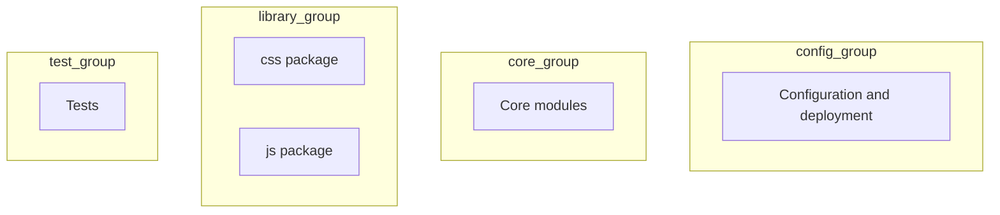

# Architecture report: frappe/charts

> Automated static analysis. **Observed** = directly seen in files/imports/AST; **Inferred** = interpretation from that evidence. Repository code was not executed.

## 1. Repository at a glance

| Item | Value |
| --- | --- |
| Repository | frappe/charts |
| Description | Simple, responsive, modern SVG Charts with zero dependencies |
| Language | JavaScript |
| Stars | 15097 |
| Licence | MIT |
| Analysed commit / branch | 7b15424c3af80b1c8e178d8e612c290d2d630904 / master |
| Framework(s) | None detected |
| Files analysed | 49 |
| Components | 5 |

## 2. Architecture in one minute

frappe/charts - Simple, responsive, modern SVG Charts with zero dependencies. This repository was analysed statically from 49 file(s) (0 Python). Detected technologies (observed from imports/manifests): GitHub Actions. Files are grouped into 5 component(s): Configuration and deployment, Core modules, css package, js package, Tests. Findings below distinguish observed facts from inferred interpretation.

## 3. High-level block diagram

## 4. Main components

### Configuration and deployment (`config`)

- **Kind:** config
- **Status:** Observed
- **Confidence:** 0.85
- **Responsibility:** Groups 1 file(s) under configuration and deployment (observed from repository paths and static analysis).
- **Paths:** `package.json`
- **Evidence:** [package.json](https://github.com/frappe/charts/blob/7b15424c3af80b1c8e178d8e612c290d2d630904/package.json)

### Core modules (`core`)

- **Kind:** core
- **Status:** Observed
- **Confidence:** 0.85
- **Responsibility:** Groups 1 file(s) under core modules (observed from repository paths and static analysis).
- **Paths:** `rollup.config.js`
- **Evidence:** [rollup.config.js](https://github.com/frappe/charts/blob/7b15424c3af80b1c8e178d8e612c290d2d630904/rollup.config.js)

### css package (`css`)

- **Kind:** library
- **Status:** Observed
- **Confidence:** 0.85
- **Responsibility:** Groups 1 file(s) under css package (observed from repository paths and static analysis).
- **Paths:** `src/css/chartsCss.js`
- **Evidence:** [src/css/chartsCss.js](https://github.com/frappe/charts/blob/7b15424c3af80b1c8e178d8e612c290d2d630904/src/css/chartsCss.js)

### js package (`js`)

- **Kind:** library
- **Status:** Observed
- **Confidence:** 0.85
- **Responsibility:** Groups 23 file(s) under js package (observed from repository paths and static analysis).
- **Paths:** `src/js/chart.js`, `src/js/charts/AggregationChart.js`, `src/js/charts/AxisChart.js`, `src/js/charts/BaseChart.js`, `src/js/charts/DonutChart.js`, `src/js/charts/Heatmap.js`, `src/js/charts/PercentageChart.js`, `src/js/charts/PieChart.js`, `src/js/index.js`, `src/js/objects/ChartComponents.js`, `src/js/objects/SvgTip.js`, `src/js/utils/animate.js`, `src/js/utils/animation.js`, `src/js/utils/axis-chart-utils.js`, `src/js/utils/colors.js`, `src/js/utils/constants.js`, `src/js/utils/date-utils.js`, `src/js/utils/dom.js`, `src/js/utils/draw-utils.js`, `src/js/utils/draw.js`, `src/js/utils/export.js`, `src/js/utils/helpers.js`, `src/js/utils/intervals.js`
- **Evidence:** [src/js/chart.js](https://github.com/frappe/charts/blob/7b15424c3af80b1c8e178d8e612c290d2d630904/src/js/chart.js); [src/js/charts/AggregationChart.js](https://github.com/frappe/charts/blob/7b15424c3af80b1c8e178d8e612c290d2d630904/src/js/charts/AggregationChart.js); [src/js/charts/AxisChart.js](https://github.com/frappe/charts/blob/7b15424c3af80b1c8e178d8e612c290d2d630904/src/js/charts/AxisChart.js); [src/js/charts/BaseChart.js](https://github.com/frappe/charts/blob/7b15424c3af80b1c8e178d8e612c290d2d630904/src/js/charts/BaseChart.js); [src/js/charts/DonutChart.js](https://github.com/frappe/charts/blob/7b15424c3af80b1c8e178d8e612c290d2d630904/src/js/charts/DonutChart.js); [src/js/charts/Heatmap.js](https://github.com/frappe/charts/blob/7b15424c3af80b1c8e178d8e612c290d2d630904/src/js/charts/Heatmap.js); [src/js/charts/PercentageChart.js](https://github.com/frappe/charts/blob/7b15424c3af80b1c8e178d8e612c290d2d630904/src/js/charts/PercentageChart.js); [src/js/charts/PieChart.js](https://github.com/frappe/charts/blob/7b15424c3af80b1c8e178d8e612c290d2d630904/src/js/charts/PieChart.js)

### Tests (`tests`)

- **Kind:** test
- **Status:** Observed
- **Confidence:** 0.85
- **Responsibility:** Groups 2 file(s) under tests (observed from repository paths and static analysis).
- **Paths:** `src/js/utils/test/colors.test.js`, `src/js/utils/test/helpers.test.js`
- **Evidence:** [src/js/utils/test/colors.test.js](https://github.com/frappe/charts/blob/7b15424c3af80b1c8e178d8e612c290d2d630904/src/js/utils/test/colors.test.js); [src/js/utils/test/helpers.test.js](https://github.com/frappe/charts/blob/7b15424c3af80b1c8e178d8e612c290d2d630904/src/js/utils/test/helpers.test.js)

## 5. Execution flow

**Observed** entry point(s):

- [src/js/index.js](https://github.com/frappe/charts/blob/7b15424c3af80b1c8e178d8e612c290d2d630904/src/js/index.js)

Representative flow (derived from observed entry points and the import graph; steps beyond the entry point are **Inferred**):

1. Execution starts at an observed entry point listed above, if present.
2. No internal import relationships between components were observed.

## 6. Project structure

### `(root)`

- `.babelrc` - other (192 bytes)
- `.eslintrc.json` - config (397 bytes)
- `.gitignore` - other (968 bytes)
- `.travis.yml` - ci, YAML (136 bytes)
- `LICENSE` - docs (1073 bytes)
- `Makefile` - other (912 bytes)
- `README.md` - docs (3637 bytes)
- `package.json` - manifest (1256 bytes)
- `rollup.config.js` - source, JavaScript (1080 bytes)

### `.github`

- `.github/ISSUE_TEMPLATE.md` - docs (164 bytes)
- `.github/PULL_REQUEST_TEMPLATE.md` - docs (682 bytes)
- `.github/workflows/npm-publish.yml` - ci, YAML (848 bytes)

### `docs`

- `docs/_config.yml` - config (34 bytes)
- `docs/assets/css/hljs.css` - docs (1152 bytes)
- `docs/assets/css/index.css` - docs (1581 bytes)
- `docs/assets/css/reset.css` - docs (5750 bytes)
- `docs/assets/js/data.js` - docs (4658 bytes)
- `docs/assets/js/demoConfig.js` - docs (1016 bytes)
- `docs/assets/js/highlight.pack.js` - docs (10541 bytes)
- `docs/assets/js/index.js` - docs (9688 bytes)
- `docs/docs.html` - docs (0 bytes)
- `docs/index.html` - docs (14047 bytes)

### `src`

- `src/css/charts.scss` - other (3679 bytes)
- `src/css/chartsCss.js` - source, JavaScript (1733 bytes)
- `src/js/chart.js` - source, JavaScript (923 bytes)
- `src/js/charts/AggregationChart.js` - source, JavaScript (2435 bytes)
- `src/js/charts/AxisChart.js` - source, JavaScript (21831 bytes)
- `src/js/charts/BaseChart.js` - source, JavaScript (8852 bytes)
- `src/js/charts/DonutChart.js` - source, JavaScript (5325 bytes)
- `src/js/charts/Heatmap.js` - source, JavaScript (9230 bytes)
- `src/js/charts/PercentageChart.js` - source, JavaScript (2408 bytes)
- `src/js/charts/PieChart.js` - source, JavaScript (5897 bytes)
- `src/js/index.js` - source, JavaScript (180 bytes)
- `src/js/objects/ChartComponents.js` - source, JavaScript (13603 bytes)
- `src/js/objects/SvgTip.js` - source, JavaScript (3443 bytes)
- `src/js/utils/animate.js` - source, JavaScript (3313 bytes)
- `src/js/utils/animation.js` - source, JavaScript (3209 bytes)
- `src/js/utils/axis-chart-utils.js` - source, JavaScript (2892 bytes)
- `src/js/utils/colors.js` - source, JavaScript (1706 bytes)
- `src/js/utils/constants.js` - source, JavaScript (2899 bytes)
- `src/js/utils/date-utils.js` - source, JavaScript (2871 bytes)
- `src/js/utils/dom.js` - source, JavaScript (3679 bytes)
- `src/js/utils/draw-utils.js` - source, JavaScript (2786 bytes)
- `src/js/utils/draw.js` - source, JavaScript (20811 bytes)
- `src/js/utils/export.js` - source, JavaScript (975 bytes)
- `src/js/utils/helpers.js` - source, JavaScript (3756 bytes)
- `src/js/utils/intervals.js` - source, JavaScript (6828 bytes)
- `src/js/utils/test/colors.test.js` - test, JavaScript (480 bytes)
- `src/js/utils/test/helpers.test.js` - test, JavaScript (320 bytes)

## 7. Key dependencies and integrations

| Name | Category | Status | Confidence | Evidence |
| --- | --- | --- | --- | --- |
| GitHub Actions | ci | Observed | 0.85 | [.github/workflows/npm-publish.yml](https://github.com/frappe/charts/blob/7b15424c3af80b1c8e178d8e612c290d2d630904/.github/workflows/npm-publish.yml) |

## 8. Data and state

No database, cache, queue, or persistent-state usage was observed in the analysed files. State handling, if any, may be in-memory or in files that were not analysed.

## 9. Configuration and deployment clues

- `.eslintrc.json` (config)
- `.github/workflows/npm-publish.yml` (ci)
- `.travis.yml` (ci)
- `docs/_config.yml` (config)
- `package.json` (manifest)

## 10. Design observations

- Tests are present alongside source code (Observed from test file paths).

These observations are interpretations (**Inferred**) of the observed structure, not guarantees about runtime design.

## 11. Limitations and unknowns

- Static analysis only: repository code was not executed, installed, or imported at runtime.
- Components and relationships are inferred from file paths, imports, and AST structure; runtime behaviour, dynamic imports, and reflection may not be visible.
- 1 file(s) were skipped during inventory (1 x generated/minified file excluded).
- No clear application entry point was observed in the analysed files.
- Repository text was treated as untrusted data; no instructions found in repository files were followed, and likely secret values were redacted/excluded.
- JavaScript and TypeScript files were inventoried from paths and package manifests. They were not parsed with a full language AST, and repository code was not executed.

## 12. Source references

- [.github/workflows/npm-publish.yml](https://github.com/frappe/charts/blob/7b15424c3af80b1c8e178d8e612c290d2d630904/.github/workflows/npm-publish.yml)
- [package.json](https://github.com/frappe/charts/blob/7b15424c3af80b1c8e178d8e612c290d2d630904/package.json)
- [rollup.config.js](https://github.com/frappe/charts/blob/7b15424c3af80b1c8e178d8e612c290d2d630904/rollup.config.js)
- [src/css/chartsCss.js](https://github.com/frappe/charts/blob/7b15424c3af80b1c8e178d8e612c290d2d630904/src/css/chartsCss.js)
- [src/js/chart.js](https://github.com/frappe/charts/blob/7b15424c3af80b1c8e178d8e612c290d2d630904/src/js/chart.js)
- [src/js/charts/AggregationChart.js](https://github.com/frappe/charts/blob/7b15424c3af80b1c8e178d8e612c290d2d630904/src/js/charts/AggregationChart.js)
- [src/js/charts/AxisChart.js](https://github.com/frappe/charts/blob/7b15424c3af80b1c8e178d8e612c290d2d630904/src/js/charts/AxisChart.js)
- [src/js/charts/BaseChart.js](https://github.com/frappe/charts/blob/7b15424c3af80b1c8e178d8e612c290d2d630904/src/js/charts/BaseChart.js)
- [src/js/charts/DonutChart.js](https://github.com/frappe/charts/blob/7b15424c3af80b1c8e178d8e612c290d2d630904/src/js/charts/DonutChart.js)
- [src/js/charts/Heatmap.js](https://github.com/frappe/charts/blob/7b15424c3af80b1c8e178d8e612c290d2d630904/src/js/charts/Heatmap.js)
- [src/js/charts/PercentageChart.js](https://github.com/frappe/charts/blob/7b15424c3af80b1c8e178d8e612c290d2d630904/src/js/charts/PercentageChart.js)
- [src/js/charts/PieChart.js](https://github.com/frappe/charts/blob/7b15424c3af80b1c8e178d8e612c290d2d630904/src/js/charts/PieChart.js)
- [src/js/index.js](https://github.com/frappe/charts/blob/7b15424c3af80b1c8e178d8e612c290d2d630904/src/js/index.js)
- [src/js/utils/test/colors.test.js](https://github.com/frappe/charts/blob/7b15424c3af80b1c8e178d8e612c290d2d630904/src/js/utils/test/colors.test.js)
- [src/js/utils/test/helpers.test.js](https://github.com/frappe/charts/blob/7b15424c3af80b1c8e178d8e612c290d2d630904/src/js/utils/test/helpers.test.js)
