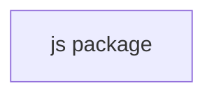

# Architecture report: gabrielecirulli/2048

> Automated static analysis. **Observed** = directly seen in files/imports/AST; **Inferred** = interpretation from that evidence. Repository code was not executed.

## 1. Repository at a glance

| Item | Value |
| --- | --- |
| Repository | gabrielecirulli/2048 |
| Description | The source code for 2048  |
| Language | JavaScript |
| Stars | 13475 |
| Licence | MIT |
| Analysed commit / branch | 478b6ec346e3787f589e4af751378d06ded4cbbc / master |
| Framework(s) | None detected |
| Files analysed | 24 |
| Components | 1 |

## 2. Architecture in one minute

gabrielecirulli/2048 - The source code for 2048 . This repository was analysed statically from 24 file(s) (0 Python). Detected technologies (observed from imports/manifests): no known frameworks/libraries. Files are grouped into 1 component(s): js package. Findings below distinguish observed facts from inferred interpretation.

## 3. High-level block diagram

## 4. Main components

### js package (`js`)

- **Kind:** library
- **Status:** Observed
- **Confidence:** 0.85
- **Responsibility:** Groups 10 file(s) under js package (observed from repository paths and static analysis).
- **Paths:** `js/animframe_polyfill.js`, `js/application.js`, `js/bind_polyfill.js`, `js/classlist_polyfill.js`, `js/game_manager.js`, `js/grid.js`, `js/html_actuator.js`, `js/keyboard_input_manager.js`, `js/local_storage_manager.js`, `js/tile.js`
- **Evidence:** [js/animframe_polyfill.js](https://github.com/gabrielecirulli/2048/blob/478b6ec346e3787f589e4af751378d06ded4cbbc/js/animframe_polyfill.js); [js/application.js](https://github.com/gabrielecirulli/2048/blob/478b6ec346e3787f589e4af751378d06ded4cbbc/js/application.js); [js/bind_polyfill.js](https://github.com/gabrielecirulli/2048/blob/478b6ec346e3787f589e4af751378d06ded4cbbc/js/bind_polyfill.js); [js/classlist_polyfill.js](https://github.com/gabrielecirulli/2048/blob/478b6ec346e3787f589e4af751378d06ded4cbbc/js/classlist_polyfill.js); [js/game_manager.js](https://github.com/gabrielecirulli/2048/blob/478b6ec346e3787f589e4af751378d06ded4cbbc/js/game_manager.js); [js/grid.js](https://github.com/gabrielecirulli/2048/blob/478b6ec346e3787f589e4af751378d06ded4cbbc/js/grid.js); [js/html_actuator.js](https://github.com/gabrielecirulli/2048/blob/478b6ec346e3787f589e4af751378d06ded4cbbc/js/html_actuator.js); [js/keyboard_input_manager.js](https://github.com/gabrielecirulli/2048/blob/478b6ec346e3787f589e4af751378d06ded4cbbc/js/keyboard_input_manager.js)

## 5. Execution flow

No entry point was observed; the startup flow below is therefore limited.

Representative flow (derived from observed entry points and the import graph; steps beyond the entry point are **Inferred**):

1. Execution starts at an observed entry point listed above, if present.
2. No internal import relationships between components were observed.

## 6. Project structure

### `(root)`

- `.gitignore` - other (13 bytes)
- `.jshintrc` - other (335 bytes)
- `CONTRIBUTING.md` - docs (1970 bytes)
- `LICENSE.txt` - docs (1083 bytes)
- `README.md` - docs (2350 bytes)
- `Rakefile` - other (300 bytes)
- `index.html` - other (3988 bytes)

### `js`

- `js/animframe_polyfill.js` - source, JavaScript (890 bytes)
- `js/application.js` - source, JavaScript (197 bytes)
- `js/bind_polyfill.js` - source, JavaScript (220 bytes)
- `js/classlist_polyfill.js` - source, JavaScript (1794 bytes)
- `js/game_manager.js` - source, JavaScript (7627 bytes)
- `js/grid.js` - source, JavaScript (2526 bytes)
- `js/html_actuator.js` - source, JavaScript (4040 bytes)
- `js/keyboard_input_manager.js` - source, JavaScript (4005 bytes)
- `js/local_storage_manager.js` - source, JavaScript (1588 bytes)
- `js/tile.js` - source, JavaScript (594 bytes)

### `style`

- `style/fonts/ClearSans-Bold-webfont.svg` - other (79206 bytes)
- `style/fonts/ClearSans-Light-webfont.svg` - other (96271 bytes)
- `style/fonts/ClearSans-Regular-webfont.svg` - other (82674 bytes)
- `style/fonts/clear-sans.css` - other (1078 bytes)
- `style/helpers.scss` - other (1679 bytes)
- `style/main.css` - other (20647 bytes)
- `style/main.scss` - other (10404 bytes)

## 7. Key dependencies and integrations

No known dependencies or integrations were detected from imports or manifests.

## 8. Data and state

No database, cache, queue, or persistent-state usage was observed in the analysed files. State handling, if any, may be in-memory or in files that were not analysed.

## 9. Configuration and deployment clues

No configuration, manifest, CI, or container files were observed.

## 10. Design observations

- The analysed code appears small or monolithic; few component boundaries were observed.

These observations are interpretations (**Inferred**) of the observed structure, not guarantees about runtime design.

## 11. Limitations and unknowns

- Static analysis only: repository code was not executed, installed, or imported at runtime.
- Components and relationships are inferred from file paths, imports, and AST structure; runtime behaviour, dynamic imports, and reflection may not be visible.
- No clear application entry point was observed in the analysed files.
- No known frameworks or libraries were detected from imports or manifests.
- Repository text was treated as untrusted data; no instructions found in repository files were followed, and likely secret values were redacted/excluded.
- JavaScript and TypeScript files were inventoried from paths and package manifests. They were not parsed with a full language AST, and repository code was not executed.

## 12. Source references

- [js/animframe_polyfill.js](https://github.com/gabrielecirulli/2048/blob/478b6ec346e3787f589e4af751378d06ded4cbbc/js/animframe_polyfill.js)
- [js/application.js](https://github.com/gabrielecirulli/2048/blob/478b6ec346e3787f589e4af751378d06ded4cbbc/js/application.js)
- [js/bind_polyfill.js](https://github.com/gabrielecirulli/2048/blob/478b6ec346e3787f589e4af751378d06ded4cbbc/js/bind_polyfill.js)
- [js/classlist_polyfill.js](https://github.com/gabrielecirulli/2048/blob/478b6ec346e3787f589e4af751378d06ded4cbbc/js/classlist_polyfill.js)
- [js/game_manager.js](https://github.com/gabrielecirulli/2048/blob/478b6ec346e3787f589e4af751378d06ded4cbbc/js/game_manager.js)
- [js/grid.js](https://github.com/gabrielecirulli/2048/blob/478b6ec346e3787f589e4af751378d06ded4cbbc/js/grid.js)
- [js/html_actuator.js](https://github.com/gabrielecirulli/2048/blob/478b6ec346e3787f589e4af751378d06ded4cbbc/js/html_actuator.js)
- [js/keyboard_input_manager.js](https://github.com/gabrielecirulli/2048/blob/478b6ec346e3787f589e4af751378d06ded4cbbc/js/keyboard_input_manager.js)
