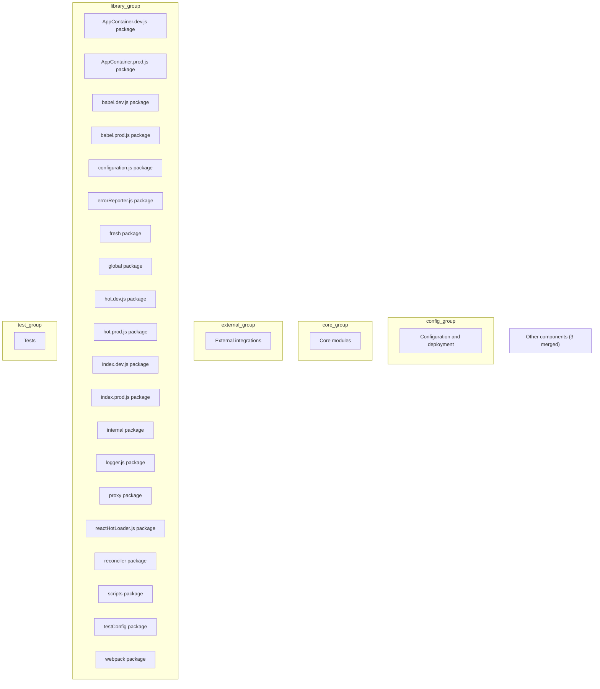

# Architecture report: gaearon/react-hot-loader

> Automated static analysis. **Observed** = directly seen in files/imports/AST; **Inferred** = interpretation from that evidence. Repository code was not executed.

## 1. Repository at a glance

| Item | Value |
| --- | --- |
| Repository | gaearon/react-hot-loader |
| Description | Tweak React components in real time. (Deprecated: use Fast Refresh instead.) |
| Language | JavaScript |
| Stars | 12148 |
| Licence | MIT |
| Analysed commit / branch | 07d1f4e080f18dd83273be5bd02863ce1caf892e / master |
| Framework(s) | Electron, Express, React |
| Files analysed | 323 |
| Components | 27 |

## 2. Architecture in one minute

gaearon/react-hot-loader - Tweak React components in real time. (Deprecated: use Fast Refresh instead.). This repository was analysed statically from 323 file(s) (0 Python). Detected technologies (observed from imports/manifests): Electron, Express, React, Redux, Jest, TypeScript. Files are grouped into 27 component(s): AppContainer.dev.js package, AppContainer.prod.js package, babel.dev.js package, babel.prod.js package, Configuration and deployment, configuration.js package, Core modules, errorReporter.js package. Findings below distinguish observed facts from inferred interpretation.

## 3. High-level block diagram

## 4. Main components

### AppContainer.dev.js package (`appcontainer_dev_js`)

- **Kind:** library
- **Status:** Observed
- **Confidence:** 0.85
- **Responsibility:** Groups 1 file(s) under appcontainer.dev.js package (observed from repository paths and static analysis).
- **Paths:** `src/AppContainer.dev.js`
- **Evidence:** [src/AppContainer.dev.js](https://github.com/gaearon/react-hot-loader/blob/07d1f4e080f18dd83273be5bd02863ce1caf892e/src/AppContainer.dev.js)

### AppContainer.prod.js package (`appcontainer_prod_js`)

- **Kind:** library
- **Status:** Observed
- **Confidence:** 0.85
- **Responsibility:** Groups 1 file(s) under appcontainer.prod.js package (observed from repository paths and static analysis).
- **Paths:** `src/AppContainer.prod.js`
- **Evidence:** [src/AppContainer.prod.js](https://github.com/gaearon/react-hot-loader/blob/07d1f4e080f18dd83273be5bd02863ce1caf892e/src/AppContainer.prod.js)

### babel.dev.js package (`babel_dev_js`)

- **Kind:** library
- **Status:** Observed
- **Confidence:** 0.85
- **Responsibility:** Groups 1 file(s) under babel.dev.js package (observed from repository paths and static analysis).
- **Paths:** `src/babel.dev.js`
- **Evidence:** [src/babel.dev.js](https://github.com/gaearon/react-hot-loader/blob/07d1f4e080f18dd83273be5bd02863ce1caf892e/src/babel.dev.js)

### babel.prod.js package (`babel_prod_js`)

- **Kind:** library
- **Status:** Observed
- **Confidence:** 0.85
- **Responsibility:** Groups 1 file(s) under babel.prod.js package (observed from repository paths and static analysis).
- **Paths:** `src/babel.prod.js`
- **Evidence:** [src/babel.prod.js](https://github.com/gaearon/react-hot-loader/blob/07d1f4e080f18dd83273be5bd02863ce1caf892e/src/babel.prod.js)

### Configuration and deployment (`config`)

- **Kind:** config
- **Status:** Observed
- **Confidence:** 0.85
- **Responsibility:** Groups 1 file(s) under configuration and deployment (observed from repository paths and static analysis).
- **Paths:** `package.json`
- **Evidence:** [package.json](https://github.com/gaearon/react-hot-loader/blob/07d1f4e080f18dd83273be5bd02863ce1caf892e/package.json)

### configuration.js package (`configuration_js`)

- **Kind:** library
- **Status:** Observed
- **Confidence:** 0.85
- **Responsibility:** Groups 1 file(s) under configuration.js package (observed from repository paths and static analysis).
- **Paths:** `src/configuration.js`
- **Evidence:** [src/configuration.js](https://github.com/gaearon/react-hot-loader/blob/07d1f4e080f18dd83273be5bd02863ce1caf892e/src/configuration.js)

### Core modules (`core`)

- **Kind:** core
- **Status:** Observed
- **Confidence:** 0.85
- **Responsibility:** Groups 8 file(s) under core modules (observed from repository paths and static analysis).
- **Paths:** `babel.js`, `index.d.ts`, `index.js`, `patch.js`, `rollup.config.js`, `root.d.ts`, `root.js`, `webpack.js`
- **Evidence:** [babel.js](https://github.com/gaearon/react-hot-loader/blob/07d1f4e080f18dd83273be5bd02863ce1caf892e/babel.js); [index.d.ts](https://github.com/gaearon/react-hot-loader/blob/07d1f4e080f18dd83273be5bd02863ce1caf892e/index.d.ts); [index.js](https://github.com/gaearon/react-hot-loader/blob/07d1f4e080f18dd83273be5bd02863ce1caf892e/index.js); [patch.js](https://github.com/gaearon/react-hot-loader/blob/07d1f4e080f18dd83273be5bd02863ce1caf892e/patch.js); [rollup.config.js](https://github.com/gaearon/react-hot-loader/blob/07d1f4e080f18dd83273be5bd02863ce1caf892e/rollup.config.js); [root.d.ts](https://github.com/gaearon/react-hot-loader/blob/07d1f4e080f18dd83273be5bd02863ce1caf892e/root.d.ts); [root.js](https://github.com/gaearon/react-hot-loader/blob/07d1f4e080f18dd83273be5bd02863ce1caf892e/root.js); [webpack.js](https://github.com/gaearon/react-hot-loader/blob/07d1f4e080f18dd83273be5bd02863ce1caf892e/webpack.js)

### errorReporter.js package (`errorreporter_js`)

- **Kind:** library
- **Status:** Observed
- **Confidence:** 0.85
- **Responsibility:** Groups 1 file(s) under errorreporter.js package (observed from repository paths and static analysis).
- **Paths:** `src/errorReporter.js`
- **Evidence:** [src/errorReporter.js](https://github.com/gaearon/react-hot-loader/blob/07d1f4e080f18dd83273be5bd02863ce1caf892e/src/errorReporter.js)

### External integrations (`external_integrations`)

- **Kind:** external
- **Status:** Observed
- **Confidence:** 0.85
- **Responsibility:** Groups 1 file(s) under external integrations (observed from repository paths and static analysis).
- **Paths:** `src/adapters/preact.js`
- **Evidence:** [src/adapters/preact.js](https://github.com/gaearon/react-hot-loader/blob/07d1f4e080f18dd83273be5bd02863ce1caf892e/src/adapters/preact.js)

### fresh package (`fresh`)

- **Kind:** library
- **Status:** Observed
- **Confidence:** 0.85
- **Responsibility:** Groups 1 file(s) under fresh package (observed from repository paths and static analysis).
- **Paths:** `src/fresh/babel.js`
- **Evidence:** [src/fresh/babel.js](https://github.com/gaearon/react-hot-loader/blob/07d1f4e080f18dd83273be5bd02863ce1caf892e/src/fresh/babel.js)

### global package (`global`)

- **Kind:** library
- **Status:** Observed
- **Confidence:** 0.85
- **Responsibility:** Groups 2 file(s) under global package (observed from repository paths and static analysis).
- **Paths:** `src/global/generation.js`, `src/global/modules.js`
- **Evidence:** [src/global/generation.js](https://github.com/gaearon/react-hot-loader/blob/07d1f4e080f18dd83273be5bd02863ce1caf892e/src/global/generation.js); [src/global/modules.js](https://github.com/gaearon/react-hot-loader/blob/07d1f4e080f18dd83273be5bd02863ce1caf892e/src/global/modules.js)

### hot.dev.js package (`hot_dev_js`)

- **Kind:** library
- **Status:** Observed
- **Confidence:** 0.85
- **Responsibility:** Groups 1 file(s) under hot.dev.js package (observed from repository paths and static analysis).
- **Paths:** `src/hot.dev.js`
- **Evidence:** [src/hot.dev.js](https://github.com/gaearon/react-hot-loader/blob/07d1f4e080f18dd83273be5bd02863ce1caf892e/src/hot.dev.js)

### hot.prod.js package (`hot_prod_js`)

- **Kind:** library
- **Status:** Observed
- **Confidence:** 0.85
- **Responsibility:** Groups 1 file(s) under hot.prod.js package (observed from repository paths and static analysis).
- **Paths:** `src/hot.prod.js`
- **Evidence:** [src/hot.prod.js](https://github.com/gaearon/react-hot-loader/blob/07d1f4e080f18dd83273be5bd02863ce1caf892e/src/hot.prod.js)

### index.dev.js package (`index_dev_js`)

- **Kind:** library
- **Status:** Observed
- **Confidence:** 0.85
- **Responsibility:** Groups 1 file(s) under index.dev.js package (observed from repository paths and static analysis).
- **Paths:** `src/index.dev.js`
- **Evidence:** [src/index.dev.js](https://github.com/gaearon/react-hot-loader/blob/07d1f4e080f18dd83273be5bd02863ce1caf892e/src/index.dev.js)

### index.prod.js package (`index_prod_js`)

- **Kind:** library
- **Status:** Observed
- **Confidence:** 0.85
- **Responsibility:** Groups 1 file(s) under index.prod.js package (observed from repository paths and static analysis).
- **Paths:** `src/index.prod.js`
- **Evidence:** [src/index.prod.js](https://github.com/gaearon/react-hot-loader/blob/07d1f4e080f18dd83273be5bd02863ce1caf892e/src/index.prod.js)

### internal package (`internal`)

- **Kind:** library
- **Status:** Observed
- **Confidence:** 0.85
- **Responsibility:** Groups 5 file(s) under internal package (observed from repository paths and static analysis).
- **Paths:** `src/internal/constants.js`, `src/internal/getReactStack.js`, `src/internal/reactUtils.js`, `src/internal/stack/hydrateFiberStack.js`, `src/internal/stack/hydrateLegacyStack.js`
- **Evidence:** [src/internal/constants.js](https://github.com/gaearon/react-hot-loader/blob/07d1f4e080f18dd83273be5bd02863ce1caf892e/src/internal/constants.js); [src/internal/getReactStack.js](https://github.com/gaearon/react-hot-loader/blob/07d1f4e080f18dd83273be5bd02863ce1caf892e/src/internal/getReactStack.js); [src/internal/reactUtils.js](https://github.com/gaearon/react-hot-loader/blob/07d1f4e080f18dd83273be5bd02863ce1caf892e/src/internal/reactUtils.js); [src/internal/stack/hydrateFiberStack.js](https://github.com/gaearon/react-hot-loader/blob/07d1f4e080f18dd83273be5bd02863ce1caf892e/src/internal/stack/hydrateFiberStack.js); [src/internal/stack/hydrateLegacyStack.js](https://github.com/gaearon/react-hot-loader/blob/07d1f4e080f18dd83273be5bd02863ce1caf892e/src/internal/stack/hydrateLegacyStack.js)

### logger.js package (`logger_js`)

- **Kind:** library
- **Status:** Observed
- **Confidence:** 0.85
- **Responsibility:** Groups 1 file(s) under logger.js package (observed from repository paths and static analysis).
- **Paths:** `src/logger.js`
- **Evidence:** [src/logger.js](https://github.com/gaearon/react-hot-loader/blob/07d1f4e080f18dd83273be5bd02863ce1caf892e/src/logger.js)

### proxy package (`proxy`)

- **Kind:** library
- **Status:** Observed
- **Confidence:** 0.85
- **Responsibility:** Groups 6 file(s) under proxy package (observed from repository paths and static analysis).
- **Paths:** `src/proxy/constants.js`, `src/proxy/createClassProxy.js`, `src/proxy/index.js`, `src/proxy/inject.js`, `src/proxy/transferStaticProps.js`, `src/proxy/utils.js`
- **Evidence:** [src/proxy/constants.js](https://github.com/gaearon/react-hot-loader/blob/07d1f4e080f18dd83273be5bd02863ce1caf892e/src/proxy/constants.js); [src/proxy/createClassProxy.js](https://github.com/gaearon/react-hot-loader/blob/07d1f4e080f18dd83273be5bd02863ce1caf892e/src/proxy/createClassProxy.js); [src/proxy/index.js](https://github.com/gaearon/react-hot-loader/blob/07d1f4e080f18dd83273be5bd02863ce1caf892e/src/proxy/index.js); [src/proxy/inject.js](https://github.com/gaearon/react-hot-loader/blob/07d1f4e080f18dd83273be5bd02863ce1caf892e/src/proxy/inject.js); [src/proxy/transferStaticProps.js](https://github.com/gaearon/react-hot-loader/blob/07d1f4e080f18dd83273be5bd02863ce1caf892e/src/proxy/transferStaticProps.js); [src/proxy/utils.js](https://github.com/gaearon/react-hot-loader/blob/07d1f4e080f18dd83273be5bd02863ce1caf892e/src/proxy/utils.js)

### reactHotLoader.js package (`reacthotloader_js`)

- **Kind:** library
- **Status:** Observed
- **Confidence:** 0.85
- **Responsibility:** Groups 1 file(s) under reacthotloader.js package (observed from repository paths and static analysis).
- **Paths:** `src/reactHotLoader.js`
- **Evidence:** [src/reactHotLoader.js](https://github.com/gaearon/react-hot-loader/blob/07d1f4e080f18dd83273be5bd02863ce1caf892e/src/reactHotLoader.js)

### reconciler package (`reconciler`)

- **Kind:** library
- **Status:** Observed
- **Confidence:** 0.85
- **Responsibility:** Groups 8 file(s) under reconciler package (observed from repository paths and static analysis).
- **Paths:** `src/reconciler/componentComparator.js`, `src/reconciler/fiberUpdater.js`, `src/reconciler/hotReplacementRender.js`, `src/reconciler/index.js`, `src/reconciler/proxies.js`, `src/reconciler/proxyAdapter.js`, `src/reconciler/resolver.js`, `src/reconciler/utils.js`
- **Evidence:** [src/reconciler/componentComparator.js](https://github.com/gaearon/react-hot-loader/blob/07d1f4e080f18dd83273be5bd02863ce1caf892e/src/reconciler/componentComparator.js); [src/reconciler/fiberUpdater.js](https://github.com/gaearon/react-hot-loader/blob/07d1f4e080f18dd83273be5bd02863ce1caf892e/src/reconciler/fiberUpdater.js); [src/reconciler/hotReplacementRender.js](https://github.com/gaearon/react-hot-loader/blob/07d1f4e080f18dd83273be5bd02863ce1caf892e/src/reconciler/hotReplacementRender.js); [src/reconciler/index.js](https://github.com/gaearon/react-hot-loader/blob/07d1f4e080f18dd83273be5bd02863ce1caf892e/src/reconciler/index.js); [src/reconciler/proxies.js](https://github.com/gaearon/react-hot-loader/blob/07d1f4e080f18dd83273be5bd02863ce1caf892e/src/reconciler/proxies.js); [src/reconciler/proxyAdapter.js](https://github.com/gaearon/react-hot-loader/blob/07d1f4e080f18dd83273be5bd02863ce1caf892e/src/reconciler/proxyAdapter.js); [src/reconciler/resolver.js](https://github.com/gaearon/react-hot-loader/blob/07d1f4e080f18dd83273be5bd02863ce1caf892e/src/reconciler/resolver.js); [src/reconciler/utils.js](https://github.com/gaearon/react-hot-loader/blob/07d1f4e080f18dd83273be5bd02863ce1caf892e/src/reconciler/utils.js)

### scripts package (`scripts`)

- **Kind:** library
- **Status:** Observed
- **Confidence:** 0.85
- **Responsibility:** Groups 4 file(s) under scripts package (observed from repository paths and static analysis).
- **Paths:** `scripts/ci.sh`, `scripts/react-15.ci.sh`, `scripts/react-16.ci.sh`, `scripts/react-17.ci.sh`
- **Evidence:** [scripts/ci.sh](https://github.com/gaearon/react-hot-loader/blob/07d1f4e080f18dd83273be5bd02863ce1caf892e/scripts/ci.sh); [scripts/react-15.ci.sh](https://github.com/gaearon/react-hot-loader/blob/07d1f4e080f18dd83273be5bd02863ce1caf892e/scripts/react-15.ci.sh); [scripts/react-16.ci.sh](https://github.com/gaearon/react-hot-loader/blob/07d1f4e080f18dd83273be5bd02863ce1caf892e/scripts/react-16.ci.sh); [scripts/react-17.ci.sh](https://github.com/gaearon/react-hot-loader/blob/07d1f4e080f18dd83273be5bd02863ce1caf892e/scripts/react-17.ci.sh)

### testConfig package (`testconfig`)

- **Kind:** library
- **Status:** Observed
- **Confidence:** 0.85
- **Responsibility:** Groups 2 file(s) under testconfig package (observed from repository paths and static analysis).
- **Paths:** `testConfig/babel.js`, `testConfig/setupTests.js`
- **Evidence:** [testConfig/babel.js](https://github.com/gaearon/react-hot-loader/blob/07d1f4e080f18dd83273be5bd02863ce1caf892e/testConfig/babel.js); [testConfig/setupTests.js](https://github.com/gaearon/react-hot-loader/blob/07d1f4e080f18dd83273be5bd02863ce1caf892e/testConfig/setupTests.js)

### Tests (`tests`)

- **Kind:** test
- **Status:** Observed
- **Confidence:** 0.85
- **Responsibility:** Groups 57 file(s) under tests (observed from repository paths and static analysis).
- **Paths:** `test/.eslintrc.js`, `test/AppContainer.dev.test.js`, `test/__babel_fixtures__/bindings.js`, `test/__babel_fixtures__/class-properties/arguments.js`, `test/__babel_fixtures__/class-properties/arrow-function-in-constructor.js`, `test/__babel_fixtures__/class-properties/async-functions-expression-body.js`, `test/__babel_fixtures__/class-properties/async-functions.js`, `test/__babel_fixtures__/class-properties/block-body.js`, `test/__babel_fixtures__/class-properties/default-params.js`, `test/__babel_fixtures__/class-properties/destructured-params.js`, `test/__babel_fixtures__/class-properties/expression-body.js`, `test/__babel_fixtures__/class-properties/nested-arguments.js`, `test/__babel_fixtures__/class-properties/nested-new.target.js`, `test/__babel_fixtures__/class-properties/new.target.js`, `test/__babel_fixtures__/class-properties/not-a-function.js`, `test/__babel_fixtures__/class-properties/not-an-arrow-function.js`, `test/__babel_fixtures__/class-properties/same-name-as-class-method.js`, `test/__babel_fixtures__/class-properties/static-property.js`, `test/__babel_fixtures__/counter.js`, `test/__babel_fixtures__/drop-hot-half.prod.js`, `test/__babel_fixtures__/drop-hot.prod.js`, `test/__babel_fixtures__/hooks.js`, `test/__babel_fixtures__/issue-246.js`, `test/__babel_fixtures__/local-hooks.js`, `test/__babel_fixtures__/name-clash.js`, `test/__snapshots__/babel.test.js.snap`, `test/babel.test.js`, `test/build.test.js`, `test/cases/hooks/useContext.test.js`, `test/cases/memo/memo.test.js`, `test/global/generation.test.js`, `test/global/modules.test.js`, `test/hot.dev.test.js`, `test/hot/.gitignore`, `test/hot/createPatchedReact.js`, `test/hot/react-dom.integration.spec.js`, `test/hot/react-dom.no-integration.spec.js`, `test/index.dev.test.js`, `test/internal/getReactStack.test.js`, `test/internal/reactUtils.test.js`, `test/prod/AppContainer.prod.test.js`, `test/prod/hot.prod.test.js`, `test/prod/utils.prod.test.js`, `test/proxy/consistency.test.js`, `test/proxy/helper.js`, `test/proxy/instance-descriptor.test.js`, `test/proxy/instance-method.test.js`, `test/proxy/instance-property.test.js`, `test/proxy/lifecycle-method.test.js`, `test/proxy/static-descriptor.test.js`, `test/proxy/static-method.test.js`, `test/proxy/static-property.test.js`, `test/proxy/unmounting.test.js`, `test/reactHotLoader.test.js`, `test/reconciler.test.js`, `test/reconciler/proxyAdapter.test.js`, `test/utils.test.js`
- **Evidence:** [test/.eslintrc.js](https://github.com/gaearon/react-hot-loader/blob/07d1f4e080f18dd83273be5bd02863ce1caf892e/test/.eslintrc.js); [test/AppContainer.dev.test.js](https://github.com/gaearon/react-hot-loader/blob/07d1f4e080f18dd83273be5bd02863ce1caf892e/test/AppContainer.dev.test.js); [test/__babel_fixtures__/bindings.js](https://github.com/gaearon/react-hot-loader/blob/07d1f4e080f18dd83273be5bd02863ce1caf892e/test/__babel_fixtures__/bindings.js); [test/__babel_fixtures__/class-properties/arguments.js](https://github.com/gaearon/react-hot-loader/blob/07d1f4e080f18dd83273be5bd02863ce1caf892e/test/__babel_fixtures__/class-properties/arguments.js); [test/__babel_fixtures__/class-properties/arrow-function-in-constructor.js](https://github.com/gaearon/react-hot-loader/blob/07d1f4e080f18dd83273be5bd02863ce1caf892e/test/__babel_fixtures__/class-properties/arrow-function-in-constructor.js); [test/__babel_fixtures__/class-properties/async-functions-expression-body.js](https://github.com/gaearon/react-hot-loader/blob/07d1f4e080f18dd83273be5bd02863ce1caf892e/test/__babel_fixtures__/class-properties/async-functions-expression-body.js); [test/__babel_fixtures__/class-properties/async-functions.js](https://github.com/gaearon/react-hot-loader/blob/07d1f4e080f18dd83273be5bd02863ce1caf892e/test/__babel_fixtures__/class-properties/async-functions.js); [test/__babel_fixtures__/class-properties/block-body.js](https://github.com/gaearon/react-hot-loader/blob/07d1f4e080f18dd83273be5bd02863ce1caf892e/test/__babel_fixtures__/class-properties/block-body.js)

### utils package (`utils`)

- **Kind:** library
- **Status:** Observed
- **Confidence:** 0.85
- **Responsibility:** Groups 1 file(s) under utils package (observed from repository paths and static analysis).
- **Paths:** `src/utils/runQueue.js`
- **Evidence:** [src/utils/runQueue.js](https://github.com/gaearon/react-hot-loader/blob/07d1f4e080f18dd83273be5bd02863ce1caf892e/src/utils/runQueue.js)

### utils.dev.js package (`utils_dev_js`)

- **Kind:** library
- **Status:** Observed
- **Confidence:** 0.85
- **Responsibility:** Groups 1 file(s) under utils.dev.js package (observed from repository paths and static analysis).
- **Paths:** `src/utils.dev.js`
- **Evidence:** [src/utils.dev.js](https://github.com/gaearon/react-hot-loader/blob/07d1f4e080f18dd83273be5bd02863ce1caf892e/src/utils.dev.js)

### utils.prod.js package (`utils_prod_js`)

- **Kind:** library
- **Status:** Observed
- **Confidence:** 0.85
- **Responsibility:** Groups 1 file(s) under utils.prod.js package (observed from repository paths and static analysis).
- **Paths:** `src/utils.prod.js`
- **Evidence:** [src/utils.prod.js](https://github.com/gaearon/react-hot-loader/blob/07d1f4e080f18dd83273be5bd02863ce1caf892e/src/utils.prod.js)

### webpack package (`webpack`)

- **Kind:** library
- **Status:** Observed
- **Confidence:** 0.85
- **Responsibility:** Groups 4 file(s) under webpack package (observed from repository paths and static analysis).
- **Paths:** `src/webpack/index.js`, `src/webpack/makeIdentitySourceMap.js`, `src/webpack/patch.js`, `src/webpack/webpackTagCommonJSExports.js`
- **Evidence:** [src/webpack/index.js](https://github.com/gaearon/react-hot-loader/blob/07d1f4e080f18dd83273be5bd02863ce1caf892e/src/webpack/index.js); [src/webpack/makeIdentitySourceMap.js](https://github.com/gaearon/react-hot-loader/blob/07d1f4e080f18dd83273be5bd02863ce1caf892e/src/webpack/makeIdentitySourceMap.js); [src/webpack/patch.js](https://github.com/gaearon/react-hot-loader/blob/07d1f4e080f18dd83273be5bd02863ce1caf892e/src/webpack/patch.js); [src/webpack/webpackTagCommonJSExports.js](https://github.com/gaearon/react-hot-loader/blob/07d1f4e080f18dd83273be5bd02863ce1caf892e/src/webpack/webpackTagCommonJSExports.js)

## 5. Execution flow

**Observed** entry point(s):

- [examples/all-possible-containers/src/index.js](https://github.com/gaearon/react-hot-loader/blob/07d1f4e080f18dd83273be5bd02863ce1caf892e/examples/all-possible-containers/src/index.js)
- [examples/electron-typescript/main.js](https://github.com/gaearon/react-hot-loader/blob/07d1f4e080f18dd83273be5bd02863ce1caf892e/examples/electron-typescript/main.js)
- [index.js](https://github.com/gaearon/react-hot-loader/blob/07d1f4e080f18dd83273be5bd02863ce1caf892e/index.js)
- [src/proxy/index.js](https://github.com/gaearon/react-hot-loader/blob/07d1f4e080f18dd83273be5bd02863ce1caf892e/src/proxy/index.js)
- [src/reconciler/index.js](https://github.com/gaearon/react-hot-loader/blob/07d1f4e080f18dd83273be5bd02863ce1caf892e/src/reconciler/index.js)
- [src/webpack/index.js](https://github.com/gaearon/react-hot-loader/blob/07d1f4e080f18dd83273be5bd02863ce1caf892e/src/webpack/index.js)

Representative flow (derived from observed entry points and the import graph; steps beyond the entry point are **Inferred**):

1. Execution starts at an observed entry point listed above, if present.
2. No internal import relationships between components were observed.

## 6. Project structure

### `(root)`

- `.babelrc` - other (263 bytes)
- `.eslintignore` - other (124 bytes)
- `.eslintrc.js` - source, JavaScript (1013 bytes)
- `.gitattributes` - other (17 bytes)
- `.gitignore` - other (40 bytes)
- `.prettierignore` - other (150 bytes)
- `.prettierrc` - other (88 bytes)
- `.travis.yml` - ci, YAML (304 bytes)
- `CHANGELOG.md` - docs (53034 bytes)
- `CODE_OF_CONDUCT.md` - docs (1423 bytes)
- `CONTRIBUTING.md` - docs (2111 bytes)
- `ISSUE_TEMPLATE.md` - docs (878 bytes)
- `LICENSE` - docs (1068 bytes)
- `PATRONS.md` - docs (958 bytes)
- `README.md` - docs (35557 bytes)
- `babel.js` - source, JavaScript (192 bytes)
- `index.d.ts` - source, TypeScript (3806 bytes)
- `index.js` - source, JavaScript (1591 bytes)
- `package.json` - manifest (3993 bytes)
- `patch.js` - source, JavaScript (229 bytes)
- `rollup.config.js` - source, JavaScript (1751 bytes)
- `root.d.ts` - source, TypeScript (173 bytes)
- `root.js` - source, JavaScript (939 bytes)
- `webpack.js` - source, JavaScript (181 bytes)

### `.vscode`

- `.vscode/extensions.json` - config (101 bytes)
- `.vscode/settings.json` - config (36 bytes)

### `docs`

- `docs/Troubleshooting.md` - docs (14988 bytes)

### `examples`

- `examples/SSR/.babelrc` - other (156 bytes)
- `examples/SSR/.gitignore` - other (13 bytes)
- `examples/SSR/package.json` - manifest (721 bytes)
- `examples/SSR/src/App.js` - source, JavaScript (380 bytes)
- `examples/SSR/src/Counter.js` - source, JavaScript (467 bytes)
- `examples/SSR/src/HiddenComponent.js` - source, JavaScript (229 bytes)
- `examples/SSR/src/index.js` - source, JavaScript (265 bytes)
- `examples/SSR/src/server.js` - source, JavaScript (460 bytes)
- `examples/SSR/src/template.js` - source, JavaScript (244 bytes)
- `examples/SSR/webpack.config.babel.js` - source, JavaScript (600 bytes)
- `examples/all-possible-containers/.babelrc` - other (806 bytes)
- `examples/all-possible-containers/.editorconfig` - config (94 bytes)
- `examples/all-possible-containers/.flowconfig` - other (39 bytes)
- `examples/all-possible-containers/.gitignore` - other (23 bytes)
- `examples/all-possible-containers/LICENSE` - docs (1067 bytes)
- `examples/all-possible-containers/README.md` - docs (81 bytes)
- `examples/all-possible-containers/package.json` - manifest (1684 bytes)
- `examples/all-possible-containers/src/components/App.js` - source, JavaScript (2599 bytes)
- `examples/all-possible-containers/src/components/ChildrenAsFunctionComponent.js` - source, JavaScript (253 bytes)
- `examples/all-possible-containers/src/components/ChildrenAsFunctionExample.js` - source, JavaScript (441 bytes)
- `examples/all-possible-containers/src/components/ClassComponent.js` - source, JavaScript (310 bytes)
- `examples/all-possible-containers/src/components/ConnectedChildrenAFComponent.js` - source, JavaScript (562 bytes)
- `examples/all-possible-containers/src/components/ConsumerClassComponent.js` - source, JavaScript (491 bytes)
- `examples/all-possible-containers/src/components/ConsumerConnectedComponent.js` - source, JavaScript (429 bytes)
- `examples/all-possible-containers/src/components/ConsumerFunctionComponent.js` - source, JavaScript (408 bytes)
- `examples/all-possible-containers/src/components/ConsumerPureClassComponent.js` - source, JavaScript (504 bytes)
- `examples/all-possible-containers/src/components/Counter.js` - source, JavaScript (381 bytes)
- `examples/all-possible-containers/src/components/ErrorBoundary.js` - source, JavaScript (721 bytes)
- `examples/all-possible-containers/src/components/FunctionComponent.js` - source, JavaScript (243 bytes)
- `examples/all-possible-containers/src/components/FunctionConsumerPureClassComponent.js` - source, JavaScript (873 bytes)
- `examples/all-possible-containers/src/components/Hook.js` - source, JavaScript (565 bytes)
- `examples/all-possible-containers/src/components/LazyComponent.js` - source, JavaScript (282 bytes)
- `examples/all-possible-containers/src/components/Modal.js` - source, JavaScript (2634 bytes)
- `examples/all-possible-containers/src/components/ModalComponent.js` - source, JavaScript (308 bytes)
- `examples/all-possible-containers/src/components/PureClassComponent.js` - source, JavaScript (319 bytes)
- `examples/all-possible-containers/src/components/SomethingWithHooks.js` - source, JavaScript (0 bytes)
- `examples/all-possible-containers/src/components/_editMe.js` - source, JavaScript (34 bytes)
- `examples/all-possible-containers/src/context.js` - source, JavaScript (445 bytes)
- `examples/all-possible-containers/src/index.js` - source, JavaScript (395 bytes)
- `examples/all-possible-containers/src/wcl.js` - source, JavaScript (963 bytes)
- `examples/all-possible-containers/webpack.config.js` - source, JavaScript (2116 bytes)
- `examples/async-components/.babelrc` - other (128 bytes)
- `examples/async-components/.gitignore` - other (13 bytes)
- `examples/async-components/package.json` - manifest (966 bytes)
- `examples/async-components/src/App.js` - source, JavaScript (1248 bytes)
- `examples/async-components/src/Counter.js` - source, JavaScript (482 bytes)
- `examples/async-components/src/Counter2.js` - source, JavaScript (436 bytes)
- `examples/async-components/src/chunks/async-component.js` - source, JavaScript (132 bytes)
- `examples/async-components/src/chunks/loadable-components.js` - source, JavaScript (238 bytes)
- `examples/async-components/src/chunks/react-imported-component.js` - source, JavaScript (125 bytes)
- `examples/async-components/src/chunks/react-loadable.js` - source, JavaScript (279 bytes)
- `examples/async-components/src/chunks/react-universal-component.js` - source, JavaScript (106 bytes)
- `examples/async-components/src/index.js` - source, JavaScript (215 bytes)
- `examples/async-components/webpack.config.babel.js` - source, JavaScript (996 bytes)
- `examples/async-portals/.babelrc` - other (156 bytes)
- `examples/async-portals/.gitignore` - other (13 bytes)
- `examples/async-portals/package.json` - manifest (589 bytes)
- `examples/async-portals/src/App.js` - source, JavaScript (477 bytes)
- `examples/async-portals/src/Counter.js` - source, JavaScript (463 bytes)
- `examples/async-portals/src/DeferredRender.js` - source, JavaScript (330 bytes)
- `examples/async-portals/src/HiddenComponent.js` - source, JavaScript (229 bytes)
- `examples/async-portals/src/Portal.js` - source, JavaScript (329 bytes)
- `examples/async-portals/src/async-component.js` - source, JavaScript (659 bytes)
- `examples/async-portals/src/index.js` - source, JavaScript (215 bytes)
- `examples/async-portals/webpack.config.babel.js` - source, JavaScript (777 bytes)
- `examples/decorators/.babelrc` - other (136 bytes)
- `examples/decorators/.gitignore` - other (13 bytes)
- `examples/decorators/package.json` - manifest (650 bytes)
- `examples/decorators/src/App.js` - source, JavaScript (213 bytes)
- `examples/decorators/src/Counter.js` - source, JavaScript (455 bytes)
- `examples/decorators/src/index.js` - source, JavaScript (190 bytes)
- `examples/decorators/webpack.config.babel.js` - source, JavaScript (498 bytes)
- `examples/electron-typescript/.gitignore` - other (29 bytes)
- `examples/electron-typescript/README.md` - docs (338 bytes)
- `examples/electron-typescript/app/App.tsx` - source, TypeScript (215 bytes)
- `examples/electron-typescript/app/Counter.tsx` - source, TypeScript (652 bytes)
- `examples/electron-typescript/app/development.html` - other (287 bytes)
- `examples/electron-typescript/app/index.tsx` - source, TypeScript (200 bytes)
- `examples/electron-typescript/app/production.html` - other (216 bytes)
- `examples/electron-typescript/main.js` - source, JavaScript (701 bytes)
- `examples/electron-typescript/package.json` - manifest (1166 bytes)
- `examples/electron-typescript/tsconfig.json` - config (201 bytes)
- `examples/electron-typescript/webpack.config.js` - source, JavaScript (1754 bytes)
- `examples/hotCold/.babelrc` - other (105 bytes)
- `examples/hotCold/.gitignore` - other (13 bytes)
- `examples/hotCold/package.json` - manifest (676 bytes)
- `examples/hotCold/src/App.js` - source, JavaScript (1269 bytes)
- `examples/hotCold/src/Counter.js` - source, JavaScript (454 bytes)
- `examples/hotCold/src/index.js` - source, JavaScript (248 bytes)
- `examples/hotCold/src/reactHotLoader.setup.js` - source, JavaScript (242 bytes)
- `examples/hotCold/webpack.config.babel.js` - source, JavaScript (1500 bytes)
- `examples/indeterminateComponent/.babelrc` - other (105 bytes)
- `examples/indeterminateComponent/.gitignore` - other (13 bytes)
- `examples/indeterminateComponent/package.json` - manifest (570 bytes)
- `examples/indeterminateComponent/src/App.js` - source, JavaScript (896 bytes)
- `examples/indeterminateComponent/src/Counter.js` - source, JavaScript (478 bytes)
- `examples/indeterminateComponent/src/index.js` - source, JavaScript (190 bytes)
- `examples/indeterminateComponent/webpack.config.babel.js` - source, JavaScript (743 bytes)
- `examples/mobx/.babelrc` - other (136 bytes)
- `examples/mobx/.gitignore` - other (13 bytes)
- `examples/mobx/package.json` - manifest (695 bytes)
- `examples/mobx/src/App.js` - source, JavaScript (458 bytes)
- `examples/mobx/src/Counter.js` - source, JavaScript (1228 bytes)
- `examples/mobx/src/index.js` - source, JavaScript (190 bytes)
- `examples/mobx/webpack.config.babel.js` - source, JavaScript (743 bytes)
- `examples/multiple-hocs/.babelrc` - other (105 bytes)
- `examples/multiple-hocs/.gitignore` - other (13 bytes)
- `examples/multiple-hocs/package.json` - manifest (588 bytes)
- `examples/multiple-hocs/src/App.js` - source, JavaScript (213 bytes)
- `examples/multiple-hocs/src/Counter.js` - source, JavaScript (481 bytes)
- `examples/multiple-hocs/src/index.js` - source, JavaScript (190 bytes)
- `examples/multiple-hocs/webpack.config.babel.js` - source, JavaScript (498 bytes)
- `examples/parcel/.babelrc` - other (96 bytes)
- `examples/parcel/.gitignore` - other (25 bytes)
- `examples/parcel/index.html` - other (334 bytes)
- `examples/parcel/package.json` - manifest (726 bytes)
- `examples/parcel/src/App.js` - source, JavaScript (292 bytes)
- `examples/parcel/src/Counter.js` - source, JavaScript (435 bytes)
- `examples/parcel/src/Problem.js` - source, JavaScript (161 bytes)
- `examples/parcel/src/index.js` - source, JavaScript (175 bytes)
- `examples/preact/.babelrc` - other (105 bytes)
- `examples/preact/.gitignore` - other (13 bytes)
- `examples/preact/package.json` - manifest (653 bytes)
- `examples/preact/src/App.js` - source, JavaScript (279 bytes)
- `examples/preact/src/Counter.js` - source, JavaScript (466 bytes)
- `examples/preact/src/Internal.js` - source, JavaScript (200 bytes)
- `examples/preact/src/hotLoaderSetup.js` - source, JavaScript (123 bytes)
- `examples/preact/src/index.js` - source, JavaScript (254 bytes)
- `examples/preact/webpack.config.babel.js` - source, JavaScript (704 bytes)
- `examples/react-bootstrap/.babelrc` - other (105 bytes)
- `examples/react-bootstrap/.gitignore` - other (13 bytes)
- `examples/react-bootstrap/package.json` - manifest (596 bytes)
- `examples/react-bootstrap/src/App.js` - source, JavaScript (355 bytes)
- `examples/react-bootstrap/src/index.js` - source, JavaScript (190 bytes)
- `examples/react-bootstrap/webpack.config.babel.js` - source, JavaScript (498 bytes)
- `examples/react-refetch/.babelrc` - other (105 bytes)
- `examples/react-refetch/.gitignore` - other (13 bytes)
- `examples/react-refetch/package.json` - manifest (591 bytes)
- `examples/react-refetch/src/App.js` - source, JavaScript (219 bytes)
- `examples/react-refetch/src/Characters.js` - source, JavaScript (358 bytes)
- `examples/react-refetch/src/index.js` - source, JavaScript (190 bytes)
- `examples/react-refetch/webpack.config.babel.js` - source, JavaScript (498 bytes)
- `examples/redux/.babelrc` - other (105 bytes)
- `examples/redux/.gitignore` - other (13 bytes)
- `examples/redux/index_csp.html` - other (194 bytes)
- `examples/redux/package.json` - manifest (635 bytes)
- `examples/redux/src/App.js` - source, JavaScript (593 bytes)
- `examples/redux/src/HookComponent.js` - source, JavaScript (145 bytes)
- `examples/redux/src/MyComponent.js` - source, JavaScript (289 bytes)
- `examples/redux/src/index.js` - source, JavaScript (375 bytes)
- `examples/redux/webpack.config.babel.js` - source, JavaScript (1171 bytes)
- `examples/styled-components/.babelrc` - other (128 bytes)
- `examples/styled-components/.gitignore` - other (13 bytes)
- `examples/styled-components/index_csp.html` - other (194 bytes)
- `examples/styled-components/package.json` - manifest (1118 bytes)
- `examples/styled-components/src/App.js` - source, JavaScript (3026 bytes)
- `examples/styled-components/src/Async.js` - source, JavaScript (125 bytes)
- `examples/styled-components/src/Counter.js` - source, JavaScript (1452 bytes)
- `examples/styled-components/src/Spring.js` - source, JavaScript (1019 bytes)
- `examples/styled-components/src/config.js` - source, JavaScript (183 bytes)
- `examples/styled-components/src/index.js` - source, JavaScript (323 bytes)
- `examples/styled-components/webpack.config.babel.js` - source, JavaScript (1558 bytes)
- `examples/typescript-no-babel/.gitignore` - other (13 bytes)
- `examples/typescript-no-babel/README.md` - docs (165 bytes)
- `examples/typescript-no-babel/package.json` - manifest (542 bytes)
- `examples/typescript-no-babel/src/App.tsx` - source, TypeScript (262 bytes)
- `examples/typescript-no-babel/src/Counter.tsx` - source, TypeScript (728 bytes)
- `examples/typescript-no-babel/src/index.tsx` - source, TypeScript (190 bytes)
- `examples/typescript-no-babel/tsconfig.json` - config (201 bytes)
- `examples/typescript-no-babel/webpack.config.js` - source, JavaScript (645 bytes)
- `examples/typescript/.gitignore` - other (13 bytes)
- `examples/typescript/package.json` - manifest (927 bytes)
- `examples/typescript/src/App.tsx` - source, TypeScript (215 bytes)
- `examples/typescript/src/Counter.tsx` - source, TypeScript (652 bytes)
- `examples/typescript/src/index.tsx` - source, TypeScript (250 bytes)
- `examples/typescript/tsconfig.json` - config (201 bytes)
- `examples/typescript/webpack.config.babel.js` - source, JavaScript (1553 bytes)
- `examples/webpack-modern/.babelrc` - other (349 bytes)
- `examples/webpack-modern/.gitignore` - other (13 bytes)
- `examples/webpack-modern/package.json` - manifest (630 bytes)
- `examples/webpack-modern/src/App.js` - source, JavaScript (213 bytes)
- `examples/webpack-modern/src/Counter.js` - source, JavaScript (367 bytes)
- `examples/webpack-modern/src/index.js` - source, JavaScript (190 bytes)
- `examples/webpack-modern/webpack.config.babel.js` - source, JavaScript (603 bytes)
- `examples/webpack/.babelrc` - other (105 bytes)
- `examples/webpack/.gitignore` - other (13 bytes)
- `examples/webpack/package.json` - manifest (554 bytes)
- `examples/webpack/src/App.js` - source, JavaScript (213 bytes)
- `examples/webpack/src/Counter.js` - source, JavaScript (367 bytes)
- `examples/webpack/src/index.js` - source, JavaScript (190 bytes)
- `examples/webpack/webpack.config.babel.js` - source, JavaScript (498 bytes)

### `scripts`

- `scripts/ci.sh` - source, Shell (143 bytes)
- `scripts/react-15.ci.sh` - source, Shell (312 bytes)
- `scripts/react-16.ci.sh` - source, Shell (670 bytes)
- `scripts/react-17.ci.sh` - source, Shell (343 bytes)

### `src`

- `src/AppContainer.dev.js` - source, JavaScript (3360 bytes)
- `src/AppContainer.prod.js` - source, JavaScript (528 bytes)
- `src/adapters/preact.js` - source, JavaScript (479 bytes)
- `src/babel.dev.js` - source, JavaScript (8638 bytes)
- `src/babel.prod.js` - source, JavaScript (3834 bytes)
- `src/configuration.js` - source, JavaScript (2075 bytes)
- `src/errorReporter.js` - source, JavaScript (5165 bytes)
- `src/fresh/babel.js` - source, JavaScript (15903 bytes)
- `src/global/generation.js` - source, JavaScript (2169 bytes)
- `src/global/modules.js` - source, JavaScript (898 bytes)
- `src/hot.dev.js` - source, JavaScript (6261 bytes)
- `src/hot.prod.js` - source, JavaScript (356 bytes)
- `src/index.dev.js` - source, JavaScript (431 bytes)
- `src/index.prod.js` - source, JavaScript (138 bytes)
- `src/internal/constants.js` - source, JavaScript (119 bytes)
- `src/internal/getReactStack.js` - source, JavaScript (1827 bytes)
- `src/internal/reactUtils.js` - source, JavaScript (3505 bytes)
- `src/internal/stack/hydrateFiberStack.js` - source, JavaScript (929 bytes)
- `src/internal/stack/hydrateLegacyStack.js` - source, JavaScript (1090 bytes)
- `src/logger.js` - source, JavaScript (642 bytes)
- `src/proxy/constants.js` - source, JavaScript (434 bytes)
- `src/proxy/createClassProxy.js` - source, JavaScript (13097 bytes)
- `src/proxy/index.js` - source, JavaScript (75 bytes)
- `src/proxy/inject.js` - source, JavaScript (5520 bytes)
- `src/proxy/transferStaticProps.js` - source, JavaScript (2727 bytes)
- `src/proxy/utils.js` - source, JavaScript (2775 bytes)
- `src/reactHotLoader.js` - source, JavaScript (7470 bytes)
- `src/reconciler/componentComparator.js` - source, JavaScript (6733 bytes)
- `src/reconciler/fiberUpdater.js` - source, JavaScript (2495 bytes)
- `src/reconciler/hotReplacementRender.js` - source, JavaScript (11675 bytes)
- `src/reconciler/index.js` - source, JavaScript (477 bytes)
- `src/reconciler/proxies.js` - source, JavaScript (2818 bytes)
- `src/reconciler/proxyAdapter.js` - source, JavaScript (4575 bytes)
- `src/reconciler/resolver.js` - source, JavaScript (2724 bytes)
- `src/reconciler/utils.js` - source, JavaScript (3070 bytes)
- `src/utils.dev.js` - source, JavaScript (742 bytes)
- `src/utils.prod.js` - source, JavaScript (166 bytes)
- `src/utils/runQueue.js` - source, JavaScript (379 bytes)
- `src/webpack/index.js` - source, JavaScript (3106 bytes)
- `src/webpack/makeIdentitySourceMap.js` - source, JavaScript (521 bytes)
- `src/webpack/patch.js` - source, JavaScript (8218 bytes)
- `src/webpack/webpackTagCommonJSExports.js` - source, JavaScript (1175 bytes)

### `test`

- `test/.eslintrc.js` - test, JavaScript (45 bytes)
- `test/AppContainer.dev.test.js` - test, JavaScript (64681 bytes)
- `test/__babel_fixtures__/bindings.js` - test, JavaScript (316 bytes)
- `test/__babel_fixtures__/class-properties/arguments.js` - test, JavaScript (72 bytes)
- `test/__babel_fixtures__/class-properties/arrow-function-in-constructor.js` - test, JavaScript (77 bytes)
- `test/__babel_fixtures__/class-properties/async-functions-expression-body.js` - test, JavaScript (49 bytes)
- `test/__babel_fixtures__/class-properties/async-functions.js` - test, JavaScript (68 bytes)
- `test/__babel_fixtures__/class-properties/block-body.js` - test, JavaScript (56 bytes)
- `test/__babel_fixtures__/class-properties/default-params.js` - test, JavaScript (66 bytes)
- `test/__babel_fixtures__/class-properties/destructured-params.js` - test, JavaScript (70 bytes)
- `test/__babel_fixtures__/class-properties/expression-body.js` - test, JavaScript (48 bytes)
- `test/__babel_fixtures__/class-properties/nested-arguments.js` - test, JavaScript (92 bytes)
- `test/__babel_fixtures__/class-properties/nested-new.target.js` - test, JavaScript (93 bytes)
- `test/__babel_fixtures__/class-properties/new.target.js` - test, JavaScript (73 bytes)
- `test/__babel_fixtures__/class-properties/not-a-function.js` - test, JavaScript (25 bytes)
- `test/__babel_fixtures__/class-properties/not-an-arrow-function.js` - test, JavaScript (62 bytes)
- `test/__babel_fixtures__/class-properties/same-name-as-class-method.js` - test, JavaScript (84 bytes)
- `test/__babel_fixtures__/class-properties/static-property.js` - test, JavaScript (63 bytes)
- `test/__babel_fixtures__/counter.js` - test, JavaScript (61 bytes)
- `test/__babel_fixtures__/drop-hot-half.prod.js` - test, JavaScript (421 bytes)
- `test/__babel_fixtures__/drop-hot.prod.js` - test, JavaScript (859 bytes)
- `test/__babel_fixtures__/hooks.js` - test, JavaScript (1076 bytes)
- `test/__babel_fixtures__/issue-246.js` - test, JavaScript (57 bytes)
- `test/__babel_fixtures__/local-hooks.js` - test, JavaScript (682 bytes)
- `test/__babel_fixtures__/name-clash.js` - test, JavaScript (39 bytes)
- `test/__snapshots__/babel.test.js.snap` - test (77025 bytes)
- `test/babel.test.js` - test, JavaScript (3367 bytes)
- `test/build.test.js` - test, JavaScript (345 bytes)
- `test/cases/hooks/useContext.test.js` - test, JavaScript (1726 bytes)
- `test/cases/memo/memo.test.js` - test, JavaScript (1981 bytes)
- `test/global/generation.test.js` - test, JavaScript (256 bytes)
- `test/global/modules.test.js` - test, JavaScript (388 bytes)
- `test/hot.dev.test.js` - test, JavaScript (4719 bytes)
- `test/hot/.gitignore` - test (9 bytes)
- `test/hot/createPatchedReact.js` - test, JavaScript (810 bytes)
- `test/hot/react-dom.integration.spec.js` - test, JavaScript (13309 bytes)
- `test/hot/react-dom.no-integration.spec.js` - test, JavaScript (8743 bytes)
- `test/index.dev.test.js` - test, JavaScript (539 bytes)
- `test/internal/getReactStack.test.js` - test, JavaScript (3637 bytes)
- `test/internal/reactUtils.test.js` - test, JavaScript (3011 bytes)
- `test/prod/AppContainer.prod.test.js` - test, JavaScript (651 bytes)
- `test/prod/hot.prod.test.js` - test, JavaScript (259 bytes)
- `test/prod/utils.prod.test.js` - test, JavaScript (580 bytes)
- `test/proxy/consistency.test.js` - test, JavaScript (14821 bytes)
- `test/proxy/helper.js` - test, JavaScript (869 bytes)
- `test/proxy/instance-descriptor.test.js` - test, JavaScript (6599 bytes)
- `test/proxy/instance-method.test.js` - test, JavaScript (5493 bytes)
- `test/proxy/instance-property.test.js` - test, JavaScript (4919 bytes)
- `test/proxy/lifecycle-method.test.js` - test, JavaScript (3992 bytes)
- `test/proxy/static-descriptor.test.js` - test, JavaScript (7327 bytes)
- `test/proxy/static-method.test.js` - test, JavaScript (3611 bytes)
- `test/proxy/static-property.test.js` - test, JavaScript (4391 bytes)
- `test/proxy/unmounting.test.js` - test, JavaScript (3469 bytes)
- `test/reactHotLoader.test.js` - test, JavaScript (6448 bytes)
- `test/reconciler.test.js` - test, JavaScript (20510 bytes)
- `test/reconciler/proxyAdapter.test.js` - test, JavaScript (1383 bytes)
- `test/utils.test.js` - test, JavaScript (4146 bytes)

### `testConfig`

- `testConfig/babel.js` - source, JavaScript (1037 bytes)
- `testConfig/setupTests.js` - source, JavaScript (559 bytes)

## 7. Key dependencies and integrations

| Name | Category | Status | Confidence | Evidence |
| --- | --- | --- | --- | --- |
| Electron | framework | Observed | 0.85 | [examples/electron-typescript/package.json:2](https://github.com/gaearon/react-hot-loader/blob/07d1f4e080f18dd83273be5bd02863ce1caf892e/examples/electron-typescript/package.json#L2) |
| Express | framework | Observed | 0.85 | [examples/SSR/package.json:22](https://github.com/gaearon/react-hot-loader/blob/07d1f4e080f18dd83273be5bd02863ce1caf892e/examples/SSR/package.json#L22) |
| React | framework | Observed | 0.90 | [examples/SSR/package.json:2](https://github.com/gaearon/react-hot-loader/blob/07d1f4e080f18dd83273be5bd02863ce1caf892e/examples/SSR/package.json#L2); [examples/SSR/package.json:24](https://github.com/gaearon/react-hot-loader/blob/07d1f4e080f18dd83273be5bd02863ce1caf892e/examples/SSR/package.json#L24); [examples/all-possible-containers/package.json:2](https://github.com/gaearon/react-hot-loader/blob/07d1f4e080f18dd83273be5bd02863ce1caf892e/examples/all-possible-containers/package.json#L2); [examples/all-possible-containers/package.json:24](https://github.com/gaearon/react-hot-loader/blob/07d1f4e080f18dd83273be5bd02863ce1caf892e/examples/all-possible-containers/package.json#L24) |
| Redux | library | Observed | 0.85 | [examples/redux/package.json:2](https://github.com/gaearon/react-hot-loader/blob/07d1f4e080f18dd83273be5bd02863ce1caf892e/examples/redux/package.json#L2) |
| Jest | tooling | Observed | 0.85 | [package.json:21](https://github.com/gaearon/react-hot-loader/blob/07d1f4e080f18dd83273be5bd02863ce1caf892e/package.json#L21) |
| TypeScript | tooling | Observed | 0.90 | [examples/electron-typescript/package.json:2](https://github.com/gaearon/react-hot-loader/blob/07d1f4e080f18dd83273be5bd02863ce1caf892e/examples/electron-typescript/package.json#L2); [examples/typescript-no-babel/package.json:2](https://github.com/gaearon/react-hot-loader/blob/07d1f4e080f18dd83273be5bd02863ce1caf892e/examples/typescript-no-babel/package.json#L2); [examples/typescript/package.json:2](https://github.com/gaearon/react-hot-loader/blob/07d1f4e080f18dd83273be5bd02863ce1caf892e/examples/typescript/package.json#L2) |
| webpack | tooling | Observed | 0.90 | [examples/SSR/package.json:6](https://github.com/gaearon/react-hot-loader/blob/07d1f4e080f18dd83273be5bd02863ce1caf892e/examples/SSR/package.json#L6); [examples/all-possible-containers/package.json:18](https://github.com/gaearon/react-hot-loader/blob/07d1f4e080f18dd83273be5bd02863ce1caf892e/examples/all-possible-containers/package.json#L18); [examples/async-components/package.json:6](https://github.com/gaearon/react-hot-loader/blob/07d1f4e080f18dd83273be5bd02863ce1caf892e/examples/async-components/package.json#L6); [examples/async-portals/package.json:6](https://github.com/gaearon/react-hot-loader/blob/07d1f4e080f18dd83273be5bd02863ce1caf892e/examples/async-portals/package.json#L6) |

## 8. Data and state

No database, cache, queue, or persistent-state usage was observed in the analysed files. State handling, if any, may be in-memory or in files that were not analysed.

## 9. Configuration and deployment clues

- `.travis.yml` (ci)
- `.vscode/extensions.json` (config)
- `.vscode/settings.json` (config)
- `examples/SSR/package.json` (manifest)
- `examples/all-possible-containers/.editorconfig` (config)
- `examples/all-possible-containers/package.json` (manifest)
- `examples/async-components/package.json` (manifest)
- `examples/async-portals/package.json` (manifest)
- `examples/decorators/package.json` (manifest)
- `examples/electron-typescript/package.json` (manifest)
- `examples/electron-typescript/tsconfig.json` (config)
- `examples/hotCold/package.json` (manifest)
- `examples/indeterminateComponent/package.json` (manifest)
- `examples/mobx/package.json` (manifest)
- `examples/multiple-hocs/package.json` (manifest)
- `examples/parcel/package.json` (manifest)
- `examples/preact/package.json` (manifest)
- `examples/react-bootstrap/package.json` (manifest)
- `examples/react-refetch/package.json` (manifest)
- `examples/redux/package.json` (manifest)
- `examples/styled-components/package.json` (manifest)
- `examples/typescript-no-babel/package.json` (manifest)
- `examples/typescript-no-babel/tsconfig.json` (config)
- `examples/typescript/package.json` (manifest)
- `examples/typescript/tsconfig.json` (config)
- `examples/webpack-modern/package.json` (manifest)
- `examples/webpack/package.json` (manifest)
- `package.json` (manifest)

## 10. Design observations

- Tests are present alongside source code (Observed from test file paths).
- External integrations appear isolated behind a boundary component (Inferred from imports/paths).

These observations are interpretations (**Inferred**) of the observed structure, not guarantees about runtime design.

## 11. Limitations and unknowns

- Static analysis only: repository code was not executed, installed, or imported at runtime.
- Components and relationships are inferred from file paths, imports, and AST structure; runtime behaviour, dynamic imports, and reflection may not be visible.
- 12 file(s) were skipped during inventory (12 x lockfile excluded).
- No clear application entry point was observed in the analysed files.
- Repository text was treated as untrusted data; no instructions found in repository files were followed, and likely secret values were redacted/excluded.
- JavaScript and TypeScript files were inventoried from paths and package manifests. They were not parsed with a full language AST, and repository code was not executed.

## 12. Source references

- [babel.js](https://github.com/gaearon/react-hot-loader/blob/07d1f4e080f18dd83273be5bd02863ce1caf892e/babel.js)
- [examples/SSR/package.json:2](https://github.com/gaearon/react-hot-loader/blob/07d1f4e080f18dd83273be5bd02863ce1caf892e/examples/SSR/package.json#L2)
- [examples/SSR/package.json:6](https://github.com/gaearon/react-hot-loader/blob/07d1f4e080f18dd83273be5bd02863ce1caf892e/examples/SSR/package.json#L6)
- [examples/SSR/package.json:22](https://github.com/gaearon/react-hot-loader/blob/07d1f4e080f18dd83273be5bd02863ce1caf892e/examples/SSR/package.json#L22)
- [examples/SSR/package.json:24](https://github.com/gaearon/react-hot-loader/blob/07d1f4e080f18dd83273be5bd02863ce1caf892e/examples/SSR/package.json#L24)
- [examples/all-possible-containers/package.json:2](https://github.com/gaearon/react-hot-loader/blob/07d1f4e080f18dd83273be5bd02863ce1caf892e/examples/all-possible-containers/package.json#L2)
- [examples/all-possible-containers/package.json:18](https://github.com/gaearon/react-hot-loader/blob/07d1f4e080f18dd83273be5bd02863ce1caf892e/examples/all-possible-containers/package.json#L18)
- [examples/all-possible-containers/package.json:24](https://github.com/gaearon/react-hot-loader/blob/07d1f4e080f18dd83273be5bd02863ce1caf892e/examples/all-possible-containers/package.json#L24)
- [examples/all-possible-containers/src/index.js](https://github.com/gaearon/react-hot-loader/blob/07d1f4e080f18dd83273be5bd02863ce1caf892e/examples/all-possible-containers/src/index.js)
- [examples/async-components/package.json:2](https://github.com/gaearon/react-hot-loader/blob/07d1f4e080f18dd83273be5bd02863ce1caf892e/examples/async-components/package.json#L2)
- [examples/async-components/package.json:6](https://github.com/gaearon/react-hot-loader/blob/07d1f4e080f18dd83273be5bd02863ce1caf892e/examples/async-components/package.json#L6)
- [examples/async-components/package.json:9](https://github.com/gaearon/react-hot-loader/blob/07d1f4e080f18dd83273be5bd02863ce1caf892e/examples/async-components/package.json#L9)
- [examples/async-portals/package.json:6](https://github.com/gaearon/react-hot-loader/blob/07d1f4e080f18dd83273be5bd02863ce1caf892e/examples/async-portals/package.json#L6)
- [examples/async-portals/package.json:13](https://github.com/gaearon/react-hot-loader/blob/07d1f4e080f18dd83273be5bd02863ce1caf892e/examples/async-portals/package.json#L13)
- [examples/async-portals/package.json:20](https://github.com/gaearon/react-hot-loader/blob/07d1f4e080f18dd83273be5bd02863ce1caf892e/examples/async-portals/package.json#L20)
- [examples/decorators/package.json:6](https://github.com/gaearon/react-hot-loader/blob/07d1f4e080f18dd83273be5bd02863ce1caf892e/examples/decorators/package.json#L6)
- [examples/electron-typescript/main.js](https://github.com/gaearon/react-hot-loader/blob/07d1f4e080f18dd83273be5bd02863ce1caf892e/examples/electron-typescript/main.js)
- [examples/electron-typescript/package.json:2](https://github.com/gaearon/react-hot-loader/blob/07d1f4e080f18dd83273be5bd02863ce1caf892e/examples/electron-typescript/package.json#L2)
- [examples/electron-typescript/package.json:6](https://github.com/gaearon/react-hot-loader/blob/07d1f4e080f18dd83273be5bd02863ce1caf892e/examples/electron-typescript/package.json#L6)
- [examples/hotCold/package.json:6](https://github.com/gaearon/react-hot-loader/blob/07d1f4e080f18dd83273be5bd02863ce1caf892e/examples/hotCold/package.json#L6)
- [examples/indeterminateComponent/package.json:6](https://github.com/gaearon/react-hot-loader/blob/07d1f4e080f18dd83273be5bd02863ce1caf892e/examples/indeterminateComponent/package.json#L6)
- [examples/redux/package.json:2](https://github.com/gaearon/react-hot-loader/blob/07d1f4e080f18dd83273be5bd02863ce1caf892e/examples/redux/package.json#L2)
- [examples/typescript-no-babel/package.json:2](https://github.com/gaearon/react-hot-loader/blob/07d1f4e080f18dd83273be5bd02863ce1caf892e/examples/typescript-no-babel/package.json#L2)
- [examples/typescript/package.json:2](https://github.com/gaearon/react-hot-loader/blob/07d1f4e080f18dd83273be5bd02863ce1caf892e/examples/typescript/package.json#L2)
- [index.d.ts](https://github.com/gaearon/react-hot-loader/blob/07d1f4e080f18dd83273be5bd02863ce1caf892e/index.d.ts)
- [index.js](https://github.com/gaearon/react-hot-loader/blob/07d1f4e080f18dd83273be5bd02863ce1caf892e/index.js)
- [package.json](https://github.com/gaearon/react-hot-loader/blob/07d1f4e080f18dd83273be5bd02863ce1caf892e/package.json)
- [package.json:21](https://github.com/gaearon/react-hot-loader/blob/07d1f4e080f18dd83273be5bd02863ce1caf892e/package.json#L21)
- [patch.js](https://github.com/gaearon/react-hot-loader/blob/07d1f4e080f18dd83273be5bd02863ce1caf892e/patch.js)
- [rollup.config.js](https://github.com/gaearon/react-hot-loader/blob/07d1f4e080f18dd83273be5bd02863ce1caf892e/rollup.config.js)
- [root.d.ts](https://github.com/gaearon/react-hot-loader/blob/07d1f4e080f18dd83273be5bd02863ce1caf892e/root.d.ts)
- [root.js](https://github.com/gaearon/react-hot-loader/blob/07d1f4e080f18dd83273be5bd02863ce1caf892e/root.js)
- [scripts/ci.sh](https://github.com/gaearon/react-hot-loader/blob/07d1f4e080f18dd83273be5bd02863ce1caf892e/scripts/ci.sh)
- [scripts/react-15.ci.sh](https://github.com/gaearon/react-hot-loader/blob/07d1f4e080f18dd83273be5bd02863ce1caf892e/scripts/react-15.ci.sh)
- [scripts/react-16.ci.sh](https://github.com/gaearon/react-hot-loader/blob/07d1f4e080f18dd83273be5bd02863ce1caf892e/scripts/react-16.ci.sh)
- [scripts/react-17.ci.sh](https://github.com/gaearon/react-hot-loader/blob/07d1f4e080f18dd83273be5bd02863ce1caf892e/scripts/react-17.ci.sh)
- [src/AppContainer.dev.js](https://github.com/gaearon/react-hot-loader/blob/07d1f4e080f18dd83273be5bd02863ce1caf892e/src/AppContainer.dev.js)
- [src/AppContainer.prod.js](https://github.com/gaearon/react-hot-loader/blob/07d1f4e080f18dd83273be5bd02863ce1caf892e/src/AppContainer.prod.js)
- [src/adapters/preact.js](https://github.com/gaearon/react-hot-loader/blob/07d1f4e080f18dd83273be5bd02863ce1caf892e/src/adapters/preact.js)
- [src/babel.dev.js](https://github.com/gaearon/react-hot-loader/blob/07d1f4e080f18dd83273be5bd02863ce1caf892e/src/babel.dev.js)
- [src/babel.prod.js](https://github.com/gaearon/react-hot-loader/blob/07d1f4e080f18dd83273be5bd02863ce1caf892e/src/babel.prod.js)
- [src/configuration.js](https://github.com/gaearon/react-hot-loader/blob/07d1f4e080f18dd83273be5bd02863ce1caf892e/src/configuration.js)
- [src/errorReporter.js](https://github.com/gaearon/react-hot-loader/blob/07d1f4e080f18dd83273be5bd02863ce1caf892e/src/errorReporter.js)
- [src/fresh/babel.js](https://github.com/gaearon/react-hot-loader/blob/07d1f4e080f18dd83273be5bd02863ce1caf892e/src/fresh/babel.js)
- [src/global/generation.js](https://github.com/gaearon/react-hot-loader/blob/07d1f4e080f18dd83273be5bd02863ce1caf892e/src/global/generation.js)
- [src/global/modules.js](https://github.com/gaearon/react-hot-loader/blob/07d1f4e080f18dd83273be5bd02863ce1caf892e/src/global/modules.js)
- [src/hot.dev.js](https://github.com/gaearon/react-hot-loader/blob/07d1f4e080f18dd83273be5bd02863ce1caf892e/src/hot.dev.js)
- [src/hot.prod.js](https://github.com/gaearon/react-hot-loader/blob/07d1f4e080f18dd83273be5bd02863ce1caf892e/src/hot.prod.js)
- [src/index.dev.js](https://github.com/gaearon/react-hot-loader/blob/07d1f4e080f18dd83273be5bd02863ce1caf892e/src/index.dev.js)
- [src/index.prod.js](https://github.com/gaearon/react-hot-loader/blob/07d1f4e080f18dd83273be5bd02863ce1caf892e/src/index.prod.js)
- [src/internal/constants.js](https://github.com/gaearon/react-hot-loader/blob/07d1f4e080f18dd83273be5bd02863ce1caf892e/src/internal/constants.js)
- [src/internal/getReactStack.js](https://github.com/gaearon/react-hot-loader/blob/07d1f4e080f18dd83273be5bd02863ce1caf892e/src/internal/getReactStack.js)
- [src/internal/reactUtils.js](https://github.com/gaearon/react-hot-loader/blob/07d1f4e080f18dd83273be5bd02863ce1caf892e/src/internal/reactUtils.js)
- [src/internal/stack/hydrateFiberStack.js](https://github.com/gaearon/react-hot-loader/blob/07d1f4e080f18dd83273be5bd02863ce1caf892e/src/internal/stack/hydrateFiberStack.js)
- [src/internal/stack/hydrateLegacyStack.js](https://github.com/gaearon/react-hot-loader/blob/07d1f4e080f18dd83273be5bd02863ce1caf892e/src/internal/stack/hydrateLegacyStack.js)
- [src/logger.js](https://github.com/gaearon/react-hot-loader/blob/07d1f4e080f18dd83273be5bd02863ce1caf892e/src/logger.js)
- [src/proxy/constants.js](https://github.com/gaearon/react-hot-loader/blob/07d1f4e080f18dd83273be5bd02863ce1caf892e/src/proxy/constants.js)
- [src/proxy/createClassProxy.js](https://github.com/gaearon/react-hot-loader/blob/07d1f4e080f18dd83273be5bd02863ce1caf892e/src/proxy/createClassProxy.js)
- [src/proxy/index.js](https://github.com/gaearon/react-hot-loader/blob/07d1f4e080f18dd83273be5bd02863ce1caf892e/src/proxy/index.js)
- [src/proxy/inject.js](https://github.com/gaearon/react-hot-loader/blob/07d1f4e080f18dd83273be5bd02863ce1caf892e/src/proxy/inject.js)
- [src/proxy/transferStaticProps.js](https://github.com/gaearon/react-hot-loader/blob/07d1f4e080f18dd83273be5bd02863ce1caf892e/src/proxy/transferStaticProps.js)
- [src/proxy/utils.js](https://github.com/gaearon/react-hot-loader/blob/07d1f4e080f18dd83273be5bd02863ce1caf892e/src/proxy/utils.js)
- [src/reactHotLoader.js](https://github.com/gaearon/react-hot-loader/blob/07d1f4e080f18dd83273be5bd02863ce1caf892e/src/reactHotLoader.js)
- [src/reconciler/componentComparator.js](https://github.com/gaearon/react-hot-loader/blob/07d1f4e080f18dd83273be5bd02863ce1caf892e/src/reconciler/componentComparator.js)
- [src/reconciler/fiberUpdater.js](https://github.com/gaearon/react-hot-loader/blob/07d1f4e080f18dd83273be5bd02863ce1caf892e/src/reconciler/fiberUpdater.js)
- [src/reconciler/hotReplacementRender.js](https://github.com/gaearon/react-hot-loader/blob/07d1f4e080f18dd83273be5bd02863ce1caf892e/src/reconciler/hotReplacementRender.js)
- [src/reconciler/index.js](https://github.com/gaearon/react-hot-loader/blob/07d1f4e080f18dd83273be5bd02863ce1caf892e/src/reconciler/index.js)
- [src/reconciler/proxies.js](https://github.com/gaearon/react-hot-loader/blob/07d1f4e080f18dd83273be5bd02863ce1caf892e/src/reconciler/proxies.js)
- [src/reconciler/proxyAdapter.js](https://github.com/gaearon/react-hot-loader/blob/07d1f4e080f18dd83273be5bd02863ce1caf892e/src/reconciler/proxyAdapter.js)
- [src/reconciler/resolver.js](https://github.com/gaearon/react-hot-loader/blob/07d1f4e080f18dd83273be5bd02863ce1caf892e/src/reconciler/resolver.js)
- [src/reconciler/utils.js](https://github.com/gaearon/react-hot-loader/blob/07d1f4e080f18dd83273be5bd02863ce1caf892e/src/reconciler/utils.js)
- [src/utils.dev.js](https://github.com/gaearon/react-hot-loader/blob/07d1f4e080f18dd83273be5bd02863ce1caf892e/src/utils.dev.js)
- [src/utils.prod.js](https://github.com/gaearon/react-hot-loader/blob/07d1f4e080f18dd83273be5bd02863ce1caf892e/src/utils.prod.js)
- [src/utils/runQueue.js](https://github.com/gaearon/react-hot-loader/blob/07d1f4e080f18dd83273be5bd02863ce1caf892e/src/utils/runQueue.js)
- [src/webpack/index.js](https://github.com/gaearon/react-hot-loader/blob/07d1f4e080f18dd83273be5bd02863ce1caf892e/src/webpack/index.js)
- [src/webpack/makeIdentitySourceMap.js](https://github.com/gaearon/react-hot-loader/blob/07d1f4e080f18dd83273be5bd02863ce1caf892e/src/webpack/makeIdentitySourceMap.js)
- [src/webpack/patch.js](https://github.com/gaearon/react-hot-loader/blob/07d1f4e080f18dd83273be5bd02863ce1caf892e/src/webpack/patch.js)
- [src/webpack/webpackTagCommonJSExports.js](https://github.com/gaearon/react-hot-loader/blob/07d1f4e080f18dd83273be5bd02863ce1caf892e/src/webpack/webpackTagCommonJSExports.js)
- [test/.eslintrc.js](https://github.com/gaearon/react-hot-loader/blob/07d1f4e080f18dd83273be5bd02863ce1caf892e/test/.eslintrc.js)
- [test/AppContainer.dev.test.js](https://github.com/gaearon/react-hot-loader/blob/07d1f4e080f18dd83273be5bd02863ce1caf892e/test/AppContainer.dev.test.js)
- [test/__babel_fixtures__/bindings.js](https://github.com/gaearon/react-hot-loader/blob/07d1f4e080f18dd83273be5bd02863ce1caf892e/test/__babel_fixtures__/bindings.js)
- [test/__babel_fixtures__/class-properties/arguments.js](https://github.com/gaearon/react-hot-loader/blob/07d1f4e080f18dd83273be5bd02863ce1caf892e/test/__babel_fixtures__/class-properties/arguments.js)
- [test/__babel_fixtures__/class-properties/arrow-function-in-constructor.js](https://github.com/gaearon/react-hot-loader/blob/07d1f4e080f18dd83273be5bd02863ce1caf892e/test/__babel_fixtures__/class-properties/arrow-function-in-constructor.js)
- [test/__babel_fixtures__/class-properties/async-functions-expression-body.js](https://github.com/gaearon/react-hot-loader/blob/07d1f4e080f18dd83273be5bd02863ce1caf892e/test/__babel_fixtures__/class-properties/async-functions-expression-body.js)
- [test/__babel_fixtures__/class-properties/async-functions.js](https://github.com/gaearon/react-hot-loader/blob/07d1f4e080f18dd83273be5bd02863ce1caf892e/test/__babel_fixtures__/class-properties/async-functions.js)
- [test/__babel_fixtures__/class-properties/block-body.js](https://github.com/gaearon/react-hot-loader/blob/07d1f4e080f18dd83273be5bd02863ce1caf892e/test/__babel_fixtures__/class-properties/block-body.js)
- [testConfig/babel.js](https://github.com/gaearon/react-hot-loader/blob/07d1f4e080f18dd83273be5bd02863ce1caf892e/testConfig/babel.js)
- [testConfig/setupTests.js](https://github.com/gaearon/react-hot-loader/blob/07d1f4e080f18dd83273be5bd02863ce1caf892e/testConfig/setupTests.js)
- [webpack.js](https://github.com/gaearon/react-hot-loader/blob/07d1f4e080f18dd83273be5bd02863ce1caf892e/webpack.js)
