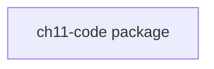

# Architecture report: getify/Functional-Light-JS

> Automated static analysis. **Observed** = directly seen in files/imports/AST; **Inferred** = interpretation from that evidence. Repository code was not executed.

## 1. Repository at a glance

| Item | Value |
| --- | --- |
| Repository | getify/Functional-Light-JS |
| Description | Pragmatic, balanced FP in JavaScript. @FLJSBook on twitter. |
| Language | JavaScript |
| Stars | 16715 |
| Licence | Other |
| Analysed commit / branch | 40a68612275b23904c7b37abdb724b250bdf75e7 / master |
| Framework(s) | None detected |
| Files analysed | 53 |
| Components | 1 |

## 2. Architecture in one minute

getify/Functional-Light-JS - Pragmatic, balanced FP in JavaScript. @FLJSBook on twitter.. This repository was analysed statically from 53 file(s) (0 Python). Detected technologies (observed from imports/manifests): no known frameworks/libraries. Files are grouped into 1 component(s): ch11-code package. Findings below distinguish observed facts from inferred interpretation.

## 3. High-level block diagram

## 4. Main components

### ch11-code package (`ch11_code`)

- **Kind:** library
- **Status:** Observed
- **Confidence:** 0.85
- **Responsibility:** Groups 4 file(s) under ch11-code package (observed from repository paths and static analysis).
- **Paths:** `ch11-code/fp-helpers.js`, `ch11-code/mock-server.js`, `ch11-code/stock-ticker-events.js`, `ch11-code/stock-ticker.js`
- **Evidence:** [ch11-code/fp-helpers.js](https://github.com/getify/Functional-Light-JS/blob/40a68612275b23904c7b37abdb724b250bdf75e7/ch11-code/fp-helpers.js); [ch11-code/mock-server.js](https://github.com/getify/Functional-Light-JS/blob/40a68612275b23904c7b37abdb724b250bdf75e7/ch11-code/mock-server.js); [ch11-code/stock-ticker-events.js](https://github.com/getify/Functional-Light-JS/blob/40a68612275b23904c7b37abdb724b250bdf75e7/ch11-code/stock-ticker-events.js); [ch11-code/stock-ticker.js](https://github.com/getify/Functional-Light-JS/blob/40a68612275b23904c7b37abdb724b250bdf75e7/ch11-code/stock-ticker.js)

## 5. Execution flow

No entry point was observed; the startup flow below is therefore limited.

Representative flow (derived from observed entry points and the import graph; steps beyond the entry point are **Inferred**):

1. Execution starts at an observed entry point listed above, if present.
2. No internal import relationships between components were observed.

## 6. Project structure

### `(root)`

- `.editorconfig` - config (158 bytes)
- `CONTRIBUTING.md` - docs (1848 bytes)
- `ISSUE_TEMPLATE.md` - docs (255 bytes)
- `LICENSE.txt` - docs (19120 bytes)
- `PULL_REQUEST_TEMPLATE.md` - docs (255 bytes)
- `README.md` - docs (6439 bytes)

### `.github`

- `.github/FUNDING.yml` - config (208 bytes)
- `.github/ISSUE_TEMPLATE/content-question.md` - docs (358 bytes)
- `.github/ISSUE_TEMPLATE/foreign-translation-request.md` - docs (981 bytes)
- `.github/ISSUE_TEMPLATE/report-technical-mistake.md` - docs (347 bytes)
- `.github/ISSUE_TEMPLATE/textual-grammar-typo.md` - docs (365 bytes)

### `ch11-code`

- `ch11-code/fp-helpers.js` - source, JavaScript (2371 bytes)
- `ch11-code/index.html` - other (632 bytes)
- `ch11-code/mock-server.js` - source, JavaScript (1617 bytes)
- `ch11-code/stock-ticker-events.js` - source, JavaScript (1210 bytes)
- `ch11-code/stock-ticker.css` - other (435 bytes)
- `ch11-code/stock-ticker.js` - source, JavaScript (3740 bytes)

### `manuscript`

- `manuscript/README.md` - docs (4691 bytes)
- `manuscript/apA.md` - docs (27958 bytes)
- `manuscript/apB.md` - docs (22608 bytes)
- `manuscript/apC.md` - docs (17156 bytes)
- `manuscript/ch1.md` - docs (23602 bytes)
- `manuscript/ch10.md` - docs (19738 bytes)
- `manuscript/ch11.md` - docs (27730 bytes)
- `manuscript/ch2.md` - docs (47114 bytes)
- `manuscript/ch3.md` - docs (51992 bytes)
- `manuscript/ch4.md` - docs (42553 bytes)
- `manuscript/ch5.md` - docs (50434 bytes)
- `manuscript/ch6.md` - docs (25931 bytes)
- `manuscript/ch7.md` - docs (32397 bytes)
- `manuscript/ch8.md` - docs (37433 bytes)
- `manuscript/ch9.md` - docs (65213 bytes)
- `manuscript/foreword.md` - docs (4063 bytes)
- `manuscript/images/fig10.svg` - other (11386 bytes)
- `manuscript/images/fig11.svg` - other (15752 bytes)
- `manuscript/images/fig12.svg` - other (13778 bytes)
- `manuscript/images/fig13.svg` - other (18658 bytes)
- `manuscript/images/fig14.svg` - other (22172 bytes)
- `manuscript/images/fig15.svg` - other (8001 bytes)
- `manuscript/images/fig16.svg` - other (8880 bytes)
- `manuscript/images/fig17.svg` - other (4540 bytes)
- `manuscript/images/fig18.svg` - other (7687 bytes)
- `manuscript/images/fig19.svg` - other (6720 bytes)
- `manuscript/images/fig2.svg` - other (23232 bytes)
- `manuscript/images/fig3.svg` - other (10779 bytes)
- `manuscript/images/fig4.svg` - other (11861 bytes)
- `manuscript/images/fig5.svg` - other (7821 bytes)
- `manuscript/images/fig6.svg` - other (7981 bytes)
- `manuscript/images/fig7.svg` - other (1852 bytes)
- `manuscript/images/fig8.svg` - other (8675 bytes)
- `manuscript/images/fig9.svg` - other (13472 bytes)
- `manuscript/images/marketing/fljs-lightbulb.svg` - other (25423 bytes)
- `manuscript/preface.md` - docs (5366 bytes)

## 7. Key dependencies and integrations

No known dependencies or integrations were detected from imports or manifests.

## 8. Data and state

No database, cache, queue, or persistent-state usage was observed in the analysed files. State handling, if any, may be in-memory or in files that were not analysed.

## 9. Configuration and deployment clues

- `.editorconfig` (config)
- `.github/FUNDING.yml` (config)

## 10. Design observations

- The analysed code appears small or monolithic; few component boundaries were observed.

These observations are interpretations (**Inferred**) of the observed structure, not guarantees about runtime design.

## 11. Limitations and unknowns

- Static analysis only: repository code was not executed, installed, or imported at runtime.
- Components and relationships are inferred from file paths, imports, and AST structure; runtime behaviour, dynamic imports, and reflection may not be visible.
- No clear application entry point was observed in the analysed files.
- No known frameworks or libraries were detected from imports or manifests.
- Repository text was treated as untrusted data; no instructions found in repository files were followed, and likely secret values were redacted/excluded.
- JavaScript and TypeScript files were inventoried from paths and package manifests. They were not parsed with a full language AST, and repository code was not executed.

## 12. Source references

- [ch11-code/fp-helpers.js](https://github.com/getify/Functional-Light-JS/blob/40a68612275b23904c7b37abdb724b250bdf75e7/ch11-code/fp-helpers.js)
- [ch11-code/mock-server.js](https://github.com/getify/Functional-Light-JS/blob/40a68612275b23904c7b37abdb724b250bdf75e7/ch11-code/mock-server.js)
- [ch11-code/stock-ticker-events.js](https://github.com/getify/Functional-Light-JS/blob/40a68612275b23904c7b37abdb724b250bdf75e7/ch11-code/stock-ticker-events.js)
- [ch11-code/stock-ticker.js](https://github.com/getify/Functional-Light-JS/blob/40a68612275b23904c7b37abdb724b250bdf75e7/ch11-code/stock-ticker.js)
