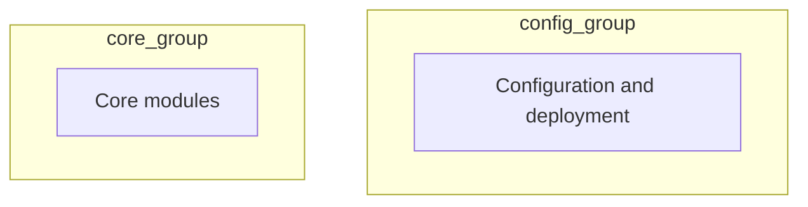

# Architecture report: git-tips/tips

> Automated static analysis. **Observed** = directly seen in files/imports/AST; **Inferred** = interpretation from that evidence. Repository code was not executed.

## 1. Repository at a glance

| Item | Value |
| --- | --- |
| Repository | git-tips/tips |
| Description | Most commonly used git tips and tricks. |
| Language | JavaScript |
| Stars | 21721 |
| Licence | MIT |
| Analysed commit / branch | 727551c5dab24c7b1d63814222a06f9d01546bc4 / master |
| Framework(s) | None detected |
| Files analysed | 25 |
| Components | 2 |

## 2. Architecture in one minute

git-tips/tips - Most commonly used git tips and tricks.. This repository was analysed statically from 25 file(s) (0 Python). Detected technologies (observed from imports/manifests): GitHub Actions. Files are grouped into 2 component(s): Configuration and deployment, Core modules. Findings below distinguish observed facts from inferred interpretation.

## 3. High-level block diagram

## 4. Main components

### Configuration and deployment (`config`)

- **Kind:** config
- **Status:** Observed
- **Confidence:** 0.85
- **Responsibility:** Groups 3 file(s) under configuration and deployment (observed from repository paths and static analysis).
- **Paths:** `book.json`, `package.json`, `tips.json`
- **Evidence:** [book.json](https://github.com/git-tips/tips/blob/727551c5dab24c7b1d63814222a06f9d01546bc4/book.json); [package.json](https://github.com/git-tips/tips/blob/727551c5dab24c7b1d63814222a06f9d01546bc4/package.json); [tips.json](https://github.com/git-tips/tips/blob/727551c5dab24c7b1d63814222a06f9d01546bc4/tips.json)

### Core modules (`core`)

- **Kind:** core
- **Status:** Observed
- **Confidence:** 0.85
- **Responsibility:** Groups 1 file(s) under core modules (observed from repository paths and static analysis).
- **Paths:** `build-readme.js`
- **Evidence:** [build-readme.js](https://github.com/git-tips/tips/blob/727551c5dab24c7b1d63814222a06f9d01546bc4/build-readme.js)

## 5. Execution flow

No entry point was observed; the startup flow below is therefore limited.

Representative flow (derived from observed entry points and the import graph; steps beyond the entry point are **Inferred**):

1. Execution starts at an observed entry point listed above, if present.
2. No internal import relationships between components were observed.

## 6. Project structure

### `(root)`

- `.gitignore` - other (44 bytes)
- `CODE_OF_CONDUCT.md` - docs (3352 bytes)
- `LICENSE` - docs (1100 bytes)
- `README.md` - docs (41063 bytes)
- `book.json` - config (143 bytes)
- `build-readme.js` - source, JavaScript (2136 bytes)
- `contributing.md` - docs (578 bytes)
- `package.json` - manifest (745 bytes)
- `tips.json` - config (38536 bytes)

### `.github`

- `.github/workflows/deploy-docs.yml` - ci, YAML (600 bytes)
- `.github/workflows/update-readme.yml` - ci, YAML (981 bytes)

### `.vscode`

- `.vscode/settings.json` - config (68 bytes)

### `docs`

- `docs/README.md` - docs (136 bytes)
- `docs/SUMMARY.md` - docs (447 bytes)
- `docs/basic-operations.md` - docs (5875 bytes)
- `docs/branching.md` - docs (1975 bytes)
- `docs/log-and-history.md` - docs (4204 bytes)
- `docs/merging-and-rebasing.md` - docs (612 bytes)
- `docs/miscellaneous.md` - docs (1269 bytes)
- `docs/remotes.md` - docs (550 bytes)
- `docs/setup-and-config.md` - docs (2445 bytes)
- `docs/stashing.md` - docs (1358 bytes)
- `docs/submodules-and-subtrees.md` - docs (800 bytes)
- `docs/tagging.md` - docs (124 bytes)
- `docs/undoing-changes.md` - docs (1331 bytes)

## 7. Key dependencies and integrations

| Name | Category | Status | Confidence | Evidence |
| --- | --- | --- | --- | --- |
| GitHub Actions | ci | Observed | 0.90 | [.github/workflows/deploy-docs.yml](https://github.com/git-tips/tips/blob/727551c5dab24c7b1d63814222a06f9d01546bc4/.github/workflows/deploy-docs.yml); [.github/workflows/update-readme.yml](https://github.com/git-tips/tips/blob/727551c5dab24c7b1d63814222a06f9d01546bc4/.github/workflows/update-readme.yml) |

## 8. Data and state

No database, cache, queue, or persistent-state usage was observed in the analysed files. State handling, if any, may be in-memory or in files that were not analysed.

## 9. Configuration and deployment clues

- `.github/workflows/deploy-docs.yml` (ci)
- `.github/workflows/update-readme.yml` (ci)
- `.vscode/settings.json` (config)
- `book.json` (config)
- `package.json` (manifest)
- `tips.json` (config)

## 10. Design observations

- No strong design patterns could be established from the available evidence.

These observations are interpretations (**Inferred**) of the observed structure, not guarantees about runtime design.

## 11. Limitations and unknowns

- Static analysis only: repository code was not executed, installed, or imported at runtime.
- Components and relationships are inferred from file paths, imports, and AST structure; runtime behaviour, dynamic imports, and reflection may not be visible.
- 1 file(s) were skipped during inventory (1 x lockfile excluded).
- No clear application entry point was observed in the analysed files.
- Repository text was treated as untrusted data; no instructions found in repository files were followed, and likely secret values were redacted/excluded.
- JavaScript and TypeScript files were inventoried from paths and package manifests. They were not parsed with a full language AST, and repository code was not executed.

## 12. Source references

- [.github/workflows/deploy-docs.yml](https://github.com/git-tips/tips/blob/727551c5dab24c7b1d63814222a06f9d01546bc4/.github/workflows/deploy-docs.yml)
- [.github/workflows/update-readme.yml](https://github.com/git-tips/tips/blob/727551c5dab24c7b1d63814222a06f9d01546bc4/.github/workflows/update-readme.yml)
- [book.json](https://github.com/git-tips/tips/blob/727551c5dab24c7b1d63814222a06f9d01546bc4/book.json)
- [build-readme.js](https://github.com/git-tips/tips/blob/727551c5dab24c7b1d63814222a06f9d01546bc4/build-readme.js)
- [package.json](https://github.com/git-tips/tips/blob/727551c5dab24c7b1d63814222a06f9d01546bc4/package.json)
- [tips.json](https://github.com/git-tips/tips/blob/727551c5dab24c7b1d63814222a06f9d01546bc4/tips.json)
