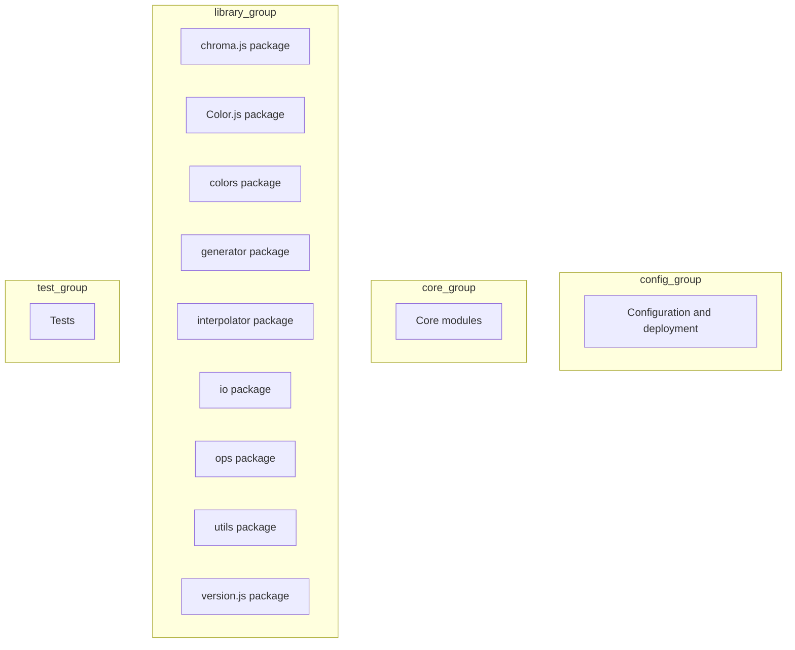

# Architecture report: gka/chroma.js

> Automated static analysis. **Observed** = directly seen in files/imports/AST; **Inferred** = interpretation from that evidence. Repository code was not executed.

## 1. Repository at a glance

| Item | Value |
| --- | --- |
| Repository | gka/chroma.js |
| Description | JavaScript library for all kinds of color manipulations |
| Language | JavaScript |
| Stars | 10604 |
| Licence | Other |
| Analysed commit / branch | c6f893a6e3bb83b3b03d397ceffd326cf818cd02 / main |
| Framework(s) | None detected |
| Files analysed | 198 |
| Components | 12 |

## 2. Architecture in one minute

gka/chroma.js - JavaScript library for all kinds of color manipulations. This repository was analysed statically from 198 file(s) (0 Python). Detected technologies (observed from imports/manifests): GitHub Actions, Vitest. Files are grouped into 12 component(s): chroma.js package, Color.js package, colors package, Configuration and deployment, Core modules, generator package, interpolator package, io package. Findings below distinguish observed facts from inferred interpretation.

## 3. High-level block diagram

## 4. Main components

### chroma.js package (`chroma_js`)

- **Kind:** library
- **Status:** Observed
- **Confidence:** 0.85
- **Responsibility:** Groups 1 file(s) under chroma.js package (observed from repository paths and static analysis).
- **Paths:** `src/chroma.js`
- **Evidence:** [src/chroma.js](https://github.com/gka/chroma.js/blob/c6f893a6e3bb83b3b03d397ceffd326cf818cd02/src/chroma.js)

### Color.js package (`color_js`)

- **Kind:** library
- **Status:** Observed
- **Confidence:** 0.85
- **Responsibility:** Groups 1 file(s) under color.js package (observed from repository paths and static analysis).
- **Paths:** `src/Color.js`
- **Evidence:** [src/Color.js](https://github.com/gka/chroma.js/blob/c6f893a6e3bb83b3b03d397ceffd326cf818cd02/src/Color.js)

### colors package (`colors`)

- **Kind:** library
- **Status:** Observed
- **Confidence:** 0.85
- **Responsibility:** Groups 2 file(s) under colors package (observed from repository paths and static analysis).
- **Paths:** `src/colors/colorbrewer.js`, `src/colors/w3cx11.js`
- **Evidence:** [src/colors/colorbrewer.js](https://github.com/gka/chroma.js/blob/c6f893a6e3bb83b3b03d397ceffd326cf818cd02/src/colors/colorbrewer.js); [src/colors/w3cx11.js](https://github.com/gka/chroma.js/blob/c6f893a6e3bb83b3b03d397ceffd326cf818cd02/src/colors/w3cx11.js)

### Configuration and deployment (`config`)

- **Kind:** config
- **Status:** Observed
- **Confidence:** 0.85
- **Responsibility:** Groups 1 file(s) under configuration and deployment (observed from repository paths and static analysis).
- **Paths:** `package.json`
- **Evidence:** [package.json](https://github.com/gka/chroma.js/blob/c6f893a6e3bb83b3b03d397ceffd326cf818cd02/package.json)

### Core modules (`core`)

- **Kind:** core
- **Status:** Observed
- **Confidence:** 0.85
- **Responsibility:** Groups 8 file(s) under core modules (observed from repository paths and static analysis).
- **Paths:** `eslint.config.mjs`, `index-light.js`, `index.js`, `index.umd.js`, `index.umd.light.js`, `prettier.config.js`, `rollup.config.js`, `vitest.config.mjs`
- **Evidence:** [eslint.config.mjs](https://github.com/gka/chroma.js/blob/c6f893a6e3bb83b3b03d397ceffd326cf818cd02/eslint.config.mjs); [index-light.js](https://github.com/gka/chroma.js/blob/c6f893a6e3bb83b3b03d397ceffd326cf818cd02/index-light.js); [index.js](https://github.com/gka/chroma.js/blob/c6f893a6e3bb83b3b03d397ceffd326cf818cd02/index.js); [index.umd.js](https://github.com/gka/chroma.js/blob/c6f893a6e3bb83b3b03d397ceffd326cf818cd02/index.umd.js); [index.umd.light.js](https://github.com/gka/chroma.js/blob/c6f893a6e3bb83b3b03d397ceffd326cf818cd02/index.umd.light.js); [prettier.config.js](https://github.com/gka/chroma.js/blob/c6f893a6e3bb83b3b03d397ceffd326cf818cd02/prettier.config.js); [rollup.config.js](https://github.com/gka/chroma.js/blob/c6f893a6e3bb83b3b03d397ceffd326cf818cd02/rollup.config.js); [vitest.config.mjs](https://github.com/gka/chroma.js/blob/c6f893a6e3bb83b3b03d397ceffd326cf818cd02/vitest.config.mjs)

### generator package (`generator`)

- **Kind:** library
- **Status:** Observed
- **Confidence:** 0.85
- **Responsibility:** Groups 7 file(s) under generator package (observed from repository paths and static analysis).
- **Paths:** `src/generator/average.js`, `src/generator/bezier.js`, `src/generator/blend.js`, `src/generator/cubehelix.js`, `src/generator/mix.js`, `src/generator/random.js`, `src/generator/scale.js`
- **Evidence:** [src/generator/average.js](https://github.com/gka/chroma.js/blob/c6f893a6e3bb83b3b03d397ceffd326cf818cd02/src/generator/average.js); [src/generator/bezier.js](https://github.com/gka/chroma.js/blob/c6f893a6e3bb83b3b03d397ceffd326cf818cd02/src/generator/bezier.js); [src/generator/blend.js](https://github.com/gka/chroma.js/blob/c6f893a6e3bb83b3b03d397ceffd326cf818cd02/src/generator/blend.js); [src/generator/cubehelix.js](https://github.com/gka/chroma.js/blob/c6f893a6e3bb83b3b03d397ceffd326cf818cd02/src/generator/cubehelix.js); [src/generator/mix.js](https://github.com/gka/chroma.js/blob/c6f893a6e3bb83b3b03d397ceffd326cf818cd02/src/generator/mix.js); [src/generator/random.js](https://github.com/gka/chroma.js/blob/c6f893a6e3bb83b3b03d397ceffd326cf818cd02/src/generator/random.js); [src/generator/scale.js](https://github.com/gka/chroma.js/blob/c6f893a6e3bb83b3b03d397ceffd326cf818cd02/src/generator/scale.js)

### interpolator package (`interpolator`)

- **Kind:** library
- **Status:** Observed
- **Confidence:** 0.85
- **Responsibility:** Groups 13 file(s) under interpolator package (observed from repository paths and static analysis).
- **Paths:** `src/interpolator/_hsx.js`, `src/interpolator/hcg.js`, `src/interpolator/hsi.js`, `src/interpolator/hsl.js`, `src/interpolator/hsv.js`, `src/interpolator/index.js`, `src/interpolator/lab.js`, `src/interpolator/lch.js`, `src/interpolator/lrgb.js`, `src/interpolator/num.js`, `src/interpolator/oklab.js`, `src/interpolator/oklch.js`, `src/interpolator/rgb.js`
- **Evidence:** [src/interpolator/_hsx.js](https://github.com/gka/chroma.js/blob/c6f893a6e3bb83b3b03d397ceffd326cf818cd02/src/interpolator/_hsx.js); [src/interpolator/hcg.js](https://github.com/gka/chroma.js/blob/c6f893a6e3bb83b3b03d397ceffd326cf818cd02/src/interpolator/hcg.js); [src/interpolator/hsi.js](https://github.com/gka/chroma.js/blob/c6f893a6e3bb83b3b03d397ceffd326cf818cd02/src/interpolator/hsi.js); [src/interpolator/hsl.js](https://github.com/gka/chroma.js/blob/c6f893a6e3bb83b3b03d397ceffd326cf818cd02/src/interpolator/hsl.js); [src/interpolator/hsv.js](https://github.com/gka/chroma.js/blob/c6f893a6e3bb83b3b03d397ceffd326cf818cd02/src/interpolator/hsv.js); [src/interpolator/index.js](https://github.com/gka/chroma.js/blob/c6f893a6e3bb83b3b03d397ceffd326cf818cd02/src/interpolator/index.js); [src/interpolator/lab.js](https://github.com/gka/chroma.js/blob/c6f893a6e3bb83b3b03d397ceffd326cf818cd02/src/interpolator/lab.js); [src/interpolator/lch.js](https://github.com/gka/chroma.js/blob/c6f893a6e3bb83b3b03d397ceffd326cf818cd02/src/interpolator/lch.js)

### io package (`io`)

- **Kind:** library
- **Status:** Observed
- **Confidence:** 0.85
- **Responsibility:** Groups 52 file(s) under io package (observed from repository paths and static analysis).
- **Paths:** `src/io/cmyk/cmyk2rgb.js`, `src/io/cmyk/index.js`, `src/io/cmyk/rgb2cmyk.js`, `src/io/css/css2rgb.js`, `src/io/css/hsl2css.js`, `src/io/css/index.js`, `src/io/css/lab2css.js`, `src/io/css/lch2css.js`, `src/io/css/oklab2css.js`, `src/io/css/oklch2css.js`, `src/io/css/rgb2css.js`, `src/io/gl/index.js`, `src/io/hcg/hcg2rgb.js`, `src/io/hcg/index.js`, `src/io/hcg/rgb2hcg.js`, `src/io/hex/hex2rgb.js`, `src/io/hex/index.js`, `src/io/hex/rgb2hex.js`, `src/io/hsi/hsi2rgb.js`, `src/io/hsi/index.js`, `src/io/hsi/rgb2hsi.js`, `src/io/hsl/hsl2rgb.js`, `src/io/hsl/index.js`, `src/io/hsl/rgb2hsl.js`, `src/io/hsv/hsv2rgb.js`, `src/io/hsv/index.js`, `src/io/hsv/rgb2hsv.js`, `src/io/input.js`, `src/io/lab/index.js`, `src/io/lab/lab-constants.js`, `src/io/lab/lab2rgb.js`, `src/io/lab/rgb2lab.js`, `src/io/lch/hcl2rgb.js`, `src/io/lch/index.js`, `src/io/lch/lab2lch.js`, `src/io/lch/lch2lab.js`, `src/io/lch/lch2rgb.js`, `src/io/lch/rgb2lch.js`, `src/io/named/index.js`, `src/io/num/index.js`, `src/io/num/num2rgb.js`, `src/io/num/rgb2num.js`, `src/io/oklab/index.js`, `src/io/oklab/oklab2rgb.js`, `src/io/oklab/rgb2oklab.js`, `src/io/oklch/index.js`, `src/io/oklch/oklch2rgb.js`, `src/io/oklch/rgb2oklch.js`, `src/io/rgb/index.js`, `src/io/temp/index.js`, `src/io/temp/rgb2temperature.js`, `src/io/temp/temperature2rgb.js`
- **Evidence:** [src/io/cmyk/cmyk2rgb.js](https://github.com/gka/chroma.js/blob/c6f893a6e3bb83b3b03d397ceffd326cf818cd02/src/io/cmyk/cmyk2rgb.js); [src/io/cmyk/index.js](https://github.com/gka/chroma.js/blob/c6f893a6e3bb83b3b03d397ceffd326cf818cd02/src/io/cmyk/index.js); [src/io/cmyk/rgb2cmyk.js](https://github.com/gka/chroma.js/blob/c6f893a6e3bb83b3b03d397ceffd326cf818cd02/src/io/cmyk/rgb2cmyk.js); [src/io/css/css2rgb.js](https://github.com/gka/chroma.js/blob/c6f893a6e3bb83b3b03d397ceffd326cf818cd02/src/io/css/css2rgb.js); [src/io/css/hsl2css.js](https://github.com/gka/chroma.js/blob/c6f893a6e3bb83b3b03d397ceffd326cf818cd02/src/io/css/hsl2css.js); [src/io/css/index.js](https://github.com/gka/chroma.js/blob/c6f893a6e3bb83b3b03d397ceffd326cf818cd02/src/io/css/index.js); [src/io/css/lab2css.js](https://github.com/gka/chroma.js/blob/c6f893a6e3bb83b3b03d397ceffd326cf818cd02/src/io/css/lab2css.js); [src/io/css/lch2css.js](https://github.com/gka/chroma.js/blob/c6f893a6e3bb83b3b03d397ceffd326cf818cd02/src/io/css/lch2css.js)

### ops package (`ops`)

- **Kind:** library
- **Status:** Observed
- **Confidence:** 0.85
- **Responsibility:** Groups 10 file(s) under ops package (observed from repository paths and static analysis).
- **Paths:** `src/ops/alpha.js`, `src/ops/clipped.js`, `src/ops/darken.js`, `src/ops/get.js`, `src/ops/luminance.js`, `src/ops/mix.js`, `src/ops/premultiply.js`, `src/ops/saturate.js`, `src/ops/set.js`, `src/ops/shade.js`
- **Evidence:** [src/ops/alpha.js](https://github.com/gka/chroma.js/blob/c6f893a6e3bb83b3b03d397ceffd326cf818cd02/src/ops/alpha.js); [src/ops/clipped.js](https://github.com/gka/chroma.js/blob/c6f893a6e3bb83b3b03d397ceffd326cf818cd02/src/ops/clipped.js); [src/ops/darken.js](https://github.com/gka/chroma.js/blob/c6f893a6e3bb83b3b03d397ceffd326cf818cd02/src/ops/darken.js); [src/ops/get.js](https://github.com/gka/chroma.js/blob/c6f893a6e3bb83b3b03d397ceffd326cf818cd02/src/ops/get.js); [src/ops/luminance.js](https://github.com/gka/chroma.js/blob/c6f893a6e3bb83b3b03d397ceffd326cf818cd02/src/ops/luminance.js); [src/ops/mix.js](https://github.com/gka/chroma.js/blob/c6f893a6e3bb83b3b03d397ceffd326cf818cd02/src/ops/mix.js); [src/ops/premultiply.js](https://github.com/gka/chroma.js/blob/c6f893a6e3bb83b3b03d397ceffd326cf818cd02/src/ops/premultiply.js); [src/ops/saturate.js](https://github.com/gka/chroma.js/blob/c6f893a6e3bb83b3b03d397ceffd326cf818cd02/src/ops/saturate.js)

### Tests (`tests`)

- **Kind:** test
- **Status:** Observed
- **Confidence:** 0.85
- **Responsibility:** Groups 56 file(s) under tests (observed from repository paths and static analysis).
- **Paths:** `test/alpha.test.js`, `test/analyze.test.js`, `test/autodetect.test.js`, `test/average.test.js`, `test/bezier.test.js`, `test/blend.test.js`, `test/color.test.js`, `test/colorbrewer.test.js`, `test/contrast.test.js`, `test/converters.test.js`, `test/cubehelix.test.js`, `test/delta-e.test.js`, `test/docs/index.test.js`, `test/html/bezier.html`, `test/html/blend.html`, `test/html/colorscales.html`, `test/html/cubehelix.html`, `test/html/luminance.html`, `test/io/cmyk2rgb.test.js`, `test/io/css2rgb.test.js`, `test/io/hcg2rgb.test.js`, `test/io/hex2rgb.test.js`, `test/io/hsi2rgb.test.js`, `test/io/hsl2rgb.test.js`, `test/io/hsv2rgb.test.js`, `test/io/lab2lch.test.js`, `test/io/lab2rgb.test.js`, `test/io/lch2lab.test.js`, `test/io/lch2rgb.test.js`, `test/io/num2rgb.test.js`, `test/io/oklab2rgb.test.js`, `test/io/oklch2rgb.test.js`, `test/io/rgb2cmyk.test.js`, `test/io/rgb2css.test.js`, `test/io/rgb2hcg.test.js`, `test/io/rgb2hex.test.js`, `test/io/rgb2hsi.test.js`, `test/io/rgb2hsv.test.js`, `test/io/rgb2lab.test.js`, `test/io/rgb2lch.test.js`, `test/io/rgb2oklab.test.js`, `test/io/rgb2oklch.test.js`, `test/lch.test.js`, `test/limits.test.js`, `test/luminance.test.js`, `test/manipulate.test.js`, `test/misc.test.js`, `test/mix.test.js`, `test/num.test.js`, `test/premultiply.test.js`, `test/random.test.js`, `test/scale.lcorrection.test.js`, `test/scales.test.js`, `test/temperature2rgb.test.js`, `test/unpack.test.js`, `test/valid.test.js`
- **Evidence:** [test/alpha.test.js](https://github.com/gka/chroma.js/blob/c6f893a6e3bb83b3b03d397ceffd326cf818cd02/test/alpha.test.js); [test/analyze.test.js](https://github.com/gka/chroma.js/blob/c6f893a6e3bb83b3b03d397ceffd326cf818cd02/test/analyze.test.js); [test/autodetect.test.js](https://github.com/gka/chroma.js/blob/c6f893a6e3bb83b3b03d397ceffd326cf818cd02/test/autodetect.test.js); [test/average.test.js](https://github.com/gka/chroma.js/blob/c6f893a6e3bb83b3b03d397ceffd326cf818cd02/test/average.test.js); [test/bezier.test.js](https://github.com/gka/chroma.js/blob/c6f893a6e3bb83b3b03d397ceffd326cf818cd02/test/bezier.test.js); [test/blend.test.js](https://github.com/gka/chroma.js/blob/c6f893a6e3bb83b3b03d397ceffd326cf818cd02/test/blend.test.js); [test/color.test.js](https://github.com/gka/chroma.js/blob/c6f893a6e3bb83b3b03d397ceffd326cf818cd02/test/color.test.js); [test/colorbrewer.test.js](https://github.com/gka/chroma.js/blob/c6f893a6e3bb83b3b03d397ceffd326cf818cd02/test/colorbrewer.test.js)

### utils package (`utils`)

- **Kind:** library
- **Status:** Observed
- **Confidence:** 0.85
- **Responsibility:** Groups 14 file(s) under utils package (observed from repository paths and static analysis).
- **Paths:** `src/utils/analyze.js`, `src/utils/clip_rgb.js`, `src/utils/contrast.js`, `src/utils/contrastAPCA.js`, `src/utils/delta-e.js`, `src/utils/distance.js`, `src/utils/index.js`, `src/utils/last.js`, `src/utils/limit.js`, `src/utils/multiply-matrices.js`, `src/utils/scales.js`, `src/utils/type.js`, `src/utils/unpack.js`, `src/utils/valid.js`
- **Evidence:** [src/utils/analyze.js](https://github.com/gka/chroma.js/blob/c6f893a6e3bb83b3b03d397ceffd326cf818cd02/src/utils/analyze.js); [src/utils/clip_rgb.js](https://github.com/gka/chroma.js/blob/c6f893a6e3bb83b3b03d397ceffd326cf818cd02/src/utils/clip_rgb.js); [src/utils/contrast.js](https://github.com/gka/chroma.js/blob/c6f893a6e3bb83b3b03d397ceffd326cf818cd02/src/utils/contrast.js); [src/utils/contrastAPCA.js](https://github.com/gka/chroma.js/blob/c6f893a6e3bb83b3b03d397ceffd326cf818cd02/src/utils/contrastAPCA.js); [src/utils/delta-e.js](https://github.com/gka/chroma.js/blob/c6f893a6e3bb83b3b03d397ceffd326cf818cd02/src/utils/delta-e.js); [src/utils/distance.js](https://github.com/gka/chroma.js/blob/c6f893a6e3bb83b3b03d397ceffd326cf818cd02/src/utils/distance.js); [src/utils/index.js](https://github.com/gka/chroma.js/blob/c6f893a6e3bb83b3b03d397ceffd326cf818cd02/src/utils/index.js); [src/utils/last.js](https://github.com/gka/chroma.js/blob/c6f893a6e3bb83b3b03d397ceffd326cf818cd02/src/utils/last.js)

### version.js package (`version_js`)

- **Kind:** library
- **Status:** Observed
- **Confidence:** 0.85
- **Responsibility:** Groups 1 file(s) under version.js package (observed from repository paths and static analysis).
- **Paths:** `src/version.js`
- **Evidence:** [src/version.js](https://github.com/gka/chroma.js/blob/c6f893a6e3bb83b3b03d397ceffd326cf818cd02/src/version.js)

## 5. Execution flow

**Observed** entry point(s):

- [index.js](https://github.com/gka/chroma.js/blob/c6f893a6e3bb83b3b03d397ceffd326cf818cd02/index.js)
- [src/interpolator/index.js](https://github.com/gka/chroma.js/blob/c6f893a6e3bb83b3b03d397ceffd326cf818cd02/src/interpolator/index.js)
- [src/io/cmyk/index.js](https://github.com/gka/chroma.js/blob/c6f893a6e3bb83b3b03d397ceffd326cf818cd02/src/io/cmyk/index.js)
- [src/io/css/index.js](https://github.com/gka/chroma.js/blob/c6f893a6e3bb83b3b03d397ceffd326cf818cd02/src/io/css/index.js)
- [src/io/gl/index.js](https://github.com/gka/chroma.js/blob/c6f893a6e3bb83b3b03d397ceffd326cf818cd02/src/io/gl/index.js)
- [src/io/hcg/index.js](https://github.com/gka/chroma.js/blob/c6f893a6e3bb83b3b03d397ceffd326cf818cd02/src/io/hcg/index.js)
- [src/io/hex/index.js](https://github.com/gka/chroma.js/blob/c6f893a6e3bb83b3b03d397ceffd326cf818cd02/src/io/hex/index.js)
- [src/io/hsi/index.js](https://github.com/gka/chroma.js/blob/c6f893a6e3bb83b3b03d397ceffd326cf818cd02/src/io/hsi/index.js)
- [src/io/hsl/index.js](https://github.com/gka/chroma.js/blob/c6f893a6e3bb83b3b03d397ceffd326cf818cd02/src/io/hsl/index.js)
- [src/io/hsv/index.js](https://github.com/gka/chroma.js/blob/c6f893a6e3bb83b3b03d397ceffd326cf818cd02/src/io/hsv/index.js)
- [src/io/lab/index.js](https://github.com/gka/chroma.js/blob/c6f893a6e3bb83b3b03d397ceffd326cf818cd02/src/io/lab/index.js)
- [src/io/lch/index.js](https://github.com/gka/chroma.js/blob/c6f893a6e3bb83b3b03d397ceffd326cf818cd02/src/io/lch/index.js)

Representative flow (derived from observed entry points and the import graph; steps beyond the entry point are **Inferred**):

1. Execution starts at an observed entry point listed above, if present.
2. No internal import relationships between components were observed.

## 6. Project structure

### `(root)`

- `.gitignore` - other (66 bytes)
- `.npmignore` - other (188 bytes)
- `.travis.yml` - ci, YAML (84 bytes)
- `CHANGELOG.md` - docs (8784 bytes)
- `LICENSE` - docs (2418 bytes)
- `eslint.config.mjs` - source, JavaScript (905 bytes)
- `index-light.js` - source, JavaScript (979 bytes)
- `index.js` - source, JavaScript (3077 bytes)
- `index.umd.js` - source, JavaScript (3185 bytes)
- `index.umd.light.js` - source, JavaScript (1064 bytes)
- `package.json` - manifest (2572 bytes)
- `prettier.config.js` - source, JavaScript (609 bytes)
- `readme.md` - docs (3705 bytes)
- `rollup.config.js` - source, JavaScript (1481 bytes)
- `vitest.config.mjs` - source, JavaScript (262 bytes)

### `.bin`

- `.bin/update-version.cjs` - source, JavaScript (555 bytes)

### `.changeset`

- `.changeset/README.md` - docs (510 bytes)
- `.changeset/config.json` - config (275 bytes)

### `.github`

- `.github/CODEOWNERS` - other (7 bytes)
- `.github/FUNDING.yml` - config (765 bytes)
- `.github/workflows/ci.yml` - ci, YAML (654 bytes)

### `.husky`

- `.husky/pre-commit` - other (33 bytes)

### `docs`

- `docs/Makefile` - docs (286 bytes)
- `docs/bin/post-process` - docs (770 bytes)
- `docs/index.html` - docs (68730 bytes)
- `docs/libs/chroma-light.cjs` - docs (55853 bytes)
- `docs/libs/chroma-light.min.cjs` - docs (23040 bytes)
- `docs/libs/chroma.cjs` - docs (133442 bytes)
- `docs/libs/chroma.min.cjs` - docs (52992 bytes)
- `docs/libs/codemirror/lib/codemirror.css` - docs (7771 bytes)
- `docs/libs/codemirror/mode/javascript/index.html` - docs (4193 bytes)
- `docs/libs/codemirror/mode/javascript/javascript.js` - docs (26745 bytes)
- `docs/libs/codemirror/mode/javascript/json-ld.html` - docs (2150 bytes)
- `docs/libs/codemirror/mode/javascript/test.js` - docs (7637 bytes)
- `docs/libs/codemirror/mode/javascript/typescript.html` - docs (1547 bytes)
- `docs/libs/codemirror/mode/shell/shell.js` - docs (5713 bytes)
- `docs/src/footer.inc.html` - docs (11966 bytes)
- `docs/src/index.css` - docs (7792 bytes)
- `docs/src/index.md` - docs (33010 bytes)

### `src`

- `src/Color.js` - source, JavaScript (1452 bytes)
- `src/chroma.js` - source, JavaScript (188 bytes)
- `src/colors/colorbrewer.js` - source, JavaScript (5735 bytes)
- `src/colors/w3cx11.js` - source, JavaScript (4105 bytes)
- `src/generator/average.js` - source, JavaScript (2788 bytes)
- `src/generator/bezier.js` - source, JavaScript (2606 bytes)
- `src/generator/blend.js` - source, JavaScript (2433 bytes)
- `src/generator/cubehelix.js` - source, JavaScript (2271 bytes)
- `src/generator/mix.js` - source, JavaScript (701 bytes)
- `src/generator/random.js` - source, JavaScript (389 bytes)
- `src/generator/scale.js` - source, JavaScript (11858 bytes)
- `src/interpolator/_hsx.js` - source, JavaScript (2068 bytes)
- `src/interpolator/hcg.js` - source, JavaScript (253 bytes)
- `src/interpolator/hsi.js` - source, JavaScript (253 bytes)
- `src/interpolator/hsl.js` - source, JavaScript (253 bytes)
- `src/interpolator/hsv.js` - source, JavaScript (253 bytes)
- `src/interpolator/index.js` - source, JavaScript (19 bytes)
- `src/interpolator/lab.js` - source, JavaScript (425 bytes)
- `src/interpolator/lch.js` - source, JavaScript (270 bytes)
- `src/interpolator/lrgb.js` - source, JavaScript (472 bytes)
- `src/interpolator/num.js` - source, JavaScript (299 bytes)
- `src/interpolator/oklab.js` - source, JavaScript (441 bytes)
- `src/interpolator/oklch.js` - source, JavaScript (263 bytes)
- `src/interpolator/rgb.js` - source, JavaScript (394 bytes)
- `src/io/cmyk/cmyk2rgb.js` - source, JavaScript (451 bytes)
- `src/io/cmyk/index.js` - source, JavaScript (649 bytes)
- `src/io/cmyk/rgb2cmyk.js` - source, JavaScript (417 bytes)
- `src/io/css/css2rgb.js` - source, JavaScript (7573 bytes)
- `src/io/css/hsl2css.js` - source, JavaScript (721 bytes)
- `src/io/css/index.js` - source, JavaScript (603 bytes)
- `src/io/css/lab2css.js` - source, JavaScript (627 bytes)
- `src/io/css/lch2css.js` - source, JavaScript (684 bytes)
- `src/io/css/oklab2css.js` - source, JavaScript (443 bytes)
- `src/io/css/oklch2css.js` - source, JavaScript (500 bytes)
- `src/io/css/rgb2css.js` - source, JavaScript (2137 bytes)
- `src/io/delta-e.coffee` - other (1100 bytes)
- `src/io/distance.coffee` - other (423 bytes)
- `src/io/gl/index.js` - source, JavaScript (514 bytes)
- `src/io/hcg/hcg2rgb.js` - source, JavaScript (1296 bytes)
- `src/io/hcg/index.js` - source, JavaScript (621 bytes)
- `src/io/hcg/rgb2hcg.js` - source, JavaScript (650 bytes)
- `src/io/hex/hex2rgb.js` - source, JavaScript (1621 bytes)
- `src/io/hex/index.js` - source, JavaScript (676 bytes)
- `src/io/hex/rgb2hex.js` - source, JavaScript (803 bytes)
- `src/io/hsi/hsi2rgb.js` - source, JavaScript (1170 bytes)
- `src/io/hsi/index.js` - source, JavaScript (621 bytes)
- `src/io/hsi/rgb2hsi.js` - source, JavaScript (740 bytes)
- `src/io/hsl/hsl2rgb.js` - source, JavaScript (1033 bytes)
- `src/io/hsl/index.js` - source, JavaScript (621 bytes)
- `src/io/hsl/rgb2hsl.js` - source, JavaScript (1037 bytes)
- `src/io/hsv/hsv2rgb.js` - source, JavaScript (1126 bytes)
- `src/io/hsv/index.js` - source, JavaScript (621 bytes)
- `src/io/hsv/rgb2hsv.js` - source, JavaScript (736 bytes)
- `src/io/input.js` - source, JavaScript (55 bytes)
- `src/io/lab/index.js` - source, JavaScript (780 bytes)
- `src/io/lab/lab-constants.js` - source, JavaScript (2872 bytes)
- `src/io/lab/lab2rgb.js` - source, JavaScript (2946 bytes)
- `src/io/lab/rgb2lab.js` - source, JavaScript (2375 bytes)
- `src/io/lch/hcl2rgb.js` - source, JavaScript (228 bytes)
- `src/io/lch/index.js` - source, JavaScript (911 bytes)
- `src/io/lch/lab2lch.js` - source, JavaScript (350 bytes)
- `src/io/lch/lch2lab.js` - source, JavaScript (582 bytes)
- `src/io/lch/lch2rgb.js` - source, JavaScript (379 bytes)
- `src/io/lch/rgb2lch.js` - source, JavaScript (394 bytes)
- `src/io/named/index.js` - source, JavaScript (806 bytes)
- `src/io/num/index.js` - source, JavaScript (693 bytes)
- `src/io/num/num2rgb.js` - source, JavaScript (346 bytes)
- `src/io/num/rgb2num.js` - source, JavaScript (187 bytes)
- `src/io/oklab/index.js` - source, JavaScript (663 bytes)
- `src/io/oklab/oklab2rgb.js` - source, JavaScript (1185 bytes)
- `src/io/oklab/rgb2oklab.js` - source, JavaScript (1434 bytes)
- `src/io/oklch/index.js` - source, JavaScript (663 bytes)
- `src/io/oklch/oklch2rgb.js` - source, JavaScript (428 bytes)
- `src/io/oklch/rgb2oklch.js` - source, JavaScript (411 bytes)
- `src/io/rgb/index.js` - source, JavaScript (1496 bytes)
- `src/io/temp/index.js` - source, JavaScript (657 bytes)
- `src/io/temp/rgb2temperature.js` - source, JavaScript (744 bytes)
- `src/io/temp/temperature2rgb.js` - source, JavaScript (1014 bytes)
- `src/ops/alpha.js` - source, JavaScript (383 bytes)
- `src/ops/clipped.js` - source, JavaScript (117 bytes)
- `src/ops/darken.js` - source, JavaScript (508 bytes)
- `src/ops/get.js` - source, JavaScript (392 bytes)
- `src/ops/luminance.js` - source, JavaScript (1642 bytes)
- `src/ops/mix.js` - source, JavaScript (218 bytes)
- `src/ops/premultiply.js` - source, JavaScript (337 bytes)
- `src/ops/saturate.js` - source, JavaScript (443 bytes)
- `src/ops/set.js` - source, JavaScript (1449 bytes)
- `src/ops/shade.js` - source, JavaScript (302 bytes)
- `src/utils/analyze.js` - source, JavaScript (5810 bytes)
- `src/utils/clip_rgb.js` - source, JavaScript (410 bytes)
- `src/utils/contrast.js` - source, JavaScript (377 bytes)
- `src/utils/contrastAPCA.js` - source, JavaScript (2101 bytes)
- `src/utils/delta-e.js` - source, JavaScript (2362 bytes)
- `src/utils/distance.js` - source, JavaScript (457 bytes)
- `src/utils/index.js` - source, JavaScript (736 bytes)
- `src/utils/last.js` - source, JavaScript (212 bytes)
- `src/utils/limit.js` - source, JavaScript (109 bytes)
- `src/utils/multiply-matrices.js` - source, JavaScript (936 bytes)
- `src/utils/scales.js` - source, JavaScript (386 bytes)
- `src/utils/type.js` - source, JavaScript (372 bytes)
- `src/utils/unpack.js` - source, JavaScript (659 bytes)
- `src/utils/valid.js` - source, JavaScript (208 bytes)
- `src/version.js` - source, JavaScript (67 bytes)

### `test`

- `test/alpha.test.js` - test, JavaScript (6516 bytes)
- `test/analyze.test.js` - test, JavaScript (1643 bytes)
- `test/autodetect.test.js` - test, JavaScript (1980 bytes)
- `test/average.test.js` - test, JavaScript (3015 bytes)
- `test/bezier.test.js` - test, JavaScript (2995 bytes)
- `test/blend.test.js` - test, JavaScript (4966 bytes)
- `test/color.test.js` - test, JavaScript (1754 bytes)
- `test/colorbrewer.test.js` - test, JavaScript (808 bytes)
- `test/contrast.test.js` - test, JavaScript (1929 bytes)
- `test/converters.test.js` - test, JavaScript (1807 bytes)
- `test/cubehelix.test.js` - test, JavaScript (3267 bytes)
- `test/delta-e.test.js` - test, JavaScript (1068 bytes)
- `test/docs/index.test.js` - test, JavaScript (1011 bytes)
- `test/html/bezier.html` - test (1954 bytes)
- `test/html/blend.html` - test (2433 bytes)
- `test/html/colorscales.html` - test (3935 bytes)
- `test/html/cubehelix.html` - test (2198 bytes)
- `test/html/luminance.html` - test (1764 bytes)
- `test/io/cmyk2rgb.test.js` - test, JavaScript (2377 bytes)
- `test/io/css2rgb.test.js` - test, JavaScript (2717 bytes)
- `test/io/hcg2rgb.test.js` - test, JavaScript (1378 bytes)
- `test/io/hex2rgb.test.js` - test, JavaScript (4222 bytes)
- `test/io/hsi2rgb.test.js` - test, JavaScript (1664 bytes)
- `test/io/hsl2rgb.test.js` - test, JavaScript (1423 bytes)
- `test/io/hsv2rgb.test.js` - test, JavaScript (969 bytes)
- `test/io/lab2lch.test.js` - test, JavaScript (1696 bytes)
- `test/io/lab2rgb.test.js` - test, JavaScript (2275 bytes)
- `test/io/lch2lab.test.js` - test, JavaScript (1701 bytes)
- `test/io/lch2rgb.test.js` - test, JavaScript (1624 bytes)
- `test/io/num2rgb.test.js` - test, JavaScript (911 bytes)
- `test/io/oklab2rgb.test.js` - test, JavaScript (1648 bytes)
- `test/io/oklch2rgb.test.js` - test, JavaScript (1831 bytes)
- `test/io/rgb2cmyk.test.js` - test, JavaScript (844 bytes)
- `test/io/rgb2css.test.js` - test, JavaScript (3078 bytes)
- `test/io/rgb2hcg.test.js` - test, JavaScript (2164 bytes)
- `test/io/rgb2hex.test.js` - test, JavaScript (1685 bytes)
- `test/io/rgb2hsi.test.js` - test, JavaScript (1433 bytes)
- `test/io/rgb2hsv.test.js` - test, JavaScript (1152 bytes)
- `test/io/rgb2lab.test.js` - test, JavaScript (2064 bytes)
- `test/io/rgb2lch.test.js` - test, JavaScript (1415 bytes)
- `test/io/rgb2oklab.test.js` - test, JavaScript (1509 bytes)
- `test/io/rgb2oklch.test.js` - test, JavaScript (1612 bytes)
- `test/lch.test.js` - test, JavaScript (1718 bytes)
- `test/limits.test.js` - test, JavaScript (2149 bytes)
- `test/luminance.test.js` - test, JavaScript (2859 bytes)
- `test/manipulate.test.js` - test, JavaScript (2614 bytes)
- `test/misc.test.js` - test, JavaScript (4496 bytes)
- `test/mix.test.js` - test, JavaScript (4703 bytes)
- `test/num.test.js` - test, JavaScript (856 bytes)
- `test/premultiply.test.js` - test, JavaScript (589 bytes)
- `test/random.test.js` - test, JavaScript (606 bytes)
- `test/scale.lcorrection.test.js` - test, JavaScript (2081 bytes)
- `test/scales.test.js` - test, JavaScript (14144 bytes)
- `test/temperature2rgb.test.js` - test, JavaScript (805 bytes)
- `test/unpack.test.js` - test, JavaScript (517 bytes)
- `test/valid.test.js` - test, JavaScript (464 bytes)

## 7. Key dependencies and integrations

| Name | Category | Status | Confidence | Evidence |
| --- | --- | --- | --- | --- |
| GitHub Actions | ci | Observed | 0.85 | [.github/workflows/ci.yml](https://github.com/gka/chroma.js/blob/c6f893a6e3bb83b3b03d397ceffd326cf818cd02/.github/workflows/ci.yml) |
| Vitest | tooling | Observed | 0.85 | [package.json:61](https://github.com/gka/chroma.js/blob/c6f893a6e3bb83b3b03d397ceffd326cf818cd02/package.json#L61) |

## 8. Data and state

No database, cache, queue, or persistent-state usage was observed in the analysed files. State handling, if any, may be in-memory or in files that were not analysed.

## 9. Configuration and deployment clues

- `.changeset/config.json` (config)
- `.github/FUNDING.yml` (config)
- `.github/workflows/ci.yml` (ci)
- `.travis.yml` (ci)
- `package.json` (manifest)

## 10. Design observations

- Tests are present alongside source code (Observed from test file paths).

These observations are interpretations (**Inferred**) of the observed structure, not guarantees about runtime design.

## 11. Limitations and unknowns

- Static analysis only: repository code was not executed, installed, or imported at runtime.
- Components and relationships are inferred from file paths, imports, and AST structure; runtime behaviour, dynamic imports, and reflection may not be visible.
- 5 file(s) were skipped during inventory (1 x lockfile excluded; 4 x vendored/generated directory excluded).
- No clear application entry point was observed in the analysed files.
- Repository text was treated as untrusted data; no instructions found in repository files were followed, and likely secret values were redacted/excluded.
- JavaScript and TypeScript files were inventoried from paths and package manifests. They were not parsed with a full language AST, and repository code was not executed.

## 12. Source references

- [.github/workflows/ci.yml](https://github.com/gka/chroma.js/blob/c6f893a6e3bb83b3b03d397ceffd326cf818cd02/.github/workflows/ci.yml)
- [eslint.config.mjs](https://github.com/gka/chroma.js/blob/c6f893a6e3bb83b3b03d397ceffd326cf818cd02/eslint.config.mjs)
- [index-light.js](https://github.com/gka/chroma.js/blob/c6f893a6e3bb83b3b03d397ceffd326cf818cd02/index-light.js)
- [index.js](https://github.com/gka/chroma.js/blob/c6f893a6e3bb83b3b03d397ceffd326cf818cd02/index.js)
- [index.umd.js](https://github.com/gka/chroma.js/blob/c6f893a6e3bb83b3b03d397ceffd326cf818cd02/index.umd.js)
- [index.umd.light.js](https://github.com/gka/chroma.js/blob/c6f893a6e3bb83b3b03d397ceffd326cf818cd02/index.umd.light.js)
- [package.json](https://github.com/gka/chroma.js/blob/c6f893a6e3bb83b3b03d397ceffd326cf818cd02/package.json)
- [package.json:61](https://github.com/gka/chroma.js/blob/c6f893a6e3bb83b3b03d397ceffd326cf818cd02/package.json#L61)
- [prettier.config.js](https://github.com/gka/chroma.js/blob/c6f893a6e3bb83b3b03d397ceffd326cf818cd02/prettier.config.js)
- [rollup.config.js](https://github.com/gka/chroma.js/blob/c6f893a6e3bb83b3b03d397ceffd326cf818cd02/rollup.config.js)
- [src/Color.js](https://github.com/gka/chroma.js/blob/c6f893a6e3bb83b3b03d397ceffd326cf818cd02/src/Color.js)
- [src/chroma.js](https://github.com/gka/chroma.js/blob/c6f893a6e3bb83b3b03d397ceffd326cf818cd02/src/chroma.js)
- [src/colors/colorbrewer.js](https://github.com/gka/chroma.js/blob/c6f893a6e3bb83b3b03d397ceffd326cf818cd02/src/colors/colorbrewer.js)
- [src/colors/w3cx11.js](https://github.com/gka/chroma.js/blob/c6f893a6e3bb83b3b03d397ceffd326cf818cd02/src/colors/w3cx11.js)
- [src/generator/average.js](https://github.com/gka/chroma.js/blob/c6f893a6e3bb83b3b03d397ceffd326cf818cd02/src/generator/average.js)
- [src/generator/bezier.js](https://github.com/gka/chroma.js/blob/c6f893a6e3bb83b3b03d397ceffd326cf818cd02/src/generator/bezier.js)
- [src/generator/blend.js](https://github.com/gka/chroma.js/blob/c6f893a6e3bb83b3b03d397ceffd326cf818cd02/src/generator/blend.js)
- [src/generator/cubehelix.js](https://github.com/gka/chroma.js/blob/c6f893a6e3bb83b3b03d397ceffd326cf818cd02/src/generator/cubehelix.js)
- [src/generator/mix.js](https://github.com/gka/chroma.js/blob/c6f893a6e3bb83b3b03d397ceffd326cf818cd02/src/generator/mix.js)
- [src/generator/random.js](https://github.com/gka/chroma.js/blob/c6f893a6e3bb83b3b03d397ceffd326cf818cd02/src/generator/random.js)
- [src/generator/scale.js](https://github.com/gka/chroma.js/blob/c6f893a6e3bb83b3b03d397ceffd326cf818cd02/src/generator/scale.js)
- [src/interpolator/_hsx.js](https://github.com/gka/chroma.js/blob/c6f893a6e3bb83b3b03d397ceffd326cf818cd02/src/interpolator/_hsx.js)
- [src/interpolator/hcg.js](https://github.com/gka/chroma.js/blob/c6f893a6e3bb83b3b03d397ceffd326cf818cd02/src/interpolator/hcg.js)
- [src/interpolator/hsi.js](https://github.com/gka/chroma.js/blob/c6f893a6e3bb83b3b03d397ceffd326cf818cd02/src/interpolator/hsi.js)
- [src/interpolator/hsl.js](https://github.com/gka/chroma.js/blob/c6f893a6e3bb83b3b03d397ceffd326cf818cd02/src/interpolator/hsl.js)
- [src/interpolator/hsv.js](https://github.com/gka/chroma.js/blob/c6f893a6e3bb83b3b03d397ceffd326cf818cd02/src/interpolator/hsv.js)
- [src/interpolator/index.js](https://github.com/gka/chroma.js/blob/c6f893a6e3bb83b3b03d397ceffd326cf818cd02/src/interpolator/index.js)
- [src/interpolator/lab.js](https://github.com/gka/chroma.js/blob/c6f893a6e3bb83b3b03d397ceffd326cf818cd02/src/interpolator/lab.js)
- [src/interpolator/lch.js](https://github.com/gka/chroma.js/blob/c6f893a6e3bb83b3b03d397ceffd326cf818cd02/src/interpolator/lch.js)
- [src/io/cmyk/cmyk2rgb.js](https://github.com/gka/chroma.js/blob/c6f893a6e3bb83b3b03d397ceffd326cf818cd02/src/io/cmyk/cmyk2rgb.js)
- [src/io/cmyk/index.js](https://github.com/gka/chroma.js/blob/c6f893a6e3bb83b3b03d397ceffd326cf818cd02/src/io/cmyk/index.js)
- [src/io/cmyk/rgb2cmyk.js](https://github.com/gka/chroma.js/blob/c6f893a6e3bb83b3b03d397ceffd326cf818cd02/src/io/cmyk/rgb2cmyk.js)
- [src/io/css/css2rgb.js](https://github.com/gka/chroma.js/blob/c6f893a6e3bb83b3b03d397ceffd326cf818cd02/src/io/css/css2rgb.js)
- [src/io/css/hsl2css.js](https://github.com/gka/chroma.js/blob/c6f893a6e3bb83b3b03d397ceffd326cf818cd02/src/io/css/hsl2css.js)
- [src/io/css/index.js](https://github.com/gka/chroma.js/blob/c6f893a6e3bb83b3b03d397ceffd326cf818cd02/src/io/css/index.js)
- [src/io/css/lab2css.js](https://github.com/gka/chroma.js/blob/c6f893a6e3bb83b3b03d397ceffd326cf818cd02/src/io/css/lab2css.js)
- [src/io/css/lch2css.js](https://github.com/gka/chroma.js/blob/c6f893a6e3bb83b3b03d397ceffd326cf818cd02/src/io/css/lch2css.js)
- [src/io/gl/index.js](https://github.com/gka/chroma.js/blob/c6f893a6e3bb83b3b03d397ceffd326cf818cd02/src/io/gl/index.js)
- [src/io/hcg/index.js](https://github.com/gka/chroma.js/blob/c6f893a6e3bb83b3b03d397ceffd326cf818cd02/src/io/hcg/index.js)
- [src/io/hex/index.js](https://github.com/gka/chroma.js/blob/c6f893a6e3bb83b3b03d397ceffd326cf818cd02/src/io/hex/index.js)
- [src/io/hsi/index.js](https://github.com/gka/chroma.js/blob/c6f893a6e3bb83b3b03d397ceffd326cf818cd02/src/io/hsi/index.js)
- [src/io/hsl/index.js](https://github.com/gka/chroma.js/blob/c6f893a6e3bb83b3b03d397ceffd326cf818cd02/src/io/hsl/index.js)
- [src/io/hsv/index.js](https://github.com/gka/chroma.js/blob/c6f893a6e3bb83b3b03d397ceffd326cf818cd02/src/io/hsv/index.js)
- [src/io/lab/index.js](https://github.com/gka/chroma.js/blob/c6f893a6e3bb83b3b03d397ceffd326cf818cd02/src/io/lab/index.js)
- [src/io/lch/index.js](https://github.com/gka/chroma.js/blob/c6f893a6e3bb83b3b03d397ceffd326cf818cd02/src/io/lch/index.js)
- [src/ops/alpha.js](https://github.com/gka/chroma.js/blob/c6f893a6e3bb83b3b03d397ceffd326cf818cd02/src/ops/alpha.js)
- [src/ops/clipped.js](https://github.com/gka/chroma.js/blob/c6f893a6e3bb83b3b03d397ceffd326cf818cd02/src/ops/clipped.js)
- [src/ops/darken.js](https://github.com/gka/chroma.js/blob/c6f893a6e3bb83b3b03d397ceffd326cf818cd02/src/ops/darken.js)
- [src/ops/get.js](https://github.com/gka/chroma.js/blob/c6f893a6e3bb83b3b03d397ceffd326cf818cd02/src/ops/get.js)
- [src/ops/luminance.js](https://github.com/gka/chroma.js/blob/c6f893a6e3bb83b3b03d397ceffd326cf818cd02/src/ops/luminance.js)
- [src/ops/mix.js](https://github.com/gka/chroma.js/blob/c6f893a6e3bb83b3b03d397ceffd326cf818cd02/src/ops/mix.js)
- [src/ops/premultiply.js](https://github.com/gka/chroma.js/blob/c6f893a6e3bb83b3b03d397ceffd326cf818cd02/src/ops/premultiply.js)
- [src/ops/saturate.js](https://github.com/gka/chroma.js/blob/c6f893a6e3bb83b3b03d397ceffd326cf818cd02/src/ops/saturate.js)
- [src/utils/analyze.js](https://github.com/gka/chroma.js/blob/c6f893a6e3bb83b3b03d397ceffd326cf818cd02/src/utils/analyze.js)
- [src/utils/clip_rgb.js](https://github.com/gka/chroma.js/blob/c6f893a6e3bb83b3b03d397ceffd326cf818cd02/src/utils/clip_rgb.js)
- [src/utils/contrast.js](https://github.com/gka/chroma.js/blob/c6f893a6e3bb83b3b03d397ceffd326cf818cd02/src/utils/contrast.js)
- [src/utils/contrastAPCA.js](https://github.com/gka/chroma.js/blob/c6f893a6e3bb83b3b03d397ceffd326cf818cd02/src/utils/contrastAPCA.js)
- [src/utils/delta-e.js](https://github.com/gka/chroma.js/blob/c6f893a6e3bb83b3b03d397ceffd326cf818cd02/src/utils/delta-e.js)
- [src/utils/distance.js](https://github.com/gka/chroma.js/blob/c6f893a6e3bb83b3b03d397ceffd326cf818cd02/src/utils/distance.js)
- [src/utils/index.js](https://github.com/gka/chroma.js/blob/c6f893a6e3bb83b3b03d397ceffd326cf818cd02/src/utils/index.js)
- [src/utils/last.js](https://github.com/gka/chroma.js/blob/c6f893a6e3bb83b3b03d397ceffd326cf818cd02/src/utils/last.js)
- [src/version.js](https://github.com/gka/chroma.js/blob/c6f893a6e3bb83b3b03d397ceffd326cf818cd02/src/version.js)
- [test/alpha.test.js](https://github.com/gka/chroma.js/blob/c6f893a6e3bb83b3b03d397ceffd326cf818cd02/test/alpha.test.js)
- [test/analyze.test.js](https://github.com/gka/chroma.js/blob/c6f893a6e3bb83b3b03d397ceffd326cf818cd02/test/analyze.test.js)
- [test/autodetect.test.js](https://github.com/gka/chroma.js/blob/c6f893a6e3bb83b3b03d397ceffd326cf818cd02/test/autodetect.test.js)
- [test/average.test.js](https://github.com/gka/chroma.js/blob/c6f893a6e3bb83b3b03d397ceffd326cf818cd02/test/average.test.js)
- [test/bezier.test.js](https://github.com/gka/chroma.js/blob/c6f893a6e3bb83b3b03d397ceffd326cf818cd02/test/bezier.test.js)
- [test/blend.test.js](https://github.com/gka/chroma.js/blob/c6f893a6e3bb83b3b03d397ceffd326cf818cd02/test/blend.test.js)
- [test/color.test.js](https://github.com/gka/chroma.js/blob/c6f893a6e3bb83b3b03d397ceffd326cf818cd02/test/color.test.js)
- [test/colorbrewer.test.js](https://github.com/gka/chroma.js/blob/c6f893a6e3bb83b3b03d397ceffd326cf818cd02/test/colorbrewer.test.js)
- [vitest.config.mjs](https://github.com/gka/chroma.js/blob/c6f893a6e3bb83b3b03d397ceffd326cf818cd02/vitest.config.mjs)
