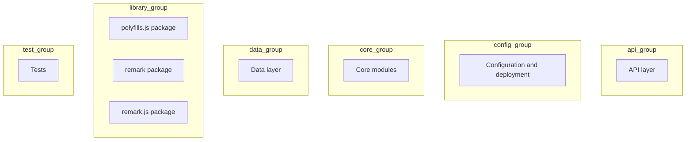

# Architecture report: gnab/remark

> Automated static analysis. **Observed** = directly seen in files/imports/AST; **Inferred** = interpretation from that evidence. Repository code was not executed.

## 1. Repository at a glance

| Item | Value |
| --- | --- |
| Repository | gnab/remark |
| Description | A simple, in-browser, markdown-driven slideshow tool. |
| Language | JavaScript |
| Stars | 13002 |
| Licence | MIT |
| Analysed commit / branch | be58d65d59faca35f6ea3f55aeb8f65ef76305a3 / develop |
| Framework(s) | None detected |
| Files analysed | 62 |
| Components | 8 |

## 2. Architecture in one minute

gnab/remark - A simple, in-browser, markdown-driven slideshow tool.. This repository was analysed statically from 62 file(s) (0 Python). Detected technologies (observed from imports/manifests): no known frameworks/libraries. Files are grouped into 8 component(s): API layer, Configuration and deployment, Core modules, Data layer, polyfills.js package, remark package, remark.js package, Tests. Findings below distinguish observed facts from inferred interpretation.

## 3. High-level block diagram

## 4. Main components

### API layer (`api_layer`)

- **Kind:** api
- **Status:** Observed
- **Confidence:** 0.85
- **Responsibility:** Groups 9 file(s) under api layer (observed from repository paths and static analysis).
- **Paths:** `src/remark/controllers/defaultController.js`, `src/remark/controllers/inputs/keyboard.js`, `src/remark/controllers/inputs/location.js`, `src/remark/controllers/inputs/message.js`, `src/remark/controllers/inputs/mouse.js`, `src/remark/controllers/inputs/touch.js`, `src/remark/views/notesView.js`, `src/remark/views/slideView.js`, `src/remark/views/slideshowView.js`
- **Evidence:** [src/remark/controllers/defaultController.js](https://github.com/gnab/remark/blob/be58d65d59faca35f6ea3f55aeb8f65ef76305a3/src/remark/controllers/defaultController.js); [src/remark/controllers/inputs/keyboard.js](https://github.com/gnab/remark/blob/be58d65d59faca35f6ea3f55aeb8f65ef76305a3/src/remark/controllers/inputs/keyboard.js); [src/remark/controllers/inputs/location.js](https://github.com/gnab/remark/blob/be58d65d59faca35f6ea3f55aeb8f65ef76305a3/src/remark/controllers/inputs/location.js); [src/remark/controllers/inputs/message.js](https://github.com/gnab/remark/blob/be58d65d59faca35f6ea3f55aeb8f65ef76305a3/src/remark/controllers/inputs/message.js); [src/remark/controllers/inputs/mouse.js](https://github.com/gnab/remark/blob/be58d65d59faca35f6ea3f55aeb8f65ef76305a3/src/remark/controllers/inputs/mouse.js); [src/remark/controllers/inputs/touch.js](https://github.com/gnab/remark/blob/be58d65d59faca35f6ea3f55aeb8f65ef76305a3/src/remark/controllers/inputs/touch.js); [src/remark/views/notesView.js](https://github.com/gnab/remark/blob/be58d65d59faca35f6ea3f55aeb8f65ef76305a3/src/remark/views/notesView.js); [src/remark/views/slideView.js](https://github.com/gnab/remark/blob/be58d65d59faca35f6ea3f55aeb8f65ef76305a3/src/remark/views/slideView.js)

### Configuration and deployment (`config`)

- **Kind:** config
- **Status:** Observed
- **Confidence:** 0.85
- **Responsibility:** Groups 2 file(s) under configuration and deployment (observed from repository paths and static analysis).
- **Paths:** `bower.json`, `package.json`
- **Evidence:** [bower.json](https://github.com/gnab/remark/blob/be58d65d59faca35f6ea3f55aeb8f65ef76305a3/bower.json); [package.json](https://github.com/gnab/remark/blob/be58d65d59faca35f6ea3f55aeb8f65ef76305a3/package.json)

### Core modules (`core`)

- **Kind:** core
- **Status:** Observed
- **Confidence:** 0.85
- **Responsibility:** Groups 2 file(s) under core modules (observed from repository paths and static analysis).
- **Paths:** `Gruntfile.js`, `make.js`
- **Evidence:** [Gruntfile.js](https://github.com/gnab/remark/blob/be58d65d59faca35f6ea3f55aeb8f65ef76305a3/Gruntfile.js); [make.js](https://github.com/gnab/remark/blob/be58d65d59faca35f6ea3f55aeb8f65ef76305a3/make.js)

### Data layer (`data_layer`)

- **Kind:** data
- **Status:** Observed
- **Confidence:** 0.85
- **Responsibility:** Groups 4 file(s) under data layer (observed from repository paths and static analysis).
- **Paths:** `src/remark/models/slide.js`, `src/remark/models/slideshow.js`, `src/remark/models/slideshow/events.js`, `src/remark/models/slideshow/navigation.js`
- **Evidence:** [src/remark/models/slide.js](https://github.com/gnab/remark/blob/be58d65d59faca35f6ea3f55aeb8f65ef76305a3/src/remark/models/slide.js); [src/remark/models/slideshow.js](https://github.com/gnab/remark/blob/be58d65d59faca35f6ea3f55aeb8f65ef76305a3/src/remark/models/slideshow.js); [src/remark/models/slideshow/events.js](https://github.com/gnab/remark/blob/be58d65d59faca35f6ea3f55aeb8f65ef76305a3/src/remark/models/slideshow/events.js); [src/remark/models/slideshow/navigation.js](https://github.com/gnab/remark/blob/be58d65d59faca35f6ea3f55aeb8f65ef76305a3/src/remark/models/slideshow/navigation.js)

### polyfills.js package (`polyfills_js`)

- **Kind:** library
- **Status:** Observed
- **Confidence:** 0.85
- **Responsibility:** Groups 1 file(s) under polyfills.js package (observed from repository paths and static analysis).
- **Paths:** `src/polyfills.js`
- **Evidence:** [src/polyfills.js](https://github.com/gnab/remark/blob/be58d65d59faca35f6ea3f55aeb8f65ef76305a3/src/polyfills.js)

### remark package (`remark`)

- **Kind:** library
- **Status:** Observed
- **Confidence:** 0.85
- **Responsibility:** Groups 13 file(s) under remark package (observed from repository paths and static analysis).
- **Paths:** `src/remark/api.js`, `src/remark/components/printing/printing.js`, `src/remark/components/slide-number/slide-number.js`, `src/remark/components/styler/styler.js`, `src/remark/components/timer/timer.js`, `src/remark/converter.js`, `src/remark/dom.js`, `src/remark/lexer.js`, `src/remark/macros.js`, `src/remark/parser.js`, `src/remark/resources.js`, `src/remark/scaler.js`, `src/remark/utils.js`
- **Evidence:** [src/remark/api.js](https://github.com/gnab/remark/blob/be58d65d59faca35f6ea3f55aeb8f65ef76305a3/src/remark/api.js); [src/remark/components/printing/printing.js](https://github.com/gnab/remark/blob/be58d65d59faca35f6ea3f55aeb8f65ef76305a3/src/remark/components/printing/printing.js); [src/remark/components/slide-number/slide-number.js](https://github.com/gnab/remark/blob/be58d65d59faca35f6ea3f55aeb8f65ef76305a3/src/remark/components/slide-number/slide-number.js); [src/remark/components/styler/styler.js](https://github.com/gnab/remark/blob/be58d65d59faca35f6ea3f55aeb8f65ef76305a3/src/remark/components/styler/styler.js); [src/remark/components/timer/timer.js](https://github.com/gnab/remark/blob/be58d65d59faca35f6ea3f55aeb8f65ef76305a3/src/remark/components/timer/timer.js); [src/remark/converter.js](https://github.com/gnab/remark/blob/be58d65d59faca35f6ea3f55aeb8f65ef76305a3/src/remark/converter.js); [src/remark/dom.js](https://github.com/gnab/remark/blob/be58d65d59faca35f6ea3f55aeb8f65ef76305a3/src/remark/dom.js); [src/remark/lexer.js](https://github.com/gnab/remark/blob/be58d65d59faca35f6ea3f55aeb8f65ef76305a3/src/remark/lexer.js)

### remark.js package (`remark_js`)

- **Kind:** library
- **Status:** Observed
- **Confidence:** 0.85
- **Responsibility:** Groups 1 file(s) under remark.js package (observed from repository paths and static analysis).
- **Paths:** `src/remark.js`
- **Evidence:** [src/remark.js](https://github.com/gnab/remark/blob/be58d65d59faca35f6ea3f55aeb8f65ef76305a3/src/remark.js)

### Tests (`tests`)

- **Kind:** test
- **Status:** Observed
- **Confidence:** 0.85
- **Responsibility:** Groups 14 file(s) under tests (observed from repository paths and static analysis).
- **Paths:** `test/mocha.opts`, `test/remark/api_test.js`, `test/remark/components/slide-number_test.js`, `test/remark/components/timer_test.js`, `test/remark/controllers/defaultController_test.js`, `test/remark/converter_test.js`, `test/remark/lexer_test.js`, `test/remark/models/slide_test.js`, `test/remark/models/slideshow_test.js`, `test/remark/parser_test.js`, `test/remark/views/slideView_test.js`, `test/remark/views/slideshowView_test.js`, `test/runner.html`, `test/test_dom.js`
- **Evidence:** [test/mocha.opts](https://github.com/gnab/remark/blob/be58d65d59faca35f6ea3f55aeb8f65ef76305a3/test/mocha.opts); [test/remark/api_test.js](https://github.com/gnab/remark/blob/be58d65d59faca35f6ea3f55aeb8f65ef76305a3/test/remark/api_test.js); [test/remark/components/slide-number_test.js](https://github.com/gnab/remark/blob/be58d65d59faca35f6ea3f55aeb8f65ef76305a3/test/remark/components/slide-number_test.js); [test/remark/components/timer_test.js](https://github.com/gnab/remark/blob/be58d65d59faca35f6ea3f55aeb8f65ef76305a3/test/remark/components/timer_test.js); [test/remark/controllers/defaultController_test.js](https://github.com/gnab/remark/blob/be58d65d59faca35f6ea3f55aeb8f65ef76305a3/test/remark/controllers/defaultController_test.js); [test/remark/converter_test.js](https://github.com/gnab/remark/blob/be58d65d59faca35f6ea3f55aeb8f65ef76305a3/test/remark/converter_test.js); [test/remark/lexer_test.js](https://github.com/gnab/remark/blob/be58d65d59faca35f6ea3f55aeb8f65ef76305a3/test/remark/lexer_test.js); [test/remark/models/slide_test.js](https://github.com/gnab/remark/blob/be58d65d59faca35f6ea3f55aeb8f65ef76305a3/test/remark/models/slide_test.js)

## 5. Execution flow

No entry point was observed; the startup flow below is therefore limited.

Representative flow (derived from observed entry points and the import graph; steps beyond the entry point are **Inferred**):

1. Execution starts at an observed entry point listed above, if present.
2. No internal import relationships between components were observed.

## 6. Project structure

### `(root)`

- `.gitignore` - other (30 bytes)
- `.jshintignore` - other (50 bytes)
- `.jshintrc` - other (218 bytes)
- `.npmignore` - other (7 bytes)
- `.travis.yml` - ci, YAML (48 bytes)
- `Gruntfile.js` - source, JavaScript (878 bytes)
- `HISTORY.md` - docs (13038 bytes)
- `LICENSE` - docs (1085 bytes)
- `Makefile` - other (170 bytes)
- `README.md` - docs (7221 bytes)
- `boilerplate-local.html` - other (1209 bytes)
- `boilerplate-remote.html` - other (1242 bytes)
- `bower.json` - config (573 bytes)
- `make.js` - source, JavaScript (5796 bytes)
- `package.json` - manifest (637 bytes)

### `src`

- `src/polyfills.js` - source, JavaScript (819 bytes)
- `src/remark.html` - other (3136 bytes)
- `src/remark.js` - source, JavaScript (300 bytes)
- `src/remark.less` - other (8459 bytes)
- `src/remark/api.js` - source, JavaScript (2298 bytes)
- `src/remark/components/printing/printing.js` - source, JavaScript (1450 bytes)
- `src/remark/components/slide-number/slide-number.js` - source, JavaScript (847 bytes)
- `src/remark/components/styler/styler.js` - source, JavaScript (1681 bytes)
- `src/remark/components/timer/timer.js` - source, JavaScript (3711 bytes)
- `src/remark/controllers/defaultController.js` - source, JavaScript (1008 bytes)
- `src/remark/controllers/inputs/keyboard.js` - source, JavaScript (3171 bytes)
- `src/remark/controllers/inputs/location.js` - source, JavaScript (1219 bytes)
- `src/remark/controllers/inputs/message.js` - source, JavaScript (492 bytes)
- `src/remark/controllers/inputs/mouse.js` - source, JavaScript (1364 bytes)
- `src/remark/controllers/inputs/touch.js` - source, JavaScript (1331 bytes)
- `src/remark/converter.js` - source, JavaScript (1443 bytes)
- `src/remark/dom.js` - source, JavaScript (686 bytes)
- `src/remark/lexer.js` - source, JavaScript (4219 bytes)
- `src/remark/macros.js` - source, JavaScript (91 bytes)
- `src/remark/models/slide.js` - source, JavaScript (3360 bytes)
- `src/remark/models/slideshow.js` - source, JavaScript (6452 bytes)
- `src/remark/models/slideshow/events.js` - source, JavaScript (623 bytes)
- `src/remark/models/slideshow/navigation.js` - source, JavaScript (3941 bytes)
- `src/remark/parser.js` - source, JavaScript (6836 bytes)
- `src/remark/resources.js` - source, JavaScript (10489 bytes)
- `src/remark/scaler.js` - source, JavaScript (1873 bytes)
- `src/remark/utils.js` - source, JavaScript (1158 bytes)
- `src/remark/views/notesView.js` - source, JavaScript (2148 bytes)
- `src/remark/views/slideView.js` - source, JavaScript (9844 bytes)
- `src/remark/views/slideshowView.js` - source, JavaScript (9160 bytes)
- `src/templates/boilerplate-single.html.template` - other (1235 bytes)
- `src/templates/highlighter.js.template` - other (368 bytes)
- `src/templates/resources.js.template` - other (152 bytes)

### `test`

- `test/mocha.opts` - test (115 bytes)
- `test/remark/api_test.js` - test, JavaScript (1329 bytes)
- `test/remark/components/slide-number_test.js` - test, JavaScript (783 bytes)
- `test/remark/components/timer_test.js` - test, JavaScript (5789 bytes)
- `test/remark/controllers/defaultController_test.js` - test, JavaScript (6030 bytes)
- `test/remark/converter_test.js` - test, JavaScript (1053 bytes)
- `test/remark/lexer_test.js` - test, JavaScript (5681 bytes)
- `test/remark/models/slide_test.js` - test, JavaScript (3960 bytes)
- `test/remark/models/slideshow_test.js` - test, JavaScript (6701 bytes)
- `test/remark/parser_test.js` - test, JavaScript (9446 bytes)
- `test/remark/views/slideView_test.js` - test, JavaScript (8705 bytes)
- `test/remark/views/slideshowView_test.js` - test, JavaScript (6935 bytes)
- `test/runner.html` - test (1069 bytes)
- `test/test_dom.js` - test, JavaScript (860 bytes)

## 7. Key dependencies and integrations

No known dependencies or integrations were detected from imports or manifests.

## 8. Data and state

- Data component `data_layer` (Observed): Groups 4 file(s) under data layer (observed from repository paths and static analysis).

## 9. Configuration and deployment clues

- `.travis.yml` (ci)
- `bower.json` (config)
- `package.json` (manifest)

## 10. Design observations

- An entry/API layer is separated from other code (Inferred from paths and decorators).
- Data-related code is grouped separately, suggesting a data-layer boundary (Inferred).
- Tests are present alongside source code (Observed from test file paths).

These observations are interpretations (**Inferred**) of the observed structure, not guarantees about runtime design.

## 11. Limitations and unknowns

- Static analysis only: repository code was not executed, installed, or imported at runtime.
- Components and relationships are inferred from file paths, imports, and AST structure; runtime behaviour, dynamic imports, and reflection may not be visible.
- No clear application entry point was observed in the analysed files.
- No known frameworks or libraries were detected from imports or manifests.
- Repository text was treated as untrusted data; no instructions found in repository files were followed, and likely secret values were redacted/excluded.
- JavaScript and TypeScript files were inventoried from paths and package manifests. They were not parsed with a full language AST, and repository code was not executed.

## 12. Source references

- [Gruntfile.js](https://github.com/gnab/remark/blob/be58d65d59faca35f6ea3f55aeb8f65ef76305a3/Gruntfile.js)
- [bower.json](https://github.com/gnab/remark/blob/be58d65d59faca35f6ea3f55aeb8f65ef76305a3/bower.json)
- [make.js](https://github.com/gnab/remark/blob/be58d65d59faca35f6ea3f55aeb8f65ef76305a3/make.js)
- [package.json](https://github.com/gnab/remark/blob/be58d65d59faca35f6ea3f55aeb8f65ef76305a3/package.json)
- [src/polyfills.js](https://github.com/gnab/remark/blob/be58d65d59faca35f6ea3f55aeb8f65ef76305a3/src/polyfills.js)
- [src/remark.js](https://github.com/gnab/remark/blob/be58d65d59faca35f6ea3f55aeb8f65ef76305a3/src/remark.js)
- [src/remark/api.js](https://github.com/gnab/remark/blob/be58d65d59faca35f6ea3f55aeb8f65ef76305a3/src/remark/api.js)
- [src/remark/components/printing/printing.js](https://github.com/gnab/remark/blob/be58d65d59faca35f6ea3f55aeb8f65ef76305a3/src/remark/components/printing/printing.js)
- [src/remark/components/slide-number/slide-number.js](https://github.com/gnab/remark/blob/be58d65d59faca35f6ea3f55aeb8f65ef76305a3/src/remark/components/slide-number/slide-number.js)
- [src/remark/components/styler/styler.js](https://github.com/gnab/remark/blob/be58d65d59faca35f6ea3f55aeb8f65ef76305a3/src/remark/components/styler/styler.js)
- [src/remark/components/timer/timer.js](https://github.com/gnab/remark/blob/be58d65d59faca35f6ea3f55aeb8f65ef76305a3/src/remark/components/timer/timer.js)
- [src/remark/controllers/defaultController.js](https://github.com/gnab/remark/blob/be58d65d59faca35f6ea3f55aeb8f65ef76305a3/src/remark/controllers/defaultController.js)
- [src/remark/controllers/inputs/keyboard.js](https://github.com/gnab/remark/blob/be58d65d59faca35f6ea3f55aeb8f65ef76305a3/src/remark/controllers/inputs/keyboard.js)
- [src/remark/controllers/inputs/location.js](https://github.com/gnab/remark/blob/be58d65d59faca35f6ea3f55aeb8f65ef76305a3/src/remark/controllers/inputs/location.js)
- [src/remark/controllers/inputs/message.js](https://github.com/gnab/remark/blob/be58d65d59faca35f6ea3f55aeb8f65ef76305a3/src/remark/controllers/inputs/message.js)
- [src/remark/controllers/inputs/mouse.js](https://github.com/gnab/remark/blob/be58d65d59faca35f6ea3f55aeb8f65ef76305a3/src/remark/controllers/inputs/mouse.js)
- [src/remark/controllers/inputs/touch.js](https://github.com/gnab/remark/blob/be58d65d59faca35f6ea3f55aeb8f65ef76305a3/src/remark/controllers/inputs/touch.js)
- [src/remark/converter.js](https://github.com/gnab/remark/blob/be58d65d59faca35f6ea3f55aeb8f65ef76305a3/src/remark/converter.js)
- [src/remark/dom.js](https://github.com/gnab/remark/blob/be58d65d59faca35f6ea3f55aeb8f65ef76305a3/src/remark/dom.js)
- [src/remark/lexer.js](https://github.com/gnab/remark/blob/be58d65d59faca35f6ea3f55aeb8f65ef76305a3/src/remark/lexer.js)
- [src/remark/models/slide.js](https://github.com/gnab/remark/blob/be58d65d59faca35f6ea3f55aeb8f65ef76305a3/src/remark/models/slide.js)
- [src/remark/models/slideshow.js](https://github.com/gnab/remark/blob/be58d65d59faca35f6ea3f55aeb8f65ef76305a3/src/remark/models/slideshow.js)
- [src/remark/models/slideshow/events.js](https://github.com/gnab/remark/blob/be58d65d59faca35f6ea3f55aeb8f65ef76305a3/src/remark/models/slideshow/events.js)
- [src/remark/models/slideshow/navigation.js](https://github.com/gnab/remark/blob/be58d65d59faca35f6ea3f55aeb8f65ef76305a3/src/remark/models/slideshow/navigation.js)
- [src/remark/views/notesView.js](https://github.com/gnab/remark/blob/be58d65d59faca35f6ea3f55aeb8f65ef76305a3/src/remark/views/notesView.js)
- [src/remark/views/slideView.js](https://github.com/gnab/remark/blob/be58d65d59faca35f6ea3f55aeb8f65ef76305a3/src/remark/views/slideView.js)
- [test/mocha.opts](https://github.com/gnab/remark/blob/be58d65d59faca35f6ea3f55aeb8f65ef76305a3/test/mocha.opts)
- [test/remark/api_test.js](https://github.com/gnab/remark/blob/be58d65d59faca35f6ea3f55aeb8f65ef76305a3/test/remark/api_test.js)
- [test/remark/components/slide-number_test.js](https://github.com/gnab/remark/blob/be58d65d59faca35f6ea3f55aeb8f65ef76305a3/test/remark/components/slide-number_test.js)
- [test/remark/components/timer_test.js](https://github.com/gnab/remark/blob/be58d65d59faca35f6ea3f55aeb8f65ef76305a3/test/remark/components/timer_test.js)
- [test/remark/controllers/defaultController_test.js](https://github.com/gnab/remark/blob/be58d65d59faca35f6ea3f55aeb8f65ef76305a3/test/remark/controllers/defaultController_test.js)
- [test/remark/converter_test.js](https://github.com/gnab/remark/blob/be58d65d59faca35f6ea3f55aeb8f65ef76305a3/test/remark/converter_test.js)
- [test/remark/lexer_test.js](https://github.com/gnab/remark/blob/be58d65d59faca35f6ea3f55aeb8f65ef76305a3/test/remark/lexer_test.js)
- [test/remark/models/slide_test.js](https://github.com/gnab/remark/blob/be58d65d59faca35f6ea3f55aeb8f65ef76305a3/test/remark/models/slide_test.js)
