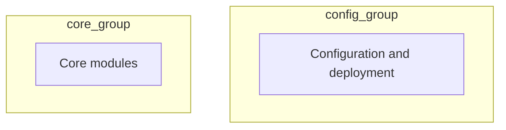

# Architecture report: goabstract/Awesome-Design-Tools

> Automated static analysis. **Observed** = directly seen in files/imports/AST; **Inferred** = interpretation from that evidence. Repository code was not executed.

## 1. Repository at a glance

| Item | Value |
| --- | --- |
| Repository | goabstract/Awesome-Design-Tools |
| Description | The best design tools and plugins for everything 👉 |
| Language | JavaScript |
| Stars | 41891 |
| Licence | MIT |
| Analysed commit / branch | dc60e63c248c44acb42f09fb0c985b77b5fe4bf5 / master |
| Framework(s) | Express |
| Files analysed | 69 |
| Components | 2 |

## 2. Architecture in one minute

goabstract/Awesome-Design-Tools - The best design tools and plugins for everything 👉. This repository was analysed statically from 69 file(s) (0 Python). Detected technologies (observed from imports/manifests): Express. Files are grouped into 2 component(s): Configuration and deployment, Core modules. Findings below distinguish observed facts from inferred interpretation.

## 3. High-level block diagram

## 4. Main components

### Configuration and deployment (`config`)

- **Kind:** config
- **Status:** Observed
- **Confidence:** 0.85
- **Responsibility:** Groups 1 file(s) under configuration and deployment (observed from repository paths and static analysis).
- **Paths:** `package.json`
- **Evidence:** [package.json](https://github.com/goabstract/Awesome-Design-Tools/blob/dc60e63c248c44acb42f09fb0c985b77b5fe4bf5/package.json)

### Core modules (`core`)

- **Kind:** core
- **Status:** Observed
- **Confidence:** 0.85
- **Responsibility:** Groups 1 file(s) under core modules (observed from repository paths and static analysis).
- **Paths:** `index.js`
- **Evidence:** [index.js](https://github.com/goabstract/Awesome-Design-Tools/blob/dc60e63c248c44acb42f09fb0c985b77b5fe4bf5/index.js)

## 5. Execution flow

**Observed** entry point(s):

- [index.js](https://github.com/goabstract/Awesome-Design-Tools/blob/dc60e63c248c44acb42f09fb0c985b77b5fe4bf5/index.js)

Representative flow (derived from observed entry points and the import graph; steps beyond the entry point are **Inferred**):

1. Execution starts at an observed entry point listed above, if present.
2. No internal import relationships between components were observed.

## 6. Project structure

### `(root)`

- `.gitignore` - other (29 bytes)
- `Awesome-Design-Conferences.md` - docs (24660 bytes)
- `Awesome-Design-UI-Kits.md` - docs (101180 bytes)
- `Contribution_Guidelines.md` - docs (4818 bytes)
- `LICENSE` - docs (1068 bytes)
- `README.md` - docs (144976 bytes)
- `index.js` - source, JavaScript (4034 bytes)
- `package.json` - manifest (1027 bytes)

### `Media`

- `Media/adk-logo.svg` - other (3356 bytes)
- `Media/adobe-xd.svg` - other (3484 bytes)
- `Media/desktop.svg` - other (1202 bytes)
- `Media/figma.svg` - other (1786 bytes)
- `Media/free.svg` - other (49283 bytes)
- `Media/invision-studio.svg` - other (534 bytes)
- `Media/mac.svg` - other (12818 bytes)
- `Media/open-source.svg` - other (10525 bytes)
- `Media/photoshop.svg` - other (2243 bytes)
- `Media/sketch.svg` - other (3208 bytes)
- `Media/smartphone-mobile-phone-svgrepo-com.svg` - other (2645 bytes)
- `Media/web.svg` - other (4083 bytes)

### `docs`

- `docs/assets/svg/adk-logo.svg` - docs (3356 bytes)
- `docs/assets/svg/filter-icon-violet.svg` - docs (1161 bytes)
- `docs/assets/svg/filter-icon.svg` - docs (1184 bytes)
- `docs/assets/svg/kits-icon-selected.svg` - docs (4775 bytes)
- `docs/assets/svg/kits-icon-unselected.svg` - docs (4454 bytes)
- `docs/assets/svg/labels/adobe-xd.svg` - docs (3484 bytes)
- `docs/assets/svg/labels/figma.svg` - docs (1786 bytes)
- `docs/assets/svg/labels/sketch.svg` - docs (3207 bytes)
- `docs/assets/svg/logo-plugins.svg` - docs (3431 bytes)
- `docs/assets/svg/plugin-icon-selected.svg` - docs (2242 bytes)
- `docs/assets/svg/plugins-icon-unselected.svg` - docs (2248 bytes)
- `docs/assets/svg/promotion/abstract-logo.svg` - docs (1698 bytes)
- `docs/assets/svg/promotion/maze-logo.svg` - docs (1110 bytes)
- `docs/assets/svg/promotion/protopie-logo.svg` - docs (6601 bytes)
- `docs/assets/svg/promotion/supernova-logo.svg` - docs (2110 bytes)
- `docs/assets/svg/promotion/xd-logo.svg` - docs (3655 bytes)
- `docs/assets/svg/search-icon.svg` - docs (992 bytes)
- `docs/assets/svg/tools-icon-selected.svg` - docs (2417 bytes)
- `docs/assets/svg/tools-icon-unselected.svg` - docs (2421 bytes)
- `docs/css/normalize.css` - docs (6137 bytes)
- `docs/js/script.js` - docs (8404 bytes)
- `docs/modules/Templates.js` - docs (4790 bytes)
- `docs/modules/addAllPromoBanners.js` - docs (4510 bytes)
- `docs/modules/addBackgroundColorToLogo.js` - docs (1760 bytes)
- `docs/modules/addContributeButtonForAddendum.js` - docs (495 bytes)
- `docs/modules/addHamburgerMenu.js` - docs (376 bytes)
- `docs/modules/addHeader.js` - docs (4894 bytes)
- `docs/modules/addIDsForHeadings.js` - docs (291 bytes)
- `docs/modules/addLinksToNavigationElements.js` - docs (280 bytes)
- `docs/modules/addScripts.js` - docs (367 bytes)
- `docs/modules/addWelcomeArticle.js` - docs (607 bytes)
- `docs/modules/config/plugins.js` - docs (2724 bytes)
- `docs/modules/config/tools.js` - docs (2832 bytes)
- `docs/modules/config/ui-kits.js` - docs (2719 bytes)
- `docs/modules/createPromoBanner.js` - docs (820 bytes)
- `docs/modules/editHead.js` - docs (820 bytes)
- `docs/modules/favicon/favicon-adk.js` - docs (57827 bytes)
- `docs/modules/favicon/favicon-adp.js` - docs (59823 bytes)
- `docs/modules/helpers/createLinkForID.js` - docs (112 bytes)
- `docs/modules/helpers/deleteAllIconsInDescription.js` - docs (259 bytes)
- `docs/modules/helpers/getCssFile.js` - docs (199 bytes)
- `docs/modules/helpers/getJS.js` - docs (339 bytes)
- `docs/modules/helpers/removeAllImages.js` - docs (193 bytes)
- `docs/modules/removeListInAddendum.js` - docs (324 bytes)
- `docs/modules/tweakDescriptionOfArticleTopic.js` - docs (661 bytes)
- `docs/modules/tweakToolContainer.js` - docs (3843 bytes)
- `docs/modules/view/promotionBanner.js` - docs (1533 bytes)
- `docs/pull_request_template.md` - docs (556 bytes)
- `docs/server.js` - docs (385 bytes)

## 7. Key dependencies and integrations

| Name | Category | Status | Confidence | Evidence |
| --- | --- | --- | --- | --- |
| Express | framework | Observed | 0.85 | [package.json:25](https://github.com/goabstract/Awesome-Design-Tools/blob/dc60e63c248c44acb42f09fb0c985b77b5fe4bf5/package.json#L25) |

## 8. Data and state

No database, cache, queue, or persistent-state usage was observed in the analysed files. State handling, if any, may be in-memory or in files that were not analysed.

## 9. Configuration and deployment clues

- `package.json` (manifest)

## 10. Design observations

- No strong design patterns could be established from the available evidence.

These observations are interpretations (**Inferred**) of the observed structure, not guarantees about runtime design.

## 11. Limitations and unknowns

- Static analysis only: repository code was not executed, installed, or imported at runtime.
- Components and relationships are inferred from file paths, imports, and AST structure; runtime behaviour, dynamic imports, and reflection may not be visible.
- 1 file(s) were skipped during inventory (1 x lockfile excluded).
- No clear application entry point was observed in the analysed files.
- Repository text was treated as untrusted data; no instructions found in repository files were followed, and likely secret values were redacted/excluded.
- JavaScript and TypeScript files were inventoried from paths and package manifests. They were not parsed with a full language AST, and repository code was not executed.

## 12. Source references

- [index.js](https://github.com/goabstract/Awesome-Design-Tools/blob/dc60e63c248c44acb42f09fb0c985b77b5fe4bf5/index.js)
- [package.json](https://github.com/goabstract/Awesome-Design-Tools/blob/dc60e63c248c44acb42f09fb0c985b77b5fe4bf5/package.json)
- [package.json:25](https://github.com/goabstract/Awesome-Design-Tools/blob/dc60e63c248c44acb42f09fb0c985b77b5fe4bf5/package.json#L25)
