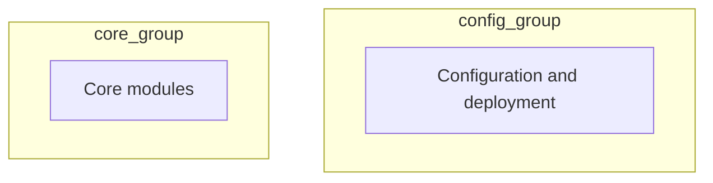

# Architecture report: goldbergyoni/javascript-testing-best-practices

> Automated static analysis. **Observed** = directly seen in files/imports/AST; **Inferred** = interpretation from that evidence. Repository code was not executed.

## 1. Repository at a glance

| Item | Value |
| --- | --- |
| Repository | goldbergyoni/javascript-testing-best-practices |
| Description | 📗🌐 🚢 Comprehensive and exhaustive JavaScript & Node.js testing best practices (August 2025) |
| Language | JavaScript |
| Stars | 24612 |
| Licence | MIT |
| Analysed commit / branch | 63a2bb07bb718d0a34a9c1249ef0df9b1266dad8 / master |
| Framework(s) | None detected |
| Files analysed | 18 |
| Components | 2 |

## 2. Architecture in one minute

goldbergyoni/javascript-testing-best-practices - 📗🌐 🚢 Comprehensive and exhaustive JavaScript & Node.js testing best practices (August 2025). This repository was analysed statically from 18 file(s) (0 Python). Detected technologies (observed from imports/manifests): no known frameworks/libraries. Files are grouped into 2 component(s): Configuration and deployment, Core modules. Findings below distinguish observed facts from inferred interpretation.

## 3. High-level block diagram

## 4. Main components

### Configuration and deployment (`config`)

- **Kind:** config
- **Status:** Observed
- **Confidence:** 0.85
- **Responsibility:** Groups 1 file(s) under configuration and deployment (observed from repository paths and static analysis).
- **Paths:** `package.json`
- **Evidence:** [package.json](https://github.com/goldbergyoni/javascript-testing-best-practices/blob/63a2bb07bb718d0a34a9c1249ef0df9b1266dad8/package.json)

### Core modules (`core`)

- **Kind:** core
- **Status:** Observed
- **Confidence:** 0.85
- **Responsibility:** Groups 1 file(s) under core modules (observed from repository paths and static analysis).
- **Paths:** `index.js`
- **Evidence:** [index.js](https://github.com/goldbergyoni/javascript-testing-best-practices/blob/63a2bb07bb718d0a34a9c1249ef0df9b1266dad8/index.js)

## 5. Execution flow

**Observed** entry point(s):

- [index.js](https://github.com/goldbergyoni/javascript-testing-best-practices/blob/63a2bb07bb718d0a34a9c1249ef0df9b1266dad8/index.js)

Representative flow (derived from observed entry points and the import graph; steps beyond the entry point are **Inferred**):

1. Execution starts at an observed entry point listed above, if present.
2. No internal import relationships between components were observed.

## 6. Project structure

### `(root)`

- `.all-contributorsrc` - other (13312 bytes)
- `.gitignore` - other (10 bytes)
- `LICENSE` - docs (1070 bytes)
- `index.js` - source, JavaScript (164 bytes)
- `package.json` - manifest (819 bytes)
- `readme-es.md` - docs (124221 bytes)
- `readme-fr.md` - docs (124843 bytes)
- `readme-pl.md` - docs (136147 bytes)
- `readme-pr-fr.md` - docs (168122 bytes)
- `readme-pt-br.md` - docs (117471 bytes)
- `readme-ru.md` - docs (191269 bytes)
- `readme-ua.md` - docs (192432 bytes)
- `readme-zh-CN.md` - docs (93891 bytes)
- `readme-zh-TW.md` - docs (96277 bytes)
- `readme.kr.md` - docs (116068 bytes)
- `readme.md` - docs (130210 bytes)

### `.operations`

- `.operations/questions-answers.md` - docs (1384 bytes)

### `assets`

- `assets/readme.md` - docs (4 bytes)

## 7. Key dependencies and integrations

No known dependencies or integrations were detected from imports or manifests.

## 8. Data and state

No database, cache, queue, or persistent-state usage was observed in the analysed files. State handling, if any, may be in-memory or in files that were not analysed.

## 9. Configuration and deployment clues

- `package.json` (manifest)

## 10. Design observations

- No strong design patterns could be established from the available evidence.

These observations are interpretations (**Inferred**) of the observed structure, not guarantees about runtime design.

## 11. Limitations and unknowns

- Static analysis only: repository code was not executed, installed, or imported at runtime.
- Components and relationships are inferred from file paths, imports, and AST structure; runtime behaviour, dynamic imports, and reflection may not be visible.
- No clear application entry point was observed in the analysed files.
- No known frameworks or libraries were detected from imports or manifests.
- Repository text was treated as untrusted data; no instructions found in repository files were followed, and likely secret values were redacted/excluded.
- JavaScript and TypeScript files were inventoried from paths and package manifests. They were not parsed with a full language AST, and repository code was not executed.

## 12. Source references

- [index.js](https://github.com/goldbergyoni/javascript-testing-best-practices/blob/63a2bb07bb718d0a34a9c1249ef0df9b1266dad8/index.js)
- [package.json](https://github.com/goldbergyoni/javascript-testing-best-practices/blob/63a2bb07bb718d0a34a9c1249ef0df9b1266dad8/package.json)
