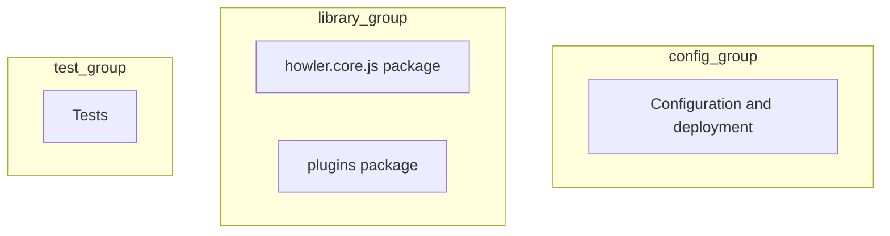

# Architecture report: goldfire/howler.js

> Automated static analysis. **Observed** = directly seen in files/imports/AST; **Inferred** = interpretation from that evidence. Repository code was not executed.

## 1. Repository at a glance

| Item | Value |
| --- | --- |
| Repository | goldfire/howler.js |
| Description | Javascript audio library for the modern web. |
| Language | JavaScript |
| Stars | 25445 |
| Licence | MIT |
| Analysed commit / branch | 1d3053576a860e9854645493ad6c4a72c6cc6e45 / master |
| Framework(s) | None detected |
| Files analysed | 46 |
| Components | 4 |

## 2. Architecture in one minute

goldfire/howler.js - Javascript audio library for the modern web.. This repository was analysed statically from 46 file(s) (0 Python). Detected technologies (observed from imports/manifests): no known frameworks/libraries. Files are grouped into 4 component(s): Configuration and deployment, howler.core.js package, plugins package, Tests. Findings below distinguish observed facts from inferred interpretation.

## 3. High-level block diagram

## 4. Main components

### Configuration and deployment (`config`)

- **Kind:** config
- **Status:** Observed
- **Confidence:** 0.85
- **Responsibility:** Groups 2 file(s) under configuration and deployment (observed from repository paths and static analysis).
- **Paths:** `bower.json`, `package.json`
- **Evidence:** [bower.json](https://github.com/goldfire/howler.js/blob/1d3053576a860e9854645493ad6c4a72c6cc6e45/bower.json); [package.json](https://github.com/goldfire/howler.js/blob/1d3053576a860e9854645493ad6c4a72c6cc6e45/package.json)

### howler.core.js package (`howler_core_js`)

- **Kind:** library
- **Status:** Observed
- **Confidence:** 0.85
- **Responsibility:** Groups 1 file(s) under howler.core.js package (observed from repository paths and static analysis).
- **Paths:** `src/howler.core.js`
- **Evidence:** [src/howler.core.js](https://github.com/goldfire/howler.js/blob/1d3053576a860e9854645493ad6c4a72c6cc6e45/src/howler.core.js)

### plugins package (`plugins`)

- **Kind:** library
- **Status:** Observed
- **Confidence:** 0.85
- **Responsibility:** Groups 1 file(s) under plugins package (observed from repository paths and static analysis).
- **Paths:** `src/plugins/howler.spatial.js`
- **Evidence:** [src/plugins/howler.spatial.js](https://github.com/goldfire/howler.js/blob/1d3053576a860e9854645493ad6c4a72c6cc6e45/src/plugins/howler.spatial.js)

### Tests (`tests`)

- **Kind:** test
- **Status:** Observed
- **Confidence:** 0.85
- **Responsibility:** Groups 8 file(s) under tests (observed from repository paths and static analysis).
- **Paths:** `tests/core.html5audio.html`, `tests/core.webaudio.html`, `tests/css/styles.css`, `tests/index.html`, `tests/js/core.html5audio.js`, `tests/js/core.webaudio.js`, `tests/js/spatial.js`, `tests/spatial.html`
- **Evidence:** [tests/core.html5audio.html](https://github.com/goldfire/howler.js/blob/1d3053576a860e9854645493ad6c4a72c6cc6e45/tests/core.html5audio.html); [tests/core.webaudio.html](https://github.com/goldfire/howler.js/blob/1d3053576a860e9854645493ad6c4a72c6cc6e45/tests/core.webaudio.html); [tests/css/styles.css](https://github.com/goldfire/howler.js/blob/1d3053576a860e9854645493ad6c4a72c6cc6e45/tests/css/styles.css); [tests/index.html](https://github.com/goldfire/howler.js/blob/1d3053576a860e9854645493ad6c4a72c6cc6e45/tests/index.html); [tests/js/core.html5audio.js](https://github.com/goldfire/howler.js/blob/1d3053576a860e9854645493ad6c4a72c6cc6e45/tests/js/core.html5audio.js); [tests/js/core.webaudio.js](https://github.com/goldfire/howler.js/blob/1d3053576a860e9854645493ad6c4a72c6cc6e45/tests/js/core.webaudio.js); [tests/js/spatial.js](https://github.com/goldfire/howler.js/blob/1d3053576a860e9854645493ad6c4a72c6cc6e45/tests/js/spatial.js); [tests/spatial.html](https://github.com/goldfire/howler.js/blob/1d3053576a860e9854645493ad6c4a72c6cc6e45/tests/spatial.html)

## 5. Execution flow

No entry point was observed; the startup flow below is therefore limited.

Representative flow (derived from observed entry points and the import graph; steps beyond the entry point are **Inferred**):

1. Execution starts at an observed entry point listed above, if present.
2. No internal import relationships between components were observed.

## 6. Project structure

### `(root)`

- `BACKERS.md` - docs (875 bytes)
- `CHANGELOG.md` - docs (35976 bytes)
- `LICENSE.md` - docs (1088 bytes)
- `README.md` - docs (27476 bytes)
- `bower.json` - config (657 bytes)
- `package.json` - manifest (1931 bytes)

### `.github`

- `.github/FUNDING.yml` - config (17 bytes)
- `.github/ISSUE_TEMPLATE/bug.yml` - config (1680 bytes)
- `.github/ISSUE_TEMPLATE/config.yml` - config (384 bytes)
- `.github/ISSUE_TEMPLATE/docs.yml` - config (671 bytes)
- `.github/ISSUE_TEMPLATE/feature.yml` - config (560 bytes)
- `.github/PULL_REQUEST_TEMPLATE.md` - docs (593 bytes)

### `examples`

- `examples/3d/README.md` - docs (1065 bytes)
- `examples/3d/index.html` - other (721 bytes)
- `examples/3d/js/camera.js` - source, JavaScript (4721 bytes)
- `examples/3d/js/controls.js` - source, JavaScript (2530 bytes)
- `examples/3d/js/game.js` - source, JavaScript (1401 bytes)
- `examples/3d/js/map.js` - source, JavaScript (6595 bytes)
- `examples/3d/js/player.js` - source, JavaScript (2116 bytes)
- `examples/3d/js/sound.js` - source, JavaScript (2567 bytes)
- `examples/3d/js/texture.js` - source, JavaScript (451 bytes)
- `examples/3d/styles.css` - other (359 bytes)
- `examples/README.md` - docs (518 bytes)
- `examples/player/README.md` - docs (1051 bytes)
- `examples/player/index.html` - other (1275 bytes)
- `examples/player/player.js` - source, JavaScript (10641 bytes)
- `examples/player/siriwave.js` - source, JavaScript (3877 bytes)
- `examples/player/styles.css` - other (15524 bytes)
- `examples/radio/README.md` - docs (784 bytes)
- `examples/radio/index.html` - other (2414 bytes)
- `examples/radio/radio.js` - source, JavaScript (3918 bytes)
- `examples/radio/styles.css` - other (3183 bytes)
- `examples/sprite/README.md` - docs (921 bytes)
- `examples/sprite/index.html` - other (1215 bytes)
- `examples/sprite/sprite.js` - source, JavaScript (4062 bytes)
- `examples/sprite/styles.css` - other (15073 bytes)

### `src`

- `src/howler.core.js` - source, JavaScript (82687 bytes)
- `src/plugins/howler.spatial.js` - source, JavaScript (25281 bytes)

### `tests`

- `tests/core.html5audio.html` - test (445 bytes)
- `tests/core.webaudio.html` - test (415 bytes)
- `tests/css/styles.css` - test (8834 bytes)
- `tests/index.html` - test (776 bytes)
- `tests/js/core.html5audio.js` - test, JavaScript (4909 bytes)
- `tests/js/core.webaudio.js` - test, JavaScript (5028 bytes)
- `tests/js/spatial.js` - test, JavaScript (2633 bytes)
- `tests/spatial.html` - test (468 bytes)

## 7. Key dependencies and integrations

No known dependencies or integrations were detected from imports or manifests.

## 8. Data and state

No database, cache, queue, or persistent-state usage was observed in the analysed files. State handling, if any, may be in-memory or in files that were not analysed.

## 9. Configuration and deployment clues

- `.github/FUNDING.yml` (config)
- `.github/ISSUE_TEMPLATE/bug.yml` (config)
- `.github/ISSUE_TEMPLATE/config.yml` (config)
- `.github/ISSUE_TEMPLATE/docs.yml` (config)
- `.github/ISSUE_TEMPLATE/feature.yml` (config)
- `bower.json` (config)
- `package.json` (manifest)

## 10. Design observations

- Tests are present alongside source code (Observed from test file paths).

These observations are interpretations (**Inferred**) of the observed structure, not guarantees about runtime design.

## 11. Limitations and unknowns

- Static analysis only: repository code was not executed, installed, or imported at runtime.
- Components and relationships are inferred from file paths, imports, and AST structure; runtime behaviour, dynamic imports, and reflection may not be visible.
- 1 file(s) were skipped during inventory (1 x vendored/generated directory excluded).
- No clear application entry point was observed in the analysed files.
- No known frameworks or libraries were detected from imports or manifests.
- Repository text was treated as untrusted data; no instructions found in repository files were followed, and likely secret values were redacted/excluded.
- JavaScript and TypeScript files were inventoried from paths and package manifests. They were not parsed with a full language AST, and repository code was not executed.

## 12. Source references

- [bower.json](https://github.com/goldfire/howler.js/blob/1d3053576a860e9854645493ad6c4a72c6cc6e45/bower.json)
- [package.json](https://github.com/goldfire/howler.js/blob/1d3053576a860e9854645493ad6c4a72c6cc6e45/package.json)
- [src/howler.core.js](https://github.com/goldfire/howler.js/blob/1d3053576a860e9854645493ad6c4a72c6cc6e45/src/howler.core.js)
- [src/plugins/howler.spatial.js](https://github.com/goldfire/howler.js/blob/1d3053576a860e9854645493ad6c4a72c6cc6e45/src/plugins/howler.spatial.js)
- [tests/core.html5audio.html](https://github.com/goldfire/howler.js/blob/1d3053576a860e9854645493ad6c4a72c6cc6e45/tests/core.html5audio.html)
- [tests/core.webaudio.html](https://github.com/goldfire/howler.js/blob/1d3053576a860e9854645493ad6c4a72c6cc6e45/tests/core.webaudio.html)
- [tests/css/styles.css](https://github.com/goldfire/howler.js/blob/1d3053576a860e9854645493ad6c4a72c6cc6e45/tests/css/styles.css)
- [tests/index.html](https://github.com/goldfire/howler.js/blob/1d3053576a860e9854645493ad6c4a72c6cc6e45/tests/index.html)
- [tests/js/core.html5audio.js](https://github.com/goldfire/howler.js/blob/1d3053576a860e9854645493ad6c4a72c6cc6e45/tests/js/core.html5audio.js)
- [tests/js/core.webaudio.js](https://github.com/goldfire/howler.js/blob/1d3053576a860e9854645493ad6c4a72c6cc6e45/tests/js/core.webaudio.js)
- [tests/js/spatial.js](https://github.com/goldfire/howler.js/blob/1d3053576a860e9854645493ad6c4a72c6cc6e45/tests/js/spatial.js)
- [tests/spatial.html](https://github.com/goldfire/howler.js/blob/1d3053576a860e9854645493ad6c4a72c6cc6e45/tests/spatial.html)
