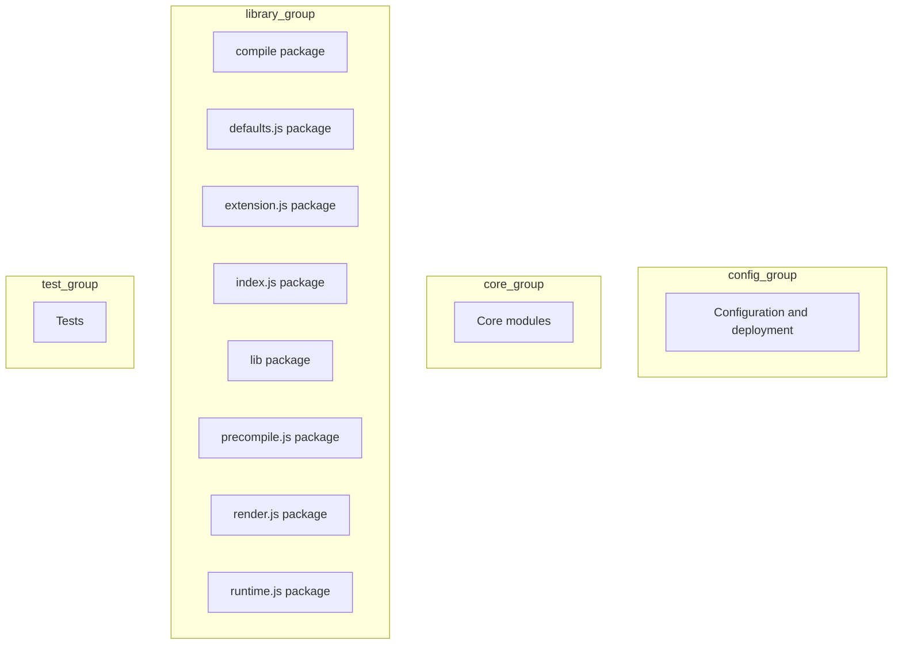

# Architecture report: goofychris/art-template

> Automated static analysis. **Observed** = directly seen in files/imports/AST; **Inferred** = interpretation from that evidence. Repository code was not executed.

## 1. Repository at a glance

| Item | Value |
| --- | --- |
| Repository | goofychris/art-template |
| Description | High performance JavaScript templating engine |
| Language | JavaScript |
| Stars | 9835 |
| Licence | MIT |
| Analysed commit / branch | d09a96dd85ef3671286157d8a0c75948b90a3ebb / master |
| Framework(s) | None detected |
| Files analysed | 104 |
| Components | 11 |

## 2. Architecture in one minute

goofychris/art-template - High performance JavaScript templating engine. This repository was analysed statically from 104 file(s) (0 Python). Detected technologies (observed from imports/manifests): webpack. Files are grouped into 11 component(s): compile package, Configuration and deployment, Core modules, defaults.js package, extension.js package, index.js package, lib package, precompile.js package. Findings below distinguish observed facts from inferred interpretation.

## 3. High-level block diagram

## 4. Main components

### compile package (`compile`)

- **Kind:** library
- **Status:** Observed
- **Confidence:** 0.85
- **Responsibility:** Groups 16 file(s) under compile package (observed from repository paths and static analysis).
- **Paths:** `src/compile/adapter/caches.js`, `src/compile/adapter/extend.js`, `src/compile/adapter/html-minifier.js`, `src/compile/adapter/include.js`, `src/compile/adapter/loader.js`, `src/compile/adapter/onerror.js`, `src/compile/adapter/resolve-filename.js`, `src/compile/adapter/rule.art.js`, `src/compile/adapter/rule.native.js`, `src/compile/compiler.js`, `src/compile/defaults.js`, `src/compile/error.js`, `src/compile/es-tokenizer.js`, `src/compile/index.js`, `src/compile/runtime.js`, `src/compile/tpl-tokenizer.js`
- **Evidence:** [src/compile/adapter/caches.js](https://github.com/goofychris/art-template/blob/d09a96dd85ef3671286157d8a0c75948b90a3ebb/src/compile/adapter/caches.js); [src/compile/adapter/extend.js](https://github.com/goofychris/art-template/blob/d09a96dd85ef3671286157d8a0c75948b90a3ebb/src/compile/adapter/extend.js); [src/compile/adapter/html-minifier.js](https://github.com/goofychris/art-template/blob/d09a96dd85ef3671286157d8a0c75948b90a3ebb/src/compile/adapter/html-minifier.js); [src/compile/adapter/include.js](https://github.com/goofychris/art-template/blob/d09a96dd85ef3671286157d8a0c75948b90a3ebb/src/compile/adapter/include.js); [src/compile/adapter/loader.js](https://github.com/goofychris/art-template/blob/d09a96dd85ef3671286157d8a0c75948b90a3ebb/src/compile/adapter/loader.js); [src/compile/adapter/onerror.js](https://github.com/goofychris/art-template/blob/d09a96dd85ef3671286157d8a0c75948b90a3ebb/src/compile/adapter/onerror.js); [src/compile/adapter/resolve-filename.js](https://github.com/goofychris/art-template/blob/d09a96dd85ef3671286157d8a0c75948b90a3ebb/src/compile/adapter/resolve-filename.js); [src/compile/adapter/rule.art.js](https://github.com/goofychris/art-template/blob/d09a96dd85ef3671286157d8a0c75948b90a3ebb/src/compile/adapter/rule.art.js)

### Configuration and deployment (`config`)

- **Kind:** config
- **Status:** Observed
- **Confidence:** 0.85
- **Responsibility:** Groups 1 file(s) under configuration and deployment (observed from repository paths and static analysis).
- **Paths:** `package.json`
- **Evidence:** [package.json](https://github.com/goofychris/art-template/blob/d09a96dd85ef3671286157d8a0c75948b90a3ebb/package.json)

### Core modules (`core`)

- **Kind:** core
- **Status:** Observed
- **Confidence:** 0.85
- **Responsibility:** Groups 3 file(s) under core modules (observed from repository paths and static analysis).
- **Paths:** `index.d.ts`, `index.js`, `webpack.config.js`
- **Evidence:** [index.d.ts](https://github.com/goofychris/art-template/blob/d09a96dd85ef3671286157d8a0c75948b90a3ebb/index.d.ts); [index.js](https://github.com/goofychris/art-template/blob/d09a96dd85ef3671286157d8a0c75948b90a3ebb/index.js); [webpack.config.js](https://github.com/goofychris/art-template/blob/d09a96dd85ef3671286157d8a0c75948b90a3ebb/webpack.config.js)

### defaults.js package (`defaults_js`)

- **Kind:** library
- **Status:** Observed
- **Confidence:** 0.85
- **Responsibility:** Groups 1 file(s) under defaults.js package (observed from repository paths and static analysis).
- **Paths:** `src/defaults.js`
- **Evidence:** [src/defaults.js](https://github.com/goofychris/art-template/blob/d09a96dd85ef3671286157d8a0c75948b90a3ebb/src/defaults.js)

### extension.js package (`extension_js`)

- **Kind:** library
- **Status:** Observed
- **Confidence:** 0.85
- **Responsibility:** Groups 1 file(s) under extension.js package (observed from repository paths and static analysis).
- **Paths:** `src/extension.js`
- **Evidence:** [src/extension.js](https://github.com/goofychris/art-template/blob/d09a96dd85ef3671286157d8a0c75948b90a3ebb/src/extension.js)

### index.js package (`index_js`)

- **Kind:** library
- **Status:** Observed
- **Confidence:** 0.85
- **Responsibility:** Groups 1 file(s) under index.js package (observed from repository paths and static analysis).
- **Paths:** `src/index.js`
- **Evidence:** [src/index.js](https://github.com/goofychris/art-template/blob/d09a96dd85ef3671286157d8a0c75948b90a3ebb/src/index.js)

### lib package (`lib`)

- **Kind:** library
- **Status:** Observed
- **Confidence:** 0.85
- **Responsibility:** Groups 1 file(s) under lib package (observed from repository paths and static analysis).
- **Paths:** `lib/template-web.js`
- **Evidence:** [lib/template-web.js](https://github.com/goofychris/art-template/blob/d09a96dd85ef3671286157d8a0c75948b90a3ebb/lib/template-web.js)

### precompile.js package (`precompile_js`)

- **Kind:** library
- **Status:** Observed
- **Confidence:** 0.85
- **Responsibility:** Groups 1 file(s) under precompile.js package (observed from repository paths and static analysis).
- **Paths:** `src/precompile.js`
- **Evidence:** [src/precompile.js](https://github.com/goofychris/art-template/blob/d09a96dd85ef3671286157d8a0c75948b90a3ebb/src/precompile.js)

### render.js package (`render_js`)

- **Kind:** library
- **Status:** Observed
- **Confidence:** 0.85
- **Responsibility:** Groups 1 file(s) under render.js package (observed from repository paths and static analysis).
- **Paths:** `src/render.js`
- **Evidence:** [src/render.js](https://github.com/goofychris/art-template/blob/d09a96dd85ef3671286157d8a0c75948b90a3ebb/src/render.js)

### runtime.js package (`runtime_js`)

- **Kind:** library
- **Status:** Observed
- **Confidence:** 0.85
- **Responsibility:** Groups 1 file(s) under runtime.js package (observed from repository paths and static analysis).
- **Paths:** `src/runtime.js`
- **Evidence:** [src/runtime.js](https://github.com/goofychris/art-template/blob/d09a96dd85ef3671286157d8a0c75948b90a3ebb/src/runtime.js)

### Tests (`tests`)

- **Kind:** test
- **Status:** Observed
- **Confidence:** 0.85
- **Responsibility:** Groups 33 file(s) under tests (observed from repository paths and static analysis).
- **Paths:** `test/compile/adapter/caches.js`, `test/compile/adapter/html-minifier.js`, `test/compile/adapter/loader.js`, `test/compile/adapter/onerror.js`, `test/compile/adapter/resolve-filename.js`, `test/compile/adapter/rule.art.js`, `test/compile/adapter/rule.native.js`, `test/compile/compiler.js`, `test/compile/defaults.js`, `test/compile/es-tokenizer.js`, `test/compile/index.js`, `test/compile/runtime.js`, `test/compile/tpl-tokenizer.js`, `test/index.js`, `test/node.js`, `test/res/extend-options/file.art`, `test/res/extend-options/file2.art`, `test/res/extend-options/include.art`, `test/res/extension.compile-error.2.tpl`, `test/res/extension.compile-error.tpl`, `test/res/extension.file.html`, `test/res/extension.file.tpl`, `test/res/extension.runtime-error.2.tpl`, `test/res/extension.runtime-error.tpl`, `test/res/file.art`, `test/res/file.html`, `test/res/index/include.html`, `test/res/index/index.html`, `test/res/nested-block/base-layout.art`, `test/res/nested-block/default.art`, `test/res/nested-block/index.art`, `test/res/nested-block/layout.art`, `test/res/template.file.html`
- **Evidence:** [test/compile/adapter/caches.js](https://github.com/goofychris/art-template/blob/d09a96dd85ef3671286157d8a0c75948b90a3ebb/test/compile/adapter/caches.js); [test/compile/adapter/html-minifier.js](https://github.com/goofychris/art-template/blob/d09a96dd85ef3671286157d8a0c75948b90a3ebb/test/compile/adapter/html-minifier.js); [test/compile/adapter/loader.js](https://github.com/goofychris/art-template/blob/d09a96dd85ef3671286157d8a0c75948b90a3ebb/test/compile/adapter/loader.js); [test/compile/adapter/onerror.js](https://github.com/goofychris/art-template/blob/d09a96dd85ef3671286157d8a0c75948b90a3ebb/test/compile/adapter/onerror.js); [test/compile/adapter/resolve-filename.js](https://github.com/goofychris/art-template/blob/d09a96dd85ef3671286157d8a0c75948b90a3ebb/test/compile/adapter/resolve-filename.js); [test/compile/adapter/rule.art.js](https://github.com/goofychris/art-template/blob/d09a96dd85ef3671286157d8a0c75948b90a3ebb/test/compile/adapter/rule.art.js); [test/compile/adapter/rule.native.js](https://github.com/goofychris/art-template/blob/d09a96dd85ef3671286157d8a0c75948b90a3ebb/test/compile/adapter/rule.native.js); [test/compile/compiler.js](https://github.com/goofychris/art-template/blob/d09a96dd85ef3671286157d8a0c75948b90a3ebb/test/compile/compiler.js)

## 5. Execution flow

**Observed** entry point(s):

- [index.js](https://github.com/goofychris/art-template/blob/d09a96dd85ef3671286157d8a0c75948b90a3ebb/index.js)
- [src/compile/index.js](https://github.com/goofychris/art-template/blob/d09a96dd85ef3671286157d8a0c75948b90a3ebb/src/compile/index.js)
- [src/index.js](https://github.com/goofychris/art-template/blob/d09a96dd85ef3671286157d8a0c75948b90a3ebb/src/index.js)

Representative flow (derived from observed entry points and the import graph; steps beyond the entry point are **Inferred**):

1. Execution starts at an observed entry point listed above, if present.
2. No internal import relationships between components were observed.

## 6. Project structure

### `(root)`

- `.babelrc` - other (124 bytes)
- `.editorconfig` - config (148 bytes)
- `.eslintignore` - other (5 bytes)
- `.eslintrc.json` - config (649 bytes)
- `.gitignore` - other (64 bytes)
- `.prettierrc` - other (114 bytes)
- `.travis.yml` - ci, YAML (202 bytes)
- `CHANGELOG.md` - docs (7408 bytes)
- `LICENSE` - docs (1078 bytes)
- `README.md` - docs (3082 bytes)
- `index.d.ts` - source, TypeScript (2769 bytes)
- `index.js` - source, JavaScript (207 bytes)
- `package.json` - manifest (1505 bytes)
- `webpack.config.js` - source, JavaScript (1529 bytes)

### `.github`

- `.github/ISSUE_TEMPLATE.md` - docs (282 bytes)

### `example`

- `example/node-include/footer.art` - other (17 bytes)
- `example/node-include/header.art` - other (39 bytes)
- `example/node-include/index.art` - other (286 bytes)
- `example/node-include/index.js` - source, JavaScript (194 bytes)
- `example/node-layout/index.art` - other (207 bytes)
- `example/node-layout/index.js` - source, JavaScript (194 bytes)
- `example/node-layout/layout.art` - other (256 bytes)
- `example/node-layout/nested-block/index.art` - other (98 bytes)
- `example/node-layout/nested-block/index.js` - source, JavaScript (196 bytes)
- `example/node-layout/nested-block/inner-layout.art` - other (353 bytes)
- `example/node-layout/nested-block/outer-layout.art` - other (216 bytes)
- `example/web-art-syntax/basic.html` - other (663 bytes)
- `example/web-art-syntax/compile-error.html` - other (383 bytes)
- `example/web-art-syntax/compile.html` - other (580 bytes)
- `example/web-art-syntax/filter.html` - other (2133 bytes)
- `example/web-art-syntax/include.html` - other (679 bytes)
- `example/web-art-syntax/no-escape.html` - other (561 bytes)
- `example/web-art-syntax/print.html` - other (386 bytes)
- `example/web-art-syntax/runtime-error.html` - other (433 bytes)
- `example/web-ie-compatible/index.html` - other (1065 bytes)
- `example/web-native-syntax/basic.html` - other (706 bytes)
- `example/web-native-syntax/compile-error.html` - other (576 bytes)
- `example/web-native-syntax/compile.html` - other (607 bytes)
- `example/web-native-syntax/filter.html` - other (1869 bytes)
- `example/web-native-syntax/include.html` - other (708 bytes)
- `example/web-native-syntax/no-escape.html` - other (557 bytes)
- `example/web-native-syntax/print.html` - other (390 bytes)
- `example/web-native-syntax/runtime-error.html` - other (569 bytes)
- `example/web-requirejs/index.html` - other (788 bytes)
- `example/web-requirejs/require.js` - source, JavaScript (17831 bytes)
- `example/web-test-speed/index.html` - other (15011 bytes)
- `example/web-test-speed/js/handlebars.js` - source, JavaScript (159586 bytes)
- `example/web-test-speed/js/highcharts.js` - source, JavaScript (197388 bytes)

### `lib`

- `lib/template-web.js` - source, JavaScript (17323 bytes)

### `src`

- `src/compile/adapter/caches.js` - source, JavaScript (272 bytes)
- `src/compile/adapter/extend.js` - source, JavaScript (852 bytes)
- `src/compile/adapter/html-minifier.js` - source, JavaScript (632 bytes)
- `src/compile/adapter/include.js` - source, JavaScript (485 bytes)
- `src/compile/adapter/loader.js` - source, JavaScript (529 bytes)
- `src/compile/adapter/onerror.js` - source, JavaScript (223 bytes)
- `src/compile/adapter/resolve-filename.js` - source, JavaScript (909 bytes)
- `src/compile/adapter/rule.art.js` - source, JavaScript (6092 bytes)
- `src/compile/adapter/rule.native.js` - source, JavaScript (692 bytes)
- `src/compile/compiler.js` - source, JavaScript (12144 bytes)
- `src/compile/defaults.js` - source, JavaScript (2882 bytes)
- `src/compile/error.js` - source, JavaScript (1177 bytes)
- `src/compile/es-tokenizer.js` - source, JavaScript (682 bytes)
- `src/compile/index.js` - source, JavaScript (3122 bytes)
- `src/compile/runtime.js` - source, JavaScript (2269 bytes)
- `src/compile/tpl-tokenizer.js` - source, JavaScript (2736 bytes)
- `src/defaults.js` - source, JavaScript (48 bytes)
- `src/extension.js` - source, JavaScript (581 bytes)
- `src/index.js` - source, JavaScript (761 bytes)
- `src/precompile.js` - source, JavaScript (8256 bytes)
- `src/render.js` - source, JavaScript (364 bytes)
- `src/runtime.js` - source, JavaScript (47 bytes)

### `test`

- `test/compile/adapter/caches.js` - test, JavaScript (562 bytes)
- `test/compile/adapter/html-minifier.js` - test, JavaScript (1790 bytes)
- `test/compile/adapter/loader.js` - test, JavaScript (364 bytes)
- `test/compile/adapter/onerror.js` - test, JavaScript (167 bytes)
- `test/compile/adapter/resolve-filename.js` - test, JavaScript (4688 bytes)
- `test/compile/adapter/rule.art.js` - test, JavaScript (17472 bytes)
- `test/compile/adapter/rule.native.js` - test, JavaScript (3106 bytes)
- `test/compile/compiler.js` - test, JavaScript (11511 bytes)
- `test/compile/defaults.js` - test, JavaScript (910 bytes)
- `test/compile/es-tokenizer.js` - test, JavaScript (4321 bytes)
- `test/compile/index.js` - test, JavaScript (24868 bytes)
- `test/compile/runtime.js` - test, JavaScript (1728 bytes)
- `test/compile/tpl-tokenizer.js` - test, JavaScript (5830 bytes)
- `test/index.js` - test, JavaScript (1801 bytes)
- `test/node.js` - test, JavaScript (2730 bytes)
- `test/res/extend-options/file.art` - test (23 bytes)
- `test/res/extend-options/file2.art` - test (17 bytes)
- `test/res/extend-options/include.art` - test (15 bytes)
- `test/res/extension.compile-error.2.tpl` - test (18 bytes)
- `test/res/extension.compile-error.tpl` - test (18 bytes)
- `test/res/extension.file.html` - test (11 bytes)
- `test/res/extension.file.tpl` - test (11 bytes)
- `test/res/extension.runtime-error.2.tpl` - test (12 bytes)
- `test/res/extension.runtime-error.tpl` - test (12 bytes)
- `test/res/file.art` - test (11 bytes)
- `test/res/file.html` - test (11 bytes)
- `test/res/index/include.html` - test (14 bytes)
- `test/res/index/index.html` - test (78 bytes)
- `test/res/nested-block/base-layout.art` - test (29 bytes)
- `test/res/nested-block/default.art` - test (25 bytes)
- `test/res/nested-block/index.art` - test (62 bytes)
- `test/res/nested-block/layout.art` - test (94 bytes)
- `test/res/template.file.html` - test (11 bytes)

## 7. Key dependencies and integrations

| Name | Category | Status | Confidence | Evidence |
| --- | --- | --- | --- | --- |
| webpack | tooling | Observed | 0.85 | [package.json:18](https://github.com/goofychris/art-template/blob/d09a96dd85ef3671286157d8a0c75948b90a3ebb/package.json#L18) |

## 8. Data and state

No database, cache, queue, or persistent-state usage was observed in the analysed files. State handling, if any, may be in-memory or in files that were not analysed.

## 9. Configuration and deployment clues

- `.editorconfig` (config)
- `.eslintrc.json` (config)
- `.travis.yml` (ci)
- `package.json` (manifest)

## 10. Design observations

- Tests are present alongside source code (Observed from test file paths).

These observations are interpretations (**Inferred**) of the observed structure, not guarantees about runtime design.

## 11. Limitations and unknowns

- Static analysis only: repository code was not executed, installed, or imported at runtime.
- Components and relationships are inferred from file paths, imports, and AST structure; runtime behaviour, dynamic imports, and reflection may not be visible.
- No clear application entry point was observed in the analysed files.
- Repository text was treated as untrusted data; no instructions found in repository files were followed, and likely secret values were redacted/excluded.
- JavaScript and TypeScript files were inventoried from paths and package manifests. They were not parsed with a full language AST, and repository code was not executed.

## 12. Source references

- [index.d.ts](https://github.com/goofychris/art-template/blob/d09a96dd85ef3671286157d8a0c75948b90a3ebb/index.d.ts)
- [index.js](https://github.com/goofychris/art-template/blob/d09a96dd85ef3671286157d8a0c75948b90a3ebb/index.js)
- [lib/template-web.js](https://github.com/goofychris/art-template/blob/d09a96dd85ef3671286157d8a0c75948b90a3ebb/lib/template-web.js)
- [package.json](https://github.com/goofychris/art-template/blob/d09a96dd85ef3671286157d8a0c75948b90a3ebb/package.json)
- [package.json:18](https://github.com/goofychris/art-template/blob/d09a96dd85ef3671286157d8a0c75948b90a3ebb/package.json#L18)
- [src/compile/adapter/caches.js](https://github.com/goofychris/art-template/blob/d09a96dd85ef3671286157d8a0c75948b90a3ebb/src/compile/adapter/caches.js)
- [src/compile/adapter/extend.js](https://github.com/goofychris/art-template/blob/d09a96dd85ef3671286157d8a0c75948b90a3ebb/src/compile/adapter/extend.js)
- [src/compile/adapter/html-minifier.js](https://github.com/goofychris/art-template/blob/d09a96dd85ef3671286157d8a0c75948b90a3ebb/src/compile/adapter/html-minifier.js)
- [src/compile/adapter/include.js](https://github.com/goofychris/art-template/blob/d09a96dd85ef3671286157d8a0c75948b90a3ebb/src/compile/adapter/include.js)
- [src/compile/adapter/loader.js](https://github.com/goofychris/art-template/blob/d09a96dd85ef3671286157d8a0c75948b90a3ebb/src/compile/adapter/loader.js)
- [src/compile/adapter/onerror.js](https://github.com/goofychris/art-template/blob/d09a96dd85ef3671286157d8a0c75948b90a3ebb/src/compile/adapter/onerror.js)
- [src/compile/adapter/resolve-filename.js](https://github.com/goofychris/art-template/blob/d09a96dd85ef3671286157d8a0c75948b90a3ebb/src/compile/adapter/resolve-filename.js)
- [src/compile/adapter/rule.art.js](https://github.com/goofychris/art-template/blob/d09a96dd85ef3671286157d8a0c75948b90a3ebb/src/compile/adapter/rule.art.js)
- [src/compile/index.js](https://github.com/goofychris/art-template/blob/d09a96dd85ef3671286157d8a0c75948b90a3ebb/src/compile/index.js)
- [src/defaults.js](https://github.com/goofychris/art-template/blob/d09a96dd85ef3671286157d8a0c75948b90a3ebb/src/defaults.js)
- [src/extension.js](https://github.com/goofychris/art-template/blob/d09a96dd85ef3671286157d8a0c75948b90a3ebb/src/extension.js)
- [src/index.js](https://github.com/goofychris/art-template/blob/d09a96dd85ef3671286157d8a0c75948b90a3ebb/src/index.js)
- [src/precompile.js](https://github.com/goofychris/art-template/blob/d09a96dd85ef3671286157d8a0c75948b90a3ebb/src/precompile.js)
- [src/render.js](https://github.com/goofychris/art-template/blob/d09a96dd85ef3671286157d8a0c75948b90a3ebb/src/render.js)
- [src/runtime.js](https://github.com/goofychris/art-template/blob/d09a96dd85ef3671286157d8a0c75948b90a3ebb/src/runtime.js)
- [test/compile/adapter/caches.js](https://github.com/goofychris/art-template/blob/d09a96dd85ef3671286157d8a0c75948b90a3ebb/test/compile/adapter/caches.js)
- [test/compile/adapter/html-minifier.js](https://github.com/goofychris/art-template/blob/d09a96dd85ef3671286157d8a0c75948b90a3ebb/test/compile/adapter/html-minifier.js)
- [test/compile/adapter/loader.js](https://github.com/goofychris/art-template/blob/d09a96dd85ef3671286157d8a0c75948b90a3ebb/test/compile/adapter/loader.js)
- [test/compile/adapter/onerror.js](https://github.com/goofychris/art-template/blob/d09a96dd85ef3671286157d8a0c75948b90a3ebb/test/compile/adapter/onerror.js)
- [test/compile/adapter/resolve-filename.js](https://github.com/goofychris/art-template/blob/d09a96dd85ef3671286157d8a0c75948b90a3ebb/test/compile/adapter/resolve-filename.js)
- [test/compile/adapter/rule.art.js](https://github.com/goofychris/art-template/blob/d09a96dd85ef3671286157d8a0c75948b90a3ebb/test/compile/adapter/rule.art.js)
- [test/compile/adapter/rule.native.js](https://github.com/goofychris/art-template/blob/d09a96dd85ef3671286157d8a0c75948b90a3ebb/test/compile/adapter/rule.native.js)
- [test/compile/compiler.js](https://github.com/goofychris/art-template/blob/d09a96dd85ef3671286157d8a0c75948b90a3ebb/test/compile/compiler.js)
- [webpack.config.js](https://github.com/goofychris/art-template/blob/d09a96dd85ef3671286157d8a0c75948b90a3ebb/webpack.config.js)
