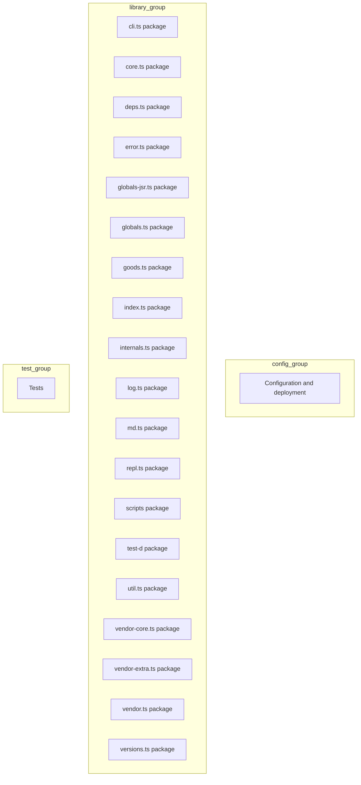

# Architecture report: google/zx

> Automated static analysis. **Observed** = directly seen in files/imports/AST; **Inferred** = interpretation from that evidence. Repository code was not executed.

## 1. Repository at a glance

| Item | Value |
| --- | --- |
| Repository | google/zx |
| Description | A tool for writing better scripts |
| Language | JavaScript |
| Stars | 45849 |
| Licence | Apache-2.0 |
| Analysed commit / branch | 3b04a6ae3e34b1a7ee6b925f1efcceb901f0d8a5 / main |
| Framework(s) | None detected |
| Files analysed | 143 |
| Components | 21 |

## 2. Architecture in one minute

google/zx - A tool for writing better scripts. This repository was analysed statically from 143 file(s) (0 Python). Detected technologies (observed from imports/manifests): GitHub Actions, Docker, TypeScript. Files are grouped into 21 component(s): cli.ts package, Configuration and deployment, core.ts package, deps.ts package, error.ts package, globals-jsr.ts package, globals.ts package, goods.ts package. Findings below distinguish observed facts from inferred interpretation.

## 3. High-level block diagram

## 4. Main components

### cli.ts package (`cli_ts`)

- **Kind:** library
- **Status:** Observed
- **Confidence:** 0.85
- **Responsibility:** Groups 1 file(s) under cli.ts package (observed from repository paths and static analysis).
- **Paths:** `src/cli.ts`
- **Evidence:** [src/cli.ts](https://github.com/google/zx/blob/3b04a6ae3e34b1a7ee6b925f1efcceb901f0d8a5/src/cli.ts)

### Configuration and deployment (`config`)

- **Kind:** config
- **Status:** Observed
- **Confidence:** 0.85
- **Responsibility:** Groups 5 file(s) under configuration and deployment (observed from repository paths and static analysis).
- **Paths:** `dcr/Dockerfile`, `lefthook.yml`, `package.json`, `tsconfig.json`, `zizmor.yml`
- **Evidence:** [dcr/Dockerfile](https://github.com/google/zx/blob/3b04a6ae3e34b1a7ee6b925f1efcceb901f0d8a5/dcr/Dockerfile); [lefthook.yml](https://github.com/google/zx/blob/3b04a6ae3e34b1a7ee6b925f1efcceb901f0d8a5/lefthook.yml); [package.json](https://github.com/google/zx/blob/3b04a6ae3e34b1a7ee6b925f1efcceb901f0d8a5/package.json); [tsconfig.json](https://github.com/google/zx/blob/3b04a6ae3e34b1a7ee6b925f1efcceb901f0d8a5/tsconfig.json); [zizmor.yml](https://github.com/google/zx/blob/3b04a6ae3e34b1a7ee6b925f1efcceb901f0d8a5/zizmor.yml)

### core.ts package (`core_ts`)

- **Kind:** library
- **Status:** Observed
- **Confidence:** 0.85
- **Responsibility:** Groups 1 file(s) under core.ts package (observed from repository paths and static analysis).
- **Paths:** `src/core.ts`
- **Evidence:** [src/core.ts](https://github.com/google/zx/blob/3b04a6ae3e34b1a7ee6b925f1efcceb901f0d8a5/src/core.ts)

### deps.ts package (`deps_ts`)

- **Kind:** library
- **Status:** Observed
- **Confidence:** 0.85
- **Responsibility:** Groups 1 file(s) under deps.ts package (observed from repository paths and static analysis).
- **Paths:** `src/deps.ts`
- **Evidence:** [src/deps.ts](https://github.com/google/zx/blob/3b04a6ae3e34b1a7ee6b925f1efcceb901f0d8a5/src/deps.ts)

### error.ts package (`error_ts`)

- **Kind:** library
- **Status:** Observed
- **Confidence:** 0.85
- **Responsibility:** Groups 1 file(s) under error.ts package (observed from repository paths and static analysis).
- **Paths:** `src/error.ts`
- **Evidence:** [src/error.ts](https://github.com/google/zx/blob/3b04a6ae3e34b1a7ee6b925f1efcceb901f0d8a5/src/error.ts)

### globals-jsr.ts package (`globals_jsr_ts`)

- **Kind:** library
- **Status:** Observed
- **Confidence:** 0.85
- **Responsibility:** Groups 1 file(s) under globals-jsr.ts package (observed from repository paths and static analysis).
- **Paths:** `src/globals-jsr.ts`
- **Evidence:** [src/globals-jsr.ts](https://github.com/google/zx/blob/3b04a6ae3e34b1a7ee6b925f1efcceb901f0d8a5/src/globals-jsr.ts)

### globals.ts package (`globals_ts`)

- **Kind:** library
- **Status:** Observed
- **Confidence:** 0.85
- **Responsibility:** Groups 1 file(s) under globals.ts package (observed from repository paths and static analysis).
- **Paths:** `src/globals.ts`
- **Evidence:** [src/globals.ts](https://github.com/google/zx/blob/3b04a6ae3e34b1a7ee6b925f1efcceb901f0d8a5/src/globals.ts)

### goods.ts package (`goods_ts`)

- **Kind:** library
- **Status:** Observed
- **Confidence:** 0.85
- **Responsibility:** Groups 1 file(s) under goods.ts package (observed from repository paths and static analysis).
- **Paths:** `src/goods.ts`
- **Evidence:** [src/goods.ts](https://github.com/google/zx/blob/3b04a6ae3e34b1a7ee6b925f1efcceb901f0d8a5/src/goods.ts)

### index.ts package (`index_ts`)

- **Kind:** library
- **Status:** Observed
- **Confidence:** 0.85
- **Responsibility:** Groups 1 file(s) under index.ts package (observed from repository paths and static analysis).
- **Paths:** `src/index.ts`
- **Evidence:** [src/index.ts](https://github.com/google/zx/blob/3b04a6ae3e34b1a7ee6b925f1efcceb901f0d8a5/src/index.ts)

### internals.ts package (`internals_ts`)

- **Kind:** library
- **Status:** Observed
- **Confidence:** 0.85
- **Responsibility:** Groups 1 file(s) under internals.ts package (observed from repository paths and static analysis).
- **Paths:** `src/internals.ts`
- **Evidence:** [src/internals.ts](https://github.com/google/zx/blob/3b04a6ae3e34b1a7ee6b925f1efcceb901f0d8a5/src/internals.ts)

### log.ts package (`log_ts`)

- **Kind:** library
- **Status:** Observed
- **Confidence:** 0.85
- **Responsibility:** Groups 1 file(s) under log.ts package (observed from repository paths and static analysis).
- **Paths:** `src/log.ts`
- **Evidence:** [src/log.ts](https://github.com/google/zx/blob/3b04a6ae3e34b1a7ee6b925f1efcceb901f0d8a5/src/log.ts)

### md.ts package (`md_ts`)

- **Kind:** library
- **Status:** Observed
- **Confidence:** 0.85
- **Responsibility:** Groups 1 file(s) under md.ts package (observed from repository paths and static analysis).
- **Paths:** `src/md.ts`
- **Evidence:** [src/md.ts](https://github.com/google/zx/blob/3b04a6ae3e34b1a7ee6b925f1efcceb901f0d8a5/src/md.ts)

### repl.ts package (`repl_ts`)

- **Kind:** library
- **Status:** Observed
- **Confidence:** 0.85
- **Responsibility:** Groups 1 file(s) under repl.ts package (observed from repository paths and static analysis).
- **Paths:** `src/repl.ts`
- **Evidence:** [src/repl.ts](https://github.com/google/zx/blob/3b04a6ae3e34b1a7ee6b925f1efcceb901f0d8a5/src/repl.ts)

### scripts package (`scripts`)

- **Kind:** library
- **Status:** Observed
- **Confidence:** 0.85
- **Responsibility:** Groups 12 file(s) under scripts package (observed from repository paths and static analysis).
- **Paths:** `scripts/build-clean.mjs`, `scripts/build-dts.mjs`, `scripts/build-js.mjs`, `scripts/build-jsr.mjs`, `scripts/build-pkgjson-lite.mjs`, `scripts/build-pkgjson-main.mjs`, `scripts/build-size-limit.mjs`, `scripts/build-tests.mjs`, `scripts/build-versions.mjs`, `scripts/deno.polyfill.js`, `scripts/import-meta-url.polyfill.js`, `scripts/npm-audit.js`
- **Evidence:** [scripts/build-clean.mjs](https://github.com/google/zx/blob/3b04a6ae3e34b1a7ee6b925f1efcceb901f0d8a5/scripts/build-clean.mjs); [scripts/build-dts.mjs](https://github.com/google/zx/blob/3b04a6ae3e34b1a7ee6b925f1efcceb901f0d8a5/scripts/build-dts.mjs); [scripts/build-js.mjs](https://github.com/google/zx/blob/3b04a6ae3e34b1a7ee6b925f1efcceb901f0d8a5/scripts/build-js.mjs); [scripts/build-jsr.mjs](https://github.com/google/zx/blob/3b04a6ae3e34b1a7ee6b925f1efcceb901f0d8a5/scripts/build-jsr.mjs); [scripts/build-pkgjson-lite.mjs](https://github.com/google/zx/blob/3b04a6ae3e34b1a7ee6b925f1efcceb901f0d8a5/scripts/build-pkgjson-lite.mjs); [scripts/build-pkgjson-main.mjs](https://github.com/google/zx/blob/3b04a6ae3e34b1a7ee6b925f1efcceb901f0d8a5/scripts/build-pkgjson-main.mjs); [scripts/build-size-limit.mjs](https://github.com/google/zx/blob/3b04a6ae3e34b1a7ee6b925f1efcceb901f0d8a5/scripts/build-size-limit.mjs); [scripts/build-tests.mjs](https://github.com/google/zx/blob/3b04a6ae3e34b1a7ee6b925f1efcceb901f0d8a5/scripts/build-tests.mjs)

### test-d package (`test_d`)

- **Kind:** library
- **Status:** Observed
- **Confidence:** 0.85
- **Responsibility:** Groups 3 file(s) under test-d package (observed from repository paths and static analysis).
- **Paths:** `test-d/core.test-d.ts`, `test-d/globals.test-d.ts`, `test-d/goods.test-d.ts`
- **Evidence:** [test-d/core.test-d.ts](https://github.com/google/zx/blob/3b04a6ae3e34b1a7ee6b925f1efcceb901f0d8a5/test-d/core.test-d.ts); [test-d/globals.test-d.ts](https://github.com/google/zx/blob/3b04a6ae3e34b1a7ee6b925f1efcceb901f0d8a5/test-d/globals.test-d.ts); [test-d/goods.test-d.ts](https://github.com/google/zx/blob/3b04a6ae3e34b1a7ee6b925f1efcceb901f0d8a5/test-d/goods.test-d.ts)

### Tests (`tests`)

- **Kind:** test
- **Status:** Observed
- **Confidence:** 0.85
- **Responsibility:** Groups 47 file(s) under tests (observed from repository paths and static analysis).
- **Paths:** `test/all.test.js`, `test/bench/buf-join.mjs`, `test/cli.test.js`, `test/core.test.js`, `test/deps.test.js`, `test/error.test.ts`, `test/export.test.js`, `test/extra.test.js`, `test/fixtures/argv.mjs`, `test/fixtures/copyright.txt`, `test/fixtures/echo.http`, `test/fixtures/exit-code.mjs`, `test/fixtures/filename-dirname.mjs`, `test/fixtures/interactive.mjs`, `test/fixtures/js-project/package.json`, `test/fixtures/js-project/script.js`, `test/fixtures/markdown-crlf.md`, `test/fixtures/markdown.md`, `test/fixtures/md.http`, `test/fixtures/no-extension`, `test/fixtures/no-extension.mjs`, `test/fixtures/non-std-ext.zx`, `test/fixtures/require.mjs`, `test/fixtures/server.mjs`, `test/fixtures/ts-project/package.json`, `test/fixtures/ts-project/script.ts`, `test/fixtures/ts-project/tsconfig.json`, `test/global.test.js`, `test/goods.test.ts`, `test/index.test.js`, `test/it/build-dcr.test.js`, `test/it/build-jsr.test.js`, `test/it/build-npm.test.js`, `test/log.test.ts`, `test/md.test.ts`, `test/smoke/bun.test.js`, `test/smoke/deno.test.js`, `test/smoke/electron.test.cjs`, `test/smoke/node.test.cjs`, `test/smoke/node.test.mjs`, `test/smoke/ts.test.ts`, `test/smoke/tsconfig.json`, `test/smoke/tsconfig.test.json`, `test/smoke/webcontainer.test.mjs`, `test/smoke/win32.test.js`, `test/util.test.js`, `test/vendor.test.js`
- **Evidence:** [test/all.test.js](https://github.com/google/zx/blob/3b04a6ae3e34b1a7ee6b925f1efcceb901f0d8a5/test/all.test.js); [test/bench/buf-join.mjs](https://github.com/google/zx/blob/3b04a6ae3e34b1a7ee6b925f1efcceb901f0d8a5/test/bench/buf-join.mjs); [test/cli.test.js](https://github.com/google/zx/blob/3b04a6ae3e34b1a7ee6b925f1efcceb901f0d8a5/test/cli.test.js); [test/core.test.js](https://github.com/google/zx/blob/3b04a6ae3e34b1a7ee6b925f1efcceb901f0d8a5/test/core.test.js); [test/deps.test.js](https://github.com/google/zx/blob/3b04a6ae3e34b1a7ee6b925f1efcceb901f0d8a5/test/deps.test.js); [test/error.test.ts](https://github.com/google/zx/blob/3b04a6ae3e34b1a7ee6b925f1efcceb901f0d8a5/test/error.test.ts); [test/export.test.js](https://github.com/google/zx/blob/3b04a6ae3e34b1a7ee6b925f1efcceb901f0d8a5/test/export.test.js); [test/extra.test.js](https://github.com/google/zx/blob/3b04a6ae3e34b1a7ee6b925f1efcceb901f0d8a5/test/extra.test.js)

### util.ts package (`util_ts`)

- **Kind:** library
- **Status:** Observed
- **Confidence:** 0.85
- **Responsibility:** Groups 1 file(s) under util.ts package (observed from repository paths and static analysis).
- **Paths:** `src/util.ts`
- **Evidence:** [src/util.ts](https://github.com/google/zx/blob/3b04a6ae3e34b1a7ee6b925f1efcceb901f0d8a5/src/util.ts)

### vendor-core.ts package (`vendor_core_ts`)

- **Kind:** library
- **Status:** Observed
- **Confidence:** 0.85
- **Responsibility:** Groups 1 file(s) under vendor-core.ts package (observed from repository paths and static analysis).
- **Paths:** `src/vendor-core.ts`
- **Evidence:** [src/vendor-core.ts](https://github.com/google/zx/blob/3b04a6ae3e34b1a7ee6b925f1efcceb901f0d8a5/src/vendor-core.ts)

### vendor-extra.ts package (`vendor_extra_ts`)

- **Kind:** library
- **Status:** Observed
- **Confidence:** 0.85
- **Responsibility:** Groups 1 file(s) under vendor-extra.ts package (observed from repository paths and static analysis).
- **Paths:** `src/vendor-extra.ts`
- **Evidence:** [src/vendor-extra.ts](https://github.com/google/zx/blob/3b04a6ae3e34b1a7ee6b925f1efcceb901f0d8a5/src/vendor-extra.ts)

### vendor.ts package (`vendor_ts`)

- **Kind:** library
- **Status:** Observed
- **Confidence:** 0.85
- **Responsibility:** Groups 1 file(s) under vendor.ts package (observed from repository paths and static analysis).
- **Paths:** `src/vendor.ts`
- **Evidence:** [src/vendor.ts](https://github.com/google/zx/blob/3b04a6ae3e34b1a7ee6b925f1efcceb901f0d8a5/src/vendor.ts)

### versions.ts package (`versions_ts`)

- **Kind:** library
- **Status:** Observed
- **Confidence:** 0.85
- **Responsibility:** Groups 1 file(s) under versions.ts package (observed from repository paths and static analysis).
- **Paths:** `src/versions.ts`
- **Evidence:** [src/versions.ts](https://github.com/google/zx/blob/3b04a6ae3e34b1a7ee6b925f1efcceb901f0d8a5/src/versions.ts)

## 5. Execution flow

**Observed** entry point(s):

- [src/index.ts](https://github.com/google/zx/blob/3b04a6ae3e34b1a7ee6b925f1efcceb901f0d8a5/src/index.ts)

Representative flow (derived from observed entry points and the import graph; steps beyond the entry point are **Inferred**):

1. Execution starts at an observed entry point listed above, if present.
2. No internal import relationships between components were observed.

## 6. Project structure

### `(root)`

- `.commitlintrc` - other (327 bytes)
- `.gitattributes` - other (70 bytes)
- `.gitignore` - other (179 bytes)
- `.node_version` - other (2 bytes)
- `.nycrc` - other (330 bytes)
- `.prettierignore` - other (82 bytes)
- `.size-limit.json` - config (1409 bytes)
- `LICENSE` - docs (11358 bytes)
- `README.md` - docs (1724 bytes)
- `lefthook.yml` - config (388 bytes)
- `package.json` - manifest (6726 bytes)
- `tsconfig.json` - config (436 bytes)
- `zizmor.yml` - config (74 bytes)

### `.github`

- `.github/FUNDING.yml` - config (18 bytes)
- `.github/ISSUE_TEMPLATE/bug.yml` - config (2255 bytes)
- `.github/ISSUE_TEMPLATE/idea.yml` - config (883 bytes)
- `.github/PULL_REQUEST_TEMPLATE.md` - docs (1004 bytes)
- `.github/SECURITY.md` - docs (1104 bytes)
- `.github/codeql/codeql-config.yml` - config (113 bytes)
- `.github/pages/index.html` - other (16 bytes)
- `.github/workflows/codeql.yml` - ci, YAML (1759 bytes)
- `.github/workflows/dev-publish.yml` - ci, YAML (8249 bytes)
- `.github/workflows/docs.yml` - ci, YAML (1204 bytes)
- `.github/workflows/jsr-publish.yml` - ci, YAML (1634 bytes)
- `.github/workflows/osv.yml` - ci, YAML (1528 bytes)
- `.github/workflows/publish.yml` - ci, YAML (6368 bytes)
- `.github/workflows/test.yml` - ci, YAML (10105 bytes)
- `.github/workflows/zizmor.yml` - ci, YAML (678 bytes)

### `dcr`

- `dcr/Dockerfile` - container (213 bytes)

### `docs`

- `docs/.gitignore` - docs (16 bytes)
- `docs/.vitepress/config.mts` - docs (2871 bytes)
- `docs/.vitepress/theme/MyLayout.vue` - docs (253 bytes)
- `docs/.vitepress/theme/MyOxygen.vue` - docs (1072 bytes)
- `docs/.vitepress/theme/custom.css` - docs (524 bytes)
- `docs/.vitepress/theme/index.js` - docs (240 bytes)
- `docs/api.md` - docs (10008 bytes)
- `docs/architecture.md` - docs (12221 bytes)
- `docs/cli.md` - docs (4321 bytes)
- `docs/configuration.md` - docs (3967 bytes)
- `docs/contribution.md` - docs (3170 bytes)
- `docs/faq.md` - docs (2849 bytes)
- `docs/getting-started.md` - docs (3211 bytes)
- `docs/index.md` - docs (556 bytes)
- `docs/known-issues.md` - docs (987 bytes)
- `docs/lite.md` - docs (631 bytes)
- `docs/markdown.md` - docs (1405 bytes)
- `docs/migration-from-v7.md` - docs (1839 bytes)
- `docs/process-output.md` - docs (826 bytes)
- `docs/process-promise.md` - docs (9467 bytes)
- `docs/public/img/favicons/safari-pinned-tab.svg` - docs (1834 bytes)
- `docs/public/img/logo.svg` - docs (524 bytes)
- `docs/quotes.md` - docs (2460 bytes)
- `docs/setup.md` - docs (6493 bytes)
- `docs/shell.md` - docs (1508 bytes)
- `docs/typescript.md` - docs (1549 bytes)
- `docs/versions.md` - docs (2246 bytes)

### `examples`

- `examples/background-process.mjs` - source, JavaScript (792 bytes)
- `examples/backup-github.mjs` - source, JavaScript (1222 bytes)
- `examples/fetch-weather.mjs` - source, JavaScript (2954 bytes)
- `examples/hello.mjs` - source, JavaScript (650 bytes)
- `examples/interactive.mjs` - source, JavaScript (1333 bytes)
- `examples/npm-oidc-enable.mjs` - source, JavaScript (2774 bytes)
- `examples/parallel.mjs` - source, JavaScript (989 bytes)

### `man`

- `man/zx.1` - other (1027 bytes)

### `scripts`

- `scripts/build-clean.mjs` - source, JavaScript (930 bytes)
- `scripts/build-dts.mjs` - source, JavaScript (3805 bytes)
- `scripts/build-js.mjs` - source, JavaScript (7862 bytes)
- `scripts/build-jsr.mjs` - source, JavaScript (2165 bytes)
- `scripts/build-pkgjson-lite.mjs` - source, JavaScript (2441 bytes)
- `scripts/build-pkgjson-main.mjs` - source, JavaScript (1451 bytes)
- `scripts/build-size-limit.mjs` - source, JavaScript (2448 bytes)
- `scripts/build-tests.mjs` - source, JavaScript (2106 bytes)
- `scripts/build-versions.mjs` - source, JavaScript (2030 bytes)
- `scripts/deno.polyfill.js` - source, JavaScript (701 bytes)
- `scripts/import-meta-url.polyfill.js` - source, JavaScript (228 bytes)
- `scripts/npm-audit.js` - source, JavaScript (4193 bytes)

### `src`

- `src/cli.ts` - source, TypeScript (8473 bytes)
- `src/core.ts` - source, TypeScript (29103 bytes)
- `src/deps.ts` - source, TypeScript (3064 bytes)
- `src/error.ts` - source, TypeScript (7733 bytes)
- `src/globals-jsr.ts` - source, TypeScript (650 bytes)
- `src/globals.ts` - source, TypeScript (2182 bytes)
- `src/goods.ts` - source, TypeScript (7289 bytes)
- `src/index.ts` - source, TypeScript (1235 bytes)
- `src/internals.ts` - source, TypeScript (1255 bytes)
- `src/log.ts` - source, TypeScript (4735 bytes)
- `src/md.ts` - source, TypeScript (2757 bytes)
- `src/repl.ts` - source, TypeScript (1246 bytes)
- `src/util.ts` - source, TypeScript (4158 bytes)
- `src/vendor-core.ts` - source, TypeScript (1235 bytes)
- `src/vendor-extra.ts` - source, TypeScript (3834 bytes)
- `src/vendor.ts` - source, TypeScript (656 bytes)
- `src/versions.ts` - source, TypeScript (836 bytes)

### `test`

- `test/all.test.js` - test, JavaScript (882 bytes)
- `test/bench/buf-join.mjs` - test, JavaScript (1663 bytes)
- `test/cli.test.js` - test, JavaScript (14444 bytes)
- `test/core.test.js` - test, JavaScript (52406 bytes)
- `test/deps.test.js` - test, JavaScript (6218 bytes)
- `test/error.test.ts` - test, TypeScript (4505 bytes)
- `test/export.test.js` - test, JavaScript (37067 bytes)
- `test/extra.test.js` - test, JavaScript (1437 bytes)
- `test/fixtures/argv.mjs` - test, JavaScript (768 bytes)
- `test/fixtures/copyright.txt` - test (588 bytes)
- `test/fixtures/echo.http` - test (101 bytes)
- `test/fixtures/exit-code.mjs` - test, JavaScript (611 bytes)
- `test/fixtures/filename-dirname.mjs` - test, JavaScript (737 bytes)
- `test/fixtures/interactive.mjs` - test, JavaScript (806 bytes)
- `test/fixtures/js-project/package.json` - test (93 bytes)
- `test/fixtures/js-project/script.js` - test, JavaScript (607 bytes)
- `test/fixtures/markdown-crlf.md` - test (31 bytes)
- `test/fixtures/markdown.md` - test (361 bytes)
- `test/fixtures/md.http` - test (132 bytes)
- `test/fixtures/no-extension` - test (780 bytes)
- `test/fixtures/no-extension.mjs` - test, JavaScript (668 bytes)
- `test/fixtures/non-std-ext.zx` - test (776 bytes)
- `test/fixtures/require.mjs` - test, JavaScript (751 bytes)
- `test/fixtures/server.mjs` - test, JavaScript (1220 bytes)
- `test/fixtures/ts-project/package.json` - test (121 bytes)
- `test/fixtures/ts-project/script.ts` - test, TypeScript (700 bytes)
- `test/fixtures/ts-project/tsconfig.json` - test (226 bytes)
- `test/global.test.js` - test, JavaScript (1264 bytes)
- `test/goods.test.ts` - test, TypeScript (12485 bytes)
- `test/index.test.js` - test, JavaScript (2317 bytes)
- `test/it/build-dcr.test.js` - test, JavaScript (1095 bytes)
- `test/it/build-jsr.test.js` - test, JavaScript (1598 bytes)
- `test/it/build-npm.test.js` - test, JavaScript (8521 bytes)
- `test/log.test.ts` - test, TypeScript (5891 bytes)
- `test/md.test.ts` - test, TypeScript (2597 bytes)
- `test/smoke/bun.test.js` - test, JavaScript (1855 bytes)
- `test/smoke/deno.test.js` - test, JavaScript (1003 bytes)
- `test/smoke/electron.test.cjs` - test, JavaScript (1254 bytes)
- `test/smoke/node.test.cjs` - test, JavaScript (1215 bytes)
- `test/smoke/node.test.mjs` - test, JavaScript (3069 bytes)
- `test/smoke/ts.test.ts` - test, TypeScript (1024 bytes)
- `test/smoke/tsconfig.json` - test (323 bytes)
- `test/smoke/tsconfig.test.json` - test (241 bytes)
- `test/smoke/webcontainer.test.mjs` - test, JavaScript (3902 bytes)
- `test/smoke/win32.test.js` - test, JavaScript (3409 bytes)
- `test/util.test.js` - test, JavaScript (3959 bytes)
- `test/vendor.test.js` - test, JavaScript (2562 bytes)

### `test-d`

- `test-d/core.test-d.ts` - source, TypeScript (2478 bytes)
- `test-d/globals.test-d.ts` - source, TypeScript (1005 bytes)
- `test-d/goods.test-d.ts` - source, TypeScript (1012 bytes)

## 7. Key dependencies and integrations

| Name | Category | Status | Confidence | Evidence |
| --- | --- | --- | --- | --- |
| GitHub Actions | ci | Observed | 0.90 | [.github/workflows/codeql.yml](https://github.com/google/zx/blob/3b04a6ae3e34b1a7ee6b925f1efcceb901f0d8a5/.github/workflows/codeql.yml); [.github/workflows/dev-publish.yml](https://github.com/google/zx/blob/3b04a6ae3e34b1a7ee6b925f1efcceb901f0d8a5/.github/workflows/dev-publish.yml); [.github/workflows/docs.yml](https://github.com/google/zx/blob/3b04a6ae3e34b1a7ee6b925f1efcceb901f0d8a5/.github/workflows/docs.yml); [.github/workflows/jsr-publish.yml](https://github.com/google/zx/blob/3b04a6ae3e34b1a7ee6b925f1efcceb901f0d8a5/.github/workflows/jsr-publish.yml) |
| Docker | tooling | Observed | 0.90 | [.github/workflows/dev-publish.yml:129](https://github.com/google/zx/blob/3b04a6ae3e34b1a7ee6b925f1efcceb901f0d8a5/.github/workflows/dev-publish.yml#L129); [.github/workflows/publish.yml:131](https://github.com/google/zx/blob/3b04a6ae3e34b1a7ee6b925f1efcceb901f0d8a5/.github/workflows/publish.yml#L131); [.github/workflows/test.yml:125](https://github.com/google/zx/blob/3b04a6ae3e34b1a7ee6b925f1efcceb901f0d8a5/.github/workflows/test.yml#L125); [dcr/Dockerfile](https://github.com/google/zx/blob/3b04a6ae3e34b1a7ee6b925f1efcceb901f0d8a5/dcr/Dockerfile) |
| TypeScript | tooling | Observed | 0.90 | [package.json:103](https://github.com/google/zx/blob/3b04a6ae3e34b1a7ee6b925f1efcceb901f0d8a5/package.json#L103); [test/fixtures/ts-project/package.json:5](https://github.com/google/zx/blob/3b04a6ae3e34b1a7ee6b925f1efcceb901f0d8a5/test/fixtures/ts-project/package.json#L5) |

## 8. Data and state

No database, cache, queue, or persistent-state usage was observed in the analysed files. State handling, if any, may be in-memory or in files that were not analysed.

## 9. Configuration and deployment clues

- `.github/FUNDING.yml` (config)
- `.github/ISSUE_TEMPLATE/bug.yml` (config)
- `.github/ISSUE_TEMPLATE/idea.yml` (config)
- `.github/codeql/codeql-config.yml` (config)
- `.github/workflows/codeql.yml` (ci)
- `.github/workflows/dev-publish.yml` (ci)
- `.github/workflows/docs.yml` (ci)
- `.github/workflows/jsr-publish.yml` (ci)
- `.github/workflows/osv.yml` (ci)
- `.github/workflows/publish.yml` (ci)
- `.github/workflows/test.yml` (ci)
- `.github/workflows/zizmor.yml` (ci)
- `.size-limit.json` (config)
- `dcr/Dockerfile` (container)
- `lefthook.yml` (config)
- `package.json` (manifest)
- `tsconfig.json` (config)
- `zizmor.yml` (config)

## 10. Design observations

- Tests are present alongside source code (Observed from test file paths).

These observations are interpretations (**Inferred**) of the observed structure, not guarantees about runtime design.

## 11. Limitations and unknowns

- Static analysis only: repository code was not executed, installed, or imported at runtime.
- Components and relationships are inferred from file paths, imports, and AST structure; runtime behaviour, dynamic imports, and reflection may not be visible.
- 31 file(s) were skipped during inventory (31 x vendored/generated directory excluded).
- No clear application entry point was observed in the analysed files.
- Repository text was treated as untrusted data; no instructions found in repository files were followed, and likely secret values were redacted/excluded.
- JavaScript and TypeScript files were inventoried from paths and package manifests. They were not parsed with a full language AST, and repository code was not executed.

## 12. Source references

- [.github/workflows/codeql.yml](https://github.com/google/zx/blob/3b04a6ae3e34b1a7ee6b925f1efcceb901f0d8a5/.github/workflows/codeql.yml)
- [.github/workflows/dev-publish.yml](https://github.com/google/zx/blob/3b04a6ae3e34b1a7ee6b925f1efcceb901f0d8a5/.github/workflows/dev-publish.yml)
- [.github/workflows/dev-publish.yml:129](https://github.com/google/zx/blob/3b04a6ae3e34b1a7ee6b925f1efcceb901f0d8a5/.github/workflows/dev-publish.yml#L129)
- [.github/workflows/docs.yml](https://github.com/google/zx/blob/3b04a6ae3e34b1a7ee6b925f1efcceb901f0d8a5/.github/workflows/docs.yml)
- [.github/workflows/jsr-publish.yml](https://github.com/google/zx/blob/3b04a6ae3e34b1a7ee6b925f1efcceb901f0d8a5/.github/workflows/jsr-publish.yml)
- [.github/workflows/osv.yml](https://github.com/google/zx/blob/3b04a6ae3e34b1a7ee6b925f1efcceb901f0d8a5/.github/workflows/osv.yml)
- [.github/workflows/publish.yml](https://github.com/google/zx/blob/3b04a6ae3e34b1a7ee6b925f1efcceb901f0d8a5/.github/workflows/publish.yml)
- [.github/workflows/publish.yml:131](https://github.com/google/zx/blob/3b04a6ae3e34b1a7ee6b925f1efcceb901f0d8a5/.github/workflows/publish.yml#L131)
- [.github/workflows/test.yml](https://github.com/google/zx/blob/3b04a6ae3e34b1a7ee6b925f1efcceb901f0d8a5/.github/workflows/test.yml)
- [.github/workflows/test.yml:125](https://github.com/google/zx/blob/3b04a6ae3e34b1a7ee6b925f1efcceb901f0d8a5/.github/workflows/test.yml#L125)
- [.github/workflows/zizmor.yml](https://github.com/google/zx/blob/3b04a6ae3e34b1a7ee6b925f1efcceb901f0d8a5/.github/workflows/zizmor.yml)
- [dcr/Dockerfile](https://github.com/google/zx/blob/3b04a6ae3e34b1a7ee6b925f1efcceb901f0d8a5/dcr/Dockerfile)
- [lefthook.yml](https://github.com/google/zx/blob/3b04a6ae3e34b1a7ee6b925f1efcceb901f0d8a5/lefthook.yml)
- [package.json](https://github.com/google/zx/blob/3b04a6ae3e34b1a7ee6b925f1efcceb901f0d8a5/package.json)
- [package.json:103](https://github.com/google/zx/blob/3b04a6ae3e34b1a7ee6b925f1efcceb901f0d8a5/package.json#L103)
- [scripts/build-clean.mjs](https://github.com/google/zx/blob/3b04a6ae3e34b1a7ee6b925f1efcceb901f0d8a5/scripts/build-clean.mjs)
- [scripts/build-dts.mjs](https://github.com/google/zx/blob/3b04a6ae3e34b1a7ee6b925f1efcceb901f0d8a5/scripts/build-dts.mjs)
- [scripts/build-js.mjs](https://github.com/google/zx/blob/3b04a6ae3e34b1a7ee6b925f1efcceb901f0d8a5/scripts/build-js.mjs)
- [scripts/build-jsr.mjs](https://github.com/google/zx/blob/3b04a6ae3e34b1a7ee6b925f1efcceb901f0d8a5/scripts/build-jsr.mjs)
- [scripts/build-pkgjson-lite.mjs](https://github.com/google/zx/blob/3b04a6ae3e34b1a7ee6b925f1efcceb901f0d8a5/scripts/build-pkgjson-lite.mjs)
- [scripts/build-pkgjson-main.mjs](https://github.com/google/zx/blob/3b04a6ae3e34b1a7ee6b925f1efcceb901f0d8a5/scripts/build-pkgjson-main.mjs)
- [scripts/build-size-limit.mjs](https://github.com/google/zx/blob/3b04a6ae3e34b1a7ee6b925f1efcceb901f0d8a5/scripts/build-size-limit.mjs)
- [scripts/build-tests.mjs](https://github.com/google/zx/blob/3b04a6ae3e34b1a7ee6b925f1efcceb901f0d8a5/scripts/build-tests.mjs)
- [src/cli.ts](https://github.com/google/zx/blob/3b04a6ae3e34b1a7ee6b925f1efcceb901f0d8a5/src/cli.ts)
- [src/core.ts](https://github.com/google/zx/blob/3b04a6ae3e34b1a7ee6b925f1efcceb901f0d8a5/src/core.ts)
- [src/deps.ts](https://github.com/google/zx/blob/3b04a6ae3e34b1a7ee6b925f1efcceb901f0d8a5/src/deps.ts)
- [src/error.ts](https://github.com/google/zx/blob/3b04a6ae3e34b1a7ee6b925f1efcceb901f0d8a5/src/error.ts)
- [src/globals-jsr.ts](https://github.com/google/zx/blob/3b04a6ae3e34b1a7ee6b925f1efcceb901f0d8a5/src/globals-jsr.ts)
- [src/globals.ts](https://github.com/google/zx/blob/3b04a6ae3e34b1a7ee6b925f1efcceb901f0d8a5/src/globals.ts)
- [src/goods.ts](https://github.com/google/zx/blob/3b04a6ae3e34b1a7ee6b925f1efcceb901f0d8a5/src/goods.ts)
- [src/index.ts](https://github.com/google/zx/blob/3b04a6ae3e34b1a7ee6b925f1efcceb901f0d8a5/src/index.ts)
- [src/internals.ts](https://github.com/google/zx/blob/3b04a6ae3e34b1a7ee6b925f1efcceb901f0d8a5/src/internals.ts)
- [src/log.ts](https://github.com/google/zx/blob/3b04a6ae3e34b1a7ee6b925f1efcceb901f0d8a5/src/log.ts)
- [src/md.ts](https://github.com/google/zx/blob/3b04a6ae3e34b1a7ee6b925f1efcceb901f0d8a5/src/md.ts)
- [src/repl.ts](https://github.com/google/zx/blob/3b04a6ae3e34b1a7ee6b925f1efcceb901f0d8a5/src/repl.ts)
- [src/util.ts](https://github.com/google/zx/blob/3b04a6ae3e34b1a7ee6b925f1efcceb901f0d8a5/src/util.ts)
- [src/vendor-core.ts](https://github.com/google/zx/blob/3b04a6ae3e34b1a7ee6b925f1efcceb901f0d8a5/src/vendor-core.ts)
- [src/vendor-extra.ts](https://github.com/google/zx/blob/3b04a6ae3e34b1a7ee6b925f1efcceb901f0d8a5/src/vendor-extra.ts)
- [src/vendor.ts](https://github.com/google/zx/blob/3b04a6ae3e34b1a7ee6b925f1efcceb901f0d8a5/src/vendor.ts)
- [src/versions.ts](https://github.com/google/zx/blob/3b04a6ae3e34b1a7ee6b925f1efcceb901f0d8a5/src/versions.ts)
- [test-d/core.test-d.ts](https://github.com/google/zx/blob/3b04a6ae3e34b1a7ee6b925f1efcceb901f0d8a5/test-d/core.test-d.ts)
- [test-d/globals.test-d.ts](https://github.com/google/zx/blob/3b04a6ae3e34b1a7ee6b925f1efcceb901f0d8a5/test-d/globals.test-d.ts)
- [test-d/goods.test-d.ts](https://github.com/google/zx/blob/3b04a6ae3e34b1a7ee6b925f1efcceb901f0d8a5/test-d/goods.test-d.ts)
- [test/all.test.js](https://github.com/google/zx/blob/3b04a6ae3e34b1a7ee6b925f1efcceb901f0d8a5/test/all.test.js)
- [test/bench/buf-join.mjs](https://github.com/google/zx/blob/3b04a6ae3e34b1a7ee6b925f1efcceb901f0d8a5/test/bench/buf-join.mjs)
- [test/cli.test.js](https://github.com/google/zx/blob/3b04a6ae3e34b1a7ee6b925f1efcceb901f0d8a5/test/cli.test.js)
- [test/core.test.js](https://github.com/google/zx/blob/3b04a6ae3e34b1a7ee6b925f1efcceb901f0d8a5/test/core.test.js)
- [test/deps.test.js](https://github.com/google/zx/blob/3b04a6ae3e34b1a7ee6b925f1efcceb901f0d8a5/test/deps.test.js)
- [test/error.test.ts](https://github.com/google/zx/blob/3b04a6ae3e34b1a7ee6b925f1efcceb901f0d8a5/test/error.test.ts)
- [test/export.test.js](https://github.com/google/zx/blob/3b04a6ae3e34b1a7ee6b925f1efcceb901f0d8a5/test/export.test.js)
- [test/extra.test.js](https://github.com/google/zx/blob/3b04a6ae3e34b1a7ee6b925f1efcceb901f0d8a5/test/extra.test.js)
- [test/fixtures/ts-project/package.json:5](https://github.com/google/zx/blob/3b04a6ae3e34b1a7ee6b925f1efcceb901f0d8a5/test/fixtures/ts-project/package.json#L5)
- [tsconfig.json](https://github.com/google/zx/blob/3b04a6ae3e34b1a7ee6b925f1efcceb901f0d8a5/tsconfig.json)
- [zizmor.yml](https://github.com/google/zx/blob/3b04a6ae3e34b1a7ee6b925f1efcceb901f0d8a5/zizmor.yml)
