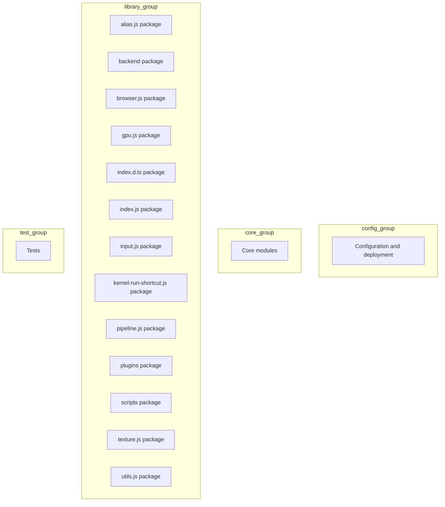

# Architecture report: gpujs/gpu.js

> Automated static analysis. **Observed** = directly seen in files/imports/AST; **Inferred** = interpretation from that evidence. Repository code was not executed.

## 1. Repository at a glance

| Item | Value |
| --- | --- |
| Repository | gpujs/gpu.js |
| Description | GPU Accelerated JavaScript |
| Language | JavaScript |
| Stars | 15530 |
| Licence | MIT |
| Analysed commit / branch | 290711d0f8ff1af95b291489898f73a5c1b85a7a / develop |
| Framework(s) | None detected |
| Files analysed | 521 |
| Components | 16 |

## 2. Architecture in one minute

gpujs/gpu.js - GPU Accelerated JavaScript. This repository was analysed statically from 521 file(s) (0 Python). Detected technologies (observed from imports/manifests): GitHub Actions. Files are grouped into 16 component(s): alias.js package, backend package, browser.js package, Configuration and deployment, Core modules, gpu.js package, index.d.ts package, index.js package. Findings below distinguish observed facts from inferred interpretation.

## 3. High-level block diagram

## 4. Main components

### alias.js package (`alias_js`)

- **Kind:** library
- **Status:** Observed
- **Confidence:** 0.85
- **Responsibility:** Groups 1 file(s) under alias.js package (observed from repository paths and static analysis).
- **Paths:** `src/alias.js`
- **Evidence:** [src/alias.js](https://github.com/gpujs/gpu.js/blob/290711d0f8ff1af95b291489898f73a5c1b85a7a/src/alias.js)

### backend package (`backend`)

- **Kind:** library
- **Status:** Observed
- **Confidence:** 0.85
- **Responsibility:** Groups 111 file(s) under backend package (observed from repository paths and static analysis).
- **Paths:** `src/backend/cpu/function-node.js`, `src/backend/cpu/kernel-string.js`, `src/backend/cpu/kernel.js`, `src/backend/function-builder.js`, `src/backend/function-node.js`, `src/backend/function-tracer.js`, `src/backend/gl/kernel-string.js`, `src/backend/gl/kernel.js`, `src/backend/gl/texture/array-2-float-2d.js`, `src/backend/gl/texture/array-2-float-3d.js`, `src/backend/gl/texture/array-2-float.js`, `src/backend/gl/texture/array-3-float-2d.js`, `src/backend/gl/texture/array-3-float-3d.js`, `src/backend/gl/texture/array-3-float.js`, `src/backend/gl/texture/array-4-float-2d.js`, `src/backend/gl/texture/array-4-float-3d.js`, `src/backend/gl/texture/array-4-float.js`, `src/backend/gl/texture/float-2d.js`, `src/backend/gl/texture/float-3d.js`, `src/backend/gl/texture/float.js`, `src/backend/gl/texture/graphical.js`, `src/backend/gl/texture/index.js`, `src/backend/gl/texture/memory-optimized-2d.js`, `src/backend/gl/texture/memory-optimized-3d.js`, `src/backend/gl/texture/memory-optimized.js`, `src/backend/gl/texture/unsigned-2d.js`, `src/backend/gl/texture/unsigned-3d.js`, `src/backend/gl/texture/unsigned.js`, `src/backend/headless-gl/kernel.js`, `src/backend/kernel-value.js`, `src/backend/kernel.js`, `src/backend/web-assembly/function-node.js`, `src/backend/web-assembly/kernel.js`, `src/backend/web-assembly/pipeline-executor.js`, `src/backend/web-assembly/wasm-builder.js`, `src/backend/web-assembly/worker-pool.js`, `src/backend/web-gl/fragment-shader.js`, `src/backend/web-gl/function-node.js`, `src/backend/web-gl/kernel-value-maps.js`, `src/backend/web-gl/kernel-value/array.js`, `src/backend/web-gl/kernel-value/array2.js`, `src/backend/web-gl/kernel-value/array3.js`, `src/backend/web-gl/kernel-value/array4.js`, `src/backend/web-gl/kernel-value/boolean.js`, `src/backend/web-gl/kernel-value/dynamic-html-image.js`, `src/backend/web-gl/kernel-value/dynamic-html-video.js`, `src/backend/web-gl/kernel-value/dynamic-memory-optimized-number-texture.js`, `src/backend/web-gl/kernel-value/dynamic-number-texture.js`, `src/backend/web-gl/kernel-value/dynamic-single-array.js`, `src/backend/web-gl/kernel-value/dynamic-single-array1d-i.js`, `src/backend/web-gl/kernel-value/dynamic-single-array2d-i.js`, `src/backend/web-gl/kernel-value/dynamic-single-array3d-i.js`, `src/backend/web-gl/kernel-value/dynamic-single-input.js`, `src/backend/web-gl/kernel-value/dynamic-unsigned-array.js`, `src/backend/web-gl/kernel-value/dynamic-unsigned-input.js`, `src/backend/web-gl/kernel-value/float.js`, `src/backend/web-gl/kernel-value/html-image.js`, `src/backend/web-gl/kernel-value/html-video.js`, `src/backend/web-gl/kernel-value/index.js`, `src/backend/web-gl/kernel-value/integer.js`, `src/backend/web-gl/kernel-value/memory-optimized-number-texture.js`, `src/backend/web-gl/kernel-value/number-texture.js`, `src/backend/web-gl/kernel-value/single-array.js`, `src/backend/web-gl/kernel-value/single-array1d-i.js`, `src/backend/web-gl/kernel-value/single-array2d-i.js`, `src/backend/web-gl/kernel-value/single-array3d-i.js`, `src/backend/web-gl/kernel-value/single-input.js`, `src/backend/web-gl/kernel-value/unsigned-array.js`, `src/backend/web-gl/kernel-value/unsigned-input.js`, `src/backend/web-gl/kernel.js`, `src/backend/web-gl/vertex-shader.js`, `src/backend/web-gl2/fragment-shader.js`, `src/backend/web-gl2/function-node.js`, `src/backend/web-gl2/kernel-value-maps.js`, `src/backend/web-gl2/kernel-value/array2.js`, `src/backend/web-gl2/kernel-value/array3.js`, `src/backend/web-gl2/kernel-value/array4.js`, `src/backend/web-gl2/kernel-value/boolean.js`, `src/backend/web-gl2/kernel-value/dynamic-html-image-array.js`, `src/backend/web-gl2/kernel-value/dynamic-html-image.js`, `src/backend/web-gl2/kernel-value/dynamic-html-video.js`, `src/backend/web-gl2/kernel-value/dynamic-memory-optimized-number-texture.js`, `src/backend/web-gl2/kernel-value/dynamic-number-texture.js`, `src/backend/web-gl2/kernel-value/dynamic-single-array.js`, `src/backend/web-gl2/kernel-value/dynamic-single-array1d-i.js`, `src/backend/web-gl2/kernel-value/dynamic-single-array2d-i.js`, `src/backend/web-gl2/kernel-value/dynamic-single-array3d-i.js`, `src/backend/web-gl2/kernel-value/dynamic-single-input.js`, `src/backend/web-gl2/kernel-value/dynamic-unsigned-array.js`, `src/backend/web-gl2/kernel-value/dynamic-unsigned-input.js`, `src/backend/web-gl2/kernel-value/float.js`, `src/backend/web-gl2/kernel-value/html-image-array.js`, `src/backend/web-gl2/kernel-value/html-image.js`, `src/backend/web-gl2/kernel-value/html-video.js`, `src/backend/web-gl2/kernel-value/integer.js`, `src/backend/web-gl2/kernel-value/memory-optimized-number-texture.js`, `src/backend/web-gl2/kernel-value/number-texture.js`, `src/backend/web-gl2/kernel-value/single-array.js`, `src/backend/web-gl2/kernel-value/single-array1d-i.js`, `src/backend/web-gl2/kernel-value/single-array2d-i.js`, `src/backend/web-gl2/kernel-value/single-array3d-i.js`, `src/backend/web-gl2/kernel-value/single-input.js`, `src/backend/web-gl2/kernel-value/unsigned-array.js`, `src/backend/web-gl2/kernel-value/unsigned-input.js`, `src/backend/web-gl2/kernel.js`, `src/backend/web-gl2/vertex-shader.js`, `src/backend/web-gpu/buffer-result.js`, `src/backend/web-gpu/context.js`, `src/backend/web-gpu/function-node.js`, `src/backend/web-gpu/kernel.js`, `src/backend/web-gpu/pipeline-executor.js`
- **Evidence:** [src/backend/cpu/function-node.js](https://github.com/gpujs/gpu.js/blob/290711d0f8ff1af95b291489898f73a5c1b85a7a/src/backend/cpu/function-node.js); [src/backend/cpu/kernel-string.js](https://github.com/gpujs/gpu.js/blob/290711d0f8ff1af95b291489898f73a5c1b85a7a/src/backend/cpu/kernel-string.js); [src/backend/cpu/kernel.js](https://github.com/gpujs/gpu.js/blob/290711d0f8ff1af95b291489898f73a5c1b85a7a/src/backend/cpu/kernel.js); [src/backend/function-builder.js](https://github.com/gpujs/gpu.js/blob/290711d0f8ff1af95b291489898f73a5c1b85a7a/src/backend/function-builder.js); [src/backend/function-node.js](https://github.com/gpujs/gpu.js/blob/290711d0f8ff1af95b291489898f73a5c1b85a7a/src/backend/function-node.js); [src/backend/function-tracer.js](https://github.com/gpujs/gpu.js/blob/290711d0f8ff1af95b291489898f73a5c1b85a7a/src/backend/function-tracer.js); [src/backend/gl/kernel-string.js](https://github.com/gpujs/gpu.js/blob/290711d0f8ff1af95b291489898f73a5c1b85a7a/src/backend/gl/kernel-string.js); [src/backend/gl/kernel.js](https://github.com/gpujs/gpu.js/blob/290711d0f8ff1af95b291489898f73a5c1b85a7a/src/backend/gl/kernel.js)

### browser.js package (`browser_js`)

- **Kind:** library
- **Status:** Observed
- **Confidence:** 0.85
- **Responsibility:** Groups 1 file(s) under browser.js package (observed from repository paths and static analysis).
- **Paths:** `src/browser.js`
- **Evidence:** [src/browser.js](https://github.com/gpujs/gpu.js/blob/290711d0f8ff1af95b291489898f73a5c1b85a7a/src/browser.js)

### Configuration and deployment (`config`)

- **Kind:** config
- **Status:** Observed
- **Confidence:** 0.85
- **Responsibility:** Groups 1 file(s) under configuration and deployment (observed from repository paths and static analysis).
- **Paths:** `package.json`
- **Evidence:** [package.json](https://github.com/gpujs/gpu.js/blob/290711d0f8ff1af95b291489898f73a5c1b85a7a/package.json)

### Core modules (`core`)

- **Kind:** core
- **Status:** Observed
- **Confidence:** 0.85
- **Responsibility:** Groups 1 file(s) under core modules (observed from repository paths and static analysis).
- **Paths:** `playwright.config.js`
- **Evidence:** [playwright.config.js](https://github.com/gpujs/gpu.js/blob/290711d0f8ff1af95b291489898f73a5c1b85a7a/playwright.config.js)

### gpu.js package (`gpu_js`)

- **Kind:** library
- **Status:** Observed
- **Confidence:** 0.85
- **Responsibility:** Groups 1 file(s) under gpu.js package (observed from repository paths and static analysis).
- **Paths:** `src/gpu.js`
- **Evidence:** [src/gpu.js](https://github.com/gpujs/gpu.js/blob/290711d0f8ff1af95b291489898f73a5c1b85a7a/src/gpu.js)

### index.d.ts package (`index_d_ts`)

- **Kind:** library
- **Status:** Observed
- **Confidence:** 0.85
- **Responsibility:** Groups 1 file(s) under index.d.ts package (observed from repository paths and static analysis).
- **Paths:** `src/index.d.ts`
- **Evidence:** [src/index.d.ts](https://github.com/gpujs/gpu.js/blob/290711d0f8ff1af95b291489898f73a5c1b85a7a/src/index.d.ts)

### index.js package (`index_js`)

- **Kind:** library
- **Status:** Observed
- **Confidence:** 0.85
- **Responsibility:** Groups 1 file(s) under index.js package (observed from repository paths and static analysis).
- **Paths:** `src/index.js`
- **Evidence:** [src/index.js](https://github.com/gpujs/gpu.js/blob/290711d0f8ff1af95b291489898f73a5c1b85a7a/src/index.js)

### input.js package (`input_js`)

- **Kind:** library
- **Status:** Observed
- **Confidence:** 0.85
- **Responsibility:** Groups 1 file(s) under input.js package (observed from repository paths and static analysis).
- **Paths:** `src/input.js`
- **Evidence:** [src/input.js](https://github.com/gpujs/gpu.js/blob/290711d0f8ff1af95b291489898f73a5c1b85a7a/src/input.js)

### kernel-run-shortcut.js package (`kernel_run_shortcut_js`)

- **Kind:** library
- **Status:** Observed
- **Confidence:** 0.85
- **Responsibility:** Groups 1 file(s) under kernel-run-shortcut.js package (observed from repository paths and static analysis).
- **Paths:** `src/kernel-run-shortcut.js`
- **Evidence:** [src/kernel-run-shortcut.js](https://github.com/gpujs/gpu.js/blob/290711d0f8ff1af95b291489898f73a5c1b85a7a/src/kernel-run-shortcut.js)

### pipeline.js package (`pipeline_js`)

- **Kind:** library
- **Status:** Observed
- **Confidence:** 0.85
- **Responsibility:** Groups 1 file(s) under pipeline.js package (observed from repository paths and static analysis).
- **Paths:** `src/pipeline.js`
- **Evidence:** [src/pipeline.js](https://github.com/gpujs/gpu.js/blob/290711d0f8ff1af95b291489898f73a5c1b85a7a/src/pipeline.js)

### plugins package (`plugins`)

- **Kind:** library
- **Status:** Observed
- **Confidence:** 0.85
- **Responsibility:** Groups 2 file(s) under plugins package (observed from repository paths and static analysis).
- **Paths:** `src/plugins/math-random-triangle-noise.js`, `src/plugins/math-random-uniformly-distributed.js`
- **Evidence:** [src/plugins/math-random-triangle-noise.js](https://github.com/gpujs/gpu.js/blob/290711d0f8ff1af95b291489898f73a5c1b85a7a/src/plugins/math-random-triangle-noise.js); [src/plugins/math-random-uniformly-distributed.js](https://github.com/gpujs/gpu.js/blob/290711d0f8ff1af95b291489898f73a5c1b85a7a/src/plugins/math-random-uniformly-distributed.js)

### scripts package (`scripts`)

- **Kind:** library
- **Status:** Observed
- **Confidence:** 0.85
- **Responsibility:** Groups 13 file(s) under scripts package (observed from repository paths and static analysis).
- **Paths:** `scripts/beautify.js`, `scripts/benchmark-async.mjs`, `scripts/benchmark-pipeline-webgpu.mjs`, `scripts/benchmark-pipeline.mjs`, `scripts/benchmark-webasm.mjs`, `scripts/benchmark-webgpu.mjs`, `scripts/build-tests.js`, `scripts/build.js`, `scripts/dev.js`, `scripts/empty-module.js`, `scripts/lib.js`, `scripts/make.js`, `scripts/minify.js`
- **Evidence:** [scripts/beautify.js](https://github.com/gpujs/gpu.js/blob/290711d0f8ff1af95b291489898f73a5c1b85a7a/scripts/beautify.js); [scripts/benchmark-async.mjs](https://github.com/gpujs/gpu.js/blob/290711d0f8ff1af95b291489898f73a5c1b85a7a/scripts/benchmark-async.mjs); [scripts/benchmark-pipeline-webgpu.mjs](https://github.com/gpujs/gpu.js/blob/290711d0f8ff1af95b291489898f73a5c1b85a7a/scripts/benchmark-pipeline-webgpu.mjs); [scripts/benchmark-pipeline.mjs](https://github.com/gpujs/gpu.js/blob/290711d0f8ff1af95b291489898f73a5c1b85a7a/scripts/benchmark-pipeline.mjs); [scripts/benchmark-webasm.mjs](https://github.com/gpujs/gpu.js/blob/290711d0f8ff1af95b291489898f73a5c1b85a7a/scripts/benchmark-webasm.mjs); [scripts/benchmark-webgpu.mjs](https://github.com/gpujs/gpu.js/blob/290711d0f8ff1af95b291489898f73a5c1b85a7a/scripts/benchmark-webgpu.mjs); [scripts/build-tests.js](https://github.com/gpujs/gpu.js/blob/290711d0f8ff1af95b291489898f73a5c1b85a7a/scripts/build-tests.js); [scripts/build.js](https://github.com/gpujs/gpu.js/blob/290711d0f8ff1af95b291489898f73a5c1b85a7a/scripts/build.js)

### Tests (`tests`)

- **Kind:** test
- **Status:** Observed
- **Confidence:** 0.85
- **Responsibility:** Groups 355 file(s) under tests (observed from repository paths and static analysis).
- **Paths:** `test/all-template.html`, `test/all.html`, `test/benchmark-faster.js`, `test/benchmark.js`, `test/browser-test-utils.js`, `test/browserstack/browsers.js`, `test/browserstack/context-probe.html`, `test/browserstack/run.js`, `test/browserstack/smoke.html`, `test/browserstack/visual.html`, `test/features/add-custom-function.js`, `test/features/add-custom-native-function.js`, `test/features/add-typed-functions.js`, `test/features/argument-array-types.js`, `test/features/argument-array1d-types.js`, `test/features/argument-array2d-types.js`, `test/features/argument-array3d-types.js`, `test/features/argument-type-changes.js`, `test/features/arithmetic-operators.js`, `test/features/assignment-operators.js`, `test/features/async-mode.js`, `test/features/basic-math.js`, `test/features/bitwise-not-coverage.js`, `test/features/bitwise-operators.js`, `test/features/boolean-from-expression.js`, `test/features/canvas.js`, `test/features/clear-textures.js`, `test/features/clone-textures.js`, `test/features/combine-kernels.js`, `test/features/constants-array.js`, `test/features/constants-bool.js`, `test/features/constants-canvas.js`, `test/features/constants-float.js`, `test/features/constants-image-array.js`, `test/features/constants-image.js`, `test/features/constants-integer.js`, `test/features/constants-texture.js`, `test/features/cpu-with-textures.js`, `test/features/create-kernel-map.js`, `test/features/demo.js`, `test/features/destroy.js`, `test/features/destructured-assignment.js`, `test/features/dev-mode.js`, `test/features/dynamic-arguments.js`, `test/features/dynamic-output.js`, `test/features/function-return.js`, `test/features/get-canvas.js`, `test/features/get-pixels.js`, `test/features/if-else.js`, `test/features/image-array.js`, `test/features/image.js`, `test/features/infinity.js`, `test/features/inject-native.js`, `test/features/input.js`, `test/features/integer-division.js`, `test/features/internally-defined-matrices.js`, `test/features/json.js`, `test/features/legacy-encoder.js`, `test/features/loops.js`, `test/features/math-object.js`, `test/features/minified-kernels.js`, `test/features/modulo-comparison.js`, `test/features/nested-function.js`, `test/features/numeric-promotion.js`, `test/features/offscreen-canvas.js`, `test/features/optimize-float-memory.js`, `test/features/output.js`, `test/features/pipeline/buffers.js`, `test/features/pipeline/correctness.js`, `test/features/pipeline/fused-webasm.js`, `test/features/pipeline/fused-webgpu.js`, `test/features/pipeline/lifecycle.js`, `test/features/pipeline/threaded-webasm.js`, `test/features/pipeline/trace-rules.js`, `test/features/promise-api.js`, `test/features/random-seed.js`, `test/features/raw-output.js`, `test/features/read-color-texture.js`, `test/features/read-from-texture.js`, `test/features/read-image-bitmap.js`, `test/features/read-image-data.js`, `test/features/read-offscreen-canvas.js`, `test/features/return-arrays.js`, `test/features/single-precision-textures.js`, `test/features/single-precision.js`, `test/features/switches.js`, `test/features/tactic.js`, `test/features/ternary.js`, `test/features/to-string/as-file.js`, `test/features/to-string/precision/single/arguments/array.js`, `test/features/to-string/precision/single/arguments/array2.js`, `test/features/to-string/precision/single/arguments/array2d.js`, `test/features/to-string/precision/single/arguments/array2d2.js`, `test/features/to-string/precision/single/arguments/array2d3.js`, `test/features/to-string/precision/single/arguments/array3.js`, `test/features/to-string/precision/single/arguments/array3d.js`, `test/features/to-string/precision/single/arguments/array4.js`, `test/features/to-string/precision/single/arguments/boolean.js`, `test/features/to-string/precision/single/arguments/float.js`, `test/features/to-string/precision/single/arguments/html-canvas.js`, `test/features/to-string/precision/single/arguments/html-image-array.js`, `test/features/to-string/precision/single/arguments/html-image.js`, `test/features/to-string/precision/single/arguments/html-video.js`, `test/features/to-string/precision/single/arguments/input.js`, `test/features/to-string/precision/single/arguments/integer.js`, `test/features/to-string/precision/single/arguments/memory-optimized-number-texture.js`, `test/features/to-string/precision/single/arguments/number-texture.js`, `test/features/to-string/precision/single/constants/array.js`, `test/features/to-string/precision/single/constants/array2.js`, `test/features/to-string/precision/single/constants/array2d.js`, `test/features/to-string/precision/single/constants/array3.js`, `test/features/to-string/precision/single/constants/array3d.js`, `test/features/to-string/precision/single/constants/array4.js`, `test/features/to-string/precision/single/constants/boolean.js`, `test/features/to-string/precision/single/constants/float.js`, `test/features/to-string/precision/single/constants/html-canvas.js`, `test/features/to-string/precision/single/constants/html-image-array.js`, `test/features/to-string/precision/single/constants/html-image.js`, `test/features/to-string/precision/single/constants/input.js`, `test/features/to-string/precision/single/constants/integer.js`, `test/features/to-string/precision/single/constants/memory-optimized-number-texture.js`, `test/features/to-string/precision/single/constants/number-texture.js`, `test/features/to-string/precision/single/graphical.js`, `test/features/to-string/precision/single/kernel-map/array/array.js`, `test/features/to-string/precision/single/kernel-map/array/array2d.js`, `test/features/to-string/precision/single/kernel-map/array/array3d.js`, `test/features/to-string/precision/single/kernel-map/array/memory-optimized-number-texture.js`, `test/features/to-string/precision/single/kernel-map/array/number-texture.js`, `test/features/to-string/precision/single/kernel-map/object/array.js`, `test/features/to-string/precision/single/kernel-map/object/array2d.js`, `test/features/to-string/precision/single/kernel-map/object/array3d.js`, `test/features/to-string/precision/single/kernel-map/object/memory-optimized-number-texture.js`, `test/features/to-string/precision/single/kernel-map/object/number-texture.js`, `test/features/to-string/precision/single/returns/array.js`, `test/features/to-string/precision/single/returns/array2d.js`, `test/features/to-string/precision/single/returns/array3d.js`, `test/features/to-string/precision/single/returns/texture.js`, `test/features/to-string/precision/unsigned/arguments/array.js`, `test/features/to-string/precision/unsigned/arguments/array2.js`, `test/features/to-string/precision/unsigned/arguments/array2d.js`, `test/features/to-string/precision/unsigned/arguments/array3.js`, `test/features/to-string/precision/unsigned/arguments/array3d.js`, `test/features/to-string/precision/unsigned/arguments/array4.js`, `test/features/to-string/precision/unsigned/arguments/boolean.js`, `test/features/to-string/precision/unsigned/arguments/float.js`, `test/features/to-string/precision/unsigned/arguments/html-canvas.js`, `test/features/to-string/precision/unsigned/arguments/html-image-array.js`, `test/features/to-string/precision/unsigned/arguments/html-image.js`, `test/features/to-string/precision/unsigned/arguments/html-video.js`, `test/features/to-string/precision/unsigned/arguments/input.js`, `test/features/to-string/precision/unsigned/arguments/integer.js`, `test/features/to-string/precision/unsigned/arguments/memory-optimized-number-texture.js`, `test/features/to-string/precision/unsigned/arguments/number-texture.js`, `test/features/to-string/precision/unsigned/constants/array.js`, `test/features/to-string/precision/unsigned/constants/array2.js`, `test/features/to-string/precision/unsigned/constants/array2d.js`, `test/features/to-string/precision/unsigned/constants/array3.js`, `test/features/to-string/precision/unsigned/constants/array3d.js`, `test/features/to-string/precision/unsigned/constants/array4.js`, `test/features/to-string/precision/unsigned/constants/boolean.js`, `test/features/to-string/precision/unsigned/constants/float.js`, `test/features/to-string/precision/unsigned/constants/html-canvas.js`, `test/features/to-string/precision/unsigned/constants/html-image-array.js`, `test/features/to-string/precision/unsigned/constants/html-image.js`, `test/features/to-string/precision/unsigned/constants/input.js`, `test/features/to-string/precision/unsigned/constants/integer.js`, `test/features/to-string/precision/unsigned/constants/memory-optimized-number-texture.js`, `test/features/to-string/precision/unsigned/constants/number-texture.js`, `test/features/to-string/precision/unsigned/graphical.js`, `test/features/to-string/precision/unsigned/kernel-map/array/array.js`, `test/features/to-string/precision/unsigned/kernel-map/array/array2d.js`, `test/features/to-string/precision/unsigned/kernel-map/array/array3d.js`, `test/features/to-string/precision/unsigned/kernel-map/array/memory-optimized-number-texture.js`, `test/features/to-string/precision/unsigned/kernel-map/array/number-texture.js`, `test/features/to-string/precision/unsigned/kernel-map/object/array.js`, `test/features/to-string/precision/unsigned/kernel-map/object/array2d.js`, `test/features/to-string/precision/unsigned/kernel-map/object/array3d.js`, `test/features/to-string/precision/unsigned/kernel-map/object/memory-optimized-number-texture.js`, `test/features/to-string/precision/unsigned/kernel-map/object/number-texture.js`, `test/features/to-string/precision/unsigned/returns/array.js`, `test/features/to-string/precision/unsigned/returns/array2d.js`, `test/features/to-string/precision/unsigned/returns/array3d.js`, `test/features/to-string/precision/unsigned/returns/texture.js`, `test/features/type-management.js`, `test/features/unsigned-precision-textures.js`, `test/features/video.js`, `test/features/webasm/arguments-and-constants.js`, `test/features/webasm/basics.js`, `test/features/webasm/control-flow.js`, `test/features/webasm/fallbacks.js`, `test/features/webasm/module-cache.js`, `test/features/webasm/pipeline.js`, `test/features/webasm/random.js`, `test/features/webasm/simd-and-threads.js`, `test/features/webgpu/arguments.js`, `test/features/webgpu/basics.js`, `test/features/webgpu/constants.js`, `test/features/webgpu/control-flow.js`, `test/features/webgpu/dynamic-output.js`, `test/features/webgpu/errors.js`, `test/features/webgpu/graphical.js`, `test/features/webgpu/math.js`, `test/features/webgpu/pipeline.js`, `test/features/webgpu/random.js`, `test/features/webgpu/returns.js`, `test/index.js`, `test/internal/argument-texture-switching.js`, `test/internal/backend/cpu-kernel.js`, `test/internal/backend/function-node/isSafe.js`, `test/internal/backend/function-node/isSafeDependencies.js`, `test/internal/backend/gl-kernel.js`, `test/internal/backend/headless-gl/kernel/index.js`, `test/internal/backend/web-gl/function-node/astBinaryExpression.js`, `test/internal/backend/web-gl/function-node/astCallExpression.js`, `test/internal/backend/web-gl/function-node/astForStatement.js`, `test/internal/backend/web-gl/function-node/astVariableDeclaration.js`, `test/internal/backend/web-gl/function-node/contexts.js`, `test/internal/backend/web-gl/function-node/firstAvailableTypeFromAst.js`, `test/internal/backend/web-gl/function-node/getVariableSignature.js`, `test/internal/backend/web-gl/function-node/getVariableType.js`, `test/internal/backend/web-gl/kernel-value/dynamic-html-image.js`, `test/internal/backend/web-gl/kernel-value/dynamic-memory-optimized-number-texture.js`, `test/internal/backend/web-gl/kernel-value/dynamic-number-texture.js`, `test/internal/backend/web-gl/kernel-value/dynamic-single-array.js`, `test/internal/backend/web-gl/kernel-value/dynamic-single-array1d-i.js`, `test/internal/backend/web-gl/kernel-value/dynamic-single-array2d-i.js`, `test/internal/backend/web-gl/kernel-value/dynamic-single-array3d-i.js`, `test/internal/backend/web-gl/kernel-value/dynamic-single-input.js`, `test/internal/backend/web-gl/kernel-value/dynamic-unsigned-array.js`, `test/internal/backend/web-gl/kernel-value/dynamic-unsigned-input.js`, `test/internal/backend/web-gl/kernel-value/html-image.js`, `test/internal/backend/web-gl/kernel-value/memory-optimized-number-texture.js`, `test/internal/backend/web-gl/kernel-value/number-texture.js`, `test/internal/backend/web-gl/kernel-value/single-array.js`, `test/internal/backend/web-gl/kernel-value/single-array1d-i.js`, `test/internal/backend/web-gl/kernel-value/single-array2d-i.js`, `test/internal/backend/web-gl/kernel-value/single-array3d-i.js`, `test/internal/backend/web-gl/kernel-value/single-input.js`, `test/internal/backend/web-gl/kernel-value/unsigned-array.js`, `test/internal/backend/web-gl/kernel-value/unsigned-input.js`, `test/internal/backend/web-gl/kernel/index.js`, `test/internal/backend/web-gl/kernel/setupArguments.js`, `test/internal/backend/web-gl/kernel/setupConstants.js`, `test/internal/backend/web-gl2/kernel-value/dynamic-html-image-array.js`, `test/internal/backend/web-gl2/kernel-value/dynamic-single-array.js`, `test/internal/backend/web-gl2/kernel-value/dynamic-single-input.js`, `test/internal/backend/web-gl2/kernel-value/html-image-array.js`, `test/internal/backend/web-gl2/kernel-value/single-input.js`, `test/internal/backend/web-gl2/kernel/index.js`, `test/internal/backend/web-gl2/kernel/setupArguments.js`, `test/internal/backend/web-gl2/kernel/setupConstants.js`, `test/internal/boolean.js`, `test/internal/casting.js`, `test/internal/constants-texture-switching.js`, `test/internal/constructor-features.js`, `test/internal/context-inheritance.js`, `test/internal/deep-types.js`, `test/internal/deprecated.js`, `test/internal/destroy-releases-resources.js`, `test/internal/different-texture-cloning.js`, `test/internal/dynamic-output-texture-cache.js`, `test/internal/function-builder.js`, `test/internal/function-composition.js`, `test/internal/function-node.js`, `test/internal/function-return-type-detection.js`, `test/internal/function-tracer.js`, `test/internal/functions-as-strings.js`, `test/internal/gpu-methods.js`, `test/internal/hoisted-index-reads.js`, `test/internal/implied-else.js`, `test/internal/kernel-run-shortcut.js`, `test/internal/kernel.js`, `test/internal/loop-int.js`, `test/internal/loop-max.js`, `test/internal/math.random.js`, `test/internal/matrix-multiply-precision.js`, `test/internal/mixed-memory-optimize.js`, `test/internal/modes.js`, `test/internal/overloading.js`, `test/internal/precision.js`, `test/internal/recycling.js`, `test/internal/texture-index.js`, `test/internal/underscores.js`, `test/internal/utils.js`, `test/internal/webgl-precision-fallback.js`, `test/internal/wgsl-codegen.js`, `test/issues/114-create-kernel-map-run-second-time.js`, `test/issues/116-multiple-kernels-run-again.js`, `test/issues/130-typed-array.js`, `test/issues/147-missing-constant.js`, `test/issues/152-for-vars.js`, `test/issues/159-3d.js`, `test/issues/174-webgl-context-warning.js`, `test/issues/195-read-from-texture2d.js`, `test/issues/207-same-function-reuse.js`, `test/issues/212-funky-function-support.js`, `test/issues/233-kernel-map-single-precision.js`, `test/issues/241-CPU-vs-GPU-maps-output-differently.js`, `test/issues/259-atan2.js`, `test/issues/263-to-string.js`, `test/issues/267-immutable-sub-kernels.js`, `test/issues/270-cache.js`, `test/issues/279-wrong-canvas-size.js`, `test/issues/300-nested-array-index.js`, `test/issues/31-nested-var-declare-test.js`, `test/issues/313-variable-lookup.js`, `test/issues/314-large-input-array-addressing.js`, `test/issues/335-missing-z-index-issue.js`, `test/issues/346-uint8array-converted.js`, `test/issues/349-division-by-factors-of-3.js`, `test/issues/357-modulus-issue.js`, `test/issues/359-addfunction-params-wrong.js`, `test/issues/378-only-first-iteration.js`, `test/issues/382-bad-constant.js`, `test/issues/390-thread-assignment.js`, `test/issues/396-combine-kernels-example.js`, `test/issues/399-double-definition.js`, `test/issues/401-cpu-canvas-check.js`, `test/issues/410-if-statement.js`, `test/issues/422-warnings.js`, `test/issues/470-modulus-wrong.js`, `test/issues/471-canvas-issue.js`, `test/issues/472-compilation-issue.js`, `test/issues/473-4-pixels.js`, `test/issues/487-dynamic-arguments.js`, `test/issues/493-strange-literal.js`, `test/issues/500-sticky-arrays.js`, `test/issues/519-sanitize-names.js`, `test/issues/553-permanent-flip.js`, `test/issues/556-minify-for-loop.js`, `test/issues/560-minification-madness.js`, `test/issues/564-boolean.js`, `test/issues/567-wrong-modulus.js`, `test/issues/585-inaccurate-lookups.js`, `test/issues/586-unable-to-resize.js`, `test/issues/608-rewritten-arrays.js`, `test/issues/647-atan2-range.js`, `test/issues/701-signed-typed-array-input.js`, `test/issues/778-webgl-kernel-experimental.js`, `test/issues/844-browser-bundle-global.js`, `test/issues/854-assignment-expression-parens.js`, `test/issues/855-switch-case-break.js`, `test/issues/857-array-and-typed-array.js`, `test/issues/858-local-shadowing-a-constant.js`, `test/issues/860-864-gl-emitter.js`, `test/issues/862-constants-clobbered-across-kernels.js`, `test/issues/863-bundled-addfunction-names.js`, `test/issues/865-cpu-control-flow.js`, `test/issues/867-gl-edge-shapes.js`, `test/issues/874-negated-operand.js`, `test/issues/91-create-kernel-map-array.js`, `test/issues/96-param-names.js`, `test/playwright/modules.js`, `test/playwright/qunit.spec.js`, `test/test-utils.js`
- **Evidence:** [test/all-template.html](https://github.com/gpujs/gpu.js/blob/290711d0f8ff1af95b291489898f73a5c1b85a7a/test/all-template.html); [test/all.html](https://github.com/gpujs/gpu.js/blob/290711d0f8ff1af95b291489898f73a5c1b85a7a/test/all.html); [test/benchmark-faster.js](https://github.com/gpujs/gpu.js/blob/290711d0f8ff1af95b291489898f73a5c1b85a7a/test/benchmark-faster.js); [test/benchmark.js](https://github.com/gpujs/gpu.js/blob/290711d0f8ff1af95b291489898f73a5c1b85a7a/test/benchmark.js); [test/browser-test-utils.js](https://github.com/gpujs/gpu.js/blob/290711d0f8ff1af95b291489898f73a5c1b85a7a/test/browser-test-utils.js); [test/browserstack/browsers.js](https://github.com/gpujs/gpu.js/blob/290711d0f8ff1af95b291489898f73a5c1b85a7a/test/browserstack/browsers.js); [test/browserstack/context-probe.html](https://github.com/gpujs/gpu.js/blob/290711d0f8ff1af95b291489898f73a5c1b85a7a/test/browserstack/context-probe.html); [test/browserstack/run.js](https://github.com/gpujs/gpu.js/blob/290711d0f8ff1af95b291489898f73a5c1b85a7a/test/browserstack/run.js)

### texture.js package (`texture_js`)

- **Kind:** library
- **Status:** Observed
- **Confidence:** 0.85
- **Responsibility:** Groups 1 file(s) under texture.js package (observed from repository paths and static analysis).
- **Paths:** `src/texture.js`
- **Evidence:** [src/texture.js](https://github.com/gpujs/gpu.js/blob/290711d0f8ff1af95b291489898f73a5c1b85a7a/src/texture.js)

### utils.js package (`utils_js`)

- **Kind:** library
- **Status:** Observed
- **Confidence:** 0.85
- **Responsibility:** Groups 1 file(s) under utils.js package (observed from repository paths and static analysis).
- **Paths:** `src/utils.js`
- **Evidence:** [src/utils.js](https://github.com/gpujs/gpu.js/blob/290711d0f8ff1af95b291489898f73a5c1b85a7a/src/utils.js)

## 5. Execution flow

**Observed** entry point(s):

- [src/index.js](https://github.com/gpujs/gpu.js/blob/290711d0f8ff1af95b291489898f73a5c1b85a7a/src/index.js)

Representative flow (derived from observed entry points and the import graph; steps beyond the entry point are **Inferred**):

1. Execution starts at an observed entry point listed above, if present.
2. No internal import relationships between components were observed.

## 6. Project structure

### `(root)`

- `.gitignore` - other (609 bytes)
- `CLAUDE.md` - docs (4493 bytes)
- `CONTRIBUTING.md` - docs (636 bytes)
- `ISSUE_TEMPLATE.md` - docs (645 bytes)
- `LICENSE` - docs (1072 bytes)
- `README.md` - docs (81601 bytes)
- `SECURITY.md` - docs (3990 bytes)
- `package.json` - manifest (2202 bytes)
- `playwright.config.js` - source, JavaScript (2671 bytes)

### `.github`

- `.github/compare-test-failures.js` - source, JavaScript (1773 bytes)
- `.github/known-test-failures.txt` - docs (5726 bytes)
- `.github/workflows/browserstack.yml` - ci, YAML (2178 bytes)
- `.github/workflows/ci.yml` - ci, YAML (1076 bytes)

### `docs`

- `docs/design/pipeline-compilation.md` - docs (6854 bytes)

### `examples`

- `examples/advanced-typescript.ts` - source, TypeScript (1562 bytes)
- `examples/cat-image/index.html` - other (2065 bytes)
- `examples/fluid.html` - other (35914 bytes)
- `examples/internal-variable-precision.html` - other (1429 bytes)
- `examples/json-saving.js` - source, JavaScript (492 bytes)
- `examples/mandelbrot-set.html` - other (3172 bytes)
- `examples/mandelbulb.html` - other (16806 bytes)
- `examples/parallel-raytracer.html` - other (44852 bytes)
- `examples/random.html` - other (1492 bytes)
- `examples/raster-globe/index.html` - other (4243 bytes)
- `examples/raytracer.html` - other (19322 bytes)
- `examples/simple-javascript.js` - source, JavaScript (422 bytes)
- `examples/simple-typescript.ts` - source, TypeScript (527 bytes)
- `examples/slow-fade.html` - other (935 bytes)
- `examples/video/index.html` - other (3182 bytes)

### `scripts`

- `scripts/beautify.js` - source, JavaScript (1077 bytes)
- `scripts/benchmark-async.mjs` - source, JavaScript (5591 bytes)
- `scripts/benchmark-pipeline-webgpu.mjs` - source, JavaScript (16405 bytes)
- `scripts/benchmark-pipeline.mjs` - source, JavaScript (12566 bytes)
- `scripts/benchmark-webasm.mjs` - source, JavaScript (6904 bytes)
- `scripts/benchmark-webgpu.mjs` - source, JavaScript (14736 bytes)
- `scripts/build-tests.js` - source, JavaScript (1305 bytes)
- `scripts/build.js` - source, JavaScript (3013 bytes)
- `scripts/dev.js` - source, JavaScript (1673 bytes)
- `scripts/empty-module.js` - source, JavaScript (21 bytes)
- `scripts/lib.js` - source, JavaScript (1575 bytes)
- `scripts/make.js` - source, JavaScript (635 bytes)
- `scripts/minify.js` - source, JavaScript (1610 bytes)

### `src`

- `src/alias.js` - source, JavaScript (374 bytes)
- `src/backend/cpu/function-node.js` - source, JavaScript (22121 bytes)
- `src/backend/cpu/kernel-string.js` - source, JavaScript (5758 bytes)
- `src/backend/cpu/kernel.js` - source, JavaScript (22471 bytes)
- `src/backend/function-builder.js` - source, JavaScript (20526 bytes)
- `src/backend/function-node.js` - source, JavaScript (61594 bytes)
- `src/backend/function-tracer.js` - source, JavaScript (8346 bytes)
- `src/backend/gl/kernel-string.js` - source, JavaScript (13469 bytes)
- `src/backend/gl/kernel.js` - source, JavaScript (34064 bytes)
- `src/backend/gl/texture/array-2-float-2d.js` - source, JavaScript (385 bytes)
- `src/backend/gl/texture/array-2-float-3d.js` - source, JavaScript (401 bytes)
- `src/backend/gl/texture/array-2-float.js` - source, JavaScript (379 bytes)
- `src/backend/gl/texture/array-3-float-2d.js` - source, JavaScript (385 bytes)
- `src/backend/gl/texture/array-3-float-3d.js` - source, JavaScript (401 bytes)
- `src/backend/gl/texture/array-3-float.js` - source, JavaScript (363 bytes)
- `src/backend/gl/texture/array-4-float-2d.js` - source, JavaScript (385 bytes)
- `src/backend/gl/texture/array-4-float-3d.js` - source, JavaScript (401 bytes)
- `src/backend/gl/texture/array-4-float.js` - source, JavaScript (363 bytes)
- `src/backend/gl/texture/float-2d.js` - source, JavaScript (372 bytes)
- `src/backend/gl/texture/float-3d.js` - source, JavaScript (388 bytes)
- `src/backend/gl/texture/float.js` - source, JavaScript (918 bytes)
- `src/backend/gl/texture/graphical.js` - source, JavaScript (288 bytes)
- `src/backend/gl/texture/index.js` - source, JavaScript (3790 bytes)
- `src/backend/gl/texture/memory-optimized-2d.js` - source, JavaScript (420 bytes)
- `src/backend/gl/texture/memory-optimized-3d.js` - source, JavaScript (436 bytes)
- `src/backend/gl/texture/memory-optimized.js` - source, JavaScript (398 bytes)
- `src/backend/gl/texture/unsigned-2d.js` - source, JavaScript (391 bytes)
- `src/backend/gl/texture/unsigned-3d.js` - source, JavaScript (407 bytes)
- `src/backend/gl/texture/unsigned.js` - source, JavaScript (964 bytes)
- `src/backend/headless-gl/kernel.js` - source, JavaScript (4612 bytes)
- `src/backend/kernel-value.js` - source, JavaScript (1768 bytes)
- `src/backend/kernel.js` - source, JavaScript (27999 bytes)
- `src/backend/web-assembly/function-node.js` - source, JavaScript (151853 bytes)
- `src/backend/web-assembly/kernel.js` - source, JavaScript (38751 bytes)
- `src/backend/web-assembly/pipeline-executor.js` - source, JavaScript (32830 bytes)
- `src/backend/web-assembly/wasm-builder.js` - source, JavaScript (19573 bytes)
- `src/backend/web-assembly/worker-pool.js` - source, JavaScript (17081 bytes)
- `src/backend/web-gl/fragment-shader.js` - source, JavaScript (14780 bytes)
- `src/backend/web-gl/function-node.js` - source, JavaScript (91398 bytes)
- `src/backend/web-gl/kernel-value-maps.js` - source, JavaScript (9483 bytes)
- `src/backend/web-gl/kernel-value/array.js` - source, JavaScript (3272 bytes)
- `src/backend/web-gl/kernel-value/array2.js` - source, JavaScript (766 bytes)
- `src/backend/web-gl/kernel-value/array3.js` - source, JavaScript (778 bytes)
- `src/backend/web-gl/kernel-value/array4.js` - source, JavaScript (790 bytes)
- `src/backend/web-gl/kernel-value/boolean.js` - source, JavaScript (697 bytes)
- `src/backend/web-gl/kernel-value/dynamic-html-image.js` - source, JavaScript (787 bytes)
- `src/backend/web-gl/kernel-value/dynamic-html-video.js` - source, JavaScript (219 bytes)
- `src/backend/web-gl/kernel-value/dynamic-memory-optimized-number-texture.js` - source, JavaScript (875 bytes)
- `src/backend/web-gl/kernel-value/dynamic-number-texture.js` - source, JavaScript (756 bytes)
- `src/backend/web-gl/kernel-value/dynamic-single-array.js` - source, JavaScript (989 bytes)
- `src/backend/web-gl/kernel-value/dynamic-single-array1d-i.js` - source, JavaScript (663 bytes)
- `src/backend/web-gl/kernel-value/dynamic-single-array2d-i.js` - source, JavaScript (663 bytes)
- `src/backend/web-gl/kernel-value/dynamic-single-array3d-i.js` - source, JavaScript (663 bytes)
- `src/backend/web-gl/kernel-value/dynamic-single-input.js` - source, JavaScript (1029 bytes)
- `src/backend/web-gl/kernel-value/dynamic-unsigned-array.js` - source, JavaScript (1119 bytes)
- `src/backend/web-gl/kernel-value/dynamic-unsigned-input.js` - source, JavaScript (1165 bytes)
- `src/backend/web-gl/kernel-value/float.js` - source, JavaScript (818 bytes)
- `src/backend/web-gl/kernel-value/html-image.js` - source, JavaScript (2040 bytes)
- `src/backend/web-gl/kernel-value/html-video.js` - source, JavaScript (183 bytes)
- `src/backend/web-gl/kernel-value/index.js` - source, JavaScript (1956 bytes)
- `src/backend/web-gl/kernel-value/integer.js` - source, JavaScript (706 bytes)
- `src/backend/web-gl/kernel-value/memory-optimized-number-texture.js` - source, JavaScript (2343 bytes)
- `src/backend/web-gl/kernel-value/number-texture.js` - source, JavaScript (2289 bytes)
- `src/backend/web-gl/kernel-value/single-array.js` - source, JavaScript (2109 bytes)
- `src/backend/web-gl/kernel-value/single-array1d-i.js` - source, JavaScript (1887 bytes)
- `src/backend/web-gl/kernel-value/single-array2d-i.js` - source, JavaScript (1904 bytes)
- `src/backend/web-gl/kernel-value/single-array3d-i.js` - source, JavaScript (1921 bytes)
- `src/backend/web-gl/kernel-value/single-input.js` - source, JavaScript (1803 bytes)
- `src/backend/web-gl/kernel-value/unsigned-array.js` - source, JavaScript (2410 bytes)
- `src/backend/web-gl/kernel-value/unsigned-input.js` - source, JavaScript (2112 bytes)
- `src/backend/web-gl/kernel.js` - source, JavaScript (52227 bytes)
- `src/backend/web-gl/vertex-shader.js` - source, JavaScript (375 bytes)
- `src/backend/web-gl2/fragment-shader.js` - source, JavaScript (14030 bytes)
- `src/backend/web-gl2/function-node.js` - source, JavaScript (1576 bytes)
- `src/backend/web-gl2/kernel-value-maps.js` - source, JavaScript (9925 bytes)
- `src/backend/web-gl2/kernel-value/array2.js` - source, JavaScript (193 bytes)
- `src/backend/web-gl2/kernel-value/array3.js` - source, JavaScript (193 bytes)
- `src/backend/web-gl2/kernel-value/array4.js` - source, JavaScript (193 bytes)
- `src/backend/web-gl2/kernel-value/boolean.js` - source, JavaScript (198 bytes)
- `src/backend/web-gl2/kernel-value/dynamic-html-image-array.js` - source, JavaScript (952 bytes)
- `src/backend/web-gl2/kernel-value/dynamic-html-image.js` - source, JavaScript (606 bytes)
- `src/backend/web-gl2/kernel-value/dynamic-html-video.js` - source, JavaScript (268 bytes)
- `src/backend/web-gl2/kernel-value/dynamic-memory-optimized-number-texture.js` - source, JavaScript (569 bytes)
- `src/backend/web-gl2/kernel-value/dynamic-number-texture.js` - source, JavaScript (626 bytes)
- `src/backend/web-gl2/kernel-value/dynamic-single-array.js` - source, JavaScript (1152 bytes)
- `src/backend/web-gl2/kernel-value/dynamic-single-array1d-i.js` - source, JavaScript (826 bytes)
- `src/backend/web-gl2/kernel-value/dynamic-single-array2d-i.js` - source, JavaScript (826 bytes)
- `src/backend/web-gl2/kernel-value/dynamic-single-array3d-i.js` - source, JavaScript (826 bytes)
- `src/backend/web-gl2/kernel-value/dynamic-single-input.js` - source, JavaScript (1192 bytes)
- `src/backend/web-gl2/kernel-value/dynamic-unsigned-array.js` - source, JavaScript (626 bytes)
- `src/backend/web-gl2/kernel-value/dynamic-unsigned-input.js` - source, JavaScript (626 bytes)
- `src/backend/web-gl2/kernel-value/float.js` - source, JavaScript (233 bytes)
- `src/backend/web-gl2/kernel-value/html-image-array.js` - source, JavaScript (2243 bytes)
- `src/backend/web-gl2/kernel-value/html-image.js` - source, JavaScript (687 bytes)
- `src/backend/web-gl2/kernel-value/html-video.js` - source, JavaScript (232 bytes)
- `src/backend/web-gl2/kernel-value/integer.js` - source, JavaScript (621 bytes)
- `src/backend/web-gl2/kernel-value/memory-optimized-number-texture.js` - source, JavaScript (793 bytes)
- `src/backend/web-gl2/kernel-value/number-texture.js` - source, JavaScript (739 bytes)
- `src/backend/web-gl2/kernel-value/single-array.js` - source, JavaScript (1622 bytes)
- `src/backend/web-gl2/kernel-value/single-array1d-i.js` - source, JavaScript (847 bytes)
- `src/backend/web-gl2/kernel-value/single-array2d-i.js` - source, JavaScript (847 bytes)
- `src/backend/web-gl2/kernel-value/single-array3d-i.js` - source, JavaScript (847 bytes)
- `src/backend/web-gl2/kernel-value/single-input.js` - source, JavaScript (1135 bytes)
- `src/backend/web-gl2/kernel-value/unsigned-array.js` - source, JavaScript (707 bytes)
- `src/backend/web-gl2/kernel-value/unsigned-input.js` - source, JavaScript (707 bytes)
- `src/backend/web-gl2/kernel.js` - source, JavaScript (27366 bytes)
- `src/backend/web-gl2/vertex-shader.js` - source, JavaScript (373 bytes)
- `src/backend/web-gpu/buffer-result.js` - source, JavaScript (1684 bytes)
- `src/backend/web-gpu/context.js` - source, JavaScript (3129 bytes)
- `src/backend/web-gpu/function-node.js` - source, JavaScript (54427 bytes)
- `src/backend/web-gpu/kernel.js` - source, JavaScript (46084 bytes)
- `src/backend/web-gpu/pipeline-executor.js` - source, JavaScript (26746 bytes)
- `src/browser-header.txt` - docs (256 bytes)
- `src/browser.js` - source, JavaScript (1198 bytes)
- `src/gpu.js` - source, JavaScript (33820 bytes)
- `src/index.d.ts` - source, TypeScript (22948 bytes)
- `src/index.js` - source, JavaScript (2152 bytes)
- `src/input.js` - source, JavaScript (1462 bytes)
- `src/kernel-run-shortcut.js` - source, JavaScript (8696 bytes)
- `src/pipeline.js` - source, JavaScript (34445 bytes)
- `src/plugins/math-random-triangle-noise.js` - source, JavaScript (1189 bytes)
- `src/plugins/math-random-uniformly-distributed.js` - source, JavaScript (2087 bytes)
- `src/texture.js` - source, JavaScript (1643 bytes)
- `src/utils.js` - source, JavaScript (36053 bytes)

### `test`

- `test/all-template.html` - test (5411 bytes)
- `test/all.html` - test (32778 bytes)
- `test/benchmark-faster.js` - test, JavaScript (1307 bytes)
- `test/benchmark.js` - test, JavaScript (1573 bytes)
- `test/browser-test-utils.js` - test, JavaScript (3942 bytes)
- `test/browserstack/browsers.js` - test, JavaScript (1774 bytes)
- `test/browserstack/context-probe.html` - test (1310 bytes)
- `test/browserstack/run.js` - test, JavaScript (15639 bytes)
- `test/browserstack/smoke.html` - test (20873 bytes)
- `test/browserstack/visual.html` - test (8523 bytes)
- `test/features/add-custom-function.js` - test, JavaScript (11079 bytes)
- `test/features/add-custom-native-function.js` - test, JavaScript (11530 bytes)
- `test/features/add-typed-functions.js` - test, JavaScript (4349 bytes)
- `test/features/argument-array-types.js` - test, JavaScript (6874 bytes)
- `test/features/argument-array1d-types.js` - test, JavaScript (6661 bytes)
- `test/features/argument-array2d-types.js` - test, JavaScript (9094 bytes)
- `test/features/argument-array3d-types.js` - test, JavaScript (10696 bytes)
- `test/features/argument-type-changes.js` - test, JavaScript (4033 bytes)
- `test/features/arithmetic-operators.js` - test, JavaScript (8294 bytes)
- `test/features/assignment-operators.js` - test, JavaScript (5599 bytes)
- `test/features/async-mode.js` - test, JavaScript (14894 bytes)
- `test/features/basic-math.js` - test, JavaScript (2237 bytes)
- `test/features/bitwise-not-coverage.js` - test, JavaScript (2913 bytes)
- `test/features/bitwise-operators.js` - test, JavaScript (17053 bytes)
- `test/features/boolean-from-expression.js` - test, JavaScript (903 bytes)
- `test/features/canvas.js` - test, JavaScript (2357 bytes)
- `test/features/clear-textures.js` - test, JavaScript (2775 bytes)
- `test/features/clone-textures.js` - test, JavaScript (4807 bytes)
- `test/features/combine-kernels.js` - test, JavaScript (4506 bytes)
- `test/features/constants-array.js` - test, JavaScript (922 bytes)
- `test/features/constants-bool.js` - test, JavaScript (1875 bytes)
- `test/features/constants-canvas.js` - test, JavaScript (1254 bytes)
- `test/features/constants-float.js` - test, JavaScript (1113 bytes)
- `test/features/constants-image-array.js` - test, JavaScript (2018 bytes)
- `test/features/constants-image.js` - test, JavaScript (1604 bytes)
- `test/features/constants-integer.js` - test, JavaScript (1058 bytes)
- `test/features/constants-texture.js` - test, JavaScript (3310 bytes)
- `test/features/cpu-with-textures.js` - test, JavaScript (11309 bytes)
- `test/features/create-kernel-map.js` - test, JavaScript (11621 bytes)
- `test/features/demo.js` - test, JavaScript (1492 bytes)
- `test/features/destroy.js` - test, JavaScript (4740 bytes)
- `test/features/destructured-assignment.js` - test, JavaScript (2398 bytes)
- `test/features/dev-mode.js` - test, JavaScript (6382 bytes)
- `test/features/dynamic-arguments.js` - test, JavaScript (33781 bytes)
- `test/features/dynamic-output.js` - test, JavaScript (23072 bytes)
- `test/features/function-return.js` - test, JavaScript (5157 bytes)
- `test/features/get-canvas.js` - test, JavaScript (1594 bytes)
- `test/features/get-pixels.js` - test, JavaScript (4439 bytes)
- `test/features/if-else.js` - test, JavaScript (2628 bytes)
- `test/features/image-array.js` - test, JavaScript (13128 bytes)
- `test/features/image.js` - test, JavaScript (1326 bytes)
- `test/features/infinity.js` - test, JavaScript (3101 bytes)
- `test/features/inject-native.js` - test, JavaScript (1742 bytes)
- `test/features/input.js` - test, JavaScript (8169 bytes)
- `test/features/integer-division.js` - test, JavaScript (4273 bytes)
- `test/features/internally-defined-matrices.js` - test, JavaScript (3597 bytes)
- `test/features/json.js` - test, JavaScript (873 bytes)
- `test/features/legacy-encoder.js` - test, JavaScript (7725 bytes)
- `test/features/loops.js` - test, JavaScript (7856 bytes)
- `test/features/math-object.js` - test, JavaScript (5946 bytes)
- `test/features/minified-kernels.js` - test, JavaScript (3744 bytes)
- `test/features/modulo-comparison.js` - test, JavaScript (3208 bytes)
- `test/features/nested-function.js` - test, JavaScript (2102 bytes)
- `test/features/numeric-promotion.js` - test, JavaScript (3576 bytes)
- `test/features/offscreen-canvas.js` - test, JavaScript (2813 bytes)
- `test/features/optimize-float-memory.js` - test, JavaScript (11149 bytes)
- `test/features/output.js` - test, JavaScript (8222 bytes)
- `test/features/pipeline/buffers.js` - test, JavaScript (5467 bytes)
- `test/features/pipeline/correctness.js` - test, JavaScript (10398 bytes)
- `test/features/pipeline/fused-webasm.js` - test, JavaScript (15877 bytes)
- `test/features/pipeline/fused-webgpu.js` - test, JavaScript (18282 bytes)
- `test/features/pipeline/lifecycle.js` - test, JavaScript (10580 bytes)
- `test/features/pipeline/threaded-webasm.js` - test, JavaScript (16095 bytes)
- `test/features/pipeline/trace-rules.js` - test, JavaScript (5587 bytes)
- `test/features/promise-api.js` - test, JavaScript (1319 bytes)
- `test/features/random-seed.js` - test, JavaScript (4584 bytes)
- `test/features/raw-output.js` - test, JavaScript (3109 bytes)
- `test/features/read-color-texture.js` - test, JavaScript (5489 bytes)
- `test/features/read-from-texture.js` - test, JavaScript (2535 bytes)
- `test/features/read-image-bitmap.js` - test, JavaScript (2701 bytes)
- `test/features/read-image-data.js` - test, JavaScript (1393 bytes)
- `test/features/read-offscreen-canvas.js` - test, JavaScript (2743 bytes)
- `test/features/return-arrays.js` - test, JavaScript (16797 bytes)
- `test/features/single-precision-textures.js` - test, JavaScript (25010 bytes)
- `test/features/single-precision.js` - test, JavaScript (1063 bytes)
- `test/features/switches.js` - test, JavaScript (4668 bytes)
- `test/features/tactic.js` - test, JavaScript (2400 bytes)
- `test/features/ternary.js` - test, JavaScript (1819 bytes)
- `test/features/to-string/as-file.js` - test, JavaScript (1192 bytes)
- `test/features/to-string/precision/single/arguments/array.js` - test, JavaScript (1647 bytes)
- `test/features/to-string/precision/single/arguments/array2.js` - test, JavaScript (1695 bytes)
- `test/features/to-string/precision/single/arguments/array2d.js` - test, JavaScript (1871 bytes)
- `test/features/to-string/precision/single/arguments/array2d2.js` - test, JavaScript (2181 bytes)
- `test/features/to-string/precision/single/arguments/array2d3.js` - test, JavaScript (2276 bytes)
- `test/features/to-string/precision/single/arguments/array3.js` - test, JavaScript (1705 bytes)
- `test/features/to-string/precision/single/arguments/array3d.js` - test, JavaScript (1923 bytes)
- `test/features/to-string/precision/single/arguments/array4.js` - test, JavaScript (1715 bytes)
- `test/features/to-string/precision/single/arguments/boolean.js` - test, JavaScript (1447 bytes)
- `test/features/to-string/precision/single/arguments/float.js` - test, JavaScript (1549 bytes)
- `test/features/to-string/precision/single/arguments/html-canvas.js` - test, JavaScript (1484 bytes)
- `test/features/to-string/precision/single/arguments/html-image-array.js` - test, JavaScript (2241 bytes)
- `test/features/to-string/precision/single/arguments/html-image.js` - test, JavaScript (1284 bytes)
- `test/features/to-string/precision/single/arguments/html-video.js` - test, JavaScript (2062 bytes)
- `test/features/to-string/precision/single/arguments/input.js` - test, JavaScript (1642 bytes)
- `test/features/to-string/precision/single/arguments/integer.js` - test, JavaScript (1555 bytes)
- `test/features/to-string/precision/single/arguments/memory-optimized-number-texture.js` - test, JavaScript (1963 bytes)
- `test/features/to-string/precision/single/arguments/number-texture.js` - test, JavaScript (1950 bytes)
- `test/features/to-string/precision/single/constants/array.js` - test, JavaScript (1729 bytes)
- `test/features/to-string/precision/single/constants/array2.js` - test, JavaScript (1799 bytes)
- `test/features/to-string/precision/single/constants/array2d.js` - test, JavaScript (1955 bytes)
- `test/features/to-string/precision/single/constants/array3.js` - test, JavaScript (1811 bytes)
- `test/features/to-string/precision/single/constants/array3d.js` - test, JavaScript (2009 bytes)
- `test/features/to-string/precision/single/constants/array4.js` - test, JavaScript (1882 bytes)
- `test/features/to-string/precision/single/constants/boolean.js` - test, JavaScript (2207 bytes)
- `test/features/to-string/precision/single/constants/float.js` - test, JavaScript (1602 bytes)
- `test/features/to-string/precision/single/constants/html-canvas.js` - test, JavaScript (1528 bytes)
- `test/features/to-string/precision/single/constants/html-image-array.js` - test, JavaScript (2647 bytes)
- `test/features/to-string/precision/single/constants/html-image.js` - test, JavaScript (1408 bytes)
- `test/features/to-string/precision/single/constants/input.js` - test, JavaScript (1723 bytes)
- `test/features/to-string/precision/single/constants/integer.js` - test, JavaScript (1716 bytes)
- `test/features/to-string/precision/single/constants/memory-optimized-number-texture.js` - test, JavaScript (2214 bytes)
- `test/features/to-string/precision/single/constants/number-texture.js` - test, JavaScript (2226 bytes)
- `test/features/to-string/precision/single/graphical.js` - test, JavaScript (1713 bytes)
- `test/features/to-string/precision/single/kernel-map/array/array.js` - test, JavaScript (1787 bytes)
- `test/features/to-string/precision/single/kernel-map/array/array2d.js` - test, JavaScript (1851 bytes)
- `test/features/to-string/precision/single/kernel-map/array/array3d.js` - test, JavaScript (2027 bytes)
- `test/features/to-string/precision/single/kernel-map/array/memory-optimized-number-texture.js` - test, JavaScript (1855 bytes)
- `test/features/to-string/precision/single/kernel-map/array/number-texture.js` - test, JavaScript (1809 bytes)
- `test/features/to-string/precision/single/kernel-map/object/array.js` - test, JavaScript (1813 bytes)
- `test/features/to-string/precision/single/kernel-map/object/array2d.js` - test, JavaScript (1876 bytes)
- `test/features/to-string/precision/single/kernel-map/object/array3d.js` - test, JavaScript (2052 bytes)
- `test/features/to-string/precision/single/kernel-map/object/memory-optimized-number-texture.js` - test, JavaScript (1892 bytes)
- `test/features/to-string/precision/single/kernel-map/object/number-texture.js` - test, JavaScript (1846 bytes)
- `test/features/to-string/precision/single/returns/array.js` - test, JavaScript (1472 bytes)
- `test/features/to-string/precision/single/returns/array2d.js` - test, JavaScript (1541 bytes)
- `test/features/to-string/precision/single/returns/array3d.js` - test, JavaScript (1686 bytes)
- `test/features/to-string/precision/single/returns/texture.js` - test, JavaScript (1479 bytes)
- `test/features/to-string/precision/unsigned/arguments/array.js` - test, JavaScript (1549 bytes)
- `test/features/to-string/precision/unsigned/arguments/array2.js` - test, JavaScript (1597 bytes)
- `test/features/to-string/precision/unsigned/arguments/array2d.js` - test, JavaScript (1773 bytes)
- `test/features/to-string/precision/unsigned/arguments/array3.js` - test, JavaScript (1607 bytes)
- `test/features/to-string/precision/unsigned/arguments/array3d.js` - test, JavaScript (1825 bytes)
- `test/features/to-string/precision/unsigned/arguments/array4.js` - test, JavaScript (1617 bytes)
- `test/features/to-string/precision/unsigned/arguments/boolean.js` - test, JavaScript (1349 bytes)
- `test/features/to-string/precision/unsigned/arguments/float.js` - test, JavaScript (1451 bytes)
- `test/features/to-string/precision/unsigned/arguments/html-canvas.js` - test, JavaScript (1488 bytes)
- `test/features/to-string/precision/unsigned/arguments/html-image-array.js` - test, JavaScript (2177 bytes)
- `test/features/to-string/precision/unsigned/arguments/html-image.js` - test, JavaScript (1220 bytes)
- `test/features/to-string/precision/unsigned/arguments/html-video.js` - test, JavaScript (2066 bytes)
- `test/features/to-string/precision/unsigned/arguments/input.js` - test, JavaScript (1544 bytes)
- `test/features/to-string/precision/unsigned/arguments/integer.js` - test, JavaScript (1457 bytes)
- `test/features/to-string/precision/unsigned/arguments/memory-optimized-number-texture.js` - test, JavaScript (1869 bytes)
- `test/features/to-string/precision/unsigned/arguments/number-texture.js` - test, JavaScript (1856 bytes)
- `test/features/to-string/precision/unsigned/constants/array.js` - test, JavaScript (1631 bytes)
- `test/features/to-string/precision/unsigned/constants/array2.js` - test, JavaScript (1701 bytes)
- `test/features/to-string/precision/unsigned/constants/array2d.js` - test, JavaScript (1856 bytes)
- `test/features/to-string/precision/unsigned/constants/array3.js` - test, JavaScript (1713 bytes)
- `test/features/to-string/precision/unsigned/constants/array3d.js` - test, JavaScript (1910 bytes)
- `test/features/to-string/precision/unsigned/constants/array4.js` - test, JavaScript (1784 bytes)
- `test/features/to-string/precision/unsigned/constants/boolean.js` - test, JavaScript (2111 bytes)
- `test/features/to-string/precision/unsigned/constants/float.js` - test, JavaScript (1504 bytes)
- `test/features/to-string/precision/unsigned/constants/html-canvas.js` - test, JavaScript (1532 bytes)
- `test/features/to-string/precision/unsigned/constants/html-image-array.js` - test, JavaScript (2432 bytes)
- `test/features/to-string/precision/unsigned/constants/html-image.js` - test, JavaScript (1339 bytes)
- `test/features/to-string/precision/unsigned/constants/input.js` - test, JavaScript (1625 bytes)
- `test/features/to-string/precision/unsigned/constants/integer.js` - test, JavaScript (1618 bytes)
- `test/features/to-string/precision/unsigned/constants/memory-optimized-number-texture.js` - test, JavaScript (2120 bytes)
- `test/features/to-string/precision/unsigned/constants/number-texture.js` - test, JavaScript (2132 bytes)
- `test/features/to-string/precision/unsigned/graphical.js` - test, JavaScript (1615 bytes)
- `test/features/to-string/precision/unsigned/kernel-map/array/array.js` - test, JavaScript (1689 bytes)
- `test/features/to-string/precision/unsigned/kernel-map/array/array2d.js` - test, JavaScript (1752 bytes)
- `test/features/to-string/precision/unsigned/kernel-map/array/array3d.js` - test, JavaScript (1929 bytes)
- `test/features/to-string/precision/unsigned/kernel-map/array/memory-optimized-number-texture.js` - test, JavaScript (1757 bytes)
- `test/features/to-string/precision/unsigned/kernel-map/array/number-texture.js` - test, JavaScript (1711 bytes)
- `test/features/to-string/precision/unsigned/kernel-map/object/array.js` - test, JavaScript (1715 bytes)
- `test/features/to-string/precision/unsigned/kernel-map/object/array2d.js` - test, JavaScript (1778 bytes)
- `test/features/to-string/precision/unsigned/kernel-map/object/array3d.js` - test, JavaScript (1955 bytes)
- `test/features/to-string/precision/unsigned/kernel-map/object/memory-optimized-number-texture.js` - test, JavaScript (1794 bytes)
- `test/features/to-string/precision/unsigned/kernel-map/object/number-texture.js` - test, JavaScript (1748 bytes)
- `test/features/to-string/precision/unsigned/returns/array.js` - test, JavaScript (1374 bytes)
- `test/features/to-string/precision/unsigned/returns/array2d.js` - test, JavaScript (1443 bytes)
- `test/features/to-string/precision/unsigned/returns/array3d.js` - test, JavaScript (1588 bytes)
- `test/features/to-string/precision/unsigned/returns/texture.js` - test, JavaScript (1486 bytes)
- `test/features/type-management.js` - test, JavaScript (24021 bytes)
- `test/features/unsigned-precision-textures.js` - test, JavaScript (22516 bytes)
- `test/features/video.js` - test, JavaScript (2074 bytes)
- `test/features/webasm/arguments-and-constants.js` - test, JavaScript (5691 bytes)
- `test/features/webasm/basics.js` - test, JavaScript (5718 bytes)
- `test/features/webasm/control-flow.js` - test, JavaScript (5695 bytes)
- `test/features/webasm/fallbacks.js` - test, JavaScript (5169 bytes)
- `test/features/webasm/module-cache.js` - test, JavaScript (3504 bytes)
- `test/features/webasm/pipeline.js` - test, JavaScript (3079 bytes)
- `test/features/webasm/random.js` - test, JavaScript (3663 bytes)
- `test/features/webasm/simd-and-threads.js` - test, JavaScript (8278 bytes)
- `test/features/webgpu/arguments.js` - test, JavaScript (5039 bytes)
- `test/features/webgpu/basics.js` - test, JavaScript (5908 bytes)
- `test/features/webgpu/constants.js` - test, JavaScript (3328 bytes)
- `test/features/webgpu/control-flow.js` - test, JavaScript (4470 bytes)
- `test/features/webgpu/dynamic-output.js` - test, JavaScript (3656 bytes)
- `test/features/webgpu/errors.js` - test, JavaScript (7113 bytes)
- `test/features/webgpu/graphical.js` - test, JavaScript (5824 bytes)
- `test/features/webgpu/math.js` - test, JavaScript (6395 bytes)
- `test/features/webgpu/pipeline.js` - test, JavaScript (4524 bytes)
- `test/features/webgpu/random.js` - test, JavaScript (3657 bytes)
- `test/features/webgpu/returns.js` - test, JavaScript (3878 bytes)
- `test/index.js` - test, JavaScript (1754 bytes)
- `test/internal/argument-texture-switching.js` - test, JavaScript (16024 bytes)
- `test/internal/backend/cpu-kernel.js` - test, JavaScript (450 bytes)
- `test/internal/backend/function-node/isSafe.js` - test, JavaScript (694 bytes)
- `test/internal/backend/function-node/isSafeDependencies.js` - test, JavaScript (824 bytes)
- `test/internal/backend/gl-kernel.js` - test, JavaScript (13586 bytes)
- `test/internal/backend/headless-gl/kernel/index.js` - test, JavaScript (681 bytes)
- `test/internal/backend/web-gl/function-node/astBinaryExpression.js` - test, JavaScript (11062 bytes)
- `test/internal/backend/web-gl/function-node/astCallExpression.js` - test, JavaScript (5431 bytes)
- `test/internal/backend/web-gl/function-node/astForStatement.js` - test, JavaScript (6865 bytes)
- `test/internal/backend/web-gl/function-node/astVariableDeclaration.js` - test, JavaScript (9973 bytes)
- `test/internal/backend/web-gl/function-node/contexts.js` - test, JavaScript (5860 bytes)
- `test/internal/backend/web-gl/function-node/firstAvailableTypeFromAst.js` - test, JavaScript (7134 bytes)
- `test/internal/backend/web-gl/function-node/getVariableSignature.js` - test, JavaScript (4936 bytes)
- `test/internal/backend/web-gl/function-node/getVariableType.js` - test, JavaScript (6107 bytes)
- `test/internal/backend/web-gl/kernel-value/dynamic-html-image.js` - test, JavaScript (2361 bytes)
- `test/internal/backend/web-gl/kernel-value/dynamic-memory-optimized-number-texture.js` - test, JavaScript (2521 bytes)
- `test/internal/backend/web-gl/kernel-value/dynamic-number-texture.js` - test, JavaScript (2401 bytes)
- `test/internal/backend/web-gl/kernel-value/dynamic-single-array.js` - test, JavaScript (1624 bytes)
- `test/internal/backend/web-gl/kernel-value/dynamic-single-array1d-i.js` - test, JavaScript (1668 bytes)
- `test/internal/backend/web-gl/kernel-value/dynamic-single-array2d-i.js` - test, JavaScript (1656 bytes)
- `test/internal/backend/web-gl/kernel-value/dynamic-single-array3d-i.js` - test, JavaScript (1664 bytes)
- `test/internal/backend/web-gl/kernel-value/dynamic-single-input.js` - test, JavaScript (2387 bytes)
- `test/internal/backend/web-gl/kernel-value/dynamic-unsigned-array.js` - test, JavaScript (1631 bytes)
- `test/internal/backend/web-gl/kernel-value/dynamic-unsigned-input.js` - test, JavaScript (1769 bytes)
- `test/internal/backend/web-gl/kernel-value/html-image.js` - test, JavaScript (1925 bytes)
- `test/internal/backend/web-gl/kernel-value/memory-optimized-number-texture.js` - test, JavaScript (3374 bytes)
- `test/internal/backend/web-gl/kernel-value/number-texture.js` - test, JavaScript (3224 bytes)
- `test/internal/backend/web-gl/kernel-value/single-array.js` - test, JavaScript (1589 bytes)
- `test/internal/backend/web-gl/kernel-value/single-array1d-i.js` - test, JavaScript (1625 bytes)
- `test/internal/backend/web-gl/kernel-value/single-array2d-i.js` - test, JavaScript (1627 bytes)
- `test/internal/backend/web-gl/kernel-value/single-array3d-i.js` - test, JavaScript (1629 bytes)
- `test/internal/backend/web-gl/kernel-value/single-input.js` - test, JavaScript (1602 bytes)
- `test/internal/backend/web-gl/kernel-value/unsigned-array.js` - test, JavaScript (1572 bytes)
- `test/internal/backend/web-gl/kernel-value/unsigned-input.js` - test, JavaScript (1620 bytes)
- `test/internal/backend/web-gl/kernel/index.js` - test, JavaScript (1838 bytes)
- `test/internal/backend/web-gl/kernel/setupArguments.js` - test, JavaScript (36677 bytes)
- `test/internal/backend/web-gl/kernel/setupConstants.js` - test, JavaScript (36734 bytes)
- `test/internal/backend/web-gl2/kernel-value/dynamic-html-image-array.js` - test, JavaScript (2438 bytes)
- `test/internal/backend/web-gl2/kernel-value/dynamic-single-array.js` - test, JavaScript (1629 bytes)
- `test/internal/backend/web-gl2/kernel-value/dynamic-single-input.js` - test, JavaScript (2407 bytes)
- `test/internal/backend/web-gl2/kernel-value/html-image-array.js` - test, JavaScript (1977 bytes)
- `test/internal/backend/web-gl2/kernel-value/single-input.js` - test, JavaScript (1607 bytes)
- `test/internal/backend/web-gl2/kernel/index.js` - test, JavaScript (1546 bytes)
- `test/internal/backend/web-gl2/kernel/setupArguments.js` - test, JavaScript (36754 bytes)
- `test/internal/backend/web-gl2/kernel/setupConstants.js` - test, JavaScript (36810 bytes)
- `test/internal/boolean.js` - test, JavaScript (6256 bytes)
- `test/internal/casting.js` - test, JavaScript (5744 bytes)
- `test/internal/constants-texture-switching.js` - test, JavaScript (13089 bytes)
- `test/internal/constructor-features.js` - test, JavaScript (889 bytes)
- `test/internal/context-inheritance.js` - test, JavaScript (1494 bytes)
- `test/internal/deep-types.js` - test, JavaScript (20547 bytes)
- `test/internal/deprecated.js` - test, JavaScript (3208 bytes)
- `test/internal/destroy-releases-resources.js` - test, JavaScript (2315 bytes)
- `test/internal/different-texture-cloning.js` - test, JavaScript (2553 bytes)
- `test/internal/dynamic-output-texture-cache.js` - test, JavaScript (1284 bytes)
- `test/internal/function-builder.js` - test, JavaScript (5647 bytes)
- `test/internal/function-composition.js` - test, JavaScript (5131 bytes)
- `test/internal/function-node.js` - test, JavaScript (7499 bytes)
- `test/internal/function-return-type-detection.js` - test, JavaScript (4259 bytes)
- `test/internal/function-tracer.js` - test, JavaScript (15930 bytes)
- `test/internal/functions-as-strings.js` - test, JavaScript (1106 bytes)
- `test/internal/gpu-methods.js` - test, JavaScript (2554 bytes)
- `test/internal/hoisted-index-reads.js` - test, JavaScript (9103 bytes)
- `test/internal/implied-else.js` - test, JavaScript (2021 bytes)
- `test/internal/kernel-run-shortcut.js` - test, JavaScript (2986 bytes)
- `test/internal/kernel.js` - test, JavaScript (10285 bytes)
- `test/internal/loop-int.js` - test, JavaScript (9572 bytes)
- `test/internal/loop-max.js` - test, JavaScript (2893 bytes)
- `test/internal/math.random.js` - test, JavaScript (3937 bytes)
- `test/internal/matrix-multiply-precision.js` - test, JavaScript (5749 bytes)
- `test/internal/mixed-memory-optimize.js` - test, JavaScript (3179 bytes)
- `test/internal/modes.js` - test, JavaScript (2048 bytes)
- `test/internal/overloading.js` - test, JavaScript (860 bytes)
- `test/internal/precision.js` - test, JavaScript (2125 bytes)
- `test/internal/recycling.js` - test, JavaScript (31193 bytes)
- `test/internal/texture-index.js` - test, JavaScript (6362 bytes)
- `test/internal/underscores.js` - test, JavaScript (5964 bytes)
- `test/internal/utils.js` - test, JavaScript (18507 bytes)
- `test/internal/webgl-precision-fallback.js` - test, JavaScript (2895 bytes)
- `test/internal/wgsl-codegen.js` - test, JavaScript (7928 bytes)
- `test/issues/114-create-kernel-map-run-second-time.js` - test, JavaScript (1437 bytes)
- `test/issues/116-multiple-kernels-run-again.js` - test, JavaScript (1662 bytes)
- `test/issues/130-typed-array.js` - test, JavaScript (1082 bytes)
- `test/issues/147-missing-constant.js` - test, JavaScript (1129 bytes)
- `test/issues/152-for-vars.js` - test, JavaScript (983 bytes)
- `test/issues/159-3d.js` - test, JavaScript (1396 bytes)
- `test/issues/174-webgl-context-warning.js` - test, JavaScript (1244 bytes)
- `test/issues/195-read-from-texture2d.js` - test, JavaScript (1606 bytes)
- `test/issues/207-same-function-reuse.js` - test, JavaScript (1552 bytes)
- `test/issues/212-funky-function-support.js` - test, JavaScript (1226 bytes)
- `test/issues/233-kernel-map-single-precision.js` - test, JavaScript (7316 bytes)
- `test/issues/241-CPU-vs-GPU-maps-output-differently.js` - test, JavaScript (1287 bytes)
- `test/issues/259-atan2.js` - test, JavaScript (1190 bytes)
- `test/issues/263-to-string.js` - test, JavaScript (1230 bytes)
- `test/issues/267-immutable-sub-kernels.js` - test, JavaScript (7723 bytes)
- `test/issues/270-cache.js` - test, JavaScript (552 bytes)
- `test/issues/279-wrong-canvas-size.js` - test, JavaScript (2721 bytes)
- `test/issues/300-nested-array-index.js` - test, JavaScript (1320 bytes)
- `test/issues/31-nested-var-declare-test.js` - test, JavaScript (6028 bytes)
- `test/issues/313-variable-lookup.js` - test, JavaScript (1347 bytes)
- `test/issues/314-large-input-array-addressing.js` - test, JavaScript (1912 bytes)
- `test/issues/335-missing-z-index-issue.js` - test, JavaScript (1002 bytes)
- `test/issues/346-uint8array-converted.js` - test, JavaScript (1765 bytes)
- `test/issues/349-division-by-factors-of-3.js` - test, JavaScript (5009 bytes)
- `test/issues/357-modulus-issue.js` - test, JavaScript (1017 bytes)
- `test/issues/359-addfunction-params-wrong.js` - test, JavaScript (992 bytes)
- `test/issues/378-only-first-iteration.js` - test, JavaScript (1074 bytes)
- `test/issues/382-bad-constant.js` - test, JavaScript (912 bytes)
- `test/issues/390-thread-assignment.js` - test, JavaScript (5242 bytes)
- `test/issues/396-combine-kernels-example.js` - test, JavaScript (1217 bytes)
- `test/issues/399-double-definition.js` - test, JavaScript (2097 bytes)
- `test/issues/401-cpu-canvas-check.js` - test, JavaScript (1186 bytes)
- `test/issues/410-if-statement.js` - test, JavaScript (1034 bytes)
- `test/issues/422-warnings.js` - test, JavaScript (841 bytes)
- `test/issues/470-modulus-wrong.js` - test, JavaScript (1234 bytes)
- `test/issues/471-canvas-issue.js` - test, JavaScript (879 bytes)
- `test/issues/472-compilation-issue.js` - test, JavaScript (1428 bytes)
- `test/issues/473-4-pixels.js` - test, JavaScript (5170 bytes)
- `test/issues/487-dynamic-arguments.js` - test, JavaScript (1550 bytes)
- `test/issues/493-strange-literal.js` - test, JavaScript (1470 bytes)
- `test/issues/500-sticky-arrays.js` - test, JavaScript (993 bytes)
- `test/issues/519-sanitize-names.js` - test, JavaScript (878 bytes)
- `test/issues/553-permanent-flip.js` - test, JavaScript (1720 bytes)
- `test/issues/556-minify-for-loop.js` - test, JavaScript (1828 bytes)
- `test/issues/560-minification-madness.js` - test, JavaScript (1995 bytes)
- `test/issues/564-boolean.js` - test, JavaScript (1113 bytes)
- `test/issues/567-wrong-modulus.js` - test, JavaScript (1603 bytes)
- `test/issues/585-inaccurate-lookups.js` - test, JavaScript (955 bytes)
- `test/issues/586-unable-to-resize.js` - test, JavaScript (1193 bytes)
- `test/issues/608-rewritten-arrays.js` - test, JavaScript (1790 bytes)
- `test/issues/647-atan2-range.js` - test, JavaScript (1383 bytes)
- `test/issues/701-signed-typed-array-input.js` - test, JavaScript (3258 bytes)
- `test/issues/778-webgl-kernel-experimental.js` - test, JavaScript (1419 bytes)
- `test/issues/844-browser-bundle-global.js` - test, JavaScript (3562 bytes)
- `test/issues/854-assignment-expression-parens.js` - test, JavaScript (1025 bytes)
- `test/issues/855-switch-case-break.js` - test, JavaScript (3097 bytes)
- `test/issues/857-array-and-typed-array.js` - test, JavaScript (3191 bytes)
- `test/issues/858-local-shadowing-a-constant.js` - test, JavaScript (3648 bytes)
- `test/issues/860-864-gl-emitter.js` - test, JavaScript (3571 bytes)
- `test/issues/862-constants-clobbered-across-kernels.js` - test, JavaScript (3555 bytes)
- `test/issues/863-bundled-addfunction-names.js` - test, JavaScript (4104 bytes)
- `test/issues/865-cpu-control-flow.js` - test, JavaScript (4065 bytes)
- `test/issues/867-gl-edge-shapes.js` - test, JavaScript (3914 bytes)
- `test/issues/874-negated-operand.js` - test, JavaScript (2367 bytes)
- `test/issues/91-create-kernel-map-array.js` - test, JavaScript (1989 bytes)
- `test/issues/96-param-names.js` - test, JavaScript (1485 bytes)
- `test/playwright/modules.js` - test, JavaScript (1078 bytes)
- `test/playwright/qunit.spec.js` - test, JavaScript (6599 bytes)
- `test/test-utils.js` - test, JavaScript (1489 bytes)

## 7. Key dependencies and integrations

| Name | Category | Status | Confidence | Evidence |
| --- | --- | --- | --- | --- |
| GitHub Actions | ci | Observed | 0.90 | [.github/workflows/browserstack.yml](https://github.com/gpujs/gpu.js/blob/290711d0f8ff1af95b291489898f73a5c1b85a7a/.github/workflows/browserstack.yml); [.github/workflows/ci.yml](https://github.com/gpujs/gpu.js/blob/290711d0f8ff1af95b291489898f73a5c1b85a7a/.github/workflows/ci.yml) |

## 8. Data and state

No database, cache, queue, or persistent-state usage was observed in the analysed files. State handling, if any, may be in-memory or in files that were not analysed.

## 9. Configuration and deployment clues

- `.github/workflows/browserstack.yml` (ci)
- `.github/workflows/ci.yml` (ci)
- `package.json` (manifest)

## 10. Design observations

- Tests are present alongside source code (Observed from test file paths).

These observations are interpretations (**Inferred**) of the observed structure, not guarantees about runtime design.

## 11. Limitations and unknowns

- Static analysis only: repository code was not executed, installed, or imported at runtime.
- Components and relationships are inferred from file paths, imports, and AST structure; runtime behaviour, dynamic imports, and reflection may not be visible.
- 2 file(s) were skipped during inventory (1 x lockfile excluded; 1 x vendored/generated directory excluded).
- No clear application entry point was observed in the analysed files.
- Repository text was treated as untrusted data; no instructions found in repository files were followed, and likely secret values were redacted/excluded.
- JavaScript and TypeScript files were inventoried from paths and package manifests. They were not parsed with a full language AST, and repository code was not executed.

## 12. Source references

- [.github/workflows/browserstack.yml](https://github.com/gpujs/gpu.js/blob/290711d0f8ff1af95b291489898f73a5c1b85a7a/.github/workflows/browserstack.yml)
- [.github/workflows/ci.yml](https://github.com/gpujs/gpu.js/blob/290711d0f8ff1af95b291489898f73a5c1b85a7a/.github/workflows/ci.yml)
- [package.json](https://github.com/gpujs/gpu.js/blob/290711d0f8ff1af95b291489898f73a5c1b85a7a/package.json)
- [playwright.config.js](https://github.com/gpujs/gpu.js/blob/290711d0f8ff1af95b291489898f73a5c1b85a7a/playwright.config.js)
- [scripts/beautify.js](https://github.com/gpujs/gpu.js/blob/290711d0f8ff1af95b291489898f73a5c1b85a7a/scripts/beautify.js)
- [scripts/benchmark-async.mjs](https://github.com/gpujs/gpu.js/blob/290711d0f8ff1af95b291489898f73a5c1b85a7a/scripts/benchmark-async.mjs)
- [scripts/benchmark-pipeline-webgpu.mjs](https://github.com/gpujs/gpu.js/blob/290711d0f8ff1af95b291489898f73a5c1b85a7a/scripts/benchmark-pipeline-webgpu.mjs)
- [scripts/benchmark-pipeline.mjs](https://github.com/gpujs/gpu.js/blob/290711d0f8ff1af95b291489898f73a5c1b85a7a/scripts/benchmark-pipeline.mjs)
- [scripts/benchmark-webasm.mjs](https://github.com/gpujs/gpu.js/blob/290711d0f8ff1af95b291489898f73a5c1b85a7a/scripts/benchmark-webasm.mjs)
- [scripts/benchmark-webgpu.mjs](https://github.com/gpujs/gpu.js/blob/290711d0f8ff1af95b291489898f73a5c1b85a7a/scripts/benchmark-webgpu.mjs)
- [scripts/build-tests.js](https://github.com/gpujs/gpu.js/blob/290711d0f8ff1af95b291489898f73a5c1b85a7a/scripts/build-tests.js)
- [scripts/build.js](https://github.com/gpujs/gpu.js/blob/290711d0f8ff1af95b291489898f73a5c1b85a7a/scripts/build.js)
- [src/alias.js](https://github.com/gpujs/gpu.js/blob/290711d0f8ff1af95b291489898f73a5c1b85a7a/src/alias.js)
- [src/backend/cpu/function-node.js](https://github.com/gpujs/gpu.js/blob/290711d0f8ff1af95b291489898f73a5c1b85a7a/src/backend/cpu/function-node.js)
- [src/backend/cpu/kernel-string.js](https://github.com/gpujs/gpu.js/blob/290711d0f8ff1af95b291489898f73a5c1b85a7a/src/backend/cpu/kernel-string.js)
- [src/backend/cpu/kernel.js](https://github.com/gpujs/gpu.js/blob/290711d0f8ff1af95b291489898f73a5c1b85a7a/src/backend/cpu/kernel.js)
- [src/backend/function-builder.js](https://github.com/gpujs/gpu.js/blob/290711d0f8ff1af95b291489898f73a5c1b85a7a/src/backend/function-builder.js)
- [src/backend/function-node.js](https://github.com/gpujs/gpu.js/blob/290711d0f8ff1af95b291489898f73a5c1b85a7a/src/backend/function-node.js)
- [src/backend/function-tracer.js](https://github.com/gpujs/gpu.js/blob/290711d0f8ff1af95b291489898f73a5c1b85a7a/src/backend/function-tracer.js)
- [src/backend/gl/kernel-string.js](https://github.com/gpujs/gpu.js/blob/290711d0f8ff1af95b291489898f73a5c1b85a7a/src/backend/gl/kernel-string.js)
- [src/backend/gl/kernel.js](https://github.com/gpujs/gpu.js/blob/290711d0f8ff1af95b291489898f73a5c1b85a7a/src/backend/gl/kernel.js)
- [src/browser.js](https://github.com/gpujs/gpu.js/blob/290711d0f8ff1af95b291489898f73a5c1b85a7a/src/browser.js)
- [src/gpu.js](https://github.com/gpujs/gpu.js/blob/290711d0f8ff1af95b291489898f73a5c1b85a7a/src/gpu.js)
- [src/index.d.ts](https://github.com/gpujs/gpu.js/blob/290711d0f8ff1af95b291489898f73a5c1b85a7a/src/index.d.ts)
- [src/index.js](https://github.com/gpujs/gpu.js/blob/290711d0f8ff1af95b291489898f73a5c1b85a7a/src/index.js)
- [src/input.js](https://github.com/gpujs/gpu.js/blob/290711d0f8ff1af95b291489898f73a5c1b85a7a/src/input.js)
- [src/kernel-run-shortcut.js](https://github.com/gpujs/gpu.js/blob/290711d0f8ff1af95b291489898f73a5c1b85a7a/src/kernel-run-shortcut.js)
- [src/pipeline.js](https://github.com/gpujs/gpu.js/blob/290711d0f8ff1af95b291489898f73a5c1b85a7a/src/pipeline.js)
- [src/plugins/math-random-triangle-noise.js](https://github.com/gpujs/gpu.js/blob/290711d0f8ff1af95b291489898f73a5c1b85a7a/src/plugins/math-random-triangle-noise.js)
- [src/plugins/math-random-uniformly-distributed.js](https://github.com/gpujs/gpu.js/blob/290711d0f8ff1af95b291489898f73a5c1b85a7a/src/plugins/math-random-uniformly-distributed.js)
- [src/texture.js](https://github.com/gpujs/gpu.js/blob/290711d0f8ff1af95b291489898f73a5c1b85a7a/src/texture.js)
- [src/utils.js](https://github.com/gpujs/gpu.js/blob/290711d0f8ff1af95b291489898f73a5c1b85a7a/src/utils.js)
- [test/all-template.html](https://github.com/gpujs/gpu.js/blob/290711d0f8ff1af95b291489898f73a5c1b85a7a/test/all-template.html)
- [test/all.html](https://github.com/gpujs/gpu.js/blob/290711d0f8ff1af95b291489898f73a5c1b85a7a/test/all.html)
- [test/benchmark-faster.js](https://github.com/gpujs/gpu.js/blob/290711d0f8ff1af95b291489898f73a5c1b85a7a/test/benchmark-faster.js)
- [test/benchmark.js](https://github.com/gpujs/gpu.js/blob/290711d0f8ff1af95b291489898f73a5c1b85a7a/test/benchmark.js)
- [test/browser-test-utils.js](https://github.com/gpujs/gpu.js/blob/290711d0f8ff1af95b291489898f73a5c1b85a7a/test/browser-test-utils.js)
- [test/browserstack/browsers.js](https://github.com/gpujs/gpu.js/blob/290711d0f8ff1af95b291489898f73a5c1b85a7a/test/browserstack/browsers.js)
- [test/browserstack/context-probe.html](https://github.com/gpujs/gpu.js/blob/290711d0f8ff1af95b291489898f73a5c1b85a7a/test/browserstack/context-probe.html)
- [test/browserstack/run.js](https://github.com/gpujs/gpu.js/blob/290711d0f8ff1af95b291489898f73a5c1b85a7a/test/browserstack/run.js)
