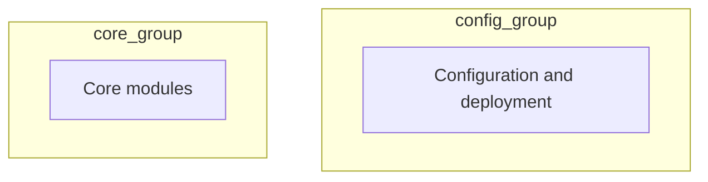

# Architecture report: grab/front-end-guide

> Automated static analysis. **Observed** = directly seen in files/imports/AST; **Inferred** = interpretation from that evidence. Repository code was not executed.

## 1. Repository at a glance

| Item | Value |
| --- | --- |
| Repository | grab/front-end-guide |
| Description | 📚 Study guide and introduction to the modern front end stack. |
| Language | JavaScript |
| Stars | 15212 |
| Licence | MIT |
| Analysed commit / branch | 1c42022b3cae66c44249639307a01a06ecea75f4 / master |
| Framework(s) | React |
| Files analysed | 14 |
| Components | 2 |

## 2. Architecture in one minute

grab/front-end-guide - 📚 Study guide and introduction to the modern front end stack.. This repository was analysed statically from 14 file(s) (0 Python). Detected technologies (observed from imports/manifests): React, React Router, Redux, Jest, webpack. Files are grouped into 2 component(s): Configuration and deployment, Core modules. Findings below distinguish observed facts from inferred interpretation.

## 3. High-level block diagram

## 4. Main components

### Configuration and deployment (`config`)

- **Kind:** config
- **Status:** Observed
- **Confidence:** 0.85
- **Responsibility:** Groups 1 file(s) under configuration and deployment (observed from repository paths and static analysis).
- **Paths:** `package.json`
- **Evidence:** [package.json](https://github.com/grab/front-end-guide/blob/1c42022b3cae66c44249639307a01a06ecea75f4/package.json)

### Core modules (`core`)

- **Kind:** core
- **Status:** Observed
- **Confidence:** 0.85
- **Responsibility:** Groups 1 file(s) under core modules (observed from repository paths and static analysis).
- **Paths:** `index.js`
- **Evidence:** [index.js](https://github.com/grab/front-end-guide/blob/1c42022b3cae66c44249639307a01a06ecea75f4/index.js)

## 5. Execution flow

**Observed** entry point(s):

- [index.js](https://github.com/grab/front-end-guide/blob/1c42022b3cae66c44249639307a01a06ecea75f4/index.js)

Representative flow (derived from observed entry points and the import graph; steps beyond the entry point are **Inferred**):

1. Execution starts at an observed entry point listed above, if present.
2. No internal import relationships between components were observed.

## 6. Project structure

### `(root)`

- `.gitignore` - other (883 bytes)
- `CODE_OF_CONDUCT.md` - docs (3222 bytes)
- `CONTRIBUTING.md` - docs (416 bytes)
- `LICENSE` - docs (1061 bytes)
- `README.md` - docs (50647 bytes)
- `index.js` - source, JavaScript (301 bytes)
- `package.json` - manifest (1160 bytes)

### `images`

- `images/css-modules-logo.svg` - other (5175 bytes)
- `images/eslint-logo.svg` - other (1372 bytes)
- `images/jest-logo.svg` - other (5848 bytes)
- `images/react-logo.svg` - other (1789 bytes)
- `images/redux-logo.svg` - other (1144 bytes)
- `images/stylelint-logo.svg` - other (6587 bytes)
- `images/webpack-logo.svg` - other (657 bytes)

## 7. Key dependencies and integrations

| Name | Category | Status | Confidence | Evidence |
| --- | --- | --- | --- | --- |
| React | framework | Observed | 0.90 | [package.json:10](https://github.com/grab/front-end-guide/blob/1c42022b3cae66c44249639307a01a06ecea75f4/package.json#L10); [package.json:11](https://github.com/grab/front-end-guide/blob/1c42022b3cae66c44249639307a01a06ecea75f4/package.json#L11) |
| React Router | library | Observed | 0.90 | [package.json:13](https://github.com/grab/front-end-guide/blob/1c42022b3cae66c44249639307a01a06ecea75f4/package.json#L13); [package.json:14](https://github.com/grab/front-end-guide/blob/1c42022b3cae66c44249639307a01a06ecea75f4/package.json#L14) |
| Redux | library | Observed | 0.85 | [package.json:12](https://github.com/grab/front-end-guide/blob/1c42022b3cae66c44249639307a01a06ecea75f4/package.json#L12) |
| Jest | tooling | Observed | 0.85 | [package.json:31](https://github.com/grab/front-end-guide/blob/1c42022b3cae66c44249639307a01a06ecea75f4/package.json#L31) |
| webpack | tooling | Observed | 0.85 | [package.json:25](https://github.com/grab/front-end-guide/blob/1c42022b3cae66c44249639307a01a06ecea75f4/package.json#L25) |

## 8. Data and state

No database, cache, queue, or persistent-state usage was observed in the analysed files. State handling, if any, may be in-memory or in files that were not analysed.

## 9. Configuration and deployment clues

- `package.json` (manifest)

## 10. Design observations

- No strong design patterns could be established from the available evidence.

These observations are interpretations (**Inferred**) of the observed structure, not guarantees about runtime design.

## 11. Limitations and unknowns

- Static analysis only: repository code was not executed, installed, or imported at runtime.
- Components and relationships are inferred from file paths, imports, and AST structure; runtime behaviour, dynamic imports, and reflection may not be visible.
- 1 file(s) were skipped during inventory (1 x lockfile excluded).
- No clear application entry point was observed in the analysed files.
- Repository text was treated as untrusted data; no instructions found in repository files were followed, and likely secret values were redacted/excluded.
- JavaScript and TypeScript files were inventoried from paths and package manifests. They were not parsed with a full language AST, and repository code was not executed.

## 12. Source references

- [index.js](https://github.com/grab/front-end-guide/blob/1c42022b3cae66c44249639307a01a06ecea75f4/index.js)
- [package.json](https://github.com/grab/front-end-guide/blob/1c42022b3cae66c44249639307a01a06ecea75f4/package.json)
- [package.json:10](https://github.com/grab/front-end-guide/blob/1c42022b3cae66c44249639307a01a06ecea75f4/package.json#L10)
- [package.json:11](https://github.com/grab/front-end-guide/blob/1c42022b3cae66c44249639307a01a06ecea75f4/package.json#L11)
- [package.json:12](https://github.com/grab/front-end-guide/blob/1c42022b3cae66c44249639307a01a06ecea75f4/package.json#L12)
- [package.json:13](https://github.com/grab/front-end-guide/blob/1c42022b3cae66c44249639307a01a06ecea75f4/package.json#L13)
- [package.json:14](https://github.com/grab/front-end-guide/blob/1c42022b3cae66c44249639307a01a06ecea75f4/package.json#L14)
- [package.json:25](https://github.com/grab/front-end-guide/blob/1c42022b3cae66c44249639307a01a06ecea75f4/package.json#L25)
- [package.json:31](https://github.com/grab/front-end-guide/blob/1c42022b3cae66c44249639307a01a06ecea75f4/package.json#L31)
