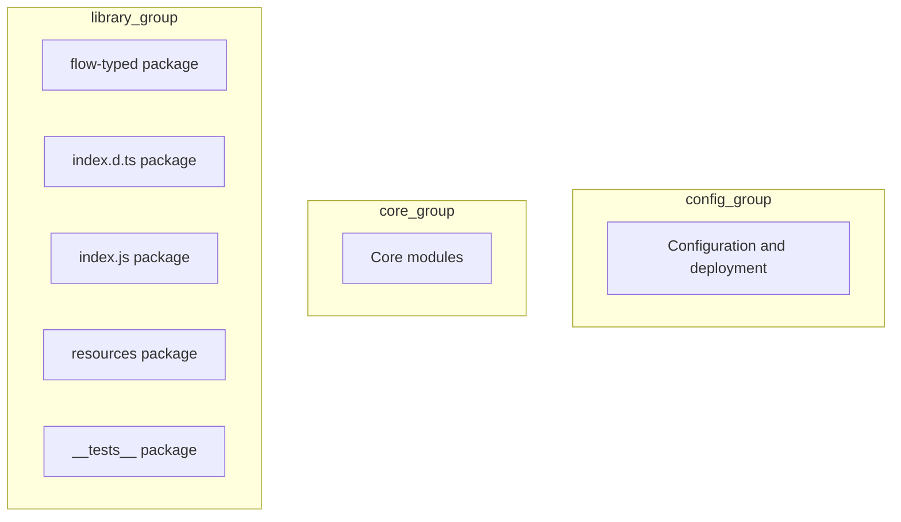

# Architecture report: graphql/dataloader

> Automated static analysis. **Observed** = directly seen in files/imports/AST; **Inferred** = interpretation from that evidence. Repository code was not executed.

## 1. Repository at a glance

| Item | Value |
| --- | --- |
| Repository | graphql/dataloader |
| Description | DataLoader is a generic utility to be used as part of your application's data fetching layer to provide a consistent API over various backends and reduce requests to those backends via batching and caching. |
| Language | JavaScript |
| Stars | 13394 |
| Licence | MIT |
| Analysed commit / branch | 65be452f5ffad3eede2d862dc26c96003fa87ef3 / main |
| Framework(s) | None detected |
| Files analysed | 33 |
| Components | 7 |

## 2. Architecture in one minute

graphql/dataloader - DataLoader is a generic utility to be used as part of your application's data fetching layer to provide a consistent API over various backends and reduce requests to those backends via batching and c…. This repository was analysed statically from 33 file(s) (0 Python). Detected technologies (observed from imports/manifests): GitHub Actions, Jest. Files are grouped into 7 component(s): Configuration and deployment, Core modules, flow-typed package, index.d.ts package, index.js package, resources package, __tests__ package. Findings below distinguish observed facts from inferred interpretation.

## 3. High-level block diagram

## 4. Main components

### Configuration and deployment (`config`)

- **Kind:** config
- **Status:** Observed
- **Confidence:** 0.85
- **Responsibility:** Groups 2 file(s) under configuration and deployment (observed from repository paths and static analysis).
- **Paths:** `package.json`, `renovate.json`
- **Evidence:** [package.json](https://github.com/graphql/dataloader/blob/65be452f5ffad3eede2d862dc26c96003fa87ef3/package.json); [renovate.json](https://github.com/graphql/dataloader/blob/65be452f5ffad3eede2d862dc26c96003fa87ef3/renovate.json)

### Core modules (`core`)

- **Kind:** core
- **Status:** Observed
- **Confidence:** 0.85
- **Responsibility:** Groups 1 file(s) under core modules (observed from repository paths and static analysis).
- **Paths:** `babel.config.js`
- **Evidence:** [babel.config.js](https://github.com/graphql/dataloader/blob/65be452f5ffad3eede2d862dc26c96003fa87ef3/babel.config.js)

### flow-typed package (`flow_typed`)

- **Kind:** library
- **Status:** Observed
- **Confidence:** 0.85
- **Responsibility:** Groups 1 file(s) under flow-typed package (observed from repository paths and static analysis).
- **Paths:** `flow-typed/npm/jest_v24.x.x.js`
- **Evidence:** [flow-typed/npm/jest_v24.x.x.js](https://github.com/graphql/dataloader/blob/65be452f5ffad3eede2d862dc26c96003fa87ef3/flow-typed/npm/jest_v24.x.x.js)

### index.d.ts package (`index_d_ts`)

- **Kind:** library
- **Status:** Observed
- **Confidence:** 0.85
- **Responsibility:** Groups 1 file(s) under index.d.ts package (observed from repository paths and static analysis).
- **Paths:** `src/index.d.ts`
- **Evidence:** [src/index.d.ts](https://github.com/graphql/dataloader/blob/65be452f5ffad3eede2d862dc26c96003fa87ef3/src/index.d.ts)

### index.js package (`index_js`)

- **Kind:** library
- **Status:** Observed
- **Confidence:** 0.85
- **Responsibility:** Groups 1 file(s) under index.js package (observed from repository paths and static analysis).
- **Paths:** `src/index.js`
- **Evidence:** [src/index.js](https://github.com/graphql/dataloader/blob/65be452f5ffad3eede2d862dc26c96003fa87ef3/src/index.js)

### resources package (`resources`)

- **Kind:** library
- **Status:** Observed
- **Confidence:** 0.85
- **Responsibility:** Groups 2 file(s) under resources package (observed from repository paths and static analysis).
- **Paths:** `resources/prepublish.sh`, `resources/watch.js`
- **Evidence:** [resources/prepublish.sh](https://github.com/graphql/dataloader/blob/65be452f5ffad3eede2d862dc26c96003fa87ef3/resources/prepublish.sh); [resources/watch.js](https://github.com/graphql/dataloader/blob/65be452f5ffad3eede2d862dc26c96003fa87ef3/resources/watch.js)

### __tests__ package (`tests`)

- **Kind:** library
- **Status:** Observed
- **Confidence:** 0.85
- **Responsibility:** Groups 5 file(s) under __tests__ package (observed from repository paths and static analysis).
- **Paths:** `src/__tests__/abuse.test.js`, `src/__tests__/browser.test.js`, `src/__tests__/dataloader.test.js`, `src/__tests__/oldbrowser.test.js`, `src/__tests__/unhandled.test.js`
- **Evidence:** [src/__tests__/abuse.test.js](https://github.com/graphql/dataloader/blob/65be452f5ffad3eede2d862dc26c96003fa87ef3/src/__tests__/abuse.test.js); [src/__tests__/browser.test.js](https://github.com/graphql/dataloader/blob/65be452f5ffad3eede2d862dc26c96003fa87ef3/src/__tests__/browser.test.js); [src/__tests__/dataloader.test.js](https://github.com/graphql/dataloader/blob/65be452f5ffad3eede2d862dc26c96003fa87ef3/src/__tests__/dataloader.test.js); [src/__tests__/oldbrowser.test.js](https://github.com/graphql/dataloader/blob/65be452f5ffad3eede2d862dc26c96003fa87ef3/src/__tests__/oldbrowser.test.js); [src/__tests__/unhandled.test.js](https://github.com/graphql/dataloader/blob/65be452f5ffad3eede2d862dc26c96003fa87ef3/src/__tests__/unhandled.test.js)

## 5. Execution flow

**Observed** entry point(s):

- [src/index.js](https://github.com/graphql/dataloader/blob/65be452f5ffad3eede2d862dc26c96003fa87ef3/src/index.js)

Representative flow (derived from observed entry points and the import graph; steps beyond the entry point are **Inferred**):

1. Execution starts at an observed entry point listed above, if present.
2. No internal import relationships between components were observed.

## 6. Project structure

### `(root)`

- `.eslintignore` - other (18 bytes)
- `.eslintrc` - other (4639 bytes)
- `.flowconfig` - other (191 bytes)
- `.gitignore` - other (158 bytes)
- `CHANGELOG.md` - docs (3189 bytes)
- `CONTRIBUTING.md` - docs (1598 bytes)
- `LICENSE` - docs (1072 bytes)
- `README.md` - docs (25493 bytes)
- `babel.config.js` - source, JavaScript (157 bytes)
- `package.json` - manifest (1987 bytes)
- `renovate.json` - config (190 bytes)

### `.changeset`

- `.changeset/README.md` - docs (510 bytes)
- `.changeset/config.json` - config (322 bytes)

### `.github`

- `.github/ISSUE_TEMPLATE/bug-report.md` - docs (771 bytes)
- `.github/ISSUE_TEMPLATE/feature-request.md` - docs (610 bytes)
- `.github/ISSUE_TEMPLATE/question.md` - docs (486 bytes)
- `.github/workflows/validation.yml` - ci, YAML (789 bytes)

### `examples`

- `examples/CouchDB.md` - docs (1123 bytes)
- `examples/GoogleDatastore.md` - docs (1076 bytes)
- `examples/Knex.md` - docs (1427 bytes)
- `examples/Redis.md` - docs (819 bytes)
- `examples/RethinkDB.md` - docs (2711 bytes)
- `examples/SQL.md` - docs (1298 bytes)

### `flow-typed`

- `flow-typed/npm/jest_v24.x.x.js` - source, JavaScript (34126 bytes)

### `resources`

- `resources/prepublish.sh` - source, Shell (616 bytes)
- `resources/watch.js` - source, JavaScript (4471 bytes)

### `src`

- `src/__tests__/abuse.test.js` - source, JavaScript (6762 bytes)
- `src/__tests__/browser.test.js` - source, JavaScript (878 bytes)
- `src/__tests__/dataloader.test.js` - source, JavaScript (28718 bytes)
- `src/__tests__/oldbrowser.test.js` - source, JavaScript (933 bytes)
- `src/__tests__/unhandled.test.js` - source, JavaScript (907 bytes)
- `src/index.d.ts` - source, TypeScript (4206 bytes)
- `src/index.js` - source, JavaScript (15620 bytes)

## 7. Key dependencies and integrations

| Name | Category | Status | Confidence | Evidence |
| --- | --- | --- | --- | --- |
| GitHub Actions | ci | Observed | 0.85 | [.github/workflows/validation.yml](https://github.com/graphql/dataloader/blob/65be452f5ffad3eede2d862dc26c96003fa87ef3/.github/workflows/validation.yml) |
| Jest | tooling | Observed | 0.85 | [package.json:28](https://github.com/graphql/dataloader/blob/65be452f5ffad3eede2d862dc26c96003fa87ef3/package.json#L28) |

## 8. Data and state

No database, cache, queue, or persistent-state usage was observed in the analysed files. State handling, if any, may be in-memory or in files that were not analysed.

## 9. Configuration and deployment clues

- `.changeset/config.json` (config)
- `.github/workflows/validation.yml` (ci)
- `package.json` (manifest)
- `renovate.json` (config)

## 10. Design observations

- No strong design patterns could be established from the available evidence.

These observations are interpretations (**Inferred**) of the observed structure, not guarantees about runtime design.

## 11. Limitations and unknowns

- Static analysis only: repository code was not executed, installed, or imported at runtime.
- Components and relationships are inferred from file paths, imports, and AST structure; runtime behaviour, dynamic imports, and reflection may not be visible.
- No clear application entry point was observed in the analysed files.
- Repository text was treated as untrusted data; no instructions found in repository files were followed, and likely secret values were redacted/excluded.
- JavaScript and TypeScript files were inventoried from paths and package manifests. They were not parsed with a full language AST, and repository code was not executed.

## 12. Source references

- [.github/workflows/validation.yml](https://github.com/graphql/dataloader/blob/65be452f5ffad3eede2d862dc26c96003fa87ef3/.github/workflows/validation.yml)
- [babel.config.js](https://github.com/graphql/dataloader/blob/65be452f5ffad3eede2d862dc26c96003fa87ef3/babel.config.js)
- [flow-typed/npm/jest_v24.x.x.js](https://github.com/graphql/dataloader/blob/65be452f5ffad3eede2d862dc26c96003fa87ef3/flow-typed/npm/jest_v24.x.x.js)
- [package.json](https://github.com/graphql/dataloader/blob/65be452f5ffad3eede2d862dc26c96003fa87ef3/package.json)
- [package.json:28](https://github.com/graphql/dataloader/blob/65be452f5ffad3eede2d862dc26c96003fa87ef3/package.json#L28)
- [renovate.json](https://github.com/graphql/dataloader/blob/65be452f5ffad3eede2d862dc26c96003fa87ef3/renovate.json)
- [resources/prepublish.sh](https://github.com/graphql/dataloader/blob/65be452f5ffad3eede2d862dc26c96003fa87ef3/resources/prepublish.sh)
- [resources/watch.js](https://github.com/graphql/dataloader/blob/65be452f5ffad3eede2d862dc26c96003fa87ef3/resources/watch.js)
- [src/__tests__/abuse.test.js](https://github.com/graphql/dataloader/blob/65be452f5ffad3eede2d862dc26c96003fa87ef3/src/__tests__/abuse.test.js)
- [src/__tests__/browser.test.js](https://github.com/graphql/dataloader/blob/65be452f5ffad3eede2d862dc26c96003fa87ef3/src/__tests__/browser.test.js)
- [src/__tests__/dataloader.test.js](https://github.com/graphql/dataloader/blob/65be452f5ffad3eede2d862dc26c96003fa87ef3/src/__tests__/dataloader.test.js)
- [src/__tests__/oldbrowser.test.js](https://github.com/graphql/dataloader/blob/65be452f5ffad3eede2d862dc26c96003fa87ef3/src/__tests__/oldbrowser.test.js)
- [src/__tests__/unhandled.test.js](https://github.com/graphql/dataloader/blob/65be452f5ffad3eede2d862dc26c96003fa87ef3/src/__tests__/unhandled.test.js)
- [src/index.d.ts](https://github.com/graphql/dataloader/blob/65be452f5ffad3eede2d862dc26c96003fa87ef3/src/index.d.ts)
- [src/index.js](https://github.com/graphql/dataloader/blob/65be452f5ffad3eede2d862dc26c96003fa87ef3/src/index.js)
