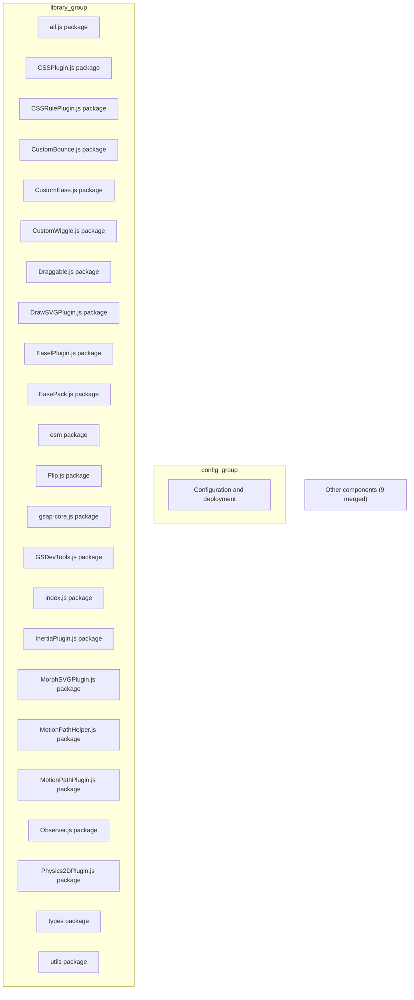

# Architecture report: greensock/GSAP

> Automated static analysis. **Observed** = directly seen in files/imports/AST; **Inferred** = interpretation from that evidence. Repository code was not executed.

## 1. Repository at a glance

| Item | Value |
| --- | --- |
| Repository | greensock/GSAP |
| Description | GSAP (GreenSock Animation Platform), a JavaScript animation library for the modern web |
| Language | JavaScript |
| Stars | 30632 |
| Licence | Not detected |
| Analysed commit / branch | 5e6c35ff8eedea12d4f229129def635277d8b0f2 / master |
| Framework(s) | None detected |
| Files analysed | 104 |
| Components | 33 |

## 2. Architecture in one minute

greensock/GSAP - GSAP (GreenSock Animation Platform), a JavaScript animation library for the modern web. This repository was analysed statically from 104 file(s) (0 Python). Detected technologies (observed from imports/manifests): no known frameworks/libraries. Files are grouped into 33 component(s): all.js package, Configuration and deployment, CSSPlugin.js package, CSSRulePlugin.js package, CustomBounce.js package, CustomEase.js package, CustomWiggle.js package, Draggable.js package. Findings below distinguish observed facts from inferred interpretation.

## 3. High-level block diagram

## 4. Main components

### all.js package (`all_js`)

- **Kind:** library
- **Status:** Observed
- **Confidence:** 0.85
- **Responsibility:** Groups 1 file(s) under all.js package (observed from repository paths and static analysis).
- **Paths:** `src/all.js`
- **Evidence:** [src/all.js](https://github.com/greensock/GSAP/blob/5e6c35ff8eedea12d4f229129def635277d8b0f2/src/all.js)

### Configuration and deployment (`config`)

- **Kind:** config
- **Status:** Observed
- **Confidence:** 0.85
- **Responsibility:** Groups 1 file(s) under configuration and deployment (observed from repository paths and static analysis).
- **Paths:** `package.json`
- **Evidence:** [package.json](https://github.com/greensock/GSAP/blob/5e6c35ff8eedea12d4f229129def635277d8b0f2/package.json)

### CSSPlugin.js package (`cssplugin_js`)

- **Kind:** library
- **Status:** Observed
- **Confidence:** 0.85
- **Responsibility:** Groups 1 file(s) under cssplugin.js package (observed from repository paths and static analysis).
- **Paths:** `src/CSSPlugin.js`
- **Evidence:** [src/CSSPlugin.js](https://github.com/greensock/GSAP/blob/5e6c35ff8eedea12d4f229129def635277d8b0f2/src/CSSPlugin.js)

### CSSRulePlugin.js package (`cssruleplugin_js`)

- **Kind:** library
- **Status:** Observed
- **Confidence:** 0.85
- **Responsibility:** Groups 1 file(s) under cssruleplugin.js package (observed from repository paths and static analysis).
- **Paths:** `src/CSSRulePlugin.js`
- **Evidence:** [src/CSSRulePlugin.js](https://github.com/greensock/GSAP/blob/5e6c35ff8eedea12d4f229129def635277d8b0f2/src/CSSRulePlugin.js)

### CustomBounce.js package (`custombounce_js`)

- **Kind:** library
- **Status:** Observed
- **Confidence:** 0.85
- **Responsibility:** Groups 1 file(s) under custombounce.js package (observed from repository paths and static analysis).
- **Paths:** `src/CustomBounce.js`
- **Evidence:** [src/CustomBounce.js](https://github.com/greensock/GSAP/blob/5e6c35ff8eedea12d4f229129def635277d8b0f2/src/CustomBounce.js)

### CustomEase.js package (`customease_js`)

- **Kind:** library
- **Status:** Observed
- **Confidence:** 0.85
- **Responsibility:** Groups 1 file(s) under customease.js package (observed from repository paths and static analysis).
- **Paths:** `src/CustomEase.js`
- **Evidence:** [src/CustomEase.js](https://github.com/greensock/GSAP/blob/5e6c35ff8eedea12d4f229129def635277d8b0f2/src/CustomEase.js)

### CustomWiggle.js package (`customwiggle_js`)

- **Kind:** library
- **Status:** Observed
- **Confidence:** 0.85
- **Responsibility:** Groups 1 file(s) under customwiggle.js package (observed from repository paths and static analysis).
- **Paths:** `src/CustomWiggle.js`
- **Evidence:** [src/CustomWiggle.js](https://github.com/greensock/GSAP/blob/5e6c35ff8eedea12d4f229129def635277d8b0f2/src/CustomWiggle.js)

### Draggable.js package (`draggable_js`)

- **Kind:** library
- **Status:** Observed
- **Confidence:** 0.85
- **Responsibility:** Groups 1 file(s) under draggable.js package (observed from repository paths and static analysis).
- **Paths:** `src/Draggable.js`
- **Evidence:** [src/Draggable.js](https://github.com/greensock/GSAP/blob/5e6c35ff8eedea12d4f229129def635277d8b0f2/src/Draggable.js)

### DrawSVGPlugin.js package (`drawsvgplugin_js`)

- **Kind:** library
- **Status:** Observed
- **Confidence:** 0.85
- **Responsibility:** Groups 1 file(s) under drawsvgplugin.js package (observed from repository paths and static analysis).
- **Paths:** `src/DrawSVGPlugin.js`
- **Evidence:** [src/DrawSVGPlugin.js](https://github.com/greensock/GSAP/blob/5e6c35ff8eedea12d4f229129def635277d8b0f2/src/DrawSVGPlugin.js)

### EaselPlugin.js package (`easelplugin_js`)

- **Kind:** library
- **Status:** Observed
- **Confidence:** 0.85
- **Responsibility:** Groups 1 file(s) under easelplugin.js package (observed from repository paths and static analysis).
- **Paths:** `src/EaselPlugin.js`
- **Evidence:** [src/EaselPlugin.js](https://github.com/greensock/GSAP/blob/5e6c35ff8eedea12d4f229129def635277d8b0f2/src/EaselPlugin.js)

### EasePack.js package (`easepack_js`)

- **Kind:** library
- **Status:** Observed
- **Confidence:** 0.85
- **Responsibility:** Groups 1 file(s) under easepack.js package (observed from repository paths and static analysis).
- **Paths:** `src/EasePack.js`
- **Evidence:** [src/EasePack.js](https://github.com/greensock/GSAP/blob/5e6c35ff8eedea12d4f229129def635277d8b0f2/src/EasePack.js)

### esm package (`esm`)

- **Kind:** library
- **Status:** Observed
- **Confidence:** 0.85
- **Responsibility:** Groups 33 file(s) under esm package (observed from repository paths and static analysis).
- **Paths:** `esm/CSSPlugin.js`, `esm/CSSRulePlugin.js`, `esm/CustomBounce.js`, `esm/CustomEase.js`, `esm/CustomWiggle.js`, `esm/Draggable.js`, `esm/DrawSVGPlugin.js`, `esm/EasePack.js`, `esm/EaselPlugin.js`, `esm/Flip.js`, `esm/GSDevTools.js`, `esm/InertiaPlugin.js`, `esm/MorphSVGPlugin.js`, `esm/MotionPathHelper.js`, `esm/MotionPathPlugin.js`, `esm/Observer.js`, `esm/Physics2DPlugin.js`, `esm/PhysicsPropsPlugin.js`, `esm/PixiPlugin.js`, `esm/ScrambleTextPlugin.js`, `esm/ScrollSmoother.js`, `esm/ScrollToPlugin.js`, `esm/ScrollTrigger.js`, `esm/SplitText.js`, `esm/TextPlugin.js`, `esm/all.js`, `esm/gsap-core.js`, `esm/index.js`, `esm/utils/PathEditor.js`, `esm/utils/VelocityTracker.js`, `esm/utils/matrix.js`, `esm/utils/paths.js`, `esm/utils/strings.js`
- **Evidence:** [esm/CSSPlugin.js](https://github.com/greensock/GSAP/blob/5e6c35ff8eedea12d4f229129def635277d8b0f2/esm/CSSPlugin.js); [esm/CSSRulePlugin.js](https://github.com/greensock/GSAP/blob/5e6c35ff8eedea12d4f229129def635277d8b0f2/esm/CSSRulePlugin.js); [esm/CustomBounce.js](https://github.com/greensock/GSAP/blob/5e6c35ff8eedea12d4f229129def635277d8b0f2/esm/CustomBounce.js); [esm/CustomEase.js](https://github.com/greensock/GSAP/blob/5e6c35ff8eedea12d4f229129def635277d8b0f2/esm/CustomEase.js); [esm/CustomWiggle.js](https://github.com/greensock/GSAP/blob/5e6c35ff8eedea12d4f229129def635277d8b0f2/esm/CustomWiggle.js); [esm/Draggable.js](https://github.com/greensock/GSAP/blob/5e6c35ff8eedea12d4f229129def635277d8b0f2/esm/Draggable.js); [esm/DrawSVGPlugin.js](https://github.com/greensock/GSAP/blob/5e6c35ff8eedea12d4f229129def635277d8b0f2/esm/DrawSVGPlugin.js); [esm/EasePack.js](https://github.com/greensock/GSAP/blob/5e6c35ff8eedea12d4f229129def635277d8b0f2/esm/EasePack.js)

### Flip.js package (`flip_js`)

- **Kind:** library
- **Status:** Observed
- **Confidence:** 0.85
- **Responsibility:** Groups 1 file(s) under flip.js package (observed from repository paths and static analysis).
- **Paths:** `src/Flip.js`
- **Evidence:** [src/Flip.js](https://github.com/greensock/GSAP/blob/5e6c35ff8eedea12d4f229129def635277d8b0f2/src/Flip.js)

### gsap-core.js package (`gsap_core_js`)

- **Kind:** library
- **Status:** Observed
- **Confidence:** 0.85
- **Responsibility:** Groups 1 file(s) under gsap-core.js package (observed from repository paths and static analysis).
- **Paths:** `src/gsap-core.js`
- **Evidence:** [src/gsap-core.js](https://github.com/greensock/GSAP/blob/5e6c35ff8eedea12d4f229129def635277d8b0f2/src/gsap-core.js)

### GSDevTools.js package (`gsdevtools_js`)

- **Kind:** library
- **Status:** Observed
- **Confidence:** 0.85
- **Responsibility:** Groups 1 file(s) under gsdevtools.js package (observed from repository paths and static analysis).
- **Paths:** `src/GSDevTools.js`
- **Evidence:** [src/GSDevTools.js](https://github.com/greensock/GSAP/blob/5e6c35ff8eedea12d4f229129def635277d8b0f2/src/GSDevTools.js)

### index.js package (`index_js`)

- **Kind:** library
- **Status:** Observed
- **Confidence:** 0.85
- **Responsibility:** Groups 1 file(s) under index.js package (observed from repository paths and static analysis).
- **Paths:** `src/index.js`
- **Evidence:** [src/index.js](https://github.com/greensock/GSAP/blob/5e6c35ff8eedea12d4f229129def635277d8b0f2/src/index.js)

### InertiaPlugin.js package (`inertiaplugin_js`)

- **Kind:** library
- **Status:** Observed
- **Confidence:** 0.85
- **Responsibility:** Groups 1 file(s) under inertiaplugin.js package (observed from repository paths and static analysis).
- **Paths:** `src/InertiaPlugin.js`
- **Evidence:** [src/InertiaPlugin.js](https://github.com/greensock/GSAP/blob/5e6c35ff8eedea12d4f229129def635277d8b0f2/src/InertiaPlugin.js)

### MorphSVGPlugin.js package (`morphsvgplugin_js`)

- **Kind:** library
- **Status:** Observed
- **Confidence:** 0.85
- **Responsibility:** Groups 1 file(s) under morphsvgplugin.js package (observed from repository paths and static analysis).
- **Paths:** `src/MorphSVGPlugin.js`
- **Evidence:** [src/MorphSVGPlugin.js](https://github.com/greensock/GSAP/blob/5e6c35ff8eedea12d4f229129def635277d8b0f2/src/MorphSVGPlugin.js)

### MotionPathHelper.js package (`motionpathhelper_js`)

- **Kind:** library
- **Status:** Observed
- **Confidence:** 0.85
- **Responsibility:** Groups 1 file(s) under motionpathhelper.js package (observed from repository paths and static analysis).
- **Paths:** `src/MotionPathHelper.js`
- **Evidence:** [src/MotionPathHelper.js](https://github.com/greensock/GSAP/blob/5e6c35ff8eedea12d4f229129def635277d8b0f2/src/MotionPathHelper.js)

### MotionPathPlugin.js package (`motionpathplugin_js`)

- **Kind:** library
- **Status:** Observed
- **Confidence:** 0.85
- **Responsibility:** Groups 1 file(s) under motionpathplugin.js package (observed from repository paths and static analysis).
- **Paths:** `src/MotionPathPlugin.js`
- **Evidence:** [src/MotionPathPlugin.js](https://github.com/greensock/GSAP/blob/5e6c35ff8eedea12d4f229129def635277d8b0f2/src/MotionPathPlugin.js)

### Observer.js package (`observer_js`)

- **Kind:** library
- **Status:** Observed
- **Confidence:** 0.85
- **Responsibility:** Groups 1 file(s) under observer.js package (observed from repository paths and static analysis).
- **Paths:** `src/Observer.js`
- **Evidence:** [src/Observer.js](https://github.com/greensock/GSAP/blob/5e6c35ff8eedea12d4f229129def635277d8b0f2/src/Observer.js)

### Physics2DPlugin.js package (`physics2dplugin_js`)

- **Kind:** library
- **Status:** Observed
- **Confidence:** 0.85
- **Responsibility:** Groups 1 file(s) under physics2dplugin.js package (observed from repository paths and static analysis).
- **Paths:** `src/Physics2DPlugin.js`
- **Evidence:** [src/Physics2DPlugin.js](https://github.com/greensock/GSAP/blob/5e6c35ff8eedea12d4f229129def635277d8b0f2/src/Physics2DPlugin.js)

### PhysicsPropsPlugin.js package (`physicspropsplugin_js`)

- **Kind:** library
- **Status:** Observed
- **Confidence:** 0.85
- **Responsibility:** Groups 1 file(s) under physicspropsplugin.js package (observed from repository paths and static analysis).
- **Paths:** `src/PhysicsPropsPlugin.js`
- **Evidence:** [src/PhysicsPropsPlugin.js](https://github.com/greensock/GSAP/blob/5e6c35ff8eedea12d4f229129def635277d8b0f2/src/PhysicsPropsPlugin.js)

### PixiPlugin.js package (`pixiplugin_js`)

- **Kind:** library
- **Status:** Observed
- **Confidence:** 0.85
- **Responsibility:** Groups 1 file(s) under pixiplugin.js package (observed from repository paths and static analysis).
- **Paths:** `src/PixiPlugin.js`
- **Evidence:** [src/PixiPlugin.js](https://github.com/greensock/GSAP/blob/5e6c35ff8eedea12d4f229129def635277d8b0f2/src/PixiPlugin.js)

### ScrambleTextPlugin.js package (`scrambletextplugin_js`)

- **Kind:** library
- **Status:** Observed
- **Confidence:** 0.85
- **Responsibility:** Groups 1 file(s) under scrambletextplugin.js package (observed from repository paths and static analysis).
- **Paths:** `src/ScrambleTextPlugin.js`
- **Evidence:** [src/ScrambleTextPlugin.js](https://github.com/greensock/GSAP/blob/5e6c35ff8eedea12d4f229129def635277d8b0f2/src/ScrambleTextPlugin.js)

### ScrollSmoother.js package (`scrollsmoother_js`)

- **Kind:** library
- **Status:** Observed
- **Confidence:** 0.85
- **Responsibility:** Groups 1 file(s) under scrollsmoother.js package (observed from repository paths and static analysis).
- **Paths:** `src/ScrollSmoother.js`
- **Evidence:** [src/ScrollSmoother.js](https://github.com/greensock/GSAP/blob/5e6c35ff8eedea12d4f229129def635277d8b0f2/src/ScrollSmoother.js)

### ScrollToPlugin.js package (`scrolltoplugin_js`)

- **Kind:** library
- **Status:** Observed
- **Confidence:** 0.85
- **Responsibility:** Groups 1 file(s) under scrolltoplugin.js package (observed from repository paths and static analysis).
- **Paths:** `src/ScrollToPlugin.js`
- **Evidence:** [src/ScrollToPlugin.js](https://github.com/greensock/GSAP/blob/5e6c35ff8eedea12d4f229129def635277d8b0f2/src/ScrollToPlugin.js)

### ScrollTrigger.js package (`scrolltrigger_js`)

- **Kind:** library
- **Status:** Observed
- **Confidence:** 0.85
- **Responsibility:** Groups 1 file(s) under scrolltrigger.js package (observed from repository paths and static analysis).
- **Paths:** `src/ScrollTrigger.js`
- **Evidence:** [src/ScrollTrigger.js](https://github.com/greensock/GSAP/blob/5e6c35ff8eedea12d4f229129def635277d8b0f2/src/ScrollTrigger.js)

### SplitText.js package (`splittext_js`)

- **Kind:** library
- **Status:** Observed
- **Confidence:** 0.85
- **Responsibility:** Groups 1 file(s) under splittext.js package (observed from repository paths and static analysis).
- **Paths:** `src/SplitText.js`
- **Evidence:** [src/SplitText.js](https://github.com/greensock/GSAP/blob/5e6c35ff8eedea12d4f229129def635277d8b0f2/src/SplitText.js)

### SplitText.ts package (`splittext_ts`)

- **Kind:** library
- **Status:** Observed
- **Confidence:** 0.85
- **Responsibility:** Groups 1 file(s) under splittext.ts package (observed from repository paths and static analysis).
- **Paths:** `src/SplitText.ts`
- **Evidence:** [src/SplitText.ts](https://github.com/greensock/GSAP/blob/5e6c35ff8eedea12d4f229129def635277d8b0f2/src/SplitText.ts)

### TextPlugin.js package (`textplugin_js`)

- **Kind:** library
- **Status:** Observed
- **Confidence:** 0.85
- **Responsibility:** Groups 1 file(s) under textplugin.js package (observed from repository paths and static analysis).
- **Paths:** `src/TextPlugin.js`
- **Evidence:** [src/TextPlugin.js](https://github.com/greensock/GSAP/blob/5e6c35ff8eedea12d4f229129def635277d8b0f2/src/TextPlugin.js)

### types package (`types`)

- **Kind:** library
- **Status:** Observed
- **Confidence:** 0.85
- **Responsibility:** Groups 33 file(s) under types package (observed from repository paths and static analysis).
- **Paths:** `types/animation.d.ts`, `types/css-plugin.d.ts`, `types/css-rule-plugin.d.ts`, `types/custom-bounce.d.ts`, `types/custom-ease.d.ts`, `types/custom-wiggle.d.ts`, `types/draggable.d.ts`, `types/draw-svg-plugin.d.ts`, `types/ease.d.ts`, `types/easel-plugin.d.ts`, `types/flip.d.ts`, `types/gs-dev-tools.d.ts`, `types/gsap-core.d.ts`, `types/gsap-plugins.d.ts`, `types/gsap-utils.d.ts`, `types/index.d.ts`, `types/inertia-plugin.d.ts`, `types/morph-svg-plugin.d.ts`, `types/motion-path-helper.d.ts`, `types/motion-path-plugin.d.ts`, `types/observer.d.ts`, `types/physics-2d-plugin.d.ts`, `types/physics-props-plugin.d.ts`, `types/pixi-plugin.d.ts`, `types/scramble-text-plugin.d.ts`, `types/scroll-smoother.d.ts`, `types/scroll-to-plugin.d.ts`, `types/scroll-trigger.d.ts`, `types/split-text.d.ts`, `types/text-plugin.d.ts`, `types/timeline.d.ts`, `types/tween.d.ts`, `types/utils/VelocityTracker.d.ts`
- **Evidence:** [types/animation.d.ts](https://github.com/greensock/GSAP/blob/5e6c35ff8eedea12d4f229129def635277d8b0f2/types/animation.d.ts); [types/css-plugin.d.ts](https://github.com/greensock/GSAP/blob/5e6c35ff8eedea12d4f229129def635277d8b0f2/types/css-plugin.d.ts); [types/css-rule-plugin.d.ts](https://github.com/greensock/GSAP/blob/5e6c35ff8eedea12d4f229129def635277d8b0f2/types/css-rule-plugin.d.ts); [types/custom-bounce.d.ts](https://github.com/greensock/GSAP/blob/5e6c35ff8eedea12d4f229129def635277d8b0f2/types/custom-bounce.d.ts); [types/custom-ease.d.ts](https://github.com/greensock/GSAP/blob/5e6c35ff8eedea12d4f229129def635277d8b0f2/types/custom-ease.d.ts); [types/custom-wiggle.d.ts](https://github.com/greensock/GSAP/blob/5e6c35ff8eedea12d4f229129def635277d8b0f2/types/custom-wiggle.d.ts); [types/draggable.d.ts](https://github.com/greensock/GSAP/blob/5e6c35ff8eedea12d4f229129def635277d8b0f2/types/draggable.d.ts); [types/draw-svg-plugin.d.ts](https://github.com/greensock/GSAP/blob/5e6c35ff8eedea12d4f229129def635277d8b0f2/types/draw-svg-plugin.d.ts)

### utils package (`utils`)

- **Kind:** library
- **Status:** Observed
- **Confidence:** 0.85
- **Responsibility:** Groups 5 file(s) under utils package (observed from repository paths and static analysis).
- **Paths:** `src/utils/PathEditor.js`, `src/utils/VelocityTracker.js`, `src/utils/matrix.js`, `src/utils/paths.js`, `src/utils/strings.js`
- **Evidence:** [src/utils/PathEditor.js](https://github.com/greensock/GSAP/blob/5e6c35ff8eedea12d4f229129def635277d8b0f2/src/utils/PathEditor.js); [src/utils/VelocityTracker.js](https://github.com/greensock/GSAP/blob/5e6c35ff8eedea12d4f229129def635277d8b0f2/src/utils/VelocityTracker.js); [src/utils/matrix.js](https://github.com/greensock/GSAP/blob/5e6c35ff8eedea12d4f229129def635277d8b0f2/src/utils/matrix.js); [src/utils/paths.js](https://github.com/greensock/GSAP/blob/5e6c35ff8eedea12d4f229129def635277d8b0f2/src/utils/paths.js); [src/utils/strings.js](https://github.com/greensock/GSAP/blob/5e6c35ff8eedea12d4f229129def635277d8b0f2/src/utils/strings.js)

## 5. Execution flow

**Observed** entry point(s):

- [esm/index.js](https://github.com/greensock/GSAP/blob/5e6c35ff8eedea12d4f229129def635277d8b0f2/esm/index.js)
- [src/index.js](https://github.com/greensock/GSAP/blob/5e6c35ff8eedea12d4f229129def635277d8b0f2/src/index.js)

Representative flow (derived from observed entry points and the import graph; steps beyond the entry point are **Inferred**):

1. Execution starts at an observed entry point listed above, if present.
2. No internal import relationships between components were observed.

## 6. Project structure

### `(root)`

- `.gitignore` - other (260 bytes)
- `README.md` - docs (6140 bytes)
- `SECURITY.md` - docs (274 bytes)
- `package.json` - manifest (2255 bytes)

### `esm`

- `esm/CSSPlugin.js` - source, JavaScript (65156 bytes)
- `esm/CSSRulePlugin.js` - source, JavaScript (3469 bytes)
- `esm/CustomBounce.js` - source, JavaScript (4372 bytes)
- `esm/CustomEase.js` - source, JavaScript (11367 bytes)
- `esm/CustomWiggle.js` - source, JavaScript (4567 bytes)
- `esm/Draggable.js` - source, JavaScript (101074 bytes)
- `esm/DrawSVGPlugin.js` - source, JavaScript (10715 bytes)
- `esm/EasePack.js` - source, JavaScript (5278 bytes)
- `esm/EaselPlugin.js` - source, JavaScript (8713 bytes)
- `esm/Flip.js` - source, JavaScript (49203 bytes)
- `esm/GSDevTools.js` - source, JavaScript (62465 bytes)
- `esm/InertiaPlugin.js` - source, JavaScript (16191 bytes)
- `esm/MorphSVGPlugin.js` - source, JavaScript (38174 bytes)
- `esm/MotionPathHelper.js` - source, JavaScript (11817 bytes)
- `esm/MotionPathPlugin.js` - source, JavaScript (12485 bytes)
- `esm/Observer.js` - source, JavaScript (26322 bytes)
- `esm/Physics2DPlugin.js` - source, JavaScript (4950 bytes)
- `esm/PhysicsPropsPlugin.js` - source, JavaScript (4825 bytes)
- `esm/PixiPlugin.js` - source, JavaScript (15319 bytes)
- `esm/ScrambleTextPlugin.js` - source, JavaScript (8392 bytes)
- `esm/ScrollSmoother.js` - source, JavaScript (40957 bytes)
- `esm/ScrollToPlugin.js` - source, JavaScript (9111 bytes)
- `esm/ScrollTrigger.js` - source, JavaScript (113247 bytes)
- `esm/SplitText.js` - source, JavaScript (17830 bytes)
- `esm/TextPlugin.js` - source, JavaScript (4660 bytes)
- `esm/all.js` - source, JavaScript (1503 bytes)
- `esm/gsap-core.js` - source, JavaScript (172615 bytes)
- `esm/index.js` - source, JavaScript (664 bytes)
- `esm/utils/PathEditor.js` - source, JavaScript (54966 bytes)
- `esm/utils/VelocityTracker.js` - source, JavaScript (6570 bytes)
- `esm/utils/matrix.js` - source, JavaScript (15372 bytes)
- `esm/utils/paths.js` - source, JavaScript (53069 bytes)
- `esm/utils/strings.js` - source, JavaScript (10428 bytes)

### `src`

- `src/CSSPlugin.js` - source, JavaScript (59818 bytes)
- `src/CSSRulePlugin.js` - source, JavaScript (3055 bytes)
- `src/CustomBounce.js` - source, JavaScript (3939 bytes)
- `src/CustomEase.js` - source, JavaScript (9988 bytes)
- `src/CustomWiggle.js` - source, JavaScript (4043 bytes)
- `src/Draggable.js` - source, JavaScript (90405 bytes)
- `src/DrawSVGPlugin.js` - source, JavaScript (9629 bytes)
- `src/EasePack.js` - source, JavaScript (4743 bytes)
- `src/EaselPlugin.js` - source, JavaScript (7948 bytes)
- `src/Flip.js` - source, JavaScript (41063 bytes)
- `src/GSDevTools.js` - source, JavaScript (58359 bytes)
- `src/InertiaPlugin.js` - source, JavaScript (14341 bytes)
- `src/MorphSVGPlugin.js` - source, JavaScript (34159 bytes)
- `src/MotionPathHelper.js` - source, JavaScript (10212 bytes)
- `src/MotionPathPlugin.js` - source, JavaScript (10890 bytes)
- `src/Observer.js` - source, JavaScript (21922 bytes)
- `src/Physics2DPlugin.js` - source, JavaScript (4293 bytes)
- `src/PhysicsPropsPlugin.js` - source, JavaScript (4113 bytes)
- `src/PixiPlugin.js` - source, JavaScript (13745 bytes)
- `src/ScrambleTextPlugin.js` - source, JavaScript (7182 bytes)
- `src/ScrollSmoother.js` - source, JavaScript (34904 bytes)
- `src/ScrollToPlugin.js` - source, JavaScript (8113 bytes)
- `src/ScrollTrigger.js` - source, JavaScript (100974 bytes)
- `src/SplitText.js` - source, JavaScript (17830 bytes)
- `src/SplitText.ts` - source, TypeScript (26318 bytes)
- `src/TextPlugin.js` - source, JavaScript (3936 bytes)
- `src/all.js` - source, JavaScript (1505 bytes)
- `src/gsap-core.js` - source, JavaScript (151850 bytes)
- `src/index.js` - source, JavaScript (690 bytes)
- `src/utils/PathEditor.js` - source, JavaScript (48399 bytes)
- `src/utils/VelocityTracker.js` - source, JavaScript (5532 bytes)
- `src/utils/matrix.js` - source, JavaScript (13713 bytes)
- `src/utils/paths.js` - source, JavaScript (49315 bytes)
- `src/utils/strings.js` - source, JavaScript (10263 bytes)

### `types`

- `types/animation.d.ts` - source, TypeScript (18219 bytes)
- `types/css-plugin.d.ts` - source, TypeScript (16896 bytes)
- `types/css-rule-plugin.d.ts` - source, TypeScript (1983 bytes)
- `types/custom-bounce.d.ts` - source, TypeScript (948 bytes)
- `types/custom-ease.d.ts` - source, TypeScript (1377 bytes)
- `types/custom-wiggle.d.ts` - source, TypeScript (1003 bytes)
- `types/draggable.d.ts` - source, TypeScript (12410 bytes)
- `types/draw-svg-plugin.d.ts` - source, TypeScript (2336 bytes)
- `types/ease.d.ts` - source, TypeScript (4269 bytes)
- `types/easel-plugin.d.ts` - source, TypeScript (1461 bytes)
- `types/flip.d.ts` - source, TypeScript (14909 bytes)
- `types/gs-dev-tools.d.ts` - source, TypeScript (2504 bytes)
- `types/gsap-core.d.ts` - source, TypeScript (20490 bytes)
- `types/gsap-plugins.d.ts` - source, TypeScript (2803 bytes)
- `types/gsap-utils.d.ts` - source, TypeScript (17238 bytes)
- `types/index.d.ts` - source, TypeScript (3819 bytes)
- `types/inertia-plugin.d.ts` - source, TypeScript (2779 bytes)
- `types/morph-svg-plugin.d.ts` - source, TypeScript (4552 bytes)
- `types/motion-path-helper.d.ts` - source, TypeScript (3263 bytes)
- `types/motion-path-plugin.d.ts` - source, TypeScript (10329 bytes)
- `types/observer.d.ts` - source, TypeScript (5403 bytes)
- `types/physics-2d-plugin.d.ts` - source, TypeScript (1834 bytes)
- `types/physics-props-plugin.d.ts` - source, TypeScript (1860 bytes)
- `types/pixi-plugin.d.ts` - source, TypeScript (3385 bytes)
- `types/scramble-text-plugin.d.ts` - source, TypeScript (1924 bytes)
- `types/scroll-smoother.d.ts` - source, TypeScript (11828 bytes)
- `types/scroll-to-plugin.d.ts` - source, TypeScript (2792 bytes)
- `types/scroll-trigger.d.ts` - source, TypeScript (27225 bytes)
- `types/split-text.d.ts` - source, TypeScript (3158 bytes)
- `types/text-plugin.d.ts` - source, TypeScript (1613 bytes)
- `types/timeline.d.ts` - source, TypeScript (17005 bytes)
- `types/tween.d.ts` - source, TypeScript (7717 bytes)
- `types/utils/VelocityTracker.d.ts` - source, TypeScript (1785 bytes)

## 7. Key dependencies and integrations

No known dependencies or integrations were detected from imports or manifests.

## 8. Data and state

No database, cache, queue, or persistent-state usage was observed in the analysed files. State handling, if any, may be in-memory or in files that were not analysed.

## 9. Configuration and deployment clues

- `package.json` (manifest)

## 10. Design observations

- No strong design patterns could be established from the available evidence.

These observations are interpretations (**Inferred**) of the observed structure, not guarantees about runtime design.

## 11. Limitations and unknowns

- Static analysis only: repository code was not executed, installed, or imported at runtime.
- Components and relationships are inferred from file paths, imports, and AST structure; runtime behaviour, dynamic imports, and reflection may not be visible.
- 25 file(s) were skipped during inventory (25 x vendored/generated directory excluded).
- No clear application entry point was observed in the analysed files.
- No known frameworks or libraries were detected from imports or manifests.
- Repository text was treated as untrusted data; no instructions found in repository files were followed, and likely secret values were redacted/excluded.
- JavaScript and TypeScript files were inventoried from paths and package manifests. They were not parsed with a full language AST, and repository code was not executed.

## 12. Source references

- [esm/CSSPlugin.js](https://github.com/greensock/GSAP/blob/5e6c35ff8eedea12d4f229129def635277d8b0f2/esm/CSSPlugin.js)
- [esm/CSSRulePlugin.js](https://github.com/greensock/GSAP/blob/5e6c35ff8eedea12d4f229129def635277d8b0f2/esm/CSSRulePlugin.js)
- [esm/CustomBounce.js](https://github.com/greensock/GSAP/blob/5e6c35ff8eedea12d4f229129def635277d8b0f2/esm/CustomBounce.js)
- [esm/CustomEase.js](https://github.com/greensock/GSAP/blob/5e6c35ff8eedea12d4f229129def635277d8b0f2/esm/CustomEase.js)
- [esm/CustomWiggle.js](https://github.com/greensock/GSAP/blob/5e6c35ff8eedea12d4f229129def635277d8b0f2/esm/CustomWiggle.js)
- [esm/Draggable.js](https://github.com/greensock/GSAP/blob/5e6c35ff8eedea12d4f229129def635277d8b0f2/esm/Draggable.js)
- [esm/DrawSVGPlugin.js](https://github.com/greensock/GSAP/blob/5e6c35ff8eedea12d4f229129def635277d8b0f2/esm/DrawSVGPlugin.js)
- [esm/EasePack.js](https://github.com/greensock/GSAP/blob/5e6c35ff8eedea12d4f229129def635277d8b0f2/esm/EasePack.js)
- [esm/index.js](https://github.com/greensock/GSAP/blob/5e6c35ff8eedea12d4f229129def635277d8b0f2/esm/index.js)
- [package.json](https://github.com/greensock/GSAP/blob/5e6c35ff8eedea12d4f229129def635277d8b0f2/package.json)
- [src/CSSPlugin.js](https://github.com/greensock/GSAP/blob/5e6c35ff8eedea12d4f229129def635277d8b0f2/src/CSSPlugin.js)
- [src/CSSRulePlugin.js](https://github.com/greensock/GSAP/blob/5e6c35ff8eedea12d4f229129def635277d8b0f2/src/CSSRulePlugin.js)
- [src/CustomBounce.js](https://github.com/greensock/GSAP/blob/5e6c35ff8eedea12d4f229129def635277d8b0f2/src/CustomBounce.js)
- [src/CustomEase.js](https://github.com/greensock/GSAP/blob/5e6c35ff8eedea12d4f229129def635277d8b0f2/src/CustomEase.js)
- [src/CustomWiggle.js](https://github.com/greensock/GSAP/blob/5e6c35ff8eedea12d4f229129def635277d8b0f2/src/CustomWiggle.js)
- [src/Draggable.js](https://github.com/greensock/GSAP/blob/5e6c35ff8eedea12d4f229129def635277d8b0f2/src/Draggable.js)
- [src/DrawSVGPlugin.js](https://github.com/greensock/GSAP/blob/5e6c35ff8eedea12d4f229129def635277d8b0f2/src/DrawSVGPlugin.js)
- [src/EasePack.js](https://github.com/greensock/GSAP/blob/5e6c35ff8eedea12d4f229129def635277d8b0f2/src/EasePack.js)
- [src/EaselPlugin.js](https://github.com/greensock/GSAP/blob/5e6c35ff8eedea12d4f229129def635277d8b0f2/src/EaselPlugin.js)
- [src/Flip.js](https://github.com/greensock/GSAP/blob/5e6c35ff8eedea12d4f229129def635277d8b0f2/src/Flip.js)
- [src/GSDevTools.js](https://github.com/greensock/GSAP/blob/5e6c35ff8eedea12d4f229129def635277d8b0f2/src/GSDevTools.js)
- [src/InertiaPlugin.js](https://github.com/greensock/GSAP/blob/5e6c35ff8eedea12d4f229129def635277d8b0f2/src/InertiaPlugin.js)
- [src/MorphSVGPlugin.js](https://github.com/greensock/GSAP/blob/5e6c35ff8eedea12d4f229129def635277d8b0f2/src/MorphSVGPlugin.js)
- [src/MotionPathHelper.js](https://github.com/greensock/GSAP/blob/5e6c35ff8eedea12d4f229129def635277d8b0f2/src/MotionPathHelper.js)
- [src/MotionPathPlugin.js](https://github.com/greensock/GSAP/blob/5e6c35ff8eedea12d4f229129def635277d8b0f2/src/MotionPathPlugin.js)
- [src/Observer.js](https://github.com/greensock/GSAP/blob/5e6c35ff8eedea12d4f229129def635277d8b0f2/src/Observer.js)
- [src/Physics2DPlugin.js](https://github.com/greensock/GSAP/blob/5e6c35ff8eedea12d4f229129def635277d8b0f2/src/Physics2DPlugin.js)
- [src/PhysicsPropsPlugin.js](https://github.com/greensock/GSAP/blob/5e6c35ff8eedea12d4f229129def635277d8b0f2/src/PhysicsPropsPlugin.js)
- [src/PixiPlugin.js](https://github.com/greensock/GSAP/blob/5e6c35ff8eedea12d4f229129def635277d8b0f2/src/PixiPlugin.js)
- [src/ScrambleTextPlugin.js](https://github.com/greensock/GSAP/blob/5e6c35ff8eedea12d4f229129def635277d8b0f2/src/ScrambleTextPlugin.js)
- [src/ScrollSmoother.js](https://github.com/greensock/GSAP/blob/5e6c35ff8eedea12d4f229129def635277d8b0f2/src/ScrollSmoother.js)
- [src/ScrollToPlugin.js](https://github.com/greensock/GSAP/blob/5e6c35ff8eedea12d4f229129def635277d8b0f2/src/ScrollToPlugin.js)
- [src/ScrollTrigger.js](https://github.com/greensock/GSAP/blob/5e6c35ff8eedea12d4f229129def635277d8b0f2/src/ScrollTrigger.js)
- [src/SplitText.js](https://github.com/greensock/GSAP/blob/5e6c35ff8eedea12d4f229129def635277d8b0f2/src/SplitText.js)
- [src/SplitText.ts](https://github.com/greensock/GSAP/blob/5e6c35ff8eedea12d4f229129def635277d8b0f2/src/SplitText.ts)
- [src/TextPlugin.js](https://github.com/greensock/GSAP/blob/5e6c35ff8eedea12d4f229129def635277d8b0f2/src/TextPlugin.js)
- [src/all.js](https://github.com/greensock/GSAP/blob/5e6c35ff8eedea12d4f229129def635277d8b0f2/src/all.js)
- [src/gsap-core.js](https://github.com/greensock/GSAP/blob/5e6c35ff8eedea12d4f229129def635277d8b0f2/src/gsap-core.js)
- [src/index.js](https://github.com/greensock/GSAP/blob/5e6c35ff8eedea12d4f229129def635277d8b0f2/src/index.js)
- [src/utils/PathEditor.js](https://github.com/greensock/GSAP/blob/5e6c35ff8eedea12d4f229129def635277d8b0f2/src/utils/PathEditor.js)
- [src/utils/VelocityTracker.js](https://github.com/greensock/GSAP/blob/5e6c35ff8eedea12d4f229129def635277d8b0f2/src/utils/VelocityTracker.js)
- [src/utils/matrix.js](https://github.com/greensock/GSAP/blob/5e6c35ff8eedea12d4f229129def635277d8b0f2/src/utils/matrix.js)
- [src/utils/paths.js](https://github.com/greensock/GSAP/blob/5e6c35ff8eedea12d4f229129def635277d8b0f2/src/utils/paths.js)
- [src/utils/strings.js](https://github.com/greensock/GSAP/blob/5e6c35ff8eedea12d4f229129def635277d8b0f2/src/utils/strings.js)
- [types/animation.d.ts](https://github.com/greensock/GSAP/blob/5e6c35ff8eedea12d4f229129def635277d8b0f2/types/animation.d.ts)
- [types/css-plugin.d.ts](https://github.com/greensock/GSAP/blob/5e6c35ff8eedea12d4f229129def635277d8b0f2/types/css-plugin.d.ts)
- [types/css-rule-plugin.d.ts](https://github.com/greensock/GSAP/blob/5e6c35ff8eedea12d4f229129def635277d8b0f2/types/css-rule-plugin.d.ts)
- [types/custom-bounce.d.ts](https://github.com/greensock/GSAP/blob/5e6c35ff8eedea12d4f229129def635277d8b0f2/types/custom-bounce.d.ts)
- [types/custom-ease.d.ts](https://github.com/greensock/GSAP/blob/5e6c35ff8eedea12d4f229129def635277d8b0f2/types/custom-ease.d.ts)
- [types/custom-wiggle.d.ts](https://github.com/greensock/GSAP/blob/5e6c35ff8eedea12d4f229129def635277d8b0f2/types/custom-wiggle.d.ts)
- [types/draggable.d.ts](https://github.com/greensock/GSAP/blob/5e6c35ff8eedea12d4f229129def635277d8b0f2/types/draggable.d.ts)
- [types/draw-svg-plugin.d.ts](https://github.com/greensock/GSAP/blob/5e6c35ff8eedea12d4f229129def635277d8b0f2/types/draw-svg-plugin.d.ts)
