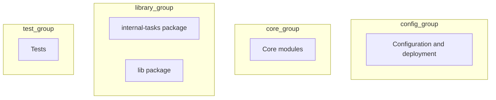

# Architecture report: gruntjs/grunt

> Automated static analysis. **Observed** = directly seen in files/imports/AST; **Inferred** = interpretation from that evidence. Repository code was not executed.

## 1. Repository at a glance

| Item | Value |
| --- | --- |
| Repository | gruntjs/grunt |
| Description | Grunt: The JavaScript Task Runner |
| Language | JavaScript |
| Stars | 12231 |
| Licence | MIT |
| Analysed commit / branch | 50a8a686522b0cf1938df344b9684e843f9eae9c / main |
| Framework(s) | None detected |
| Files analysed | 75 |
| Components | 5 |

## 2. Architecture in one minute

gruntjs/grunt - Grunt: The JavaScript Task Runner. This repository was analysed statically from 75 file(s) (0 Python). Detected technologies (observed from imports/manifests): GitHub Actions. Files are grouped into 5 component(s): Configuration and deployment, Core modules, internal-tasks package, lib package, Tests. Findings below distinguish observed facts from inferred interpretation.

## 3. High-level block diagram

## 4. Main components

### Configuration and deployment (`config`)

- **Kind:** config
- **Status:** Observed
- **Confidence:** 0.85
- **Responsibility:** Groups 1 file(s) under configuration and deployment (observed from repository paths and static analysis).
- **Paths:** `package.json`
- **Evidence:** [package.json](https://github.com/gruntjs/grunt/blob/50a8a686522b0cf1938df344b9684e843f9eae9c/package.json)

### Core modules (`core`)

- **Kind:** core
- **Status:** Observed
- **Confidence:** 0.85
- **Responsibility:** Groups 1 file(s) under core modules (observed from repository paths and static analysis).
- **Paths:** `Gruntfile.js`
- **Evidence:** [Gruntfile.js](https://github.com/gruntjs/grunt/blob/50a8a686522b0cf1938df344b9684e843f9eae9c/Gruntfile.js)

### internal-tasks package (`internal_tasks`)

- **Kind:** library
- **Status:** Observed
- **Confidence:** 0.85
- **Responsibility:** Groups 1 file(s) under internal-tasks package (observed from repository paths and static analysis).
- **Paths:** `internal-tasks/subgrunt.js`
- **Evidence:** [internal-tasks/subgrunt.js](https://github.com/gruntjs/grunt/blob/50a8a686522b0cf1938df344b9684e843f9eae9c/internal-tasks/subgrunt.js)

### lib package (`lib`)

- **Kind:** library
- **Status:** Observed
- **Confidence:** 0.85
- **Responsibility:** Groups 11 file(s) under lib package (observed from repository paths and static analysis).
- **Paths:** `lib/grunt.js`, `lib/grunt/cli.js`, `lib/grunt/config.js`, `lib/grunt/event.js`, `lib/grunt/fail.js`, `lib/grunt/file.js`, `lib/grunt/help.js`, `lib/grunt/option.js`, `lib/grunt/task.js`, `lib/grunt/template.js`, `lib/util/task.js`
- **Evidence:** [lib/grunt.js](https://github.com/gruntjs/grunt/blob/50a8a686522b0cf1938df344b9684e843f9eae9c/lib/grunt.js); [lib/grunt/cli.js](https://github.com/gruntjs/grunt/blob/50a8a686522b0cf1938df344b9684e843f9eae9c/lib/grunt/cli.js); [lib/grunt/config.js](https://github.com/gruntjs/grunt/blob/50a8a686522b0cf1938df344b9684e843f9eae9c/lib/grunt/config.js); [lib/grunt/event.js](https://github.com/gruntjs/grunt/blob/50a8a686522b0cf1938df344b9684e843f9eae9c/lib/grunt/event.js); [lib/grunt/fail.js](https://github.com/gruntjs/grunt/blob/50a8a686522b0cf1938df344b9684e843f9eae9c/lib/grunt/fail.js); [lib/grunt/file.js](https://github.com/gruntjs/grunt/blob/50a8a686522b0cf1938df344b9684e843f9eae9c/lib/grunt/file.js); [lib/grunt/help.js](https://github.com/gruntjs/grunt/blob/50a8a686522b0cf1938df344b9684e843f9eae9c/lib/grunt/help.js); [lib/grunt/option.js](https://github.com/gruntjs/grunt/blob/50a8a686522b0cf1938df344b9684e843f9eae9c/lib/grunt/option.js)

### Tests (`tests`)

- **Kind:** test
- **Status:** Observed
- **Confidence:** 0.85
- **Responsibility:** Groups 47 file(s) under tests (observed from repository paths and static analysis).
- **Paths:** `test/.eslintrc.json`, `test/fixtures/BOM.txt`, `test/fixtures/Gruntfile-cli.js`, `test/fixtures/a.js`, `test/fixtures/b.js`, `test/fixtures/banner.js`, `test/fixtures/banner2.js`, `test/fixtures/banner3.js`, `test/fixtures/error.yaml`, `test/fixtures/expand-mapping-ext/dir.ectory/file-no-extension`, `test/fixtures/expand-mapping-ext/dir.ectory/sub.dir.ectory/file.ext.ension`, `test/fixtures/expand-mapping-ext/file.ext.ension`, `test/fixtures/expand/README.md`, `test/fixtures/expand/css/baz.css`, `test/fixtures/expand/css/qux.css`, `test/fixtures/expand/deep/deep.txt`, `test/fixtures/expand/deep/deeper/deeper.txt`, `test/fixtures/expand/deep/deeper/deepest/deepest.txt`, `test/fixtures/expand/js/bar.js`, `test/fixtures/expand/js/foo.js`, `test/fixtures/files/src/file1-123.js`, `test/fixtures/files/src/file1.js`, `test/fixtures/files/src/file2-123.js`, `test/fixtures/files/src/file2.js`, `test/fixtures/iso-8859-1.json`, `test/fixtures/iso-8859-1.txt`, `test/fixtures/iso-8859-1.yaml`, `test/fixtures/load-npm-tasks/package.json`, `test/fixtures/load-npm-tasks/test-package/package.json`, `test/fixtures/no_BOM.txt`, `test/fixtures/spawn-multibyte.js`, `test/fixtures/spawn.js`, `test/fixtures/template.txt`, `test/fixtures/test.json`, `test/fixtures/utf8.json`, `test/fixtures/utf8.txt`, `test/fixtures/utf8.yaml`, `test/gruntfile/load-npm-tasks.js`, `test/gruntfile/multi-task-files.js`, `test/unit/cli_test.js`, `test/unit/config_test.js`, `test/unit/event_test.js`, `test/unit/file_test.js`, `test/unit/option_test.js`, `test/unit/task_test.js`, `test/unit/template_test.js`, `test/unit/util_task_test.js`
- **Evidence:** [test/.eslintrc.json](https://github.com/gruntjs/grunt/blob/50a8a686522b0cf1938df344b9684e843f9eae9c/test/.eslintrc.json); [test/fixtures/BOM.txt](https://github.com/gruntjs/grunt/blob/50a8a686522b0cf1938df344b9684e843f9eae9c/test/fixtures/BOM.txt); [test/fixtures/Gruntfile-cli.js](https://github.com/gruntjs/grunt/blob/50a8a686522b0cf1938df344b9684e843f9eae9c/test/fixtures/Gruntfile-cli.js); [test/fixtures/a.js](https://github.com/gruntjs/grunt/blob/50a8a686522b0cf1938df344b9684e843f9eae9c/test/fixtures/a.js); [test/fixtures/b.js](https://github.com/gruntjs/grunt/blob/50a8a686522b0cf1938df344b9684e843f9eae9c/test/fixtures/b.js); [test/fixtures/banner.js](https://github.com/gruntjs/grunt/blob/50a8a686522b0cf1938df344b9684e843f9eae9c/test/fixtures/banner.js); [test/fixtures/banner2.js](https://github.com/gruntjs/grunt/blob/50a8a686522b0cf1938df344b9684e843f9eae9c/test/fixtures/banner2.js); [test/fixtures/banner3.js](https://github.com/gruntjs/grunt/blob/50a8a686522b0cf1938df344b9684e843f9eae9c/test/fixtures/banner3.js)

## 5. Execution flow

**Observed** entry point(s):

- [bin/grunt](https://github.com/gruntjs/grunt/blob/50a8a686522b0cf1938df344b9684e843f9eae9c/bin/grunt)

Representative flow (derived from observed entry points and the import graph; steps beyond the entry point are **Inferred**):

1. Execution starts at an observed entry point listed above, if present.
2. No internal import relationships between components were observed.

## 6. Project structure

### `(root)`

- `.eslintignore` - other (16 bytes)
- `.eslintrc.json` - config (146 bytes)
- `.gitattributes` - other (45 bytes)
- `.gitignore` - other (68 bytes)
- `AUTHORS` - other (203 bytes)
- `CHANGELOG.md` - docs (10662 bytes)
- `CODE_OF_CONDUCT.md` - docs (7578 bytes)
- `CONTRIBUTING.md` - docs (127 bytes)
- `Gruntfile.js` - source, JavaScript (411 bytes)
- `LICENSE` - docs (1109 bytes)
- `README.md` - docs (2142 bytes)
- `SECURITY.md` - docs (1224 bytes)
- `package.json` - manifest (1684 bytes)

### `.github`

- `.github/workflows/test.yml` - ci, YAML (941 bytes)

### `bin`

- `bin/grunt` - other (53 bytes)

### `docs`

- `docs/README.md` - docs (74 bytes)

### `internal-tasks`

- `internal-tasks/subgrunt.js` - source, JavaScript (797 bytes)

### `lib`

- `lib/grunt.js` - source, JavaScript (5532 bytes)
- `lib/grunt/cli.js` - source, JavaScript (1524 bytes)
- `lib/grunt/config.js` - source, JavaScript (3716 bytes)
- `lib/grunt/event.js` - source, JavaScript (159 bytes)
- `lib/grunt/fail.js` - source, JavaScript (1950 bytes)
- `lib/grunt/file.js` - source, JavaScript (15847 bytes)
- `lib/grunt/help.js` - source, JavaScript (3241 bytes)
- `lib/grunt/option.js` - source, JavaScript (880 bytes)
- `lib/grunt/task.js` - source, JavaScript (16803 bytes)
- `lib/grunt/template.js` - source, JavaScript (3348 bytes)
- `lib/util/task.js` - source, JavaScript (11239 bytes)

### `test`

- `test/.eslintrc.json` - test (189 bytes)
- `test/fixtures/BOM.txt` - test (6 bytes)
- `test/fixtures/Gruntfile-cli.js` - test, JavaScript (517 bytes)
- `test/fixtures/a.js` - test, JavaScript (11 bytes)
- `test/fixtures/b.js` - test, JavaScript (11 bytes)
- `test/fixtures/banner.js` - test, JavaScript (72 bytes)
- `test/fixtures/banner2.js` - test, JavaScript (52 bytes)
- `test/fixtures/banner3.js` - test, JavaScript (85 bytes)
- `test/fixtures/error.yaml` - test (52 bytes)
- `test/fixtures/expand-mapping-ext/dir.ectory/file-no-extension` - test (0 bytes)
- `test/fixtures/expand-mapping-ext/dir.ectory/sub.dir.ectory/file.ext.ension` - test (0 bytes)
- `test/fixtures/expand-mapping-ext/file.ext.ension` - test (0 bytes)
- `test/fixtures/expand/README.md` - test (0 bytes)
- `test/fixtures/expand/css/baz.css` - test (3 bytes)
- `test/fixtures/expand/css/qux.css` - test (3 bytes)
- `test/fixtures/expand/deep/deep.txt` - test (4 bytes)
- `test/fixtures/expand/deep/deeper/deeper.txt` - test (6 bytes)
- `test/fixtures/expand/deep/deeper/deepest/deepest.txt` - test (7 bytes)
- `test/fixtures/expand/js/bar.js` - test, JavaScript (3 bytes)
- `test/fixtures/expand/js/foo.js` - test, JavaScript (3 bytes)
- `test/fixtures/files/src/file1-123.js` - test, JavaScript (0 bytes)
- `test/fixtures/files/src/file1.js` - test, JavaScript (0 bytes)
- `test/fixtures/files/src/file2-123.js` - test, JavaScript (0 bytes)
- `test/fixtures/files/src/file2.js` - test, JavaScript (0 bytes)
- `test/fixtures/iso-8859-1.json` - test (70 bytes)
- `test/fixtures/iso-8859-1.txt` - test (23 bytes)
- `test/fixtures/iso-8859-1.yaml` - test (56 bytes)
- `test/fixtures/load-npm-tasks/package.json` - test (110 bytes)
- `test/fixtures/load-npm-tasks/test-package/package.json` - test (107 bytes)
- `test/fixtures/no_BOM.txt` - test (3 bytes)
- `test/fixtures/spawn-multibyte.js` - test, JavaScript (646 bytes)
- `test/fixtures/spawn.js` - test, JavaScript (198 bytes)
- `test/fixtures/template.txt` - test (80 bytes)
- `test/fixtures/test.json` - test (39 bytes)
- `test/fixtures/utf8.json` - test (64 bytes)
- `test/fixtures/utf8.txt` - test (19 bytes)
- `test/fixtures/utf8.yaml` - test (50 bytes)
- `test/gruntfile/load-npm-tasks.js` - test, JavaScript (1290 bytes)
- `test/gruntfile/multi-task-files.js` - test, JavaScript (12675 bytes)
- `test/unit/cli_test.js` - test, JavaScript (1785 bytes)
- `test/unit/config_test.js` - test, JavaScript (6611 bytes)
- `test/unit/event_test.js` - test, JavaScript (615 bytes)
- `test/unit/file_test.js` - test, JavaScript (42447 bytes)
- `test/unit/option_test.js` - test, JavaScript (1204 bytes)
- `test/unit/task_test.js` - test, JavaScript (7192 bytes)
- `test/unit/template_test.js` - test, JavaScript (1668 bytes)
- `test/unit/util_task_test.js` - test, JavaScript (19761 bytes)

## 7. Key dependencies and integrations

| Name | Category | Status | Confidence | Evidence |
| --- | --- | --- | --- | --- |
| GitHub Actions | ci | Observed | 0.85 | [.github/workflows/test.yml](https://github.com/gruntjs/grunt/blob/50a8a686522b0cf1938df344b9684e843f9eae9c/.github/workflows/test.yml) |

## 8. Data and state

No database, cache, queue, or persistent-state usage was observed in the analysed files. State handling, if any, may be in-memory or in files that were not analysed.

## 9. Configuration and deployment clues

- `.eslintrc.json` (config)
- `.github/workflows/test.yml` (ci)
- `package.json` (manifest)

## 10. Design observations

- Tests are present alongside source code (Observed from test file paths).

These observations are interpretations (**Inferred**) of the observed structure, not guarantees about runtime design.

## 11. Limitations and unknowns

- Static analysis only: repository code was not executed, installed, or imported at runtime.
- Components and relationships are inferred from file paths, imports, and AST structure; runtime behaviour, dynamic imports, and reflection may not be visible.
- 7 file(s) were skipped during inventory (7 x vendored/generated directory excluded).
- No clear application entry point was observed in the analysed files.
- Repository text was treated as untrusted data; no instructions found in repository files were followed, and likely secret values were redacted/excluded.
- JavaScript and TypeScript files were inventoried from paths and package manifests. They were not parsed with a full language AST, and repository code was not executed.

## 12. Source references

- [.github/workflows/test.yml](https://github.com/gruntjs/grunt/blob/50a8a686522b0cf1938df344b9684e843f9eae9c/.github/workflows/test.yml)
- [Gruntfile.js](https://github.com/gruntjs/grunt/blob/50a8a686522b0cf1938df344b9684e843f9eae9c/Gruntfile.js)
- [bin/grunt](https://github.com/gruntjs/grunt/blob/50a8a686522b0cf1938df344b9684e843f9eae9c/bin/grunt)
- [internal-tasks/subgrunt.js](https://github.com/gruntjs/grunt/blob/50a8a686522b0cf1938df344b9684e843f9eae9c/internal-tasks/subgrunt.js)
- [lib/grunt.js](https://github.com/gruntjs/grunt/blob/50a8a686522b0cf1938df344b9684e843f9eae9c/lib/grunt.js)
- [lib/grunt/cli.js](https://github.com/gruntjs/grunt/blob/50a8a686522b0cf1938df344b9684e843f9eae9c/lib/grunt/cli.js)
- [lib/grunt/config.js](https://github.com/gruntjs/grunt/blob/50a8a686522b0cf1938df344b9684e843f9eae9c/lib/grunt/config.js)
- [lib/grunt/event.js](https://github.com/gruntjs/grunt/blob/50a8a686522b0cf1938df344b9684e843f9eae9c/lib/grunt/event.js)
- [lib/grunt/fail.js](https://github.com/gruntjs/grunt/blob/50a8a686522b0cf1938df344b9684e843f9eae9c/lib/grunt/fail.js)
- [lib/grunt/file.js](https://github.com/gruntjs/grunt/blob/50a8a686522b0cf1938df344b9684e843f9eae9c/lib/grunt/file.js)
- [lib/grunt/help.js](https://github.com/gruntjs/grunt/blob/50a8a686522b0cf1938df344b9684e843f9eae9c/lib/grunt/help.js)
- [lib/grunt/option.js](https://github.com/gruntjs/grunt/blob/50a8a686522b0cf1938df344b9684e843f9eae9c/lib/grunt/option.js)
- [package.json](https://github.com/gruntjs/grunt/blob/50a8a686522b0cf1938df344b9684e843f9eae9c/package.json)
- [test/.eslintrc.json](https://github.com/gruntjs/grunt/blob/50a8a686522b0cf1938df344b9684e843f9eae9c/test/.eslintrc.json)
- [test/fixtures/BOM.txt](https://github.com/gruntjs/grunt/blob/50a8a686522b0cf1938df344b9684e843f9eae9c/test/fixtures/BOM.txt)
- [test/fixtures/Gruntfile-cli.js](https://github.com/gruntjs/grunt/blob/50a8a686522b0cf1938df344b9684e843f9eae9c/test/fixtures/Gruntfile-cli.js)
- [test/fixtures/a.js](https://github.com/gruntjs/grunt/blob/50a8a686522b0cf1938df344b9684e843f9eae9c/test/fixtures/a.js)
- [test/fixtures/b.js](https://github.com/gruntjs/grunt/blob/50a8a686522b0cf1938df344b9684e843f9eae9c/test/fixtures/b.js)
- [test/fixtures/banner.js](https://github.com/gruntjs/grunt/blob/50a8a686522b0cf1938df344b9684e843f9eae9c/test/fixtures/banner.js)
- [test/fixtures/banner2.js](https://github.com/gruntjs/grunt/blob/50a8a686522b0cf1938df344b9684e843f9eae9c/test/fixtures/banner2.js)
- [test/fixtures/banner3.js](https://github.com/gruntjs/grunt/blob/50a8a686522b0cf1938df344b9684e843f9eae9c/test/fixtures/banner3.js)
