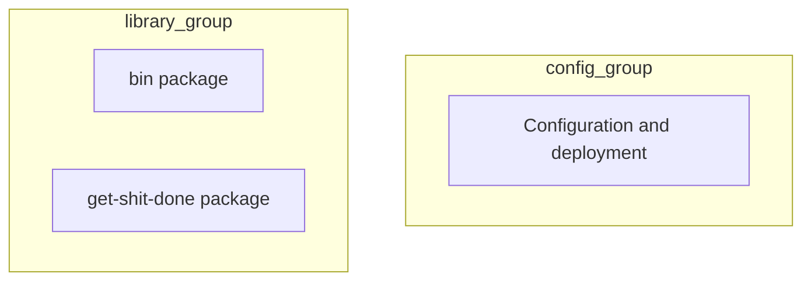

# Architecture report: gsd-build/get-shit-done

> Automated static analysis. **Observed** = directly seen in files/imports/AST; **Inferred** = interpretation from that evidence. Repository code was not executed.

## 1. Repository at a glance

| Item | Value |
| --- | --- |
| Repository | gsd-build/get-shit-done |
| Description | A light-weight and powerful meta-prompting, context engineering and spec-driven development system for Claude Code by TÂCHES. |
| Language | JavaScript |
| Stars | 64136 |
| Licence | MIT |
| Analysed commit / branch | bdcaab2c752d9a33a1a1ca9acf3a3c81fb991815 / main |
| Framework(s) | None detected |
| Files analysed | 800 |
| Components | 3 |

## 2. Architecture in one minute

gsd-build/get-shit-done - A light-weight and powerful meta-prompting, context engineering and spec-driven development system for Claude Code by TÂCHES.. This repository was analysed statically from 800 file(s) (0 Python). Detected technologies (observed from imports/manifests): GitHub Actions. Files are grouped into 3 component(s): bin package, Configuration and deployment, get-shit-done package. Findings below distinguish observed facts from inferred interpretation.

## 3. High-level block diagram

## 4. Main components

### bin package (`bin`)

- **Kind:** library
- **Status:** Observed
- **Confidence:** 0.85
- **Responsibility:** Groups 2 file(s) under bin package (observed from repository paths and static analysis).
- **Paths:** `bin/gsd-sdk.js`, `bin/lib/ui-safety-gate.cjs`
- **Evidence:** [bin/gsd-sdk.js](https://github.com/gsd-build/get-shit-done/blob/bdcaab2c752d9a33a1a1ca9acf3a3c81fb991815/bin/gsd-sdk.js); [bin/lib/ui-safety-gate.cjs](https://github.com/gsd-build/get-shit-done/blob/bdcaab2c752d9a33a1a1ca9acf3a3c81fb991815/bin/lib/ui-safety-gate.cjs)

### Configuration and deployment (`config`)

- **Kind:** config
- **Status:** Observed
- **Confidence:** 0.85
- **Responsibility:** Groups 2 file(s) under configuration and deployment (observed from repository paths and static analysis).
- **Paths:** `get-shit-done/templates/config.json`, `get-shit-done/workflows/discuss-phase/templates/checkpoint.json`
- **Evidence:** [get-shit-done/templates/config.json](https://github.com/gsd-build/get-shit-done/blob/bdcaab2c752d9a33a1a1ca9acf3a3c81fb991815/get-shit-done/templates/config.json); [get-shit-done/workflows/discuss-phase/templates/checkpoint.json](https://github.com/gsd-build/get-shit-done/blob/bdcaab2c752d9a33a1a1ca9acf3a3c81fb991815/get-shit-done/workflows/discuss-phase/templates/checkpoint.json)

### get-shit-done package (`get_shit_done`)

- **Kind:** library
- **Status:** Observed
- **Confidence:** 0.85
- **Responsibility:** Groups 80 file(s) under get-shit-done package (observed from repository paths and static analysis).
- **Paths:** `get-shit-done/bin/check-latest-version.cjs`, `get-shit-done/bin/gsd-tools.cjs`, `get-shit-done/bin/lib/active-workstream-store.cjs`, `get-shit-done/bin/lib/adr-parser.cjs`, `get-shit-done/bin/lib/artifacts.cjs`, `get-shit-done/bin/lib/audit.cjs`, `get-shit-done/bin/lib/cjs-command-router-adapter.cjs`, `get-shit-done/bin/lib/cjs-sdk-bridge.cjs`, `get-shit-done/bin/lib/clusters.cjs`, `get-shit-done/bin/lib/code-review-flags.cjs`, `get-shit-done/bin/lib/command-aliases.generated.cjs`, `get-shit-done/bin/lib/command-routing-hub.cjs`, `get-shit-done/bin/lib/commands.cjs`, `get-shit-done/bin/lib/config-schema.cjs`, `get-shit-done/bin/lib/config.cjs`, `get-shit-done/bin/lib/configuration.generated.cjs`, `get-shit-done/bin/lib/context-utilization.cjs`, `get-shit-done/bin/lib/core.cjs`, `get-shit-done/bin/lib/decisions.cjs`, `get-shit-done/bin/lib/decisions.generated.cjs`, `get-shit-done/bin/lib/docs.cjs`, `get-shit-done/bin/lib/drift.cjs`, `get-shit-done/bin/lib/fallow-runner.cjs`, `get-shit-done/bin/lib/frontmatter.cjs`, `get-shit-done/bin/lib/gap-checker.cjs`, `get-shit-done/bin/lib/graphify.cjs`, `get-shit-done/bin/lib/gsd2-import.cjs`, `get-shit-done/bin/lib/init-command-router.cjs`, `get-shit-done/bin/lib/init.cjs`, `get-shit-done/bin/lib/install-profiles.cjs`, `get-shit-done/bin/lib/installer-migration-authoring.cjs`, `get-shit-done/bin/lib/installer-migration-report.cjs`, `get-shit-done/bin/lib/installer-migrations.cjs`, `get-shit-done/bin/lib/installer-migrations/000-first-time-baseline.cjs`, `get-shit-done/bin/lib/installer-migrations/001-legacy-orphan-files.cjs`, `get-shit-done/bin/lib/installer-migrations/002-codex-legacy-hooks-json.cjs`, `get-shit-done/bin/lib/intel.cjs`, `get-shit-done/bin/lib/learnings.cjs`, `get-shit-done/bin/lib/milestone.cjs`, `get-shit-done/bin/lib/model-catalog.cjs`, `get-shit-done/bin/lib/model-profiles.cjs`, `get-shit-done/bin/lib/phase-command-router.cjs`, `get-shit-done/bin/lib/phase.cjs`, `get-shit-done/bin/lib/phases-command-router.cjs`, `get-shit-done/bin/lib/plan-scan.cjs`, `get-shit-done/bin/lib/plan-scan.generated.cjs`, `get-shit-done/bin/lib/planning-workspace.cjs`, `get-shit-done/bin/lib/profile-output.cjs`, `get-shit-done/bin/lib/profile-pipeline.cjs`, `get-shit-done/bin/lib/project-root.generated.cjs`, `get-shit-done/bin/lib/prompt-budget.cjs`, `get-shit-done/bin/lib/review-reviewer-selection.cjs`, `get-shit-done/bin/lib/roadmap-command-router.cjs`, `get-shit-done/bin/lib/roadmap.cjs`, `get-shit-done/bin/lib/runtime-artifact-layout.cjs`, `get-shit-done/bin/lib/runtime-homes.cjs`, `get-shit-done/bin/lib/runtime-slash.cjs`, `get-shit-done/bin/lib/schema-detect.cjs`, `get-shit-done/bin/lib/schema-detect.generated.cjs`, `get-shit-done/bin/lib/secrets.cjs`, `get-shit-done/bin/lib/secrets.generated.cjs`, `get-shit-done/bin/lib/security.cjs`, `get-shit-done/bin/lib/shell-command-projection.cjs`, `get-shit-done/bin/lib/state-command-router.cjs`, `get-shit-done/bin/lib/state-document.cjs`, `get-shit-done/bin/lib/state-document.generated.cjs`, `get-shit-done/bin/lib/state.cjs`, `get-shit-done/bin/lib/surface.cjs`, `get-shit-done/bin/lib/template.cjs`, `get-shit-done/bin/lib/uat.cjs`, `get-shit-done/bin/lib/validate-command-router.cjs`, `get-shit-done/bin/lib/verify-command-router.cjs`, `get-shit-done/bin/lib/verify.cjs`, `get-shit-done/bin/lib/workstream-inventory-builder.generated.cjs`, `get-shit-done/bin/lib/workstream-inventory.cjs`, `get-shit-done/bin/lib/workstream-name-policy.cjs`, `get-shit-done/bin/lib/workstream-name-policy.generated.cjs`, `get-shit-done/bin/lib/workstream.cjs`, `get-shit-done/bin/lib/worktree-safety.cjs`, `get-shit-done/bin/verify-reapply-patches.cjs`
- **Evidence:** [get-shit-done/bin/check-latest-version.cjs](https://github.com/gsd-build/get-shit-done/blob/bdcaab2c752d9a33a1a1ca9acf3a3c81fb991815/get-shit-done/bin/check-latest-version.cjs); [get-shit-done/bin/gsd-tools.cjs](https://github.com/gsd-build/get-shit-done/blob/bdcaab2c752d9a33a1a1ca9acf3a3c81fb991815/get-shit-done/bin/gsd-tools.cjs); [get-shit-done/bin/lib/active-workstream-store.cjs](https://github.com/gsd-build/get-shit-done/blob/bdcaab2c752d9a33a1a1ca9acf3a3c81fb991815/get-shit-done/bin/lib/active-workstream-store.cjs); [get-shit-done/bin/lib/adr-parser.cjs](https://github.com/gsd-build/get-shit-done/blob/bdcaab2c752d9a33a1a1ca9acf3a3c81fb991815/get-shit-done/bin/lib/adr-parser.cjs); [get-shit-done/bin/lib/artifacts.cjs](https://github.com/gsd-build/get-shit-done/blob/bdcaab2c752d9a33a1a1ca9acf3a3c81fb991815/get-shit-done/bin/lib/artifacts.cjs); [get-shit-done/bin/lib/audit.cjs](https://github.com/gsd-build/get-shit-done/blob/bdcaab2c752d9a33a1a1ca9acf3a3c81fb991815/get-shit-done/bin/lib/audit.cjs); [get-shit-done/bin/lib/cjs-command-router-adapter.cjs](https://github.com/gsd-build/get-shit-done/blob/bdcaab2c752d9a33a1a1ca9acf3a3c81fb991815/get-shit-done/bin/lib/cjs-command-router-adapter.cjs); [get-shit-done/bin/lib/cjs-sdk-bridge.cjs](https://github.com/gsd-build/get-shit-done/blob/bdcaab2c752d9a33a1a1ca9acf3a3c81fb991815/get-shit-done/bin/lib/cjs-sdk-bridge.cjs)

## 5. Execution flow

No entry point was observed; the startup flow below is therefore limited.

Representative flow (derived from observed entry points and the import graph; steps beyond the entry point are **Inferred**):

1. Execution starts at an observed entry point listed above, if present.
2. No internal import relationships between components were observed.

## 6. Project structure

### `(root)`

- `.base64scanignore` - other (235 bytes)
- `.clinerules` - other (1206 bytes)
- `.coderabbit.yaml` - config (1683 bytes)
- `.gitignore` - other (1188 bytes)
- `.release-monitor.sh` - source, Shell (1430 bytes)
- `.secretscanignore` - other (369 bytes)
- `AGENTS.md` - docs (3078 bytes)
- `CHANGELOG.md` - docs (196824 bytes)
- `CONTEXT.md` - docs (87446 bytes)
- `CONTRIBUTING.md` - docs (44337 bytes)
- `LICENSE` - docs (1075 bytes)
- `QUICK-WINS-CONFIRMED-BUGS.md` - docs (5825 bytes)
- `README.ja-JP.md` - docs (48838 bytes)
- `README.ko-KR.md` - docs (41991 bytes)
- `README.md` - docs (329 bytes)
- `README.pt-BR.md` - docs (17497 bytes)
- `README.zh-CN.md` - docs (35432 bytes)
- `SECURITY.md` - docs (815 bytes)
- `TEST-EXAMPLES.md` - docs (9134 bytes)
- `VERSIONING.md` - docs (7220 bytes)

### `.changeset`

- `.changeset/2937-statusline-context-position.md` - docs (513 bytes)
- `.changeset/3033-sdk-flag-wired.md` - docs (561 bytes)
- `.changeset/3095-quota-failure-classification.md` - docs (1038 bytes)
- `.changeset/3156-plan-phase-opencode-dispatch.md` - docs (1003 bytes)
- `.changeset/3166-graphify-inline-build.md` - docs (927 bytes)
- `.changeset/3170-graphify-commit-staleness.md` - docs (1114 bytes)
- `.changeset/3195-quick-resurrection-guard.md` - docs (461 bytes)
- `.changeset/3198-retrospective-canonical.md` - docs (251 bytes)
- `.changeset/3210-fallow-structural-review.md` - docs (668 bytes)
- `.changeset/3251-non-family-aliases.md` - docs (1008 bytes)
- `.changeset/3262-extract-scan-phase-plans.md` - docs (776 bytes)
- `.changeset/3271-sdk-adr-structure.md` - docs (698 bytes)
- `.changeset/3298-phase-dir-prefix-drift-workflows.md` - docs (807 bytes)
- `.changeset/3312-sdk-first-architecture-seams.md` - docs (321 bytes)
- `.changeset/3346-codex-aot-toml-key.md` - docs (945 bytes)
- `.changeset/3347-graphify-auto-update-hook.md` - docs (1616 bytes)
- `.changeset/3409-phase-remove-force-position.md` - docs (322 bytes)
- `.changeset/3450-shell-projection-merge-repair.md` - docs (503 bytes)
- `.changeset/3488-decimal-phase-depends-on.md` - docs (901 bytes)
- `.changeset/3489-complete-phase-idempotent.md` - docs (967 bytes)
- `.changeset/3491-nested-git-detection.md` - docs (544 bytes)
- `.changeset/3493-extract-milestone-generic-heading.md` - docs (862 bytes)
- `.changeset/3517-phase-complete-state-staleness.md` - docs (933 bytes)
- `.changeset/3537-phase-regex-fanout.md` - docs (1037 bytes)
- `.changeset/3541-installer-migration-prompt-user-resolution.md` - docs (633 bytes)
- `.changeset/3542-executor-git-stash-prohibition.md` - docs (1007 bytes)
- `.changeset/3544-workstream-inventory-builder.md` - docs (444 bytes)
- `.changeset/3562-codex-install-skill-surface.md` - docs (916 bytes)
- `.changeset/3566-codex-hooks-canonical-feature-key.md` - docs (866 bytes)
- `.changeset/3571-configuration-manifest-install-layout.md` - docs (500 bytes)
- `.changeset/3577-adr-violations-and-validation-port.md` - docs (4452 bytes)
- `.changeset/3577-config-ensure-section-parity.md` - docs (1040 bytes)
- `.changeset/3577-docker-test-fixup.md` - docs (1789 bytes)
- `.changeset/3589-planning-paths-workstream-validation.md` - docs (750 bytes)
- `.changeset/3591-gsdtools-native-workstream.md` - docs (705 bytes)
- `.changeset/3593-cli-negative-matrix-harness.md` - docs (511 bytes)
- `.changeset/3594-parser-adversarial-fixtures.md` - docs (827 bytes)
- `.changeset/3595-fs-fault-injection-atomic-write.md` - docs (826 bytes)
- `.changeset/3597-test-suite-split-node-matrix.md` - docs (1044 bytes)
- `.changeset/3597-windows-argv-overflow.md` - docs (690 bytes)
- `.changeset/3599-roadmap-get-phase-project-code-prefix.md` - docs (584 bytes)
- `.changeset/3600-milestone-phase-filter-project-code.md` - docs (856 bytes)
- `.changeset/3601-phase-remove-decimal-section-loss.md` - docs (703 bytes)
- `.changeset/3602-phase-remove-slugged-plan-refs.md` - docs (632 bytes)
- `.changeset/3605-stale-agent-command-refs.md` - docs (634 bytes)
- `.changeset/3608-antigravity-update-runtime.md` - docs (714 bytes)
- `.changeset/3610-codex-install-bundled-hooks-blocker.md` - docs (678 bytes)
- `.changeset/3621-cherry-pick-test-fixtures.md` - docs (720 bytes)
- `.changeset/3628-bundled-hook-whitelist.md` - docs (901 bytes)
- `.changeset/3643-resolve-model-claude-runtime.md` - docs (1092 bytes)
- `.changeset/3653-graphify-hook-sdk-commit-visibility.md` - docs (1077 bytes)
- `.changeset/3689-resume-glob-nomatch-fix.md` - docs (533 bytes)
- `.changeset/3707-worktree-orphan-reap.md` - docs (691 bytes)
- `.changeset/3740-consolidate-phase-tests.md` - docs (1148 bytes)
- `.changeset/3742-consolidate-worktree-tests.md` - docs (682 bytes)
- `.changeset/3753-consolidate-milestone-tests.md` - docs (1073 bytes)
- `.changeset/3755-consolidate-init-tests.md` - docs (210 bytes)
- `.changeset/3757-consolidate-runtime-artifact-layout.md` - docs (371 bytes)
- `.changeset/3758-consolidate-installer-tests.md` - docs (769 bytes)
- `.changeset/3761-consolidate-graphify-tests.md` - docs (738 bytes)
- `.changeset/3772-fix-acquirestatelock-non-eexist.md` - docs (346 bytes)
- `.changeset/3776-fix-acquirestatelock-retry-allowlist.md` - docs (284 bytes)
- `.changeset/README.md` - docs (1675 bytes)
- `.changeset/adr-0002-command-contract-validation.md` - docs (1312 bytes)
- `.changeset/agile-birds-cheer.md` - docs (296 bytes)
- `.changeset/blue-stones-topology.md` - docs (300 bytes)
- `.changeset/bold-elks-zip.md` - docs (381 bytes)
- `.changeset/bold-finches-rally.md` - docs (191 bytes)
- `.changeset/brave-mice-build.md` - docs (508 bytes)
- `.changeset/brave-wolves-rally.md` - docs (205 bytes)
- `.changeset/bright-pumas-fold.md` - docs (295 bytes)
- `.changeset/bug-3446-resume-continue-here-discovery.md` - docs (313 bytes)
- `.changeset/build-hooks-atomic-write.md` - docs (1309 bytes)
- `.changeset/calm-birds-greet.md` - docs (234 bytes)
- `.changeset/calm-herons-wake.md` - docs (442 bytes)
- `.changeset/calm-ibex-jump.md` - docs (296 bytes)
- `.changeset/calm-koalas-hop.md` - docs (270 bytes)
- `.changeset/calm-tigers-frolic.md` - docs (742 bytes)
- `.changeset/careful-model-transport.md` - docs (260 bytes)
- `.changeset/clever-wasps-parade.md` - docs (159 bytes)
- `.changeset/clever-zebras-snooze.md` - docs (255 bytes)
- `.changeset/codex-bare-node-fix.md` - docs (509 bytes)
- `.changeset/codex-discuss-fallback.md` - docs (536 bytes)
- `.changeset/codex-windows-bash-runner.md` - docs (208 bytes)
- `.changeset/codex-windows-hook-script-paths.md` - docs (227 bytes)
- `.changeset/cool-monkeys-smell.md` - docs (280 bytes)
- `.changeset/crisp-seams-align.md` - docs (242 bytes)
- `.changeset/curious-bears-march.md` - docs (893 bytes)
- `.changeset/curious-bears-zip.md` - docs (973 bytes)
- `.changeset/daring-badgers-munch.md` - docs (181 bytes)
- `.changeset/disable-milestone-tags.md` - docs (422 bytes)
- `.changeset/docs-1-40-0-audit.md` - docs (698 bytes)
- `.changeset/dynamic-routing.md` - docs (666 bytes)
- `.changeset/eager-badgers-purr.md` - docs (337 bytes)
- `.changeset/eager-elks-purr.md` - docs (276 bytes)
- `.changeset/eager-foxes-zip.md` - docs (152 bytes)
- `.changeset/eager-hawks-rally.md` - docs (647 bytes)
- `.changeset/eager-lynx-munch.md` - docs (178 bytes)
- `.changeset/eager-wolves-tumble.md` - docs (250 bytes)
- `.changeset/fair-hawks-play.md` - docs (313 bytes)
- `.changeset/feat-3408-skill-profiles.md` - docs (850 bytes)
- `.changeset/feat-3408-skill-surface.md` - docs (651 bytes)
- `.changeset/fierce-birds-wake.md` - docs (489 bytes)
- `.changeset/fierce-geese-march.md` - docs (1156 bytes)
- `.changeset/fix-3054-doc-anchor-and-token-check.md` - docs (279 bytes)
- `.changeset/fix-3056-worktree-path-assertion.md` - docs (306 bytes)
- `.changeset/fix-3072-findings-probe-assertions.md` - docs (304 bytes)
- `.changeset/fix-3087-planner-directive-language.md` - docs (814 bytes)
- `.changeset/fix-3088-milestone-state-fallback-sections.md` - docs (311 bytes)
- `.changeset/fix-3094-progress-stale-assumptions.md` - docs (282 bytes)
- `.changeset/fix-3096-ai-integration-parallel-race.md` - docs (801 bytes)
- `.changeset/fix-3097-3099-executor-worktree-path.md` - docs (1108 bytes)
- `.changeset/fix-3120-secure-phase-empty-register.md` - docs (697 bytes)
- `.changeset/fix-3121-gsd-tools-commands-verb.md` - docs (526 bytes)
- `.changeset/fix-3126-global-skills-base-runtime.md` - docs (806 bytes)
- `.changeset/fix-3127-state-begin-phase-idempotent.md` - docs (650 bytes)
- `.changeset/fix-3128-roadmap-plan-count-slug.md` - docs (712 bytes)
- `.changeset/fix-3129-validate-commit-bypass.md` - docs (702 bytes)
- `.changeset/fix-3130-update-npx-robust.md` - docs (630 bytes)
- `.changeset/fix-3135-capture-backlog-workflow.md` - docs (987 bytes)
- `.changeset/fix-3150-stats-json-decimal-gap-regression.md` - docs (255 bytes)
- `.changeset/fix-3153-statusline-percent-next-phases.md` - docs (259 bytes)
- `.changeset/fix-3163-codex-agents-md.md` - docs (328 bytes)
- `.changeset/fix-3196-workstream-milestone-op.md` - docs (390 bytes)
- `.changeset/fix-3197-gsd-tools-config-whitelist.md` - docs (820 bytes)
- `.changeset/fix-3229-model-catalog-source-of-truth.md` - docs (1119 bytes)
- `.changeset/fix-3321-verifier-probes.md` - docs (153 bytes)
- `.changeset/fix-3339-human-needed-verification-pending.md` - docs (339 bytes)
- `.changeset/fix-3344-gemini-agent-tool.md` - docs (163 bytes)
- `.changeset/fix-3355-phase-remove-roadmap-renumber.md` - docs (327 bytes)
- `.changeset/fix-3357-codex-legacy-hooks-json.md` - docs (298 bytes)
- `.changeset/fix-3358-sdk-init-progress-models.md` - docs (366 bytes)
- `.changeset/fix-3359-stale-sdk-path-version.md` - docs (360 bytes)
- `.changeset/fix-3360-codex-execute-worktrees.md` - docs (371 bytes)
- `.changeset/fix-3362-windows-powershell-gemini.md` - docs (438 bytes)
- `.changeset/fix-3381-init-verify-work-ws.md` - docs (257 bytes)
- `.changeset/fix-3384-worktree-merge-safety.md` - docs (291 bytes)
- `.changeset/fix-3406-detect-stale-sdk-shadow.md` - docs (484 bytes)
- `.changeset/fix-3509-path-spaces-test-suite.md` - docs (223 bytes)
- `.changeset/fix-3579-graphify-hook-publish.md` - docs (769 bytes)
- `.changeset/fix-3588-npm-audit-clean.md` - docs (427 bytes)
- `.changeset/fix-3631-sdk-raw-flag-routers.md` - docs (575 bytes)
- `.changeset/fix-3632-lint-handsync-pair-fanout.md` - docs (472 bytes)
- `.changeset/fix-3677-agent-colon-namespace-leak.md` - docs (919 bytes)
- `.changeset/fix-3678-commit-docs-respect.md` - docs (617 bytes)
- `.changeset/fix-canary-2-release-gates.md` - docs (1226 bytes)
- `.changeset/gallant-badgers-bark.md` - docs (301 bytes)
- `.changeset/gallant-ravens-travel.md` - docs (211 bytes)
- `.changeset/gemini-skip-local-when-global.md` - docs (602 bytes)
- `.changeset/gentle-bears-wave.md` - docs (337 bytes)
- `.changeset/gentle-birds-caper.md` - docs (337 bytes)
- `.changeset/gentle-goats-fly.md` - docs (242 bytes)
- `.changeset/gentle-jays-zip.md` - docs (245 bytes)
- `.changeset/gentle-tigers-roar.md` - docs (252 bytes)
- `.changeset/graceful-geese-tumble.md` - docs (282 bytes)
- `.changeset/graceful-moles-wave.md` - docs (464 bytes)
- `.changeset/graceful-otters-wave.md` - docs (546 bytes)
- `.changeset/graceful-sloths-wake.md` - docs (272 bytes)
- `.changeset/graceful-tigers-fly.md` - docs (475 bytes)
- `.changeset/happy-jays-greet.md` - docs (265 bytes)
- `.changeset/happy-jays-wake.md` - docs (481 bytes)
- `.changeset/happy-pandas-glide.md` - docs (459 bytes)
- `.changeset/happy-tigers-travel.md` - docs (171 bytes)
- `.changeset/help-passthrough.md` - docs (595 bytes)
- `.changeset/humble-geese-wave.md` - docs (203 bytes)
- `.changeset/humble-goats-swim.md` - docs (200 bytes)
- `.changeset/humble-tunas-leap.md` - docs (207 bytes)
- `.changeset/install-shell-path-probe.md` - docs (697 bytes)
- `.changeset/issue-driven-orchestration.md` - docs (510 bytes)
- `.changeset/jolly-newts-roam.md` - docs (265 bytes)
- `.changeset/jolly-pandas-parade.md` - docs (455 bytes)
- `.changeset/jolly-pumas-dance.md` - docs (246 bytes)
- `.changeset/kind-foxes-click.md` - docs (437 bytes)
- `.changeset/kind-moles-dance.md` - docs (289 bytes)
- `.changeset/kind-tunas-gather.md` - docs (174 bytes)
- `.changeset/lively-foxes-roam.md` - docs (603 bytes)
- `.changeset/lively-goats-run.md` - docs (203 bytes)
- `.changeset/lively-lemurs-glide.md` - docs (465 bytes)
- `.changeset/lively-moles-caper.md` - docs (188 bytes)
- `.changeset/lively-otters-gather.md` - docs (845 bytes)
- `.changeset/lucky-lynx-wave.md` - docs (903 bytes)
- `.changeset/mcp-token-budget-docs.md` - docs (853 bytes)
- `.changeset/mellow-hawks-greet.md` - docs (290 bytes)
- `.changeset/mellow-herons-greet.md` - docs (1473 bytes)
- `.changeset/mellow-lynx-forage.md` - docs (441 bytes)
- `.changeset/mellow-tigers-gather.md` - docs (99 bytes)
- `.changeset/merry-foxes-climb.md` - docs (281 bytes)
- `.changeset/merry-lynx-sing.md` - docs (231 bytes)
- `.changeset/merry-lynx-wander.md` - docs (389 bytes)
- `.changeset/merry-moles-chatter.md` - docs (202 bytes)
- `.changeset/merry-quails-roam.md` - docs (180 bytes)
- `.changeset/mvp-concept-cleanup-canary-prep.md` - docs (629 bytes)
- `.changeset/mvp-resolution-verbs-and-fix-sdk-mode.md` - docs (2256 bytes)
- `.changeset/new-project-agent-diagnostics.md` - docs (252 bytes)
- `.changeset/nimble-deer-chatter.md` - docs (246 bytes)
- `.changeset/nimble-lynx-tumble.md` - docs (484 bytes)
- `.changeset/nimble-sloths-zip.md` - docs (213 bytes)
- `.changeset/noble-badgers-roar.md` - docs (200 bytes)
- `.changeset/noble-jaguars-squeak.md` - docs (529 bytes)
- `.changeset/noble-mice-squeak.md` - docs (243 bytes)
- `.changeset/noble-otters-hop.md` - docs (214 bytes)
- `.changeset/patient-lemurs-sing.md` - docs (743 bytes)
- `.changeset/per-phase-type-models.md` - docs (565 bytes)
- `.changeset/phase-five-installer-migration-guardrails.md` - docs (227 bytes)
- `.changeset/plucky-eagles-roar.md` - docs (203 bytes)
- `.changeset/plucky-ibex-gather.md` - docs (374 bytes)
- `.changeset/plucky-lemurs-dance.md` - docs (281 bytes)
- `.changeset/plucky-moles-roam.md` - docs (281 bytes)
- `.changeset/plucky-otters-roam.md` - docs (203 bytes)
- `.changeset/plucky-pandas-sprint.md` - docs (275 bytes)
- `.changeset/plucky-rams-climb.md` - docs (333 bytes)
- `.changeset/portable-bash-shebang-hooks.md` - docs (937 bytes)
- `.changeset/pr-3112-release-note.md` - docs (152 bytes)
- `.changeset/pr-3113-release-note.md` - docs (152 bytes)
- `.changeset/pr-3115-release-note.md` - docs (152 bytes)
- `.changeset/pr-3116-release-note.md` - docs (152 bytes)
- `.changeset/pr-3118-release-note.md` - docs (152 bytes)
- `.changeset/pr-3123-release-note.md` - docs (152 bytes)
- `.changeset/pr-3124-release-note.md` - docs (152 bytes)
- `.changeset/pr-3125-release-note.md` - docs (152 bytes)
- `.changeset/proud-sloths-rally.md` - docs (604 bytes)
- `.changeset/quick-deer-squeak.md` - docs (262 bytes)
- `.changeset/quick-geese-hum.md` - docs (201 bytes)
- `.changeset/quick-voles-sprint.md` - docs (341 bytes)
- `.changeset/quiet-geckos-switch.md` - docs (297 bytes)
- `.changeset/rapid-goats-munch.md` - docs (183 bytes)
- `.changeset/research-flag-and-stale-refs.md` - docs (711 bytes)
- `.changeset/rewire-orphaned-workflows-3131.md` - docs (793 bytes)
- `.changeset/scrub-stale-command-routes.md` - docs (586 bytes)
- `.changeset/sdk-init-phase-flags.md` - docs (201 bytes)
- `.changeset/serene-pandas-zip.md` - docs (619 bytes)
- `.changeset/sharp-badgers-squeak.md` - docs (308 bytes)
- `.changeset/sharp-quails-leap.md` - docs (1002 bytes)
- `.changeset/sharp-yaks-climb.md` - docs (268 bytes)
- `.changeset/shell-projection-cleanup.md` - docs (526 bytes)
- `.changeset/shell-projection-fs-migration.md` - docs (399 bytes)
- `.changeset/shell-projection-io-seam.md` - docs (333 bytes)
- `.changeset/shell-projection-subprocess-migration.md` - docs (385 bytes)
- `.changeset/silly-badgers-frolic.md` - docs (309 bytes)
- `.changeset/silly-finches-travel.md` - docs (250 bytes)
- `.changeset/silly-foxes-sing.md` - docs (584 bytes)
- `.changeset/silly-foxes-wander.md` - docs (234 bytes)
- `.changeset/silly-jaguars-sing.md` - docs (255 bytes)
- `.changeset/silly-newts-swim.md` - docs (190 bytes)
- `.changeset/steady-badgers-rest.md` - docs (467 bytes)
- `.changeset/steady-bears-purr.md` - docs (222 bytes)
- `.changeset/steady-jays-click.md` - docs (412 bytes)
- `.changeset/steady-ravens-shape.md` - docs (286 bytes)
- `.changeset/steady-shell-projection.md` - docs (322 bytes)
- `.changeset/steady-yaks-caper.md` - docs (204 bytes)
- `.changeset/steady-zebras-click.md` - docs (1137 bytes)
- `.changeset/sturdy-finches-fly.md` - docs (285 bytes)
- `.changeset/sturdy-geese-glide.md` - docs (406 bytes)
- `.changeset/sturdy-jays-glide.md` - docs (195 bytes)
- `.changeset/sturdy-moles-bark.md` - docs (457 bytes)
- `.changeset/sturdy-otters-purr.md` - docs (659 bytes)
- `.changeset/sturdy-pandas-rest.md` - docs (1220 bytes)
- `.changeset/sturdy-rams-caper.md` - docs (338 bytes)
- `.changeset/sturdy-rams-forage.md` - docs (189 bytes)
- `.changeset/sturdy-sloths-hum.md` - docs (271 bytes)
- `.changeset/sturdy-wolves-frolic.md` - docs (276 bytes)
- `.changeset/sturdy-wolves-glide.md` - docs (253 bytes)
- `.changeset/sunny-dogs-frolic.md` - docs (391 bytes)
- `.changeset/sunny-ibex-wave.md` - docs (332 bytes)
- `.changeset/sunny-pandas-dance.md` - docs (906 bytes)
- `.changeset/swift-coyotes-document.md` - docs (442 bytes)
- `.changeset/swift-otter-pebble.md` - docs (649 bytes)
- `.changeset/tidy-finches-caper.md` - docs (283 bytes)
- `.changeset/tidy-herons-dance.md` - docs (213 bytes)
- `.changeset/tidy-tigers-dance.md` - docs (521 bytes)
- `.changeset/tidy-tunas-zip.md` - docs (252 bytes)
- `.changeset/tidy-voles-rally.md` - docs (550 bytes)
- `.changeset/typed-rivers-flow.md` - docs (633 bytes)
- `.changeset/update-banner-opt-in.md` - docs (431 bytes)
- `.changeset/verifier-debt-gate.md` - docs (593 bytes)
- `.changeset/vivid-eagles-climb.md` - docs (616 bytes)
- `.changeset/vivid-foxes-romp.md` - docs (301 bytes)
- `.changeset/vivid-tunas-sing.md` - docs (246 bytes)
- `.changeset/windows-npm-shell-fix.md` - docs (462 bytes)
- `.changeset/wise-foxes-romp.md` - docs (284 bytes)
- `.changeset/wise-koalas-climb.md` - docs (192 bytes)
- `.changeset/wise-mice-cheer.md` - docs (214 bytes)
- `.changeset/wise-pumas-glide.md` - docs (429 bytes)
- `.changeset/wise-rams-gather.md` - docs (353 bytes)
- `.changeset/witty-bears-climb.md` - docs (303 bytes)
- `.changeset/witty-geese-purr.md` - docs (448 bytes)
- `.changeset/witty-hawks-jump.md` - docs (256 bytes)
- `.changeset/witty-newts-greet.md` - docs (231 bytes)
- `.changeset/witty-wasps-hum.md` - docs (297 bytes)
- `.changeset/zesty-eagles-fly.md` - docs (242 bytes)
- `.changeset/zesty-goats-dart.md` - docs (493 bytes)
- `.changeset/zesty-jays-wake.md` - docs (246 bytes)
- `.changeset/zesty-moles-forage.md` - docs (190 bytes)
- `.changeset/zesty-ravens-rest.md` - docs (218 bytes)

### `.githooks`

- `.githooks/pre-commit` - other (2666 bytes)
- `.githooks/pre-push` - other (1479 bytes)

### `.github`

- `.github/CODEOWNERS` - other (1213 bytes)
- `.github/FUNDING.yml` - config (22 bytes)
- `.github/ISSUE_TEMPLATE/bug_report.yml` - config (7603 bytes)
- `.github/ISSUE_TEMPLATE/chore.yml` - config (3982 bytes)
- `.github/ISSUE_TEMPLATE/config.yml` - config (449 bytes)
- `.github/ISSUE_TEMPLATE/docs_issue.yml` - config (1174 bytes)
- `.github/ISSUE_TEMPLATE/enhancement.yml` - config (6612 bytes)
- `.github/ISSUE_TEMPLATE/feature_request.yml` - config (10603 bytes)
- `.github/PULL_REQUEST_TEMPLATE/enhancement.md` - docs (3425 bytes)
- `.github/PULL_REQUEST_TEMPLATE/feature.md` - docs (4541 bytes)
- `.github/PULL_REQUEST_TEMPLATE/fix.md` - docs (1945 bytes)
- `.github/dependabot.yml` - config (496 bytes)
- `.github/pull_request_template.md` - docs (1996 bytes)
- `.github/workflows/auto-branch.yml` - ci, YAML (2784 bytes)
- `.github/workflows/auto-close-deprecated.yml` - ci, YAML (1929 bytes)
- `.github/workflows/auto-label-issues.yml` - ci, YAML (518 bytes)
- `.github/workflows/branch-cleanup.yml` - ci, YAML (4435 bytes)
- `.github/workflows/branch-naming.yml` - ci, YAML (1306 bytes)
- `.github/workflows/canary.yml` - ci, YAML (6144 bytes)
- `.github/workflows/changeset-required.yml` - ci, YAML (518 bytes)
- `.github/workflows/close-draft-prs.yml` - ci, YAML (2031 bytes)
- `.github/workflows/dismiss-unauthorized-pr-approvals.yml` - ci, YAML (6795 bytes)
- `.github/workflows/docs-required.yml` - ci, YAML (516 bytes)
- `.github/workflows/hotfix.yml` - ci, YAML (19863 bytes)
- `.github/workflows/install-smoke.yml` - ci, YAML (12563 bytes)
- `.github/workflows/pr-gate.yml` - ci, YAML (2269 bytes)
- `.github/workflows/pr-template-format.yml` - ci, YAML (5236 bytes)
- `.github/workflows/release-sdk.yml` - ci, YAML (37330 bytes)
- `.github/workflows/release.yml` - ci, YAML (17941 bytes)
- `.github/workflows/require-issue-link.yml` - ci, YAML (2420 bytes)
- `.github/workflows/security-scan.yml` - ci, YAML (1942 bytes)
- `.github/workflows/stale.yml` - ci, YAML (2468 bytes)
- `.github/workflows/test.yml` - ci, YAML (9579 bytes)

### `.out-of-scope`

- `.out-of-scope/agent-template-rendering.md` - docs (5174 bytes)
- `.out-of-scope/temporal-context.md` - docs (2809 bytes)

### `.plans`

- `.plans/1755-install-audit-fix.md` - docs (2249 bytes)

### `agents`

- `agents/gsd-advisor-researcher.md` - docs (5343 bytes)
- `agents/gsd-ai-researcher.md` - docs (6661 bytes)
- `agents/gsd-assumptions-analyzer.md` - docs (4489 bytes)
- `agents/gsd-code-fixer.md` - docs (32031 bytes)
- `agents/gsd-code-reviewer.md` - docs (16776 bytes)
- `agents/gsd-codebase-mapper.md` - docs (21388 bytes)
- `agents/gsd-debug-session-manager.md` - docs (9683 bytes)
- `agents/gsd-debugger.md` - docs (46783 bytes)
- `agents/gsd-doc-classifier.md` - docs (7629 bytes)
- `agents/gsd-doc-synthesizer.md` - docs (9722 bytes)
- `agents/gsd-doc-verifier.md` - docs (12403 bytes)
- `agents/gsd-doc-writer.md` - docs (38059 bytes)
- `agents/gsd-domain-researcher.md` - docs (6144 bytes)
- `agents/gsd-eval-auditor.md` - docs (7765 bytes)
- `agents/gsd-eval-planner.md` - docs (7010 bytes)
- `agents/gsd-executor.md` - docs (36458 bytes)
- `agents/gsd-framework-selector.md` - docs (6788 bytes)
- `agents/gsd-integration-checker.md` - docs (15141 bytes)
- `agents/gsd-intel-updater.md` - docs (12833 bytes)
- `agents/gsd-nyquist-auditor.md` - docs (7248 bytes)
- `agents/gsd-pattern-mapper.md` - docs (12488 bytes)
- `agents/gsd-phase-researcher.md` - docs (37266 bytes)
- `agents/gsd-plan-checker.md` - docs (36076 bytes)
- `agents/gsd-planner.md` - docs (49350 bytes)
- `agents/gsd-project-researcher.md` - docs (18517 bytes)
- `agents/gsd-research-synthesizer.md` - docs (7244 bytes)
- `agents/gsd-roadmapper.md` - docs (19133 bytes)
- `agents/gsd-security-auditor.md` - docs (6222 bytes)
- `agents/gsd-ui-auditor.md` - docs (17157 bytes)
- `agents/gsd-ui-checker.md` - docs (11086 bytes)
- `agents/gsd-ui-researcher.md` - docs (13910 bytes)
- `agents/gsd-user-profiler.md` - docs (8527 bytes)
- `agents/gsd-verifier.md` - docs (35730 bytes)

### `assets`

- `assets/gsd-logo-2000-transparent.svg` - other (1347 bytes)
- `assets/gsd-logo-2000.svg` - other (1447 bytes)
- `assets/terminal.svg` - other (3591 bytes)

### `bin`

- `bin/gsd-sdk.js` - source, JavaScript (1554 bytes)
- `bin/lib/ui-safety-gate.cjs` - source, JavaScript (3710 bytes)

### `commands`

- `commands/gsd/add-tests.md` - docs (1308 bytes)
- `commands/gsd/ai-integration-phase.md` - docs (1018 bytes)
- `commands/gsd/audit-fix.md` - docs (938 bytes)
- `commands/gsd/audit-milestone.md` - docs (1156 bytes)
- `commands/gsd/audit-uat.md` - docs (610 bytes)
- `commands/gsd/autonomous.md` - docs (1863 bytes)
- `commands/gsd/capture.md` - docs (2289 bytes)
- `commands/gsd/cleanup.md` - docs (599 bytes)
- `commands/gsd/code-review.md` - docs (2790 bytes)
- `commands/gsd/complete-milestone.md` - docs (5013 bytes)
- `commands/gsd/config.md` - docs (2603 bytes)
- `commands/gsd/debug.md` - docs (1716 bytes)
- `commands/gsd/discuss-phase.md` - docs (3210 bytes)
- `commands/gsd/docs-update.md` - docs (2191 bytes)
- `commands/gsd/eval-review.md` - docs (823 bytes)
- `commands/gsd/execute-phase.md` - docs (2933 bytes)
- `commands/gsd/explore.md` - docs (708 bytes)
- `commands/gsd/extract-learnings.md` - docs (732 bytes)
- `commands/gsd/fast.md` - docs (856 bytes)
- `commands/gsd/forensics.md` - docs (2283 bytes)
- `commands/gsd/graphify.md` - docs (8165 bytes)
- `commands/gsd/health.md` - docs (1255 bytes)
- `commands/gsd/help.md` - docs (840 bytes)
- `commands/gsd/import.md` - docs (1325 bytes)
- `commands/gsd/inbox.md` - docs (1394 bytes)
- `commands/gsd/ingest-docs.md` - docs (2105 bytes)
- `commands/gsd/manager.md` - docs (1660 bytes)
- `commands/gsd/map-codebase.md` - docs (3514 bytes)
- `commands/gsd/milestone-summary.md` - docs (1829 bytes)
- `commands/gsd/mvp-phase.md` - docs (1875 bytes)
- `commands/gsd/new-milestone.md` - docs (1670 bytes)
- `commands/gsd/new-project.md` - docs (1612 bytes)
- `commands/gsd/ns-context.md` - docs (811 bytes)
- `commands/gsd/ns-ideate.md` - docs (850 bytes)
- `commands/gsd/ns-manage.md` - docs (1100 bytes)
- `commands/gsd/ns-project.md` - docs (696 bytes)
- `commands/gsd/ns-review.md` - docs (988 bytes)
- `commands/gsd/ns-workflow.md` - docs (1131 bytes)
- `commands/gsd/pause-work.md` - docs (1152 bytes)
- `commands/gsd/phase.md` - docs (2135 bytes)
- `commands/gsd/plan-phase.md` - docs (3811 bytes)
- `commands/gsd/plan-review-convergence.md` - docs (3141 bytes)
- `commands/gsd/pr-branch.md` - docs (709 bytes)
- `commands/gsd/profile-user.md` - docs (1626 bytes)
- `commands/gsd/progress.md` - docs (2263 bytes)
- `commands/gsd/quick.md` - docs (7349 bytes)
- `commands/gsd/resume-work.md` - docs (695 bytes)
- `commands/gsd/review-backlog.md` - docs (1899 bytes)
- `commands/gsd/review.md` - docs (1276 bytes)
- `commands/gsd/secure-phase.md` - docs (810 bytes)
- `commands/gsd/settings.md` - docs (701 bytes)
- `commands/gsd/ship.md` - docs (720 bytes)
- `commands/gsd/sketch.md` - docs (2347 bytes)
- `commands/gsd/spec-phase.md` - docs (2507 bytes)
- `commands/gsd/spike.md` - docs (2132 bytes)
- `commands/gsd/stats.md` - docs (494 bytes)
- `commands/gsd/surface.md` - docs (5111 bytes)
- `commands/gsd/thread.md` - docs (603 bytes)
- `commands/gsd/ui-phase.md` - docs (782 bytes)
- `commands/gsd/ui-review.md` - docs (723 bytes)
- `commands/gsd/ultraplan-phase.md` - docs (956 bytes)
- `commands/gsd/undo.md` - docs (930 bytes)
- `commands/gsd/update.md` - docs (1669 bytes)
- `commands/gsd/validate-phase.md` - docs (848 bytes)
- `commands/gsd/verify-work.md` - docs (1280 bytes)
- `commands/gsd/workspace.md` - docs (1917 bytes)
- `commands/gsd/workstreams.md` - docs (2253 bytes)

### `docs`

- `docs/AGENTS.md` - docs (30307 bytes)
- `docs/ARCHITECTURE.md` - docs (48290 bytes)
- `docs/BETA.md` - docs (4952 bytes)
- `docs/CANARY.md` - docs (3422 bytes)
- `docs/CLI-TOOLS.md` - docs (20307 bytes)
- `docs/COMMANDS.md` - docs (56933 bytes)
- `docs/CONFIGURATION.md` - docs (69423 bytes)
- `docs/FEATURES.md` - docs (146296 bytes)
- `docs/INVENTORY-MANIFEST.json` - config (9266 bytes)
- `docs/INVENTORY.md` - docs (51082 bytes)
- `docs/README.md` - docs (3549 bytes)
- `docs/RELEASE-v1.39.0-rc.4.md` - docs (2471 bytes)
- `docs/RELEASE-v1.39.0-rc.5.md` - docs (3934 bytes)
- `docs/RELEASE-v1.39.0-rc.6.md` - docs (4693 bytes)
- `docs/RELEASE-v1.39.0-rc.7.md` - docs (9957 bytes)
- `docs/RELEASE-v1.40.0-rc.1.md` - docs (6392 bytes)
- `docs/RELEASE-v1.41.0.md` - docs (10634 bytes)
- `docs/RELEASE-v1.42.0-rc.1.md` - docs (7046 bytes)
- `docs/RELEASE-v1.42.1.md` - docs (8790 bytes)
- `docs/RELEASE-v1.42.3.md` - docs (7024 bytes)
- `docs/RELEASE-v1.50.0-canary.1.md` - docs (6577 bytes)
- `docs/STATE-MD-LIFECYCLE.md` - docs (7727 bytes)
- `docs/TESTING-SUITES.md` - docs (4375 bytes)
- `docs/USER-GUIDE.md` - docs (71798 bytes)
- `docs/adr/0001-dispatch-policy-module.md` - docs (3146 bytes)
- `docs/adr/0002-command-contract-validation-module.md` - docs (3160 bytes)
- `docs/adr/0003-model-catalog-module.md` - docs (2792 bytes)
- `docs/adr/0004-worktree-workstream-seam-module.md` - docs (1943 bytes)
- `docs/adr/0005-sdk-architecture-seam-map.md` - docs (1494 bytes)
- `docs/adr/0006-planning-path-projection-module.md` - docs (1405 bytes)
- `docs/adr/0007-sdk-package-seam-module.md` - docs (1081 bytes)
- `docs/adr/0008-installer-migration-module.md` - docs (3788 bytes)
- `docs/adr/0009-shell-command-projection-module.md` - docs (7770 bytes)
- `docs/adr/0010-file-operation-engine-module.md` - docs (6422 bytes)
- `docs/adr/0010-skill-surface-budget-module.md` - docs (12449 bytes)
- `docs/adr/0011-review-default-reviewers-prd.md` - docs (16933 bytes)
- `docs/adr/0011-review-default-reviewers.md` - docs (11343 bytes)
- `docs/adr/0011-skill-surface-budget-module.md` - docs (7377 bytes)
- `docs/adr/0012-command-routing-hub.md` - docs (5254 bytes)
- `docs/adr/3524-cjs-sdk-hard-seam.md` - docs (15053 bytes)
- `docs/adr/3660-runtime-artifact-layout-module.md` - docs (12728 bytes)
- `docs/adr/README.md` - docs (5404 bytes)
- `docs/agents/cjs-sdk-seam.md` - docs (18288 bytes)
- `docs/agents/domain.md` - docs (1602 bytes)
- `docs/agents/issue-tracker.md` - docs (1170 bytes)
- `docs/agents/triage-labels.md` - docs (1749 bytes)
- `docs/context-monitor.md` - docs (3417 bytes)
- `docs/contributor-standards.md` - docs (10952 bytes)
- `docs/discussions/grok-build-support-2026-05.md` - docs (14011 bytes)
- `docs/gsd-sdk-query-migration-blurb.md` - docs (1613 bytes)
- `docs/installer-migrations.md` - docs (25342 bytes)
- `docs/issue-driven-orchestration.md` - docs (9502 bytes)
- `docs/ja-JP/AGENTS.md` - docs (17928 bytes)
- `docs/ja-JP/ARCHITECTURE.md` - docs (30679 bytes)
- `docs/ja-JP/CLI-TOOLS.md` - docs (12628 bytes)
- `docs/ja-JP/COMMANDS.md` - docs (32471 bytes)
- `docs/ja-JP/CONFIGURATION.md` - docs (18973 bytes)
- `docs/ja-JP/FEATURES.md` - docs (113311 bytes)
- `docs/ja-JP/README.md` - docs (2772 bytes)
- `docs/ja-JP/USER-GUIDE.md` - docs (51604 bytes)
- `docs/ja-JP/context-monitor.md` - docs (4044 bytes)
- `docs/ja-JP/superpowers/plans/2026-03-18-materialize-new-project-config.md` - docs (26218 bytes)
- `docs/ja-JP/superpowers/specs/2026-03-20-multi-project-workspaces-design.md` - docs (12103 bytes)
- `docs/ja-JP/workflow-discuss-mode.md` - docs (3569 bytes)
- `docs/json-errors.md` - docs (4232 bytes)
- `docs/ko-KR/AGENTS.md` - docs (16163 bytes)
- `docs/ko-KR/ARCHITECTURE.md` - docs (27138 bytes)
- `docs/ko-KR/CLI-TOOLS.md` - docs (11243 bytes)
- `docs/ko-KR/COMMANDS.md` - docs (29440 bytes)
- `docs/ko-KR/CONFIGURATION.md` - docs (16912 bytes)
- `docs/ko-KR/FEATURES.md` - docs (92274 bytes)
- `docs/ko-KR/README.md` - docs (2370 bytes)
- `docs/ko-KR/USER-GUIDE.md` - docs (45038 bytes)
- `docs/ko-KR/context-monitor.md` - docs (3729 bytes)
- `docs/ko-KR/superpowers/plans/2026-03-18-materialize-new-project-config.md` - docs (24644 bytes)
- `docs/ko-KR/superpowers/specs/2026-03-20-multi-project-workspaces-design.md` - docs (10347 bytes)
- `docs/ko-KR/workflow-discuss-mode.md` - docs (3184 bytes)
- `docs/manual-update.md` - docs (1832 bytes)
- `docs/prd/3524-cjs-sdk-hard-seam.md` - docs (23859 bytes)
- `docs/prd/README.md` - docs (1218 bytes)
- `docs/pt-BR/AGENTS.md` - docs (2304 bytes)
- `docs/pt-BR/ARCHITECTURE.md` - docs (2236 bytes)
- `docs/pt-BR/CLI-TOOLS.md` - docs (1840 bytes)
- `docs/pt-BR/COMMANDS.md` - docs (3963 bytes)
- `docs/pt-BR/CONFIGURATION.md` - docs (3900 bytes)
- `docs/pt-BR/FEATURES.md` - docs (3868 bytes)
- `docs/pt-BR/README.md` - docs (2525 bytes)
- `docs/pt-BR/USER-GUIDE.md` - docs (8031 bytes)
- `docs/pt-BR/context-monitor.md` - docs (1078 bytes)
- `docs/pt-BR/superpowers/README.md` - docs (277 bytes)
- `docs/pt-BR/superpowers/plans/2026-03-23-materialize-new-project-config.md` - docs (1961 bytes)
- `docs/pt-BR/superpowers/specs/2026-03-20-multi-project-workspaces-design.md` - docs (1750 bytes)
- `docs/pt-BR/workflow-discuss-mode.md` - docs (1619 bytes)
- `docs/research/2026-05-12-skill-surface-budget.md` - docs (18421 bytes)
- `docs/research/data/2026-05-12-skill-audit.json` - config (24712 bytes)
- `docs/research/provider-rate-limit-signals.md` - docs (6591 bytes)
- `docs/ship-pr-body-sections.md` - docs (5739 bytes)
- `docs/skills/discovery-contract.md` - docs (2690 bytes)
- `docs/superpowers/specs/2026-04-17-ultraplan-phase-design.md` - docs (5331 bytes)
- `docs/workflow-discuss-mode.md` - docs (2694 bytes)
- `docs/zh-CN/README.md` - docs (27625 bytes)
- `docs/zh-CN/USER-GUIDE.md` - docs (22553 bytes)
- `docs/zh-CN/references/checkpoints.md` - docs (18073 bytes)
- `docs/zh-CN/references/continuation-format.md` - docs (4282 bytes)
- `docs/zh-CN/references/decimal-phase-calculation.md` - docs (1182 bytes)
- `docs/zh-CN/references/git-integration.md` - docs (6450 bytes)
- `docs/zh-CN/references/git-planning-commit.md` - docs (1508 bytes)
- `docs/zh-CN/references/model-profile-resolution.md` - docs (1047 bytes)
- `docs/zh-CN/references/model-profiles.md` - docs (3149 bytes)
- `docs/zh-CN/references/phase-argument-parsing.md` - docs (1543 bytes)
- `docs/zh-CN/references/planning-config.md` - docs (7081 bytes)
- `docs/zh-CN/references/questioning.md` - docs (5685 bytes)
- `docs/zh-CN/references/tdd.md` - docs (7533 bytes)
- `docs/zh-CN/references/ui-brand.md` - docs (4456 bytes)
- `docs/zh-CN/references/verification-patterns.md` - docs (15923 bytes)

### `get-shit-done`

- `get-shit-done/bin/check-latest-version.cjs` - source, JavaScript (3520 bytes)
- `get-shit-done/bin/gsd-tools.cjs` - source, JavaScript (67610 bytes)
- `get-shit-done/bin/lib/active-workstream-store.cjs` - source, JavaScript (2159 bytes)
- `get-shit-done/bin/lib/adr-parser.cjs` - source, JavaScript (9147 bytes)
- `get-shit-done/bin/lib/artifacts.cjs` - source, JavaScript (1543 bytes)
- `get-shit-done/bin/lib/audit.cjs` - source, JavaScript (22853 bytes)
- `get-shit-done/bin/lib/cjs-command-router-adapter.cjs` - source, JavaScript (805 bytes)
- `get-shit-done/bin/lib/cjs-sdk-bridge.cjs` - source, JavaScript (4668 bytes)
- `get-shit-done/bin/lib/clusters.cjs` - source, JavaScript (2637 bytes)
- `get-shit-done/bin/lib/code-review-flags.cjs` - source, JavaScript (2344 bytes)
- `get-shit-done/bin/lib/command-aliases.generated.cjs` - source, JavaScript (15376 bytes)
- `get-shit-done/bin/lib/command-routing-hub.cjs` - source, JavaScript (7956 bytes)
- `get-shit-done/bin/lib/commands.cjs` - source, JavaScript (37492 bytes)
- `get-shit-done/bin/lib/config-schema.cjs` - source, JavaScript (1047 bytes)
- `get-shit-done/bin/lib/config.cjs` - source, JavaScript (25434 bytes)
- `get-shit-done/bin/lib/configuration.generated.cjs` - source, JavaScript (9236 bytes)
- `get-shit-done/bin/lib/context-utilization.cjs` - source, JavaScript (1670 bytes)
- `get-shit-done/bin/lib/core.cjs` - source, JavaScript (83371 bytes)
- `get-shit-done/bin/lib/decisions.cjs` - source, JavaScript (705 bytes)
- `get-shit-done/bin/lib/decisions.generated.cjs` - source, JavaScript (4737 bytes)
- `get-shit-done/bin/lib/docs.cjs` - source, JavaScript (9293 bytes)
- `get-shit-done/bin/lib/drift.cjs` - source, JavaScript (14136 bytes)
- `get-shit-done/bin/lib/fallow-runner.cjs` - source, JavaScript (3029 bytes)
- `get-shit-done/bin/lib/frontmatter.cjs` - source, JavaScript (15725 bytes)
- `get-shit-done/bin/lib/gap-checker.cjs` - source, JavaScript (6559 bytes)
- `get-shit-done/bin/lib/graphify.cjs` - source, JavaScript (21414 bytes)
- `get-shit-done/bin/lib/gsd2-import.cjs` - source, JavaScript (16206 bytes)
- `get-shit-done/bin/lib/init-command-router.cjs` - source, JavaScript (5704 bytes)
- `get-shit-done/bin/lib/init.cjs` - source, JavaScript (78633 bytes)
- `get-shit-done/bin/lib/install-profiles.cjs` - source, JavaScript (22517 bytes)
- `get-shit-done/bin/lib/installer-migration-authoring.cjs` - source, JavaScript (4800 bytes)
- `get-shit-done/bin/lib/installer-migration-report.cjs` - source, JavaScript (13365 bytes)
- `get-shit-done/bin/lib/installer-migrations.cjs` - source, JavaScript (27978 bytes)
- `get-shit-done/bin/lib/installer-migrations/000-first-time-baseline.cjs` - source, JavaScript (7984 bytes)
- `get-shit-done/bin/lib/installer-migrations/001-legacy-orphan-files.cjs` - source, JavaScript (1490 bytes)
- `get-shit-done/bin/lib/installer-migrations/002-codex-legacy-hooks-json.cjs` - source, JavaScript (2618 bytes)
- `get-shit-done/bin/lib/intel.cjs` - source, JavaScript (20359 bytes)
- `get-shit-done/bin/lib/learnings.cjs` - source, JavaScript (11492 bytes)
- `get-shit-done/bin/lib/milestone.cjs` - source, JavaScript (12458 bytes)
- `get-shit-done/bin/lib/model-catalog.cjs` - source, JavaScript (4989 bytes)
- `get-shit-done/bin/lib/model-profiles.cjs` - source, JavaScript (482 bytes)
- `get-shit-done/bin/lib/phase-command-router.cjs` - source, JavaScript (9720 bytes)
- `get-shit-done/bin/lib/phase.cjs` - source, JavaScript (58796 bytes)
- `get-shit-done/bin/lib/phases-command-router.cjs` - source, JavaScript (3725 bytes)
- `get-shit-done/bin/lib/plan-scan.cjs` - source, JavaScript (1078 bytes)
- `get-shit-done/bin/lib/plan-scan.generated.cjs` - source, JavaScript (3147 bytes)
- `get-shit-done/bin/lib/planning-workspace.cjs` - source, JavaScript (12760 bytes)
- `get-shit-done/bin/lib/profile-output.cjs` - source, JavaScript (49896 bytes)
- `get-shit-done/bin/lib/profile-pipeline.cjs` - source, JavaScript (17623 bytes)
- `get-shit-done/bin/lib/project-root.generated.cjs` - source, JavaScript (3859 bytes)
- `get-shit-done/bin/lib/prompt-budget.cjs` - source, JavaScript (12297 bytes)
- `get-shit-done/bin/lib/review-reviewer-selection.cjs` - source, JavaScript (3532 bytes)
- `get-shit-done/bin/lib/roadmap-command-router.cjs` - source, JavaScript (3645 bytes)
- `get-shit-done/bin/lib/roadmap.cjs` - source, JavaScript (24206 bytes)
- `get-shit-done/bin/lib/runtime-artifact-layout.cjs` - source, JavaScript (10089 bytes)
- `get-shit-done/bin/lib/runtime-homes.cjs` - source, JavaScript (9486 bytes)
- `get-shit-done/bin/lib/runtime-slash.cjs` - source, JavaScript (4564 bytes)
- `get-shit-done/bin/lib/schema-detect.cjs` - source, JavaScript (801 bytes)
- `get-shit-done/bin/lib/schema-detect.generated.cjs` - source, JavaScript (6132 bytes)
- `get-shit-done/bin/lib/secrets.cjs` - source, JavaScript (700 bytes)
- `get-shit-done/bin/lib/secrets.generated.cjs` - source, JavaScript (894 bytes)
- `get-shit-done/bin/lib/security.cjs` - source, JavaScript (17690 bytes)
- `get-shit-done/bin/lib/shell-command-projection.cjs` - source, JavaScript (18612 bytes)
- `get-shit-done/bin/lib/state-command-router.cjs` - source, JavaScript (12734 bytes)
- `get-shit-done/bin/lib/state-document.cjs` - source, JavaScript (428 bytes)
- `get-shit-done/bin/lib/state-document.generated.cjs` - source, JavaScript (4983 bytes)
- `get-shit-done/bin/lib/state.cjs` - source, JavaScript (76677 bytes)
- `get-shit-done/bin/lib/surface.cjs` - source, JavaScript (16441 bytes)
- `get-shit-done/bin/lib/template.cjs` - source, JavaScript (7637 bytes)
- `get-shit-done/bin/lib/uat.cjs` - source, JavaScript (10596 bytes)
- `get-shit-done/bin/lib/validate-command-router.cjs` - source, JavaScript (5369 bytes)
- `get-shit-done/bin/lib/verify-command-router.cjs` - source, JavaScript (4354 bytes)
- `get-shit-done/bin/lib/verify.cjs` - source, JavaScript (59183 bytes)
- `get-shit-done/bin/lib/workstream-inventory-builder.generated.cjs` - source, JavaScript (2796 bytes)
- `get-shit-done/bin/lib/workstream-inventory.cjs` - source, JavaScript (4047 bytes)
- `get-shit-done/bin/lib/workstream-name-policy.cjs` - source, JavaScript (901 bytes)
- `get-shit-done/bin/lib/workstream-name-policy.generated.cjs` - source, JavaScript (1953 bytes)
- `get-shit-done/bin/lib/workstream.cjs` - source, JavaScript (12529 bytes)
- `get-shit-done/bin/lib/worktree-safety.cjs` - source, JavaScript (30496 bytes)
- `get-shit-done/bin/verify-reapply-patches.cjs` - source, JavaScript (13756 bytes)
- `get-shit-done/contexts/dev.md` - docs (759 bytes)
- `get-shit-done/contexts/research.md` - docs (859 bytes)
- `get-shit-done/contexts/review.md` - docs (1310 bytes)
- `get-shit-done/references/agent-contracts.md` - docs (4527 bytes)
- `get-shit-done/references/ai-evals.md` - docs (8683 bytes)
- `get-shit-done/references/ai-frameworks.md` - docs (11522 bytes)
- `get-shit-done/references/artifact-types.md` - docs (6799 bytes)
- `get-shit-done/references/autonomous-smart-discuss.md` - docs (9525 bytes)
- `get-shit-done/references/checkpoints.md` - docs (32402 bytes)
- `get-shit-done/references/common-bug-patterns.md` - docs (5745 bytes)
- `get-shit-done/references/context-budget.md` - docs (6246 bytes)
- `get-shit-done/references/continuation-format.md` - docs (4777 bytes)
- `get-shit-done/references/debugger-philosophy.md` - docs (3320 bytes)
- `get-shit-done/references/decimal-phase-calculation.md` - docs (1204 bytes)
- `get-shit-done/references/doc-conflict-engine.md` - docs (3344 bytes)
- `get-shit-done/references/domain-probes.md` - docs (6381 bytes)
- `get-shit-done/references/execute-mvp-tdd.md` - docs (4855 bytes)
- `get-shit-done/references/executor-examples.md` - docs (4149 bytes)
- `get-shit-done/references/few-shot-examples/plan-checker.md` - docs (3552 bytes)
- `get-shit-done/references/few-shot-examples/verifier.md` - docs (7138 bytes)
- `get-shit-done/references/gate-prompts.md` - docs (3802 bytes)
- `get-shit-done/references/gates.md` - docs (3907 bytes)
- `get-shit-done/references/git-integration.md` - docs (9059 bytes)
- `get-shit-done/references/git-planning-commit.md` - docs (1506 bytes)
- `get-shit-done/references/ios-scaffold.md` - docs (3564 bytes)
- `get-shit-done/references/mandatory-initial-read.md` - docs (218 bytes)
- `get-shit-done/references/model-profile-resolution.md` - docs (1322 bytes)
- `get-shit-done/references/model-profiles.md` - docs (10676 bytes)
- `get-shit-done/references/mvp-concepts.md` - docs (4832 bytes)
- `get-shit-done/references/phase-argument-parsing.md` - docs (1463 bytes)
- `get-shit-done/references/planner-antipatterns.md` - docs (3893 bytes)
- `get-shit-done/references/planner-chunked.md` - docs (1491 bytes)
- `get-shit-done/references/planner-gap-closure.md` - docs (2262 bytes)
- `get-shit-done/references/planner-graphify-auto-update.md` - docs (4209 bytes)
- `get-shit-done/references/planner-human-verify-mode.md` - docs (3582 bytes)
- `get-shit-done/references/planner-mvp-mode.md` - docs (3509 bytes)
- `get-shit-done/references/planner-reviews.md` - docs (1580 bytes)
- `get-shit-done/references/planner-revision.md` - docs (2348 bytes)
- `get-shit-done/references/planner-source-audit.md` - docs (3328 bytes)
- `get-shit-done/references/planning-config.md` - docs (24568 bytes)
- `get-shit-done/references/project-skills-discovery.md` - docs (1084 bytes)
- `get-shit-done/references/questioning.md` - docs (6284 bytes)
- `get-shit-done/references/revision-loop.md` - docs (3947 bytes)
- `get-shit-done/references/scout-codebase.md` - docs (2285 bytes)
- `get-shit-done/references/skeleton-template.md` - docs (1678 bytes)
- `get-shit-done/references/sketch-interactivity.md` - docs (1700 bytes)
- `get-shit-done/references/sketch-theme-system.md` - docs (2446 bytes)
- `get-shit-done/references/sketch-tooling.md` - docs (1604 bytes)
- `get-shit-done/references/sketch-variant-patterns.md` - docs (2698 bytes)
- `get-shit-done/references/spidr-splitting.md` - docs (3776 bytes)
- `get-shit-done/references/tdd.md` - docs (10674 bytes)
- `get-shit-done/references/thinking-models-debug.md` - docs (4247 bytes)
- `get-shit-done/references/thinking-models-execution.md` - docs (4635 bytes)
- `get-shit-done/references/thinking-models-planning.md` - docs (4559 bytes)
- `get-shit-done/references/thinking-models-research.md` - docs (4677 bytes)
- `get-shit-done/references/thinking-models-verification.md` - docs (4345 bytes)
- `get-shit-done/references/thinking-partner.md` - docs (3068 bytes)
- `get-shit-done/references/ui-brand.md` - docs (4385 bytes)
- `get-shit-done/references/universal-anti-patterns.md` - docs (6232 bytes)
- `get-shit-done/references/user-profiling.md` - docs (37775 bytes)
- `get-shit-done/references/user-story-template.md` - docs (2111 bytes)
- `get-shit-done/references/verification-overrides.md` - docs (8762 bytes)
- `get-shit-done/references/verification-patterns.md` - docs (16548 bytes)
- `get-shit-done/references/verify-mvp-mode.md` - docs (5563 bytes)
- `get-shit-done/references/workstream-flag.md` - docs (4545 bytes)
- `get-shit-done/references/worktree-path-safety.md` - docs (3648 bytes)
- `get-shit-done/templates/AI-SPEC.md` - docs (6900 bytes)
- `get-shit-done/templates/DEBUG.md` - docs (5323 bytes)
- `get-shit-done/templates/README.md` - docs (4467 bytes)
- `get-shit-done/templates/SECURITY.md` - docs (1488 bytes)
- `get-shit-done/templates/UAT.md` - docs (6860 bytes)
- `get-shit-done/templates/UI-SPEC.md` - docs (2296 bytes)
- `get-shit-done/templates/VALIDATION.md` - docs (2176 bytes)
- `get-shit-done/templates/claude-md.md` - docs (4433 bytes)
- `get-shit-done/templates/codebase/architecture.md` - docs (7268 bytes)
- `get-shit-done/templates/codebase/concerns.md` - docs (11269 bytes)
- `get-shit-done/templates/codebase/conventions.md` - docs (8832 bytes)
- `get-shit-done/templates/codebase/integrations.md` - docs (8664 bytes)
- `get-shit-done/templates/codebase/stack.md` - docs (4466 bytes)
- `get-shit-done/templates/codebase/structure.md` - docs (8124 bytes)
- `get-shit-done/templates/codebase/testing.md` - docs (10993 bytes)
- `get-shit-done/templates/config.json` - config (1437 bytes)
- `get-shit-done/templates/context.md` - docs (9832 bytes)
- `get-shit-done/templates/continue-here.md` - docs (1821 bytes)
- `get-shit-done/templates/copilot-instructions.md` - docs (644 bytes)
- `get-shit-done/templates/debug-subagent-prompt.md` - docs (1802 bytes)
- `get-shit-done/templates/dev-preferences.md` - docs (543 bytes)
- `get-shit-done/templates/discovery.md` - docs (4103 bytes)
- `get-shit-done/templates/discussion-log.md` - docs (1818 bytes)
- `get-shit-done/templates/milestone-archive.md` - docs (2803 bytes)
- `get-shit-done/templates/milestone.md` - docs (3057 bytes)
- `get-shit-done/templates/phase-prompt.md` - docs (18567 bytes)
- `get-shit-done/templates/planner-subagent-prompt.md` - docs (2682 bytes)
- `get-shit-done/templates/project.md` - docs (5104 bytes)
- `get-shit-done/templates/requirements.md` - docs (6071 bytes)
- `get-shit-done/templates/research-project/ARCHITECTURE.md` - docs (6931 bytes)
- `get-shit-done/templates/research-project/FEATURES.md` - docs (4320 bytes)
- `get-shit-done/templates/research-project/PITFALLS.md` - docs (5511 bytes)
- `get-shit-done/templates/research-project/STACK.md` - docs (3092 bytes)
- `get-shit-done/templates/research-project/SUMMARY.md` - docs (4402 bytes)
- `get-shit-done/templates/research.md` - docs (18252 bytes)
- `get-shit-done/templates/retrospective.md` - docs (1255 bytes)
- `get-shit-done/templates/roadmap.md` - docs (5666 bytes)
- `get-shit-done/templates/spec.md` - docs (14280 bytes)
- `get-shit-done/templates/state.md` - docs (4747 bytes)
- `get-shit-done/templates/summary-complex.md` - docs (1308 bytes)
- `get-shit-done/templates/summary-minimal.md` - docs (861 bytes)
- `get-shit-done/templates/summary-standard.md` - docs (1054 bytes)
- `get-shit-done/templates/summary.md` - docs (7826 bytes)
- `get-shit-done/templates/user-profile.md` - docs (3054 bytes)
- `get-shit-done/templates/user-setup.md` - docs (9047 bytes)
- `get-shit-done/templates/verification-report.md` - docs (9641 bytes)
- `get-shit-done/workflows/add-backlog.md` - docs (2662 bytes)
- `get-shit-done/workflows/add-phase.md` - docs (2721 bytes)
- `get-shit-done/workflows/add-tests.md` - docs (12431 bytes)
- `get-shit-done/workflows/add-todo.md` - docs (4482 bytes)
- `get-shit-done/workflows/ai-integration-phase.md` - docs (10306 bytes)
- `get-shit-done/workflows/analyze-dependencies.md` - docs (3887 bytes)
- `get-shit-done/workflows/audit-fix.md` - docs (6426 bytes)
- `get-shit-done/workflows/audit-milestone.md` - docs (12944 bytes)
- `get-shit-done/workflows/audit-uat.md` - docs (2955 bytes)
- `get-shit-done/workflows/autonomous.md` - docs (31130 bytes)
- `get-shit-done/workflows/check-todos.md` - docs (4961 bytes)
- `get-shit-done/workflows/cleanup.md` - docs (3814 bytes)
- `get-shit-done/workflows/code-review-fix.md` - docs (18742 bytes)
- `get-shit-done/workflows/code-review.md` - docs (24497 bytes)
- `get-shit-done/workflows/complete-milestone.md` - docs (25381 bytes)
- `get-shit-done/workflows/debug.md` - docs (8781 bytes)
- `get-shit-done/workflows/diagnose-issues.md` - docs (8641 bytes)
- `get-shit-done/workflows/discovery-phase.md` - docs (8676 bytes)
- `get-shit-done/workflows/discuss-phase-assumptions.md` - docs (22339 bytes)
- `get-shit-done/workflows/discuss-phase-power.md` - docs (11273 bytes)
- `get-shit-done/workflows/discuss-phase.md` - docs (26859 bytes)
- `get-shit-done/workflows/discuss-phase/modes/advisor.md` - docs (7846 bytes)
- `get-shit-done/workflows/discuss-phase/modes/all.md` - docs (1277 bytes)
- `get-shit-done/workflows/discuss-phase/modes/analyze.md` - docs (1717 bytes)
- `get-shit-done/workflows/discuss-phase/modes/auto.md` - docs (2677 bytes)
- `get-shit-done/workflows/discuss-phase/modes/batch.md` - docs (2044 bytes)
- `get-shit-done/workflows/discuss-phase/modes/chain.md` - docs (4127 bytes)
- `get-shit-done/workflows/discuss-phase/modes/default.md` - docs (7335 bytes)
- `get-shit-done/workflows/discuss-phase/modes/power.md` - docs (1645 bytes)
- `get-shit-done/workflows/discuss-phase/modes/text.md` - docs (1624 bytes)
- `get-shit-done/workflows/discuss-phase/templates/checkpoint.json` - config (526 bytes)
- `get-shit-done/workflows/discuss-phase/templates/context.md` - docs (4157 bytes)
- `get-shit-done/workflows/discuss-phase/templates/discussion-log.md` - docs (1357 bytes)
- `get-shit-done/workflows/do.md` - docs (5598 bytes)
- `get-shit-done/workflows/docs-update.md` - docs (48815 bytes)
- `get-shit-done/workflows/edit-phase.md` - docs (8413 bytes)

## 7. Key dependencies and integrations

| Name | Category | Status | Confidence | Evidence |
| --- | --- | --- | --- | --- |
| GitHub Actions | ci | Observed | 0.90 | [.github/workflows/auto-branch.yml](https://github.com/gsd-build/get-shit-done/blob/bdcaab2c752d9a33a1a1ca9acf3a3c81fb991815/.github/workflows/auto-branch.yml); [.github/workflows/auto-close-deprecated.yml](https://github.com/gsd-build/get-shit-done/blob/bdcaab2c752d9a33a1a1ca9acf3a3c81fb991815/.github/workflows/auto-close-deprecated.yml); [.github/workflows/auto-label-issues.yml](https://github.com/gsd-build/get-shit-done/blob/bdcaab2c752d9a33a1a1ca9acf3a3c81fb991815/.github/workflows/auto-label-issues.yml); [.github/workflows/branch-cleanup.yml](https://github.com/gsd-build/get-shit-done/blob/bdcaab2c752d9a33a1a1ca9acf3a3c81fb991815/.github/workflows/branch-cleanup.yml) |

## 8. Data and state

No database, cache, queue, or persistent-state usage was observed in the analysed files. State handling, if any, may be in-memory or in files that were not analysed.

## 9. Configuration and deployment clues

- `.coderabbit.yaml` (config)
- `.github/FUNDING.yml` (config)
- `.github/ISSUE_TEMPLATE/bug_report.yml` (config)
- `.github/ISSUE_TEMPLATE/chore.yml` (config)
- `.github/ISSUE_TEMPLATE/config.yml` (config)
- `.github/ISSUE_TEMPLATE/docs_issue.yml` (config)
- `.github/ISSUE_TEMPLATE/enhancement.yml` (config)
- `.github/ISSUE_TEMPLATE/feature_request.yml` (config)
- `.github/dependabot.yml` (config)
- `.github/workflows/auto-branch.yml` (ci)
- `.github/workflows/auto-close-deprecated.yml` (ci)
- `.github/workflows/auto-label-issues.yml` (ci)
- `.github/workflows/branch-cleanup.yml` (ci)
- `.github/workflows/branch-naming.yml` (ci)
- `.github/workflows/canary.yml` (ci)
- `.github/workflows/changeset-required.yml` (ci)
- `.github/workflows/close-draft-prs.yml` (ci)
- `.github/workflows/dismiss-unauthorized-pr-approvals.yml` (ci)
- `.github/workflows/docs-required.yml` (ci)
- `.github/workflows/hotfix.yml` (ci)
- `.github/workflows/install-smoke.yml` (ci)
- `.github/workflows/pr-gate.yml` (ci)
- `.github/workflows/pr-template-format.yml` (ci)
- `.github/workflows/release-sdk.yml` (ci)
- `.github/workflows/release.yml` (ci)
- `.github/workflows/require-issue-link.yml` (ci)
- `.github/workflows/security-scan.yml` (ci)
- `.github/workflows/stale.yml` (ci)
- `.github/workflows/test.yml` (ci)
- `docs/INVENTORY-MANIFEST.json` (config)
- `docs/research/data/2026-05-12-skill-audit.json` (config)
- `get-shit-done/templates/config.json` (config)
- `get-shit-done/workflows/discuss-phase/templates/checkpoint.json` (config)

## 10. Design observations

- No strong design patterns could be established from the available evidence.

These observations are interpretations (**Inferred**) of the observed structure, not guarantees about runtime design.

## 11. Limitations and unknowns

- Static analysis only: repository code was not executed, installed, or imported at runtime.
- Components and relationships are inferred from file paths, imports, and AST structure; runtime behaviour, dynamic imports, and reflection may not be visible.
- No clear application entry point was observed in the analysed files.
- Repository text was treated as untrusted data; no instructions found in repository files were followed, and likely secret values were redacted/excluded.
- JavaScript and TypeScript files were inventoried from paths and package manifests. They were not parsed with a full language AST, and repository code was not executed.
- The GitHub repository was marked archived at selection time.

## 12. Source references

- [.github/workflows/auto-branch.yml](https://github.com/gsd-build/get-shit-done/blob/bdcaab2c752d9a33a1a1ca9acf3a3c81fb991815/.github/workflows/auto-branch.yml)
- [.github/workflows/auto-close-deprecated.yml](https://github.com/gsd-build/get-shit-done/blob/bdcaab2c752d9a33a1a1ca9acf3a3c81fb991815/.github/workflows/auto-close-deprecated.yml)
- [.github/workflows/auto-label-issues.yml](https://github.com/gsd-build/get-shit-done/blob/bdcaab2c752d9a33a1a1ca9acf3a3c81fb991815/.github/workflows/auto-label-issues.yml)
- [.github/workflows/branch-cleanup.yml](https://github.com/gsd-build/get-shit-done/blob/bdcaab2c752d9a33a1a1ca9acf3a3c81fb991815/.github/workflows/branch-cleanup.yml)
- [.github/workflows/branch-naming.yml](https://github.com/gsd-build/get-shit-done/blob/bdcaab2c752d9a33a1a1ca9acf3a3c81fb991815/.github/workflows/branch-naming.yml)
- [.github/workflows/canary.yml](https://github.com/gsd-build/get-shit-done/blob/bdcaab2c752d9a33a1a1ca9acf3a3c81fb991815/.github/workflows/canary.yml)
- [.github/workflows/changeset-required.yml](https://github.com/gsd-build/get-shit-done/blob/bdcaab2c752d9a33a1a1ca9acf3a3c81fb991815/.github/workflows/changeset-required.yml)
- [.github/workflows/close-draft-prs.yml](https://github.com/gsd-build/get-shit-done/blob/bdcaab2c752d9a33a1a1ca9acf3a3c81fb991815/.github/workflows/close-draft-prs.yml)
- [bin/gsd-sdk.js](https://github.com/gsd-build/get-shit-done/blob/bdcaab2c752d9a33a1a1ca9acf3a3c81fb991815/bin/gsd-sdk.js)
- [bin/lib/ui-safety-gate.cjs](https://github.com/gsd-build/get-shit-done/blob/bdcaab2c752d9a33a1a1ca9acf3a3c81fb991815/bin/lib/ui-safety-gate.cjs)
- [get-shit-done/bin/check-latest-version.cjs](https://github.com/gsd-build/get-shit-done/blob/bdcaab2c752d9a33a1a1ca9acf3a3c81fb991815/get-shit-done/bin/check-latest-version.cjs)
- [get-shit-done/bin/gsd-tools.cjs](https://github.com/gsd-build/get-shit-done/blob/bdcaab2c752d9a33a1a1ca9acf3a3c81fb991815/get-shit-done/bin/gsd-tools.cjs)
- [get-shit-done/bin/lib/active-workstream-store.cjs](https://github.com/gsd-build/get-shit-done/blob/bdcaab2c752d9a33a1a1ca9acf3a3c81fb991815/get-shit-done/bin/lib/active-workstream-store.cjs)
- [get-shit-done/bin/lib/adr-parser.cjs](https://github.com/gsd-build/get-shit-done/blob/bdcaab2c752d9a33a1a1ca9acf3a3c81fb991815/get-shit-done/bin/lib/adr-parser.cjs)
- [get-shit-done/bin/lib/artifacts.cjs](https://github.com/gsd-build/get-shit-done/blob/bdcaab2c752d9a33a1a1ca9acf3a3c81fb991815/get-shit-done/bin/lib/artifacts.cjs)
- [get-shit-done/bin/lib/audit.cjs](https://github.com/gsd-build/get-shit-done/blob/bdcaab2c752d9a33a1a1ca9acf3a3c81fb991815/get-shit-done/bin/lib/audit.cjs)
- [get-shit-done/bin/lib/cjs-command-router-adapter.cjs](https://github.com/gsd-build/get-shit-done/blob/bdcaab2c752d9a33a1a1ca9acf3a3c81fb991815/get-shit-done/bin/lib/cjs-command-router-adapter.cjs)
- [get-shit-done/bin/lib/cjs-sdk-bridge.cjs](https://github.com/gsd-build/get-shit-done/blob/bdcaab2c752d9a33a1a1ca9acf3a3c81fb991815/get-shit-done/bin/lib/cjs-sdk-bridge.cjs)
- [get-shit-done/templates/config.json](https://github.com/gsd-build/get-shit-done/blob/bdcaab2c752d9a33a1a1ca9acf3a3c81fb991815/get-shit-done/templates/config.json)
- [get-shit-done/workflows/discuss-phase/templates/checkpoint.json](https://github.com/gsd-build/get-shit-done/blob/bdcaab2c752d9a33a1a1ca9acf3a3c81fb991815/get-shit-done/workflows/discuss-phase/templates/checkpoint.json)
