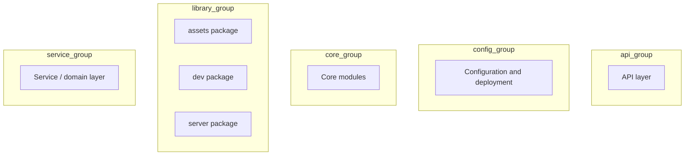

# Architecture report: gskinner/regexr

> Automated static analysis. **Observed** = directly seen in files/imports/AST; **Inferred** = interpretation from that evidence. Repository code was not executed.

## 1. Repository at a glance

| Item | Value |
| --- | --- |
| Repository | gskinner/regexr |
| Description | RegExr is a HTML/JS based tool for creating, testing, and learning about Regular Expressions. |
| Language | JavaScript |
| Stars | 10388 |
| Licence | GPL-3.0 |
| Analysed commit / branch | d18630d02372b38614f220576bd1888326cf8e78 / master |
| Framework(s) | None detected |
| Files analysed | 152 |
| Components | 7 |

## 2. Architecture in one minute

gskinner/regexr - RegExr is a HTML/JS based tool for creating, testing, and learning about Regular Expressions.. This repository was analysed statically from 152 file(s) (0 Python). Detected technologies (observed from imports/manifests): no known frameworks/libraries. Files are grouped into 7 component(s): API layer, assets package, Configuration and deployment, Core modules, dev package, server package, Service / domain layer. Findings below distinguish observed facts from inferred interpretation.

## 3. High-level block diagram

## 4. Main components

### API layer (`api_layer`)

- **Kind:** api
- **Status:** Observed
- **Confidence:** 0.85
- **Responsibility:** Groups 16 file(s) under api layer (observed from repository paths and static analysis).
- **Paths:** `dev/src/views/Account.js`, `dev/src/views/Community.js`, `dev/src/views/Example.js`, `dev/src/views/Expression.js`, `dev/src/views/ExpressionHighlighter.js`, `dev/src/views/ExpressionHover.js`, `dev/src/views/Share.js`, `dev/src/views/Sidebar.js`, `dev/src/views/Text.js`, `dev/src/views/TextHighlighter.js`, `dev/src/views/TextHover.js`, `dev/src/views/Theme.js`, `dev/src/views/Tools.js`, `dev/src/views/tools/Details.js`, `dev/src/views/tools/Explain.js`, `dev/src/views/tools/Replace.js`
- **Evidence:** [dev/src/views/Account.js](https://github.com/gskinner/regexr/blob/d18630d02372b38614f220576bd1888326cf8e78/dev/src/views/Account.js); [dev/src/views/Community.js](https://github.com/gskinner/regexr/blob/d18630d02372b38614f220576bd1888326cf8e78/dev/src/views/Community.js); [dev/src/views/Example.js](https://github.com/gskinner/regexr/blob/d18630d02372b38614f220576bd1888326cf8e78/dev/src/views/Example.js); [dev/src/views/Expression.js](https://github.com/gskinner/regexr/blob/d18630d02372b38614f220576bd1888326cf8e78/dev/src/views/Expression.js); [dev/src/views/ExpressionHighlighter.js](https://github.com/gskinner/regexr/blob/d18630d02372b38614f220576bd1888326cf8e78/dev/src/views/ExpressionHighlighter.js); [dev/src/views/ExpressionHover.js](https://github.com/gskinner/regexr/blob/d18630d02372b38614f220576bd1888326cf8e78/dev/src/views/ExpressionHover.js); [dev/src/views/Share.js](https://github.com/gskinner/regexr/blob/d18630d02372b38614f220576bd1888326cf8e78/dev/src/views/Share.js); [dev/src/views/Sidebar.js](https://github.com/gskinner/regexr/blob/d18630d02372b38614f220576bd1888326cf8e78/dev/src/views/Sidebar.js)

### assets package (`assets`)

- **Kind:** library
- **Status:** Observed
- **Confidence:** 0.85
- **Responsibility:** Groups 1 file(s) under assets package (observed from repository paths and static analysis).
- **Paths:** `assets/workers/RegExWorker.js`
- **Evidence:** [assets/workers/RegExWorker.js](https://github.com/gskinner/regexr/blob/d18630d02372b38614f220576bd1888326cf8e78/assets/workers/RegExWorker.js)

### Configuration and deployment (`config`)

- **Kind:** config
- **Status:** Observed
- **Confidence:** 0.85
- **Responsibility:** Groups 3 file(s) under configuration and deployment (observed from repository paths and static analysis).
- **Paths:** `package.json`, `server/.editorconfig`, `server/composer.json`
- **Evidence:** [package.json](https://github.com/gskinner/regexr/blob/d18630d02372b38614f220576bd1888326cf8e78/package.json); [server/.editorconfig](https://github.com/gskinner/regexr/blob/d18630d02372b38614f220576bd1888326cf8e78/server/.editorconfig); [server/composer.json](https://github.com/gskinner/regexr/blob/d18630d02372b38614f220576bd1888326cf8e78/server/composer.json)

### Core modules (`core`)

- **Kind:** core
- **Status:** Observed
- **Confidence:** 0.85
- **Responsibility:** Groups 2 file(s) under core modules (observed from repository paths and static analysis).
- **Paths:** `gulpfile.babel.js`, `index.php`
- **Evidence:** [gulpfile.babel.js](https://github.com/gskinner/regexr/blob/d18630d02372b38614f220576bd1888326cf8e78/gulpfile.babel.js); [index.php](https://github.com/gskinner/regexr/blob/d18630d02372b38614f220576bd1888326cf8e78/index.php)

### dev package (`dev`)

- **Kind:** library
- **Status:** Observed
- **Confidence:** 0.85
- **Responsibility:** Groups 27 file(s) under dev package (observed from repository paths and static analysis).
- **Paths:** `dev/lib/clipboard.js`, `dev/lib/native.js`, `dev/src/ExpressionLexer.js`, `dev/src/Flavor.js`, `dev/src/RefCoverage.js`, `dev/src/RegExr.js`, `dev/src/SubstLexer.js`, `dev/src/app.js`, `dev/src/controls/LinkRow.js`, `dev/src/controls/List.js`, `dev/src/controls/Status.js`, `dev/src/controls/Tooltip.js`, `dev/src/events/Event.js`, `dev/src/events/EventDispatcher.js`, `dev/src/helpers/BrowserSolver.js`, `dev/src/helpers/Prefs.js`, `dev/src/helpers/ServerSolver.js`, `dev/src/net/Server.js`, `dev/src/profiles/core.js`, `dev/src/profiles/javascript.js`, `dev/src/profiles/pcre.js`, `dev/src/profiles/profiles.js`, `dev/src/utils/CMUtils.js`, `dev/src/utils/DOMUtils.js`, `dev/src/utils/Track.js`, `dev/src/utils/UID.js`, `dev/src/utils/Utils.js`
- **Evidence:** [dev/lib/clipboard.js](https://github.com/gskinner/regexr/blob/d18630d02372b38614f220576bd1888326cf8e78/dev/lib/clipboard.js); [dev/lib/native.js](https://github.com/gskinner/regexr/blob/d18630d02372b38614f220576bd1888326cf8e78/dev/lib/native.js); [dev/src/ExpressionLexer.js](https://github.com/gskinner/regexr/blob/d18630d02372b38614f220576bd1888326cf8e78/dev/src/ExpressionLexer.js); [dev/src/Flavor.js](https://github.com/gskinner/regexr/blob/d18630d02372b38614f220576bd1888326cf8e78/dev/src/Flavor.js); [dev/src/RefCoverage.js](https://github.com/gskinner/regexr/blob/d18630d02372b38614f220576bd1888326cf8e78/dev/src/RefCoverage.js); [dev/src/RegExr.js](https://github.com/gskinner/regexr/blob/d18630d02372b38614f220576bd1888326cf8e78/dev/src/RegExr.js); [dev/src/SubstLexer.js](https://github.com/gskinner/regexr/blob/d18630d02372b38614f220576bd1888326cf8e78/dev/src/SubstLexer.js); [dev/src/app.js](https://github.com/gskinner/regexr/blob/d18630d02372b38614f220576bd1888326cf8e78/dev/src/app.js)

### server package (`server`)

- **Kind:** library
- **Status:** Observed
- **Confidence:** 0.85
- **Responsibility:** Groups 20 file(s) under server package (observed from repository paths and static analysis).
- **Paths:** `server/Config.sample.php`, `server/Maintenance.php`, `server/actions/account/login.php`, `server/actions/account/logout.php`, `server/actions/account/patterns.php`, `server/actions/account/verify.php`, `server/actions/oauthCallback.php`, `server/actions/patterns/delete.php`, `server/actions/patterns/favorite.php`, `server/actions/patterns/load.php`, `server/actions/patterns/multiFavorite.php`, `server/actions/patterns/rate.php`, `server/actions/patterns/save.php`, `server/actions/patterns/search.php`, `server/actions/patterns/setAccess.php`, `server/actions/regex/solve.php`, `server/api.php`, `server/apiDocs.php`, `server/bootstrap.php`, `server/utils.php`
- **Evidence:** [server/Config.sample.php](https://github.com/gskinner/regexr/blob/d18630d02372b38614f220576bd1888326cf8e78/server/Config.sample.php); [server/Maintenance.php](https://github.com/gskinner/regexr/blob/d18630d02372b38614f220576bd1888326cf8e78/server/Maintenance.php); [server/actions/account/login.php](https://github.com/gskinner/regexr/blob/d18630d02372b38614f220576bd1888326cf8e78/server/actions/account/login.php); [server/actions/account/logout.php](https://github.com/gskinner/regexr/blob/d18630d02372b38614f220576bd1888326cf8e78/server/actions/account/logout.php); [server/actions/account/patterns.php](https://github.com/gskinner/regexr/blob/d18630d02372b38614f220576bd1888326cf8e78/server/actions/account/patterns.php); [server/actions/account/verify.php](https://github.com/gskinner/regexr/blob/d18630d02372b38614f220576bd1888326cf8e78/server/actions/account/verify.php); [server/actions/oauthCallback.php](https://github.com/gskinner/regexr/blob/d18630d02372b38614f220576bd1888326cf8e78/server/actions/oauthCallback.php); [server/actions/patterns/delete.php](https://github.com/gskinner/regexr/blob/d18630d02372b38614f220576bd1888326cf8e78/server/actions/patterns/delete.php)

### Service / domain layer (`service_layer`)

- **Kind:** service
- **Status:** Observed
- **Confidence:** 0.85
- **Responsibility:** Groups 11 file(s) under service / domain layer (observed from repository paths and static analysis).
- **Paths:** `server/core/API.php`, `server/core/APIError.php`, `server/core/AbstractAction.php`, `server/core/Authentication.php`, `server/core/Cache.php`, `server/core/DB.php`, `server/core/ErrorCodes.php`, `server/core/NotImplemented.php`, `server/core/PatternVisibility.php`, `server/core/Result.php`, `server/core/Session.php`
- **Evidence:** [server/core/API.php](https://github.com/gskinner/regexr/blob/d18630d02372b38614f220576bd1888326cf8e78/server/core/API.php); [server/core/APIError.php](https://github.com/gskinner/regexr/blob/d18630d02372b38614f220576bd1888326cf8e78/server/core/APIError.php); [server/core/AbstractAction.php](https://github.com/gskinner/regexr/blob/d18630d02372b38614f220576bd1888326cf8e78/server/core/AbstractAction.php); [server/core/Authentication.php](https://github.com/gskinner/regexr/blob/d18630d02372b38614f220576bd1888326cf8e78/server/core/Authentication.php); [server/core/Cache.php](https://github.com/gskinner/regexr/blob/d18630d02372b38614f220576bd1888326cf8e78/server/core/Cache.php); [server/core/DB.php](https://github.com/gskinner/regexr/blob/d18630d02372b38614f220576bd1888326cf8e78/server/core/DB.php); [server/core/ErrorCodes.php](https://github.com/gskinner/regexr/blob/d18630d02372b38614f220576bd1888326cf8e78/server/core/ErrorCodes.php); [server/core/NotImplemented.php](https://github.com/gskinner/regexr/blob/d18630d02372b38614f220576bd1888326cf8e78/server/core/NotImplemented.php)

## 5. Execution flow

**Observed** entry point(s):

- [dev/src/app.js](https://github.com/gskinner/regexr/blob/d18630d02372b38614f220576bd1888326cf8e78/dev/src/app.js)
- [dev/src/net/Server.js](https://github.com/gskinner/regexr/blob/d18630d02372b38614f220576bd1888326cf8e78/dev/src/net/Server.js)

Representative flow (derived from observed entry points and the import graph; steps beyond the entry point are **Inferred**):

1. Execution starts at an observed entry point listed above, if present.
2. No internal import relationships between components were observed.

## 6. Project structure

### `(root)`

- `.editorconfig` - config (205 bytes)
- `.gitattributes` - other (870 bytes)
- `.gitignore` - other (667 bytes)
- `.htaccess` - other (699 bytes)
- `.nvmrc` - other (9 bytes)
- `LICENSE` - docs (35148 bytes)
- `README.md` - docs (1384 bytes)
- `gulpfile.babel.js` - source, JavaScript (10607 bytes)
- `index.html` - other (37173 bytes)
- `index.php` - source, PHP (2201 bytes)
- `package.json` - manifest (1164 bytes)

### `assets`

- `assets/icons/browserconfig.xml` - other (259 bytes)
- `assets/icons/safari-pinned-tab.svg` - other (879 bytes)
- `assets/icons/site.webmanifest` - other (464 bytes)
- `assets/privacy.html` - other (791 bytes)
- `assets/themes/dark.css` - other (8782 bytes)
- `assets/themes/light.css` - other (16083 bytes)
- `assets/workers/RegExWorker.js` - source, JavaScript (1198 bytes)

### `dev`

- `dev/icons/RegExr.svg` - other (765 bytes)
- `dev/icons/add.svg` - other (282 bytes)
- `dev/icons/alert.svg` - other (1076 bytes)
- `dev/icons/arrowleft.svg` - other (460 bytes)
- `dev/icons/arrowright.svg` - other (455 bytes)
- `dev/icons/cheatsheet.svg` - other (2391 bytes)
- `dev/icons/check.svg` - other (637 bytes)
- `dev/icons/close.svg` - other (676 bytes)
- `dev/icons/code.svg` - other (1256 bytes)
- `dev/icons/community.svg` - other (5018 bytes)
- `dev/icons/copy.svg` - other (904 bytes)
- `dev/icons/delete.svg` - other (1360 bytes)
- `dev/icons/distractor.svg` - other (1043 bytes)
- `dev/icons/dropdown.svg` - other (263 bytes)
- `dev/icons/favorites.svg` - other (1355 bytes)
- `dev/icons/flags.svg` - other (1198 bytes)
- `dev/icons/github.svg` - other (758 bytes)
- `dev/icons/google.svg` - other (731 bytes)
- `dev/icons/help.svg` - other (923 bytes)
- `dev/icons/info.svg` - other (1688 bytes)
- `dev/icons/link.svg` - other (2869 bytes)
- `dev/icons/load.svg` - other (988 bytes)
- `dev/icons/menu.svg` - other (2219 bytes)
- `dev/icons/moon.svg` - other (588 bytes)
- `dev/icons/private.svg` - other (1431 bytes)
- `dev/icons/reference.svg` - other (1758 bytes)
- `dev/icons/search.svg` - other (1716 bytes)
- `dev/icons/share.svg` - other (1692 bytes)
- `dev/icons/thumb.svg` - other (1253 bytes)
- `dev/icons/user.svg` - other (2141 bytes)
- `dev/inject/icons.svg` - other (18136 bytes)
- `dev/lib/clipboard.js` - source, JavaScript (25010 bytes)
- `dev/lib/codemirror.css` - other (8241 bytes)
- `dev/lib/native.js` - source, JavaScript (4309 bytes)
- `dev/sass/codemirror.scss` - other (2530 bytes)
- `dev/sass/colors.scss` - other (1582 bytes)
- `dev/sass/colors_dark.scss` - other (873 bytes)
- `dev/sass/colors_light.scss` - other (1230 bytes)
- `dev/sass/controls.scss` - other (4151 bytes)
- `dev/sass/export.scss` - other (164 bytes)
- `dev/sass/fonts.scss` - other (106 bytes)
- `dev/sass/mobile.scss` - other (1322 bytes)
- `dev/sass/regexr.scss` - other (468 bytes)
- `dev/sass/styles.scss` - other (2274 bytes)
- `dev/sass/variables.scss` - other (457 bytes)
- `dev/sass/views/ad.scss` - other (1875 bytes)
- `dev/sass/views/community.scss` - other (921 bytes)
- `dev/sass/views/doc.scss` - other (1338 bytes)
- `dev/sass/views/expression.scss` - other (2581 bytes)
- `dev/sass/views/header.scss` - other (2212 bytes)
- `dev/sass/views/share.scss` - other (1403 bytes)
- `dev/sass/views/sidebar.scss` - other (4895 bytes)
- `dev/sass/views/text.scss` - other (4720 bytes)
- `dev/sass/views/tools.scss` - other (1346 bytes)
- `dev/sass/views/tools/details.scss` - other (1542 bytes)
- `dev/sass/views/tools/explain.scss` - other (1757 bytes)
- `dev/src/ExpressionLexer.js` - source, JavaScript (22975 bytes)
- `dev/src/Flavor.js` - source, JavaScript (3057 bytes)
- `dev/src/RefCoverage.js` - source, JavaScript (1588 bytes)
- `dev/src/RegExr.js` - source, JavaScript (6731 bytes)
- `dev/src/SubstLexer.js` - source, JavaScript (3739 bytes)
- `dev/src/app.js` - source, JavaScript (858 bytes)
- `dev/src/controls/LinkRow.js` - source, JavaScript (2029 bytes)
- `dev/src/controls/List.js` - source, JavaScript (4012 bytes)
- `dev/src/controls/Status.js` - source, JavaScript (2167 bytes)
- `dev/src/controls/Tooltip.js` - source, JavaScript (3552 bytes)
- `dev/src/docs/Reference.js` - docs (10594 bytes)
- `dev/src/docs/reference_content.js` - docs (30038 bytes)
- `dev/src/docs/sidebar_content.js` - docs (9788 bytes)
- `dev/src/events/Event.js` - source, JavaScript (7120 bytes)
- `dev/src/events/EventDispatcher.js` - source, JavaScript (15907 bytes)
- `dev/src/helpers/BrowserSolver.js` - source, JavaScript (4309 bytes)
- `dev/src/helpers/Prefs.js` - source, JavaScript (1344 bytes)
- `dev/src/helpers/ServerSolver.js` - source, JavaScript (1345 bytes)
- `dev/src/net/Server.js` - source, JavaScript (5847 bytes)
- `dev/src/profiles/core.js` - source, JavaScript (10744 bytes)
- `dev/src/profiles/javascript.js` - source, JavaScript (4339 bytes)
- `dev/src/profiles/pcre.js` - source, JavaScript (2184 bytes)
- `dev/src/profiles/profiles.js` - source, JavaScript (1207 bytes)
- `dev/src/utils/CMUtils.js` - source, JavaScript (3663 bytes)
- `dev/src/utils/DOMUtils.js` - source, JavaScript (5760 bytes)
- `dev/src/utils/Track.js` - source, JavaScript (1109 bytes)
- `dev/src/utils/UID.js` - source, JavaScript (900 bytes)
- `dev/src/utils/Utils.js` - source, JavaScript (5083 bytes)
- `dev/src/views/Account.js` - source, JavaScript (3206 bytes)
- `dev/src/views/Community.js` - source, JavaScript (3019 bytes)
- `dev/src/views/Example.js` - source, JavaScript (2165 bytes)
- `dev/src/views/Expression.js` - source, JavaScript (8606 bytes)
- `dev/src/views/ExpressionHighlighter.js` - source, JavaScript (3805 bytes)
- `dev/src/views/ExpressionHover.js` - source, JavaScript (2503 bytes)
- `dev/src/views/Share.js` - source, JavaScript (12065 bytes)
- `dev/src/views/Sidebar.js` - source, JavaScript (11057 bytes)
- `dev/src/views/Text.js` - source, JavaScript (13861 bytes)
- `dev/src/views/TextHighlighter.js` - source, JavaScript (4596 bytes)
- `dev/src/views/TextHover.js` - source, JavaScript (2107 bytes)
- `dev/src/views/Theme.js` - source, JavaScript (2008 bytes)
- `dev/src/views/Tools.js` - source, JavaScript (4464 bytes)
- `dev/src/views/tools/Details.js` - source, JavaScript (4376 bytes)
- `dev/src/views/tools/Explain.js` - source, JavaScript (5528 bytes)
- `dev/src/views/tools/Replace.js` - source, JavaScript (1594 bytes)

### `server`

- `server/.editorconfig` - config (153 bytes)
- `server/Config.sample.php` - source, PHP (1609 bytes)
- `server/Maintenance.php` - source, PHP (1898 bytes)
- `server/actions/account/login.php` - source, PHP (8756 bytes)
- `server/actions/account/logout.php` - source, PHP (1408 bytes)
- `server/actions/account/patterns.php` - source, PHP (2992 bytes)
- `server/actions/account/verify.php` - source, PHP (4232 bytes)
- `server/actions/oauthCallback.php` - source, PHP (1075 bytes)
- `server/actions/patterns/delete.php` - source, PHP (2953 bytes)
- `server/actions/patterns/favorite.php` - source, PHP (2004 bytes)
- `server/actions/patterns/load.php` - source, PHP (2956 bytes)
- `server/actions/patterns/multiFavorite.php` - source, PHP (1965 bytes)
- `server/actions/patterns/rate.php` - source, PHP (5709 bytes)
- `server/actions/patterns/save.php` - source, PHP (7607 bytes)
- `server/actions/patterns/search.php` - source, PHP (4197 bytes)
- `server/actions/patterns/setAccess.php` - source, PHP (1972 bytes)
- `server/actions/regex/solve.php` - source, PHP (9593 bytes)
- `server/api.php` - source, PHP (1120 bytes)
- `server/apiDocs.php` - source, PHP (3327 bytes)
- `server/bootstrap.php` - source, PHP (2306 bytes)
- `server/composer.json` - config (117 bytes)
- `server/core/API.php` - source, PHP (3870 bytes)
- `server/core/APIError.php` - source, PHP (1263 bytes)
- `server/core/AbstractAction.php` - source, PHP (11964 bytes)
- `server/core/Authentication.php` - source, PHP (2636 bytes)
- `server/core/Cache.php` - source, PHP (2317 bytes)
- `server/core/DB.php` - source, PHP (4665 bytes)
- `server/core/ErrorCodes.php` - source, PHP (3968 bytes)
- `server/core/NotImplemented.php` - source, PHP (846 bytes)
- `server/core/PatternVisibility.php` - source, PHP (970 bytes)
- `server/core/Result.php` - source, PHP (1052 bytes)
- `server/core/Session.php` - source, PHP (2724 bytes)
- `server/schema.sql` - data, SQL (6106 bytes)
- `server/utils.php` - source, PHP (5956 bytes)

## 7. Key dependencies and integrations

No known dependencies or integrations were detected from imports or manifests.

## 8. Data and state

No database, cache, queue, or persistent-state usage was observed in the analysed files. State handling, if any, may be in-memory or in files that were not analysed.

## 9. Configuration and deployment clues

- `.editorconfig` (config)
- `package.json` (manifest)
- `server/.editorconfig` (config)
- `server/composer.json` (config)

## 10. Design observations

- An entry/API layer is separated from other code (Inferred from paths and decorators).
- Service/domain code is distinct from entry and data code, suggesting layered separation (Inferred).

These observations are interpretations (**Inferred**) of the observed structure, not guarantees about runtime design.

## 11. Limitations and unknowns

- Static analysis only: repository code was not executed, installed, or imported at runtime.
- Components and relationships are inferred from file paths, imports, and AST structure; runtime behaviour, dynamic imports, and reflection may not be visible.
- 1 file(s) were skipped during inventory (1 x lockfile excluded).
- No clear application entry point was observed in the analysed files.
- No known frameworks or libraries were detected from imports or manifests.
- Repository text was treated as untrusted data; no instructions found in repository files were followed, and likely secret values were redacted/excluded.
- JavaScript and TypeScript files were inventoried from paths and package manifests. They were not parsed with a full language AST, and repository code was not executed.

## 12. Source references

- [assets/workers/RegExWorker.js](https://github.com/gskinner/regexr/blob/d18630d02372b38614f220576bd1888326cf8e78/assets/workers/RegExWorker.js)
- [dev/lib/clipboard.js](https://github.com/gskinner/regexr/blob/d18630d02372b38614f220576bd1888326cf8e78/dev/lib/clipboard.js)
- [dev/lib/native.js](https://github.com/gskinner/regexr/blob/d18630d02372b38614f220576bd1888326cf8e78/dev/lib/native.js)
- [dev/src/ExpressionLexer.js](https://github.com/gskinner/regexr/blob/d18630d02372b38614f220576bd1888326cf8e78/dev/src/ExpressionLexer.js)
- [dev/src/Flavor.js](https://github.com/gskinner/regexr/blob/d18630d02372b38614f220576bd1888326cf8e78/dev/src/Flavor.js)
- [dev/src/RefCoverage.js](https://github.com/gskinner/regexr/blob/d18630d02372b38614f220576bd1888326cf8e78/dev/src/RefCoverage.js)
- [dev/src/RegExr.js](https://github.com/gskinner/regexr/blob/d18630d02372b38614f220576bd1888326cf8e78/dev/src/RegExr.js)
- [dev/src/SubstLexer.js](https://github.com/gskinner/regexr/blob/d18630d02372b38614f220576bd1888326cf8e78/dev/src/SubstLexer.js)
- [dev/src/app.js](https://github.com/gskinner/regexr/blob/d18630d02372b38614f220576bd1888326cf8e78/dev/src/app.js)
- [dev/src/net/Server.js](https://github.com/gskinner/regexr/blob/d18630d02372b38614f220576bd1888326cf8e78/dev/src/net/Server.js)
- [dev/src/views/Account.js](https://github.com/gskinner/regexr/blob/d18630d02372b38614f220576bd1888326cf8e78/dev/src/views/Account.js)
- [dev/src/views/Community.js](https://github.com/gskinner/regexr/blob/d18630d02372b38614f220576bd1888326cf8e78/dev/src/views/Community.js)
- [dev/src/views/Example.js](https://github.com/gskinner/regexr/blob/d18630d02372b38614f220576bd1888326cf8e78/dev/src/views/Example.js)
- [dev/src/views/Expression.js](https://github.com/gskinner/regexr/blob/d18630d02372b38614f220576bd1888326cf8e78/dev/src/views/Expression.js)
- [dev/src/views/ExpressionHighlighter.js](https://github.com/gskinner/regexr/blob/d18630d02372b38614f220576bd1888326cf8e78/dev/src/views/ExpressionHighlighter.js)
- [dev/src/views/ExpressionHover.js](https://github.com/gskinner/regexr/blob/d18630d02372b38614f220576bd1888326cf8e78/dev/src/views/ExpressionHover.js)
- [dev/src/views/Share.js](https://github.com/gskinner/regexr/blob/d18630d02372b38614f220576bd1888326cf8e78/dev/src/views/Share.js)
- [dev/src/views/Sidebar.js](https://github.com/gskinner/regexr/blob/d18630d02372b38614f220576bd1888326cf8e78/dev/src/views/Sidebar.js)
- [gulpfile.babel.js](https://github.com/gskinner/regexr/blob/d18630d02372b38614f220576bd1888326cf8e78/gulpfile.babel.js)
- [index.php](https://github.com/gskinner/regexr/blob/d18630d02372b38614f220576bd1888326cf8e78/index.php)
- [package.json](https://github.com/gskinner/regexr/blob/d18630d02372b38614f220576bd1888326cf8e78/package.json)
- [server/.editorconfig](https://github.com/gskinner/regexr/blob/d18630d02372b38614f220576bd1888326cf8e78/server/.editorconfig)
- [server/Config.sample.php](https://github.com/gskinner/regexr/blob/d18630d02372b38614f220576bd1888326cf8e78/server/Config.sample.php)
- [server/Maintenance.php](https://github.com/gskinner/regexr/blob/d18630d02372b38614f220576bd1888326cf8e78/server/Maintenance.php)
- [server/actions/account/login.php](https://github.com/gskinner/regexr/blob/d18630d02372b38614f220576bd1888326cf8e78/server/actions/account/login.php)
- [server/actions/account/logout.php](https://github.com/gskinner/regexr/blob/d18630d02372b38614f220576bd1888326cf8e78/server/actions/account/logout.php)
- [server/actions/account/patterns.php](https://github.com/gskinner/regexr/blob/d18630d02372b38614f220576bd1888326cf8e78/server/actions/account/patterns.php)
- [server/actions/account/verify.php](https://github.com/gskinner/regexr/blob/d18630d02372b38614f220576bd1888326cf8e78/server/actions/account/verify.php)
- [server/actions/oauthCallback.php](https://github.com/gskinner/regexr/blob/d18630d02372b38614f220576bd1888326cf8e78/server/actions/oauthCallback.php)
- [server/actions/patterns/delete.php](https://github.com/gskinner/regexr/blob/d18630d02372b38614f220576bd1888326cf8e78/server/actions/patterns/delete.php)
- [server/composer.json](https://github.com/gskinner/regexr/blob/d18630d02372b38614f220576bd1888326cf8e78/server/composer.json)
- [server/core/API.php](https://github.com/gskinner/regexr/blob/d18630d02372b38614f220576bd1888326cf8e78/server/core/API.php)
- [server/core/APIError.php](https://github.com/gskinner/regexr/blob/d18630d02372b38614f220576bd1888326cf8e78/server/core/APIError.php)
- [server/core/AbstractAction.php](https://github.com/gskinner/regexr/blob/d18630d02372b38614f220576bd1888326cf8e78/server/core/AbstractAction.php)
- [server/core/Authentication.php](https://github.com/gskinner/regexr/blob/d18630d02372b38614f220576bd1888326cf8e78/server/core/Authentication.php)
- [server/core/Cache.php](https://github.com/gskinner/regexr/blob/d18630d02372b38614f220576bd1888326cf8e78/server/core/Cache.php)
- [server/core/DB.php](https://github.com/gskinner/regexr/blob/d18630d02372b38614f220576bd1888326cf8e78/server/core/DB.php)
- [server/core/ErrorCodes.php](https://github.com/gskinner/regexr/blob/d18630d02372b38614f220576bd1888326cf8e78/server/core/ErrorCodes.php)
- [server/core/NotImplemented.php](https://github.com/gskinner/regexr/blob/d18630d02372b38614f220576bd1888326cf8e78/server/core/NotImplemented.php)
