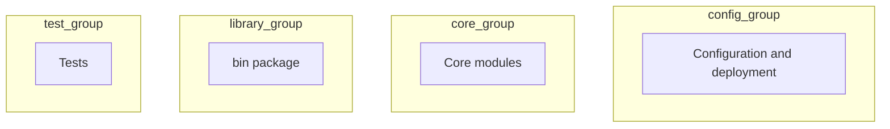

# Architecture report: gulpjs/gulp

> Automated static analysis. **Observed** = directly seen in files/imports/AST; **Inferred** = interpretation from that evidence. Repository code was not executed.

## 1. Repository at a glance

| Item | Value |
| --- | --- |
| Repository | gulpjs/gulp |
| Description | A toolkit to automate & enhance your workflow |
| Language | JavaScript |
| Stars | 32915 |
| Licence | MIT |
| Analysed commit / branch | 61f22dc11bb14234b555253095fa1d224ce0eab1 / master |
| Framework(s) | None detected |
| Files analysed | 93 |
| Components | 4 |

## 2. Architecture in one minute

gulpjs/gulp - A toolkit to automate & enhance your workflow. This repository was analysed statically from 93 file(s) (0 Python). Detected technologies (observed from imports/manifests): GitHub Actions. Files are grouped into 4 component(s): bin package, Configuration and deployment, Core modules, Tests. Findings below distinguish observed facts from inferred interpretation.

## 3. High-level block diagram

## 4. Main components

### bin package (`bin`)

- **Kind:** library
- **Status:** Observed
- **Confidence:** 0.85
- **Responsibility:** Groups 1 file(s) under bin package (observed from repository paths and static analysis).
- **Paths:** `bin/gulp.js`
- **Evidence:** [bin/gulp.js](https://github.com/gulpjs/gulp/blob/61f22dc11bb14234b555253095fa1d224ce0eab1/bin/gulp.js)

### Configuration and deployment (`config`)

- **Kind:** config
- **Status:** Observed
- **Confidence:** 0.85
- **Responsibility:** Groups 1 file(s) under configuration and deployment (observed from repository paths and static analysis).
- **Paths:** `package.json`
- **Evidence:** [package.json](https://github.com/gulpjs/gulp/blob/61f22dc11bb14234b555253095fa1d224ce0eab1/package.json)

### Core modules (`core`)

- **Kind:** core
- **Status:** Observed
- **Confidence:** 0.85
- **Responsibility:** Groups 2 file(s) under core modules (observed from repository paths and static analysis).
- **Paths:** `index.js`, `index.mjs`
- **Evidence:** [index.js](https://github.com/gulpjs/gulp/blob/61f22dc11bb14234b555253095fa1d224ce0eab1/index.js); [index.mjs](https://github.com/gulpjs/gulp/blob/61f22dc11bb14234b555253095fa1d224ce0eab1/index.mjs)

### Tests (`tests`)

- **Kind:** test
- **Status:** Observed
- **Confidence:** 0.85
- **Responsibility:** Groups 12 file(s) under tests (observed from repository paths and static analysis).
- **Paths:** `test/.gitkeep`, `test/dest.js`, `test/fixtures/copy/example.txt`, `test/fixtures/gulpfiles/cjs/gulpfile.cjs`, `test/fixtures/gulpfiles/mjs/gulpfile.mjs`, `test/fixtures/stuff/run.dmc`, `test/fixtures/stuff/test.dmc`, `test/fixtures/test.coffee`, `test/fixtures/test/run.jade`, `test/index.test.js`, `test/src.js`, `test/watch.js`
- **Evidence:** [test/.gitkeep](https://github.com/gulpjs/gulp/blob/61f22dc11bb14234b555253095fa1d224ce0eab1/test/.gitkeep); [test/dest.js](https://github.com/gulpjs/gulp/blob/61f22dc11bb14234b555253095fa1d224ce0eab1/test/dest.js); [test/fixtures/copy/example.txt](https://github.com/gulpjs/gulp/blob/61f22dc11bb14234b555253095fa1d224ce0eab1/test/fixtures/copy/example.txt); [test/fixtures/gulpfiles/cjs/gulpfile.cjs](https://github.com/gulpjs/gulp/blob/61f22dc11bb14234b555253095fa1d224ce0eab1/test/fixtures/gulpfiles/cjs/gulpfile.cjs); [test/fixtures/gulpfiles/mjs/gulpfile.mjs](https://github.com/gulpjs/gulp/blob/61f22dc11bb14234b555253095fa1d224ce0eab1/test/fixtures/gulpfiles/mjs/gulpfile.mjs); [test/fixtures/stuff/run.dmc](https://github.com/gulpjs/gulp/blob/61f22dc11bb14234b555253095fa1d224ce0eab1/test/fixtures/stuff/run.dmc); [test/fixtures/stuff/test.dmc](https://github.com/gulpjs/gulp/blob/61f22dc11bb14234b555253095fa1d224ce0eab1/test/fixtures/stuff/test.dmc); [test/fixtures/test.coffee](https://github.com/gulpjs/gulp/blob/61f22dc11bb14234b555253095fa1d224ce0eab1/test/fixtures/test.coffee)

## 5. Execution flow

**Observed** entry point(s):

- [bin/gulp.js](https://github.com/gulpjs/gulp/blob/61f22dc11bb14234b555253095fa1d224ce0eab1/bin/gulp.js)
- [index.js](https://github.com/gulpjs/gulp/blob/61f22dc11bb14234b555253095fa1d224ce0eab1/index.js)

Representative flow (derived from observed entry points and the import graph; steps beyond the entry point are **Inferred**):

1. Execution starts at an observed entry point listed above, if present.
2. No internal import relationships between components were observed.

## 6. Project structure

### `(root)`

- `.editorconfig` - config (215 bytes)
- `.eslintrc` - other (24 bytes)
- `.gitattributes` - other (110 bytes)
- `.gitignore` - other (655 bytes)
- `.prettierignore` - other (36 bytes)
- `.tidelift.yml` - config (462 bytes)
- `CHANGELOG.md` - docs (15755 bytes)
- `CONTRIBUTING.md` - docs (5332 bytes)
- `EXPENSE_POLICY.md` - docs (1772 bytes)
- `LICENSE` - docs (1149 bytes)
- `README.md` - docs (6708 bytes)
- `index.js` - source, JavaScript (1422 bytes)
- `index.mjs` - source, JavaScript (501 bytes)
- `package.json` - manifest (1408 bytes)

### `.github`

- `.github/SECURITY.md` - docs (365 bytes)
- `.github/workflows/dev.yml` - ci, YAML (1617 bytes)
- `.github/workflows/release.yml` - ci, YAML (324 bytes)

### `bin`

- `bin/gulp.js` - source, JavaScript (44 bytes)

### `docs`

- `docs/CLI.md` - docs (3705 bytes)
- `docs/FAQ.md` - docs (2316 bytes)
- `docs/README.md` - docs (3400 bytes)
- `docs/advanced/creating-custom-registries.md` - docs (5776 bytes)
- `docs/api/README.md` - docs (391 bytes)
- `docs/api/concepts.md` - docs (5190 bytes)
- `docs/api/dest.md` - docs (6605 bytes)
- `docs/api/last-run.md` - docs (2632 bytes)
- `docs/api/parallel.md` - docs (3281 bytes)
- `docs/api/registry.md` - docs (2441 bytes)
- `docs/api/series.md` - docs (3268 bytes)
- `docs/api/src.md` - docs (6903 bytes)
- `docs/api/symlink.md` - docs (4621 bytes)
- `docs/api/task.md` - docs (3489 bytes)
- `docs/api/tree.md` - docs (3540 bytes)
- `docs/api/vinyl-iscustomprop.md` - docs (1692 bytes)
- `docs/api/vinyl-isvinyl.md` - docs (771 bytes)
- `docs/api/vinyl.md` - docs (8430 bytes)
- `docs/api/watch.md` - docs (8406 bytes)
- `docs/documentation-missing.md` - docs (502 bytes)
- `docs/getting-started.md` - docs (227 bytes)
- `docs/getting-started/1-quick-start.md` - docs (2273 bytes)
- `docs/getting-started/2-javascript-and-gulpfiles.md` - docs (2630 bytes)
- `docs/getting-started/3-creating-tasks.md` - docs (4977 bytes)
- `docs/getting-started/4-async-completion.md` - docs (4436 bytes)
- `docs/getting-started/5-working-with-files.md` - docs (4197 bytes)
- `docs/getting-started/6-explaining-globs.md` - docs (4348 bytes)
- `docs/getting-started/7-using-plugins.md` - docs (3498 bytes)
- `docs/getting-started/8-watching-files.md` - docs (4549 bytes)
- `docs/getting-started/README.md` - docs (375 bytes)
- `docs/recipes/README.md` - docs (1457 bytes)
- `docs/recipes/automate-releases.md` - docs (3116 bytes)
- `docs/recipes/browserify-multiple-destination.md` - docs (1275 bytes)
- `docs/recipes/browserify-transforms.md` - docs (1288 bytes)
- `docs/recipes/browserify-uglify-sourcemap.md` - docs (1364 bytes)
- `docs/recipes/browserify-with-globs.md` - docs (2321 bytes)
- `docs/recipes/combining-streams-to-handle-errors.md` - docs (932 bytes)
- `docs/recipes/cron-task.md` - docs (916 bytes)
- `docs/recipes/delete-files-folder.md` - docs (2249 bytes)
- `docs/recipes/fast-browserify-builds-with-watchify.md` - docs (2161 bytes)
- `docs/recipes/handling-the-delete-event-on-watch.md` - docs (1033 bytes)
- `docs/recipes/incremental-builds-with-concatenate.md` - docs (1828 bytes)
- `docs/recipes/maintain-directory-structure-while-globbing.md` - docs (1410 bytes)
- `docs/recipes/make-stream-from-buffer.md` - docs (4228 bytes)
- `docs/recipes/minified-and-non-minified.md` - docs (686 bytes)
- `docs/recipes/minimal-browsersync-setup-with-gulp4.md` - docs (3552 bytes)
- `docs/recipes/mocha-test-runner-with-gulp.md` - docs (836 bytes)
- `docs/recipes/pass-arguments-from-cli.md` - docs (657 bytes)
- `docs/recipes/rollup-with-rollup-stream.md` - docs (2201 bytes)
- `docs/recipes/run-grunt-tasks-from-gulp.md` - docs (1750 bytes)
- `docs/recipes/running-task-steps-per-folder.md` - docs (1907 bytes)
- `docs/recipes/server-with-livereload-and-css-injection.md` - docs (2847 bytes)
- `docs/recipes/sharing-streams-with-stream-factories.md` - docs (2031 bytes)
- `docs/recipes/templating-with-swig-and-yaml-front-matter.md` - docs (811 bytes)
- `docs/recipes/using-multiple-sources-in-one-task.md` - docs (721 bytes)
- `docs/support/for-enterprise.md` - docs (3153 bytes)
- `docs/why-use-pump/README.md` - docs (3906 bytes)
- `docs/writing-a-plugin/README.md` - docs (7897 bytes)
- `docs/writing-a-plugin/dealing-with-streams.md` - docs (2277 bytes)
- `docs/writing-a-plugin/guidelines.md` - docs (5954 bytes)
- `docs/writing-a-plugin/recommended-modules.md` - docs (574 bytes)
- `docs/writing-a-plugin/testing.md` - docs (2638 bytes)
- `docs/writing-a-plugin/using-buffers.md` - docs (2082 bytes)

### `test`

- `test/.gitkeep` - test (0 bytes)
- `test/dest.js` - test, JavaScript (4576 bytes)
- `test/fixtures/copy/example.txt` - test (14 bytes)
- `test/fixtures/gulpfiles/cjs/gulpfile.cjs` - test, JavaScript (47 bytes)
- `test/fixtures/gulpfiles/mjs/gulpfile.mjs` - test, JavaScript (673 bytes)
- `test/fixtures/stuff/run.dmc` - test (0 bytes)
- `test/fixtures/stuff/test.dmc` - test (0 bytes)
- `test/fixtures/test.coffee` - test (14 bytes)
- `test/fixtures/test/run.jade` - test (13 bytes)
- `test/index.test.js` - test, JavaScript (2557 bytes)
- `test/src.js` - test, JavaScript (5018 bytes)
- `test/watch.js` - test, JavaScript (6715 bytes)

## 7. Key dependencies and integrations

| Name | Category | Status | Confidence | Evidence |
| --- | --- | --- | --- | --- |
| GitHub Actions | ci | Observed | 0.90 | [.github/workflows/dev.yml](https://github.com/gulpjs/gulp/blob/61f22dc11bb14234b555253095fa1d224ce0eab1/.github/workflows/dev.yml); [.github/workflows/release.yml](https://github.com/gulpjs/gulp/blob/61f22dc11bb14234b555253095fa1d224ce0eab1/.github/workflows/release.yml) |

## 8. Data and state

No database, cache, queue, or persistent-state usage was observed in the analysed files. State handling, if any, may be in-memory or in files that were not analysed.

## 9. Configuration and deployment clues

- `.editorconfig` (config)
- `.github/workflows/dev.yml` (ci)
- `.github/workflows/release.yml` (ci)
- `.tidelift.yml` (config)
- `package.json` (manifest)

## 10. Design observations

- Tests are present alongside source code (Observed from test file paths).

These observations are interpretations (**Inferred**) of the observed structure, not guarantees about runtime design.

## 11. Limitations and unknowns

- Static analysis only: repository code was not executed, installed, or imported at runtime.
- Components and relationships are inferred from file paths, imports, and AST structure; runtime behaviour, dynamic imports, and reflection may not be visible.
- 1 file(s) were skipped during inventory (1 x likely secret file excluded).
- No clear application entry point was observed in the analysed files.
- Repository text was treated as untrusted data; no instructions found in repository files were followed, and likely secret values were redacted/excluded.
- JavaScript and TypeScript files were inventoried from paths and package manifests. They were not parsed with a full language AST, and repository code was not executed.

## 12. Source references

- [.github/workflows/dev.yml](https://github.com/gulpjs/gulp/blob/61f22dc11bb14234b555253095fa1d224ce0eab1/.github/workflows/dev.yml)
- [.github/workflows/release.yml](https://github.com/gulpjs/gulp/blob/61f22dc11bb14234b555253095fa1d224ce0eab1/.github/workflows/release.yml)
- [bin/gulp.js](https://github.com/gulpjs/gulp/blob/61f22dc11bb14234b555253095fa1d224ce0eab1/bin/gulp.js)
- [index.js](https://github.com/gulpjs/gulp/blob/61f22dc11bb14234b555253095fa1d224ce0eab1/index.js)
- [index.mjs](https://github.com/gulpjs/gulp/blob/61f22dc11bb14234b555253095fa1d224ce0eab1/index.mjs)
- [package.json](https://github.com/gulpjs/gulp/blob/61f22dc11bb14234b555253095fa1d224ce0eab1/package.json)
- [test/.gitkeep](https://github.com/gulpjs/gulp/blob/61f22dc11bb14234b555253095fa1d224ce0eab1/test/.gitkeep)
- [test/dest.js](https://github.com/gulpjs/gulp/blob/61f22dc11bb14234b555253095fa1d224ce0eab1/test/dest.js)
- [test/fixtures/copy/example.txt](https://github.com/gulpjs/gulp/blob/61f22dc11bb14234b555253095fa1d224ce0eab1/test/fixtures/copy/example.txt)
- [test/fixtures/gulpfiles/cjs/gulpfile.cjs](https://github.com/gulpjs/gulp/blob/61f22dc11bb14234b555253095fa1d224ce0eab1/test/fixtures/gulpfiles/cjs/gulpfile.cjs)
- [test/fixtures/gulpfiles/mjs/gulpfile.mjs](https://github.com/gulpjs/gulp/blob/61f22dc11bb14234b555253095fa1d224ce0eab1/test/fixtures/gulpfiles/mjs/gulpfile.mjs)
- [test/fixtures/stuff/run.dmc](https://github.com/gulpjs/gulp/blob/61f22dc11bb14234b555253095fa1d224ce0eab1/test/fixtures/stuff/run.dmc)
- [test/fixtures/stuff/test.dmc](https://github.com/gulpjs/gulp/blob/61f22dc11bb14234b555253095fa1d224ce0eab1/test/fixtures/stuff/test.dmc)
- [test/fixtures/test.coffee](https://github.com/gulpjs/gulp/blob/61f22dc11bb14234b555253095fa1d224ce0eab1/test/fixtures/test.coffee)
