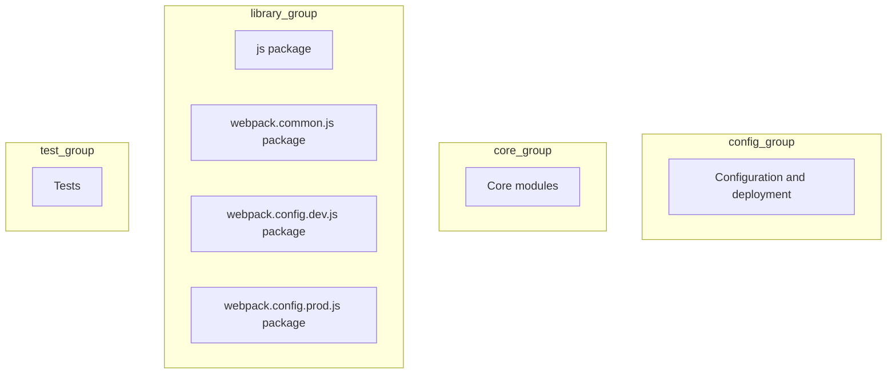

# Architecture report: h5bp/html5-boilerplate

> Automated static analysis. **Observed** = directly seen in files/imports/AST; **Inferred** = interpretation from that evidence. Repository code was not executed.

## 1. Repository at a glance

| Item | Value |
| --- | --- |
| Repository | h5bp/html5-boilerplate |
| Description | A professional front-end template for building fast, robust, and adaptable web apps or sites. |
| Language | JavaScript |
| Stars | 57679 |
| Licence | MIT |
| Analysed commit / branch | abc52d91fb7cb36c35b50a11aa76b19d2935d7fe / main |
| Framework(s) | None detected |
| Files analysed | 56 |
| Components | 7 |

## 2. Architecture in one minute

h5bp/html5-boilerplate - A professional front-end template for building fast, robust, and adaptable web apps or sites.. This repository was analysed statically from 56 file(s) (0 Python). Detected technologies (observed from imports/manifests): GitHub Actions, webpack. Files are grouped into 7 component(s): Configuration and deployment, Core modules, js package, Tests, webpack.common.js package, webpack.config.dev.js package, webpack.config.prod.js package. Findings below distinguish observed facts from inferred interpretation.

## 3. High-level block diagram

## 4. Main components

### Configuration and deployment (`config`)

- **Kind:** config
- **Status:** Observed
- **Confidence:** 0.85
- **Responsibility:** Groups 3 file(s) under configuration and deployment (observed from repository paths and static analysis).
- **Paths:** `package.json`, `src/.editorconfig`, `src/package.json`
- **Evidence:** [package.json](https://github.com/h5bp/html5-boilerplate/blob/abc52d91fb7cb36c35b50a11aa76b19d2935d7fe/package.json); [src/.editorconfig](https://github.com/h5bp/html5-boilerplate/blob/abc52d91fb7cb36c35b50a11aa76b19d2935d7fe/src/.editorconfig); [src/package.json](https://github.com/h5bp/html5-boilerplate/blob/abc52d91fb7cb36c35b50a11aa76b19d2935d7fe/src/package.json)

### Core modules (`core`)

- **Kind:** core
- **Status:** Observed
- **Confidence:** 0.85
- **Responsibility:** Groups 2 file(s) under core modules (observed from repository paths and static analysis).
- **Paths:** `eslint.config.mjs`, `gulpfile.mjs`
- **Evidence:** [eslint.config.mjs](https://github.com/h5bp/html5-boilerplate/blob/abc52d91fb7cb36c35b50a11aa76b19d2935d7fe/eslint.config.mjs); [gulpfile.mjs](https://github.com/h5bp/html5-boilerplate/blob/abc52d91fb7cb36c35b50a11aa76b19d2935d7fe/gulpfile.mjs)

### js package (`js`)

- **Kind:** library
- **Status:** Observed
- **Confidence:** 0.85
- **Responsibility:** Groups 1 file(s) under js package (observed from repository paths and static analysis).
- **Paths:** `src/js/app.js`
- **Evidence:** [src/js/app.js](https://github.com/h5bp/html5-boilerplate/blob/abc52d91fb7cb36c35b50a11aa76b19d2935d7fe/src/js/app.js)

### Tests (`tests`)

- **Kind:** test
- **Status:** Observed
- **Confidence:** 0.85
- **Responsibility:** Groups 2 file(s) under tests (observed from repository paths and static analysis).
- **Paths:** `test/file_content.mjs`, `test/file_existence.mjs`
- **Evidence:** [test/file_content.mjs](https://github.com/h5bp/html5-boilerplate/blob/abc52d91fb7cb36c35b50a11aa76b19d2935d7fe/test/file_content.mjs); [test/file_existence.mjs](https://github.com/h5bp/html5-boilerplate/blob/abc52d91fb7cb36c35b50a11aa76b19d2935d7fe/test/file_existence.mjs)

### webpack.common.js package (`webpack_common_js`)

- **Kind:** library
- **Status:** Observed
- **Confidence:** 0.85
- **Responsibility:** Groups 1 file(s) under webpack.common.js package (observed from repository paths and static analysis).
- **Paths:** `src/webpack.common.js`
- **Evidence:** [src/webpack.common.js](https://github.com/h5bp/html5-boilerplate/blob/abc52d91fb7cb36c35b50a11aa76b19d2935d7fe/src/webpack.common.js)

### webpack.config.dev.js package (`webpack_config_dev_js`)

- **Kind:** library
- **Status:** Observed
- **Confidence:** 0.85
- **Responsibility:** Groups 1 file(s) under webpack.config.dev.js package (observed from repository paths and static analysis).
- **Paths:** `src/webpack.config.dev.js`
- **Evidence:** [src/webpack.config.dev.js](https://github.com/h5bp/html5-boilerplate/blob/abc52d91fb7cb36c35b50a11aa76b19d2935d7fe/src/webpack.config.dev.js)

### webpack.config.prod.js package (`webpack_config_prod_js`)

- **Kind:** library
- **Status:** Observed
- **Confidence:** 0.85
- **Responsibility:** Groups 1 file(s) under webpack.config.prod.js package (observed from repository paths and static analysis).
- **Paths:** `src/webpack.config.prod.js`
- **Evidence:** [src/webpack.config.prod.js](https://github.com/h5bp/html5-boilerplate/blob/abc52d91fb7cb36c35b50a11aa76b19d2935d7fe/src/webpack.config.prod.js)

## 5. Execution flow

**Observed** entry point(s):

- [src/js/app.js](https://github.com/h5bp/html5-boilerplate/blob/abc52d91fb7cb36c35b50a11aa76b19d2935d7fe/src/js/app.js)

Representative flow (derived from observed entry points and the import graph; steps beyond the entry point are **Inferred**):

1. Execution starts at an observed entry point listed above, if present.
2. No internal import relationships between components were observed.

## 6. Project structure

### `(root)`

- `.cspell.json` - config (361 bytes)
- `.editorconfig` - config (325 bytes)
- `.gitattributes` - other (683 bytes)
- `.gitignore` - other (88 bytes)
- `.prettierignore` - other (6 bytes)
- `.prettierrc.json` - config (209 bytes)
- `CHANGELOG.md` - docs (23827 bytes)
- `LICENSE.txt` - docs (1056 bytes)
- `README.md` - docs (5659 bytes)
- `eslint.config.mjs` - source, JavaScript (624 bytes)
- `gulpfile.mjs` - source, JavaScript (3704 bytes)
- `package.json` - manifest (1535 bytes)

### `.github`

- `.github/CODE_OF_CONDUCT.md` - docs (3226 bytes)
- `.github/CONTRIBUTING.md` - docs (5834 bytes)
- `.github/ISSUE_TEMPLATE/bug_report.yml` - config (1899 bytes)
- `.github/ISSUE_TEMPLATE/config.yml` - config (223 bytes)
- `.github/ISSUE_TEMPLATE/feature_request.yml` - config (1155 bytes)
- `.github/PROPOSAL_GUIDELINES.md` - docs (2814 bytes)
- `.github/PULL_REQUEST_TEMPLATE.md` - docs (1300 bytes)
- `.github/SUPPORT.md` - docs (179 bytes)
- `.github/dependabot.yml` - config (793 bytes)
- `.github/workflows/build-dist.yml` - ci, YAML (1440 bytes)
- `.github/workflows/codeql-analysis.yml` - ci, YAML (843 bytes)
- `.github/workflows/dependency-review.yml` - ci, YAML (442 bytes)
- `.github/workflows/ossf-scorecard.yml` - ci, YAML (1225 bytes)
- `.github/workflows/publish.yml` - ci, YAML (1898 bytes)
- `.github/workflows/push-to-template.yml` - ci, YAML (1444 bytes)
- `.github/workflows/spellcheck.yml` - ci, YAML (561 bytes)
- `.github/workflows/test.yml` - ci, YAML (1103 bytes)

### `.vscode`

- `.vscode/extensions.json` - config (168 bytes)
- `.vscode/settings.json` - config (434 bytes)

### `docs`

- `docs/TOC.md` - docs (1688 bytes)
- `docs/about-this-repo.md` - docs (5627 bytes)
- `docs/css.md` - docs (669 bytes)
- `docs/extend.md` - docs (13800 bytes)
- `docs/faq.md` - docs (602 bytes)
- `docs/html.md` - docs (4997 bytes)
- `docs/js.md` - docs (454 bytes)
- `docs/misc.md` - docs (5023 bytes)
- `docs/usage.md` - docs (4832 bytes)

### `src`

- `src/.editorconfig` - config (167 bytes)
- `src/.gitattributes` - other (3249 bytes)
- `src/.gitignore` - other (228 bytes)
- `src/404.html` - other (1037 bytes)
- `src/icon.svg` - other (429 bytes)
- `src/img/.gitkeep` - other (0 bytes)
- `src/index.html` - other (851 bytes)
- `src/js/app.js` - source, JavaScript (0 bytes)
- `src/package.json` - manifest (612 bytes)
- `src/robots.txt` - docs (86 bytes)
- `src/site.webmanifest` - other (231 bytes)
- `src/webpack.common.js` - source, JavaScript (199 bytes)
- `src/webpack.config.dev.js` - source, JavaScript (277 bytes)
- `src/webpack.config.prod.js` - source, JavaScript (824 bytes)

### `test`

- `test/file_content.mjs` - test, JavaScript (1573 bytes)
- `test/file_existence.mjs` - test, JavaScript (3021 bytes)

## 7. Key dependencies and integrations

| Name | Category | Status | Confidence | Evidence |
| --- | --- | --- | --- | --- |
| GitHub Actions | ci | Observed | 0.90 | [.github/workflows/build-dist.yml](https://github.com/h5bp/html5-boilerplate/blob/abc52d91fb7cb36c35b50a11aa76b19d2935d7fe/.github/workflows/build-dist.yml); [.github/workflows/codeql-analysis.yml](https://github.com/h5bp/html5-boilerplate/blob/abc52d91fb7cb36c35b50a11aa76b19d2935d7fe/.github/workflows/codeql-analysis.yml); [.github/workflows/dependency-review.yml](https://github.com/h5bp/html5-boilerplate/blob/abc52d91fb7cb36c35b50a11aa76b19d2935d7fe/.github/workflows/dependency-review.yml); [.github/workflows/ossf-scorecard.yml](https://github.com/h5bp/html5-boilerplate/blob/abc52d91fb7cb36c35b50a11aa76b19d2935d7fe/.github/workflows/ossf-scorecard.yml) |
| webpack | tooling | Observed | 0.85 | [src/package.json:13](https://github.com/h5bp/html5-boilerplate/blob/abc52d91fb7cb36c35b50a11aa76b19d2935d7fe/src/package.json#L13) |

## 8. Data and state

No database, cache, queue, or persistent-state usage was observed in the analysed files. State handling, if any, may be in-memory or in files that were not analysed.

## 9. Configuration and deployment clues

- `.cspell.json` (config)
- `.editorconfig` (config)
- `.github/ISSUE_TEMPLATE/bug_report.yml` (config)
- `.github/ISSUE_TEMPLATE/config.yml` (config)
- `.github/ISSUE_TEMPLATE/feature_request.yml` (config)
- `.github/dependabot.yml` (config)
- `.github/workflows/build-dist.yml` (ci)
- `.github/workflows/codeql-analysis.yml` (ci)
- `.github/workflows/dependency-review.yml` (ci)
- `.github/workflows/ossf-scorecard.yml` (ci)
- `.github/workflows/publish.yml` (ci)
- `.github/workflows/push-to-template.yml` (ci)
- `.github/workflows/spellcheck.yml` (ci)
- `.github/workflows/test.yml` (ci)
- `.prettierrc.json` (config)
- `.vscode/extensions.json` (config)
- `.vscode/settings.json` (config)
- `package.json` (manifest)
- `src/.editorconfig` (config)
- `src/package.json` (manifest)

## 10. Design observations

- Tests are present alongside source code (Observed from test file paths).

These observations are interpretations (**Inferred**) of the observed structure, not guarantees about runtime design.

## 11. Limitations and unknowns

- Static analysis only: repository code was not executed, installed, or imported at runtime.
- Components and relationships are inferred from file paths, imports, and AST structure; runtime behaviour, dynamic imports, and reflection may not be visible.
- 20 file(s) were skipped during inventory (1 x likely secret file excluded; 1 x lockfile excluded; 18 x vendored/generated directory excluded).
- No clear application entry point was observed in the analysed files.
- Repository text was treated as untrusted data; no instructions found in repository files were followed, and likely secret values were redacted/excluded.
- JavaScript and TypeScript files were inventoried from paths and package manifests. They were not parsed with a full language AST, and repository code was not executed.

## 12. Source references

- [.github/workflows/build-dist.yml](https://github.com/h5bp/html5-boilerplate/blob/abc52d91fb7cb36c35b50a11aa76b19d2935d7fe/.github/workflows/build-dist.yml)
- [.github/workflows/codeql-analysis.yml](https://github.com/h5bp/html5-boilerplate/blob/abc52d91fb7cb36c35b50a11aa76b19d2935d7fe/.github/workflows/codeql-analysis.yml)
- [.github/workflows/dependency-review.yml](https://github.com/h5bp/html5-boilerplate/blob/abc52d91fb7cb36c35b50a11aa76b19d2935d7fe/.github/workflows/dependency-review.yml)
- [.github/workflows/ossf-scorecard.yml](https://github.com/h5bp/html5-boilerplate/blob/abc52d91fb7cb36c35b50a11aa76b19d2935d7fe/.github/workflows/ossf-scorecard.yml)
- [.github/workflows/publish.yml](https://github.com/h5bp/html5-boilerplate/blob/abc52d91fb7cb36c35b50a11aa76b19d2935d7fe/.github/workflows/publish.yml)
- [.github/workflows/push-to-template.yml](https://github.com/h5bp/html5-boilerplate/blob/abc52d91fb7cb36c35b50a11aa76b19d2935d7fe/.github/workflows/push-to-template.yml)
- [.github/workflows/spellcheck.yml](https://github.com/h5bp/html5-boilerplate/blob/abc52d91fb7cb36c35b50a11aa76b19d2935d7fe/.github/workflows/spellcheck.yml)
- [.github/workflows/test.yml](https://github.com/h5bp/html5-boilerplate/blob/abc52d91fb7cb36c35b50a11aa76b19d2935d7fe/.github/workflows/test.yml)
- [eslint.config.mjs](https://github.com/h5bp/html5-boilerplate/blob/abc52d91fb7cb36c35b50a11aa76b19d2935d7fe/eslint.config.mjs)
- [gulpfile.mjs](https://github.com/h5bp/html5-boilerplate/blob/abc52d91fb7cb36c35b50a11aa76b19d2935d7fe/gulpfile.mjs)
- [package.json](https://github.com/h5bp/html5-boilerplate/blob/abc52d91fb7cb36c35b50a11aa76b19d2935d7fe/package.json)
- [src/.editorconfig](https://github.com/h5bp/html5-boilerplate/blob/abc52d91fb7cb36c35b50a11aa76b19d2935d7fe/src/.editorconfig)
- [src/js/app.js](https://github.com/h5bp/html5-boilerplate/blob/abc52d91fb7cb36c35b50a11aa76b19d2935d7fe/src/js/app.js)
- [src/package.json](https://github.com/h5bp/html5-boilerplate/blob/abc52d91fb7cb36c35b50a11aa76b19d2935d7fe/src/package.json)
- [src/package.json:13](https://github.com/h5bp/html5-boilerplate/blob/abc52d91fb7cb36c35b50a11aa76b19d2935d7fe/src/package.json#L13)
- [src/webpack.common.js](https://github.com/h5bp/html5-boilerplate/blob/abc52d91fb7cb36c35b50a11aa76b19d2935d7fe/src/webpack.common.js)
- [src/webpack.config.dev.js](https://github.com/h5bp/html5-boilerplate/blob/abc52d91fb7cb36c35b50a11aa76b19d2935d7fe/src/webpack.config.dev.js)
- [src/webpack.config.prod.js](https://github.com/h5bp/html5-boilerplate/blob/abc52d91fb7cb36c35b50a11aa76b19d2935d7fe/src/webpack.config.prod.js)
- [test/file_content.mjs](https://github.com/h5bp/html5-boilerplate/blob/abc52d91fb7cb36c35b50a11aa76b19d2935d7fe/test/file_content.mjs)
- [test/file_existence.mjs](https://github.com/h5bp/html5-boilerplate/blob/abc52d91fb7cb36c35b50a11aa76b19d2935d7fe/test/file_existence.mjs)
