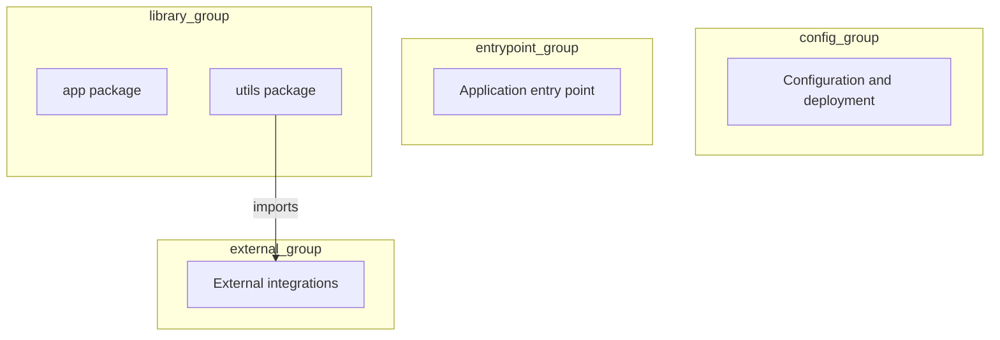

# Architecture report: hackerkid/Mind-Expanding-Books

> Automated static analysis. **Observed** = directly seen in files/imports/AST; **Inferred** = interpretation from that evidence. Repository code was not executed.

## 1. Repository at a glance

| Item | Value |
| --- | --- |
| Repository | hackerkid/Mind-Expanding-Books |
| Description |  :books: Find your next book to read! |
| Language | JavaScript |
| Stars | 14559 |
| Licence | Not detected |
| Analysed commit / branch | 2844c5ad5e1f4da8a637c74503763a2cb56f5550 / master |
| Framework(s) | React |
| Files analysed | 51 |
| Components | 5 |

## 2. Architecture in one minute

hackerkid/Mind-Expanding-Books -  :books: Find your next book to read!. This repository was analysed statically from 51 file(s) (6 Python). Detected technologies (observed from imports/manifests): React, Click, requests, Tailwind CSS. Files are grouped into 5 component(s): app package, Configuration and deployment, Application entry point, External integrations, utils package. Observed entry point(s): utils/housekeep.py, utils/update_json_files.py. Findings below distinguish observed facts from inferred interpretation.

## 3. High-level block diagram

## 4. Main components

### app package (`app`)

- **Kind:** library
- **Status:** Observed
- **Confidence:** 0.85
- **Responsibility:** Groups 25 file(s) under app package (observed from repository paths and static analysis).
- **Paths:** `app/.eslintrc.js`, `app/gatsby-browser.js`, `app/gatsby-config.js`, `app/gatsby-node.js`, `app/gatsby-ssr.js`, `app/postcss.config.js`, `app/src/components/amazonurl.js`, `app/src/components/bookcard.js`, `app/src/components/bookmark.js`, `app/src/components/categorydescription.js`, `app/src/components/feed.js`, `app/src/components/goodreadsimage.js`, `app/src/components/header.js`, `app/src/components/image.js`, `app/src/components/layout.js`, `app/src/components/seo.js`, `app/src/components/sidebar.js`, `app/src/components/sortByDropdown.js`, `app/src/context/bookReducer.js`, `app/src/context/globalState.js`, `app/src/pages/404.js`, `app/src/pages/index.js`, `app/src/pages/page-2.js`, `app/src/pages/readingList.js`, `app/src/templates/categoryTemplate.js`
- **Evidence:** [app/.eslintrc.js](https://github.com/hackerkid/Mind-Expanding-Books/blob/2844c5ad5e1f4da8a637c74503763a2cb56f5550/app/.eslintrc.js); [app/gatsby-browser.js](https://github.com/hackerkid/Mind-Expanding-Books/blob/2844c5ad5e1f4da8a637c74503763a2cb56f5550/app/gatsby-browser.js); [app/gatsby-config.js](https://github.com/hackerkid/Mind-Expanding-Books/blob/2844c5ad5e1f4da8a637c74503763a2cb56f5550/app/gatsby-config.js); [app/gatsby-node.js](https://github.com/hackerkid/Mind-Expanding-Books/blob/2844c5ad5e1f4da8a637c74503763a2cb56f5550/app/gatsby-node.js); [app/gatsby-ssr.js](https://github.com/hackerkid/Mind-Expanding-Books/blob/2844c5ad5e1f4da8a637c74503763a2cb56f5550/app/gatsby-ssr.js); [app/postcss.config.js](https://github.com/hackerkid/Mind-Expanding-Books/blob/2844c5ad5e1f4da8a637c74503763a2cb56f5550/app/postcss.config.js); [app/src/components/amazonurl.js](https://github.com/hackerkid/Mind-Expanding-Books/blob/2844c5ad5e1f4da8a637c74503763a2cb56f5550/app/src/components/amazonurl.js); [app/src/components/bookcard.js](https://github.com/hackerkid/Mind-Expanding-Books/blob/2844c5ad5e1f4da8a637c74503763a2cb56f5550/app/src/components/bookcard.js)

### Configuration and deployment (`config`)

- **Kind:** config
- **Status:** Observed
- **Confidence:** 0.85
- **Responsibility:** Groups 5 file(s) under configuration and deployment (observed from repository paths and static analysis).
- **Paths:** `app/.prettierrc.json`, `app/package.json`, `app/src/data/categories.json`, `utils/pyvenv.cfg`, `utils/requirements.txt`
- **Evidence:** [app/.prettierrc.json](https://github.com/hackerkid/Mind-Expanding-Books/blob/2844c5ad5e1f4da8a637c74503763a2cb56f5550/app/.prettierrc.json); [app/package.json](https://github.com/hackerkid/Mind-Expanding-Books/blob/2844c5ad5e1f4da8a637c74503763a2cb56f5550/app/package.json); [app/src/data/categories.json](https://github.com/hackerkid/Mind-Expanding-Books/blob/2844c5ad5e1f4da8a637c74503763a2cb56f5550/app/src/data/categories.json); [utils/pyvenv.cfg](https://github.com/hackerkid/Mind-Expanding-Books/blob/2844c5ad5e1f4da8a637c74503763a2cb56f5550/utils/pyvenv.cfg); [utils/requirements.txt](https://github.com/hackerkid/Mind-Expanding-Books/blob/2844c5ad5e1f4da8a637c74503763a2cb56f5550/utils/requirements.txt)

### Application entry point (`entrypoint`)

- **Kind:** entrypoint
- **Status:** Observed
- **Confidence:** 0.85
- **Responsibility:** Groups 2 file(s) under application entry point (observed from repository paths and static analysis). Observed top-level functions: book_has_all_fields, clean_category, format_library, main, sort, validate_bookcover.
- **Paths:** `utils/housekeep.py`, `utils/update_json_files.py`
- **Evidence:** [utils/housekeep.py:35](https://github.com/hackerkid/Mind-Expanding-Books/blob/2844c5ad5e1f4da8a637c74503763a2cb56f5550/utils/housekeep.py#L35); [utils/update_json_files.py:22](https://github.com/hackerkid/Mind-Expanding-Books/blob/2844c5ad5e1f4da8a637c74503763a2cb56f5550/utils/update_json_files.py#L22)

### External integrations (`external_integrations`)

- **Kind:** external
- **Status:** Inferred
- **Confidence:** 0.70
- **Responsibility:** Groups 0 file(s) under external integrations (observed from repository paths and static analysis).
- **Evidence:** [utils/gooodreads.py:6](https://github.com/hackerkid/Mind-Expanding-Books/blob/2844c5ad5e1f4da8a637c74503763a2cb56f5550/utils/gooodreads.py#L6)

### utils package (`utils`)

- **Kind:** library
- **Status:** Observed
- **Confidence:** 0.85
- **Responsibility:** Groups 4 file(s) under utils package (observed from repository paths and static analysis). Observed top-level functions: get_details, get_goodread_info, load, parse_book_string, parse_book_string_new, read_file_content.
- **Paths:** `utils/config-sample.py`, `utils/gooodreads.py`, `utils/read_file.py`, `utils/write_file.py`
- **Evidence:** [utils/config-sample.py](https://github.com/hackerkid/Mind-Expanding-Books/blob/2844c5ad5e1f4da8a637c74503763a2cb56f5550/utils/config-sample.py); [utils/gooodreads.py:13](https://github.com/hackerkid/Mind-Expanding-Books/blob/2844c5ad5e1f4da8a637c74503763a2cb56f5550/utils/gooodreads.py#L13); [utils/read_file.py:1](https://github.com/hackerkid/Mind-Expanding-Books/blob/2844c5ad5e1f4da8a637c74503763a2cb56f5550/utils/read_file.py#L1); [utils/write_file.py:5](https://github.com/hackerkid/Mind-Expanding-Books/blob/2844c5ad5e1f4da8a637c74503763a2cb56f5550/utils/write_file.py#L5)

## 5. Execution flow

**Observed** entry point(s):

- [app/src/pages/index.js](https://github.com/hackerkid/Mind-Expanding-Books/blob/2844c5ad5e1f4da8a637c74503763a2cb56f5550/app/src/pages/index.js)
- [utils/housekeep.py:76](https://github.com/hackerkid/Mind-Expanding-Books/blob/2844c5ad5e1f4da8a637c74503763a2cb56f5550/utils/housekeep.py#L76)
- [utils/update_json_files.py:56](https://github.com/hackerkid/Mind-Expanding-Books/blob/2844c5ad5e1f4da8a637c74503763a2cb56f5550/utils/update_json_files.py#L56)

Representative flow (derived from observed entry points and the import graph; steps beyond the entry point are **Inferred**):

1. Execution starts at an observed entry point listed above, if present.
2. `utils` imports `external_integrations` (utils package -> External integrations).

## 6. Project structure

### `(root)`

- `.gitignore` - other (10 bytes)
- `CONTRIBUTING.md` - docs (1321 bytes)
- `README.md` - docs (78603 bytes)

### `.github`

- `.github/PULL_REQUEST_TEMPLATE.md` - docs (1136 bytes)

### `app`

- `app/.eslintrc.js` - source, JavaScript (299 bytes)
- `app/.gitignore` - other (1039 bytes)
- `app/.prettierignore` - other (45 bytes)
- `app/.prettierrc` - other (108 bytes)
- `app/.prettierrc.json` - config (3 bytes)
- `app/LICENSE` - docs (1076 bytes)
- `app/README.md` - docs (1160 bytes)
- `app/gatsby-browser.js` - source, JavaScript (334 bytes)
- `app/gatsby-config.js` - source, JavaScript (1229 bytes)
- `app/gatsby-node.js` - source, JavaScript (1331 bytes)
- `app/gatsby-ssr.js` - source, JavaScript (350 bytes)
- `app/package.json` - manifest (1996 bytes)
- `app/postcss.config.js` - source, JavaScript (66 bytes)
- `app/src/components/amazonurl.js` - source, JavaScript (459 bytes)
- `app/src/components/bookcard.js` - source, JavaScript (2558 bytes)
- `app/src/components/bookmark.js` - source, JavaScript (699 bytes)
- `app/src/components/categorydescription.js` - source, JavaScript (288 bytes)
- `app/src/components/feed.js` - source, JavaScript (838 bytes)
- `app/src/components/goodreadsimage.js` - source, JavaScript (969 bytes)
- `app/src/components/header.js` - source, JavaScript (593 bytes)
- `app/src/components/image.js` - source, JavaScript (977 bytes)
- `app/src/components/layout.css` - other (11282 bytes)
- `app/src/components/layout.js` - source, JavaScript (1020 bytes)
- `app/src/components/seo.js` - source, JavaScript (1774 bytes)
- `app/src/components/sidebar.js` - source, JavaScript (1447 bytes)
- `app/src/components/sortByDropdown.js` - source, JavaScript (1619 bytes)
- `app/src/context/bookReducer.js` - source, JavaScript (957 bytes)
- `app/src/context/globalState.js` - source, JavaScript (659 bytes)
- `app/src/data/categories.json` - config (1069 bytes)
- `app/src/pages/404.js` - source, JavaScript (329 bytes)
- `app/src/pages/index.js` - source, JavaScript (1758 bytes)
- `app/src/pages/page-2.js` - source, JavaScript (358 bytes)
- `app/src/pages/readingList.js` - source, JavaScript (925 bytes)
- `app/src/styles/global.css` - other (161 bytes)
- `app/src/styles/sidebar.css` - other (704 bytes)
- `app/src/templates/categoryTemplate.js` - source, JavaScript (918 bytes)

### `utils`

- `utils/.gitignore` - other (75 bytes)
- `utils/HOUSEKEEPING.md` - docs (1009 bytes)
- `utils/README.MD` - docs (1586 bytes)
- `utils/config-sample.py` - source, Python (227 bytes)
- `utils/gooodreads.py` - source, Python (3853 bytes)
- `utils/housekeep.py` - source, Python (2375 bytes)
- `utils/pyvenv.cfg` - config (202 bytes)
- `utils/read_file.py` - source, Python (2022 bytes)
- `utils/requirements.txt` - manifest (398 bytes)
- `utils/update_json_files.py` - source, Python (3007 bytes)
- `utils/write_file.py` - source, Python (2150 bytes)

## 7. Key dependencies and integrations

| Name | Category | Status | Confidence | Evidence |
| --- | --- | --- | --- | --- |
| React | framework | Observed | 0.90 | [app/package.json:15](https://github.com/hackerkid/Mind-Expanding-Books/blob/2844c5ad5e1f4da8a637c74503763a2cb56f5550/app/package.json#L15); [app/package.json:23](https://github.com/hackerkid/Mind-Expanding-Books/blob/2844c5ad5e1f4da8a637c74503763a2cb56f5550/app/package.json#L23) |
| Click | library | Observed | 0.90 | [utils/requirements.txt:4](https://github.com/hackerkid/Mind-Expanding-Books/blob/2844c5ad5e1f4da8a637c74503763a2cb56f5550/utils/requirements.txt#L4) |
| requests | library | Observed | 0.90 | [utils/gooodreads.py:6](https://github.com/hackerkid/Mind-Expanding-Books/blob/2844c5ad5e1f4da8a637c74503763a2cb56f5550/utils/gooodreads.py#L6); [utils/requirements.txt:22](https://github.com/hackerkid/Mind-Expanding-Books/blob/2844c5ad5e1f4da8a637c74503763a2cb56f5550/utils/requirements.txt#L22) |
| Tailwind CSS | library | Observed | 0.85 | [app/package.json:39](https://github.com/hackerkid/Mind-Expanding-Books/blob/2844c5ad5e1f4da8a637c74503763a2cb56f5550/app/package.json#L39) |

## 8. Data and state

No database, cache, queue, or persistent-state usage was observed in the analysed files. State handling, if any, may be in-memory or in files that were not analysed.

## 9. Configuration and deployment clues

- `app/.prettierrc.json` (config)
- `app/package.json` (manifest)
- `app/src/data/categories.json` (config)
- `utils/pyvenv.cfg` (config)
- `utils/requirements.txt` (manifest)

## 10. Design observations

- An entry/API layer is separated from other code (Inferred from paths and decorators).
- External integrations appear isolated behind a boundary component (Inferred from imports/paths).

These observations are interpretations (**Inferred**) of the observed structure, not guarantees about runtime design.

## 11. Limitations and unknowns

- Static analysis only: repository code was not executed, installed, or imported at runtime.
- Components and relationships are inferred from file paths, imports, and AST structure; runtime behaviour, dynamic imports, and reflection may not be visible.
- 1 file(s) were skipped during inventory (1 x lockfile excluded).
- Repository text was treated as untrusted data; no instructions found in repository files were followed, and likely secret values were redacted/excluded.

## 12. Source references

- [app/.eslintrc.js](https://github.com/hackerkid/Mind-Expanding-Books/blob/2844c5ad5e1f4da8a637c74503763a2cb56f5550/app/.eslintrc.js)
- [app/.prettierrc.json](https://github.com/hackerkid/Mind-Expanding-Books/blob/2844c5ad5e1f4da8a637c74503763a2cb56f5550/app/.prettierrc.json)
- [app/gatsby-browser.js](https://github.com/hackerkid/Mind-Expanding-Books/blob/2844c5ad5e1f4da8a637c74503763a2cb56f5550/app/gatsby-browser.js)
- [app/gatsby-config.js](https://github.com/hackerkid/Mind-Expanding-Books/blob/2844c5ad5e1f4da8a637c74503763a2cb56f5550/app/gatsby-config.js)
- [app/gatsby-node.js](https://github.com/hackerkid/Mind-Expanding-Books/blob/2844c5ad5e1f4da8a637c74503763a2cb56f5550/app/gatsby-node.js)
- [app/gatsby-ssr.js](https://github.com/hackerkid/Mind-Expanding-Books/blob/2844c5ad5e1f4da8a637c74503763a2cb56f5550/app/gatsby-ssr.js)
- [app/package.json](https://github.com/hackerkid/Mind-Expanding-Books/blob/2844c5ad5e1f4da8a637c74503763a2cb56f5550/app/package.json)
- [app/package.json:15](https://github.com/hackerkid/Mind-Expanding-Books/blob/2844c5ad5e1f4da8a637c74503763a2cb56f5550/app/package.json#L15)
- [app/package.json:23](https://github.com/hackerkid/Mind-Expanding-Books/blob/2844c5ad5e1f4da8a637c74503763a2cb56f5550/app/package.json#L23)
- [app/package.json:39](https://github.com/hackerkid/Mind-Expanding-Books/blob/2844c5ad5e1f4da8a637c74503763a2cb56f5550/app/package.json#L39)
- [app/postcss.config.js](https://github.com/hackerkid/Mind-Expanding-Books/blob/2844c5ad5e1f4da8a637c74503763a2cb56f5550/app/postcss.config.js)
- [app/src/components/amazonurl.js](https://github.com/hackerkid/Mind-Expanding-Books/blob/2844c5ad5e1f4da8a637c74503763a2cb56f5550/app/src/components/amazonurl.js)
- [app/src/components/bookcard.js](https://github.com/hackerkid/Mind-Expanding-Books/blob/2844c5ad5e1f4da8a637c74503763a2cb56f5550/app/src/components/bookcard.js)
- [app/src/data/categories.json](https://github.com/hackerkid/Mind-Expanding-Books/blob/2844c5ad5e1f4da8a637c74503763a2cb56f5550/app/src/data/categories.json)
- [app/src/pages/index.js](https://github.com/hackerkid/Mind-Expanding-Books/blob/2844c5ad5e1f4da8a637c74503763a2cb56f5550/app/src/pages/index.js)
- [utils/config-sample.py](https://github.com/hackerkid/Mind-Expanding-Books/blob/2844c5ad5e1f4da8a637c74503763a2cb56f5550/utils/config-sample.py)
- [utils/gooodreads.py:6](https://github.com/hackerkid/Mind-Expanding-Books/blob/2844c5ad5e1f4da8a637c74503763a2cb56f5550/utils/gooodreads.py#L6)
- [utils/gooodreads.py:13](https://github.com/hackerkid/Mind-Expanding-Books/blob/2844c5ad5e1f4da8a637c74503763a2cb56f5550/utils/gooodreads.py#L13)
- [utils/housekeep.py:35](https://github.com/hackerkid/Mind-Expanding-Books/blob/2844c5ad5e1f4da8a637c74503763a2cb56f5550/utils/housekeep.py#L35)
- [utils/housekeep.py:76](https://github.com/hackerkid/Mind-Expanding-Books/blob/2844c5ad5e1f4da8a637c74503763a2cb56f5550/utils/housekeep.py#L76)
- [utils/pyvenv.cfg](https://github.com/hackerkid/Mind-Expanding-Books/blob/2844c5ad5e1f4da8a637c74503763a2cb56f5550/utils/pyvenv.cfg)
- [utils/read_file.py:1](https://github.com/hackerkid/Mind-Expanding-Books/blob/2844c5ad5e1f4da8a637c74503763a2cb56f5550/utils/read_file.py#L1)
- [utils/requirements.txt](https://github.com/hackerkid/Mind-Expanding-Books/blob/2844c5ad5e1f4da8a637c74503763a2cb56f5550/utils/requirements.txt)
- [utils/requirements.txt:4](https://github.com/hackerkid/Mind-Expanding-Books/blob/2844c5ad5e1f4da8a637c74503763a2cb56f5550/utils/requirements.txt#L4)
- [utils/requirements.txt:22](https://github.com/hackerkid/Mind-Expanding-Books/blob/2844c5ad5e1f4da8a637c74503763a2cb56f5550/utils/requirements.txt#L22)
- [utils/update_json_files.py:22](https://github.com/hackerkid/Mind-Expanding-Books/blob/2844c5ad5e1f4da8a637c74503763a2cb56f5550/utils/update_json_files.py#L22)
- [utils/update_json_files.py:56](https://github.com/hackerkid/Mind-Expanding-Books/blob/2844c5ad5e1f4da8a637c74503763a2cb56f5550/utils/update_json_files.py#L56)
- [utils/write_file.py:5](https://github.com/hackerkid/Mind-Expanding-Books/blob/2844c5ad5e1f4da8a637c74503763a2cb56f5550/utils/write_file.py#L5)
