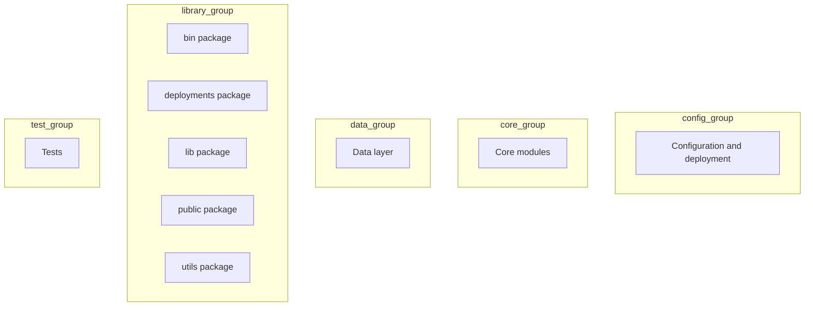

# Architecture report: hackmdio/codimd

> Automated static analysis. **Observed** = directly seen in files/imports/AST; **Inferred** = interpretation from that evidence. Repository code was not executed.

## 1. Repository at a glance

| Item | Value |
| --- | --- |
| Repository | hackmdio/codimd |
| Description | CodiMD - Realtime collaborative markdown notes on all platforms. |
| Language | JavaScript |
| Stars | 10163 |
| Licence | AGPL-3.0 |
| Analysed commit / branch | b1188a5648a23d970b9ad58612376e6602431f6f / develop |
| Framework(s) | Express |
| Files analysed | 302 |
| Components | 9 |

## 2. Architecture in one minute

hackmdio/codimd - CodiMD - Realtime collaborative markdown notes on all platforms.. This repository was analysed statically from 302 file(s) (0 Python). Detected technologies (observed from imports/manifests): GitHub Actions, MySQL, PostgreSQL, Express, Docker, Docker Compose. Files are grouped into 9 component(s): bin package, Configuration and deployment, Core modules, Data layer, deployments package, lib package, public package, Tests. Findings below distinguish observed facts from inferred interpretation.

## 3. High-level block diagram

## 4. Main components

### bin package (`bin`)

- **Kind:** library
- **Status:** Observed
- **Confidence:** 0.85
- **Responsibility:** Groups 1 file(s) under bin package (observed from repository paths and static analysis).
- **Paths:** `bin/heroku_start.sh`
- **Evidence:** [bin/heroku_start.sh](https://github.com/hackmdio/codimd/blob/b1188a5648a23d970b9ad58612376e6602431f6f/bin/heroku_start.sh)

### Configuration and deployment (`config`)

- **Kind:** config
- **Status:** Observed
- **Confidence:** 0.85
- **Responsibility:** Groups 38 file(s) under configuration and deployment (observed from repository paths and static analysis).
- **Paths:** `FUNDING.json`, `app.json`, `deployments/Dockerfile`, `deployments/docker-compose.yml`, `lib/config/default.js`, `lib/config/defaultSSL.js`, `lib/config/dockerSecret.js`, `lib/config/enum.js`, `lib/config/environment.js`, `lib/config/index.js`, `lib/config/utils.js`, `locales/ca.json`, `locales/da.json`, `locales/de.json`, `locales/el.json`, `locales/en.json`, `locales/eo.json`, `locales/es.json`, `locales/fr.json`, `locales/hi.json`, `locales/hr.json`, `locales/id.json`, `locales/it.json`, `locales/ja.json`, `locales/ko.json`, `locales/nl.json`, `locales/pl.json`, `locales/pt.json`, `locales/ru.json`, `locales/sr.json`, `locales/sv.json`, `locales/tr.json`, `locales/uk.json`, `locales/zh-CN.json`, `locales/zh-TW.json`, `package.json`, `public/js/lib/config/index.js`, `scalingo.json`
- **Evidence:** [FUNDING.json](https://github.com/hackmdio/codimd/blob/b1188a5648a23d970b9ad58612376e6602431f6f/FUNDING.json); [app.json](https://github.com/hackmdio/codimd/blob/b1188a5648a23d970b9ad58612376e6602431f6f/app.json); [deployments/Dockerfile](https://github.com/hackmdio/codimd/blob/b1188a5648a23d970b9ad58612376e6602431f6f/deployments/Dockerfile); [deployments/docker-compose.yml](https://github.com/hackmdio/codimd/blob/b1188a5648a23d970b9ad58612376e6602431f6f/deployments/docker-compose.yml); [lib/config/default.js](https://github.com/hackmdio/codimd/blob/b1188a5648a23d970b9ad58612376e6602431f6f/lib/config/default.js); [lib/config/defaultSSL.js](https://github.com/hackmdio/codimd/blob/b1188a5648a23d970b9ad58612376e6602431f6f/lib/config/defaultSSL.js); [lib/config/dockerSecret.js](https://github.com/hackmdio/codimd/blob/b1188a5648a23d970b9ad58612376e6602431f6f/lib/config/dockerSecret.js); [lib/config/enum.js](https://github.com/hackmdio/codimd/blob/b1188a5648a23d970b9ad58612376e6602431f6f/lib/config/enum.js)

### Core modules (`core`)

- **Kind:** core
- **Status:** Observed
- **Confidence:** 0.85
- **Responsibility:** Groups 7 file(s) under core modules (observed from repository paths and static analysis).
- **Paths:** `app.js`, `babel.config.js`, `config.js`, `webpack.common.js`, `webpack.dev.js`, `webpack.htmlexport.js`, `webpack.prod.js`
- **Evidence:** [app.js](https://github.com/hackmdio/codimd/blob/b1188a5648a23d970b9ad58612376e6602431f6f/app.js); [babel.config.js](https://github.com/hackmdio/codimd/blob/b1188a5648a23d970b9ad58612376e6602431f6f/babel.config.js); [config.js](https://github.com/hackmdio/codimd/blob/b1188a5648a23d970b9ad58612376e6602431f6f/config.js); [webpack.common.js](https://github.com/hackmdio/codimd/blob/b1188a5648a23d970b9ad58612376e6602431f6f/webpack.common.js); [webpack.dev.js](https://github.com/hackmdio/codimd/blob/b1188a5648a23d970b9ad58612376e6602431f6f/webpack.dev.js); [webpack.htmlexport.js](https://github.com/hackmdio/codimd/blob/b1188a5648a23d970b9ad58612376e6602431f6f/webpack.htmlexport.js); [webpack.prod.js](https://github.com/hackmdio/codimd/blob/b1188a5648a23d970b9ad58612376e6602431f6f/webpack.prod.js)

### Data layer (`data_layer`)

- **Kind:** data
- **Status:** Observed
- **Confidence:** 0.85
- **Responsibility:** Groups 5 file(s) under data layer (observed from repository paths and static analysis).
- **Paths:** `lib/models/author.js`, `lib/models/index.js`, `lib/models/note.js`, `lib/models/revision.js`, `lib/models/user.js`
- **Evidence:** [lib/models/author.js](https://github.com/hackmdio/codimd/blob/b1188a5648a23d970b9ad58612376e6602431f6f/lib/models/author.js); [lib/models/index.js](https://github.com/hackmdio/codimd/blob/b1188a5648a23d970b9ad58612376e6602431f6f/lib/models/index.js); [lib/models/note.js](https://github.com/hackmdio/codimd/blob/b1188a5648a23d970b9ad58612376e6602431f6f/lib/models/note.js); [lib/models/revision.js](https://github.com/hackmdio/codimd/blob/b1188a5648a23d970b9ad58612376e6602431f6f/lib/models/revision.js); [lib/models/user.js](https://github.com/hackmdio/codimd/blob/b1188a5648a23d970b9ad58612376e6602431f6f/lib/models/user.js)

### deployments package (`deployments`)

- **Kind:** library
- **Status:** Observed
- **Confidence:** 0.85
- **Responsibility:** Groups 2 file(s) under deployments package (observed from repository paths and static analysis).
- **Paths:** `deployments/build.sh`, `deployments/docker-entrypoint.sh`
- **Evidence:** [deployments/build.sh](https://github.com/hackmdio/codimd/blob/b1188a5648a23d970b9ad58612376e6602431f6f/deployments/build.sh); [deployments/docker-entrypoint.sh](https://github.com/hackmdio/codimd/blob/b1188a5648a23d970b9ad58612376e6602431f6f/deployments/docker-entrypoint.sh)

### lib package (`lib`)

- **Kind:** library
- **Status:** Observed
- **Confidence:** 0.85
- **Responsibility:** Groups 76 file(s) under lib package (observed from repository paths and static analysis).
- **Paths:** `lib/auth/bitbucket/index.js`, `lib/auth/dropbox/index.js`, `lib/auth/email/index.js`, `lib/auth/facebook/index.js`, `lib/auth/github/index.js`, `lib/auth/gitlab/index.js`, `lib/auth/google/index.js`, `lib/auth/index.js`, `lib/auth/ldap/index.js`, `lib/auth/mattermost/index.js`, `lib/auth/oauth2/index.js`, `lib/auth/oauth2/strategy.js`, `lib/auth/openid/index.js`, `lib/auth/saml/index.js`, `lib/auth/twitter/index.js`, `lib/auth/utils.js`, `lib/csp.js`, `lib/errorPage/index.js`, `lib/history/index.js`, `lib/homepage/index.js`, `lib/imageRouter/azure.js`, `lib/imageRouter/filesystem.js`, `lib/imageRouter/imgur.js`, `lib/imageRouter/index.js`, `lib/imageRouter/lutim.js`, `lib/imageRouter/minio.js`, `lib/imageRouter/s3.js`, `lib/letter-avatars.js`, `lib/logger.js`, `lib/metrics.js`, `lib/middleware/checkURIValid.js`, `lib/middleware/codiMDVersion.js`, `lib/middleware/redirectWithoutTrailingSlashes.js`, `lib/middleware/tooBusy.js`, `lib/migrations/20150504155329-create-users.js`, `lib/migrations/20150508114741-create-notes.js`, `lib/migrations/20150515125813-create-temp.js`, `lib/migrations/20150702001020-update-to-0_3_1.js`, `lib/migrations/20150915153700-change-notes-title-to-text.js`, `lib/migrations/20160112220142-note-add-lastchange.js`, `lib/migrations/20160420180355-note-add-alias.js`, `lib/migrations/20160515114000-user-add-tokens.js`, `lib/migrations/20160607060246-support-revision.js`, `lib/migrations/20160703062241-support-authorship.js`, `lib/migrations/20161009040430-support-delete-note.js`, `lib/migrations/20161201050312-support-email-signin.js`, `lib/migrations/20171009121200-longtext-for-mysql.js`, `lib/migrations/20180209120907-longtext-of-authorship.js`, `lib/migrations/20180306150303-fix-enum.js`, `lib/migrations/20180326103000-use-text-in-tokens.js`, `lib/migrations/20180525153000-user-add-delete-token.js`, `lib/migrations/20200104215332-remove-temp-table.js`, `lib/migrations/20240114120250-revision-add-index.js`, `lib/note/index.js`, `lib/note/noteActions.js`, `lib/ot/client.js`, `lib/ot/editor-socketio-server.js`, `lib/ot/index.js`, `lib/ot/selection.js`, `lib/ot/server.js`, `lib/ot/simple-text-operation.js`, `lib/ot/text-operation.js`, `lib/ot/wrapped-operation.js`, `lib/realtime/processQueue.js`, `lib/realtime/realtime.js`, `lib/realtime/realtimeCleanDanglingUserJob.js`, `lib/realtime/realtimeClientConnection.js`, `lib/realtime/realtimeSaveRevisionJob.js`, `lib/realtime/realtimeUpdateDirtyNoteJob.js`, `lib/response.js`, `lib/routes.js`, `lib/status/index.js`, `lib/user/index.js`, `lib/utils.js`, `lib/web/middleware/checkVersion.js`, `lib/workers/dmpWorker.js`
- **Evidence:** [lib/auth/bitbucket/index.js](https://github.com/hackmdio/codimd/blob/b1188a5648a23d970b9ad58612376e6602431f6f/lib/auth/bitbucket/index.js); [lib/auth/dropbox/index.js](https://github.com/hackmdio/codimd/blob/b1188a5648a23d970b9ad58612376e6602431f6f/lib/auth/dropbox/index.js); [lib/auth/email/index.js](https://github.com/hackmdio/codimd/blob/b1188a5648a23d970b9ad58612376e6602431f6f/lib/auth/email/index.js); [lib/auth/facebook/index.js](https://github.com/hackmdio/codimd/blob/b1188a5648a23d970b9ad58612376e6602431f6f/lib/auth/facebook/index.js); [lib/auth/github/index.js](https://github.com/hackmdio/codimd/blob/b1188a5648a23d970b9ad58612376e6602431f6f/lib/auth/github/index.js); [lib/auth/gitlab/index.js](https://github.com/hackmdio/codimd/blob/b1188a5648a23d970b9ad58612376e6602431f6f/lib/auth/gitlab/index.js); [lib/auth/google/index.js](https://github.com/hackmdio/codimd/blob/b1188a5648a23d970b9ad58612376e6602431f6f/lib/auth/google/index.js); [lib/auth/index.js](https://github.com/hackmdio/codimd/blob/b1188a5648a23d970b9ad58612376e6602431f6f/lib/auth/index.js)

### public package (`public`)

- **Kind:** library
- **Status:** Observed
- **Confidence:** 0.85
- **Responsibility:** Groups 31 file(s) under public package (observed from repository paths and static analysis).
- **Paths:** `public/.eslintrc.js`, `public/js/cover.js`, `public/js/extra.js`, `public/js/history.js`, `public/js/htmlExport.js`, `public/js/index.js`, `public/js/lib/appState.js`, `public/js/lib/common/login.js`, `public/js/lib/editor/config.js`, `public/js/lib/editor/constants.js`, `public/js/lib/editor/index.js`, `public/js/lib/editor/markdown-lint/index.js`, `public/js/lib/editor/spellcheck.js`, `public/js/lib/editor/table-editor.js`, `public/js/lib/editor/ui-elements.js`, `public/js/lib/editor/utils.js`, `public/js/lib/markdown/utils.js`, `public/js/lib/modeType.js`, `public/js/lib/renderer/csvpreview.js`, `public/js/lib/renderer/fretboard/fretboard.js`, `public/js/lib/renderer/lightbox/index.js`, `public/js/lib/syncscroll.js`, `public/js/locale.js`, `public/js/mathjax-config-extra.js`, `public/js/pretty.js`, `public/js/render.js`, `public/js/reveal-markdown.js`, `public/js/revealjs-plugins/elapsed-time-bar/elapsed-time-bar.js`, `public/js/revealjs-plugins/spotlight/spotlight.js`, `public/js/slide.js`, `public/js/utils.js`
- **Evidence:** [public/.eslintrc.js](https://github.com/hackmdio/codimd/blob/b1188a5648a23d970b9ad58612376e6602431f6f/public/.eslintrc.js); [public/js/cover.js](https://github.com/hackmdio/codimd/blob/b1188a5648a23d970b9ad58612376e6602431f6f/public/js/cover.js); [public/js/extra.js](https://github.com/hackmdio/codimd/blob/b1188a5648a23d970b9ad58612376e6602431f6f/public/js/extra.js); [public/js/history.js](https://github.com/hackmdio/codimd/blob/b1188a5648a23d970b9ad58612376e6602431f6f/public/js/history.js); [public/js/htmlExport.js](https://github.com/hackmdio/codimd/blob/b1188a5648a23d970b9ad58612376e6602431f6f/public/js/htmlExport.js); [public/js/index.js](https://github.com/hackmdio/codimd/blob/b1188a5648a23d970b9ad58612376e6602431f6f/public/js/index.js); [public/js/lib/appState.js](https://github.com/hackmdio/codimd/blob/b1188a5648a23d970b9ad58612376e6602431f6f/public/js/lib/appState.js); [public/js/lib/common/login.js](https://github.com/hackmdio/codimd/blob/b1188a5648a23d970b9ad58612376e6602431f6f/public/js/lib/common/login.js)

### Tests (`tests`)

- **Kind:** test
- **Status:** Observed
- **Confidence:** 0.85
- **Responsibility:** Groups 22 file(s) under tests (observed from repository paths and static analysis).
- **Paths:** `.github/tests/README.md`, `.github/tests/pull-request.json`, `test/auth/oauth2/strategy.test.js`, `test/connectionQueue.test.js`, `test/csp.js`, `test/letter-avatars.js`, `test/realtime/cleanDanglingUser.test.js`, `test/realtime/connection.test.js`, `test/realtime/dirtyNoteUpdate.test.js`, `test/realtime/disconnect-process.test.js`, `test/realtime/extractNoteIdFromSocket.test.js`, `test/realtime/ifMayEdit.test.js`, `test/realtime/parseNoteIdFromSocket.test.js`, `test/realtime/realtime.test.js`, `test/realtime/saveRevisionJob.test.js`, `test/realtime/socket-events.test.js`, `test/realtime/updateNote.test.js`, `test/realtime/utils.js`, `test/testDoubles/ProcessQueueFake.js`, `test/testDoubles/loggerFake.js`, `test/testDoubles/otFake.js`, `test/testDoubles/realtimeJobStub.js`
- **Evidence:** [.github/tests/README.md](https://github.com/hackmdio/codimd/blob/b1188a5648a23d970b9ad58612376e6602431f6f/.github/tests/README.md); [.github/tests/pull-request.json](https://github.com/hackmdio/codimd/blob/b1188a5648a23d970b9ad58612376e6602431f6f/.github/tests/pull-request.json); [test/auth/oauth2/strategy.test.js](https://github.com/hackmdio/codimd/blob/b1188a5648a23d970b9ad58612376e6602431f6f/test/auth/oauth2/strategy.test.js); [test/connectionQueue.test.js](https://github.com/hackmdio/codimd/blob/b1188a5648a23d970b9ad58612376e6602431f6f/test/connectionQueue.test.js); [test/csp.js](https://github.com/hackmdio/codimd/blob/b1188a5648a23d970b9ad58612376e6602431f6f/test/csp.js); [test/letter-avatars.js](https://github.com/hackmdio/codimd/blob/b1188a5648a23d970b9ad58612376e6602431f6f/test/letter-avatars.js); [test/realtime/cleanDanglingUser.test.js](https://github.com/hackmdio/codimd/blob/b1188a5648a23d970b9ad58612376e6602431f6f/test/realtime/cleanDanglingUser.test.js); [test/realtime/connection.test.js](https://github.com/hackmdio/codimd/blob/b1188a5648a23d970b9ad58612376e6602431f6f/test/realtime/connection.test.js)

### utils package (`utils`)

- **Kind:** library
- **Status:** Observed
- **Confidence:** 0.85
- **Responsibility:** Groups 1 file(s) under utils package (observed from repository paths and static analysis).
- **Paths:** `utils/string.js`
- **Evidence:** [utils/string.js](https://github.com/hackmdio/codimd/blob/b1188a5648a23d970b9ad58612376e6602431f6f/utils/string.js)

## 5. Execution flow

**Observed** entry point(s):

- [app.js](https://github.com/hackmdio/codimd/blob/b1188a5648a23d970b9ad58612376e6602431f6f/app.js)
- [lib/auth/bitbucket/index.js](https://github.com/hackmdio/codimd/blob/b1188a5648a23d970b9ad58612376e6602431f6f/lib/auth/bitbucket/index.js)
- [lib/auth/dropbox/index.js](https://github.com/hackmdio/codimd/blob/b1188a5648a23d970b9ad58612376e6602431f6f/lib/auth/dropbox/index.js)
- [lib/auth/email/index.js](https://github.com/hackmdio/codimd/blob/b1188a5648a23d970b9ad58612376e6602431f6f/lib/auth/email/index.js)
- [lib/auth/facebook/index.js](https://github.com/hackmdio/codimd/blob/b1188a5648a23d970b9ad58612376e6602431f6f/lib/auth/facebook/index.js)
- [lib/auth/github/index.js](https://github.com/hackmdio/codimd/blob/b1188a5648a23d970b9ad58612376e6602431f6f/lib/auth/github/index.js)
- [lib/auth/gitlab/index.js](https://github.com/hackmdio/codimd/blob/b1188a5648a23d970b9ad58612376e6602431f6f/lib/auth/gitlab/index.js)
- [lib/auth/google/index.js](https://github.com/hackmdio/codimd/blob/b1188a5648a23d970b9ad58612376e6602431f6f/lib/auth/google/index.js)
- [lib/auth/index.js](https://github.com/hackmdio/codimd/blob/b1188a5648a23d970b9ad58612376e6602431f6f/lib/auth/index.js)
- [lib/auth/ldap/index.js](https://github.com/hackmdio/codimd/blob/b1188a5648a23d970b9ad58612376e6602431f6f/lib/auth/ldap/index.js)
- [lib/auth/mattermost/index.js](https://github.com/hackmdio/codimd/blob/b1188a5648a23d970b9ad58612376e6602431f6f/lib/auth/mattermost/index.js)
- [lib/auth/oauth2/index.js](https://github.com/hackmdio/codimd/blob/b1188a5648a23d970b9ad58612376e6602431f6f/lib/auth/oauth2/index.js)

Representative flow (derived from observed entry points and the import graph; steps beyond the entry point are **Inferred**):

1. Execution starts at an observed entry point listed above, if present.
2. No internal import relationships between components were observed.

## 6. Project structure

### `(root)`

- `.buildpacks` - other (87 bytes)
- `.dockerignore` - container (156 bytes)
- `.editorconfig` - config (329 bytes)
- `.gitignore` - other (365 bytes)
- `.mailmap` - other (867 bytes)
- `.nvmrc` - other (9 bytes)
- `.sequelizerc.example` - other (251 bytes)
- `AUTHORS` - other (2577 bytes)
- `Aptfile` - other (12 bytes)
- `CONTRIBUTING.md` - docs (4054 bytes)
- `FUNDING.json` - config (107 bytes)
- `LICENSE` - docs (34519 bytes)
- `Procfile` - other (27 bytes)
- `README.md` - docs (6789 bytes)
- `app.js` - source, JavaScript (9744 bytes)
- `app.json` - config (5807 bytes)
- `babel.config.js` - source, JavaScript (376 bytes)
- `config.js` - source, JavaScript (67 bytes)
- `config.json.example` - other (4861 bytes)
- `package.json` - manifest (7810 bytes)
- `scalingo.json` - config (5971 bytes)
- `webpack.common.js` - source, JavaScript (20268 bytes)
- `webpack.dev.js` - source, JavaScript (371 bytes)
- `webpack.htmlexport.js` - source, JavaScript (538 bytes)
- `webpack.prod.js` - source, JavaScript (597 bytes)

### `.devcontainer`

- `.devcontainer/Dockerfile` - container (661 bytes)
- `.devcontainer/devcontainer.json` - config (1603 bytes)
- `.devcontainer/docker-compose.yml` - container (1426 bytes)

### `.github`

- `.github/tests/README.md` - test (202 bytes)
- `.github/tests/pull-request.json` - test (120 bytes)
- `.github/workflows/build.yml` - ci, YAML (1332 bytes)
- `.github/workflows/check-release.yml` - ci, YAML (1124 bytes)
- `.github/workflows/push-image.yml` - ci, YAML (3553 bytes)

### `bin`

- `bin/heroku` - other (175 bytes)
- `bin/heroku_start.sh` - source, Shell (90 bytes)
- `bin/manage_users` - other (3583 bytes)
- `bin/setup` - other (827 bytes)

### `contribute`

- `contribute/developer-certificate-of-origin` - other (1421 bytes)

### `deployments`

- `deployments/Dockerfile` - container (935 bytes)
- `deployments/build.sh` - source, Shell (527 bytes)
- `deployments/docker-compose.yml` - container (1000 bytes)
- `deployments/docker-entrypoint.sh` - source, Shell (344 bytes)

### `lib`

- `lib/auth/bitbucket/index.js` - source, JavaScript (932 bytes)
- `lib/auth/dropbox/index.js` - source, JavaScript (937 bytes)
- `lib/auth/email/index.js` - source, JavaScript (2748 bytes)
- `lib/auth/facebook/index.js` - source, JavaScript (912 bytes)
- `lib/auth/github/index.js` - source, JavaScript (2459 bytes)
- `lib/auth/gitlab/index.js` - source, JavaScript (1426 bytes)
- `lib/auth/google/index.js` - source, JavaScript (1031 bytes)
- `lib/auth/index.js` - source, JavaScript (1927 bytes)
- `lib/auth/ldap/index.js` - source, JavaScript (2957 bytes)
- `lib/auth/mattermost/index.js` - source, JavaScript (1501 bytes)
- `lib/auth/oauth2/index.js` - source, JavaScript (1067 bytes)
- `lib/auth/oauth2/strategy.js` - source, JavaScript (2613 bytes)
- `lib/auth/openid/index.js` - source, JavaScript (1781 bytes)
- `lib/auth/saml/index.js` - source, JavaScript (3317 bytes)
- `lib/auth/twitter/index.js` - source, JavaScript (908 bytes)
- `lib/auth/utils.js` - source, JavaScript (2034 bytes)
- `lib/config/default.js` - source, JavaScript (5039 bytes)
- `lib/config/defaultSSL.js` - source, JavaScript (404 bytes)
- `lib/config/dockerSecret.js` - source, JavaScript (2205 bytes)
- `lib/config/enum.js` - source, JavaScript (272 bytes)
- `lib/config/environment.js` - source, JavaScript (6800 bytes)
- `lib/config/index.js` - source, JavaScript (8270 bytes)
- `lib/config/utils.js` - source, JavaScript (1705 bytes)
- `lib/csp.js` - source, JavaScript (3684 bytes)
- `lib/errorPage/index.js` - source, JavaScript (547 bytes)
- `lib/history/index.js` - source, JavaScript (6122 bytes)
- `lib/homepage/index.js` - source, JavaScript (972 bytes)
- `lib/imageRouter/azure.js` - source, JavaScript (1105 bytes)
- `lib/imageRouter/filesystem.js` - source, JavaScript (1614 bytes)
- `lib/imageRouter/imgur.js` - source, JavaScript (791 bytes)
- `lib/imageRouter/index.js` - source, JavaScript (1921 bytes)
- `lib/imageRouter/lutim.js` - source, JavaScript (811 bytes)
- `lib/imageRouter/minio.js` - source, JavaScript (1419 bytes)
- `lib/imageRouter/s3.js` - source, JavaScript (1976 bytes)
- `lib/letter-avatars.js` - source, JavaScript (1548 bytes)
- `lib/logger.js` - source, JavaScript (549 bytes)
- `lib/metrics.js` - source, JavaScript (355 bytes)
- `lib/middleware/checkURIValid.js` - source, JavaScript (278 bytes)
- `lib/middleware/codiMDVersion.js` - source, JavaScript (168 bytes)
- `lib/middleware/redirectWithoutTrailingSlashes.js` - source, JavaScript (498 bytes)
- `lib/middleware/tooBusy.js` - source, JavaScript (308 bytes)
- `lib/migrations/20150504155329-create-users.js` - source, JavaScript (561 bytes)
- `lib/migrations/20150508114741-create-notes.js` - source, JavaScript (511 bytes)
- `lib/migrations/20150515125813-create-temp.js` - source, JavaScript (406 bytes)
- `lib/migrations/20150702001020-update-to-0_3_1.js` - source, JavaScript (1478 bytes)
- `lib/migrations/20150915153700-change-notes-title-to-text.js` - source, JavaScript (768 bytes)
- `lib/migrations/20160112220142-note-add-lastchange.js` - source, JavaScript (927 bytes)
- `lib/migrations/20160420180355-note-add-alias.js` - source, JavaScript (852 bytes)
- `lib/migrations/20160515114000-user-add-tokens.js` - source, JavaScript (851 bytes)
- `lib/migrations/20160607060246-support-revision.js` - source, JavaScript (1117 bytes)
- `lib/migrations/20160703062241-support-authorship.js` - source, JavaScript (1293 bytes)
- `lib/migrations/20161009040430-support-delete-note.js` - source, JavaScript (640 bytes)
- `lib/migrations/20161201050312-support-email-signin.js` - source, JavaScript (1118 bytes)
- `lib/migrations/20171009121200-longtext-for-mysql.js` - source, JavaScript (880 bytes)
- `lib/migrations/20180209120907-longtext-of-authorship.js` - source, JavaScript (521 bytes)
- `lib/migrations/20180306150303-fix-enum.js` - source, JavaScript (433 bytes)
- `lib/migrations/20180326103000-use-text-in-tokens.js` - source, JavaScript (603 bytes)
- `lib/migrations/20180525153000-user-add-delete-token.js` - source, JavaScript (333 bytes)
- `lib/migrations/20200104215332-remove-temp-table.js` - source, JavaScript (595 bytes)
- `lib/migrations/20240114120250-revision-add-index.js` - source, JavaScript (250 bytes)
- `lib/models/author.js` - source, JavaScript (805 bytes)
- `lib/models/index.js` - source, JavaScript (1523 bytes)
- `lib/models/note.js` - source, JavaScript (20414 bytes)
- `lib/models/revision.js` - source, JavaScript (9561 bytes)
- `lib/models/user.js` - source, JavaScript (4800 bytes)
- `lib/note/index.js` - source, JavaScript (9107 bytes)
- `lib/note/noteActions.js` - source, JavaScript (7632 bytes)
- `lib/ot/client.js` - source, JavaScript (10810 bytes)
- `lib/ot/editor-socketio-server.js` - source, JavaScript (5392 bytes)
- `lib/ot/index.js` - source, JavaScript (383 bytes)
- `lib/ot/selection.js` - source, JavaScript (3499 bytes)
- `lib/ot/server.js` - source, JavaScript (1675 bytes)
- `lib/ot/simple-text-operation.js` - source, JavaScript (6055 bytes)
- `lib/ot/text-operation.js` - source, JavaScript (17605 bytes)
- `lib/ot/wrapped-operation.js` - source, JavaScript (2057 bytes)
- `lib/realtime/processQueue.js` - source, JavaScript (2264 bytes)
- `lib/realtime/realtime.js` - source, JavaScript (22981 bytes)
- `lib/realtime/realtimeCleanDanglingUserJob.js` - source, JavaScript (1296 bytes)
- `lib/realtime/realtimeClientConnection.js` - source, JavaScript (7356 bytes)
- `lib/realtime/realtimeSaveRevisionJob.js` - source, JavaScript (924 bytes)
- `lib/realtime/realtimeUpdateDirtyNoteJob.js` - source, JavaScript (1975 bytes)
- `lib/response.js` - source, JavaScript (11884 bytes)
- `lib/routes.js` - source, JavaScript (3063 bytes)
- `lib/status/index.js` - source, JavaScript (1518 bytes)
- `lib/user/index.js` - source, JavaScript (2959 bytes)
- `lib/utils.js` - source, JavaScript (1007 bytes)
- `lib/web/middleware/checkVersion.js` - source, JavaScript (1637 bytes)
- `lib/workers/dmpWorker.js` - source, JavaScript (4101 bytes)

### `locales`

- `locales/ca.json` - config (4379 bytes)
- `locales/da.json` - config (4229 bytes)
- `locales/de.json` - config (5549 bytes)
- `locales/el.json` - config (6154 bytes)
- `locales/en.json` - config (4980 bytes)
- `locales/eo.json` - config (4242 bytes)
- `locales/es.json` - config (4384 bytes)
- `locales/fr.json` - config (5916 bytes)
- `locales/hi.json` - config (7212 bytes)
- `locales/hr.json` - config (4382 bytes)
- `locales/id.json` - config (5485 bytes)
- `locales/it.json` - config (5582 bytes)
- `locales/ja.json` - config (6433 bytes)
- `locales/ko.json` - config (5721 bytes)
- `locales/nl.json` - config (5627 bytes)
- `locales/pl.json` - config (5442 bytes)
- `locales/pt.json` - config (4360 bytes)
- `locales/ru.json` - config (7616 bytes)
- `locales/sr.json` - config (7415 bytes)
- `locales/sv.json` - config (4253 bytes)
- `locales/tr.json` - config (4355 bytes)
- `locales/uk.json` - config (5913 bytes)
- `locales/zh-CN.json` - config (6237 bytes)
- `locales/zh-TW.json` - config (6313 bytes)

### `public`

- `public/.eslintrc.js` - source, JavaScript (702 bytes)
- `public/css/bootstrap-social.css` - other (20328 bytes)
- `public/css/center.css` - other (196 bytes)
- `public/css/codemirror-extend/ayu-dark.css` - other (2243 bytes)
- `public/css/codemirror-extend/ayu-mirage.css` - other (2357 bytes)
- `public/css/codemirror-extend/one-dark.css` - other (217 bytes)
- `public/css/codemirror-extend/tomorrow-night-bright.css` - other (1769 bytes)
- `public/css/codemirror-extend/tomorrow-night-eighties.css` - other (2439 bytes)
- `public/css/cover.css` - other (7745 bytes)
- `public/css/extra.css` - other (11647 bytes)
- `public/css/font.css` - other (8862 bytes)
- `public/css/github-extract.css` - other (9916 bytes)
- `public/css/google-font.css` - other (180 bytes)
- `public/css/index.css` - other (13276 bytes)
- `public/css/markdown.css` - other (4452 bytes)
- `public/css/mermaid.css` - other (5043 bytes)
- `public/css/site.css` - other (731 bytes)
- `public/css/slide-preview.css` - other (1077 bytes)
- `public/css/slide.css` - other (5556 bytes)
- `public/default.md` - docs (0 bytes)
- `public/docs/features.md` - docs (17875 bytes)
- `public/docs/privacy.md.example` - docs (1972 bytes)
- `public/docs/release-notes.md` - docs (60340 bytes)
- `public/docs/slide-example.md` - docs (5817 bytes)
- `public/docs/yaml-metadata.md` - docs (3394 bytes)
- `public/images/mattermost-logo.svg` - other (1664 bytes)
- `public/js/cover.js` - source, JavaScript (11639 bytes)
- `public/js/extra.js` - source, JavaScript (50196 bytes)
- `public/js/history.js` - source, JavaScript (7267 bytes)
- `public/js/htmlExport.js` - source, JavaScript (193 bytes)
- `public/js/index.js` - source, JavaScript (103126 bytes)
- `public/js/lib/appState.js` - source, JavaScript (144 bytes)
- `public/js/lib/common/constant.ejs` - other (501 bytes)
- `public/js/lib/common/login.js` - source, JavaScript (1954 bytes)
- `public/js/lib/common/metrics.ejs` - other (1158 bytes)
- `public/js/lib/config/index.js` - source, JavaScript (753 bytes)
- `public/js/lib/editor/config.js` - source, JavaScript (63 bytes)
- `public/js/lib/editor/constants.js` - source, JavaScript (888 bytes)
- `public/js/lib/editor/index.js` - source, JavaScript (28080 bytes)
- `public/js/lib/editor/markdown-lint/index.js` - source, JavaScript (3652 bytes)
- `public/js/lib/editor/spellcheck.js` - source, JavaScript (5451 bytes)
- `public/js/lib/editor/statusbar.html` - other (3083 bytes)
- `public/js/lib/editor/table-editor.js` - source, JavaScript (7274 bytes)
- `public/js/lib/editor/toolbar.html` - other (6281 bytes)
- `public/js/lib/editor/ui-elements.js` - source, JavaScript (2809 bytes)
- `public/js/lib/editor/utils.js` - source, JavaScript (4116 bytes)
- `public/js/lib/markdown/utils.js` - source, JavaScript (1653 bytes)
- `public/js/lib/modeType.js` - source, JavaScript (114 bytes)
- `public/js/lib/renderer/csvpreview.js` - source, JavaScript (1023 bytes)
- `public/js/lib/renderer/fretboard/css/i.css` - other (2614 bytes)
- `public/js/lib/renderer/fretboard/fretboard.js` - source, JavaScript (3221 bytes)
- `public/js/lib/renderer/fretboard/svg/dot.svg` - other (300 bytes)
- `public/js/lib/renderer/fretboard/svg/dotEmpty.svg` - other (303 bytes)
- `public/js/lib/renderer/fretboard/svg/dotEmpty_h.svg` - other (303 bytes)
- `public/js/lib/renderer/fretboard/svg/dotWideLeft.svg` - other (287 bytes)
- `public/js/lib/renderer/fretboard/svg/dotWideMiddle.svg` - other (250 bytes)
- `public/js/lib/renderer/fretboard/svg/dotWideRight.svg` - other (295 bytes)
- `public/js/lib/renderer/fretboard/svg/dot_h.svg` - other (305 bytes)
- `public/js/lib/renderer/fretboard/svg/fretb_horiz_5.svg` - other (1149 bytes)
- `public/js/lib/renderer/fretboard/svg/fretb_horiz_6.svg` - other (1216 bytes)
- `public/js/lib/renderer/fretboard/svg/fretb_horiz_7.svg` - other (1281 bytes)
- `public/js/lib/renderer/fretboard/svg/fretb_vert_12.svg` - other (1622 bytes)
- `public/js/lib/renderer/fretboard/svg/fretb_vert_15.svg` - other (1823 bytes)
- `public/js/lib/renderer/fretboard/svg/fretb_vert_4.svg` - other (1070 bytes)
- `public/js/lib/renderer/fretboard/svg/fretb_vert_5.svg` - other (1149 bytes)
- `public/js/lib/renderer/fretboard/svg/fretb_vert_7.svg` - other (1281 bytes)
- `public/js/lib/renderer/fretboard/svg/fretb_vert_9.svg` - other (1414 bytes)
- `public/js/lib/renderer/fretboard/svg/number1.svg` - other (2130 bytes)
- `public/js/lib/renderer/fretboard/svg/number1_h.svg` - other (2145 bytes)
- `public/js/lib/renderer/fretboard/svg/number2.svg` - other (3364 bytes)
- `public/js/lib/renderer/fretboard/svg/number2_h.svg` - other (3347 bytes)
- `public/js/lib/renderer/fretboard/svg/number3.svg` - other (4627 bytes)
- `public/js/lib/renderer/fretboard/svg/number3_h.svg` - other (4629 bytes)
- `public/js/lib/renderer/fretboard/svg/number4.svg` - other (2486 bytes)
- `public/js/lib/renderer/fretboard/svg/number4_h.svg` - other (2497 bytes)
- `public/js/lib/renderer/fretboard/svg/number5.svg` - other (4324 bytes)
- `public/js/lib/renderer/fretboard/svg/number5_h.svg` - other (4420 bytes)
- `public/js/lib/renderer/fretboard/svg/number6.svg` - other (3316 bytes)
- `public/js/lib/renderer/fretboard/svg/number6_h.svg` - other (3328 bytes)
- `public/js/lib/renderer/fretboard/svg/number7.svg` - other (2048 bytes)
- `public/js/lib/renderer/fretboard/svg/number7_h.svg` - other (2049 bytes)
- `public/js/lib/renderer/fretboard/svg/number8.svg` - other (3567 bytes)
- `public/js/lib/renderer/fretboard/svg/number8_h.svg` - other (3551 bytes)
- `public/js/lib/renderer/fretboard/svg/number9.svg` - other (3137 bytes)
- `public/js/lib/renderer/fretboard/svg/number9_h.svg` - other (3107 bytes)
- `public/js/lib/renderer/fretboard/svg/string_o.svg` - other (381 bytes)
- `public/js/lib/renderer/fretboard/svg/string_x.svg` - other (482 bytes)
- `public/js/lib/renderer/lightbox/index.js` - source, JavaScript (5449 bytes)
- `public/js/lib/renderer/lightbox/lightbox.css` - other (2456 bytes)
- `public/js/lib/syncscroll.js` - source, JavaScript (12798 bytes)
- `public/js/locale.js` - source, JavaScript (852 bytes)
- `public/js/mathjax-config-extra.js` - source, JavaScript (205 bytes)
- `public/js/pretty.js` - source, JavaScript (3705 bytes)
- `public/js/render.js` - source, JavaScript (2763 bytes)
- `public/js/reveal-markdown.js` - source, JavaScript (13179 bytes)
- `public/js/revealjs-plugins/elapsed-time-bar/elapsed-time-bar.js` - source, JavaScript (3915 bytes)
- `public/js/revealjs-plugins/spotlight/spotlight.js` - source, JavaScript (7374 bytes)
- `public/js/slide.js` - source, JavaScript (4016 bytes)
- `public/js/utils.js` - source, JavaScript (1702 bytes)
- `public/markdown-lint/css/lint.css` - other (1880 bytes)
- `public/uploads/.gitkeep` - other (0 bytes)
- `public/views/codimd.ejs` - other (264 bytes)
- `public/views/codimd/body.ejs` - other (18763 bytes)
- `public/views/codimd/foot.ejs` - other (5316 bytes)
- `public/views/codimd/footer.ejs` - other (0 bytes)
- `public/views/codimd/head.ejs` - other (2259 bytes)
- `public/views/codimd/header.ejs` - other (13476 bytes)
- `public/views/error.ejs` - other (450 bytes)
- `public/views/html.hbs` - other (8744 bytes)
- `public/views/includes/header.ejs` - other (160 bytes)
- `public/views/includes/scripts.ejs` - other (216 bytes)
- `public/views/index.ejs` - other (259 bytes)
- `public/views/index/body.ejs` - other (14422 bytes)
- `public/views/index/foot.ejs` - other (1677 bytes)
- `public/views/index/footer.ejs` - other (0 bytes)
- `public/views/index/head.ejs` - other (2050 bytes)
- `public/views/index/header.ejs` - other (0 bytes)
- `public/views/pretty.ejs` - other (9621 bytes)
- `public/views/shared/disqus.ejs` - other (632 bytes)
- `public/views/shared/ga.ejs` - other (348 bytes)
- `public/views/shared/help-modal.ejs` - other (9537 bytes)
- `public/views/shared/pandoc-export-modal.ejs` - other (1855 bytes)
- `public/views/shared/polyfill.ejs` - other (754 bytes)
- `public/views/shared/refresh-modal.ejs` - other (1665 bytes)
- `public/views/shared/revision-modal.ejs` - other (1525 bytes)
- `public/views/shared/signin-modal.ejs` - other (9481 bytes)
- `public/views/slide.ejs` - other (10669 bytes)

### `test`

- `test/auth/oauth2/strategy.test.js` - test, JavaScript (1867 bytes)
- `test/connectionQueue.test.js` - test, JavaScript (3205 bytes)
- `test/csp.js` - test, JavaScript (4540 bytes)
- `test/letter-avatars.js` - test, JavaScript (2061 bytes)
- `test/realtime/cleanDanglingUser.test.js` - test, JavaScript (1916 bytes)
- `test/realtime/connection.test.js` - test, JavaScript (6451 bytes)
- `test/realtime/dirtyNoteUpdate.test.js` - test, JavaScript (2871 bytes)
- `test/realtime/disconnect-process.test.js` - test, JavaScript (2353 bytes)
- `test/realtime/extractNoteIdFromSocket.test.js` - test, JavaScript (2565 bytes)
- `test/realtime/ifMayEdit.test.js` - test, JavaScript (4584 bytes)
- `test/realtime/parseNoteIdFromSocket.test.js` - test, JavaScript (3219 bytes)
- `test/realtime/realtime.test.js` - test, JavaScript (1938 bytes)
- `test/realtime/saveRevisionJob.test.js` - test, JavaScript (2126 bytes)
- `test/realtime/socket-events.test.js` - test, JavaScript (21427 bytes)
- `test/realtime/updateNote.test.js` - test, JavaScript (8396 bytes)
- `test/realtime/utils.js` - test, JavaScript (1267 bytes)
- `test/testDoubles/ProcessQueueFake.js` - test, JavaScript (458 bytes)
- `test/testDoubles/loggerFake.js` - test, JavaScript (259 bytes)
- `test/testDoubles/otFake.js` - test, JavaScript (447 bytes)
- `test/testDoubles/realtimeJobStub.js` - test, JavaScript (251 bytes)

### `utils`

- `utils/string.js` - source, JavaScript (123 bytes)

## 7. Key dependencies and integrations

| Name | Category | Status | Confidence | Evidence |
| --- | --- | --- | --- | --- |
| GitHub Actions | ci | Observed | 0.90 | [.github/workflows/build.yml](https://github.com/hackmdio/codimd/blob/b1188a5648a23d970b9ad58612376e6602431f6f/.github/workflows/build.yml); [.github/workflows/check-release.yml](https://github.com/hackmdio/codimd/blob/b1188a5648a23d970b9ad58612376e6602431f6f/.github/workflows/check-release.yml); [.github/workflows/push-image.yml](https://github.com/hackmdio/codimd/blob/b1188a5648a23d970b9ad58612376e6602431f6f/.github/workflows/push-image.yml) |
| MySQL | database | Observed | 0.85 | [package.json:74](https://github.com/hackmdio/codimd/blob/b1188a5648a23d970b9ad58612376e6602431f6f/package.json#L74) |
| PostgreSQL | database | Observed | 0.85 | [.devcontainer/docker-compose.yml:11](https://github.com/hackmdio/codimd/blob/b1188a5648a23d970b9ad58612376e6602431f6f/.devcontainer/docker-compose.yml#L11); [deployments/docker-compose.yml:4](https://github.com/hackmdio/codimd/blob/b1188a5648a23d970b9ad58612376e6602431f6f/deployments/docker-compose.yml#L4) |
| Express | framework | Observed | 0.85 | [package.json:56](https://github.com/hackmdio/codimd/blob/b1188a5648a23d970b9ad58612376e6602431f6f/package.json#L56) |
| Docker | tooling | Observed | 0.90 | [.devcontainer/Dockerfile](https://github.com/hackmdio/codimd/blob/b1188a5648a23d970b9ad58612376e6602431f6f/.devcontainer/Dockerfile); [.github/workflows/push-image.yml:39](https://github.com/hackmdio/codimd/blob/b1188a5648a23d970b9ad58612376e6602431f6f/.github/workflows/push-image.yml#L39); [deployments/Dockerfile](https://github.com/hackmdio/codimd/blob/b1188a5648a23d970b9ad58612376e6602431f6f/deployments/Dockerfile) |
| Docker Compose | tooling | Observed | 0.90 | [.devcontainer/docker-compose.yml](https://github.com/hackmdio/codimd/blob/b1188a5648a23d970b9ad58612376e6602431f6f/.devcontainer/docker-compose.yml); [deployments/docker-compose.yml](https://github.com/hackmdio/codimd/blob/b1188a5648a23d970b9ad58612376e6602431f6f/deployments/docker-compose.yml) |
| webpack | tooling | Observed | 0.85 | [package.json:18](https://github.com/hackmdio/codimd/blob/b1188a5648a23d970b9ad58612376e6602431f6f/package.json#L18) |

## 8. Data and state

- **MySQL** (Observed, confidence 0.85) - evidence: [package.json:74](https://github.com/hackmdio/codimd/blob/b1188a5648a23d970b9ad58612376e6602431f6f/package.json#L74)
- **PostgreSQL** (Observed, confidence 0.85) - evidence: [.devcontainer/docker-compose.yml:11](https://github.com/hackmdio/codimd/blob/b1188a5648a23d970b9ad58612376e6602431f6f/.devcontainer/docker-compose.yml#L11); [deployments/docker-compose.yml:4](https://github.com/hackmdio/codimd/blob/b1188a5648a23d970b9ad58612376e6602431f6f/deployments/docker-compose.yml#L4)
- Data component `data_layer` (Observed): Groups 5 file(s) under data layer (observed from repository paths and static analysis).

## 9. Configuration and deployment clues

- `.devcontainer/Dockerfile` (container)
- `.devcontainer/devcontainer.json` (config)
- `.devcontainer/docker-compose.yml` (container)
- `.dockerignore` (container)
- `.editorconfig` (config)
- `.github/workflows/build.yml` (ci)
- `.github/workflows/check-release.yml` (ci)
- `.github/workflows/push-image.yml` (ci)
- `FUNDING.json` (config)
- `app.json` (config)
- `deployments/Dockerfile` (container)
- `deployments/docker-compose.yml` (container)
- `locales/ca.json` (config)
- `locales/da.json` (config)
- `locales/de.json` (config)
- `locales/el.json` (config)
- `locales/en.json` (config)
- `locales/eo.json` (config)
- `locales/es.json` (config)
- `locales/fr.json` (config)
- `locales/hi.json` (config)
- `locales/hr.json` (config)
- `locales/id.json` (config)
- `locales/it.json` (config)
- `locales/ja.json` (config)
- `locales/ko.json` (config)
- `locales/nl.json` (config)
- `locales/pl.json` (config)
- `locales/pt.json` (config)
- `locales/ru.json` (config)
- `locales/sr.json` (config)
- `locales/sv.json` (config)
- `locales/tr.json` (config)
- `locales/uk.json` (config)
- `locales/zh-CN.json` (config)
- `locales/zh-TW.json` (config)
- `package.json` (manifest)
- `scalingo.json` (config)

## 10. Design observations

- Data-related code is grouped separately, suggesting a data-layer boundary (Inferred).
- Tests are present alongside source code (Observed from test file paths).

These observations are interpretations (**Inferred**) of the observed structure, not guarantees about runtime design.

## 11. Limitations and unknowns

- Static analysis only: repository code was not executed, installed, or imported at runtime.
- Components and relationships are inferred from file paths, imports, and AST structure; runtime behaviour, dynamic imports, and reflection may not be visible.
- 20 file(s) were skipped during inventory (20 x vendored/generated directory excluded).
- No clear application entry point was observed in the analysed files.
- Repository text was treated as untrusted data; no instructions found in repository files were followed, and likely secret values were redacted/excluded.
- JavaScript and TypeScript files were inventoried from paths and package manifests. They were not parsed with a full language AST, and repository code was not executed.

## 12. Source references

- [.devcontainer/Dockerfile](https://github.com/hackmdio/codimd/blob/b1188a5648a23d970b9ad58612376e6602431f6f/.devcontainer/Dockerfile)
- [.devcontainer/docker-compose.yml](https://github.com/hackmdio/codimd/blob/b1188a5648a23d970b9ad58612376e6602431f6f/.devcontainer/docker-compose.yml)
- [.devcontainer/docker-compose.yml:11](https://github.com/hackmdio/codimd/blob/b1188a5648a23d970b9ad58612376e6602431f6f/.devcontainer/docker-compose.yml#L11)
- [.github/tests/README.md](https://github.com/hackmdio/codimd/blob/b1188a5648a23d970b9ad58612376e6602431f6f/.github/tests/README.md)
- [.github/tests/pull-request.json](https://github.com/hackmdio/codimd/blob/b1188a5648a23d970b9ad58612376e6602431f6f/.github/tests/pull-request.json)
- [.github/workflows/build.yml](https://github.com/hackmdio/codimd/blob/b1188a5648a23d970b9ad58612376e6602431f6f/.github/workflows/build.yml)
- [.github/workflows/check-release.yml](https://github.com/hackmdio/codimd/blob/b1188a5648a23d970b9ad58612376e6602431f6f/.github/workflows/check-release.yml)
- [.github/workflows/push-image.yml](https://github.com/hackmdio/codimd/blob/b1188a5648a23d970b9ad58612376e6602431f6f/.github/workflows/push-image.yml)
- [.github/workflows/push-image.yml:39](https://github.com/hackmdio/codimd/blob/b1188a5648a23d970b9ad58612376e6602431f6f/.github/workflows/push-image.yml#L39)
- [FUNDING.json](https://github.com/hackmdio/codimd/blob/b1188a5648a23d970b9ad58612376e6602431f6f/FUNDING.json)
- [app.js](https://github.com/hackmdio/codimd/blob/b1188a5648a23d970b9ad58612376e6602431f6f/app.js)
- [app.json](https://github.com/hackmdio/codimd/blob/b1188a5648a23d970b9ad58612376e6602431f6f/app.json)
- [babel.config.js](https://github.com/hackmdio/codimd/blob/b1188a5648a23d970b9ad58612376e6602431f6f/babel.config.js)
- [bin/heroku_start.sh](https://github.com/hackmdio/codimd/blob/b1188a5648a23d970b9ad58612376e6602431f6f/bin/heroku_start.sh)
- [config.js](https://github.com/hackmdio/codimd/blob/b1188a5648a23d970b9ad58612376e6602431f6f/config.js)
- [deployments/Dockerfile](https://github.com/hackmdio/codimd/blob/b1188a5648a23d970b9ad58612376e6602431f6f/deployments/Dockerfile)
- [deployments/build.sh](https://github.com/hackmdio/codimd/blob/b1188a5648a23d970b9ad58612376e6602431f6f/deployments/build.sh)
- [deployments/docker-compose.yml](https://github.com/hackmdio/codimd/blob/b1188a5648a23d970b9ad58612376e6602431f6f/deployments/docker-compose.yml)
- [deployments/docker-compose.yml:4](https://github.com/hackmdio/codimd/blob/b1188a5648a23d970b9ad58612376e6602431f6f/deployments/docker-compose.yml#L4)
- [deployments/docker-entrypoint.sh](https://github.com/hackmdio/codimd/blob/b1188a5648a23d970b9ad58612376e6602431f6f/deployments/docker-entrypoint.sh)
- [lib/auth/bitbucket/index.js](https://github.com/hackmdio/codimd/blob/b1188a5648a23d970b9ad58612376e6602431f6f/lib/auth/bitbucket/index.js)
- [lib/auth/dropbox/index.js](https://github.com/hackmdio/codimd/blob/b1188a5648a23d970b9ad58612376e6602431f6f/lib/auth/dropbox/index.js)
- [lib/auth/email/index.js](https://github.com/hackmdio/codimd/blob/b1188a5648a23d970b9ad58612376e6602431f6f/lib/auth/email/index.js)
- [lib/auth/facebook/index.js](https://github.com/hackmdio/codimd/blob/b1188a5648a23d970b9ad58612376e6602431f6f/lib/auth/facebook/index.js)
- [lib/auth/github/index.js](https://github.com/hackmdio/codimd/blob/b1188a5648a23d970b9ad58612376e6602431f6f/lib/auth/github/index.js)
- [lib/auth/gitlab/index.js](https://github.com/hackmdio/codimd/blob/b1188a5648a23d970b9ad58612376e6602431f6f/lib/auth/gitlab/index.js)
- [lib/auth/google/index.js](https://github.com/hackmdio/codimd/blob/b1188a5648a23d970b9ad58612376e6602431f6f/lib/auth/google/index.js)
- [lib/auth/index.js](https://github.com/hackmdio/codimd/blob/b1188a5648a23d970b9ad58612376e6602431f6f/lib/auth/index.js)
- [lib/auth/ldap/index.js](https://github.com/hackmdio/codimd/blob/b1188a5648a23d970b9ad58612376e6602431f6f/lib/auth/ldap/index.js)
- [lib/auth/mattermost/index.js](https://github.com/hackmdio/codimd/blob/b1188a5648a23d970b9ad58612376e6602431f6f/lib/auth/mattermost/index.js)
- [lib/auth/oauth2/index.js](https://github.com/hackmdio/codimd/blob/b1188a5648a23d970b9ad58612376e6602431f6f/lib/auth/oauth2/index.js)
- [lib/config/default.js](https://github.com/hackmdio/codimd/blob/b1188a5648a23d970b9ad58612376e6602431f6f/lib/config/default.js)
- [lib/config/defaultSSL.js](https://github.com/hackmdio/codimd/blob/b1188a5648a23d970b9ad58612376e6602431f6f/lib/config/defaultSSL.js)
- [lib/config/dockerSecret.js](https://github.com/hackmdio/codimd/blob/b1188a5648a23d970b9ad58612376e6602431f6f/lib/config/dockerSecret.js)
- [lib/config/enum.js](https://github.com/hackmdio/codimd/blob/b1188a5648a23d970b9ad58612376e6602431f6f/lib/config/enum.js)
- [lib/models/author.js](https://github.com/hackmdio/codimd/blob/b1188a5648a23d970b9ad58612376e6602431f6f/lib/models/author.js)
- [lib/models/index.js](https://github.com/hackmdio/codimd/blob/b1188a5648a23d970b9ad58612376e6602431f6f/lib/models/index.js)
- [lib/models/note.js](https://github.com/hackmdio/codimd/blob/b1188a5648a23d970b9ad58612376e6602431f6f/lib/models/note.js)
- [lib/models/revision.js](https://github.com/hackmdio/codimd/blob/b1188a5648a23d970b9ad58612376e6602431f6f/lib/models/revision.js)
- [lib/models/user.js](https://github.com/hackmdio/codimd/blob/b1188a5648a23d970b9ad58612376e6602431f6f/lib/models/user.js)
- [package.json:18](https://github.com/hackmdio/codimd/blob/b1188a5648a23d970b9ad58612376e6602431f6f/package.json#L18)
- [package.json:56](https://github.com/hackmdio/codimd/blob/b1188a5648a23d970b9ad58612376e6602431f6f/package.json#L56)
- [package.json:74](https://github.com/hackmdio/codimd/blob/b1188a5648a23d970b9ad58612376e6602431f6f/package.json#L74)
- [public/.eslintrc.js](https://github.com/hackmdio/codimd/blob/b1188a5648a23d970b9ad58612376e6602431f6f/public/.eslintrc.js)
- [public/js/cover.js](https://github.com/hackmdio/codimd/blob/b1188a5648a23d970b9ad58612376e6602431f6f/public/js/cover.js)
- [public/js/extra.js](https://github.com/hackmdio/codimd/blob/b1188a5648a23d970b9ad58612376e6602431f6f/public/js/extra.js)
- [public/js/history.js](https://github.com/hackmdio/codimd/blob/b1188a5648a23d970b9ad58612376e6602431f6f/public/js/history.js)
- [public/js/htmlExport.js](https://github.com/hackmdio/codimd/blob/b1188a5648a23d970b9ad58612376e6602431f6f/public/js/htmlExport.js)
- [public/js/index.js](https://github.com/hackmdio/codimd/blob/b1188a5648a23d970b9ad58612376e6602431f6f/public/js/index.js)
- [public/js/lib/appState.js](https://github.com/hackmdio/codimd/blob/b1188a5648a23d970b9ad58612376e6602431f6f/public/js/lib/appState.js)
- [public/js/lib/common/login.js](https://github.com/hackmdio/codimd/blob/b1188a5648a23d970b9ad58612376e6602431f6f/public/js/lib/common/login.js)
- [test/auth/oauth2/strategy.test.js](https://github.com/hackmdio/codimd/blob/b1188a5648a23d970b9ad58612376e6602431f6f/test/auth/oauth2/strategy.test.js)
- [test/connectionQueue.test.js](https://github.com/hackmdio/codimd/blob/b1188a5648a23d970b9ad58612376e6602431f6f/test/connectionQueue.test.js)
- [test/csp.js](https://github.com/hackmdio/codimd/blob/b1188a5648a23d970b9ad58612376e6602431f6f/test/csp.js)
- [test/letter-avatars.js](https://github.com/hackmdio/codimd/blob/b1188a5648a23d970b9ad58612376e6602431f6f/test/letter-avatars.js)
- [test/realtime/cleanDanglingUser.test.js](https://github.com/hackmdio/codimd/blob/b1188a5648a23d970b9ad58612376e6602431f6f/test/realtime/cleanDanglingUser.test.js)
- [test/realtime/connection.test.js](https://github.com/hackmdio/codimd/blob/b1188a5648a23d970b9ad58612376e6602431f6f/test/realtime/connection.test.js)
- [utils/string.js](https://github.com/hackmdio/codimd/blob/b1188a5648a23d970b9ad58612376e6602431f6f/utils/string.js)
- [webpack.common.js](https://github.com/hackmdio/codimd/blob/b1188a5648a23d970b9ad58612376e6602431f6f/webpack.common.js)
- [webpack.dev.js](https://github.com/hackmdio/codimd/blob/b1188a5648a23d970b9ad58612376e6602431f6f/webpack.dev.js)
- [webpack.htmlexport.js](https://github.com/hackmdio/codimd/blob/b1188a5648a23d970b9ad58612376e6602431f6f/webpack.htmlexport.js)
- [webpack.prod.js](https://github.com/hackmdio/codimd/blob/b1188a5648a23d970b9ad58612376e6602431f6f/webpack.prod.js)
