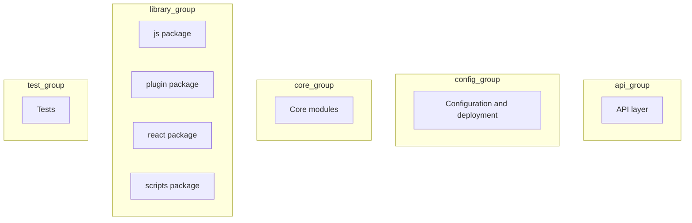

# Architecture report: hakimel/reveal.js

> Automated static analysis. **Observed** = directly seen in files/imports/AST; **Inferred** = interpretation from that evidence. Repository code was not executed.

## 1. Repository at a glance

| Item | Value |
| --- | --- |
| Repository | hakimel/reveal.js |
| Description | The HTML Presentation Framework |
| Language | JavaScript |
| Stars | 72579 |
| Licence | MIT |
| Analysed commit / branch | e240e175232fa2de660a02bc0d7bf5f655b159bb / master |
| Framework(s) | React |
| Files analysed | 172 |
| Components | 8 |

## 2. Architecture in one minute

hakimel/reveal.js - The HTML Presentation Framework. This repository was analysed statically from 172 file(s) (0 Python). Detected technologies (observed from imports/manifests): GitHub Actions, React, TypeScript, Vite, Vitest. Files are grouped into 8 component(s): API layer, Configuration and deployment, Core modules, js package, plugin package, react package, scripts package, Tests. Findings below distinguish observed facts from inferred interpretation.

## 3. High-level block diagram

## 4. Main components

### API layer (`api_layer`)

- **Kind:** api
- **Status:** Observed
- **Confidence:** 0.85
- **Responsibility:** Groups 19 file(s) under api layer (observed from repository paths and static analysis).
- **Paths:** `js/controllers/autoanimate.js`, `js/controllers/backgrounds.js`, `js/controllers/controls.js`, `js/controllers/focus.js`, `js/controllers/fragments.js`, `js/controllers/jumptoslide.js`, `js/controllers/keyboard.js`, `js/controllers/location.js`, `js/controllers/notes.js`, `js/controllers/overlay.js`, `js/controllers/overview.js`, `js/controllers/plugins.js`, `js/controllers/pointer.js`, `js/controllers/printview.js`, `js/controllers/progress.js`, `js/controllers/scrollview.js`, `js/controllers/slidecontent.js`, `js/controllers/slidenumber.js`, `js/controllers/touch.js`
- **Evidence:** [js/controllers/autoanimate.js](https://github.com/hakimel/reveal.js/blob/e240e175232fa2de660a02bc0d7bf5f655b159bb/js/controllers/autoanimate.js); [js/controllers/backgrounds.js](https://github.com/hakimel/reveal.js/blob/e240e175232fa2de660a02bc0d7bf5f655b159bb/js/controllers/backgrounds.js); [js/controllers/controls.js](https://github.com/hakimel/reveal.js/blob/e240e175232fa2de660a02bc0d7bf5f655b159bb/js/controllers/controls.js); [js/controllers/focus.js](https://github.com/hakimel/reveal.js/blob/e240e175232fa2de660a02bc0d7bf5f655b159bb/js/controllers/focus.js); [js/controllers/fragments.js](https://github.com/hakimel/reveal.js/blob/e240e175232fa2de660a02bc0d7bf5f655b159bb/js/controllers/fragments.js); [js/controllers/jumptoslide.js](https://github.com/hakimel/reveal.js/blob/e240e175232fa2de660a02bc0d7bf5f655b159bb/js/controllers/jumptoslide.js); [js/controllers/keyboard.js](https://github.com/hakimel/reveal.js/blob/e240e175232fa2de660a02bc0d7bf5f655b159bb/js/controllers/keyboard.js); [js/controllers/location.js](https://github.com/hakimel/reveal.js/blob/e240e175232fa2de660a02bc0d7bf5f655b159bb/js/controllers/location.js)

### Configuration and deployment (`config`)

- **Kind:** config
- **Status:** Observed
- **Confidence:** 0.85
- **Responsibility:** Groups 7 file(s) under configuration and deployment (observed from repository paths and static analysis).
- **Paths:** `package.json`, `react/demo/package.json`, `react/demo/tsconfig.json`, `react/package.json`, `react/tsconfig.json`, `tsconfig.json`, `tsconfig.node.json`
- **Evidence:** [package.json](https://github.com/hakimel/reveal.js/blob/e240e175232fa2de660a02bc0d7bf5f655b159bb/package.json); [react/demo/package.json](https://github.com/hakimel/reveal.js/blob/e240e175232fa2de660a02bc0d7bf5f655b159bb/react/demo/package.json); [react/demo/tsconfig.json](https://github.com/hakimel/reveal.js/blob/e240e175232fa2de660a02bc0d7bf5f655b159bb/react/demo/tsconfig.json); [react/package.json](https://github.com/hakimel/reveal.js/blob/e240e175232fa2de660a02bc0d7bf5f655b159bb/react/package.json); [react/tsconfig.json](https://github.com/hakimel/reveal.js/blob/e240e175232fa2de660a02bc0d7bf5f655b159bb/react/tsconfig.json); [tsconfig.json](https://github.com/hakimel/reveal.js/blob/e240e175232fa2de660a02bc0d7bf5f655b159bb/tsconfig.json); [tsconfig.node.json](https://github.com/hakimel/reveal.js/blob/e240e175232fa2de660a02bc0d7bf5f655b159bb/tsconfig.node.json)

### Core modules (`core`)

- **Kind:** core
- **Status:** Observed
- **Confidence:** 0.85
- **Responsibility:** Groups 2 file(s) under core modules (observed from repository paths and static analysis).
- **Paths:** `vite.config.styles.ts`, `vite.config.ts`
- **Evidence:** [vite.config.styles.ts](https://github.com/hakimel/reveal.js/blob/e240e175232fa2de660a02bc0d7bf5f655b159bb/vite.config.styles.ts); [vite.config.ts](https://github.com/hakimel/reveal.js/blob/e240e175232fa2de660a02bc0d7bf5f655b159bb/vite.config.ts)

### js package (`js`)

- **Kind:** library
- **Status:** Observed
- **Confidence:** 0.85
- **Responsibility:** Groups 10 file(s) under js package (observed from repository paths and static analysis).
- **Paths:** `js/components/playback.js`, `js/config.ts`, `js/index.ts`, `js/reveal.d.ts`, `js/reveal.js`, `js/utils/color.ts`, `js/utils/constants.ts`, `js/utils/device.ts`, `js/utils/loader.ts`, `js/utils/util.ts`
- **Evidence:** [js/components/playback.js](https://github.com/hakimel/reveal.js/blob/e240e175232fa2de660a02bc0d7bf5f655b159bb/js/components/playback.js); [js/config.ts](https://github.com/hakimel/reveal.js/blob/e240e175232fa2de660a02bc0d7bf5f655b159bb/js/config.ts); [js/index.ts](https://github.com/hakimel/reveal.js/blob/e240e175232fa2de660a02bc0d7bf5f655b159bb/js/index.ts); [js/reveal.d.ts](https://github.com/hakimel/reveal.js/blob/e240e175232fa2de660a02bc0d7bf5f655b159bb/js/reveal.d.ts); [js/reveal.js](https://github.com/hakimel/reveal.js/blob/e240e175232fa2de660a02bc0d7bf5f655b159bb/js/reveal.js); [js/utils/color.ts](https://github.com/hakimel/reveal.js/blob/e240e175232fa2de660a02bc0d7bf5f655b159bb/js/utils/color.ts); [js/utils/constants.ts](https://github.com/hakimel/reveal.js/blob/e240e175232fa2de660a02bc0d7bf5f655b159bb/js/utils/constants.ts); [js/utils/device.ts](https://github.com/hakimel/reveal.js/blob/e240e175232fa2de660a02bc0d7bf5f655b159bb/js/utils/device.ts)

### plugin package (`plugin`)

- **Kind:** library
- **Status:** Observed
- **Confidence:** 0.85
- **Responsibility:** Groups 23 file(s) under plugin package (observed from repository paths and static analysis).
- **Paths:** `plugin/highlight/index.ts`, `plugin/highlight/plugin.js`, `plugin/highlight/vite.config.ts`, `plugin/markdown/index.ts`, `plugin/markdown/plugin.js`, `plugin/markdown/vite.config.ts`, `plugin/math/index.ts`, `plugin/math/katex.js`, `plugin/math/mathjax2.js`, `plugin/math/mathjax3.js`, `plugin/math/mathjax4.js`, `plugin/math/plugin.js`, `plugin/math/vite.config.ts`, `plugin/notes/index.ts`, `plugin/notes/plugin.js`, `plugin/notes/vite.config.ts`, `plugin/search/index.ts`, `plugin/search/plugin.js`, `plugin/search/vite.config.ts`, `plugin/vite-plugin-dts.ts`, `plugin/zoom/index.ts`, `plugin/zoom/plugin.js`, `plugin/zoom/vite.config.ts`
- **Evidence:** [plugin/highlight/index.ts](https://github.com/hakimel/reveal.js/blob/e240e175232fa2de660a02bc0d7bf5f655b159bb/plugin/highlight/index.ts); [plugin/highlight/plugin.js](https://github.com/hakimel/reveal.js/blob/e240e175232fa2de660a02bc0d7bf5f655b159bb/plugin/highlight/plugin.js); [plugin/highlight/vite.config.ts](https://github.com/hakimel/reveal.js/blob/e240e175232fa2de660a02bc0d7bf5f655b159bb/plugin/highlight/vite.config.ts); [plugin/markdown/index.ts](https://github.com/hakimel/reveal.js/blob/e240e175232fa2de660a02bc0d7bf5f655b159bb/plugin/markdown/index.ts); [plugin/markdown/plugin.js](https://github.com/hakimel/reveal.js/blob/e240e175232fa2de660a02bc0d7bf5f655b159bb/plugin/markdown/plugin.js); [plugin/markdown/vite.config.ts](https://github.com/hakimel/reveal.js/blob/e240e175232fa2de660a02bc0d7bf5f655b159bb/plugin/markdown/vite.config.ts); [plugin/math/index.ts](https://github.com/hakimel/reveal.js/blob/e240e175232fa2de660a02bc0d7bf5f655b159bb/plugin/math/index.ts); [plugin/math/katex.js](https://github.com/hakimel/reveal.js/blob/e240e175232fa2de660a02bc0d7bf5f655b159bb/plugin/math/katex.js)

### react package (`react`)

- **Kind:** library
- **Status:** Observed
- **Confidence:** 0.85
- **Responsibility:** Groups 23 file(s) under react package (observed from repository paths and static analysis).
- **Paths:** `react/demo/src/demo-app.tsx`, `react/demo/src/main.tsx`, `react/demo/vite.config.ts`, `react/src/__tests__/setup.ts`, `react/src/components/code.test.tsx`, `react/src/components/code.tsx`, `react/src/components/deck.test.tsx`, `react/src/components/deck.tsx`, `react/src/components/fragment.test.tsx`, `react/src/components/fragment.tsx`, `react/src/components/markdown.test.tsx`, `react/src/components/markdown.tsx`, `react/src/components/slide.test.tsx`, `react/src/components/slide.tsx`, `react/src/components/stack.test.tsx`, `react/src/components/stack.tsx`, `react/src/index.ts`, `react/src/reveal-context.ts`, `react/src/types.ts`, `react/src/utils/markdown.ts`, `react/src/utils/slide-attributes.ts`, `react/vite.config.ts`, `react/vitest.config.ts`
- **Evidence:** [react/demo/src/demo-app.tsx](https://github.com/hakimel/reveal.js/blob/e240e175232fa2de660a02bc0d7bf5f655b159bb/react/demo/src/demo-app.tsx); [react/demo/src/main.tsx](https://github.com/hakimel/reveal.js/blob/e240e175232fa2de660a02bc0d7bf5f655b159bb/react/demo/src/main.tsx); [react/demo/vite.config.ts](https://github.com/hakimel/reveal.js/blob/e240e175232fa2de660a02bc0d7bf5f655b159bb/react/demo/vite.config.ts); [react/src/__tests__/setup.ts](https://github.com/hakimel/reveal.js/blob/e240e175232fa2de660a02bc0d7bf5f655b159bb/react/src/__tests__/setup.ts); [react/src/components/code.test.tsx](https://github.com/hakimel/reveal.js/blob/e240e175232fa2de660a02bc0d7bf5f655b159bb/react/src/components/code.test.tsx); [react/src/components/code.tsx](https://github.com/hakimel/reveal.js/blob/e240e175232fa2de660a02bc0d7bf5f655b159bb/react/src/components/code.tsx); [react/src/components/deck.test.tsx](https://github.com/hakimel/reveal.js/blob/e240e175232fa2de660a02bc0d7bf5f655b159bb/react/src/components/deck.test.tsx); [react/src/components/deck.tsx](https://github.com/hakimel/reveal.js/blob/e240e175232fa2de660a02bc0d7bf5f655b159bb/react/src/components/deck.tsx)

### scripts package (`scripts`)

- **Kind:** library
- **Status:** Observed
- **Confidence:** 0.85
- **Responsibility:** Groups 5 file(s) under scripts package (observed from repository paths and static analysis).
- **Paths:** `scripts/add-banner.js`, `scripts/banner.js`, `scripts/build-es5.js`, `scripts/test.js`, `scripts/zip.js`
- **Evidence:** [scripts/add-banner.js](https://github.com/hakimel/reveal.js/blob/e240e175232fa2de660a02bc0d7bf5f655b159bb/scripts/add-banner.js); [scripts/banner.js](https://github.com/hakimel/reveal.js/blob/e240e175232fa2de660a02bc0d7bf5f655b159bb/scripts/banner.js); [scripts/build-es5.js](https://github.com/hakimel/reveal.js/blob/e240e175232fa2de660a02bc0d7bf5f655b159bb/scripts/build-es5.js); [scripts/test.js](https://github.com/hakimel/reveal.js/blob/e240e175232fa2de660a02bc0d7bf5f655b159bb/scripts/test.js); [scripts/zip.js](https://github.com/hakimel/reveal.js/blob/e240e175232fa2de660a02bc0d7bf5f655b159bb/scripts/zip.js)

### Tests (`tests`)

- **Kind:** test
- **Status:** Observed
- **Confidence:** 0.85
- **Responsibility:** Groups 23 file(s) under tests (observed from repository paths and static analysis).
- **Paths:** `test/assets/external-script-a.js`, `test/assets/external-script-b.js`, `test/assets/external-script-c.js`, `test/assets/external-script-d.js`, `test/simple.md`, `test/test-auto-animate.html`, `test/test-dependencies-async.html`, `test/test-dependencies.html`, `test/test-destroy.html`, `test/test-grid-navigation.html`, `test/test-iframe-backgrounds.html`, `test/test-iframes.html`, `test/test-markdown.html`, `test/test-mathjax4.html`, `test/test-multiple-instances-es5.html`, `test/test-multiple-instances.html`, `test/test-overlays.html`, `test/test-pdf.html`, `test/test-plugins.html`, `test/test-scroll.html`, `test/test-state.html`, `test/test.html`, `test/types/plugin-imports.ts`
- **Evidence:** [test/assets/external-script-a.js](https://github.com/hakimel/reveal.js/blob/e240e175232fa2de660a02bc0d7bf5f655b159bb/test/assets/external-script-a.js); [test/assets/external-script-b.js](https://github.com/hakimel/reveal.js/blob/e240e175232fa2de660a02bc0d7bf5f655b159bb/test/assets/external-script-b.js); [test/assets/external-script-c.js](https://github.com/hakimel/reveal.js/blob/e240e175232fa2de660a02bc0d7bf5f655b159bb/test/assets/external-script-c.js); [test/assets/external-script-d.js](https://github.com/hakimel/reveal.js/blob/e240e175232fa2de660a02bc0d7bf5f655b159bb/test/assets/external-script-d.js); [test/simple.md](https://github.com/hakimel/reveal.js/blob/e240e175232fa2de660a02bc0d7bf5f655b159bb/test/simple.md); [test/test-auto-animate.html](https://github.com/hakimel/reveal.js/blob/e240e175232fa2de660a02bc0d7bf5f655b159bb/test/test-auto-animate.html); [test/test-dependencies-async.html](https://github.com/hakimel/reveal.js/blob/e240e175232fa2de660a02bc0d7bf5f655b159bb/test/test-dependencies-async.html); [test/test-dependencies.html](https://github.com/hakimel/reveal.js/blob/e240e175232fa2de660a02bc0d7bf5f655b159bb/test/test-dependencies.html)

## 5. Execution flow

**Observed** entry point(s):

- [js/index.ts](https://github.com/hakimel/reveal.js/blob/e240e175232fa2de660a02bc0d7bf5f655b159bb/js/index.ts)
- [plugin/highlight/index.ts](https://github.com/hakimel/reveal.js/blob/e240e175232fa2de660a02bc0d7bf5f655b159bb/plugin/highlight/index.ts)
- [plugin/markdown/index.ts](https://github.com/hakimel/reveal.js/blob/e240e175232fa2de660a02bc0d7bf5f655b159bb/plugin/markdown/index.ts)
- [plugin/math/index.ts](https://github.com/hakimel/reveal.js/blob/e240e175232fa2de660a02bc0d7bf5f655b159bb/plugin/math/index.ts)
- [plugin/notes/index.ts](https://github.com/hakimel/reveal.js/blob/e240e175232fa2de660a02bc0d7bf5f655b159bb/plugin/notes/index.ts)
- [plugin/search/index.ts](https://github.com/hakimel/reveal.js/blob/e240e175232fa2de660a02bc0d7bf5f655b159bb/plugin/search/index.ts)
- [plugin/zoom/index.ts](https://github.com/hakimel/reveal.js/blob/e240e175232fa2de660a02bc0d7bf5f655b159bb/plugin/zoom/index.ts)
- [react/demo/src/main.tsx](https://github.com/hakimel/reveal.js/blob/e240e175232fa2de660a02bc0d7bf5f655b159bb/react/demo/src/main.tsx)
- [react/src/index.ts](https://github.com/hakimel/reveal.js/blob/e240e175232fa2de660a02bc0d7bf5f655b159bb/react/src/index.ts)

Representative flow (derived from observed entry points and the import graph; steps beyond the entry point are **Inferred**):

1. Execution starts at an observed entry point listed above, if present.
2. No internal import relationships between components were observed.

## 6. Project structure

### `(root)`

- `.codespellrc` - other (331 bytes)
- `.gitignore` - other (172 bytes)
- `.prettierignore` - other (82 bytes)
- `.prettierrc` - other (131 bytes)
- `LICENSE` - docs (1108 bytes)
- `README.md` - docs (1799 bytes)
- `demo.html` - other (22161 bytes)
- `index.html` - other (1163 bytes)
- `package.json` - manifest (3713 bytes)
- `tsconfig.json` - config (588 bytes)
- `tsconfig.node.json` - config (247 bytes)
- `vite.config.styles.ts` - source, TypeScript (799 bytes)
- `vite.config.ts` - source, TypeScript (1336 bytes)

### `.github`

- `.github/CONTRIBUTING.md` - docs (1057 bytes)
- `.github/FUNDING.yml` - config (18 bytes)
- `.github/workflows/spellcheck.yml` - ci, YAML (495 bytes)
- `.github/workflows/test.yml` - ci, YAML (502 bytes)

### `css`

- `css/layout.scss` - other (1484 bytes)
- `css/print/paper.scss` - other (3088 bytes)
- `css/print/pdf.scss` - other (2925 bytes)
- `css/reset.css` - other (866 bytes)
- `css/reveal.scss` - other (55117 bytes)
- `css/theme/README.md` - docs (1313 bytes)
- `css/theme/beige.scss` - other (1593 bytes)
- `css/theme/black-contrast.scss` - other (1260 bytes)
- `css/theme/black.scss` - other (1077 bytes)
- `css/theme/blood.scss` - other (1774 bytes)
- `css/theme/dracula.scss` - other (2008 bytes)
- `css/theme/fonts/league-gothic/LICENSE` - docs (92 bytes)
- `css/theme/fonts/league-gothic/league-gothic.css` - other (152 bytes)
- `css/theme/fonts/source-sans-pro/LICENSE` - docs (4632 bytes)
- `css/theme/fonts/source-sans-pro/source-sans-pro.css` - other (656 bytes)
- `css/theme/league.scss` - other (1094 bytes)
- `css/theme/moon.scss` - other (1163 bytes)
- `css/theme/night.scss` - other (1021 bytes)
- `css/theme/serif.scss` - other (1152 bytes)
- `css/theme/simple.scss` - other (1350 bytes)
- `css/theme/sky.scss` - other (1162 bytes)
- `css/theme/solarized.scss` - other (1206 bytes)
- `css/theme/template/mixins.scss` - other (275 bytes)
- `css/theme/template/settings.scss` - other (2940 bytes)
- `css/theme/template/theme.scss` - other (5800 bytes)
- `css/theme/white-contrast.scss` - other (1306 bytes)
- `css/theme/white.scss` - other (1116 bytes)

### `examples`

- `examples/500-slides.html` - other (18425 bytes)
- `examples/assets/beeping.txt` - docs (92 bytes)
- `examples/auto-animate.html` - other (10664 bytes)
- `examples/backgrounds.html` - other (3995 bytes)
- `examples/barebones.html` - other (685 bytes)
- `examples/layout-helpers.html` - other (5166 bytes)
- `examples/lightbox.html` - other (4400 bytes)
- `examples/markdown.html` - other (4159 bytes)
- `examples/markdown.md` - docs (398 bytes)
- `examples/math.html` - other (6851 bytes)
- `examples/media.html` - other (1824 bytes)
- `examples/multiple-presentations.html` - other (2615 bytes)
- `examples/scroll.html` - other (4945 bytes)
- `examples/transitions.html` - other (1932 bytes)

### `js`

- `js/components/playback.js` - source, JavaScript (3935 bytes)
- `js/config.ts` - source, TypeScript (21801 bytes)
- `js/controllers/autoanimate.js` - source, JavaScript (20328 bytes)
- `js/controllers/backgrounds.js` - source, JavaScript (15325 bytes)
- `js/controllers/controls.js` - source, JavaScript (10348 bytes)
- `js/controllers/focus.js` - source, JavaScript (1960 bytes)
- `js/controllers/fragments.js` - source, JavaScript (9308 bytes)
- `js/controllers/jumptoslide.js` - source, JavaScript (4130 bytes)
- `js/controllers/keyboard.js` - source, JavaScript (10854 bytes)
- `js/controllers/location.js` - source, JavaScript (6399 bytes)
- `js/controllers/notes.js` - source, JavaScript (2848 bytes)
- `js/controllers/overlay.js` - source, JavaScript (10977 bytes)
- `js/controllers/overview.js` - source, JavaScript (6530 bytes)
- `js/controllers/plugins.js` - source, JavaScript (5444 bytes)
- `js/controllers/pointer.js` - source, JavaScript (2843 bytes)
- `js/controllers/printview.js` - source, JavaScript (7717 bytes)
- `js/controllers/progress.js` - source, JavaScript (2170 bytes)
- `js/controllers/scrollview.js` - source, JavaScript (27907 bytes)
- `js/controllers/slidecontent.js` - source, JavaScript (21274 bytes)
- `js/controllers/slidenumber.js` - source, JavaScript (3712 bytes)
- `js/controllers/touch.js` - source, JavaScript (8213 bytes)
- `js/index.ts` - source, TypeScript (2003 bytes)
- `js/reveal.d.ts` - source, TypeScript (21447 bytes)
- `js/reveal.js` - source, JavaScript (80863 bytes)
- `js/utils/color.ts` - source, TypeScript (1793 bytes)
- `js/utils/constants.ts` - source, TypeScript (950 bytes)
- `js/utils/device.ts` - source, TypeScript (295 bytes)
- `js/utils/loader.ts` - source, TypeScript (1055 bytes)
- `js/utils/util.ts` - source, TypeScript (7503 bytes)

### `plugin`

- `plugin/highlight/index.ts` - source, TypeScript (1698 bytes)
- `plugin/highlight/plugin.js` - source, JavaScript (16339 bytes)
- `plugin/highlight/vite.config.ts` - source, TypeScript (652 bytes)
- `plugin/markdown/index.ts` - source, TypeScript (877 bytes)
- `plugin/markdown/plugin.js` - source, JavaScript (15388 bytes)
- `plugin/markdown/vite.config.ts` - source, TypeScript (653 bytes)
- `plugin/math/index.ts` - source, TypeScript (723 bytes)
- `plugin/math/katex.js` - source, JavaScript (2582 bytes)
- `plugin/math/mathjax2.js` - source, JavaScript (2102 bytes)
- `plugin/math/mathjax3.js` - source, JavaScript (2220 bytes)
- `plugin/math/mathjax4.js` - source, JavaScript (2527 bytes)
- `plugin/math/plugin.js` - source, JavaScript (392 bytes)
- `plugin/math/vite.config.ts` - source, TypeScript (641 bytes)
- `plugin/notes/index.ts` - source, TypeScript (342 bytes)
- `plugin/notes/plugin.js` - source, JavaScript (7082 bytes)
- `plugin/notes/speaker-view.html` - other (24236 bytes)
- `plugin/notes/vite.config.ts` - source, TypeScript (640 bytes)
- `plugin/search/index.ts` - source, TypeScript (382 bytes)
- `plugin/search/plugin.js` - source, JavaScript (6484 bytes)
- `plugin/search/vite.config.ts` - source, TypeScript (643 bytes)
- `plugin/vite-plugin-dts.ts` - source, TypeScript (548 bytes)
- `plugin/zoom/index.ts` - source, TypeScript (320 bytes)
- `plugin/zoom/plugin.js` - source, JavaScript (6779 bytes)
- `plugin/zoom/vite.config.ts` - source, TypeScript (637 bytes)

### `public`

- `public/plugin/highlight/monokai.css` - other (940 bytes)
- `public/plugin/highlight/zenburn.css` - other (946 bytes)

### `react`

- `react/AGENTS.md` - docs (4014 bytes)
- `react/README.md` - docs (7174 bytes)
- `react/demo/index.html` - other (317 bytes)
- `react/demo/package.json` - manifest (271 bytes)
- `react/demo/public/markdown.md` - docs (61 bytes)
- `react/demo/src/demo-app.tsx` - source, TypeScript (6680 bytes)
- `react/demo/src/main.tsx` - source, TypeScript (211 bytes)
- `react/demo/tsconfig.json` - config (295 bytes)
- `react/demo/vite.config.ts` - source, TypeScript (260 bytes)
- `react/package.json` - manifest (1256 bytes)
- `react/src/__tests__/setup.ts` - source, TypeScript (43 bytes)
- `react/src/components/code.test.tsx` - source, TypeScript (4578 bytes)
- `react/src/components/code.tsx` - source, TypeScript (4236 bytes)
- `react/src/components/deck.test.tsx` - source, TypeScript (10847 bytes)
- `react/src/components/deck.tsx` - source, TypeScript (7909 bytes)
- `react/src/components/fragment.test.tsx` - source, TypeScript (3829 bytes)
- `react/src/components/fragment.tsx` - source, TypeScript (1668 bytes)
- `react/src/components/markdown.test.tsx` - source, TypeScript (6521 bytes)
- `react/src/components/markdown.tsx` - source, TypeScript (6445 bytes)
- `react/src/components/slide.test.tsx` - source, TypeScript (8766 bytes)
- `react/src/components/slide.tsx` - source, TypeScript (2694 bytes)
- `react/src/components/stack.test.tsx` - source, TypeScript (1298 bytes)
- `react/src/components/stack.tsx` - source, TypeScript (204 bytes)
- `react/src/index.ts` - source, TypeScript (610 bytes)
- `react/src/reveal-context.ts` - source, TypeScript (152 bytes)
- `react/src/types.ts` - source, TypeScript (3808 bytes)
- `react/src/utils/markdown.ts` - source, TypeScript (9872 bytes)
- `react/src/utils/slide-attributes.ts` - source, TypeScript (2743 bytes)
- `react/tsconfig.json` - config (368 bytes)
- `react/vite.config.ts` - source, TypeScript (747 bytes)
- `react/vitest.config.ts` - source, TypeScript (360 bytes)

### `scripts`

- `scripts/add-banner.js` - source, JavaScript (700 bytes)
- `scripts/banner.js` - source, JavaScript (158 bytes)
- `scripts/build-es5.js` - source, JavaScript (1691 bytes)
- `scripts/test.js` - source, JavaScript (2929 bytes)
- `scripts/zip.js` - source, JavaScript (4837 bytes)

### `test`

- `test/assets/external-script-a.js` - test, JavaScript (37 bytes)
- `test/assets/external-script-b.js` - test, JavaScript (37 bytes)
- `test/assets/external-script-c.js` - test, JavaScript (37 bytes)
- `test/assets/external-script-d.js` - test, JavaScript (37 bytes)
- `test/simple.md` - test (63 bytes)
- `test/test-auto-animate.html` - test (4118 bytes)
- `test/test-dependencies-async.html` - test (1881 bytes)
- `test/test-dependencies.html` - test (1079 bytes)
- `test/test-destroy.html` - test (2002 bytes)
- `test/test-grid-navigation.html` - test (1788 bytes)
- `test/test-iframe-backgrounds.html` - test (3057 bytes)
- `test/test-iframes.html` - test (3033 bytes)
- `test/test-markdown.html` - test (20938 bytes)
- `test/test-mathjax4.html` - test (8333 bytes)
- `test/test-multiple-instances-es5.html` - test (1950 bytes)
- `test/test-multiple-instances.html` - test (2480 bytes)
- `test/test-overlays.html` - test (4975 bytes)
- `test/test-pdf.html` - test (1886 bytes)
- `test/test-plugins.html` - test (2762 bytes)
- `test/test-scroll.html` - test (4779 bytes)
- `test/test-state.html` - test (3113 bytes)
- `test/test.html` - test (41652 bytes)
- `test/types/plugin-imports.ts` - test, TypeScript (2895 bytes)

## 7. Key dependencies and integrations

| Name | Category | Status | Confidence | Evidence |
| --- | --- | --- | --- | --- |
| GitHub Actions | ci | Observed | 0.90 | [.github/workflows/spellcheck.yml](https://github.com/hakimel/reveal.js/blob/e240e175232fa2de660a02bc0d7bf5f655b159bb/.github/workflows/spellcheck.yml); [.github/workflows/test.yml](https://github.com/hakimel/reveal.js/blob/e240e175232fa2de660a02bc0d7bf5f655b159bb/.github/workflows/test.yml) |
| React | framework | Observed | 0.90 | [react/package.json:2](https://github.com/hakimel/reveal.js/blob/e240e175232fa2de660a02bc0d7bf5f655b159bb/react/package.json#L2); [react/package.json:34](https://github.com/hakimel/reveal.js/blob/e240e175232fa2de660a02bc0d7bf5f655b159bb/react/package.json#L34) |
| TypeScript | tooling | Observed | 0.90 | [package.json:116](https://github.com/hakimel/reveal.js/blob/e240e175232fa2de660a02bc0d7bf5f655b159bb/package.json#L116); [react/demo/package.json:13](https://github.com/hakimel/reveal.js/blob/e240e175232fa2de660a02bc0d7bf5f655b159bb/react/demo/package.json#L13); [react/package.json:47](https://github.com/hakimel/reveal.js/blob/e240e175232fa2de660a02bc0d7bf5f655b159bb/react/package.json#L47) |
| Vite | tooling | Observed | 0.90 | [package.json:71](https://github.com/hakimel/reveal.js/blob/e240e175232fa2de660a02bc0d7bf5f655b159bb/package.json#L71); [react/demo/package.json:5](https://github.com/hakimel/reveal.js/blob/e240e175232fa2de660a02bc0d7bf5f655b159bb/react/demo/package.json#L5); [react/package.json:27](https://github.com/hakimel/reveal.js/blob/e240e175232fa2de660a02bc0d7bf5f655b159bb/react/package.json#L27) |
| Vitest | tooling | Observed | 0.85 | [react/package.json:28](https://github.com/hakimel/reveal.js/blob/e240e175232fa2de660a02bc0d7bf5f655b159bb/react/package.json#L28) |

## 8. Data and state

No database, cache, queue, or persistent-state usage was observed in the analysed files. State handling, if any, may be in-memory or in files that were not analysed.

## 9. Configuration and deployment clues

- `.github/FUNDING.yml` (config)
- `.github/workflows/spellcheck.yml` (ci)
- `.github/workflows/test.yml` (ci)
- `package.json` (manifest)
- `react/demo/package.json` (manifest)
- `react/demo/tsconfig.json` (config)
- `react/package.json` (manifest)
- `react/tsconfig.json` (config)
- `tsconfig.json` (config)
- `tsconfig.node.json` (config)

## 10. Design observations

- An entry/API layer is separated from other code (Inferred from paths and decorators).
- Tests are present alongside source code (Observed from test file paths).

These observations are interpretations (**Inferred**) of the observed structure, not guarantees about runtime design.

## 11. Limitations and unknowns

- Static analysis only: repository code was not executed, installed, or imported at runtime.
- Components and relationships are inferred from file paths, imports, and AST structure; runtime behaviour, dynamic imports, and reflection may not be visible.
- 43 file(s) were skipped during inventory (3 x lockfile excluded; 40 x vendored/generated directory excluded).
- No clear application entry point was observed in the analysed files.
- Repository text was treated as untrusted data; no instructions found in repository files were followed, and likely secret values were redacted/excluded.
- JavaScript and TypeScript files were inventoried from paths and package manifests. They were not parsed with a full language AST, and repository code was not executed.

## 12. Source references

- [.github/workflows/spellcheck.yml](https://github.com/hakimel/reveal.js/blob/e240e175232fa2de660a02bc0d7bf5f655b159bb/.github/workflows/spellcheck.yml)
- [.github/workflows/test.yml](https://github.com/hakimel/reveal.js/blob/e240e175232fa2de660a02bc0d7bf5f655b159bb/.github/workflows/test.yml)
- [js/components/playback.js](https://github.com/hakimel/reveal.js/blob/e240e175232fa2de660a02bc0d7bf5f655b159bb/js/components/playback.js)
- [js/config.ts](https://github.com/hakimel/reveal.js/blob/e240e175232fa2de660a02bc0d7bf5f655b159bb/js/config.ts)
- [js/controllers/autoanimate.js](https://github.com/hakimel/reveal.js/blob/e240e175232fa2de660a02bc0d7bf5f655b159bb/js/controllers/autoanimate.js)
- [js/controllers/backgrounds.js](https://github.com/hakimel/reveal.js/blob/e240e175232fa2de660a02bc0d7bf5f655b159bb/js/controllers/backgrounds.js)
- [js/controllers/controls.js](https://github.com/hakimel/reveal.js/blob/e240e175232fa2de660a02bc0d7bf5f655b159bb/js/controllers/controls.js)
- [js/controllers/focus.js](https://github.com/hakimel/reveal.js/blob/e240e175232fa2de660a02bc0d7bf5f655b159bb/js/controllers/focus.js)
- [js/controllers/fragments.js](https://github.com/hakimel/reveal.js/blob/e240e175232fa2de660a02bc0d7bf5f655b159bb/js/controllers/fragments.js)
- [js/controllers/jumptoslide.js](https://github.com/hakimel/reveal.js/blob/e240e175232fa2de660a02bc0d7bf5f655b159bb/js/controllers/jumptoslide.js)
- [js/controllers/keyboard.js](https://github.com/hakimel/reveal.js/blob/e240e175232fa2de660a02bc0d7bf5f655b159bb/js/controllers/keyboard.js)
- [js/controllers/location.js](https://github.com/hakimel/reveal.js/blob/e240e175232fa2de660a02bc0d7bf5f655b159bb/js/controllers/location.js)
- [js/index.ts](https://github.com/hakimel/reveal.js/blob/e240e175232fa2de660a02bc0d7bf5f655b159bb/js/index.ts)
- [js/reveal.d.ts](https://github.com/hakimel/reveal.js/blob/e240e175232fa2de660a02bc0d7bf5f655b159bb/js/reveal.d.ts)
- [js/reveal.js](https://github.com/hakimel/reveal.js/blob/e240e175232fa2de660a02bc0d7bf5f655b159bb/js/reveal.js)
- [js/utils/color.ts](https://github.com/hakimel/reveal.js/blob/e240e175232fa2de660a02bc0d7bf5f655b159bb/js/utils/color.ts)
- [js/utils/constants.ts](https://github.com/hakimel/reveal.js/blob/e240e175232fa2de660a02bc0d7bf5f655b159bb/js/utils/constants.ts)
- [js/utils/device.ts](https://github.com/hakimel/reveal.js/blob/e240e175232fa2de660a02bc0d7bf5f655b159bb/js/utils/device.ts)
- [package.json](https://github.com/hakimel/reveal.js/blob/e240e175232fa2de660a02bc0d7bf5f655b159bb/package.json)
- [package.json:71](https://github.com/hakimel/reveal.js/blob/e240e175232fa2de660a02bc0d7bf5f655b159bb/package.json#L71)
- [package.json:116](https://github.com/hakimel/reveal.js/blob/e240e175232fa2de660a02bc0d7bf5f655b159bb/package.json#L116)
- [plugin/highlight/index.ts](https://github.com/hakimel/reveal.js/blob/e240e175232fa2de660a02bc0d7bf5f655b159bb/plugin/highlight/index.ts)
- [plugin/highlight/plugin.js](https://github.com/hakimel/reveal.js/blob/e240e175232fa2de660a02bc0d7bf5f655b159bb/plugin/highlight/plugin.js)
- [plugin/highlight/vite.config.ts](https://github.com/hakimel/reveal.js/blob/e240e175232fa2de660a02bc0d7bf5f655b159bb/plugin/highlight/vite.config.ts)
- [plugin/markdown/index.ts](https://github.com/hakimel/reveal.js/blob/e240e175232fa2de660a02bc0d7bf5f655b159bb/plugin/markdown/index.ts)
- [plugin/markdown/plugin.js](https://github.com/hakimel/reveal.js/blob/e240e175232fa2de660a02bc0d7bf5f655b159bb/plugin/markdown/plugin.js)
- [plugin/markdown/vite.config.ts](https://github.com/hakimel/reveal.js/blob/e240e175232fa2de660a02bc0d7bf5f655b159bb/plugin/markdown/vite.config.ts)
- [plugin/math/index.ts](https://github.com/hakimel/reveal.js/blob/e240e175232fa2de660a02bc0d7bf5f655b159bb/plugin/math/index.ts)
- [plugin/math/katex.js](https://github.com/hakimel/reveal.js/blob/e240e175232fa2de660a02bc0d7bf5f655b159bb/plugin/math/katex.js)
- [plugin/notes/index.ts](https://github.com/hakimel/reveal.js/blob/e240e175232fa2de660a02bc0d7bf5f655b159bb/plugin/notes/index.ts)
- [plugin/search/index.ts](https://github.com/hakimel/reveal.js/blob/e240e175232fa2de660a02bc0d7bf5f655b159bb/plugin/search/index.ts)
- [plugin/zoom/index.ts](https://github.com/hakimel/reveal.js/blob/e240e175232fa2de660a02bc0d7bf5f655b159bb/plugin/zoom/index.ts)
- [react/demo/package.json](https://github.com/hakimel/reveal.js/blob/e240e175232fa2de660a02bc0d7bf5f655b159bb/react/demo/package.json)
- [react/demo/package.json:5](https://github.com/hakimel/reveal.js/blob/e240e175232fa2de660a02bc0d7bf5f655b159bb/react/demo/package.json#L5)
- [react/demo/package.json:13](https://github.com/hakimel/reveal.js/blob/e240e175232fa2de660a02bc0d7bf5f655b159bb/react/demo/package.json#L13)
- [react/demo/src/demo-app.tsx](https://github.com/hakimel/reveal.js/blob/e240e175232fa2de660a02bc0d7bf5f655b159bb/react/demo/src/demo-app.tsx)
- [react/demo/src/main.tsx](https://github.com/hakimel/reveal.js/blob/e240e175232fa2de660a02bc0d7bf5f655b159bb/react/demo/src/main.tsx)
- [react/demo/tsconfig.json](https://github.com/hakimel/reveal.js/blob/e240e175232fa2de660a02bc0d7bf5f655b159bb/react/demo/tsconfig.json)
- [react/demo/vite.config.ts](https://github.com/hakimel/reveal.js/blob/e240e175232fa2de660a02bc0d7bf5f655b159bb/react/demo/vite.config.ts)
- [react/package.json](https://github.com/hakimel/reveal.js/blob/e240e175232fa2de660a02bc0d7bf5f655b159bb/react/package.json)
- [react/package.json:2](https://github.com/hakimel/reveal.js/blob/e240e175232fa2de660a02bc0d7bf5f655b159bb/react/package.json#L2)
- [react/package.json:27](https://github.com/hakimel/reveal.js/blob/e240e175232fa2de660a02bc0d7bf5f655b159bb/react/package.json#L27)
- [react/package.json:28](https://github.com/hakimel/reveal.js/blob/e240e175232fa2de660a02bc0d7bf5f655b159bb/react/package.json#L28)
- [react/package.json:34](https://github.com/hakimel/reveal.js/blob/e240e175232fa2de660a02bc0d7bf5f655b159bb/react/package.json#L34)
- [react/package.json:47](https://github.com/hakimel/reveal.js/blob/e240e175232fa2de660a02bc0d7bf5f655b159bb/react/package.json#L47)
- [react/src/__tests__/setup.ts](https://github.com/hakimel/reveal.js/blob/e240e175232fa2de660a02bc0d7bf5f655b159bb/react/src/__tests__/setup.ts)
- [react/src/components/code.test.tsx](https://github.com/hakimel/reveal.js/blob/e240e175232fa2de660a02bc0d7bf5f655b159bb/react/src/components/code.test.tsx)
- [react/src/components/code.tsx](https://github.com/hakimel/reveal.js/blob/e240e175232fa2de660a02bc0d7bf5f655b159bb/react/src/components/code.tsx)
- [react/src/components/deck.test.tsx](https://github.com/hakimel/reveal.js/blob/e240e175232fa2de660a02bc0d7bf5f655b159bb/react/src/components/deck.test.tsx)
- [react/src/components/deck.tsx](https://github.com/hakimel/reveal.js/blob/e240e175232fa2de660a02bc0d7bf5f655b159bb/react/src/components/deck.tsx)
- [react/src/index.ts](https://github.com/hakimel/reveal.js/blob/e240e175232fa2de660a02bc0d7bf5f655b159bb/react/src/index.ts)
- [react/tsconfig.json](https://github.com/hakimel/reveal.js/blob/e240e175232fa2de660a02bc0d7bf5f655b159bb/react/tsconfig.json)
- [scripts/add-banner.js](https://github.com/hakimel/reveal.js/blob/e240e175232fa2de660a02bc0d7bf5f655b159bb/scripts/add-banner.js)
- [scripts/banner.js](https://github.com/hakimel/reveal.js/blob/e240e175232fa2de660a02bc0d7bf5f655b159bb/scripts/banner.js)
- [scripts/build-es5.js](https://github.com/hakimel/reveal.js/blob/e240e175232fa2de660a02bc0d7bf5f655b159bb/scripts/build-es5.js)
- [scripts/test.js](https://github.com/hakimel/reveal.js/blob/e240e175232fa2de660a02bc0d7bf5f655b159bb/scripts/test.js)
- [scripts/zip.js](https://github.com/hakimel/reveal.js/blob/e240e175232fa2de660a02bc0d7bf5f655b159bb/scripts/zip.js)
- [test/assets/external-script-a.js](https://github.com/hakimel/reveal.js/blob/e240e175232fa2de660a02bc0d7bf5f655b159bb/test/assets/external-script-a.js)
- [test/assets/external-script-b.js](https://github.com/hakimel/reveal.js/blob/e240e175232fa2de660a02bc0d7bf5f655b159bb/test/assets/external-script-b.js)
- [test/assets/external-script-c.js](https://github.com/hakimel/reveal.js/blob/e240e175232fa2de660a02bc0d7bf5f655b159bb/test/assets/external-script-c.js)
- [test/assets/external-script-d.js](https://github.com/hakimel/reveal.js/blob/e240e175232fa2de660a02bc0d7bf5f655b159bb/test/assets/external-script-d.js)
- [test/simple.md](https://github.com/hakimel/reveal.js/blob/e240e175232fa2de660a02bc0d7bf5f655b159bb/test/simple.md)
- [test/test-auto-animate.html](https://github.com/hakimel/reveal.js/blob/e240e175232fa2de660a02bc0d7bf5f655b159bb/test/test-auto-animate.html)
- [test/test-dependencies-async.html](https://github.com/hakimel/reveal.js/blob/e240e175232fa2de660a02bc0d7bf5f655b159bb/test/test-dependencies-async.html)
- [test/test-dependencies.html](https://github.com/hakimel/reveal.js/blob/e240e175232fa2de660a02bc0d7bf5f655b159bb/test/test-dependencies.html)
- [tsconfig.json](https://github.com/hakimel/reveal.js/blob/e240e175232fa2de660a02bc0d7bf5f655b159bb/tsconfig.json)
- [tsconfig.node.json](https://github.com/hakimel/reveal.js/blob/e240e175232fa2de660a02bc0d7bf5f655b159bb/tsconfig.node.json)
- [vite.config.styles.ts](https://github.com/hakimel/reveal.js/blob/e240e175232fa2de660a02bc0d7bf5f655b159bb/vite.config.styles.ts)
- [vite.config.ts](https://github.com/hakimel/reveal.js/blob/e240e175232fa2de660a02bc0d7bf5f655b159bb/vite.config.ts)
