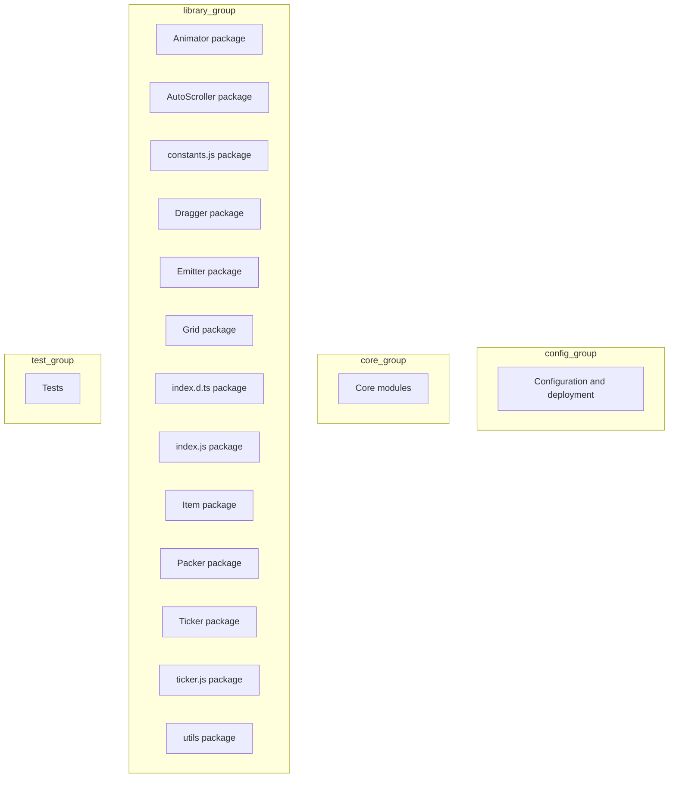

# Architecture report: haltu/muuri

> Automated static analysis. **Observed** = directly seen in files/imports/AST; **Inferred** = interpretation from that evidence. Repository code was not executed.

## 1. Repository at a glance

| Item | Value |
| --- | --- |
| Repository | haltu/muuri |
| Description | Infinite responsive, sortable, filterable and draggable layouts |
| Language | JavaScript |
| Stars | 10935 |
| Licence | MIT |
| Analysed commit / branch | 219e00893327dc22cf241103bef0ca63ee6fde2e / master |
| Framework(s) | Vue |
| Files analysed | 174 |
| Components | 16 |

## 2. Architecture in one minute

haltu/muuri - Infinite responsive, sortable, filterable and draggable layouts. This repository was analysed statically from 174 file(s) (0 Python). Detected technologies (observed from imports/manifests): Vue. Files are grouped into 16 component(s): Animator package, AutoScroller package, Configuration and deployment, constants.js package, Core modules, Dragger package, Emitter package, Grid package. Findings below distinguish observed facts from inferred interpretation.

## 3. High-level block diagram

## 4. Main components

### Animator package (`animator`)

- **Kind:** library
- **Status:** Observed
- **Confidence:** 0.85
- **Responsibility:** Groups 1 file(s) under animator package (observed from repository paths and static analysis).
- **Paths:** `src/Animator/Animator.js`
- **Evidence:** [src/Animator/Animator.js](https://github.com/haltu/muuri/blob/219e00893327dc22cf241103bef0ca63ee6fde2e/src/Animator/Animator.js)

### AutoScroller package (`autoscroller`)

- **Kind:** library
- **Status:** Observed
- **Confidence:** 0.85
- **Responsibility:** Groups 6 file(s) under autoscroller package (observed from repository paths and static analysis).
- **Paths:** `src/AutoScroller/AutoScroller.js`, `src/AutoScroller/Pool.js`, `src/AutoScroller/ScrollAction.js`, `src/AutoScroller/ScrollRequest.js`, `src/AutoScroller/constants.js`, `src/AutoScroller/utils.js`
- **Evidence:** [src/AutoScroller/AutoScroller.js](https://github.com/haltu/muuri/blob/219e00893327dc22cf241103bef0ca63ee6fde2e/src/AutoScroller/AutoScroller.js); [src/AutoScroller/Pool.js](https://github.com/haltu/muuri/blob/219e00893327dc22cf241103bef0ca63ee6fde2e/src/AutoScroller/Pool.js); [src/AutoScroller/ScrollAction.js](https://github.com/haltu/muuri/blob/219e00893327dc22cf241103bef0ca63ee6fde2e/src/AutoScroller/ScrollAction.js); [src/AutoScroller/ScrollRequest.js](https://github.com/haltu/muuri/blob/219e00893327dc22cf241103bef0ca63ee6fde2e/src/AutoScroller/ScrollRequest.js); [src/AutoScroller/constants.js](https://github.com/haltu/muuri/blob/219e00893327dc22cf241103bef0ca63ee6fde2e/src/AutoScroller/constants.js); [src/AutoScroller/utils.js](https://github.com/haltu/muuri/blob/219e00893327dc22cf241103bef0ca63ee6fde2e/src/AutoScroller/utils.js)

### Configuration and deployment (`config`)

- **Kind:** config
- **Status:** Observed
- **Confidence:** 0.85
- **Responsibility:** Groups 1 file(s) under configuration and deployment (observed from repository paths and static analysis).
- **Paths:** `package.json`
- **Evidence:** [package.json](https://github.com/haltu/muuri/blob/219e00893327dc22cf241103bef0ca63ee6fde2e/package.json)

### constants.js package (`constants_js`)

- **Kind:** library
- **Status:** Observed
- **Confidence:** 0.85
- **Responsibility:** Groups 1 file(s) under constants.js package (observed from repository paths and static analysis).
- **Paths:** `src/constants.js`
- **Evidence:** [src/constants.js](https://github.com/haltu/muuri/blob/219e00893327dc22cf241103bef0ca63ee6fde2e/src/constants.js)

### Core modules (`core`)

- **Kind:** core
- **Status:** Observed
- **Confidence:** 0.85
- **Responsibility:** Groups 5 file(s) under core modules (observed from repository paths and static analysis).
- **Paths:** `gulpfile.js`, `karma.conf.js`, `karma.defaults.js`, `rollup.banner.js`, `rollup.config.js`
- **Evidence:** [gulpfile.js](https://github.com/haltu/muuri/blob/219e00893327dc22cf241103bef0ca63ee6fde2e/gulpfile.js); [karma.conf.js](https://github.com/haltu/muuri/blob/219e00893327dc22cf241103bef0ca63ee6fde2e/karma.conf.js); [karma.defaults.js](https://github.com/haltu/muuri/blob/219e00893327dc22cf241103bef0ca63ee6fde2e/karma.defaults.js); [rollup.banner.js](https://github.com/haltu/muuri/blob/219e00893327dc22cf241103bef0ca63ee6fde2e/rollup.banner.js); [rollup.config.js](https://github.com/haltu/muuri/blob/219e00893327dc22cf241103bef0ca63ee6fde2e/rollup.config.js)

### Dragger package (`dragger`)

- **Kind:** library
- **Status:** Observed
- **Confidence:** 0.85
- **Responsibility:** Groups 2 file(s) under dragger package (observed from repository paths and static analysis).
- **Paths:** `src/Dragger/Dragger.js`, `src/Dragger/EdgeHack.js`
- **Evidence:** [src/Dragger/Dragger.js](https://github.com/haltu/muuri/blob/219e00893327dc22cf241103bef0ca63ee6fde2e/src/Dragger/Dragger.js); [src/Dragger/EdgeHack.js](https://github.com/haltu/muuri/blob/219e00893327dc22cf241103bef0ca63ee6fde2e/src/Dragger/EdgeHack.js)

### Emitter package (`emitter`)

- **Kind:** library
- **Status:** Observed
- **Confidence:** 0.85
- **Responsibility:** Groups 1 file(s) under emitter package (observed from repository paths and static analysis).
- **Paths:** `src/Emitter/Emitter.js`
- **Evidence:** [src/Emitter/Emitter.js](https://github.com/haltu/muuri/blob/219e00893327dc22cf241103bef0ca63ee6fde2e/src/Emitter/Emitter.js)

### Grid package (`grid`)

- **Kind:** library
- **Status:** Observed
- **Confidence:** 0.85
- **Responsibility:** Groups 1 file(s) under grid package (observed from repository paths and static analysis).
- **Paths:** `src/Grid/Grid.js`
- **Evidence:** [src/Grid/Grid.js](https://github.com/haltu/muuri/blob/219e00893327dc22cf241103bef0ca63ee6fde2e/src/Grid/Grid.js)

### index.d.ts package (`index_d_ts`)

- **Kind:** library
- **Status:** Observed
- **Confidence:** 0.85
- **Responsibility:** Groups 1 file(s) under index.d.ts package (observed from repository paths and static analysis).
- **Paths:** `src/index.d.ts`
- **Evidence:** [src/index.d.ts](https://github.com/haltu/muuri/blob/219e00893327dc22cf241103bef0ca63ee6fde2e/src/index.d.ts)

### index.js package (`index_js`)

- **Kind:** library
- **Status:** Observed
- **Confidence:** 0.85
- **Responsibility:** Groups 1 file(s) under index.js package (observed from repository paths and static analysis).
- **Paths:** `src/index.js`
- **Evidence:** [src/index.js](https://github.com/haltu/muuri/blob/219e00893327dc22cf241103bef0ca63ee6fde2e/src/index.js)

### Item package (`item`)

- **Kind:** library
- **Status:** Observed
- **Confidence:** 0.85
- **Responsibility:** Groups 7 file(s) under item package (observed from repository paths and static analysis).
- **Paths:** `src/Item/Item.js`, `src/Item/ItemDrag.js`, `src/Item/ItemDragPlaceholder.js`, `src/Item/ItemDragRelease.js`, `src/Item/ItemLayout.js`, `src/Item/ItemMigrate.js`, `src/Item/ItemVisibility.js`
- **Evidence:** [src/Item/Item.js](https://github.com/haltu/muuri/blob/219e00893327dc22cf241103bef0ca63ee6fde2e/src/Item/Item.js); [src/Item/ItemDrag.js](https://github.com/haltu/muuri/blob/219e00893327dc22cf241103bef0ca63ee6fde2e/src/Item/ItemDrag.js); [src/Item/ItemDragPlaceholder.js](https://github.com/haltu/muuri/blob/219e00893327dc22cf241103bef0ca63ee6fde2e/src/Item/ItemDragPlaceholder.js); [src/Item/ItemDragRelease.js](https://github.com/haltu/muuri/blob/219e00893327dc22cf241103bef0ca63ee6fde2e/src/Item/ItemDragRelease.js); [src/Item/ItemLayout.js](https://github.com/haltu/muuri/blob/219e00893327dc22cf241103bef0ca63ee6fde2e/src/Item/ItemLayout.js); [src/Item/ItemMigrate.js](https://github.com/haltu/muuri/blob/219e00893327dc22cf241103bef0ca63ee6fde2e/src/Item/ItemMigrate.js); [src/Item/ItemVisibility.js](https://github.com/haltu/muuri/blob/219e00893327dc22cf241103bef0ca63ee6fde2e/src/Item/ItemVisibility.js)

### Packer package (`packer`)

- **Kind:** library
- **Status:** Observed
- **Confidence:** 0.85
- **Responsibility:** Groups 2 file(s) under packer package (observed from repository paths and static analysis).
- **Paths:** `src/Packer/Packer.js`, `src/Packer/PackerProcessor.js`
- **Evidence:** [src/Packer/Packer.js](https://github.com/haltu/muuri/blob/219e00893327dc22cf241103bef0ca63ee6fde2e/src/Packer/Packer.js); [src/Packer/PackerProcessor.js](https://github.com/haltu/muuri/blob/219e00893327dc22cf241103bef0ca63ee6fde2e/src/Packer/PackerProcessor.js)

### Tests (`tests`)

- **Kind:** test
- **Status:** Observed
- **Confidence:** 0.85
- **Responsibility:** Groups 81 file(s) under tests (observed from repository paths and static analysis).
- **Paths:** `tests/grid-constructor/container.js`, `tests/grid-constructor/instance.js`, `tests/grid-events/add.js`, `tests/grid-events/beforeReceive.js`, `tests/grid-events/beforeSend.js`, `tests/grid-events/destroy.js`, `tests/grid-events/dragEnd.js`, `tests/grid-events/dragInit.js`, `tests/grid-events/dragMove.js`, `tests/grid-events/dragReleaseEnd.js`, `tests/grid-events/dragReleaseStart.js`, `tests/grid-events/dragScroll.js`, `tests/grid-events/dragStart.js`, `tests/grid-events/draggerEvent.js`, `tests/grid-events/filter.js`, `tests/grid-events/hideEnd.js`, `tests/grid-events/hideStart.js`, `tests/grid-events/layoutAbort.js`, `tests/grid-events/layoutEnd.js`, `tests/grid-events/layoutStart.js`, `tests/grid-events/move.js`, `tests/grid-events/receive.js`, `tests/grid-events/remove.js`, `tests/grid-events/send.js`, `tests/grid-events/showEnd.js`, `tests/grid-events/showStart.js`, `tests/grid-events/sort.js`, `tests/grid-events/synchronize.js`, `tests/grid-methods/add.js`, `tests/grid-methods/destroy.js`, `tests/grid-methods/filter.js`, `tests/grid-methods/getElement.js`, `tests/grid-methods/getItems.js`, `tests/grid-methods/hide.js`, `tests/grid-methods/layout.js`, `tests/grid-methods/move.js`, `tests/grid-methods/off.js`, `tests/grid-methods/on.js`, `tests/grid-methods/refreshItems.js`, `tests/grid-methods/refreshSortData.js`, `tests/grid-methods/remove.js`, `tests/grid-methods/send.js`, `tests/grid-methods/show.js`, `tests/grid-methods/sort.js`, `tests/grid-methods/synchronize.js`, `tests/grid-options/containerClass.js`, `tests/grid-options/dragAutoScroll.js`, `tests/grid-options/dragAxis.js`, `tests/grid-options/dragContainer.js`, `tests/grid-options/dragEnabled.js`, `tests/grid-options/dragPlaceholder.js`, `tests/grid-options/dragSort.js`, `tests/grid-options/dragSortPredicate.js`, `tests/grid-options/dragStartPredicate.js`, `tests/grid-options/hideDuration.js`, `tests/grid-options/itemClass.js`, `tests/grid-options/itemDraggingClass.js`, `tests/grid-options/itemHiddenClass.js`, `tests/grid-options/itemPositioningClass.js`, `tests/grid-options/itemReleasingClass.js`, `tests/grid-options/itemVisibleClass.js`, `tests/grid-options/items.js`, `tests/grid-options/layout.js`, `tests/grid-options/showDuration.js`, `tests/grid-options/visibleStyles-hiddenStyles.js`, `tests/index.js`, `tests/item-methods/getElement.js`, `tests/item-methods/getGrid.js`, `tests/item-methods/getHeight.js`, `tests/item-methods/getMargin.js`, `tests/item-methods/getPosition.js`, `tests/item-methods/getWidth.js`, `tests/item-methods/isActive.js`, `tests/item-methods/isDestroyed.js`, `tests/item-methods/isDragging.js`, `tests/item-methods/isHiding.js`, `tests/item-methods/isPositioning.js`, `tests/item-methods/isReleasing.js`, `tests/item-methods/isShowing.js`, `tests/item-methods/isVisible.js`, `tests/utils.js`
- **Evidence:** [tests/grid-constructor/container.js](https://github.com/haltu/muuri/blob/219e00893327dc22cf241103bef0ca63ee6fde2e/tests/grid-constructor/container.js); [tests/grid-constructor/instance.js](https://github.com/haltu/muuri/blob/219e00893327dc22cf241103bef0ca63ee6fde2e/tests/grid-constructor/instance.js); [tests/grid-events/add.js](https://github.com/haltu/muuri/blob/219e00893327dc22cf241103bef0ca63ee6fde2e/tests/grid-events/add.js); [tests/grid-events/beforeReceive.js](https://github.com/haltu/muuri/blob/219e00893327dc22cf241103bef0ca63ee6fde2e/tests/grid-events/beforeReceive.js); [tests/grid-events/beforeSend.js](https://github.com/haltu/muuri/blob/219e00893327dc22cf241103bef0ca63ee6fde2e/tests/grid-events/beforeSend.js); [tests/grid-events/destroy.js](https://github.com/haltu/muuri/blob/219e00893327dc22cf241103bef0ca63ee6fde2e/tests/grid-events/destroy.js); [tests/grid-events/dragEnd.js](https://github.com/haltu/muuri/blob/219e00893327dc22cf241103bef0ca63ee6fde2e/tests/grid-events/dragEnd.js); [tests/grid-events/dragInit.js](https://github.com/haltu/muuri/blob/219e00893327dc22cf241103bef0ca63ee6fde2e/tests/grid-events/dragInit.js)

### Ticker package (`ticker`)

- **Kind:** library
- **Status:** Observed
- **Confidence:** 0.85
- **Responsibility:** Groups 1 file(s) under ticker package (observed from repository paths and static analysis).
- **Paths:** `src/Ticker/Ticker.js`
- **Evidence:** [src/Ticker/Ticker.js](https://github.com/haltu/muuri/blob/219e00893327dc22cf241103bef0ca63ee6fde2e/src/Ticker/Ticker.js)

### ticker.js package (`ticker_js`)

- **Kind:** library
- **Status:** Observed
- **Confidence:** 0.85
- **Responsibility:** Groups 1 file(s) under ticker.js package (observed from repository paths and static analysis).
- **Paths:** `src/ticker.js`
- **Evidence:** [src/ticker.js](https://github.com/haltu/muuri/blob/219e00893327dc22cf241103bef0ca63ee6fde2e/src/ticker.js)

### utils package (`utils`)

- **Kind:** library
- **Status:** Observed
- **Confidence:** 0.85
- **Responsibility:** Groups 36 file(s) under utils package (observed from repository paths and static analysis).
- **Paths:** `src/utils/addClass.js`, `src/utils/arrayInsert.js`, `src/utils/arrayMove.js`, `src/utils/arraySwap.js`, `src/utils/createUid.js`, `src/utils/debounce.js`, `src/utils/elementMatches.js`, `src/utils/getContainingBlock.js`, `src/utils/getCurrentStyles.js`, `src/utils/getIntersectionArea.js`, `src/utils/getIntersectionScore.js`, `src/utils/getOffsetDiff.js`, `src/utils/getPrefixedPropName.js`, `src/utils/getScrollableAncestors.js`, `src/utils/getStyle.js`, `src/utils/getStyleAsFloat.js`, `src/utils/getStyleName.js`, `src/utils/getTranslate.js`, `src/utils/getTranslateString.js`, `src/utils/getUnprefixedPropName.js`, `src/utils/hasPassiveEvents.js`, `src/utils/isFunction.js`, `src/utils/isNative.js`, `src/utils/isNodeList.js`, `src/utils/isOverlapping.js`, `src/utils/isPlainObject.js`, `src/utils/isScrollable.js`, `src/utils/isTransformed.js`, `src/utils/noop.js`, `src/utils/normalizeArrayIndex.js`, `src/utils/raf.js`, `src/utils/removeClass.js`, `src/utils/setStyles.js`, `src/utils/toArray.js`, `src/utils/transformProp.js`, `src/utils/transformStyle.js`
- **Evidence:** [src/utils/addClass.js](https://github.com/haltu/muuri/blob/219e00893327dc22cf241103bef0ca63ee6fde2e/src/utils/addClass.js); [src/utils/arrayInsert.js](https://github.com/haltu/muuri/blob/219e00893327dc22cf241103bef0ca63ee6fde2e/src/utils/arrayInsert.js); [src/utils/arrayMove.js](https://github.com/haltu/muuri/blob/219e00893327dc22cf241103bef0ca63ee6fde2e/src/utils/arrayMove.js); [src/utils/arraySwap.js](https://github.com/haltu/muuri/blob/219e00893327dc22cf241103bef0ca63ee6fde2e/src/utils/arraySwap.js); [src/utils/createUid.js](https://github.com/haltu/muuri/blob/219e00893327dc22cf241103bef0ca63ee6fde2e/src/utils/createUid.js); [src/utils/debounce.js](https://github.com/haltu/muuri/blob/219e00893327dc22cf241103bef0ca63ee6fde2e/src/utils/debounce.js); [src/utils/elementMatches.js](https://github.com/haltu/muuri/blob/219e00893327dc22cf241103bef0ca63ee6fde2e/src/utils/elementMatches.js); [src/utils/getContainingBlock.js](https://github.com/haltu/muuri/blob/219e00893327dc22cf241103bef0ca63ee6fde2e/src/utils/getContainingBlock.js)

## 5. Execution flow

**Observed** entry point(s):

- [src/index.js](https://github.com/haltu/muuri/blob/219e00893327dc22cf241103bef0ca63ee6fde2e/src/index.js)

Representative flow (derived from observed entry points and the import graph; steps beyond the entry point are **Inferred**):

1. Execution starts at an observed entry point listed above, if present.
2. No internal import relationships between components were observed.

## 6. Project structure

### `(root)`

- `.eslintrc.js` - source, JavaScript (2002 bytes)
- `.gitignore` - other (90 bytes)
- `.prettierrc.json` - config (47 bytes)
- `.travis.yml` - ci, YAML (1466 bytes)
- `AUTHORS.txt` - docs (303 bytes)
- `CONTRIBUTING.md` - docs (3776 bytes)
- `LICENSE.md` - docs (1076 bytes)
- `README.md` - docs (109474 bytes)
- `gulpfile.js` - source, JavaScript (3743 bytes)
- `karma.conf.js` - source, JavaScript (127 bytes)
- `karma.defaults.js` - source, JavaScript (1412 bytes)
- `package.json` - manifest (2383 bytes)
- `rollup.banner.js` - source, JavaScript (576 bytes)
- `rollup.config.js` - source, JavaScript (523 bytes)

### `.github`

- `.github/FUNDING.yml` - config (21 bytes)

### `docs`

- `docs/.vitepress/config.js` - docs (1865 bytes)
- `docs/.vitepress/theme/custom.css` - docs (171 bytes)
- `docs/.vitepress/theme/index.js` - docs (97 bytes)
- `docs/examples.md` - docs (7460 bytes)
- `docs/getting-started.md` - docs (4004 bytes)
- `docs/grid-constructor.md` - docs (3154 bytes)
- `docs/grid-events.md` - docs (12961 bytes)
- `docs/grid-methods.md` - docs (23349 bytes)
- `docs/grid-options.md` - docs (43434 bytes)
- `docs/index.md` - docs (422 bytes)
- `docs/item-methods.md` - docs (3170 bytes)
- `docs/public/muuri-icon.svg` - docs (477 bytes)

### `src`

- `src/Animator/Animator.js` - source, JavaScript (5792 bytes)
- `src/AutoScroller/AutoScroller.js` - source, JavaScript (20802 bytes)
- `src/AutoScroller/LICENSE.md` - docs (1058 bytes)
- `src/AutoScroller/Pool.js` - source, JavaScript (640 bytes)
- `src/AutoScroller/ScrollAction.js` - source, JavaScript (1787 bytes)
- `src/AutoScroller/ScrollRequest.js` - source, JavaScript (3225 bytes)
- `src/AutoScroller/constants.js` - source, JavaScript (443 bytes)
- `src/AutoScroller/utils.js` - source, JavaScript (3611 bytes)
- `src/Dragger/Dragger.js` - source, JavaScript (15470 bytes)
- `src/Dragger/EdgeHack.js` - source, JavaScript (3451 bytes)
- `src/Dragger/LICENSE.md` - docs (1058 bytes)
- `src/Emitter/Emitter.js` - source, JavaScript (5249 bytes)
- `src/Emitter/LICENSE.md` - docs (1058 bytes)
- `src/Grid/Grid.js` - source, JavaScript (50991 bytes)
- `src/Item/Item.js` - source, JavaScript (10149 bytes)
- `src/Item/ItemDrag.js` - source, JavaScript (43690 bytes)
- `src/Item/ItemDragPlaceholder.js` - source, JavaScript (11778 bytes)
- `src/Item/ItemDragRelease.js` - source, JavaScript (4695 bytes)
- `src/Item/ItemLayout.js` - source, JavaScript (8580 bytes)
- `src/Item/ItemMigrate.js` - source, JavaScript (7841 bytes)
- `src/Item/ItemVisibility.js` - source, JavaScript (8977 bytes)
- `src/Packer/LICENSE.md` - docs (1058 bytes)
- `src/Packer/Packer.js` - source, JavaScript (7809 bytes)
- `src/Packer/PackerProcessor.js` - source, JavaScript (18173 bytes)
- `src/Ticker/LICENSE.md` - docs (1058 bytes)
- `src/Ticker/Ticker.js` - source, JavaScript (2259 bytes)
- `src/constants.js` - source, JavaScript (1587 bytes)
- `src/index.d.ts` - source, TypeScript (15252 bytes)
- `src/index.js` - source, JavaScript (179 bytes)
- `src/ticker.js` - source, JavaScript (4028 bytes)
- `src/utils/addClass.js` - source, JavaScript (555 bytes)
- `src/utils/arrayInsert.js` - source, JavaScript (739 bytes)
- `src/utils/arrayMove.js` - source, JavaScript (858 bytes)
- `src/utils/arraySwap.js` - source, JavaScript (882 bytes)
- `src/utils/createUid.js` - source, JavaScript (309 bytes)
- `src/utils/debounce.js` - source, JavaScript (1466 bytes)
- `src/utils/elementMatches.js` - source, JavaScript (638 bytes)
- `src/utils/getContainingBlock.js` - source, JavaScript (1022 bytes)
- `src/utils/getCurrentStyles.js` - source, JavaScript (774 bytes)
- `src/utils/getIntersectionArea.js` - source, JavaScript (604 bytes)
- `src/utils/getIntersectionScore.js` - source, JavaScript (643 bytes)
- `src/utils/getOffsetDiff.js` - source, JavaScript (2797 bytes)
- `src/utils/getPrefixedPropName.js` - source, JavaScript (1009 bytes)
- `src/utils/getScrollableAncestors.js` - source, JavaScript (1143 bytes)
- `src/utils/getStyle.js` - source, JavaScript (627 bytes)
- `src/utils/getStyleAsFloat.js` - source, JavaScript (458 bytes)
- `src/utils/getStyleName.js` - source, JavaScript (1083 bytes)
- `src/utils/getTranslate.js` - source, JavaScript (1195 bytes)
- `src/utils/getTranslateString.js` - source, JavaScript (418 bytes)
- `src/utils/getUnprefixedPropName.js` - source, JavaScript (629 bytes)
- `src/utils/hasPassiveEvents.js` - source, JavaScript (730 bytes)
- `src/utils/isFunction.js` - source, JavaScript (340 bytes)
- `src/utils/isNative.js` - source, JavaScript (591 bytes)
- `src/utils/isNodeList.js` - source, JavaScript (498 bytes)
- `src/utils/isOverlapping.js` - source, JavaScript (454 bytes)
- `src/utils/isPlainObject.js` - source, JavaScript (472 bytes)
- `src/utils/isScrollable.js` - source, JavaScript (743 bytes)
- `src/utils/isTransformed.js` - source, JavaScript (1056 bytes)
- `src/utils/noop.js` - source, JavaScript (174 bytes)
- `src/utils/normalizeArrayIndex.js` - source, JavaScript (834 bytes)
- `src/utils/raf.js` - source, JavaScript (525 bytes)
- `src/utils/removeClass.js` - source, JavaScript (641 bytes)
- `src/utils/setStyles.js` - source, JavaScript (373 bytes)
- `src/utils/toArray.js` - source, JavaScript (412 bytes)
- `src/utils/transformProp.js` - source, JavaScript (330 bytes)
- `src/utils/transformStyle.js` - source, JavaScript (311 bytes)

### `tests`

- `tests/grid-constructor/container.js` - test, JavaScript (2620 bytes)
- `tests/grid-constructor/instance.js` - test, JavaScript (242 bytes)
- `tests/grid-events/add.js` - test, JavaScript (973 bytes)
- `tests/grid-events/beforeReceive.js` - test, JavaScript (6559 bytes)
- `tests/grid-events/beforeSend.js` - test, JavaScript (6545 bytes)
- `tests/grid-events/destroy.js` - test, JavaScript (764 bytes)
- `tests/grid-events/dragEnd.js` - test, JavaScript (1819 bytes)
- `tests/grid-events/dragInit.js` - test, JavaScript (2032 bytes)
- `tests/grid-events/dragMove.js` - test, JavaScript (1724 bytes)
- `tests/grid-events/dragReleaseEnd.js` - test, JavaScript (909 bytes)
- `tests/grid-events/dragReleaseStart.js` - test, JavaScript (963 bytes)
- `tests/grid-events/dragScroll.js` - test, JavaScript (1631 bytes)
- `tests/grid-events/dragStart.js` - test, JavaScript (2029 bytes)
- `tests/grid-events/draggerEvent.js` - test, JavaScript (3662 bytes)
- `tests/grid-events/filter.js` - test, JavaScript (1139 bytes)
- `tests/grid-events/hideEnd.js` - test, JavaScript (1073 bytes)
- `tests/grid-events/hideStart.js` - test, JavaScript (1030 bytes)
- `tests/grid-events/layoutAbort.js` - test, JavaScript (1395 bytes)
- `tests/grid-events/layoutEnd.js` - test, JavaScript (1477 bytes)
- `tests/grid-events/layoutStart.js` - test, JavaScript (1985 bytes)
- `tests/grid-events/move.js` - test, JavaScript (3398 bytes)
- `tests/grid-events/receive.js` - test, JavaScript (6561 bytes)
- `tests/grid-events/remove.js` - test, JavaScript (1024 bytes)
- `tests/grid-events/send.js` - test, JavaScript (6544 bytes)
- `tests/grid-events/showEnd.js` - test, JavaScript (1078 bytes)
- `tests/grid-events/showStart.js` - test, JavaScript (1039 bytes)
- `tests/grid-events/sort.js` - test, JavaScript (1089 bytes)
- `tests/grid-events/synchronize.js` - test, JavaScript (588 bytes)
- `tests/grid-methods/add.js` - test, JavaScript (5560 bytes)
- `tests/grid-methods/destroy.js` - test, JavaScript (455 bytes)
- `tests/grid-methods/filter.js` - test, JavaScript (5064 bytes)
- `tests/grid-methods/getElement.js` - test, JavaScript (475 bytes)
- `tests/grid-methods/getItems.js` - test, JavaScript (1569 bytes)
- `tests/grid-methods/hide.js` - test, JavaScript (3721 bytes)
- `tests/grid-methods/layout.js` - test, JavaScript (2655 bytes)
- `tests/grid-methods/move.js` - test, JavaScript (3643 bytes)
- `tests/grid-methods/off.js` - test, JavaScript (1257 bytes)
- `tests/grid-methods/on.js` - test, JavaScript (1051 bytes)
- `tests/grid-methods/refreshItems.js` - test, JavaScript (2213 bytes)
- `tests/grid-methods/refreshSortData.js` - test, JavaScript (471 bytes)
- `tests/grid-methods/remove.js` - test, JavaScript (4617 bytes)
- `tests/grid-methods/send.js` - test, JavaScript (4857 bytes)
- `tests/grid-methods/show.js` - test, JavaScript (3858 bytes)
- `tests/grid-methods/sort.js` - test, JavaScript (6380 bytes)
- `tests/grid-methods/synchronize.js` - test, JavaScript (1311 bytes)
- `tests/grid-options/containerClass.js` - test, JavaScript (553 bytes)
- `tests/grid-options/dragAutoScroll.js` - test, JavaScript (4633 bytes)
- `tests/grid-options/dragAxis.js` - test, JavaScript (4653 bytes)
- `tests/grid-options/dragContainer.js` - test, JavaScript (1562 bytes)
- `tests/grid-options/dragEnabled.js` - test, JavaScript (1397 bytes)
- `tests/grid-options/dragPlaceholder.js` - test, JavaScript (5527 bytes)
- `tests/grid-options/dragSort.js` - test, JavaScript (5252 bytes)
- `tests/grid-options/dragSortPredicate.js` - test, JavaScript (7520 bytes)
- `tests/grid-options/dragStartPredicate.js` - test, JavaScript (7856 bytes)
- `tests/grid-options/hideDuration.js` - test, JavaScript (672 bytes)
- `tests/grid-options/itemClass.js` - test, JavaScript (553 bytes)
- `tests/grid-options/itemDraggingClass.js` - test, JavaScript (1299 bytes)
- `tests/grid-options/itemHiddenClass.js` - test, JavaScript (833 bytes)
- `tests/grid-options/itemPositioningClass.js` - test, JavaScript (1185 bytes)
- `tests/grid-options/itemReleasingClass.js` - test, JavaScript (1385 bytes)
- `tests/grid-options/itemVisibleClass.js` - test, JavaScript (836 bytes)
- `tests/grid-options/items.js` - test, JavaScript (2684 bytes)
- `tests/grid-options/layout.js` - test, JavaScript (16825 bytes)
- `tests/grid-options/showDuration.js` - test, JavaScript (706 bytes)
- `tests/grid-options/visibleStyles-hiddenStyles.js` - test, JavaScript (1138 bytes)
- `tests/index.js` - test, JavaScript (151 bytes)
- `tests/item-methods/getElement.js` - test, JavaScript (584 bytes)
- `tests/item-methods/getGrid.js` - test, JavaScript (517 bytes)
- `tests/item-methods/getHeight.js` - test, JavaScript (944 bytes)
- `tests/item-methods/getMargin.js` - test, JavaScript (884 bytes)
- `tests/item-methods/getPosition.js` - test, JavaScript (1001 bytes)
- `tests/item-methods/getWidth.js` - test, JavaScript (935 bytes)
- `tests/item-methods/isActive.js` - test, JavaScript (773 bytes)
- `tests/item-methods/isDestroyed.js` - test, JavaScript (848 bytes)
- `tests/item-methods/isDragging.js` - test, JavaScript (1536 bytes)
- `tests/item-methods/isHiding.js` - test, JavaScript (1350 bytes)
- `tests/item-methods/isPositioning.js` - test, JavaScript (1185 bytes)
- `tests/item-methods/isReleasing.js` - test, JavaScript (2164 bytes)
- `tests/item-methods/isShowing.js` - test, JavaScript (1616 bytes)
- `tests/item-methods/isVisible.js` - test, JavaScript (803 bytes)
- `tests/utils.js` - test, JavaScript (5661 bytes)

## 7. Key dependencies and integrations

| Name | Category | Status | Confidence | Evidence |
| --- | --- | --- | --- | --- |
| Vue | framework | Observed | 0.85 | [package.json:80](https://github.com/haltu/muuri/blob/219e00893327dc22cf241103bef0ca63ee6fde2e/package.json#L80) |

## 8. Data and state

No database, cache, queue, or persistent-state usage was observed in the analysed files. State handling, if any, may be in-memory or in files that were not analysed.

## 9. Configuration and deployment clues

- `.github/FUNDING.yml` (config)
- `.prettierrc.json` (config)
- `.travis.yml` (ci)
- `package.json` (manifest)

## 10. Design observations

- Tests are present alongside source code (Observed from test file paths).

These observations are interpretations (**Inferred**) of the observed structure, not guarantees about runtime design.

## 11. Limitations and unknowns

- Static analysis only: repository code was not executed, installed, or imported at runtime.
- Components and relationships are inferred from file paths, imports, and AST structure; runtime behaviour, dynamic imports, and reflection may not be visible.
- No clear application entry point was observed in the analysed files.
- Repository text was treated as untrusted data; no instructions found in repository files were followed, and likely secret values were redacted/excluded.
- JavaScript and TypeScript files were inventoried from paths and package manifests. They were not parsed with a full language AST, and repository code was not executed.

## 12. Source references

- [gulpfile.js](https://github.com/haltu/muuri/blob/219e00893327dc22cf241103bef0ca63ee6fde2e/gulpfile.js)
- [karma.conf.js](https://github.com/haltu/muuri/blob/219e00893327dc22cf241103bef0ca63ee6fde2e/karma.conf.js)
- [karma.defaults.js](https://github.com/haltu/muuri/blob/219e00893327dc22cf241103bef0ca63ee6fde2e/karma.defaults.js)
- [package.json](https://github.com/haltu/muuri/blob/219e00893327dc22cf241103bef0ca63ee6fde2e/package.json)
- [package.json:80](https://github.com/haltu/muuri/blob/219e00893327dc22cf241103bef0ca63ee6fde2e/package.json#L80)
- [rollup.banner.js](https://github.com/haltu/muuri/blob/219e00893327dc22cf241103bef0ca63ee6fde2e/rollup.banner.js)
- [rollup.config.js](https://github.com/haltu/muuri/blob/219e00893327dc22cf241103bef0ca63ee6fde2e/rollup.config.js)
- [src/Animator/Animator.js](https://github.com/haltu/muuri/blob/219e00893327dc22cf241103bef0ca63ee6fde2e/src/Animator/Animator.js)
- [src/AutoScroller/AutoScroller.js](https://github.com/haltu/muuri/blob/219e00893327dc22cf241103bef0ca63ee6fde2e/src/AutoScroller/AutoScroller.js)
- [src/AutoScroller/Pool.js](https://github.com/haltu/muuri/blob/219e00893327dc22cf241103bef0ca63ee6fde2e/src/AutoScroller/Pool.js)
- [src/AutoScroller/ScrollAction.js](https://github.com/haltu/muuri/blob/219e00893327dc22cf241103bef0ca63ee6fde2e/src/AutoScroller/ScrollAction.js)
- [src/AutoScroller/ScrollRequest.js](https://github.com/haltu/muuri/blob/219e00893327dc22cf241103bef0ca63ee6fde2e/src/AutoScroller/ScrollRequest.js)
- [src/AutoScroller/constants.js](https://github.com/haltu/muuri/blob/219e00893327dc22cf241103bef0ca63ee6fde2e/src/AutoScroller/constants.js)
- [src/AutoScroller/utils.js](https://github.com/haltu/muuri/blob/219e00893327dc22cf241103bef0ca63ee6fde2e/src/AutoScroller/utils.js)
- [src/Dragger/Dragger.js](https://github.com/haltu/muuri/blob/219e00893327dc22cf241103bef0ca63ee6fde2e/src/Dragger/Dragger.js)
- [src/Dragger/EdgeHack.js](https://github.com/haltu/muuri/blob/219e00893327dc22cf241103bef0ca63ee6fde2e/src/Dragger/EdgeHack.js)
- [src/Emitter/Emitter.js](https://github.com/haltu/muuri/blob/219e00893327dc22cf241103bef0ca63ee6fde2e/src/Emitter/Emitter.js)
- [src/Grid/Grid.js](https://github.com/haltu/muuri/blob/219e00893327dc22cf241103bef0ca63ee6fde2e/src/Grid/Grid.js)
- [src/Item/Item.js](https://github.com/haltu/muuri/blob/219e00893327dc22cf241103bef0ca63ee6fde2e/src/Item/Item.js)
- [src/Item/ItemDrag.js](https://github.com/haltu/muuri/blob/219e00893327dc22cf241103bef0ca63ee6fde2e/src/Item/ItemDrag.js)
- [src/Item/ItemDragPlaceholder.js](https://github.com/haltu/muuri/blob/219e00893327dc22cf241103bef0ca63ee6fde2e/src/Item/ItemDragPlaceholder.js)
- [src/Item/ItemDragRelease.js](https://github.com/haltu/muuri/blob/219e00893327dc22cf241103bef0ca63ee6fde2e/src/Item/ItemDragRelease.js)
- [src/Item/ItemLayout.js](https://github.com/haltu/muuri/blob/219e00893327dc22cf241103bef0ca63ee6fde2e/src/Item/ItemLayout.js)
- [src/Item/ItemMigrate.js](https://github.com/haltu/muuri/blob/219e00893327dc22cf241103bef0ca63ee6fde2e/src/Item/ItemMigrate.js)
- [src/Item/ItemVisibility.js](https://github.com/haltu/muuri/blob/219e00893327dc22cf241103bef0ca63ee6fde2e/src/Item/ItemVisibility.js)
- [src/Packer/Packer.js](https://github.com/haltu/muuri/blob/219e00893327dc22cf241103bef0ca63ee6fde2e/src/Packer/Packer.js)
- [src/Packer/PackerProcessor.js](https://github.com/haltu/muuri/blob/219e00893327dc22cf241103bef0ca63ee6fde2e/src/Packer/PackerProcessor.js)
- [src/Ticker/Ticker.js](https://github.com/haltu/muuri/blob/219e00893327dc22cf241103bef0ca63ee6fde2e/src/Ticker/Ticker.js)
- [src/constants.js](https://github.com/haltu/muuri/blob/219e00893327dc22cf241103bef0ca63ee6fde2e/src/constants.js)
- [src/index.d.ts](https://github.com/haltu/muuri/blob/219e00893327dc22cf241103bef0ca63ee6fde2e/src/index.d.ts)
- [src/index.js](https://github.com/haltu/muuri/blob/219e00893327dc22cf241103bef0ca63ee6fde2e/src/index.js)
- [src/ticker.js](https://github.com/haltu/muuri/blob/219e00893327dc22cf241103bef0ca63ee6fde2e/src/ticker.js)
- [src/utils/addClass.js](https://github.com/haltu/muuri/blob/219e00893327dc22cf241103bef0ca63ee6fde2e/src/utils/addClass.js)
- [src/utils/arrayInsert.js](https://github.com/haltu/muuri/blob/219e00893327dc22cf241103bef0ca63ee6fde2e/src/utils/arrayInsert.js)
- [src/utils/arrayMove.js](https://github.com/haltu/muuri/blob/219e00893327dc22cf241103bef0ca63ee6fde2e/src/utils/arrayMove.js)
- [src/utils/arraySwap.js](https://github.com/haltu/muuri/blob/219e00893327dc22cf241103bef0ca63ee6fde2e/src/utils/arraySwap.js)
- [src/utils/createUid.js](https://github.com/haltu/muuri/blob/219e00893327dc22cf241103bef0ca63ee6fde2e/src/utils/createUid.js)
- [src/utils/debounce.js](https://github.com/haltu/muuri/blob/219e00893327dc22cf241103bef0ca63ee6fde2e/src/utils/debounce.js)
- [src/utils/elementMatches.js](https://github.com/haltu/muuri/blob/219e00893327dc22cf241103bef0ca63ee6fde2e/src/utils/elementMatches.js)
- [src/utils/getContainingBlock.js](https://github.com/haltu/muuri/blob/219e00893327dc22cf241103bef0ca63ee6fde2e/src/utils/getContainingBlock.js)
- [tests/grid-constructor/container.js](https://github.com/haltu/muuri/blob/219e00893327dc22cf241103bef0ca63ee6fde2e/tests/grid-constructor/container.js)
- [tests/grid-constructor/instance.js](https://github.com/haltu/muuri/blob/219e00893327dc22cf241103bef0ca63ee6fde2e/tests/grid-constructor/instance.js)
- [tests/grid-events/add.js](https://github.com/haltu/muuri/blob/219e00893327dc22cf241103bef0ca63ee6fde2e/tests/grid-events/add.js)
- [tests/grid-events/beforeReceive.js](https://github.com/haltu/muuri/blob/219e00893327dc22cf241103bef0ca63ee6fde2e/tests/grid-events/beforeReceive.js)
- [tests/grid-events/beforeSend.js](https://github.com/haltu/muuri/blob/219e00893327dc22cf241103bef0ca63ee6fde2e/tests/grid-events/beforeSend.js)
- [tests/grid-events/destroy.js](https://github.com/haltu/muuri/blob/219e00893327dc22cf241103bef0ca63ee6fde2e/tests/grid-events/destroy.js)
- [tests/grid-events/dragEnd.js](https://github.com/haltu/muuri/blob/219e00893327dc22cf241103bef0ca63ee6fde2e/tests/grid-events/dragEnd.js)
- [tests/grid-events/dragInit.js](https://github.com/haltu/muuri/blob/219e00893327dc22cf241103bef0ca63ee6fde2e/tests/grid-events/dragInit.js)
