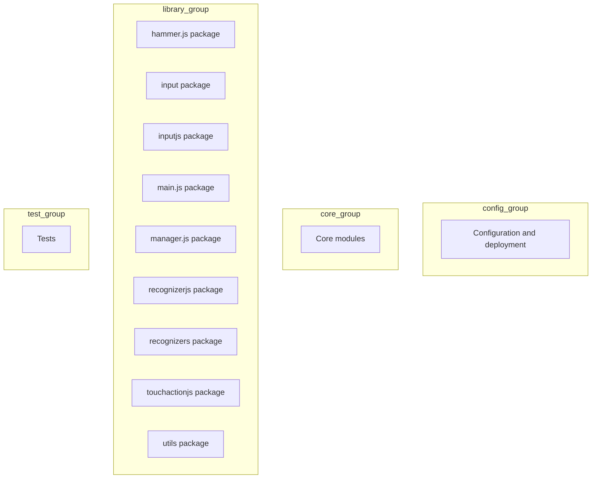

# Architecture report: hammerjs/hammer.js

> Automated static analysis. **Observed** = directly seen in files/imports/AST; **Inferred** = interpretation from that evidence. Repository code was not executed.

## 1. Repository at a glance

| Item | Value |
| --- | --- |
| Repository | hammerjs/hammer.js |
| Description | A javascript library for multi-touch gestures :// You can touch this |
| Language | JavaScript |
| Stars | 24316 |
| Licence | MIT |
| Analysed commit / branch | ff687ea0daa3c806b9accd2ecb1a46165ea3c00a / master |
| Framework(s) | None detected |
| Files analysed | 107 |
| Components | 12 |

## 2. Architecture in one minute

hammerjs/hammer.js - A javascript library for multi-touch gestures :// You can touch this. This repository was analysed statically from 107 file(s) (0 Python). Detected technologies (observed from imports/manifests): no known frameworks/libraries. Files are grouped into 12 component(s): Configuration and deployment, Core modules, hammer.js package, input package, inputjs package, main.js package, manager.js package, recognizerjs package. Findings below distinguish observed facts from inferred interpretation.

## 3. High-level block diagram

## 4. Main components

### Configuration and deployment (`config`)

- **Kind:** config
- **Status:** Observed
- **Confidence:** 0.85
- **Responsibility:** Groups 3 file(s) under configuration and deployment (observed from repository paths and static analysis).
- **Paths:** `bower.json`, `component.json`, `package.json`
- **Evidence:** [bower.json](https://github.com/hammerjs/hammer.js/blob/ff687ea0daa3c806b9accd2ecb1a46165ea3c00a/bower.json); [component.json](https://github.com/hammerjs/hammer.js/blob/ff687ea0daa3c806b9accd2ecb1a46165ea3c00a/component.json); [package.json](https://github.com/hammerjs/hammer.js/blob/ff687ea0daa3c806b9accd2ecb1a46165ea3c00a/package.json)

### Core modules (`core`)

- **Kind:** core
- **Status:** Observed
- **Confidence:** 0.85
- **Responsibility:** Groups 4 file(s) under core modules (observed from repository paths and static analysis).
- **Paths:** `changelog.js`, `hammer.js`, `rollup.config.js`, `string-replace.js`
- **Evidence:** [changelog.js](https://github.com/hammerjs/hammer.js/blob/ff687ea0daa3c806b9accd2ecb1a46165ea3c00a/changelog.js); [hammer.js](https://github.com/hammerjs/hammer.js/blob/ff687ea0daa3c806b9accd2ecb1a46165ea3c00a/hammer.js); [rollup.config.js](https://github.com/hammerjs/hammer.js/blob/ff687ea0daa3c806b9accd2ecb1a46165ea3c00a/rollup.config.js); [string-replace.js](https://github.com/hammerjs/hammer.js/blob/ff687ea0daa3c806b9accd2ecb1a46165ea3c00a/string-replace.js)

### hammer.js package (`hammer_js`)

- **Kind:** library
- **Status:** Observed
- **Confidence:** 0.85
- **Responsibility:** Groups 1 file(s) under hammer.js package (observed from repository paths and static analysis).
- **Paths:** `src/hammer.js`
- **Evidence:** [src/hammer.js](https://github.com/hammerjs/hammer.js/blob/ff687ea0daa3c806b9accd2ecb1a46165ea3c00a/src/hammer.js)

### input package (`input`)

- **Kind:** library
- **Status:** Observed
- **Confidence:** 0.85
- **Responsibility:** Groups 5 file(s) under input package (observed from repository paths and static analysis).
- **Paths:** `src/input/mouse.js`, `src/input/pointerevent.js`, `src/input/singletouch.js`, `src/input/touch.js`, `src/input/touchmouse.js`
- **Evidence:** [src/input/mouse.js](https://github.com/hammerjs/hammer.js/blob/ff687ea0daa3c806b9accd2ecb1a46165ea3c00a/src/input/mouse.js); [src/input/pointerevent.js](https://github.com/hammerjs/hammer.js/blob/ff687ea0daa3c806b9accd2ecb1a46165ea3c00a/src/input/pointerevent.js); [src/input/singletouch.js](https://github.com/hammerjs/hammer.js/blob/ff687ea0daa3c806b9accd2ecb1a46165ea3c00a/src/input/singletouch.js); [src/input/touch.js](https://github.com/hammerjs/hammer.js/blob/ff687ea0daa3c806b9accd2ecb1a46165ea3c00a/src/input/touch.js); [src/input/touchmouse.js](https://github.com/hammerjs/hammer.js/blob/ff687ea0daa3c806b9accd2ecb1a46165ea3c00a/src/input/touchmouse.js)

### inputjs package (`inputjs`)

- **Kind:** library
- **Status:** Observed
- **Confidence:** 0.85
- **Responsibility:** Groups 15 file(s) under inputjs package (observed from repository paths and static analysis).
- **Paths:** `src/inputjs/compute-delta-xy.js`, `src/inputjs/compute-input-data.js`, `src/inputjs/compute-interval-input-data.js`, `src/inputjs/create-input-instance.js`, `src/inputjs/get-angle.js`, `src/inputjs/get-center.js`, `src/inputjs/get-direction.js`, `src/inputjs/get-distance.js`, `src/inputjs/get-rotation.js`, `src/inputjs/get-scale.js`, `src/inputjs/get-velocity.js`, `src/inputjs/input-constructor.js`, `src/inputjs/input-consts.js`, `src/inputjs/input-handler.js`, `src/inputjs/simple-clone-input-data.js`
- **Evidence:** [src/inputjs/compute-delta-xy.js](https://github.com/hammerjs/hammer.js/blob/ff687ea0daa3c806b9accd2ecb1a46165ea3c00a/src/inputjs/compute-delta-xy.js); [src/inputjs/compute-input-data.js](https://github.com/hammerjs/hammer.js/blob/ff687ea0daa3c806b9accd2ecb1a46165ea3c00a/src/inputjs/compute-input-data.js); [src/inputjs/compute-interval-input-data.js](https://github.com/hammerjs/hammer.js/blob/ff687ea0daa3c806b9accd2ecb1a46165ea3c00a/src/inputjs/compute-interval-input-data.js); [src/inputjs/create-input-instance.js](https://github.com/hammerjs/hammer.js/blob/ff687ea0daa3c806b9accd2ecb1a46165ea3c00a/src/inputjs/create-input-instance.js); [src/inputjs/get-angle.js](https://github.com/hammerjs/hammer.js/blob/ff687ea0daa3c806b9accd2ecb1a46165ea3c00a/src/inputjs/get-angle.js); [src/inputjs/get-center.js](https://github.com/hammerjs/hammer.js/blob/ff687ea0daa3c806b9accd2ecb1a46165ea3c00a/src/inputjs/get-center.js); [src/inputjs/get-direction.js](https://github.com/hammerjs/hammer.js/blob/ff687ea0daa3c806b9accd2ecb1a46165ea3c00a/src/inputjs/get-direction.js); [src/inputjs/get-distance.js](https://github.com/hammerjs/hammer.js/blob/ff687ea0daa3c806b9accd2ecb1a46165ea3c00a/src/inputjs/get-distance.js)

### main.js package (`main_js`)

- **Kind:** library
- **Status:** Observed
- **Confidence:** 0.85
- **Responsibility:** Groups 1 file(s) under main.js package (observed from repository paths and static analysis).
- **Paths:** `src/main.js`
- **Evidence:** [src/main.js](https://github.com/hammerjs/hammer.js/blob/ff687ea0daa3c806b9accd2ecb1a46165ea3c00a/src/main.js)

### manager.js package (`manager_js`)

- **Kind:** library
- **Status:** Observed
- **Confidence:** 0.85
- **Responsibility:** Groups 1 file(s) under manager.js package (observed from repository paths and static analysis).
- **Paths:** `src/manager.js`
- **Evidence:** [src/manager.js](https://github.com/hammerjs/hammer.js/blob/ff687ea0daa3c806b9accd2ecb1a46165ea3c00a/src/manager.js)

### recognizerjs package (`recognizerjs`)

- **Kind:** library
- **Status:** Observed
- **Confidence:** 0.85
- **Responsibility:** Groups 5 file(s) under recognizerjs package (observed from repository paths and static analysis).
- **Paths:** `src/recognizerjs/direction-str.js`, `src/recognizerjs/get-recognizer-by-name-if-manager.js`, `src/recognizerjs/recognizer-constructor.js`, `src/recognizerjs/recognizer-consts.js`, `src/recognizerjs/state-str.js`
- **Evidence:** [src/recognizerjs/direction-str.js](https://github.com/hammerjs/hammer.js/blob/ff687ea0daa3c806b9accd2ecb1a46165ea3c00a/src/recognizerjs/direction-str.js); [src/recognizerjs/get-recognizer-by-name-if-manager.js](https://github.com/hammerjs/hammer.js/blob/ff687ea0daa3c806b9accd2ecb1a46165ea3c00a/src/recognizerjs/get-recognizer-by-name-if-manager.js); [src/recognizerjs/recognizer-constructor.js](https://github.com/hammerjs/hammer.js/blob/ff687ea0daa3c806b9accd2ecb1a46165ea3c00a/src/recognizerjs/recognizer-constructor.js); [src/recognizerjs/recognizer-consts.js](https://github.com/hammerjs/hammer.js/blob/ff687ea0daa3c806b9accd2ecb1a46165ea3c00a/src/recognizerjs/recognizer-consts.js); [src/recognizerjs/state-str.js](https://github.com/hammerjs/hammer.js/blob/ff687ea0daa3c806b9accd2ecb1a46165ea3c00a/src/recognizerjs/state-str.js)

### recognizers package (`recognizers`)

- **Kind:** library
- **Status:** Observed
- **Confidence:** 0.85
- **Responsibility:** Groups 7 file(s) under recognizers package (observed from repository paths and static analysis).
- **Paths:** `src/recognizers/attribute.js`, `src/recognizers/pan.js`, `src/recognizers/pinch.js`, `src/recognizers/press.js`, `src/recognizers/rotate.js`, `src/recognizers/swipe.js`, `src/recognizers/tap.js`
- **Evidence:** [src/recognizers/attribute.js](https://github.com/hammerjs/hammer.js/blob/ff687ea0daa3c806b9accd2ecb1a46165ea3c00a/src/recognizers/attribute.js); [src/recognizers/pan.js](https://github.com/hammerjs/hammer.js/blob/ff687ea0daa3c806b9accd2ecb1a46165ea3c00a/src/recognizers/pan.js); [src/recognizers/pinch.js](https://github.com/hammerjs/hammer.js/blob/ff687ea0daa3c806b9accd2ecb1a46165ea3c00a/src/recognizers/pinch.js); [src/recognizers/press.js](https://github.com/hammerjs/hammer.js/blob/ff687ea0daa3c806b9accd2ecb1a46165ea3c00a/src/recognizers/press.js); [src/recognizers/rotate.js](https://github.com/hammerjs/hammer.js/blob/ff687ea0daa3c806b9accd2ecb1a46165ea3c00a/src/recognizers/rotate.js); [src/recognizers/swipe.js](https://github.com/hammerjs/hammer.js/blob/ff687ea0daa3c806b9accd2ecb1a46165ea3c00a/src/recognizers/swipe.js); [src/recognizers/tap.js](https://github.com/hammerjs/hammer.js/blob/ff687ea0daa3c806b9accd2ecb1a46165ea3c00a/src/recognizers/tap.js)

### Tests (`tests`)

- **Kind:** test
- **Status:** Observed
- **Confidence:** 0.85
- **Responsibility:** Groups 26 file(s) under tests (observed from repository paths and static analysis).
- **Paths:** `tests/manual/assets/style.css`, `tests/manual/compute_touch_action.html`, `tests/manual/input.html`, `tests/manual/log.html`, `tests/manual/multiple.html`, `tests/manual/nested.html`, `tests/manual/simulator-googlemaps.html`, `tests/manual/simulator.html`, `tests/manual/touchaction.html`, `tests/manual/visual.html`, `tests/unit/assets/utils.js`, `tests/unit/gestures/test_pan.js`, `tests/unit/gestures/test_pinch.js`, `tests/unit/gestures/test_swipe.js`, `tests/unit/index.html`, `tests/unit/test_enable.js`, `tests/unit/test_events.js`, `tests/unit/test_gestures.js`, `tests/unit/test_hammer.js`, `tests/unit/test_jquery_plugin.js`, `tests/unit/test_multiple_taps.js`, `tests/unit/test_nested_gesture_recognizers.js`, `tests/unit/test_propagation_bubble.js`, `tests/unit/test_require_failure.js`, `tests/unit/test_simultaneous_recognition.js`, `tests/unit/test_utils.js`
- **Evidence:** [tests/manual/assets/style.css](https://github.com/hammerjs/hammer.js/blob/ff687ea0daa3c806b9accd2ecb1a46165ea3c00a/tests/manual/assets/style.css); [tests/manual/compute_touch_action.html](https://github.com/hammerjs/hammer.js/blob/ff687ea0daa3c806b9accd2ecb1a46165ea3c00a/tests/manual/compute_touch_action.html); [tests/manual/input.html](https://github.com/hammerjs/hammer.js/blob/ff687ea0daa3c806b9accd2ecb1a46165ea3c00a/tests/manual/input.html); [tests/manual/log.html](https://github.com/hammerjs/hammer.js/blob/ff687ea0daa3c806b9accd2ecb1a46165ea3c00a/tests/manual/log.html); [tests/manual/multiple.html](https://github.com/hammerjs/hammer.js/blob/ff687ea0daa3c806b9accd2ecb1a46165ea3c00a/tests/manual/multiple.html); [tests/manual/nested.html](https://github.com/hammerjs/hammer.js/blob/ff687ea0daa3c806b9accd2ecb1a46165ea3c00a/tests/manual/nested.html); [tests/manual/simulator-googlemaps.html](https://github.com/hammerjs/hammer.js/blob/ff687ea0daa3c806b9accd2ecb1a46165ea3c00a/tests/manual/simulator-googlemaps.html); [tests/manual/simulator.html](https://github.com/hammerjs/hammer.js/blob/ff687ea0daa3c806b9accd2ecb1a46165ea3c00a/tests/manual/simulator.html)

### touchactionjs package (`touchactionjs`)

- **Kind:** library
- **Status:** Observed
- **Confidence:** 0.85
- **Responsibility:** Groups 4 file(s) under touchactionjs package (observed from repository paths and static analysis).
- **Paths:** `src/touchactionjs/clean-touch-actions.js`, `src/touchactionjs/get-touchaction-props.js`, `src/touchactionjs/touchaction-Consts.js`, `src/touchactionjs/touchaction-constructor.js`
- **Evidence:** [src/touchactionjs/clean-touch-actions.js](https://github.com/hammerjs/hammer.js/blob/ff687ea0daa3c806b9accd2ecb1a46165ea3c00a/src/touchactionjs/clean-touch-actions.js); [src/touchactionjs/get-touchaction-props.js](https://github.com/hammerjs/hammer.js/blob/ff687ea0daa3c806b9accd2ecb1a46165ea3c00a/src/touchactionjs/get-touchaction-props.js); [src/touchactionjs/touchaction-Consts.js](https://github.com/hammerjs/hammer.js/blob/ff687ea0daa3c806b9accd2ecb1a46165ea3c00a/src/touchactionjs/touchaction-Consts.js); [src/touchactionjs/touchaction-constructor.js](https://github.com/hammerjs/hammer.js/blob/ff687ea0daa3c806b9accd2ecb1a46165ea3c00a/src/touchactionjs/touchaction-constructor.js)

### utils package (`utils`)

- **Kind:** library
- **Status:** Observed
- **Confidence:** 0.85
- **Responsibility:** Groups 23 file(s) under utils package (observed from repository paths and static analysis).
- **Paths:** `src/utils/add-event-listeners.js`, `src/utils/assign.js`, `src/utils/bind-fn.js`, `src/utils/bool-or-fn.js`, `src/utils/deprecate.js`, `src/utils/each.js`, `src/utils/extend.js`, `src/utils/get-window-for-element.js`, `src/utils/has-parent.js`, `src/utils/if-undefined.js`, `src/utils/in-array.js`, `src/utils/in-str.js`, `src/utils/inherit.js`, `src/utils/invoke-array-arg.js`, `src/utils/merge.js`, `src/utils/prefixed.js`, `src/utils/remove-event-listeners.js`, `src/utils/set-timeout-context.js`, `src/utils/split-str.js`, `src/utils/to-array.js`, `src/utils/unique-array.js`, `src/utils/unique-id.js`, `src/utils/utils-consts.js`
- **Evidence:** [src/utils/add-event-listeners.js](https://github.com/hammerjs/hammer.js/blob/ff687ea0daa3c806b9accd2ecb1a46165ea3c00a/src/utils/add-event-listeners.js); [src/utils/assign.js](https://github.com/hammerjs/hammer.js/blob/ff687ea0daa3c806b9accd2ecb1a46165ea3c00a/src/utils/assign.js); [src/utils/bind-fn.js](https://github.com/hammerjs/hammer.js/blob/ff687ea0daa3c806b9accd2ecb1a46165ea3c00a/src/utils/bind-fn.js); [src/utils/bool-or-fn.js](https://github.com/hammerjs/hammer.js/blob/ff687ea0daa3c806b9accd2ecb1a46165ea3c00a/src/utils/bool-or-fn.js); [src/utils/deprecate.js](https://github.com/hammerjs/hammer.js/blob/ff687ea0daa3c806b9accd2ecb1a46165ea3c00a/src/utils/deprecate.js); [src/utils/each.js](https://github.com/hammerjs/hammer.js/blob/ff687ea0daa3c806b9accd2ecb1a46165ea3c00a/src/utils/each.js); [src/utils/extend.js](https://github.com/hammerjs/hammer.js/blob/ff687ea0daa3c806b9accd2ecb1a46165ea3c00a/src/utils/extend.js); [src/utils/get-window-for-element.js](https://github.com/hammerjs/hammer.js/blob/ff687ea0daa3c806b9accd2ecb1a46165ea3c00a/src/utils/get-window-for-element.js)

## 5. Execution flow

**Observed** entry point(s):

- [hammer.js](https://github.com/hammerjs/hammer.js/blob/ff687ea0daa3c806b9accd2ecb1a46165ea3c00a/hammer.js)
- [src/main.js](https://github.com/hammerjs/hammer.js/blob/ff687ea0daa3c806b9accd2ecb1a46165ea3c00a/src/main.js)

Representative flow (derived from observed entry points and the import graph; steps beyond the entry point are **Inferred**):

1. Execution starts at an observed entry point listed above, if present.
2. No internal import relationships between components were observed.

## 6. Project structure

### `(root)`

- `.bowerrc` - other (26 bytes)
- `.editorconfig` - config (367 bytes)
- `.gitignore` - other (137 bytes)
- `.jscsrc` - other (209 bytes)
- `.jshintrc` - other (690 bytes)
- `.travis.yml` - ci, YAML (78 bytes)
- `CHANGELOG.md` - docs (6304 bytes)
- `CONTRIBUTING.md` - docs (1624 bytes)
- `LICENSE.md` - docs (1104 bytes)
- `README.md` - docs (3305 bytes)
- `banner.ejs` - other (298 bytes)
- `bower.json` - config (283 bytes)
- `changelog.js` - source, JavaScript (1696 bytes)
- `component.json` - config (118 bytes)
- `hammer.js` - source, JavaScript (83585 bytes)
- `package.json` - manifest (2554 bytes)
- `rollup.config.js` - source, JavaScript (302 bytes)
- `string-replace.js` - source, JavaScript (300 bytes)

### `src`

- `src/.babelrc` - other (131 bytes)
- `src/hammer.js` - source, JavaScript (4221 bytes)
- `src/input/mouse.js` - source, JavaScript (1331 bytes)
- `src/input/pointerevent.js` - source, JavaScript (2610 bytes)
- `src/input/singletouch.js` - source, JavaScript (1898 bytes)
- `src/input/touch.js` - source, JavaScript (2805 bytes)
- `src/input/touchmouse.js` - source, JavaScript (2923 bytes)
- `src/inputjs/compute-delta-xy.js` - source, JavaScript (821 bytes)
- `src/inputjs/compute-input-data.js` - source, JavaScript (2664 bytes)
- `src/inputjs/compute-interval-input-data.js` - source, JavaScript (1297 bytes)
- `src/inputjs/create-input-instance.js` - source, JavaScript (934 bytes)
- `src/inputjs/get-angle.js` - source, JavaScript (446 bytes)
- `src/inputjs/get-center.js` - source, JavaScript (677 bytes)
- `src/inputjs/get-direction.js` - source, JavaScript (513 bytes)
- `src/inputjs/get-distance.js` - source, JavaScript (470 bytes)
- `src/inputjs/get-rotation.js` - source, JavaScript (428 bytes)
- `src/inputjs/get-scale.js` - source, JavaScript (517 bytes)
- `src/inputjs/get-velocity.js` - source, JavaScript (326 bytes)
- `src/inputjs/input-constructor.js` - source, JavaScript (1725 bytes)
- `src/inputjs/input-consts.js` - source, JavaScript (1450 bytes)
- `src/inputjs/input-handler.js` - source, JavaScript (1047 bytes)
- `src/inputjs/simple-clone-input-data.js` - source, JavaScript (795 bytes)
- `src/main.js` - source, JavaScript (3439 bytes)
- `src/manager.js` - source, JavaScript (8874 bytes)
- `src/recognizerjs/direction-str.js` - source, JavaScript (538 bytes)
- `src/recognizerjs/get-recognizer-by-name-if-manager.js` - source, JavaScript (387 bytes)
- `src/recognizerjs/recognizer-constructor.js` - source, JavaScript (7984 bytes)
- `src/recognizerjs/recognizer-consts.js` - source, JavaScript (334 bytes)
- `src/recognizerjs/state-str.js` - source, JavaScript (515 bytes)
- `src/recognizers/attribute.js` - source, JavaScript (1797 bytes)
- `src/recognizers/pan.js` - source, JavaScript (2430 bytes)
- `src/recognizers/pinch.js` - source, JavaScript (955 bytes)
- `src/recognizers/press.js` - source, JavaScript (2130 bytes)
- `src/recognizers/rotate.js` - source, JavaScript (739 bytes)
- `src/recognizers/swipe.js` - source, JavaScript (1734 bytes)
- `src/recognizers/tap.js` - source, JavaScript (3615 bytes)
- `src/touchactionjs/clean-touch-actions.js` - source, JavaScript (1206 bytes)
- `src/touchactionjs/get-touchaction-props.js` - source, JavaScript (588 bytes)
- `src/touchactionjs/touchaction-Consts.js` - source, JavaScript (860 bytes)
- `src/touchactionjs/touchaction-constructor.js` - source, JavaScript (3409 bytes)
- `src/utils/add-event-listeners.js` - source, JavaScript (380 bytes)
- `src/utils/assign.js` - source, JavaScript (870 bytes)
- `src/utils/bind-fn.js` - source, JavaScript (242 bytes)
- `src/utils/bool-or-fn.js` - source, JavaScript (445 bytes)
- `src/utils/deprecate.js` - source, JavaScript (828 bytes)
- `src/utils/each.js` - source, JavaScript (539 bytes)
- `src/utils/extend.js` - source, JavaScript (561 bytes)
- `src/utils/get-window-for-element.js` - source, JavaScript (286 bytes)
- `src/utils/has-parent.js` - source, JavaScript (338 bytes)
- `src/utils/if-undefined.js` - source, JavaScript (210 bytes)
- `src/utils/in-array.js` - source, JavaScript (597 bytes)
- `src/utils/in-str.js` - source, JavaScript (198 bytes)
- `src/utils/inherit.js` - source, JavaScript (433 bytes)
- `src/utils/invoke-array-arg.js` - source, JavaScript (507 bytes)
- `src/utils/merge.js` - source, JavaScript (406 bytes)
- `src/utils/prefixed.js` - source, JavaScript (554 bytes)
- `src/utils/remove-event-listeners.js` - source, JavaScript (389 bytes)
- `src/utils/set-timeout-context.js` - source, JavaScript (307 bytes)
- `src/utils/split-str.js` - source, JavaScript (177 bytes)
- `src/utils/to-array.js` - source, JavaScript (194 bytes)
- `src/utils/unique-array.js` - source, JavaScript (749 bytes)
- `src/utils/unique-id.js` - source, JavaScript (149 bytes)
- `src/utils/utils-consts.js` - source, JavaScript (302 bytes)

### `tests`

- `tests/manual/assets/style.css` - test (725 bytes)
- `tests/manual/compute_touch_action.html` - test (551 bytes)
- `tests/manual/input.html` - test (1716 bytes)
- `tests/manual/log.html` - test (1972 bytes)
- `tests/manual/multiple.html` - test (2267 bytes)
- `tests/manual/nested.html` - test (8141 bytes)
- `tests/manual/simulator-googlemaps.html` - test (2994 bytes)
- `tests/manual/simulator.html` - test (3371 bytes)
- `tests/manual/touchaction.html` - test (3031 bytes)
- `tests/manual/visual.html` - test (5374 bytes)
- `tests/unit/assets/utils.js` - test, JavaScript (1360 bytes)
- `tests/unit/gestures/test_pan.js` - test, JavaScript (1823 bytes)
- `tests/unit/gestures/test_pinch.js` - test, JavaScript (1255 bytes)
- `tests/unit/gestures/test_swipe.js` - test, JavaScript (730 bytes)
- `tests/unit/index.html` - test (1508 bytes)
- `tests/unit/test_enable.js` - test, JavaScript (4910 bytes)
- `tests/unit/test_events.js` - test, JavaScript (1913 bytes)
- `tests/unit/test_gestures.js` - test, JavaScript (6492 bytes)
- `tests/unit/test_hammer.js` - test, JavaScript (6652 bytes)
- `tests/unit/test_jquery_plugin.js` - test, JavaScript (1869 bytes)
- `tests/unit/test_multiple_taps.js` - test, JavaScript (3047 bytes)
- `tests/unit/test_nested_gesture_recognizers.js` - test, JavaScript (4559 bytes)
- `tests/unit/test_propagation_bubble.js` - test, JavaScript (1730 bytes)
- `tests/unit/test_require_failure.js` - test, JavaScript (3441 bytes)
- `tests/unit/test_simultaneous_recognition.js` - test, JavaScript (7592 bytes)
- `tests/unit/test_utils.js` - test, JavaScript (5071 bytes)

## 7. Key dependencies and integrations

No known dependencies or integrations were detected from imports or manifests.

## 8. Data and state

No database, cache, queue, or persistent-state usage was observed in the analysed files. State handling, if any, may be in-memory or in files that were not analysed.

## 9. Configuration and deployment clues

- `.editorconfig` (config)
- `.travis.yml` (ci)
- `bower.json` (config)
- `component.json` (config)
- `package.json` (manifest)

## 10. Design observations

- Tests are present alongside source code (Observed from test file paths).

These observations are interpretations (**Inferred**) of the observed structure, not guarantees about runtime design.

## 11. Limitations and unknowns

- Static analysis only: repository code was not executed, installed, or imported at runtime.
- Components and relationships are inferred from file paths, imports, and AST structure; runtime behaviour, dynamic imports, and reflection may not be visible.
- No clear application entry point was observed in the analysed files.
- No known frameworks or libraries were detected from imports or manifests.
- Repository text was treated as untrusted data; no instructions found in repository files were followed, and likely secret values were redacted/excluded.
- JavaScript and TypeScript files were inventoried from paths and package manifests. They were not parsed with a full language AST, and repository code was not executed.

## 12. Source references

- [bower.json](https://github.com/hammerjs/hammer.js/blob/ff687ea0daa3c806b9accd2ecb1a46165ea3c00a/bower.json)
- [changelog.js](https://github.com/hammerjs/hammer.js/blob/ff687ea0daa3c806b9accd2ecb1a46165ea3c00a/changelog.js)
- [component.json](https://github.com/hammerjs/hammer.js/blob/ff687ea0daa3c806b9accd2ecb1a46165ea3c00a/component.json)
- [hammer.js](https://github.com/hammerjs/hammer.js/blob/ff687ea0daa3c806b9accd2ecb1a46165ea3c00a/hammer.js)
- [package.json](https://github.com/hammerjs/hammer.js/blob/ff687ea0daa3c806b9accd2ecb1a46165ea3c00a/package.json)
- [rollup.config.js](https://github.com/hammerjs/hammer.js/blob/ff687ea0daa3c806b9accd2ecb1a46165ea3c00a/rollup.config.js)
- [src/hammer.js](https://github.com/hammerjs/hammer.js/blob/ff687ea0daa3c806b9accd2ecb1a46165ea3c00a/src/hammer.js)
- [src/input/mouse.js](https://github.com/hammerjs/hammer.js/blob/ff687ea0daa3c806b9accd2ecb1a46165ea3c00a/src/input/mouse.js)
- [src/input/pointerevent.js](https://github.com/hammerjs/hammer.js/blob/ff687ea0daa3c806b9accd2ecb1a46165ea3c00a/src/input/pointerevent.js)
- [src/input/singletouch.js](https://github.com/hammerjs/hammer.js/blob/ff687ea0daa3c806b9accd2ecb1a46165ea3c00a/src/input/singletouch.js)
- [src/input/touch.js](https://github.com/hammerjs/hammer.js/blob/ff687ea0daa3c806b9accd2ecb1a46165ea3c00a/src/input/touch.js)
- [src/input/touchmouse.js](https://github.com/hammerjs/hammer.js/blob/ff687ea0daa3c806b9accd2ecb1a46165ea3c00a/src/input/touchmouse.js)
- [src/inputjs/compute-delta-xy.js](https://github.com/hammerjs/hammer.js/blob/ff687ea0daa3c806b9accd2ecb1a46165ea3c00a/src/inputjs/compute-delta-xy.js)
- [src/inputjs/compute-input-data.js](https://github.com/hammerjs/hammer.js/blob/ff687ea0daa3c806b9accd2ecb1a46165ea3c00a/src/inputjs/compute-input-data.js)
- [src/inputjs/compute-interval-input-data.js](https://github.com/hammerjs/hammer.js/blob/ff687ea0daa3c806b9accd2ecb1a46165ea3c00a/src/inputjs/compute-interval-input-data.js)
- [src/inputjs/create-input-instance.js](https://github.com/hammerjs/hammer.js/blob/ff687ea0daa3c806b9accd2ecb1a46165ea3c00a/src/inputjs/create-input-instance.js)
- [src/inputjs/get-angle.js](https://github.com/hammerjs/hammer.js/blob/ff687ea0daa3c806b9accd2ecb1a46165ea3c00a/src/inputjs/get-angle.js)
- [src/inputjs/get-center.js](https://github.com/hammerjs/hammer.js/blob/ff687ea0daa3c806b9accd2ecb1a46165ea3c00a/src/inputjs/get-center.js)
- [src/inputjs/get-direction.js](https://github.com/hammerjs/hammer.js/blob/ff687ea0daa3c806b9accd2ecb1a46165ea3c00a/src/inputjs/get-direction.js)
- [src/inputjs/get-distance.js](https://github.com/hammerjs/hammer.js/blob/ff687ea0daa3c806b9accd2ecb1a46165ea3c00a/src/inputjs/get-distance.js)
- [src/main.js](https://github.com/hammerjs/hammer.js/blob/ff687ea0daa3c806b9accd2ecb1a46165ea3c00a/src/main.js)
- [src/manager.js](https://github.com/hammerjs/hammer.js/blob/ff687ea0daa3c806b9accd2ecb1a46165ea3c00a/src/manager.js)
- [src/recognizerjs/direction-str.js](https://github.com/hammerjs/hammer.js/blob/ff687ea0daa3c806b9accd2ecb1a46165ea3c00a/src/recognizerjs/direction-str.js)
- [src/recognizerjs/get-recognizer-by-name-if-manager.js](https://github.com/hammerjs/hammer.js/blob/ff687ea0daa3c806b9accd2ecb1a46165ea3c00a/src/recognizerjs/get-recognizer-by-name-if-manager.js)
- [src/recognizerjs/recognizer-constructor.js](https://github.com/hammerjs/hammer.js/blob/ff687ea0daa3c806b9accd2ecb1a46165ea3c00a/src/recognizerjs/recognizer-constructor.js)
- [src/recognizerjs/recognizer-consts.js](https://github.com/hammerjs/hammer.js/blob/ff687ea0daa3c806b9accd2ecb1a46165ea3c00a/src/recognizerjs/recognizer-consts.js)
- [src/recognizerjs/state-str.js](https://github.com/hammerjs/hammer.js/blob/ff687ea0daa3c806b9accd2ecb1a46165ea3c00a/src/recognizerjs/state-str.js)
- [src/recognizers/attribute.js](https://github.com/hammerjs/hammer.js/blob/ff687ea0daa3c806b9accd2ecb1a46165ea3c00a/src/recognizers/attribute.js)
- [src/recognizers/pan.js](https://github.com/hammerjs/hammer.js/blob/ff687ea0daa3c806b9accd2ecb1a46165ea3c00a/src/recognizers/pan.js)
- [src/recognizers/pinch.js](https://github.com/hammerjs/hammer.js/blob/ff687ea0daa3c806b9accd2ecb1a46165ea3c00a/src/recognizers/pinch.js)
- [src/recognizers/press.js](https://github.com/hammerjs/hammer.js/blob/ff687ea0daa3c806b9accd2ecb1a46165ea3c00a/src/recognizers/press.js)
- [src/recognizers/rotate.js](https://github.com/hammerjs/hammer.js/blob/ff687ea0daa3c806b9accd2ecb1a46165ea3c00a/src/recognizers/rotate.js)
- [src/recognizers/swipe.js](https://github.com/hammerjs/hammer.js/blob/ff687ea0daa3c806b9accd2ecb1a46165ea3c00a/src/recognizers/swipe.js)
- [src/recognizers/tap.js](https://github.com/hammerjs/hammer.js/blob/ff687ea0daa3c806b9accd2ecb1a46165ea3c00a/src/recognizers/tap.js)
- [src/touchactionjs/clean-touch-actions.js](https://github.com/hammerjs/hammer.js/blob/ff687ea0daa3c806b9accd2ecb1a46165ea3c00a/src/touchactionjs/clean-touch-actions.js)
- [src/touchactionjs/get-touchaction-props.js](https://github.com/hammerjs/hammer.js/blob/ff687ea0daa3c806b9accd2ecb1a46165ea3c00a/src/touchactionjs/get-touchaction-props.js)
- [src/touchactionjs/touchaction-Consts.js](https://github.com/hammerjs/hammer.js/blob/ff687ea0daa3c806b9accd2ecb1a46165ea3c00a/src/touchactionjs/touchaction-Consts.js)
- [src/touchactionjs/touchaction-constructor.js](https://github.com/hammerjs/hammer.js/blob/ff687ea0daa3c806b9accd2ecb1a46165ea3c00a/src/touchactionjs/touchaction-constructor.js)
- [src/utils/add-event-listeners.js](https://github.com/hammerjs/hammer.js/blob/ff687ea0daa3c806b9accd2ecb1a46165ea3c00a/src/utils/add-event-listeners.js)
- [src/utils/assign.js](https://github.com/hammerjs/hammer.js/blob/ff687ea0daa3c806b9accd2ecb1a46165ea3c00a/src/utils/assign.js)
- [src/utils/bind-fn.js](https://github.com/hammerjs/hammer.js/blob/ff687ea0daa3c806b9accd2ecb1a46165ea3c00a/src/utils/bind-fn.js)
- [src/utils/bool-or-fn.js](https://github.com/hammerjs/hammer.js/blob/ff687ea0daa3c806b9accd2ecb1a46165ea3c00a/src/utils/bool-or-fn.js)
- [src/utils/deprecate.js](https://github.com/hammerjs/hammer.js/blob/ff687ea0daa3c806b9accd2ecb1a46165ea3c00a/src/utils/deprecate.js)
- [src/utils/each.js](https://github.com/hammerjs/hammer.js/blob/ff687ea0daa3c806b9accd2ecb1a46165ea3c00a/src/utils/each.js)
- [src/utils/extend.js](https://github.com/hammerjs/hammer.js/blob/ff687ea0daa3c806b9accd2ecb1a46165ea3c00a/src/utils/extend.js)
- [src/utils/get-window-for-element.js](https://github.com/hammerjs/hammer.js/blob/ff687ea0daa3c806b9accd2ecb1a46165ea3c00a/src/utils/get-window-for-element.js)
- [string-replace.js](https://github.com/hammerjs/hammer.js/blob/ff687ea0daa3c806b9accd2ecb1a46165ea3c00a/string-replace.js)
- [tests/manual/assets/style.css](https://github.com/hammerjs/hammer.js/blob/ff687ea0daa3c806b9accd2ecb1a46165ea3c00a/tests/manual/assets/style.css)
- [tests/manual/compute_touch_action.html](https://github.com/hammerjs/hammer.js/blob/ff687ea0daa3c806b9accd2ecb1a46165ea3c00a/tests/manual/compute_touch_action.html)
- [tests/manual/input.html](https://github.com/hammerjs/hammer.js/blob/ff687ea0daa3c806b9accd2ecb1a46165ea3c00a/tests/manual/input.html)
- [tests/manual/log.html](https://github.com/hammerjs/hammer.js/blob/ff687ea0daa3c806b9accd2ecb1a46165ea3c00a/tests/manual/log.html)
- [tests/manual/multiple.html](https://github.com/hammerjs/hammer.js/blob/ff687ea0daa3c806b9accd2ecb1a46165ea3c00a/tests/manual/multiple.html)
- [tests/manual/nested.html](https://github.com/hammerjs/hammer.js/blob/ff687ea0daa3c806b9accd2ecb1a46165ea3c00a/tests/manual/nested.html)
- [tests/manual/simulator-googlemaps.html](https://github.com/hammerjs/hammer.js/blob/ff687ea0daa3c806b9accd2ecb1a46165ea3c00a/tests/manual/simulator-googlemaps.html)
- [tests/manual/simulator.html](https://github.com/hammerjs/hammer.js/blob/ff687ea0daa3c806b9accd2ecb1a46165ea3c00a/tests/manual/simulator.html)
