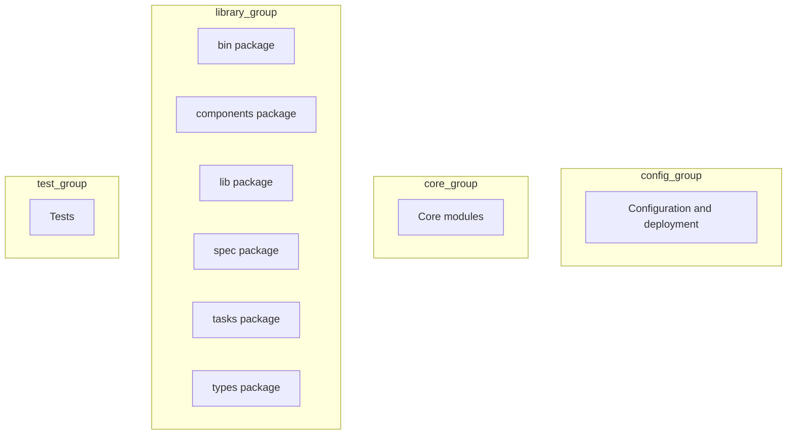

# Architecture report: handlebars-lang/handlebars.js

> Automated static analysis. **Observed** = directly seen in files/imports/AST; **Inferred** = interpretation from that evidence. Repository code was not executed.

## 1. Repository at a glance

| Item | Value |
| --- | --- |
| Repository | handlebars-lang/handlebars.js |
| Description | Minimal templating on steroids. |
| Language | JavaScript |
| Stars | 18692 |
| Licence | MIT |
| Analysed commit / branch | 13a7a679910d2adbfe7f6fad61ce8f98426b0378 / master |
| Framework(s) | None detected |
| Files analysed | 143 |
| Components | 9 |

## 2. Architecture in one minute

handlebars-lang/handlebars.js - Minimal templating on steroids.. This repository was analysed statically from 143 file(s) (0 Python). Detected technologies (observed from imports/manifests): GitHub Actions, TypeScript, Vitest, webpack. Files are grouped into 9 component(s): bin package, components package, Configuration and deployment, Core modules, lib package, spec package, tasks package, Tests. Findings below distinguish observed facts from inferred interpretation.

## 3. High-level block diagram

## 4. Main components

### bin package (`bin`)

- **Kind:** library
- **Status:** Observed
- **Confidence:** 0.85
- **Responsibility:** Groups 1 file(s) under bin package (observed from repository paths and static analysis).
- **Paths:** `bin/handlebars.js`
- **Evidence:** [bin/handlebars.js](https://github.com/handlebars-lang/handlebars.js/blob/13a7a679910d2adbfe7f6fad61ce8f98426b0378/bin/handlebars.js)

### components package (`components`)

- **Kind:** library
- **Status:** Observed
- **Confidence:** 0.85
- **Responsibility:** Groups 1 file(s) under components package (observed from repository paths and static analysis).
- **Paths:** `components/lib/handlebars/source.rb`
- **Evidence:** [components/lib/handlebars/source.rb](https://github.com/handlebars-lang/handlebars.js/blob/13a7a679910d2adbfe7f6fad61ce8f98426b0378/components/lib/handlebars/source.rb)

### Configuration and deployment (`config`)

- **Kind:** config
- **Status:** Observed
- **Confidence:** 0.85
- **Responsibility:** Groups 7 file(s) under configuration and deployment (observed from repository paths and static analysis).
- **Paths:** `components/bower.json`, `components/component.json`, `components/composer.json`, `components/package.json`, `package.json`, `pnpm-workspace.yaml`, `types/tsconfig.json`
- **Evidence:** [components/bower.json](https://github.com/handlebars-lang/handlebars.js/blob/13a7a679910d2adbfe7f6fad61ce8f98426b0378/components/bower.json); [components/component.json](https://github.com/handlebars-lang/handlebars.js/blob/13a7a679910d2adbfe7f6fad61ce8f98426b0378/components/component.json); [components/composer.json](https://github.com/handlebars-lang/handlebars.js/blob/13a7a679910d2adbfe7f6fad61ce8f98426b0378/components/composer.json); [components/package.json](https://github.com/handlebars-lang/handlebars.js/blob/13a7a679910d2adbfe7f6fad61ce8f98426b0378/components/package.json); [package.json](https://github.com/handlebars-lang/handlebars.js/blob/13a7a679910d2adbfe7f6fad61ce8f98426b0378/package.json); [pnpm-workspace.yaml](https://github.com/handlebars-lang/handlebars.js/blob/13a7a679910d2adbfe7f6fad61ce8f98426b0378/pnpm-workspace.yaml); [types/tsconfig.json](https://github.com/handlebars-lang/handlebars.js/blob/13a7a679910d2adbfe7f6fad61ce8f98426b0378/types/tsconfig.json)

### Core modules (`core`)

- **Kind:** core
- **Status:** Observed
- **Confidence:** 0.85
- **Responsibility:** Groups 5 file(s) under core modules (observed from repository paths and static analysis).
- **Paths:** `eslint.config.js`, `rspack.config.js`, `runtime.d.ts`, `runtime.js`, `vitest.config.js`
- **Evidence:** [eslint.config.js](https://github.com/handlebars-lang/handlebars.js/blob/13a7a679910d2adbfe7f6fad61ce8f98426b0378/eslint.config.js); [rspack.config.js](https://github.com/handlebars-lang/handlebars.js/blob/13a7a679910d2adbfe7f6fad61ce8f98426b0378/rspack.config.js); [runtime.d.ts](https://github.com/handlebars-lang/handlebars.js/blob/13a7a679910d2adbfe7f6fad61ce8f98426b0378/runtime.d.ts); [runtime.js](https://github.com/handlebars-lang/handlebars.js/blob/13a7a679910d2adbfe7f6fad61ce8f98426b0378/runtime.js); [vitest.config.js](https://github.com/handlebars-lang/handlebars.js/blob/13a7a679910d2adbfe7f6fad61ce8f98426b0378/vitest.config.js)

### lib package (`lib`)

- **Kind:** library
- **Status:** Observed
- **Confidence:** 0.85
- **Responsibility:** Groups 28 file(s) under lib package (observed from repository paths and static analysis).
- **Paths:** `lib/handlebars.js`, `lib/handlebars.runtime.js`, `lib/handlebars/base.js`, `lib/handlebars/compiler/ast.js`, `lib/handlebars/compiler/code-gen.js`, `lib/handlebars/compiler/compiler.js`, `lib/handlebars/compiler/javascript-compiler.js`, `lib/handlebars/compiler/source-node.browser.js`, `lib/handlebars/compiler/source-node.node.js`, `lib/handlebars/decorators.js`, `lib/handlebars/decorators/inline.js`, `lib/handlebars/helpers.js`, `lib/handlebars/helpers/block-helper-missing.js`, `lib/handlebars/helpers/each.js`, `lib/handlebars/helpers/helper-missing.js`, `lib/handlebars/helpers/if.js`, `lib/handlebars/helpers/log.js`, `lib/handlebars/helpers/lookup.js`, `lib/handlebars/helpers/with.js`, `lib/handlebars/internal/proto-access.js`, `lib/handlebars/internal/wrapHelper.js`, `lib/handlebars/logger.js`, `lib/handlebars/no-conflict.js`, `lib/handlebars/runtime.js`, `lib/handlebars/safe-string.js`, `lib/handlebars/utils.js`, `lib/index.js`, `lib/precompiler.js`
- **Evidence:** [lib/handlebars.js](https://github.com/handlebars-lang/handlebars.js/blob/13a7a679910d2adbfe7f6fad61ce8f98426b0378/lib/handlebars.js); [lib/handlebars.runtime.js](https://github.com/handlebars-lang/handlebars.js/blob/13a7a679910d2adbfe7f6fad61ce8f98426b0378/lib/handlebars.runtime.js); [lib/handlebars/base.js](https://github.com/handlebars-lang/handlebars.js/blob/13a7a679910d2adbfe7f6fad61ce8f98426b0378/lib/handlebars/base.js); [lib/handlebars/compiler/ast.js](https://github.com/handlebars-lang/handlebars.js/blob/13a7a679910d2adbfe7f6fad61ce8f98426b0378/lib/handlebars/compiler/ast.js); [lib/handlebars/compiler/code-gen.js](https://github.com/handlebars-lang/handlebars.js/blob/13a7a679910d2adbfe7f6fad61ce8f98426b0378/lib/handlebars/compiler/code-gen.js); [lib/handlebars/compiler/compiler.js](https://github.com/handlebars-lang/handlebars.js/blob/13a7a679910d2adbfe7f6fad61ce8f98426b0378/lib/handlebars/compiler/compiler.js); [lib/handlebars/compiler/javascript-compiler.js](https://github.com/handlebars-lang/handlebars.js/blob/13a7a679910d2adbfe7f6fad61ce8f98426b0378/lib/handlebars/compiler/javascript-compiler.js); [lib/handlebars/compiler/source-node.browser.js](https://github.com/handlebars-lang/handlebars.js/blob/13a7a679910d2adbfe7f6fad61ce8f98426b0378/lib/handlebars/compiler/source-node.browser.js)

### spec package (`spec`)

- **Kind:** library
- **Status:** Observed
- **Confidence:** 0.85
- **Responsibility:** Groups 25 file(s) under spec package (observed from repository paths and static analysis).
- **Paths:** `spec/ast.js`, `spec/basic.js`, `spec/blocks.js`, `spec/builtins.js`, `spec/compiler.js`, `spec/data.js`, `spec/env/browser-vitest-pre.js`, `spec/env/browser-vitest.js`, `spec/env/browser.js`, `spec/env/common.js`, `spec/env/node.js`, `spec/expected/empty.namespace.js`, `spec/helpers.js`, `spec/javascript-compiler.js`, `spec/partials.js`, `spec/precompiler.js`, `spec/regressions.js`, `spec/runtime.js`, `spec/security.js`, `spec/source-map.js`, `spec/spec.js`, `spec/strict.js`, `spec/subexpressions.js`, `spec/utils.js`, `spec/whitespace-control.js`
- **Evidence:** [spec/ast.js](https://github.com/handlebars-lang/handlebars.js/blob/13a7a679910d2adbfe7f6fad61ce8f98426b0378/spec/ast.js); [spec/basic.js](https://github.com/handlebars-lang/handlebars.js/blob/13a7a679910d2adbfe7f6fad61ce8f98426b0378/spec/basic.js); [spec/blocks.js](https://github.com/handlebars-lang/handlebars.js/blob/13a7a679910d2adbfe7f6fad61ce8f98426b0378/spec/blocks.js); [spec/builtins.js](https://github.com/handlebars-lang/handlebars.js/blob/13a7a679910d2adbfe7f6fad61ce8f98426b0378/spec/builtins.js); [spec/compiler.js](https://github.com/handlebars-lang/handlebars.js/blob/13a7a679910d2adbfe7f6fad61ce8f98426b0378/spec/compiler.js); [spec/data.js](https://github.com/handlebars-lang/handlebars.js/blob/13a7a679910d2adbfe7f6fad61ce8f98426b0378/spec/data.js); [spec/env/browser-vitest-pre.js](https://github.com/handlebars-lang/handlebars.js/blob/13a7a679910d2adbfe7f6fad61ce8f98426b0378/spec/env/browser-vitest-pre.js); [spec/env/browser-vitest.js](https://github.com/handlebars-lang/handlebars.js/blob/13a7a679910d2adbfe7f6fad61ce8f98426b0378/spec/env/browser-vitest.js)

### tasks package (`tasks`)

- **Kind:** library
- **Status:** Observed
- **Confidence:** 0.85
- **Responsibility:** Groups 3 file(s) under tasks package (observed from repository paths and static analysis).
- **Paths:** `tasks/publish-to-aws.js`, `tasks/util/git.js`, `tasks/version.js`
- **Evidence:** [tasks/publish-to-aws.js](https://github.com/handlebars-lang/handlebars.js/blob/13a7a679910d2adbfe7f6fad61ce8f98426b0378/tasks/publish-to-aws.js); [tasks/util/git.js](https://github.com/handlebars-lang/handlebars.js/blob/13a7a679910d2adbfe7f6fad61ce8f98426b0378/tasks/util/git.js); [tasks/version.js](https://github.com/handlebars-lang/handlebars.js/blob/13a7a679910d2adbfe7f6fad61ce8f98426b0378/tasks/version.js)

### Tests (`tests`)

- **Kind:** test
- **Status:** Observed
- **Confidence:** 0.85
- **Responsibility:** Groups 38 file(s) under tests (observed from repository paths and static analysis).
- **Paths:** `tasks/tests/README.md`, `tasks/tests/cli.test.js`, `tasks/tests/fake-s3.js`, `tasks/tests/git.test.js`, `tasks/tests/publish-to-aws.test.js`, `tests/bench/compare.js`, `tests/bench/perf.js`, `tests/bench/report.js`, `tests/bench/size.js`, `tests/bench/templates.js`, `tests/browser/README.md`, `tests/browser/playwright.config.js`, `tests/browser/tests/lib.spec.js`, `tests/integration/README.md`, `tests/integration/multi-nodejs-test/.gitignore`, `tests/integration/multi-nodejs-test/package.json`, `tests/integration/multi-nodejs-test/precompile-test-template.txt.hbs`, `tests/integration/multi-nodejs-test/run-handlebars.js`, `tests/integration/multi-nodejs-test/test.sh`, `tests/integration/rollup-test/.gitignore`, `tests/integration/rollup-test/package.json`, `tests/integration/rollup-test/rollup.config.js`, `tests/integration/rollup-test/src/index.js`, `tests/integration/rollup-test/test.sh`, `tests/integration/run-integration-tests.sh`, `tests/integration/webpack-test/.gitignore`, `tests/integration/webpack-test/package.json`, `tests/integration/webpack-test/src/handlebars-default-import-test.js`, `tests/integration/webpack-test/src/handlebars-esm-import-test.js`, `tests/integration/webpack-test/src/handlebars-loader-test.js`, `tests/integration/webpack-test/src/handlebars-register-helper-test.js`, `tests/integration/webpack-test/src/handlebars-runtime-test.js`, `tests/integration/webpack-test/src/lib/assert.js`, `tests/integration/webpack-test/src/test-template.handlebars`, `tests/integration/webpack-test/test.sh`, `tests/integration/webpack-test/webpack.config.js`, `tests/print-script.js`, `tests/rspack/rspack.test.js`
- **Evidence:** [tasks/tests/README.md](https://github.com/handlebars-lang/handlebars.js/blob/13a7a679910d2adbfe7f6fad61ce8f98426b0378/tasks/tests/README.md); [tasks/tests/cli.test.js](https://github.com/handlebars-lang/handlebars.js/blob/13a7a679910d2adbfe7f6fad61ce8f98426b0378/tasks/tests/cli.test.js); [tasks/tests/fake-s3.js](https://github.com/handlebars-lang/handlebars.js/blob/13a7a679910d2adbfe7f6fad61ce8f98426b0378/tasks/tests/fake-s3.js); [tasks/tests/git.test.js](https://github.com/handlebars-lang/handlebars.js/blob/13a7a679910d2adbfe7f6fad61ce8f98426b0378/tasks/tests/git.test.js); [tasks/tests/publish-to-aws.test.js](https://github.com/handlebars-lang/handlebars.js/blob/13a7a679910d2adbfe7f6fad61ce8f98426b0378/tasks/tests/publish-to-aws.test.js); [tests/bench/compare.js](https://github.com/handlebars-lang/handlebars.js/blob/13a7a679910d2adbfe7f6fad61ce8f98426b0378/tests/bench/compare.js); [tests/bench/perf.js](https://github.com/handlebars-lang/handlebars.js/blob/13a7a679910d2adbfe7f6fad61ce8f98426b0378/tests/bench/perf.js); [tests/bench/report.js](https://github.com/handlebars-lang/handlebars.js/blob/13a7a679910d2adbfe7f6fad61ce8f98426b0378/tests/bench/report.js)

### types package (`types`)

- **Kind:** library
- **Status:** Observed
- **Confidence:** 0.85
- **Responsibility:** Groups 2 file(s) under types package (observed from repository paths and static analysis).
- **Paths:** `types/__typetests__/handlebars.tst.ts`, `types/index.d.ts`
- **Evidence:** [types/__typetests__/handlebars.tst.ts](https://github.com/handlebars-lang/handlebars.js/blob/13a7a679910d2adbfe7f6fad61ce8f98426b0378/types/__typetests__/handlebars.tst.ts); [types/index.d.ts](https://github.com/handlebars-lang/handlebars.js/blob/13a7a679910d2adbfe7f6fad61ce8f98426b0378/types/index.d.ts)

## 5. Execution flow

**Observed** entry point(s):

- [bin/handlebars.js](https://github.com/handlebars-lang/handlebars.js/blob/13a7a679910d2adbfe7f6fad61ce8f98426b0378/bin/handlebars.js)
- [lib/index.js](https://github.com/handlebars-lang/handlebars.js/blob/13a7a679910d2adbfe7f6fad61ce8f98426b0378/lib/index.js)

Representative flow (derived from observed entry points and the import graph; steps beyond the entry point are **Inferred**):

1. Execution starts at an observed entry point listed above, if present.
2. No internal import relationships between components were observed.

## 6. Project structure

### `(root)`

- `.editorconfig` - config (181 bytes)
- `.git-blame-ignore-revs` - other (217 bytes)
- `.gitattributes` - other (150 bytes)
- `.gitignore` - other (255 bytes)
- `.gitmodules` - other (94 bytes)
- `.oxfmtrc.json` - config (606 bytes)
- `.oxlintrc.json` - config (3564 bytes)
- `CONTRIBUTING.md` - docs (6234 bytes)
- `FAQ.md` - docs (2904 bytes)
- `LICENSE` - docs (1063 bytes)
- `README.md` - docs (12171 bytes)
- `SECURITY.md` - docs (493 bytes)
- `eslint.config.js` - source, JavaScript (407 bytes)
- `package.json` - manifest (3949 bytes)
- `pnpm-workspace.yaml` - config (27 bytes)
- `release-notes.md` - docs (63746 bytes)
- `rspack.config.js` - source, JavaScript (2533 bytes)
- `runtime.d.ts` - source, TypeScript (104 bytes)
- `runtime.js` - source, JavaScript (76 bytes)
- `vitest.config.js` - source, JavaScript (1877 bytes)

### `.github`

- `.github/ISSUE_TEMPLATE.md` - docs (609 bytes)
- `.github/PULL_REQUEST_TEMPLATE.md` - docs (941 bytes)
- `.github/dependabot.yml` - config (182 bytes)
- `.github/workflows/ci.yml` - ci, YAML (3456 bytes)
- `.github/workflows/release.yml` - ci, YAML (1044 bytes)

### `bin`

- `bin/handlebars.js` - source, JavaScript (2856 bytes)

### `components`

- `components/bower.json` - config (126 bytes)
- `components/component.json` - config (146 bytes)
- `components/composer.json` - config (761 bytes)
- `components/handlebars-source.gemspec` - other (705 bytes)
- `components/handlebars.js.nuspec` - other (644 bytes)
- `components/lib/handlebars/source.rb` - source, Ruby (247 bytes)
- `components/package.json` - manifest (326 bytes)

### `docs`

- `docs/compiler-api.md` - docs (10321 bytes)
- `docs/decorators-api.md` - docs (2010 bytes)

### `lib`

- `lib/handlebars.js` - source, JavaScript (1037 bytes)
- `lib/handlebars.runtime.js` - source, JavaScript (1634 bytes)
- `lib/handlebars/base.js` - source, JavaScript (2537 bytes)
- `lib/handlebars/compiler/ast.js` - source, JavaScript (988 bytes)
- `lib/handlebars/compiler/code-gen.js` - source, JavaScript (2794 bytes)
- `lib/handlebars/compiler/compiler.js` - source, JavaScript (13503 bytes)
- `lib/handlebars/compiler/javascript-compiler.js` - source, JavaScript (32603 bytes)
- `lib/handlebars/compiler/source-node.browser.js` - source, JavaScript (668 bytes)
- `lib/handlebars/compiler/source-node.node.js` - source, JavaScript (41 bytes)
- `lib/handlebars/decorators.js` - source, JavaScript (138 bytes)
- `lib/handlebars/decorators/inline.js` - source, JavaScript (674 bytes)
- `lib/handlebars/helpers.js` - source, JavaScript (912 bytes)
- `lib/handlebars/helpers/block-helper-missing.js` - source, JavaScript (586 bytes)
- `lib/handlebars/helpers/each.js` - source, JavaScript (2589 bytes)
- `lib/handlebars/helpers/helper-missing.js` - source, JavaScript (471 bytes)
- `lib/handlebars/helpers/if.js` - source, JavaScript (1197 bytes)
- `lib/handlebars/helpers/log.js` - source, JavaScript (523 bytes)
- `lib/handlebars/helpers/lookup.js` - source, JavaScript (255 bytes)
- `lib/handlebars/helpers/with.js` - source, JavaScript (619 bytes)
- `lib/handlebars/internal/proto-access.js` - source, JavaScript (2399 bytes)
- `lib/handlebars/internal/wrapHelper.js` - source, JavaScript (578 bytes)
- `lib/handlebars/logger.js` - source, JavaScript (957 bytes)
- `lib/handlebars/no-conflict.js` - source, JavaScript (273 bytes)
- `lib/handlebars/runtime.js` - source, JavaScript (12372 bytes)
- `lib/handlebars/safe-string.js` - source, JavaScript (230 bytes)
- `lib/handlebars/utils.js` - source, JavaScript (2273 bytes)
- `lib/index.js` - source, JavaScript (1191 bytes)
- `lib/precompiler.js` - source, JavaScript (7715 bytes)

### `spec`

- `spec/artifacts/bom.handlebars` - other (4 bytes)
- `spec/artifacts/empty.handlebars` - other (0 bytes)
- `spec/artifacts/example_1.handlebars` - other (8 bytes)
- `spec/artifacts/example_2.hbs` - other (17 bytes)
- `spec/artifacts/known.helpers.handlebars` - other (154 bytes)
- `spec/artifacts/non.default.extension.hbs` - other (25 bytes)
- `spec/artifacts/partial.template.handlebars` - other (23 bytes)
- `spec/ast.js` - source, JavaScript (5523 bytes)
- `spec/basic.js` - source, JavaScript (17969 bytes)
- `spec/blocks.js` - source, JavaScript (14416 bytes)
- `spec/builtins.js` - source, JavaScript (23879 bytes)
- `spec/compiler.js` - source, JavaScript (5587 bytes)
- `spec/data.js` - source, JavaScript (10054 bytes)
- `spec/env/browser-vitest-pre.js` - source, JavaScript (290 bytes)
- `spec/env/browser-vitest.js` - source, JavaScript (690 bytes)
- `spec/env/browser.js` - source, JavaScript (943 bytes)
- `spec/env/common.js` - source, JavaScript (3634 bytes)
- `spec/env/node.js` - source, JavaScript (659 bytes)
- `spec/expected/compiled.string.txt` - docs (139 bytes)
- `spec/expected/empty.namespace.js` - source, JavaScript (280 bytes)
- `spec/expected/help.menu.txt` - docs (2309 bytes)
- `spec/helpers.js` - source, JavaScript (33805 bytes)
- `spec/index.html` - other (1687 bytes)
- `spec/javascript-compiler.js` - source, JavaScript (4399 bytes)
- `spec/partials.js` - source, JavaScript (24145 bytes)
- `spec/precompiler.js` - source, JavaScript (9448 bytes)
- `spec/regressions.js` - source, JavaScript (15952 bytes)
- `spec/runtime.js` - source, JavaScript (1728 bytes)
- `spec/security.js` - source, JavaScript (15805 bytes)
- `spec/source-map.js` - source, JavaScript (1670 bytes)
- `spec/spec.js` - source, JavaScript (1780 bytes)
- `spec/strict.js` - source, JavaScript (8183 bytes)
- `spec/subexpressions.js` - source, JavaScript (5964 bytes)
- `spec/tmp/.gitkeep` - other (94 bytes)
- `spec/utils.js` - source, JavaScript (3516 bytes)
- `spec/whitespace-control.js` - source, JavaScript (4373 bytes)

### `tasks`

- `tasks/publish-to-aws.js` - source, JavaScript (2961 bytes)
- `tasks/tests/README.md` - test (43 bytes)
- `tasks/tests/cli.test.js` - test, JavaScript (6049 bytes)
- `tasks/tests/fake-s3.js` - test, JavaScript (2169 bytes)
- `tasks/tests/git.test.js` - test, JavaScript (4241 bytes)
- `tasks/tests/publish-to-aws.test.js` - test, JavaScript (5489 bytes)
- `tasks/util/git.js` - source, JavaScript (1780 bytes)
- `tasks/version.js` - source, JavaScript (1798 bytes)

### `tests`

- `tests/bench/compare.js` - test, JavaScript (7679 bytes)
- `tests/bench/perf.js` - test, JavaScript (9481 bytes)
- `tests/bench/report.js` - test, JavaScript (4302 bytes)
- `tests/bench/size.js` - test, JavaScript (2895 bytes)
- `tests/bench/templates.js` - test, JavaScript (7035 bytes)
- `tests/browser/README.md` - test (427 bytes)
- `tests/browser/playwright.config.js` - test, JavaScript (539 bytes)
- `tests/browser/tests/lib.spec.js` - test, JavaScript (460 bytes)
- `tests/integration/README.md` - test (556 bytes)
- `tests/integration/multi-nodejs-test/.gitignore` - test (24 bytes)
- `tests/integration/multi-nodejs-test/package.json` - test (429 bytes)
- `tests/integration/multi-nodejs-test/precompile-test-template.txt.hbs` - test (18 bytes)
- `tests/integration/multi-nodejs-test/run-handlebars.js` - test, JavaScript (319 bytes)
- `tests/integration/multi-nodejs-test/test.sh` - test, Shell (981 bytes)
- `tests/integration/rollup-test/.gitignore` - test (35 bytes)
- `tests/integration/rollup-test/package.json` - test (351 bytes)
- `tests/integration/rollup-test/rollup.config.js` - test, JavaScript (196 bytes)
- `tests/integration/rollup-test/src/index.js` - test, JavaScript (217 bytes)
- `tests/integration/rollup-test/test.sh` - test, Shell (189 bytes)
- `tests/integration/run-integration-tests.sh` - test, Shell (289 bytes)
- `tests/integration/webpack-test/.gitignore` - test (35 bytes)
- `tests/integration/webpack-test/package.json` - test (369 bytes)
- `tests/integration/webpack-test/src/handlebars-default-import-test.js` - test, JavaScript (206 bytes)
- `tests/integration/webpack-test/src/handlebars-esm-import-test.js` - test, JavaScript (206 bytes)
- `tests/integration/webpack-test/src/handlebars-loader-test.js` - test, JavaScript (332 bytes)
- `tests/integration/webpack-test/src/handlebars-register-helper-test.js` - test, JavaScript (297 bytes)
- `tests/integration/webpack-test/src/handlebars-runtime-test.js` - test, JavaScript (1291 bytes)
- `tests/integration/webpack-test/src/lib/assert.js` - test, JavaScript (152 bytes)
- `tests/integration/webpack-test/src/test-template.handlebars` - test (20 bytes)
- `tests/integration/webpack-test/test.sh` - test, Shell (323 bytes)
- `tests/integration/webpack-test/webpack.config.js` - test, JavaScript (459 bytes)
- `tests/print-script.js` - test, JavaScript (2908 bytes)
- `tests/rspack/rspack.test.js` - test, JavaScript (6147 bytes)

### `types`

- `types/__typetests__/handlebars.tst.ts` - source, TypeScript (18926 bytes)
- `types/index.d.ts` - source, TypeScript (10784 bytes)
- `types/tsconfig.json` - config (295 bytes)

## 7. Key dependencies and integrations

| Name | Category | Status | Confidence | Evidence |
| --- | --- | --- | --- | --- |
| GitHub Actions | ci | Observed | 0.90 | [.github/workflows/ci.yml](https://github.com/handlebars-lang/handlebars.js/blob/13a7a679910d2adbfe7f6fad61ce8f98426b0378/.github/workflows/ci.yml); [.github/workflows/release.yml](https://github.com/handlebars-lang/handlebars.js/blob/13a7a679910d2adbfe7f6fad61ce8f98426b0378/.github/workflows/release.yml) |
| TypeScript | tooling | Observed | 0.85 | [package.json:102](https://github.com/handlebars-lang/handlebars.js/blob/13a7a679910d2adbfe7f6fad61ce8f98426b0378/package.json#L102) |
| Vitest | tooling | Observed | 0.85 | [package.json:61](https://github.com/handlebars-lang/handlebars.js/blob/13a7a679910d2adbfe7f6fad61ce8f98426b0378/package.json#L61) |
| webpack | tooling | Observed | 0.85 | [tests/integration/webpack-test/package.json:2](https://github.com/handlebars-lang/handlebars.js/blob/13a7a679910d2adbfe7f6fad61ce8f98426b0378/tests/integration/webpack-test/package.json#L2) |

## 8. Data and state

No database, cache, queue, or persistent-state usage was observed in the analysed files. State handling, if any, may be in-memory or in files that were not analysed.

## 9. Configuration and deployment clues

- `.editorconfig` (config)
- `.github/dependabot.yml` (config)
- `.github/workflows/ci.yml` (ci)
- `.github/workflows/release.yml` (ci)
- `.oxfmtrc.json` (config)
- `.oxlintrc.json` (config)
- `components/bower.json` (config)
- `components/component.json` (config)
- `components/composer.json` (config)
- `components/package.json` (manifest)
- `package.json` (manifest)
- `pnpm-workspace.yaml` (config)
- `types/tsconfig.json` (config)

## 10. Design observations

- Tests are present alongside source code (Observed from test file paths).

These observations are interpretations (**Inferred**) of the observed structure, not guarantees about runtime design.

## 11. Limitations and unknowns

- Static analysis only: repository code was not executed, installed, or imported at runtime.
- Components and relationships are inferred from file paths, imports, and AST structure; runtime behaviour, dynamic imports, and reflection may not be visible.
- 1 file(s) were skipped during inventory (1 x lockfile excluded).
- No clear application entry point was observed in the analysed files.
- Repository text was treated as untrusted data; no instructions found in repository files were followed, and likely secret values were redacted/excluded.
- JavaScript and TypeScript files were inventoried from paths and package manifests. They were not parsed with a full language AST, and repository code was not executed.

## 12. Source references

- [.github/workflows/ci.yml](https://github.com/handlebars-lang/handlebars.js/blob/13a7a679910d2adbfe7f6fad61ce8f98426b0378/.github/workflows/ci.yml)
- [.github/workflows/release.yml](https://github.com/handlebars-lang/handlebars.js/blob/13a7a679910d2adbfe7f6fad61ce8f98426b0378/.github/workflows/release.yml)
- [bin/handlebars.js](https://github.com/handlebars-lang/handlebars.js/blob/13a7a679910d2adbfe7f6fad61ce8f98426b0378/bin/handlebars.js)
- [components/bower.json](https://github.com/handlebars-lang/handlebars.js/blob/13a7a679910d2adbfe7f6fad61ce8f98426b0378/components/bower.json)
- [components/component.json](https://github.com/handlebars-lang/handlebars.js/blob/13a7a679910d2adbfe7f6fad61ce8f98426b0378/components/component.json)
- [components/composer.json](https://github.com/handlebars-lang/handlebars.js/blob/13a7a679910d2adbfe7f6fad61ce8f98426b0378/components/composer.json)
- [components/lib/handlebars/source.rb](https://github.com/handlebars-lang/handlebars.js/blob/13a7a679910d2adbfe7f6fad61ce8f98426b0378/components/lib/handlebars/source.rb)
- [components/package.json](https://github.com/handlebars-lang/handlebars.js/blob/13a7a679910d2adbfe7f6fad61ce8f98426b0378/components/package.json)
- [eslint.config.js](https://github.com/handlebars-lang/handlebars.js/blob/13a7a679910d2adbfe7f6fad61ce8f98426b0378/eslint.config.js)
- [lib/handlebars.js](https://github.com/handlebars-lang/handlebars.js/blob/13a7a679910d2adbfe7f6fad61ce8f98426b0378/lib/handlebars.js)
- [lib/handlebars.runtime.js](https://github.com/handlebars-lang/handlebars.js/blob/13a7a679910d2adbfe7f6fad61ce8f98426b0378/lib/handlebars.runtime.js)
- [lib/handlebars/base.js](https://github.com/handlebars-lang/handlebars.js/blob/13a7a679910d2adbfe7f6fad61ce8f98426b0378/lib/handlebars/base.js)
- [lib/handlebars/compiler/ast.js](https://github.com/handlebars-lang/handlebars.js/blob/13a7a679910d2adbfe7f6fad61ce8f98426b0378/lib/handlebars/compiler/ast.js)
- [lib/handlebars/compiler/code-gen.js](https://github.com/handlebars-lang/handlebars.js/blob/13a7a679910d2adbfe7f6fad61ce8f98426b0378/lib/handlebars/compiler/code-gen.js)
- [lib/handlebars/compiler/compiler.js](https://github.com/handlebars-lang/handlebars.js/blob/13a7a679910d2adbfe7f6fad61ce8f98426b0378/lib/handlebars/compiler/compiler.js)
- [lib/handlebars/compiler/javascript-compiler.js](https://github.com/handlebars-lang/handlebars.js/blob/13a7a679910d2adbfe7f6fad61ce8f98426b0378/lib/handlebars/compiler/javascript-compiler.js)
- [lib/handlebars/compiler/source-node.browser.js](https://github.com/handlebars-lang/handlebars.js/blob/13a7a679910d2adbfe7f6fad61ce8f98426b0378/lib/handlebars/compiler/source-node.browser.js)
- [lib/index.js](https://github.com/handlebars-lang/handlebars.js/blob/13a7a679910d2adbfe7f6fad61ce8f98426b0378/lib/index.js)
- [package.json](https://github.com/handlebars-lang/handlebars.js/blob/13a7a679910d2adbfe7f6fad61ce8f98426b0378/package.json)
- [package.json:61](https://github.com/handlebars-lang/handlebars.js/blob/13a7a679910d2adbfe7f6fad61ce8f98426b0378/package.json#L61)
- [package.json:102](https://github.com/handlebars-lang/handlebars.js/blob/13a7a679910d2adbfe7f6fad61ce8f98426b0378/package.json#L102)
- [pnpm-workspace.yaml](https://github.com/handlebars-lang/handlebars.js/blob/13a7a679910d2adbfe7f6fad61ce8f98426b0378/pnpm-workspace.yaml)
- [rspack.config.js](https://github.com/handlebars-lang/handlebars.js/blob/13a7a679910d2adbfe7f6fad61ce8f98426b0378/rspack.config.js)
- [runtime.d.ts](https://github.com/handlebars-lang/handlebars.js/blob/13a7a679910d2adbfe7f6fad61ce8f98426b0378/runtime.d.ts)
- [runtime.js](https://github.com/handlebars-lang/handlebars.js/blob/13a7a679910d2adbfe7f6fad61ce8f98426b0378/runtime.js)
- [spec/ast.js](https://github.com/handlebars-lang/handlebars.js/blob/13a7a679910d2adbfe7f6fad61ce8f98426b0378/spec/ast.js)
- [spec/basic.js](https://github.com/handlebars-lang/handlebars.js/blob/13a7a679910d2adbfe7f6fad61ce8f98426b0378/spec/basic.js)
- [spec/blocks.js](https://github.com/handlebars-lang/handlebars.js/blob/13a7a679910d2adbfe7f6fad61ce8f98426b0378/spec/blocks.js)
- [spec/builtins.js](https://github.com/handlebars-lang/handlebars.js/blob/13a7a679910d2adbfe7f6fad61ce8f98426b0378/spec/builtins.js)
- [spec/compiler.js](https://github.com/handlebars-lang/handlebars.js/blob/13a7a679910d2adbfe7f6fad61ce8f98426b0378/spec/compiler.js)
- [spec/data.js](https://github.com/handlebars-lang/handlebars.js/blob/13a7a679910d2adbfe7f6fad61ce8f98426b0378/spec/data.js)
- [spec/env/browser-vitest-pre.js](https://github.com/handlebars-lang/handlebars.js/blob/13a7a679910d2adbfe7f6fad61ce8f98426b0378/spec/env/browser-vitest-pre.js)
- [spec/env/browser-vitest.js](https://github.com/handlebars-lang/handlebars.js/blob/13a7a679910d2adbfe7f6fad61ce8f98426b0378/spec/env/browser-vitest.js)
- [tasks/publish-to-aws.js](https://github.com/handlebars-lang/handlebars.js/blob/13a7a679910d2adbfe7f6fad61ce8f98426b0378/tasks/publish-to-aws.js)
- [tasks/tests/README.md](https://github.com/handlebars-lang/handlebars.js/blob/13a7a679910d2adbfe7f6fad61ce8f98426b0378/tasks/tests/README.md)
- [tasks/tests/cli.test.js](https://github.com/handlebars-lang/handlebars.js/blob/13a7a679910d2adbfe7f6fad61ce8f98426b0378/tasks/tests/cli.test.js)
- [tasks/tests/fake-s3.js](https://github.com/handlebars-lang/handlebars.js/blob/13a7a679910d2adbfe7f6fad61ce8f98426b0378/tasks/tests/fake-s3.js)
- [tasks/tests/git.test.js](https://github.com/handlebars-lang/handlebars.js/blob/13a7a679910d2adbfe7f6fad61ce8f98426b0378/tasks/tests/git.test.js)
- [tasks/tests/publish-to-aws.test.js](https://github.com/handlebars-lang/handlebars.js/blob/13a7a679910d2adbfe7f6fad61ce8f98426b0378/tasks/tests/publish-to-aws.test.js)
- [tasks/util/git.js](https://github.com/handlebars-lang/handlebars.js/blob/13a7a679910d2adbfe7f6fad61ce8f98426b0378/tasks/util/git.js)
- [tasks/version.js](https://github.com/handlebars-lang/handlebars.js/blob/13a7a679910d2adbfe7f6fad61ce8f98426b0378/tasks/version.js)
- [tests/bench/compare.js](https://github.com/handlebars-lang/handlebars.js/blob/13a7a679910d2adbfe7f6fad61ce8f98426b0378/tests/bench/compare.js)
- [tests/bench/perf.js](https://github.com/handlebars-lang/handlebars.js/blob/13a7a679910d2adbfe7f6fad61ce8f98426b0378/tests/bench/perf.js)
- [tests/bench/report.js](https://github.com/handlebars-lang/handlebars.js/blob/13a7a679910d2adbfe7f6fad61ce8f98426b0378/tests/bench/report.js)
- [tests/integration/webpack-test/package.json:2](https://github.com/handlebars-lang/handlebars.js/blob/13a7a679910d2adbfe7f6fad61ce8f98426b0378/tests/integration/webpack-test/package.json#L2)
- [types/__typetests__/handlebars.tst.ts](https://github.com/handlebars-lang/handlebars.js/blob/13a7a679910d2adbfe7f6fad61ce8f98426b0378/types/__typetests__/handlebars.tst.ts)
- [types/index.d.ts](https://github.com/handlebars-lang/handlebars.js/blob/13a7a679910d2adbfe7f6fad61ce8f98426b0378/types/index.d.ts)
- [types/tsconfig.json](https://github.com/handlebars-lang/handlebars.js/blob/13a7a679910d2adbfe7f6fad61ce8f98426b0378/types/tsconfig.json)
- [vitest.config.js](https://github.com/handlebars-lang/handlebars.js/blob/13a7a679910d2adbfe7f6fad61ce8f98426b0378/vitest.config.js)
