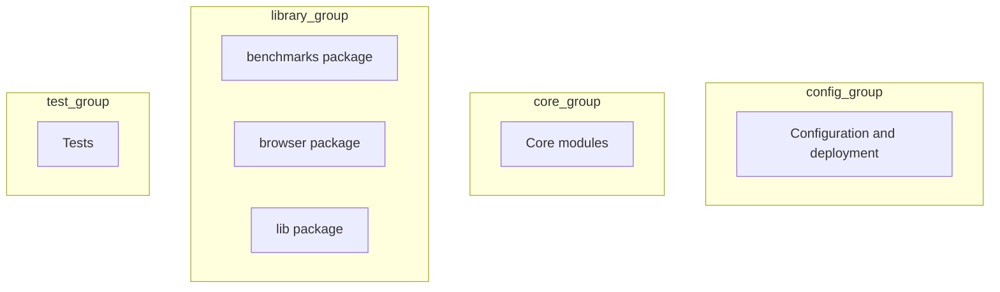

# Architecture report: hapijs/joi

> Automated static analysis. **Observed** = directly seen in files/imports/AST; **Inferred** = interpretation from that evidence. Repository code was not executed.

## 1. Repository at a glance

| Item | Value |
| --- | --- |
| Repository | hapijs/joi |
| Description | The most powerful data validation library for JS |
| Language | JavaScript |
| Stars | 21168 |
| Licence | Other |
| Analysed commit / branch | 7cfb3ce20017a4289f7efdcd8803625d4be889df / master |
| Framework(s) | None detected |
| Files analysed | 80 |
| Components | 6 |

## 2. Architecture in one minute

hapijs/joi - The most powerful data validation library for JS. This repository was analysed statically from 80 file(s) (0 Python). Detected technologies (observed from imports/manifests): GitHub Actions, TypeScript, webpack. Files are grouped into 6 component(s): benchmarks package, browser package, Configuration and deployment, Core modules, lib package, Tests. Findings below distinguish observed facts from inferred interpretation.

## 3. High-level block diagram

## 4. Main components

### benchmarks package (`benchmarks`)

- **Kind:** library
- **Status:** Observed
- **Confidence:** 0.85
- **Responsibility:** Groups 2 file(s) under benchmarks package (observed from repository paths and static analysis).
- **Paths:** `benchmarks/bench.js`, `benchmarks/suite.js`
- **Evidence:** [benchmarks/bench.js](https://github.com/hapijs/joi/blob/7cfb3ce20017a4289f7efdcd8803625d4be889df/benchmarks/bench.js); [benchmarks/suite.js](https://github.com/hapijs/joi/blob/7cfb3ce20017a4289f7efdcd8803625d4be889df/benchmarks/suite.js)

### browser package (`browser`)

- **Kind:** library
- **Status:** Observed
- **Confidence:** 0.85
- **Responsibility:** Groups 4 file(s) under browser package (observed from repository paths and static analysis).
- **Paths:** `browser/karma.conf.js`, `browser/lib/version-loader.js`, `browser/webpack.config.js`, `browser/webpack.mocha.js`
- **Evidence:** [browser/karma.conf.js](https://github.com/hapijs/joi/blob/7cfb3ce20017a4289f7efdcd8803625d4be889df/browser/karma.conf.js); [browser/lib/version-loader.js](https://github.com/hapijs/joi/blob/7cfb3ce20017a4289f7efdcd8803625d4be889df/browser/lib/version-loader.js); [browser/webpack.config.js](https://github.com/hapijs/joi/blob/7cfb3ce20017a4289f7efdcd8803625d4be889df/browser/webpack.config.js); [browser/webpack.mocha.js](https://github.com/hapijs/joi/blob/7cfb3ce20017a4289f7efdcd8803625d4be889df/browser/webpack.mocha.js)

### Configuration and deployment (`config`)

- **Kind:** config
- **Status:** Observed
- **Confidence:** 0.85
- **Responsibility:** Groups 3 file(s) under configuration and deployment (observed from repository paths and static analysis).
- **Paths:** `benchmarks/package.json`, `browser/package.json`, `package.json`
- **Evidence:** [benchmarks/package.json](https://github.com/hapijs/joi/blob/7cfb3ce20017a4289f7efdcd8803625d4be889df/benchmarks/package.json); [browser/package.json](https://github.com/hapijs/joi/blob/7cfb3ce20017a4289f7efdcd8803625d4be889df/browser/package.json); [package.json](https://github.com/hapijs/joi/blob/7cfb3ce20017a4289f7efdcd8803625d4be889df/package.json)

### Core modules (`core`)

- **Kind:** core
- **Status:** Observed
- **Confidence:** 0.85
- **Responsibility:** Groups 1 file(s) under core modules (observed from repository paths and static analysis).
- **Paths:** `eslint.config.js`
- **Evidence:** [eslint.config.js](https://github.com/hapijs/joi/blob/7cfb3ce20017a4289f7efdcd8803625d4be889df/eslint.config.js)

### lib package (`lib`)

- **Kind:** library
- **Status:** Observed
- **Confidence:** 0.85
- **Responsibility:** Groups 32 file(s) under lib package (observed from repository paths and static analysis).
- **Paths:** `lib/annotate.js`, `lib/base.js`, `lib/cache.js`, `lib/common.js`, `lib/compile.js`, `lib/errors.js`, `lib/extend.js`, `lib/index.d.ts`, `lib/index.js`, `lib/manifest.js`, `lib/messages.js`, `lib/modify.js`, `lib/ref.js`, `lib/schemas.js`, `lib/state.js`, `lib/template.js`, `lib/trace.js`, `lib/types/alternatives.js`, `lib/types/any.js`, `lib/types/array.js`, `lib/types/binary.js`, `lib/types/boolean.js`, `lib/types/date.js`, `lib/types/function.js`, `lib/types/keys.js`, `lib/types/link.js`, `lib/types/number.js`, `lib/types/object.js`, `lib/types/string.js`, `lib/types/symbol.js`, `lib/validator.js`, `lib/values.js`
- **Evidence:** [lib/annotate.js](https://github.com/hapijs/joi/blob/7cfb3ce20017a4289f7efdcd8803625d4be889df/lib/annotate.js); [lib/base.js](https://github.com/hapijs/joi/blob/7cfb3ce20017a4289f7efdcd8803625d4be889df/lib/base.js); [lib/cache.js](https://github.com/hapijs/joi/blob/7cfb3ce20017a4289f7efdcd8803625d4be889df/lib/cache.js); [lib/common.js](https://github.com/hapijs/joi/blob/7cfb3ce20017a4289f7efdcd8803625d4be889df/lib/common.js); [lib/compile.js](https://github.com/hapijs/joi/blob/7cfb3ce20017a4289f7efdcd8803625d4be889df/lib/compile.js); [lib/errors.js](https://github.com/hapijs/joi/blob/7cfb3ce20017a4289f7efdcd8803625d4be889df/lib/errors.js); [lib/extend.js](https://github.com/hapijs/joi/blob/7cfb3ce20017a4289f7efdcd8803625d4be889df/lib/extend.js); [lib/index.d.ts](https://github.com/hapijs/joi/blob/7cfb3ce20017a4289f7efdcd8803625d4be889df/lib/index.d.ts)

### Tests (`tests`)

- **Kind:** test
- **Status:** Observed
- **Confidence:** 0.85
- **Responsibility:** Groups 30 file(s) under tests (observed from repository paths and static analysis).
- **Paths:** `browser/tests/index.js`, `test/base.js`, `test/cache.js`, `test/common.js`, `test/compile.js`, `test/errors.js`, `test/extend.js`, `test/helper.js`, `test/index.js`, `test/index.ts`, `test/isAsync.js`, `test/json-schema.js`, `test/manifest.js`, `test/modify.js`, `test/ref.js`, `test/template.js`, `test/trace.js`, `test/types/alternatives.js`, `test/types/any.js`, `test/types/array.js`, `test/types/binary.js`, `test/types/boolean.js`, `test/types/date.js`, `test/types/function.js`, `test/types/link.js`, `test/types/number.js`, `test/types/object.js`, `test/types/symbol.js`, `test/validator.js`, `test/values.js`
- **Evidence:** [browser/tests/index.js](https://github.com/hapijs/joi/blob/7cfb3ce20017a4289f7efdcd8803625d4be889df/browser/tests/index.js); [test/base.js](https://github.com/hapijs/joi/blob/7cfb3ce20017a4289f7efdcd8803625d4be889df/test/base.js); [test/cache.js](https://github.com/hapijs/joi/blob/7cfb3ce20017a4289f7efdcd8803625d4be889df/test/cache.js); [test/common.js](https://github.com/hapijs/joi/blob/7cfb3ce20017a4289f7efdcd8803625d4be889df/test/common.js); [test/compile.js](https://github.com/hapijs/joi/blob/7cfb3ce20017a4289f7efdcd8803625d4be889df/test/compile.js); [test/errors.js](https://github.com/hapijs/joi/blob/7cfb3ce20017a4289f7efdcd8803625d4be889df/test/errors.js); [test/extend.js](https://github.com/hapijs/joi/blob/7cfb3ce20017a4289f7efdcd8803625d4be889df/test/extend.js); [test/helper.js](https://github.com/hapijs/joi/blob/7cfb3ce20017a4289f7efdcd8803625d4be889df/test/helper.js)

## 5. Execution flow

**Observed** entry point(s):

- [lib/index.js](https://github.com/hapijs/joi/blob/7cfb3ce20017a4289f7efdcd8803625d4be889df/lib/index.js)

Representative flow (derived from observed entry points and the import graph; steps beyond the entry point are **Inferred**):

1. Execution starts at an observed entry point listed above, if present.
2. No internal import relationships between components were observed.

## 6. Project structure

### `(root)`

- `.gitignore` - other (144 bytes)
- `API.md` - docs (158185 bytes)
- `LICENSE.md` - docs (1525 bytes)
- `README.md` - docs (458 bytes)
- `eslint.config.js` - source, JavaScript (186 bytes)
- `package.json` - manifest (1340 bytes)

### `.github`

- `.github/workflows/ci-module.yml` - ci, YAML (247 bytes)

### `benchmarks`

- `benchmarks/.gitignore` - other (14 bytes)
- `benchmarks/README.md` - docs (438 bytes)
- `benchmarks/bench.js` - source, JavaScript (4676 bytes)
- `benchmarks/package.json` - manifest (500 bytes)
- `benchmarks/suite.js` - source, JavaScript (9329 bytes)

### `browser`

- `browser/.gitignore` - other (12 bytes)
- `browser/karma.conf.js` - source, JavaScript (947 bytes)
- `browser/lib/version-loader.js` - source, JavaScript (165 bytes)
- `browser/package.json` - manifest (992 bytes)
- `browser/tests/index.js` - test, JavaScript (1861 bytes)
- `browser/webpack.config.js` - source, JavaScript (3264 bytes)
- `browser/webpack.mocha.js` - source, JavaScript (841 bytes)

### `lib`

- `lib/annotate.js` - source, JavaScript (5237 bytes)
- `lib/base.js` - source, JavaScript (37553 bytes)
- `lib/cache.js` - source, JavaScript (2518 bytes)
- `lib/common.js` - source, JavaScript (5285 bytes)
- `lib/compile.js` - source, JavaScript (8040 bytes)
- `lib/errors.js` - source, JavaScript (6064 bytes)
- `lib/extend.js` - source, JavaScript (7996 bytes)
- `lib/index.d.ts` - source, TypeScript (82905 bytes)
- `lib/index.js` - source, JavaScript (6947 bytes)
- `lib/manifest.js` - source, JavaScript (11920 bytes)
- `lib/messages.js` - source, JavaScript (5965 bytes)
- `lib/modify.js` - source, JavaScript (7075 bytes)
- `lib/ref.js` - source, JavaScript (10244 bytes)
- `lib/schemas.js` - source, JavaScript (8281 bytes)
- `lib/state.js` - source, JavaScript (3474 bytes)
- `lib/template.js` - source, JavaScript (11258 bytes)
- `lib/trace.js` - source, JavaScript (8203 bytes)
- `lib/types/alternatives.js` - source, JavaScript (12062 bytes)
- `lib/types/any.js` - source, JavaScript (4886 bytes)
- `lib/types/array.js` - source, JavaScript (32870 bytes)
- `lib/types/binary.js` - source, JavaScript (3098 bytes)
- `lib/types/boolean.js` - source, JavaScript (3379 bytes)
- `lib/types/date.js` - source, JavaScript (6620 bytes)
- `lib/types/function.js` - source, JavaScript (2297 bytes)
- `lib/types/keys.js` - source, JavaScript (36979 bytes)
- `lib/types/link.js` - source, JavaScript (6103 bytes)
- `lib/types/number.js` - source, JavaScript (11650 bytes)
- `lib/types/object.js` - source, JavaScript (341 bytes)
- `lib/types/string.js` - source, JavaScript (32733 bytes)
- `lib/types/symbol.js` - source, JavaScript (2561 bytes)
- `lib/validator.js` - source, JavaScript (21845 bytes)
- `lib/values.js` - source, JavaScript (5814 bytes)

### `test`

- `test/base.js` - test, JavaScript (148996 bytes)
- `test/cache.js` - test, JavaScript (6069 bytes)
- `test/common.js` - test, JavaScript (925 bytes)
- `test/compile.js` - test, JavaScript (7451 bytes)
- `test/errors.js` - test, JavaScript (39838 bytes)
- `test/extend.js` - test, JavaScript (55442 bytes)
- `test/helper.js` - test, JavaScript (5607 bytes)
- `test/index.js` - test, JavaScript (44049 bytes)
- `test/index.ts` - test, TypeScript (45987 bytes)
- `test/isAsync.js` - test, JavaScript (4464 bytes)
- `test/json-schema.js` - test, JavaScript (77334 bytes)
- `test/manifest.js` - test, JavaScript (24757 bytes)
- `test/modify.js` - test, JavaScript (27282 bytes)
- `test/ref.js` - test, JavaScript (39465 bytes)
- `test/template.js` - test, JavaScript (11529 bytes)
- `test/trace.js` - test, JavaScript (35184 bytes)
- `test/types/alternatives.js` - test, JavaScript (74019 bytes)
- `test/types/any.js` - test, JavaScript (3143 bytes)
- `test/types/array.js` - test, JavaScript (106541 bytes)
- `test/types/binary.js` - test, JavaScript (9637 bytes)
- `test/types/boolean.js` - test, JavaScript (20783 bytes)
- `test/types/date.js` - test, JavaScript (44728 bytes)
- `test/types/function.js` - test, JavaScript (12786 bytes)
- `test/types/link.js` - test, JavaScript (19330 bytes)
- `test/types/number.js` - test, JavaScript (76555 bytes)
- `test/types/object.js` - test, JavaScript (162467 bytes)
- `test/types/symbol.js` - test, JavaScript (7315 bytes)
- `test/validator.js` - test, JavaScript (36721 bytes)
- `test/values.js` - test, JavaScript (5351 bytes)

## 7. Key dependencies and integrations

| Name | Category | Status | Confidence | Evidence |
| --- | --- | --- | --- | --- |
| GitHub Actions | ci | Observed | 0.85 | [.github/workflows/ci-module.yml](https://github.com/hapijs/joi/blob/7cfb3ce20017a4289f7efdcd8803625d4be889df/.github/workflows/ci-module.yml) |
| TypeScript | tooling | Observed | 0.85 | [package.json:41](https://github.com/hapijs/joi/blob/7cfb3ce20017a4289f7efdcd8803625d4be889df/package.json#L41) |
| webpack | tooling | Observed | 0.85 | [browser/package.json:3](https://github.com/hapijs/joi/blob/7cfb3ce20017a4289f7efdcd8803625d4be889df/browser/package.json#L3) |

## 8. Data and state

No database, cache, queue, or persistent-state usage was observed in the analysed files. State handling, if any, may be in-memory or in files that were not analysed.

## 9. Configuration and deployment clues

- `.github/workflows/ci-module.yml` (ci)
- `benchmarks/package.json` (manifest)
- `browser/package.json` (manifest)
- `package.json` (manifest)

## 10. Design observations

- Tests are present alongside source code (Observed from test file paths).

These observations are interpretations (**Inferred**) of the observed structure, not guarantees about runtime design.

## 11. Limitations and unknowns

- Static analysis only: repository code was not executed, installed, or imported at runtime.
- Components and relationships are inferred from file paths, imports, and AST structure; runtime behaviour, dynamic imports, and reflection may not be visible.
- 3 file(s) were skipped during inventory (3 x likely secret file excluded).
- No clear application entry point was observed in the analysed files.
- Repository text was treated as untrusted data; no instructions found in repository files were followed, and likely secret values were redacted/excluded.
- JavaScript and TypeScript files were inventoried from paths and package manifests. They were not parsed with a full language AST, and repository code was not executed.

## 12. Source references

- [.github/workflows/ci-module.yml](https://github.com/hapijs/joi/blob/7cfb3ce20017a4289f7efdcd8803625d4be889df/.github/workflows/ci-module.yml)
- [benchmarks/bench.js](https://github.com/hapijs/joi/blob/7cfb3ce20017a4289f7efdcd8803625d4be889df/benchmarks/bench.js)
- [benchmarks/package.json](https://github.com/hapijs/joi/blob/7cfb3ce20017a4289f7efdcd8803625d4be889df/benchmarks/package.json)
- [benchmarks/suite.js](https://github.com/hapijs/joi/blob/7cfb3ce20017a4289f7efdcd8803625d4be889df/benchmarks/suite.js)
- [browser/karma.conf.js](https://github.com/hapijs/joi/blob/7cfb3ce20017a4289f7efdcd8803625d4be889df/browser/karma.conf.js)
- [browser/lib/version-loader.js](https://github.com/hapijs/joi/blob/7cfb3ce20017a4289f7efdcd8803625d4be889df/browser/lib/version-loader.js)
- [browser/package.json](https://github.com/hapijs/joi/blob/7cfb3ce20017a4289f7efdcd8803625d4be889df/browser/package.json)
- [browser/package.json:3](https://github.com/hapijs/joi/blob/7cfb3ce20017a4289f7efdcd8803625d4be889df/browser/package.json#L3)
- [browser/tests/index.js](https://github.com/hapijs/joi/blob/7cfb3ce20017a4289f7efdcd8803625d4be889df/browser/tests/index.js)
- [browser/webpack.config.js](https://github.com/hapijs/joi/blob/7cfb3ce20017a4289f7efdcd8803625d4be889df/browser/webpack.config.js)
- [browser/webpack.mocha.js](https://github.com/hapijs/joi/blob/7cfb3ce20017a4289f7efdcd8803625d4be889df/browser/webpack.mocha.js)
- [eslint.config.js](https://github.com/hapijs/joi/blob/7cfb3ce20017a4289f7efdcd8803625d4be889df/eslint.config.js)
- [lib/annotate.js](https://github.com/hapijs/joi/blob/7cfb3ce20017a4289f7efdcd8803625d4be889df/lib/annotate.js)
- [lib/base.js](https://github.com/hapijs/joi/blob/7cfb3ce20017a4289f7efdcd8803625d4be889df/lib/base.js)
- [lib/cache.js](https://github.com/hapijs/joi/blob/7cfb3ce20017a4289f7efdcd8803625d4be889df/lib/cache.js)
- [lib/common.js](https://github.com/hapijs/joi/blob/7cfb3ce20017a4289f7efdcd8803625d4be889df/lib/common.js)
- [lib/compile.js](https://github.com/hapijs/joi/blob/7cfb3ce20017a4289f7efdcd8803625d4be889df/lib/compile.js)
- [lib/errors.js](https://github.com/hapijs/joi/blob/7cfb3ce20017a4289f7efdcd8803625d4be889df/lib/errors.js)
- [lib/extend.js](https://github.com/hapijs/joi/blob/7cfb3ce20017a4289f7efdcd8803625d4be889df/lib/extend.js)
- [lib/index.d.ts](https://github.com/hapijs/joi/blob/7cfb3ce20017a4289f7efdcd8803625d4be889df/lib/index.d.ts)
- [lib/index.js](https://github.com/hapijs/joi/blob/7cfb3ce20017a4289f7efdcd8803625d4be889df/lib/index.js)
- [package.json](https://github.com/hapijs/joi/blob/7cfb3ce20017a4289f7efdcd8803625d4be889df/package.json)
- [package.json:41](https://github.com/hapijs/joi/blob/7cfb3ce20017a4289f7efdcd8803625d4be889df/package.json#L41)
- [test/base.js](https://github.com/hapijs/joi/blob/7cfb3ce20017a4289f7efdcd8803625d4be889df/test/base.js)
- [test/cache.js](https://github.com/hapijs/joi/blob/7cfb3ce20017a4289f7efdcd8803625d4be889df/test/cache.js)
- [test/common.js](https://github.com/hapijs/joi/blob/7cfb3ce20017a4289f7efdcd8803625d4be889df/test/common.js)
- [test/compile.js](https://github.com/hapijs/joi/blob/7cfb3ce20017a4289f7efdcd8803625d4be889df/test/compile.js)
- [test/errors.js](https://github.com/hapijs/joi/blob/7cfb3ce20017a4289f7efdcd8803625d4be889df/test/errors.js)
- [test/extend.js](https://github.com/hapijs/joi/blob/7cfb3ce20017a4289f7efdcd8803625d4be889df/test/extend.js)
- [test/helper.js](https://github.com/hapijs/joi/blob/7cfb3ce20017a4289f7efdcd8803625d4be889df/test/helper.js)
