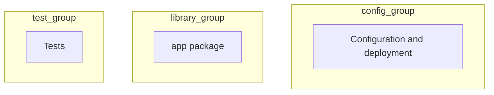

# Architecture report: hemanth/functional-programming-jargon

> Automated static analysis. **Observed** = directly seen in files/imports/AST; **Inferred** = interpretation from that evidence. Repository code was not executed.

## 1. Repository at a glance

| Item | Value |
| --- | --- |
| Repository | hemanth/functional-programming-jargon |
| Description | Jargon from the functional programming world in simple terms! |
| Language | JavaScript |
| Stars | 18744 |
| Licence | MIT |
| Analysed commit / branch | a362b3a6117eeaa6042fc21e032afa30bab8b5d6 / master |
| Framework(s) | React |
| Files analysed | 30 |
| Components | 3 |

## 2. Architecture in one minute

hemanth/functional-programming-jargon - Jargon from the functional programming world in simple terms!. This repository was analysed statically from 30 file(s) (0 Python). Detected technologies (observed from imports/manifests): GitHub Actions, React, Tailwind CSS, Vite. Files are grouped into 3 component(s): app package, Configuration and deployment, Tests. Findings below distinguish observed facts from inferred interpretation.

## 3. High-level block diagram

## 4. Main components

### app package (`app`)

- **Kind:** library
- **Status:** Observed
- **Confidence:** 0.85
- **Responsibility:** Groups 12 file(s) under app package (observed from repository paths and static analysis).
- **Paths:** `app/postcss.config.mjs`, `app/scripts/parse-jargons.js`, `app/src/App.jsx`, `app/src/components/CodeBlock.jsx`, `app/src/components/GraphCanvas.jsx`, `app/src/components/Icons.jsx`, `app/src/components/NodeDetailPanel.jsx`, `app/src/components/SearchHUD.jsx`, `app/src/main.jsx`, `app/src/utils/audio.js`, `app/tailwind.config.js`, `app/vite.config.mjs`
- **Evidence:** [app/postcss.config.mjs](https://github.com/hemanth/functional-programming-jargon/blob/a362b3a6117eeaa6042fc21e032afa30bab8b5d6/app/postcss.config.mjs); [app/scripts/parse-jargons.js](https://github.com/hemanth/functional-programming-jargon/blob/a362b3a6117eeaa6042fc21e032afa30bab8b5d6/app/scripts/parse-jargons.js); [app/src/App.jsx](https://github.com/hemanth/functional-programming-jargon/blob/a362b3a6117eeaa6042fc21e032afa30bab8b5d6/app/src/App.jsx); [app/src/components/CodeBlock.jsx](https://github.com/hemanth/functional-programming-jargon/blob/a362b3a6117eeaa6042fc21e032afa30bab8b5d6/app/src/components/CodeBlock.jsx); [app/src/components/GraphCanvas.jsx](https://github.com/hemanth/functional-programming-jargon/blob/a362b3a6117eeaa6042fc21e032afa30bab8b5d6/app/src/components/GraphCanvas.jsx); [app/src/components/Icons.jsx](https://github.com/hemanth/functional-programming-jargon/blob/a362b3a6117eeaa6042fc21e032afa30bab8b5d6/app/src/components/Icons.jsx); [app/src/components/NodeDetailPanel.jsx](https://github.com/hemanth/functional-programming-jargon/blob/a362b3a6117eeaa6042fc21e032afa30bab8b5d6/app/src/components/NodeDetailPanel.jsx); [app/src/components/SearchHUD.jsx](https://github.com/hemanth/functional-programming-jargon/blob/a362b3a6117eeaa6042fc21e032afa30bab8b5d6/app/src/components/SearchHUD.jsx)

### Configuration and deployment (`config`)

- **Kind:** config
- **Status:** Observed
- **Confidence:** 0.85
- **Responsibility:** Groups 4 file(s) under configuration and deployment (observed from repository paths and static analysis).
- **Paths:** `app/package.json`, `app/public/data/jargons.json`, `app/src/data/jargons.json`, `package.json`
- **Evidence:** [app/package.json](https://github.com/hemanth/functional-programming-jargon/blob/a362b3a6117eeaa6042fc21e032afa30bab8b5d6/app/package.json); [app/public/data/jargons.json](https://github.com/hemanth/functional-programming-jargon/blob/a362b3a6117eeaa6042fc21e032afa30bab8b5d6/app/public/data/jargons.json); [app/src/data/jargons.json](https://github.com/hemanth/functional-programming-jargon/blob/a362b3a6117eeaa6042fc21e032afa30bab8b5d6/app/src/data/jargons.json); [package.json](https://github.com/hemanth/functional-programming-jargon/blob/a362b3a6117eeaa6042fc21e032afa30bab8b5d6/package.json)

### Tests (`tests`)

- **Kind:** test
- **Status:** Observed
- **Confidence:** 0.85
- **Responsibility:** Groups 1 file(s) under tests (observed from repository paths and static analysis).
- **Paths:** `app/tests/e2e.test.mjs`
- **Evidence:** [app/tests/e2e.test.mjs](https://github.com/hemanth/functional-programming-jargon/blob/a362b3a6117eeaa6042fc21e032afa30bab8b5d6/app/tests/e2e.test.mjs)

## 5. Execution flow

**Observed** entry point(s):

- [app/src/App.jsx](https://github.com/hemanth/functional-programming-jargon/blob/a362b3a6117eeaa6042fc21e032afa30bab8b5d6/app/src/App.jsx)
- [app/src/main.jsx](https://github.com/hemanth/functional-programming-jargon/blob/a362b3a6117eeaa6042fc21e032afa30bab8b5d6/app/src/main.jsx)

Representative flow (derived from observed entry points and the import graph; steps beyond the entry point are **Inferred**):

1. Execution starts at an observed entry point listed above, if present.
2. No internal import relationships between components were observed.

## 6. Project structure

### `(root)`

- `.eslintrc.yml` - config (157 bytes)
- `.gitignore` - other (71 bytes)
- `LICENSE` - docs (1100 bytes)
- `contributing.md` - docs (1164 bytes)
- `package.json` - manifest (1100 bytes)
- `readme.md` - docs (58249 bytes)

### `.github`

- `.github/FUNDING.yml` - config (116 bytes)
- `.github/workflows/deploy.yml` - ci, YAML (1083 bytes)

### `app`

- `app/README.md` - docs (1474 bytes)
- `app/index.html` - other (4894 bytes)
- `app/package.json` - manifest (765 bytes)
- `app/postcss.config.mjs` - source, JavaScript (80 bytes)
- `app/public/data/jargons.json` - config (176609 bytes)
- `app/public/llms-full.txt` - docs (51418 bytes)
- `app/public/llms.txt` - docs (16254 bytes)
- `app/public/robots.txt` - docs (296 bytes)
- `app/scripts/parse-jargons.js` - source, JavaScript (19587 bytes)
- `app/src/App.jsx` - source, JavaScript (12184 bytes)
- `app/src/components/CodeBlock.jsx` - source, JavaScript (3567 bytes)
- `app/src/components/GraphCanvas.jsx` - source, JavaScript (31700 bytes)
- `app/src/components/Icons.jsx` - source, JavaScript (616 bytes)
- `app/src/components/NodeDetailPanel.jsx` - source, JavaScript (13254 bytes)
- `app/src/components/SearchHUD.jsx` - source, JavaScript (8876 bytes)
- `app/src/data/jargons.json` - config (176609 bytes)
- `app/src/index.css` - other (7434 bytes)
- `app/src/main.jsx` - source, JavaScript (235 bytes)
- `app/src/utils/audio.js` - source, JavaScript (2669 bytes)
- `app/tailwind.config.js` - source, JavaScript (1188 bytes)
- `app/tests/e2e.test.mjs` - test, JavaScript (6566 bytes)
- `app/vite.config.mjs` - source, JavaScript (259 bytes)

## 7. Key dependencies and integrations

| Name | Category | Status | Confidence | Evidence |
| --- | --- | --- | --- | --- |
| GitHub Actions | ci | Observed | 0.85 | [.github/workflows/deploy.yml](https://github.com/hemanth/functional-programming-jargon/blob/a362b3a6117eeaa6042fc21e032afa30bab8b5d6/.github/workflows/deploy.yml) |
| React | framework | Observed | 0.90 | [app/package.json:15](https://github.com/hemanth/functional-programming-jargon/blob/a362b3a6117eeaa6042fc21e032afa30bab8b5d6/app/package.json#L15); [app/package.json:19](https://github.com/hemanth/functional-programming-jargon/blob/a362b3a6117eeaa6042fc21e032afa30bab8b5d6/app/package.json#L19) |
| Tailwind CSS | library | Observed | 0.85 | [app/package.json:26](https://github.com/hemanth/functional-programming-jargon/blob/a362b3a6117eeaa6042fc21e032afa30bab8b5d6/app/package.json#L26) |
| Vite | tooling | Observed | 0.85 | [app/package.json:7](https://github.com/hemanth/functional-programming-jargon/blob/a362b3a6117eeaa6042fc21e032afa30bab8b5d6/app/package.json#L7) |

## 8. Data and state

No database, cache, queue, or persistent-state usage was observed in the analysed files. State handling, if any, may be in-memory or in files that were not analysed.

## 9. Configuration and deployment clues

- `.eslintrc.yml` (config)
- `.github/FUNDING.yml` (config)
- `.github/workflows/deploy.yml` (ci)
- `app/package.json` (manifest)
- `app/public/data/jargons.json` (config)
- `app/src/data/jargons.json` (config)
- `package.json` (manifest)

## 10. Design observations

- Tests are present alongside source code (Observed from test file paths).

These observations are interpretations (**Inferred**) of the observed structure, not guarantees about runtime design.

## 11. Limitations and unknowns

- Static analysis only: repository code was not executed, installed, or imported at runtime.
- Components and relationships are inferred from file paths, imports, and AST structure; runtime behaviour, dynamic imports, and reflection may not be visible.
- 2 file(s) were skipped during inventory (2 x lockfile excluded).
- No clear application entry point was observed in the analysed files.
- Repository text was treated as untrusted data; no instructions found in repository files were followed, and likely secret values were redacted/excluded.
- JavaScript and TypeScript files were inventoried from paths and package manifests. They were not parsed with a full language AST, and repository code was not executed.

## 12. Source references

- [.github/workflows/deploy.yml](https://github.com/hemanth/functional-programming-jargon/blob/a362b3a6117eeaa6042fc21e032afa30bab8b5d6/.github/workflows/deploy.yml)
- [app/package.json](https://github.com/hemanth/functional-programming-jargon/blob/a362b3a6117eeaa6042fc21e032afa30bab8b5d6/app/package.json)
- [app/package.json:7](https://github.com/hemanth/functional-programming-jargon/blob/a362b3a6117eeaa6042fc21e032afa30bab8b5d6/app/package.json#L7)
- [app/package.json:15](https://github.com/hemanth/functional-programming-jargon/blob/a362b3a6117eeaa6042fc21e032afa30bab8b5d6/app/package.json#L15)
- [app/package.json:19](https://github.com/hemanth/functional-programming-jargon/blob/a362b3a6117eeaa6042fc21e032afa30bab8b5d6/app/package.json#L19)
- [app/package.json:26](https://github.com/hemanth/functional-programming-jargon/blob/a362b3a6117eeaa6042fc21e032afa30bab8b5d6/app/package.json#L26)
- [app/postcss.config.mjs](https://github.com/hemanth/functional-programming-jargon/blob/a362b3a6117eeaa6042fc21e032afa30bab8b5d6/app/postcss.config.mjs)
- [app/public/data/jargons.json](https://github.com/hemanth/functional-programming-jargon/blob/a362b3a6117eeaa6042fc21e032afa30bab8b5d6/app/public/data/jargons.json)
- [app/scripts/parse-jargons.js](https://github.com/hemanth/functional-programming-jargon/blob/a362b3a6117eeaa6042fc21e032afa30bab8b5d6/app/scripts/parse-jargons.js)
- [app/src/App.jsx](https://github.com/hemanth/functional-programming-jargon/blob/a362b3a6117eeaa6042fc21e032afa30bab8b5d6/app/src/App.jsx)
- [app/src/components/CodeBlock.jsx](https://github.com/hemanth/functional-programming-jargon/blob/a362b3a6117eeaa6042fc21e032afa30bab8b5d6/app/src/components/CodeBlock.jsx)
- [app/src/components/GraphCanvas.jsx](https://github.com/hemanth/functional-programming-jargon/blob/a362b3a6117eeaa6042fc21e032afa30bab8b5d6/app/src/components/GraphCanvas.jsx)
- [app/src/components/Icons.jsx](https://github.com/hemanth/functional-programming-jargon/blob/a362b3a6117eeaa6042fc21e032afa30bab8b5d6/app/src/components/Icons.jsx)
- [app/src/components/NodeDetailPanel.jsx](https://github.com/hemanth/functional-programming-jargon/blob/a362b3a6117eeaa6042fc21e032afa30bab8b5d6/app/src/components/NodeDetailPanel.jsx)
- [app/src/components/SearchHUD.jsx](https://github.com/hemanth/functional-programming-jargon/blob/a362b3a6117eeaa6042fc21e032afa30bab8b5d6/app/src/components/SearchHUD.jsx)
- [app/src/data/jargons.json](https://github.com/hemanth/functional-programming-jargon/blob/a362b3a6117eeaa6042fc21e032afa30bab8b5d6/app/src/data/jargons.json)
- [app/src/main.jsx](https://github.com/hemanth/functional-programming-jargon/blob/a362b3a6117eeaa6042fc21e032afa30bab8b5d6/app/src/main.jsx)
- [app/tests/e2e.test.mjs](https://github.com/hemanth/functional-programming-jargon/blob/a362b3a6117eeaa6042fc21e032afa30bab8b5d6/app/tests/e2e.test.mjs)
- [package.json](https://github.com/hemanth/functional-programming-jargon/blob/a362b3a6117eeaa6042fc21e032afa30bab8b5d6/package.json)
