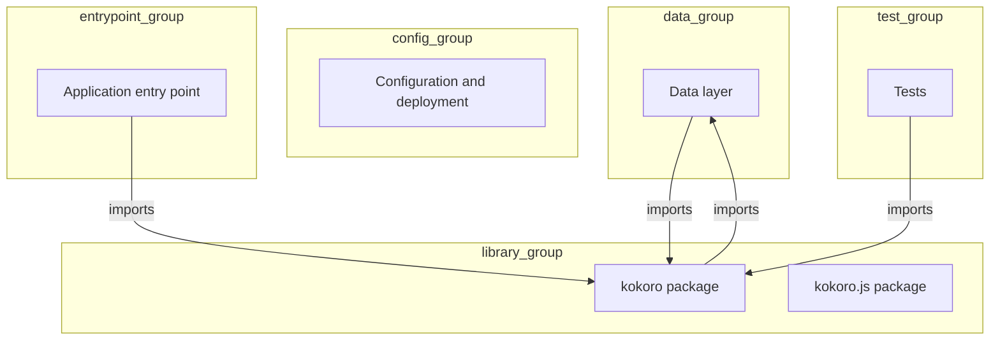

# Architecture report: hexgrad/kokoro

> Automated static analysis. **Observed** = directly seen in files/imports/AST; **Inferred** = interpretation from that evidence. Repository code was not executed.

## 1. Repository at a glance

| Item | Value |
| --- | --- |
| Repository | hexgrad/kokoro |
| Description | https://hf.co/hexgrad/Kokoro-82M |
| Language | JavaScript |
| Stars | 10117 |
| Licence | Apache-2.0 |
| Analysed commit / branch | dfb907a02bba8152ca444717ca5d78747ccb4bec / main |
| Framework(s) | React |
| Files analysed | 51 |
| Components | 6 |

## 2. Architecture in one minute

hexgrad/kokoro - https://hf.co/hexgrad/Kokoro-82M. This repository was analysed statically from 51 file(s) (13 Python). Detected technologies (observed from imports/manifests): React, NumPy, Tailwind CSS, Poetry, pytest, TypeScript. Files are grouped into 6 component(s): Configuration and deployment, Data layer, Application entry point, kokoro package, kokoro.js package, Tests. Observed entry point(s): demo/app.py, kokoro/__main__.py. Findings below distinguish observed facts from inferred interpretation.

## 3. High-level block diagram

## 4. Main components

### Configuration and deployment (`config`)

- **Kind:** config
- **Status:** Observed
- **Confidence:** 0.85
- **Responsibility:** Groups 5 file(s) under configuration and deployment (observed from repository paths and static analysis).
- **Paths:** `demo/requirements.txt`, `kokoro.js/demo/package.json`, `kokoro.js/package.json`, `kokoro.js/tsconfig.json`, `pyproject.toml`
- **Evidence:** [demo/requirements.txt](https://github.com/hexgrad/kokoro/blob/dfb907a02bba8152ca444717ca5d78747ccb4bec/demo/requirements.txt); [kokoro.js/demo/package.json](https://github.com/hexgrad/kokoro/blob/dfb907a02bba8152ca444717ca5d78747ccb4bec/kokoro.js/demo/package.json); [kokoro.js/package.json](https://github.com/hexgrad/kokoro/blob/dfb907a02bba8152ca444717ca5d78747ccb4bec/kokoro.js/package.json); [kokoro.js/tsconfig.json](https://github.com/hexgrad/kokoro/blob/dfb907a02bba8152ca444717ca5d78747ccb4bec/kokoro.js/tsconfig.json); [pyproject.toml](https://github.com/hexgrad/kokoro/blob/dfb907a02bba8152ca444717ca5d78747ccb4bec/pyproject.toml)

### Data layer (`data_layer`)

- **Kind:** data
- **Status:** Observed
- **Confidence:** 0.85
- **Responsibility:** Groups 1 file(s) under data layer (observed from repository paths and static analysis). Observed top-level classes: KModel, KModelForONNX.
- **Paths:** `kokoro/model.py`
- **Evidence:** [kokoro/model.py:11](https://github.com/hexgrad/kokoro/blob/dfb907a02bba8152ca444717ca5d78747ccb4bec/kokoro/model.py#L11)

### Application entry point (`entrypoint`)

- **Kind:** entrypoint
- **Status:** Observed
- **Confidence:** 0.85
- **Responsibility:** Groups 2 file(s) under application entry point (observed from repository paths and static analysis). Observed top-level functions: forward_gpu, generate_all, generate_and_save_audio, generate_audio, generate_first, get_frankenstein.
- **Paths:** `demo/app.py`, `kokoro/__main__.py`
- **Evidence:** [demo/app.py:15](https://github.com/hexgrad/kokoro/blob/dfb907a02bba8152ca444717ca5d78747ccb4bec/demo/app.py#L15); [kokoro/__main__.py:39](https://github.com/hexgrad/kokoro/blob/dfb907a02bba8152ca444717ca5d78747ccb4bec/kokoro/__main__.py#L39)

### kokoro package (`kokoro`)

- **Kind:** library
- **Status:** Observed
- **Confidence:** 0.85
- **Responsibility:** Groups 5 file(s) under kokoro package (observed from repository paths and static analysis). Observed top-level classes: AdaIN1d, AdaINResBlock1, AdaLayerNorm, AdainResBlk1d, CustomAlbert, CustomSTFT. Observed top-level functions: get_padding, init_weights.
- **Paths:** `kokoro/__init__.py`, `kokoro/custom_stft.py`, `kokoro/istftnet.py`, `kokoro/modules.py`, `kokoro/pipeline.py`
- **Evidence:** [kokoro/__init__.py](https://github.com/hexgrad/kokoro/blob/dfb907a02bba8152ca444717ca5d78747ccb4bec/kokoro/__init__.py); [kokoro/custom_stft.py:7](https://github.com/hexgrad/kokoro/blob/dfb907a02bba8152ca444717ca5d78747ccb4bec/kokoro/custom_stft.py#L7); [kokoro/istftnet.py:11](https://github.com/hexgrad/kokoro/blob/dfb907a02bba8152ca444717ca5d78747ccb4bec/kokoro/istftnet.py#L11); [kokoro/modules.py:11](https://github.com/hexgrad/kokoro/blob/dfb907a02bba8152ca444717ca5d78747ccb4bec/kokoro/modules.py#L11); [kokoro/pipeline.py:42](https://github.com/hexgrad/kokoro/blob/dfb907a02bba8152ca444717ca5d78747ccb4bec/kokoro/pipeline.py#L42)

### kokoro.js package (`kokoro_js`)

- **Kind:** library
- **Status:** Observed
- **Confidence:** 0.85
- **Responsibility:** Groups 13 file(s) under kokoro.js package (observed from repository paths and static analysis).
- **Paths:** `kokoro.js/demo/eslint.config.js`, `kokoro.js/demo/postcss.config.js`, `kokoro.js/demo/src/App.jsx`, `kokoro.js/demo/src/main.jsx`, `kokoro.js/demo/src/utils.js`, `kokoro.js/demo/src/worker.js`, `kokoro.js/demo/tailwind.config.js`, `kokoro.js/demo/vite.config.js`, `kokoro.js/rollup.config.js`, `kokoro.js/src/kokoro.js`, `kokoro.js/src/phonemize.js`, `kokoro.js/src/splitter.js`, `kokoro.js/src/voices.js`
- **Evidence:** [kokoro.js/demo/eslint.config.js](https://github.com/hexgrad/kokoro/blob/dfb907a02bba8152ca444717ca5d78747ccb4bec/kokoro.js/demo/eslint.config.js); [kokoro.js/demo/postcss.config.js](https://github.com/hexgrad/kokoro/blob/dfb907a02bba8152ca444717ca5d78747ccb4bec/kokoro.js/demo/postcss.config.js); [kokoro.js/demo/src/App.jsx](https://github.com/hexgrad/kokoro/blob/dfb907a02bba8152ca444717ca5d78747ccb4bec/kokoro.js/demo/src/App.jsx); [kokoro.js/demo/src/main.jsx](https://github.com/hexgrad/kokoro/blob/dfb907a02bba8152ca444717ca5d78747ccb4bec/kokoro.js/demo/src/main.jsx); [kokoro.js/demo/src/utils.js](https://github.com/hexgrad/kokoro/blob/dfb907a02bba8152ca444717ca5d78747ccb4bec/kokoro.js/demo/src/utils.js); [kokoro.js/demo/src/worker.js](https://github.com/hexgrad/kokoro/blob/dfb907a02bba8152ca444717ca5d78747ccb4bec/kokoro.js/demo/src/worker.js); [kokoro.js/demo/tailwind.config.js](https://github.com/hexgrad/kokoro/blob/dfb907a02bba8152ca444717ca5d78747ccb4bec/kokoro.js/demo/tailwind.config.js); [kokoro.js/demo/vite.config.js](https://github.com/hexgrad/kokoro/blob/dfb907a02bba8152ca444717ca5d78747ccb4bec/kokoro.js/demo/vite.config.js)

### Tests (`tests`)

- **Kind:** test
- **Status:** Observed
- **Confidence:** 0.85
- **Responsibility:** Groups 3 file(s) under tests (observed from repository paths and static analysis). Observed top-level functions: sample_audio, test_batch_processing, test_different_window_sizes, test_magnitude_phase_consistency, test_stft_reconstruction.
- **Paths:** `kokoro.js/tests/phonemize.test.js`, `kokoro.js/tests/splitting.test.js`, `tests/test_custom_stft.py`
- **Evidence:** [kokoro.js/tests/phonemize.test.js](https://github.com/hexgrad/kokoro/blob/dfb907a02bba8152ca444717ca5d78747ccb4bec/kokoro.js/tests/phonemize.test.js); [kokoro.js/tests/splitting.test.js](https://github.com/hexgrad/kokoro/blob/dfb907a02bba8152ca444717ca5d78747ccb4bec/kokoro.js/tests/splitting.test.js); [tests/test_custom_stft.py:10](https://github.com/hexgrad/kokoro/blob/dfb907a02bba8152ca444717ca5d78747ccb4bec/tests/test_custom_stft.py#L10)

## 5. Execution flow

**Observed** entry point(s):

- [demo/app.py:181](https://github.com/hexgrad/kokoro/blob/dfb907a02bba8152ca444717ca5d78747ccb4bec/demo/app.py#L181)
- [kokoro.js/demo/src/App.jsx](https://github.com/hexgrad/kokoro/blob/dfb907a02bba8152ca444717ca5d78747ccb4bec/kokoro.js/demo/src/App.jsx)
- [kokoro.js/demo/src/main.jsx](https://github.com/hexgrad/kokoro/blob/dfb907a02bba8152ca444717ca5d78747ccb4bec/kokoro.js/demo/src/main.jsx)
- [kokoro/__main__.py](https://github.com/hexgrad/kokoro/blob/dfb907a02bba8152ca444717ca5d78747ccb4bec/kokoro/__main__.py)

Representative flow (derived from observed entry points and the import graph; steps beyond the entry point are **Inferred**):

1. Execution starts at an observed entry point listed above, if present.
2. `data_layer` imports `kokoro` (Data layer -> kokoro package).
3. `entrypoint` imports `kokoro` (Application entry point -> kokoro package).
4. `kokoro` imports `data_layer` (kokoro package -> Data layer).
5. `tests` imports `kokoro` (Tests -> kokoro package).

## 6. Project structure

### `(root)`

- `.gitignore` - other (3415 bytes)
- `LICENSE` - docs (11357 bytes)
- `README.md` - docs (8355 bytes)
- `pyproject.toml` - manifest (819 bytes)

### `.github`

- `.github/FUNDING.yml` - config (929 bytes)

### `demo`

- `demo/README.md` - docs (312 bytes)
- `demo/app.py` - source, Python (7286 bytes)
- `demo/en.txt` - docs (189223 bytes)
- `demo/frankenstein5k.md` - docs (4965 bytes)
- `demo/gatsby5k.md` - docs (5064 bytes)
- `demo/packages.txt` - docs (9 bytes)
- `demo/requirements.txt` - manifest (26 bytes)

### `examples`

- `examples/device_examples.py` - source, Python (1643 bytes)
- `examples/export.py` - source, Python (4806 bytes)
- `examples/make_triton_compatible.py` - source, Python (3020 bytes)
- `examples/phoneme_example.py` - source, Python (2287 bytes)

### `kokoro`

- `kokoro/__init__.py` - source, Python (655 bytes)
- `kokoro/__main__.py` - source, Python (4089 bytes)
- `kokoro/custom_stft.py` - source, Python (7746 bytes)
- `kokoro/istftnet.py` - source, Python (19505 bytes)
- `kokoro/model.py` - source, Python (6605 bytes)
- `kokoro/modules.py` - source, Python (7784 bytes)
- `kokoro/pipeline.py` - source, Python (18113 bytes)

### `kokoro.js`

- `kokoro.js/.gitignore` - other (33 bytes)
- `kokoro.js/.prettierignore` - other (11 bytes)
- `kokoro.js/README.md` - docs (6309 bytes)
- `kokoro.js/demo/.gitignore` - other (253 bytes)
- `kokoro.js/demo/README.md` - docs (1325 bytes)
- `kokoro.js/demo/eslint.config.js` - source, JavaScript (984 bytes)
- `kokoro.js/demo/index.html` - other (373 bytes)
- `kokoro.js/demo/package.json` - manifest (788 bytes)
- `kokoro.js/demo/postcss.config.js` - source, JavaScript (81 bytes)
- `kokoro.js/demo/public/hf-logo.svg` - other (35286 bytes)
- `kokoro.js/demo/public/wave.svg` - other (465 bytes)
- `kokoro.js/demo/src/App.jsx` - source, JavaScript (6749 bytes)
- `kokoro.js/demo/src/index.css` - other (1703 bytes)
- `kokoro.js/demo/src/main.jsx` - source, JavaScript (234 bytes)
- `kokoro.js/demo/src/utils.js` - source, JavaScript (167 bytes)
- `kokoro.js/demo/src/worker.js` - source, JavaScript (925 bytes)
- `kokoro.js/demo/tailwind.config.js` - source, JavaScript (170 bytes)
- `kokoro.js/demo/vite.config.js` - source, JavaScript (230 bytes)
- `kokoro.js/package.json` - manifest (1429 bytes)
- `kokoro.js/rollup.config.js` - source, JavaScript (932 bytes)
- `kokoro.js/src/kokoro.js` - source, JavaScript (5786 bytes)
- `kokoro.js/src/phonemize.js` - source, JavaScript (6617 bytes)
- `kokoro.js/src/splitter.js` - source, JavaScript (10580 bytes)
- `kokoro.js/src/voices.js` - source, JavaScript (10494 bytes)
- `kokoro.js/tests/phonemize.test.js` - test, JavaScript (4801 bytes)
- `kokoro.js/tests/splitting.test.js` - test, JavaScript (24874 bytes)
- `kokoro.js/tsconfig.json` - config (341 bytes)

### `tests`

- `tests/test_custom_stft.py` - test, Python (2732 bytes)

## 7. Key dependencies and integrations

| Name | Category | Status | Confidence | Evidence |
| --- | --- | --- | --- | --- |
| React | framework | Observed | 0.90 | [kokoro.js/demo/package.json:15](https://github.com/hexgrad/kokoro/blob/dfb907a02bba8152ca444717ca5d78747ccb4bec/kokoro.js/demo/package.json#L15); [kokoro.js/demo/package.json:16](https://github.com/hexgrad/kokoro/blob/dfb907a02bba8152ca444717ca5d78747ccb4bec/kokoro.js/demo/package.json#L16) |
| NumPy | library | Observed | 0.95 | [examples/make_triton_compatible.py:6](https://github.com/hexgrad/kokoro/blob/dfb907a02bba8152ca444717ca5d78747ccb4bec/examples/make_triton_compatible.py#L6); [kokoro/__main__.py:20](https://github.com/hexgrad/kokoro/blob/dfb907a02bba8152ca444717ca5d78747ccb4bec/kokoro/__main__.py#L20); [kokoro/custom_stft.py:2](https://github.com/hexgrad/kokoro/blob/dfb907a02bba8152ca444717ca5d78747ccb4bec/kokoro/custom_stft.py#L2); [kokoro/modules.py:5](https://github.com/hexgrad/kokoro/blob/dfb907a02bba8152ca444717ca5d78747ccb4bec/kokoro/modules.py#L5) |
| Tailwind CSS | library | Observed | 0.85 | [kokoro.js/demo/package.json:30](https://github.com/hexgrad/kokoro/blob/dfb907a02bba8152ca444717ca5d78747ccb4bec/kokoro.js/demo/package.json#L30) |
| Poetry | packaging | Observed | 0.85 | [pyproject.toml](https://github.com/hexgrad/kokoro/blob/dfb907a02bba8152ca444717ca5d78747ccb4bec/pyproject.toml) |
| pytest | tooling | Observed | 0.90 | [tests/test_custom_stft.py:3](https://github.com/hexgrad/kokoro/blob/dfb907a02bba8152ca444717ca5d78747ccb4bec/tests/test_custom_stft.py#L3) |
| TypeScript | tooling | Observed | 0.85 | [kokoro.js/package.json:45](https://github.com/hexgrad/kokoro/blob/dfb907a02bba8152ca444717ca5d78747ccb4bec/kokoro.js/package.json#L45) |
| Vite | tooling | Observed | 0.85 | [kokoro.js/demo/package.json:7](https://github.com/hexgrad/kokoro/blob/dfb907a02bba8152ca444717ca5d78747ccb4bec/kokoro.js/demo/package.json#L7) |
| Vitest | tooling | Observed | 0.85 | [kokoro.js/package.json:16](https://github.com/hexgrad/kokoro/blob/dfb907a02bba8152ca444717ca5d78747ccb4bec/kokoro.js/package.json#L16) |

## 8. Data and state

- Data component `data_layer` (Observed): Groups 1 file(s) under data layer (observed from repository paths and static analysis). Observed top-level classes: KModel, KModelForONNX.

## 9. Configuration and deployment clues

- `.github/FUNDING.yml` (config)
- `demo/requirements.txt` (manifest)
- `kokoro.js/demo/package.json` (manifest)
- `kokoro.js/package.json` (manifest)
- `kokoro.js/tsconfig.json` (config)
- `pyproject.toml` (manifest)

Console scripts declared in packaging metadata (**Observed**):

- `kokoro` -> `kokoro.__main__:main`

## 10. Design observations

- An entry/API layer is separated from other code (Inferred from paths and decorators).
- Data-related code is grouped separately, suggesting a data-layer boundary (Inferred).
- Tests are present alongside source code (Observed from test file paths).

These observations are interpretations (**Inferred**) of the observed structure, not guarantees about runtime design.

## 11. Limitations and unknowns

- Static analysis only: repository code was not executed, installed, or imported at runtime.
- Components and relationships are inferred from file paths, imports, and AST structure; runtime behaviour, dynamic imports, and reflection may not be visible.
- 2 file(s) were skipped during inventory (2 x lockfile excluded).
- Repository text was treated as untrusted data; no instructions found in repository files were followed, and likely secret values were redacted/excluded.

## 12. Source references

- [demo/app.py:15](https://github.com/hexgrad/kokoro/blob/dfb907a02bba8152ca444717ca5d78747ccb4bec/demo/app.py#L15)
- [demo/app.py:181](https://github.com/hexgrad/kokoro/blob/dfb907a02bba8152ca444717ca5d78747ccb4bec/demo/app.py#L181)
- [demo/requirements.txt](https://github.com/hexgrad/kokoro/blob/dfb907a02bba8152ca444717ca5d78747ccb4bec/demo/requirements.txt)
- [examples/make_triton_compatible.py:6](https://github.com/hexgrad/kokoro/blob/dfb907a02bba8152ca444717ca5d78747ccb4bec/examples/make_triton_compatible.py#L6)
- [kokoro.js/demo/eslint.config.js](https://github.com/hexgrad/kokoro/blob/dfb907a02bba8152ca444717ca5d78747ccb4bec/kokoro.js/demo/eslint.config.js)
- [kokoro.js/demo/package.json](https://github.com/hexgrad/kokoro/blob/dfb907a02bba8152ca444717ca5d78747ccb4bec/kokoro.js/demo/package.json)
- [kokoro.js/demo/package.json:7](https://github.com/hexgrad/kokoro/blob/dfb907a02bba8152ca444717ca5d78747ccb4bec/kokoro.js/demo/package.json#L7)
- [kokoro.js/demo/package.json:15](https://github.com/hexgrad/kokoro/blob/dfb907a02bba8152ca444717ca5d78747ccb4bec/kokoro.js/demo/package.json#L15)
- [kokoro.js/demo/package.json:16](https://github.com/hexgrad/kokoro/blob/dfb907a02bba8152ca444717ca5d78747ccb4bec/kokoro.js/demo/package.json#L16)
- [kokoro.js/demo/package.json:30](https://github.com/hexgrad/kokoro/blob/dfb907a02bba8152ca444717ca5d78747ccb4bec/kokoro.js/demo/package.json#L30)
- [kokoro.js/demo/postcss.config.js](https://github.com/hexgrad/kokoro/blob/dfb907a02bba8152ca444717ca5d78747ccb4bec/kokoro.js/demo/postcss.config.js)
- [kokoro.js/demo/src/App.jsx](https://github.com/hexgrad/kokoro/blob/dfb907a02bba8152ca444717ca5d78747ccb4bec/kokoro.js/demo/src/App.jsx)
- [kokoro.js/demo/src/main.jsx](https://github.com/hexgrad/kokoro/blob/dfb907a02bba8152ca444717ca5d78747ccb4bec/kokoro.js/demo/src/main.jsx)
- [kokoro.js/demo/src/utils.js](https://github.com/hexgrad/kokoro/blob/dfb907a02bba8152ca444717ca5d78747ccb4bec/kokoro.js/demo/src/utils.js)
- [kokoro.js/demo/src/worker.js](https://github.com/hexgrad/kokoro/blob/dfb907a02bba8152ca444717ca5d78747ccb4bec/kokoro.js/demo/src/worker.js)
- [kokoro.js/demo/tailwind.config.js](https://github.com/hexgrad/kokoro/blob/dfb907a02bba8152ca444717ca5d78747ccb4bec/kokoro.js/demo/tailwind.config.js)
- [kokoro.js/demo/vite.config.js](https://github.com/hexgrad/kokoro/blob/dfb907a02bba8152ca444717ca5d78747ccb4bec/kokoro.js/demo/vite.config.js)
- [kokoro.js/package.json](https://github.com/hexgrad/kokoro/blob/dfb907a02bba8152ca444717ca5d78747ccb4bec/kokoro.js/package.json)
- [kokoro.js/package.json:16](https://github.com/hexgrad/kokoro/blob/dfb907a02bba8152ca444717ca5d78747ccb4bec/kokoro.js/package.json#L16)
- [kokoro.js/package.json:45](https://github.com/hexgrad/kokoro/blob/dfb907a02bba8152ca444717ca5d78747ccb4bec/kokoro.js/package.json#L45)
- [kokoro.js/tests/phonemize.test.js](https://github.com/hexgrad/kokoro/blob/dfb907a02bba8152ca444717ca5d78747ccb4bec/kokoro.js/tests/phonemize.test.js)
- [kokoro.js/tests/splitting.test.js](https://github.com/hexgrad/kokoro/blob/dfb907a02bba8152ca444717ca5d78747ccb4bec/kokoro.js/tests/splitting.test.js)
- [kokoro.js/tsconfig.json](https://github.com/hexgrad/kokoro/blob/dfb907a02bba8152ca444717ca5d78747ccb4bec/kokoro.js/tsconfig.json)
- [kokoro/__init__.py](https://github.com/hexgrad/kokoro/blob/dfb907a02bba8152ca444717ca5d78747ccb4bec/kokoro/__init__.py)
- [kokoro/__main__.py](https://github.com/hexgrad/kokoro/blob/dfb907a02bba8152ca444717ca5d78747ccb4bec/kokoro/__main__.py)
- [kokoro/__main__.py:20](https://github.com/hexgrad/kokoro/blob/dfb907a02bba8152ca444717ca5d78747ccb4bec/kokoro/__main__.py#L20)
- [kokoro/__main__.py:39](https://github.com/hexgrad/kokoro/blob/dfb907a02bba8152ca444717ca5d78747ccb4bec/kokoro/__main__.py#L39)
- [kokoro/custom_stft.py:2](https://github.com/hexgrad/kokoro/blob/dfb907a02bba8152ca444717ca5d78747ccb4bec/kokoro/custom_stft.py#L2)
- [kokoro/custom_stft.py:7](https://github.com/hexgrad/kokoro/blob/dfb907a02bba8152ca444717ca5d78747ccb4bec/kokoro/custom_stft.py#L7)
- [kokoro/istftnet.py:11](https://github.com/hexgrad/kokoro/blob/dfb907a02bba8152ca444717ca5d78747ccb4bec/kokoro/istftnet.py#L11)
- [kokoro/model.py:11](https://github.com/hexgrad/kokoro/blob/dfb907a02bba8152ca444717ca5d78747ccb4bec/kokoro/model.py#L11)
- [kokoro/modules.py:5](https://github.com/hexgrad/kokoro/blob/dfb907a02bba8152ca444717ca5d78747ccb4bec/kokoro/modules.py#L5)
- [kokoro/modules.py:11](https://github.com/hexgrad/kokoro/blob/dfb907a02bba8152ca444717ca5d78747ccb4bec/kokoro/modules.py#L11)
- [kokoro/pipeline.py:42](https://github.com/hexgrad/kokoro/blob/dfb907a02bba8152ca444717ca5d78747ccb4bec/kokoro/pipeline.py#L42)
- [pyproject.toml](https://github.com/hexgrad/kokoro/blob/dfb907a02bba8152ca444717ca5d78747ccb4bec/pyproject.toml)
- [pyproject.toml:24](https://github.com/hexgrad/kokoro/blob/dfb907a02bba8152ca444717ca5d78747ccb4bec/pyproject.toml#L24)
- [tests/test_custom_stft.py:2](https://github.com/hexgrad/kokoro/blob/dfb907a02bba8152ca444717ca5d78747ccb4bec/tests/test_custom_stft.py#L2)
- [tests/test_custom_stft.py:3](https://github.com/hexgrad/kokoro/blob/dfb907a02bba8152ca444717ca5d78747ccb4bec/tests/test_custom_stft.py#L3)
- [tests/test_custom_stft.py:10](https://github.com/hexgrad/kokoro/blob/dfb907a02bba8152ca444717ca5d78747ccb4bec/tests/test_custom_stft.py#L10)
