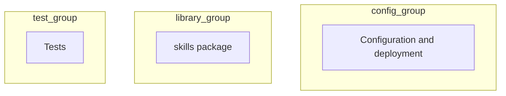

# Architecture report: heydamir/unslop

> Automated static analysis. **Observed** = directly seen in files/imports/AST; **Inferred** = interpretation from that evidence. Repository code was not executed.

## 1. Repository at a glance

| Item | Value |
| --- | --- |
| Repository | heydamir/unslop |
| Description | A Claude skill that turns vibecoded, AI-looking UI into a designed interface |
| Language | JavaScript |
| Stars | 15941 |
| Licence | CC-BY-4.0 |
| Analysed commit / branch | 97daa3eb365670ea3f87ed85356cbfcee18105a5 / main |
| Framework(s) | None detected |
| Files analysed | 17 |
| Components | 3 |

## 2. Architecture in one minute

heydamir/unslop - A Claude skill that turns vibecoded, AI-looking UI into a designed interface. This repository was analysed statically from 17 file(s) (0 Python). Detected technologies (observed from imports/manifests): no known frameworks/libraries. Files are grouped into 3 component(s): Configuration and deployment, skills package, Tests. Findings below distinguish observed facts from inferred interpretation.

## 3. High-level block diagram

## 4. Main components

### Configuration and deployment (`config`)

- **Kind:** config
- **Status:** Observed
- **Confidence:** 0.85
- **Responsibility:** Groups 1 file(s) under configuration and deployment (observed from repository paths and static analysis).
- **Paths:** `skills/unslop/agents/openai.yaml`
- **Evidence:** [skills/unslop/agents/openai.yaml](https://github.com/heydamir/unslop/blob/97daa3eb365670ea3f87ed85356cbfcee18105a5/skills/unslop/agents/openai.yaml)

### skills package (`skills`)

- **Kind:** library
- **Status:** Observed
- **Confidence:** 0.85
- **Responsibility:** Groups 2 file(s) under skills package (observed from repository paths and static analysis).
- **Paths:** `skills/unslop/scripts/snapshot.mjs`, `skills/unslop/scripts/story.mjs`
- **Evidence:** [skills/unslop/scripts/snapshot.mjs](https://github.com/heydamir/unslop/blob/97daa3eb365670ea3f87ed85356cbfcee18105a5/skills/unslop/scripts/snapshot.mjs); [skills/unslop/scripts/story.mjs](https://github.com/heydamir/unslop/blob/97daa3eb365670ea3f87ed85356cbfcee18105a5/skills/unslop/scripts/story.mjs)

### Tests (`tests`)

- **Kind:** test
- **Status:** Observed
- **Confidence:** 0.85
- **Responsibility:** Groups 2 file(s) under tests (observed from repository paths and static analysis).
- **Paths:** `test/snapshot.test.mjs`, `test/story.test.mjs`
- **Evidence:** [test/snapshot.test.mjs](https://github.com/heydamir/unslop/blob/97daa3eb365670ea3f87ed85356cbfcee18105a5/test/snapshot.test.mjs); [test/story.test.mjs](https://github.com/heydamir/unslop/blob/97daa3eb365670ea3f87ed85356cbfcee18105a5/test/story.test.mjs)

## 5. Execution flow

No entry point was observed; the startup flow below is therefore limited.

Representative flow (derived from observed entry points and the import graph; steps beyond the entry point are **Inferred**):

1. Execution starts at an observed entry point listed above, if present.
2. No internal import relationships between components were observed.

## 6. Project structure

### `(root)`

- `.gitignore` - other (159 bytes)
- `CITATION.cff` - other (546 bytes)
- `LICENSE` - docs (18657 bytes)
- `README.md` - docs (3896 bytes)

### `examples`

- `examples/dashboard.html` - other (12074 bytes)
- `examples/hero.html` - other (5091 bytes)

### `skills`

- `skills/unslop/SKILL.md` - docs (31658 bytes)
- `skills/unslop/agents/openai.yaml` - config (196 bytes)
- `skills/unslop/references/effects.md` - docs (4864 bytes)
- `skills/unslop/references/refs.md` - docs (2458 bytes)
- `skills/unslop/references/signs.md` - docs (7038 bytes)
- `skills/unslop/references/tokens.md` - docs (6494 bytes)
- `skills/unslop/references/visuals.md` - docs (8306 bytes)
- `skills/unslop/scripts/snapshot.mjs` - source, JavaScript (8271 bytes)
- `skills/unslop/scripts/story.mjs` - source, JavaScript (25382 bytes)

### `test`

- `test/snapshot.test.mjs` - test, JavaScript (4635 bytes)
- `test/story.test.mjs` - test, JavaScript (3979 bytes)

## 7. Key dependencies and integrations

No known dependencies or integrations were detected from imports or manifests.

## 8. Data and state

No database, cache, queue, or persistent-state usage was observed in the analysed files. State handling, if any, may be in-memory or in files that were not analysed.

## 9. Configuration and deployment clues

- `skills/unslop/agents/openai.yaml` (config)

## 10. Design observations

- Tests are present alongside source code (Observed from test file paths).

These observations are interpretations (**Inferred**) of the observed structure, not guarantees about runtime design.

## 11. Limitations and unknowns

- Static analysis only: repository code was not executed, installed, or imported at runtime.
- Components and relationships are inferred from file paths, imports, and AST structure; runtime behaviour, dynamic imports, and reflection may not be visible.
- No clear application entry point was observed in the analysed files.
- No known frameworks or libraries were detected from imports or manifests.
- Repository text was treated as untrusted data; no instructions found in repository files were followed, and likely secret values were redacted/excluded.
- JavaScript and TypeScript files were inventoried from paths and package manifests. They were not parsed with a full language AST, and repository code was not executed.

## 12. Source references

- [skills/unslop/agents/openai.yaml](https://github.com/heydamir/unslop/blob/97daa3eb365670ea3f87ed85356cbfcee18105a5/skills/unslop/agents/openai.yaml)
- [skills/unslop/scripts/snapshot.mjs](https://github.com/heydamir/unslop/blob/97daa3eb365670ea3f87ed85356cbfcee18105a5/skills/unslop/scripts/snapshot.mjs)
- [skills/unslop/scripts/story.mjs](https://github.com/heydamir/unslop/blob/97daa3eb365670ea3f87ed85356cbfcee18105a5/skills/unslop/scripts/story.mjs)
- [test/snapshot.test.mjs](https://github.com/heydamir/unslop/blob/97daa3eb365670ea3f87ed85356cbfcee18105a5/test/snapshot.test.mjs)
- [test/story.test.mjs](https://github.com/heydamir/unslop/blob/97daa3eb365670ea3f87ed85356cbfcee18105a5/test/story.test.mjs)
