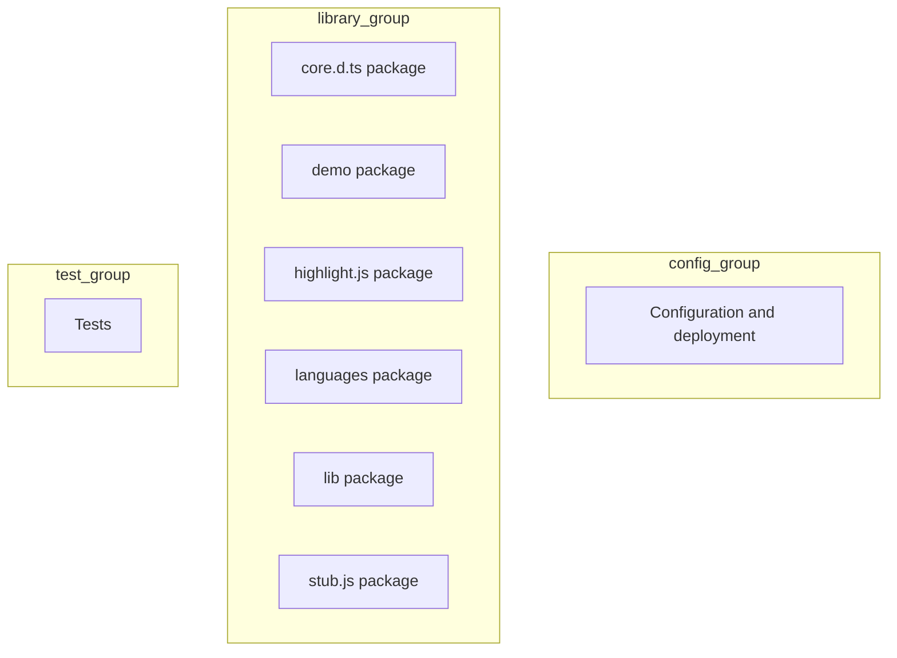

# Architecture report: highlightjs/highlight.js

> Automated static analysis. **Observed** = directly seen in files/imports/AST; **Inferred** = interpretation from that evidence. Repository code was not executed.

## 1. Repository at a glance

| Item | Value |
| --- | --- |
| Repository | highlightjs/highlight.js |
| Description | JavaScript syntax highlighter with language auto-detection and zero dependencies. |
| Language | JavaScript |
| Stars | 25016 |
| Licence | BSD-3-Clause |
| Analysed commit / branch | 35f98874f935d3e4b98dbbbef9895c5fbc7d9b4c / main |
| Framework(s) | None detected |
| Files analysed | 800 |
| Components | 8 |

## 2. Architecture in one minute

highlightjs/highlight.js - JavaScript syntax highlighter with language auto-detection and zero dependencies.. This repository was analysed statically from 800 file(s) (1 Python). Detected technologies (observed from imports/manifests): GitHub Actions, Docker, TypeScript. Files are grouped into 8 component(s): Configuration and deployment, core.d.ts package, demo package, highlight.js package, languages package, lib package, stub.js package, Tests. Findings below distinguish observed facts from inferred interpretation.

## 3. High-level block diagram

## 4. Main components

### Configuration and deployment (`config`)

- **Kind:** config
- **Status:** Observed
- **Confidence:** 0.85
- **Responsibility:** Groups 3 file(s) under configuration and deployment (observed from repository paths and static analysis).
- **Paths:** `Dockerfile`, `package.json`, `src/languages/dockerfile.js`
- **Evidence:** [Dockerfile](https://github.com/highlightjs/highlight.js/blob/35f98874f935d3e4b98dbbbef9895c5fbc7d9b4c/Dockerfile); [package.json](https://github.com/highlightjs/highlight.js/blob/35f98874f935d3e4b98dbbbef9895c5fbc7d9b4c/package.json); [src/languages/dockerfile.js](https://github.com/highlightjs/highlight.js/blob/35f98874f935d3e4b98dbbbef9895c5fbc7d9b4c/src/languages/dockerfile.js)

### core.d.ts package (`core_d_ts`)

- **Kind:** library
- **Status:** Observed
- **Confidence:** 0.85
- **Responsibility:** Groups 1 file(s) under core.d.ts package (observed from repository paths and static analysis).
- **Paths:** `src/core.d.ts`
- **Evidence:** [src/core.d.ts](https://github.com/highlightjs/highlight.js/blob/35f98874f935d3e4b98dbbbef9895c5fbc7d9b4c/src/core.d.ts)

### demo package (`demo`)

- **Kind:** library
- **Status:** Observed
- **Confidence:** 0.85
- **Responsibility:** Groups 1 file(s) under demo package (observed from repository paths and static analysis).
- **Paths:** `demo/demo.js`
- **Evidence:** [demo/demo.js](https://github.com/highlightjs/highlight.js/blob/35f98874f935d3e4b98dbbbef9895c5fbc7d9b4c/demo/demo.js)

### highlight.js package (`highlight_js`)

- **Kind:** library
- **Status:** Observed
- **Confidence:** 0.85
- **Responsibility:** Groups 1 file(s) under highlight.js package (observed from repository paths and static analysis).
- **Paths:** `src/highlight.js`
- **Evidence:** [src/highlight.js](https://github.com/highlightjs/highlight.js/blob/35f98874f935d3e4b98dbbbef9895c5fbc7d9b4c/src/highlight.js)

### languages package (`languages`)

- **Kind:** library
- **Status:** Observed
- **Confidence:** 0.85
- **Responsibility:** Groups 198 file(s) under languages package (observed from repository paths and static analysis).
- **Paths:** `src/languages/1c.js`, `src/languages/abnf.js`, `src/languages/accesslog.js`, `src/languages/actionscript.js`, `src/languages/ada.js`, `src/languages/angelscript.js`, `src/languages/apache.js`, `src/languages/applescript.js`, `src/languages/arcade.js`, `src/languages/arduino.js`, `src/languages/armasm.js`, `src/languages/asciidoc.js`, `src/languages/aspectj.js`, `src/languages/autohotkey.js`, `src/languages/autoit.js`, `src/languages/avrasm.js`, `src/languages/awk.js`, `src/languages/axapta.js`, `src/languages/bash.js`, `src/languages/basic.js`, `src/languages/bnf.js`, `src/languages/brainfuck.js`, `src/languages/c.js`, `src/languages/cal.js`, `src/languages/capnproto.js`, `src/languages/ceylon.js`, `src/languages/clean.js`, `src/languages/clojure-repl.js`, `src/languages/clojure.js`, `src/languages/cmake.js`, `src/languages/coffeescript.js`, `src/languages/coq.js`, `src/languages/cos.js`, `src/languages/cpp.js`, `src/languages/crmsh.js`, `src/languages/crystal.js`, `src/languages/csharp.js`, `src/languages/csp.js`, `src/languages/css.js`, `src/languages/d.js`, `src/languages/dart.js`, `src/languages/delphi.js`, `src/languages/diff.js`, `src/languages/django.js`, `src/languages/dns.js`, `src/languages/dos.js`, `src/languages/dsconfig.js`, `src/languages/dts.js`, `src/languages/dust.js`, `src/languages/ebnf.js`, `src/languages/elixir.js`, `src/languages/elm.js`, `src/languages/erb.js`, `src/languages/erlang-repl.js`, `src/languages/erlang.js`, `src/languages/excel.js`, `src/languages/fix.js`, `src/languages/flix.js`, `src/languages/fortran.js`, `src/languages/freedesktop.js`, `src/languages/fsharp.js`, `src/languages/gams.js`, `src/languages/gauss.js`, `src/languages/gcode.js`, `src/languages/gherkin.js`, `src/languages/glsl.js`, `src/languages/gml.js`, `src/languages/go.js`, `src/languages/golo.js`, `src/languages/gradle.js`, `src/languages/graphql.js`, `src/languages/groovy.js`, `src/languages/haml.js`, `src/languages/handlebars.js`, `src/languages/haskell.js`, `src/languages/haxe.js`, `src/languages/hsp.js`, `src/languages/http.js`, `src/languages/hy.js`, `src/languages/inform7.js`, `src/languages/ini.js`, `src/languages/irpf90.js`, `src/languages/isbl.js`, `src/languages/java.js`, `src/languages/javascript.js`, `src/languages/jboss-cli.js`, `src/languages/json.js`, `src/languages/julia-repl.js`, `src/languages/julia.js`, `src/languages/kotlin.js`, `src/languages/lasso.js`, `src/languages/latex.js`, `src/languages/ldif.js`, `src/languages/leaf.js`, `src/languages/less.js`, `src/languages/lib/css-shared.js`, `src/languages/lib/ecmascript.js`, `src/languages/lib/java.js`, `src/languages/lib/kws_swift.js`, `src/languages/lib/mathematica.js`, `src/languages/lisp.js`, `src/languages/livecodeserver.js`, `src/languages/livescript.js`, `src/languages/llvm.js`, `src/languages/lsl.js`, `src/languages/lua.js`, `src/languages/makefile.js`, `src/languages/markdown.js`, `src/languages/mathematica.js`, `src/languages/matlab.js`, `src/languages/maxima.js`, `src/languages/mel.js`, `src/languages/mercury.js`, `src/languages/mipsasm.js`, `src/languages/mizar.js`, `src/languages/mojolicious.js`, `src/languages/monkey.js`, `src/languages/moonscript.js`, `src/languages/n1ql.js`, `src/languages/nestedtext.js`, `src/languages/nginx.js`, `src/languages/nim.js`, `src/languages/nix.js`, `src/languages/node-repl.js`, `src/languages/nsis.js`, `src/languages/objectivec.js`, `src/languages/ocaml.js`, `src/languages/odin.js`, `src/languages/openscad.js`, `src/languages/oxygene.js`, `src/languages/parser3.js`, `src/languages/perl.js`, `src/languages/pf.js`, `src/languages/pgsql.js`, `src/languages/php-template.js`, `src/languages/php.js`, `src/languages/plaintext.js`, `src/languages/pony.js`, `src/languages/powershell.js`, `src/languages/processing.js`, `src/languages/profile.js`, `src/languages/prolog.js`, `src/languages/properties.js`, `src/languages/protobuf.js`, `src/languages/puppet.js`, `src/languages/purebasic.js`, `src/languages/python-repl.js`, `src/languages/python.js`, `src/languages/q.js`, `src/languages/qml.js`, `src/languages/r.js`, `src/languages/reasonml.js`, `src/languages/rib.js`, `src/languages/roboconf.js`, `src/languages/routeros.js`, `src/languages/rsl.js`, `src/languages/ruby.js`, `src/languages/ruleslanguage.js`, `src/languages/rust.js`, `src/languages/sas.js`, `src/languages/scala.js`, `src/languages/scheme.js`, `src/languages/scilab.js`, `src/languages/scss.js`, `src/languages/shell.js`, `src/languages/smali.js`, `src/languages/smalltalk.js`, `src/languages/sml.js`, `src/languages/sqf.js`, `src/languages/sql.js`, `src/languages/stan.js`, `src/languages/stata.js`, `src/languages/step21.js`, `src/languages/stylus.js`, `src/languages/subunit.js`, `src/languages/swift.js`, `src/languages/taggerscript.js`, `src/languages/tap.js`, `src/languages/tcl.js`, `src/languages/thrift.js`, `src/languages/tp.js`, `src/languages/twig.js`, `src/languages/typescript.js`, `src/languages/vala.js`, `src/languages/vbnet.js`, `src/languages/vbscript-html.js`, `src/languages/vbscript.js`, `src/languages/verilog.js`, `src/languages/vhdl.js`, `src/languages/vim.js`, `src/languages/wasm.js`, `src/languages/wren.js`, `src/languages/x86asm.js`, `src/languages/xl.js`, `src/languages/xml.js`, `src/languages/xquery.js`, `src/languages/yaml.js`, `src/languages/zephir.js`
- **Evidence:** [src/languages/1c.js](https://github.com/highlightjs/highlight.js/blob/35f98874f935d3e4b98dbbbef9895c5fbc7d9b4c/src/languages/1c.js); [src/languages/abnf.js](https://github.com/highlightjs/highlight.js/blob/35f98874f935d3e4b98dbbbef9895c5fbc7d9b4c/src/languages/abnf.js); [src/languages/accesslog.js](https://github.com/highlightjs/highlight.js/blob/35f98874f935d3e4b98dbbbef9895c5fbc7d9b4c/src/languages/accesslog.js); [src/languages/actionscript.js](https://github.com/highlightjs/highlight.js/blob/35f98874f935d3e4b98dbbbef9895c5fbc7d9b4c/src/languages/actionscript.js); [src/languages/ada.js](https://github.com/highlightjs/highlight.js/blob/35f98874f935d3e4b98dbbbef9895c5fbc7d9b4c/src/languages/ada.js); [src/languages/angelscript.js](https://github.com/highlightjs/highlight.js/blob/35f98874f935d3e4b98dbbbef9895c5fbc7d9b4c/src/languages/angelscript.js); [src/languages/apache.js](https://github.com/highlightjs/highlight.js/blob/35f98874f935d3e4b98dbbbef9895c5fbc7d9b4c/src/languages/apache.js); [src/languages/applescript.js](https://github.com/highlightjs/highlight.js/blob/35f98874f935d3e4b98dbbbef9895c5fbc7d9b4c/src/languages/applescript.js)

### lib package (`lib`)

- **Kind:** library
- **Status:** Observed
- **Confidence:** 0.85
- **Responsibility:** Groups 13 file(s) under lib package (observed from repository paths and static analysis).
- **Paths:** `src/lib/compile_keywords.js`, `src/lib/compiler_extensions.js`, `src/lib/ext/multi_class.js`, `src/lib/exts/before_match.js`, `src/lib/html_injection_error.js`, `src/lib/html_renderer.js`, `src/lib/logger.js`, `src/lib/mode_compiler.js`, `src/lib/modes.js`, `src/lib/regex.js`, `src/lib/response.js`, `src/lib/token_tree.js`, `src/lib/utils.js`
- **Evidence:** [src/lib/compile_keywords.js](https://github.com/highlightjs/highlight.js/blob/35f98874f935d3e4b98dbbbef9895c5fbc7d9b4c/src/lib/compile_keywords.js); [src/lib/compiler_extensions.js](https://github.com/highlightjs/highlight.js/blob/35f98874f935d3e4b98dbbbef9895c5fbc7d9b4c/src/lib/compiler_extensions.js); [src/lib/ext/multi_class.js](https://github.com/highlightjs/highlight.js/blob/35f98874f935d3e4b98dbbbef9895c5fbc7d9b4c/src/lib/ext/multi_class.js); [src/lib/exts/before_match.js](https://github.com/highlightjs/highlight.js/blob/35f98874f935d3e4b98dbbbef9895c5fbc7d9b4c/src/lib/exts/before_match.js); [src/lib/html_injection_error.js](https://github.com/highlightjs/highlight.js/blob/35f98874f935d3e4b98dbbbef9895c5fbc7d9b4c/src/lib/html_injection_error.js); [src/lib/html_renderer.js](https://github.com/highlightjs/highlight.js/blob/35f98874f935d3e4b98dbbbef9895c5fbc7d9b4c/src/lib/html_renderer.js); [src/lib/logger.js](https://github.com/highlightjs/highlight.js/blob/35f98874f935d3e4b98dbbbef9895c5fbc7d9b4c/src/lib/logger.js); [src/lib/mode_compiler.js](https://github.com/highlightjs/highlight.js/blob/35f98874f935d3e4b98dbbbef9895c5fbc7d9b4c/src/lib/mode_compiler.js)

### stub.js package (`stub_js`)

- **Kind:** library
- **Status:** Observed
- **Confidence:** 0.85
- **Responsibility:** Groups 1 file(s) under stub.js package (observed from repository paths and static analysis).
- **Paths:** `src/stub.js`
- **Evidence:** [src/stub.js](https://github.com/highlightjs/highlight.js/blob/35f98874f935d3e4b98dbbbef9895c5fbc7d9b4c/src/stub.js)

### Tests (`tests`)

- **Kind:** test
- **Status:** Observed
- **Confidence:** 0.85
- **Responsibility:** Groups 256 file(s) under tests (observed from repository paths and static analysis).
- **Paths:** `test/api/autoDetection.js`, `test/api/beginKeywords.js`, `test/api/binaryNumber.js`, `test/api/cNumber.js`, `test/api/getLanguage.js`, `test/api/highlight.js`, `test/api/ident.js`, `test/api/index.js`, `test/api/keywords.js`, `test/api/multiClassMatch.js`, `test/api/number.js`, `test/api/registerAlias.js`, `test/api/starters.js`, `test/api/underscoreIdent.js`, `test/api/unregisterLanguage.js`, `test/browser/highlight_block_callbacks.js`, `test/browser/index.js`, `test/browser/plain.js`, `test/browser/test_case.js`, `test/browser/worker.js`, `test/builds/browser_build_as_commonjs.js`, `test/builds/cdn_build_as_esm.mjs`, `test/builds/node_build_as_esm.mjs`, `test/builds/package.js`, `test/builds/rollup_import_cdn_build_esm.mjs`, `test/builds/rollup_import_node_build_esm.mjs`, `test/builds/rollup_import_via_commonjs.mjs`, `test/detect/1c/default.txt`, `test/detect/abnf/default.txt`, `test/detect/accesslog/default.txt`, `test/detect/actionscript/default.txt`, `test/detect/ada/default.txt`, `test/detect/angelscript/default.txt`, `test/detect/apache/default.txt`, `test/detect/applescript/default.txt`, `test/detect/arcade/default.txt`, `test/detect/arduino/default.txt`, `test/detect/armasm/default.txt`, `test/detect/asciidoc/default.txt`, `test/detect/aspectj/default.txt`, `test/detect/autohotkey/default.txt`, `test/detect/autoit/default.txt`, `test/detect/avrasm/default.txt`, `test/detect/awk/default.txt`, `test/detect/axapta/default.txt`, `test/detect/bash/default.txt`, `test/detect/basic/default.txt`, `test/detect/bnf/default.txt`, `test/detect/brainfuck/default.txt`, `test/detect/cal/default.txt`, `test/detect/capnproto/default.txt`, `test/detect/ceylon/default.txt`, `test/detect/clean/default.txt`, `test/detect/clojure-repl/default.txt`, `test/detect/clojure/default.txt`, `test/detect/cmake/default.txt`, `test/detect/coffeescript/default.txt`, `test/detect/coq/default.txt`, `test/detect/cos/default.txt`, `test/detect/cpp/default.txt`, `test/detect/crmsh/default.txt`, `test/detect/crystal/default.txt`, `test/detect/csharp/default.txt`, `test/detect/csp/default.txt`, `test/detect/css/default.txt`, `test/detect/d/default.txt`, `test/detect/dart/default.txt`, `test/detect/delphi/default.txt`, `test/detect/diff/default.txt`, `test/detect/django/default.txt`, `test/detect/dns/default.txt`, `test/detect/dockerfile/default.txt`, `test/detect/dos/default.txt`, `test/detect/dsconfig/default.txt`, `test/detect/dts/default.txt`, `test/detect/dust/default.txt`, `test/detect/ebnf/default.txt`, `test/detect/elixir/default.txt`, `test/detect/elm/default.txt`, `test/detect/erb/default.txt`, `test/detect/erlang-repl/default.txt`, `test/detect/erlang/default.txt`, `test/detect/excel/default.txt`, `test/detect/fix/default.txt`, `test/detect/flix/default.txt`, `test/detect/fortran/default.txt`, `test/detect/fsharp/default.txt`, `test/detect/gams/default.txt`, `test/detect/gauss/default.txt`, `test/detect/gcode/default.txt`, `test/detect/gherkin/default.txt`, `test/detect/glsl/default.txt`, `test/detect/gml/default.txt`, `test/detect/go/default.txt`, `test/detect/go/swift-like.txt`, `test/detect/golo/default.txt`, `test/detect/gradle/default.txt`, `test/detect/graphql/default.txt`, `test/detect/groovy/default.txt`, `test/detect/haml/default.txt`, `test/detect/handlebars/default.txt`, `test/detect/haskell/default.txt`, `test/detect/haxe/default.txt`, `test/detect/hsp/default.txt`, `test/detect/http/default.txt`, `test/detect/hy/default.txt`, `test/detect/index.js`, `test/detect/inform7/default.txt`, `test/detect/ini/default.txt`, `test/detect/irpf90/default.txt`, `test/detect/isbl/default.txt`, `test/detect/java/default.txt`, `test/detect/javascript/default.txt`, `test/detect/javascript/sample1.txt`, `test/detect/javascript/short-plain.txt`, `test/detect/jboss-cli/default.txt`, `test/detect/json/default.txt`, `test/detect/json5/default.txt`, `test/detect/julia-repl/default.txt`, `test/detect/julia/default.txt`, `test/detect/kotlin/default.txt`, `test/detect/lasso/default.txt`, `test/detect/latex/default.txt`, `test/detect/ldif/default.txt`, `test/detect/leaf/default.txt`, `test/detect/less/default.txt`, `test/detect/lisp/default.txt`, `test/detect/livecodeserver/default.txt`, `test/detect/livescript/default.txt`, `test/detect/llvm/default.txt`, `test/detect/lsl/default.txt`, `test/detect/lua/default.txt`, `test/detect/makefile/default.txt`, `test/detect/markdown/default.txt`, `test/detect/mathematica/default.txt`, `test/detect/matlab/default.txt`, `test/detect/maxima/default.txt`, `test/detect/mel/default.txt`, `test/detect/mercury/default.txt`, `test/detect/mipsasm/default.txt`, `test/detect/mizar/default.txt`, `test/detect/mojolicious/default.txt`, `test/detect/monkey/default.txt`, `test/detect/moonscript/default.txt`, `test/detect/n1ql/default.txt`, `test/detect/nestedtext/default.txt`, `test/detect/nginx/default.txt`, `test/detect/nim/default.txt`, `test/detect/nix/default.txt`, `test/detect/node-repl/default.txt`, `test/detect/nsis/default.txt`, `test/detect/objectivec/default.txt`, `test/detect/ocaml/default.txt`, `test/detect/odin/default.txt`, `test/detect/openscad/default.txt`, `test/detect/oxygene/default.txt`, `test/detect/parser3/default.txt`, `test/detect/perl/default.txt`, `test/detect/pf/default.txt`, `test/detect/pgsql/default.txt`, `test/detect/php-template/default.txt`, `test/detect/php/default.txt`, `test/detect/plaintext/default.txt`, `test/detect/pony/default.txt`, `test/detect/powershell/default.txt`, `test/detect/processing/default.txt`, `test/detect/profile/default.txt`, `test/detect/prolog/default.txt`, `test/detect/properties/default.txt`, `test/detect/protobuf/default.txt`, `test/detect/puppet/default.txt`, `test/detect/purebasic/default.txt`, `test/detect/python-repl/default.txt`, `test/detect/python/default.txt`, `test/detect/q/default.txt`, `test/detect/qml/default.txt`, `test/detect/r/default.txt`, `test/detect/reasonml/default.txt`, `test/detect/rib/default.txt`, `test/detect/roboconf/default.txt`, `test/detect/routeros/default.txt`, `test/detect/rsl/default.txt`, `test/detect/ruby/default.txt`, `test/detect/ruby/double-colon.txt`, `test/detect/ruleslanguage/default.txt`, `test/detect/rust/default.txt`, `test/detect/sas/default.txt`, `test/detect/scala/default.txt`, `test/detect/scheme/default.txt`, `test/detect/scilab/default.txt`, `test/detect/scss/default.txt`, `test/detect/shell/default.txt`, `test/detect/smali/default.txt`, `test/detect/smalltalk/default.txt`, `test/detect/sml/default.txt`, `test/detect/sqf/default.txt`, `test/detect/sql/default.txt`, `test/detect/stan/default.txt`, `test/detect/stata/default.txt`, `test/detect/step21/default.txt`, `test/detect/stylus/default.txt`, `test/detect/subunit/default.txt`, `test/detect/swift/default.txt`, `test/detect/taggerscript/default.txt`, `test/detect/tap/default.txt`, `test/detect/tcl/default.txt`, `test/detect/thrift/default.txt`, `test/detect/tp/default.txt`, `test/detect/twig/default.txt`, `test/detect/typescript/default.txt`, `test/detect/vala/default.txt`, `test/detect/vbnet/default.txt`, `test/detect/vbscript-html/default.txt`, `test/detect/vbscript/default.txt`, `test/detect/verilog/default.txt`, `test/detect/vhdl/default.txt`, `test/detect/vim/default.txt`, `test/detect/wasm/default.txt`, `test/detect/wren/default.txt`, `test/detect/x86asm/default.txt`, `test/detect/xl/default.txt`, `test/detect/xml/default.txt`, `test/detect/xml/groovy-julia.txt`, `test/detect/xml/js.txt`, `test/detect/xquery/default.txt`, `test/detect/yaml/default.txt`, `test/detect/zephir/default.txt`, `test/fixtures/expect/endsWithParentVariants.txt`, `test/fixtures/expect/explicit1.txt`, `test/fixtures/expect/explicit2.txt`, `test/fixtures/expect/languagealias.txt`, `test/fixtures/expect/sublanguages.txt`, `test/fixtures/expect/useBr.txt`, `test/fixtures/index.html`, `test/fixtures/nested.js`, `test/index.js`, `test/markup/1c/default.expect.txt`, `test/markup/1c/default.txt`, `test/markup/1c/query-parameters.expect.txt`, `test/markup/1c/query-parameters.txt`, `test/markup/abnf/default.expect.txt`, `test/markup/abnf/default.txt`, `test/markup/accesslog/default.expect.txt`, `test/markup/accesslog/default.txt`, `test/markup/actionscript/method-call.expect.txt`, `test/markup/actionscript/method-call.txt`, `test/markup/ada/default.expect.txt`, `test/markup/ada/default.txt`, `test/markup/angelscript/default.expect.txt`, `test/markup/angelscript/default.txt`, `test/markup/apache/default.expect.txt`, `test/markup/apache/default.txt`, `test/markup/applescript/default.expect.txt`, `test/markup/applescript/default.txt`, `test/markup/arcade/profile.expect.txt`, `test/markup/arcade/profile.txt`
- **Evidence:** [test/api/autoDetection.js](https://github.com/highlightjs/highlight.js/blob/35f98874f935d3e4b98dbbbef9895c5fbc7d9b4c/test/api/autoDetection.js); [test/api/beginKeywords.js](https://github.com/highlightjs/highlight.js/blob/35f98874f935d3e4b98dbbbef9895c5fbc7d9b4c/test/api/beginKeywords.js); [test/api/binaryNumber.js](https://github.com/highlightjs/highlight.js/blob/35f98874f935d3e4b98dbbbef9895c5fbc7d9b4c/test/api/binaryNumber.js); [test/api/cNumber.js](https://github.com/highlightjs/highlight.js/blob/35f98874f935d3e4b98dbbbef9895c5fbc7d9b4c/test/api/cNumber.js); [test/api/getLanguage.js](https://github.com/highlightjs/highlight.js/blob/35f98874f935d3e4b98dbbbef9895c5fbc7d9b4c/test/api/getLanguage.js); [test/api/highlight.js](https://github.com/highlightjs/highlight.js/blob/35f98874f935d3e4b98dbbbef9895c5fbc7d9b4c/test/api/highlight.js); [test/api/ident.js](https://github.com/highlightjs/highlight.js/blob/35f98874f935d3e4b98dbbbef9895c5fbc7d9b4c/test/api/ident.js); [test/api/index.js](https://github.com/highlightjs/highlight.js/blob/35f98874f935d3e4b98dbbbef9895c5fbc7d9b4c/test/api/index.js)

## 5. Execution flow

No entry point was observed; the startup flow below is therefore limited.

Representative flow (derived from observed entry points and the import graph; steps beyond the entry point are **Inferred**):

1. Execution starts at an observed entry point listed above, if present.
2. No internal import relationships between components were observed.

## 6. Project structure

### `(root)`

- `.dockerignore` - container (121 bytes)
- `.editorconfig` - config (116 bytes)
- `.eslintrc.js` - source, JavaScript (3033 bytes)
- `.eslintrc.lang.js` - source, JavaScript (298 bytes)
- `.git-blame-ignore-revs` - other (72 bytes)
- `.gitattributes` - other (189 bytes)
- `.gitignore` - other (195 bytes)
- `.mocharc.json` - config (28 bytes)
- `.readthedocs.yaml` - config (598 bytes)
- `.tokeignore` - other (49 bytes)
- `AGENTS.md` - docs (6727 bytes)
- `CHANGES.md` - docs (157477 bytes)
- `CONTRIBUTING.md` - docs (7698 bytes)
- `CONTRIBUTORS.md` - docs (790 bytes)
- `Dockerfile` - container (518 bytes)
- `LICENSE` - docs (1514 bytes)
- `MAINTAINERS_GUIDE.md` - docs (2134 bytes)
- `NOTICE.txt` - docs (81 bytes)
- `README.CDN.md` - docs (1712 bytes)
- `README.md` - docs (19640 bytes)
- `SECURITY.md` - docs (1228 bytes)
- `SUPPORTED_LANGUAGES.md` - docs (28553 bytes)
- `VERSION_10_BREAKING_CHANGES.md` - docs (1768 bytes)
- `VERSION_10_UPGRADE.md` - docs (3322 bytes)
- `VERSION_11_UPGRADE.md` - docs (8936 bytes)
- `package.json` - manifest (2954 bytes)

### `.github`

- `.github/ISSUE_TEMPLATE/1_incorrect-syntax-highlighting.md` - docs (1670 bytes)
- `.github/ISSUE_TEMPLATE/bug_report.md` - docs (941 bytes)
- `.github/ISSUE_TEMPLATE/config.yml` - config (540 bytes)
- `.github/ISSUE_TEMPLATE/feature_request.md` - docs (840 bytes)
- `.github/dependabot.yml` - config (205 bytes)
- `.github/pull_request_template.md` - docs (434 bytes)
- `.github/workflows/lint.yml` - ci, YAML (586 bytes)
- `.github/workflows/release.yml` - ci, YAML (4879 bytes)
- `.github/workflows/size_report_comment.yml` - ci, YAML (1844 bytes)
- `.github/workflows/size_report_create.yml` - ci, YAML (1026 bytes)
- `.github/workflows/tests.js.yml` - ci, YAML (2042 bytes)

### `demo`

- `demo/demo.js` - source, JavaScript (1473 bytes)
- `demo/index.html` - other (1710 bytes)
- `demo/readme.md` - docs (224 bytes)
- `demo/style.css` - other (1902 bytes)

### `docs`

- `docs/Makefile` - docs (5584 bytes)
- `docs/_build/.gitkeep` - docs (0 bytes)
- `docs/_static/.gitkeep` - docs (0 bytes)
- `docs/_static/custom.css` - docs (480 bytes)
- `docs/_templates/.gitkeep` - docs (0 bytes)
- `docs/ai-contributions.md` - docs (3746 bytes)
- `docs/api.rst` - docs (6955 bytes)
- `docs/building-testing.rst` - docs (6321 bytes)
- `docs/conf.py` - docs (8347 bytes)
- `docs/css-classes-reference.rst` - docs (15452 bytes)
- `docs/index.rst` - docs (1897 bytes)
- `docs/language-contribution.rst` - docs (4758 bytes)
- `docs/language-guide.rst` - docs (9408 bytes)
- `docs/language-requests.rst` - docs (1527 bytes)
- `docs/line-numbers.rst` - docs (2124 bytes)
- `docs/mode-reference.rst` - docs (19797 bytes)
- `docs/plugin-api.rst` - docs (3610 bytes)
- `docs/plugin-recipes.rst` - docs (630 bytes)
- `docs/requirements.txt` - manifest (81 bytes)
- `docs/theme-guide.rst` - docs (2764 bytes)

### `extra`

- `extra/.keep` - other (0 bytes)
- `extra/3RD_PARTY_QUICK_START.md` - docs (3075 bytes)

### `src`

- `src/core.d.ts` - source, TypeScript (55 bytes)
- `src/highlight.js` - source, JavaScript (34040 bytes)
- `src/languages/1c.js` - source, JavaScript (64998 bytes)
- `src/languages/abnf.js` - source, JavaScript (1461 bytes)
- `src/languages/accesslog.js` - source, JavaScript (1952 bytes)
- `src/languages/actionscript.js` - source, JavaScript (2840 bytes)
- `src/languages/ada.js` - source, JavaScript (6708 bytes)
- `src/languages/angelscript.js` - source, JavaScript (3504 bytes)
- `src/languages/apache.js` - source, JavaScript (2534 bytes)
- `src/languages/applescript.js` - source, JavaScript (4031 bytes)
- `src/languages/arcade.js` - source, JavaScript (8600 bytes)
- `src/languages/arduino.js` - source, JavaScript (7738 bytes)
- `src/languages/armasm.js` - source, JavaScript (5184 bytes)
- `src/languages/asciidoc.js` - source, JavaScript (6381 bytes)
- `src/languages/aspectj.js` - source, JavaScript (5230 bytes)
- `src/languages/autohotkey.js` - source, JavaScript (2169 bytes)
- `src/languages/autoit.js` - source, JavaScript (9621 bytes)
- `src/languages/avrasm.js` - source, JavaScript (2939 bytes)
- `src/languages/awk.js` - source, JavaScript (1350 bytes)
- `src/languages/axapta.js` - source, JavaScript (3063 bytes)
- `src/languages/bash.js` - source, JavaScript (6622 bytes)
- `src/languages/basic.js` - source, JavaScript (3630 bytes)
- `src/languages/bnf.js` - source, JavaScript (718 bytes)
- `src/languages/brainfuck.js` - source, JavaScript (1103 bytes)
- `src/languages/c.js` - source, JavaScript (10973 bytes)
- `src/languages/cal.js` - source, JavaScript (2679 bytes)
- `src/languages/capnproto.js` - source, JavaScript (1594 bytes)
- `src/languages/ceylon.js` - source, JavaScript (2428 bytes)
- `src/languages/clean.js` - source, JavaScript (1087 bytes)
- `src/languages/clojure-repl.js` - source, JavaScript (472 bytes)
- `src/languages/clojure.js` - source, JavaScript (6299 bytes)
- `src/languages/cmake.js` - source, JavaScript (3388 bytes)
- `src/languages/coffeescript.js` - source, JavaScript (4841 bytes)
- `src/languages/coq.js` - source, JavaScript (6700 bytes)
- `src/languages/cos.js` - source, JavaScript (5302 bytes)
- `src/languages/cpp.js` - source, JavaScript (14637 bytes)
- `src/languages/crmsh.js` - source, JavaScript (2496 bytes)
- `src/languages/crystal.js` - source, JavaScript (8470 bytes)
- `src/languages/csharp.js` - source, JavaScript (9018 bytes)
- `src/languages/csp.js` - source, JavaScript (1198 bytes)
- `src/languages/css.js` - source, JavaScript (3860 bytes)
- `src/languages/d.js` - source, JavaScript (6823 bytes)
- `src/languages/dart.js` - source, JavaScript (5106 bytes)
- `src/languages/delphi.js` - source, JavaScript (4363 bytes)
- `src/languages/diff.js` - source, JavaScript (1389 bytes)
- `src/languages/django.js` - source, JavaScript (2790 bytes)
- `src/languages/dns.js` - source, JavaScript (3591 bytes)
- `src/languages/dockerfile.js` - container (878 bytes)
- `src/languages/dos.js` - source, JavaScript (2594 bytes)
- `src/languages/dsconfig.js` - source, JavaScript (1307 bytes)
- `src/languages/dts.js` - source, JavaScript (3053 bytes)
- `src/languages/dust.js` - source, JavaScript (1005 bytes)
- `src/languages/ebnf.js` - source, JavaScript (992 bytes)
- `src/languages/elixir.js` - source, JavaScript (5889 bytes)
- `src/languages/elm.js` - source, JavaScript (2507 bytes)
- `src/languages/erb.js` - source, JavaScript (649 bytes)
- `src/languages/erlang-repl.js` - source, JavaScript (1326 bytes)
- `src/languages/erlang.js` - source, JavaScript (5194 bytes)
- `src/languages/excel.js` - source, JavaScript (9437 bytes)
- `src/languages/fix.js` - source, JavaScript (775 bytes)
- `src/languages/flix.js` - source, JavaScript (1295 bytes)
- `src/languages/fortran.js` - source, JavaScript (9310 bytes)
- `src/languages/freedesktop.js` - source, JavaScript (1848 bytes)
- `src/languages/fsharp.js` - source, JavaScript (13675 bytes)
- `src/languages/gams.js` - source, JavaScript (5214 bytes)
- `src/languages/gauss.js` - source, JavaScript (17222 bytes)
- `src/languages/gcode.js` - source, JavaScript (4334 bytes)
- `src/languages/gherkin.js` - source, JavaScript (2843 bytes)
- `src/languages/glsl.js` - source, JavaScript (9907 bytes)
- `src/languages/gml.js` - source, JavaScript (91990 bytes)
- `src/languages/go.js` - source, JavaScript (3806 bytes)
- `src/languages/golo.js` - source, JavaScript (1206 bytes)
- `src/languages/gradle.js` - source, JavaScript (2988 bytes)
- `src/languages/graphql.js` - source, JavaScript (1461 bytes)
- `src/languages/groovy.js` - source, JavaScript (3665 bytes)
- `src/languages/haml.js` - source, JavaScript (2595 bytes)
- `src/languages/handlebars.js` - source, JavaScript (6432 bytes)
- `src/languages/haskell.js` - source, JavaScript (5648 bytes)
- `src/languages/haxe.js` - source, JavaScript (4332 bytes)
- `src/languages/hsp.js` - source, JavaScript (3940 bytes)
- `src/languages/http.js` - source, JavaScript (2068 bytes)
- `src/languages/hy.js` - source, JavaScript (4423 bytes)
- `src/languages/inform7.js` - source, JavaScript (1633 bytes)
- `src/languages/ini.js` - source, JavaScript (2335 bytes)
- `src/languages/irpf90.js` - source, JavaScript (6109 bytes)
- `src/languages/isbl.js` - source, JavaScript (108219 bytes)
- `src/languages/java.js` - source, JavaScript (6356 bytes)
- `src/languages/javascript.js` - source, JavaScript (15524 bytes)
- `src/languages/jboss-cli.js` - source, JavaScript (1514 bytes)
- `src/languages/json.js` - source, JavaScript (1421 bytes)
- `src/languages/julia-repl.js` - source, JavaScript (1767 bytes)
- `src/languages/julia.js` - source, JavaScript (9117 bytes)
- `src/languages/kotlin.js` - source, JavaScript (6925 bytes)
- `src/languages/lasso.js` - source, JavaScript (5148 bytes)
- `src/languages/latex.js` - source, JavaScript (7797 bytes)
- `src/languages/ldif.js` - source, JavaScript (553 bytes)
- `src/languages/leaf.js` - source, JavaScript (1837 bytes)
- `src/languages/less.js` - source, JavaScript (6391 bytes)
- `src/languages/lib/css-shared.js` - source, JavaScript (15587 bytes)
- `src/languages/lib/ecmascript.js` - source, JavaScript (2681 bytes)
- `src/languages/lib/java.js` - source, JavaScript (1123 bytes)
- `src/languages/lib/kws_swift.js` - source, JavaScript (7486 bytes)
- `src/languages/lib/mathematica.js` - source, JavaScript (144789 bytes)
- `src/languages/lisp.js` - source, JavaScript (2609 bytes)
- `src/languages/livecodeserver.js` - source, JavaScript (10261 bytes)
- `src/languages/livescript.js` - source, JavaScript (5185 bytes)
- `src/languages/llvm.js` - source, JavaScript (4588 bytes)
- `src/languages/lsl.js` - source, JavaScript (12720 bytes)
- `src/languages/lua.js` - source, JavaScript (3093 bytes)
- `src/languages/makefile.js` - source, JavaScript (2176 bytes)
- `src/languages/markdown.js` - source, JavaScript (5565 bytes)
- `src/languages/mathematica.js` - source, JavaScript (3870 bytes)
- `src/languages/matlab.js` - source, JavaScript (3632 bytes)
- `src/languages/maxima.js` - source, JavaScript (32815 bytes)
- `src/languages/mel.js` - source, JavaScript (19098 bytes)
- `src/languages/mercury.js` - source, JavaScript (3342 bytes)
- `src/languages/mipsasm.js` - source, JavaScript (4315 bytes)
- `src/languages/mizar.js` - source, JavaScript (1059 bytes)
- `src/languages/mojolicious.js` - source, JavaScript (705 bytes)
- `src/languages/monkey.js` - source, JavaScript (2984 bytes)
- `src/languages/moonscript.js` - source, JavaScript (3579 bytes)
- `src/languages/n1ql.js` - source, JavaScript (6172 bytes)
- `src/languages/nestedtext.js` - source, JavaScript (1436 bytes)
- `src/languages/nginx.js` - source, JavaScript (3122 bytes)
- `src/languages/nim.js` - source, JavaScript (2959 bytes)
- `src/languages/nix.js` - source, JavaScript (6926 bytes)
- `src/languages/node-repl.js` - source, JavaScript (652 bytes)
- `src/languages/nsis.js` - source, JavaScript (10684 bytes)
- `src/languages/objectivec.js` - source, JavaScript (4898 bytes)
- `src/languages/ocaml.js` - source, JavaScript (2506 bytes)
- `src/languages/odin.js` - source, JavaScript (3786 bytes)
- `src/languages/openscad.js` - source, JavaScript (2061 bytes)
- `src/languages/oxygene.js` - source, JavaScript (2901 bytes)
- `src/languages/parser3.js` - source, JavaScript (1044 bytes)
- `src/languages/perl.js` - source, JavaScript (9769 bytes)
- `src/languages/pf.js` - source, JavaScript (2113 bytes)
- `src/languages/pgsql.js` - source, JavaScript (28804 bytes)
- `src/languages/php-template.js` - source, JavaScript (1376 bytes)
- `src/languages/php.js` - source, JavaScript (14857 bytes)
- `src/languages/plaintext.js` - source, JavaScript (289 bytes)
- `src/languages/pony.js` - source, JavaScript (2109 bytes)
- `src/languages/powershell.js` - source, JavaScript (8644 bytes)
- `src/languages/processing.js` - source, JavaScript (7068 bytes)
- `src/languages/profile.js` - source, JavaScript (869 bytes)
- `src/languages/prolog.js` - source, JavaScript (1603 bytes)
- `src/languages/properties.js` - source, JavaScript (1590 bytes)
- `src/languages/protobuf.js` - source, JavaScript (1422 bytes)
- `src/languages/puppet.js` - source, JavaScript (5788 bytes)
- `src/languages/purebasic.js` - source, JavaScript (4402 bytes)
- `src/languages/python-repl.js` - source, JavaScript (624 bytes)
- `src/languages/python.js` - source, JavaScript (9796 bytes)
- `src/languages/q.js` - source, JavaScript (1598 bytes)
- `src/languages/qml.js` - source, JavaScript (5517 bytes)
- `src/languages/r.js` - source, JavaScript (7939 bytes)
- `src/languages/reasonml.js` - source, JavaScript (3067 bytes)
- `src/languages/rib.js` - source, JavaScript (1732 bytes)
- `src/languages/roboconf.js` - source, JavaScript (1550 bytes)
- `src/languages/routeros.js` - source, JavaScript (6204 bytes)
- `src/languages/rsl.js` - source, JavaScript (2343 bytes)
- `src/languages/ruby.js` - source, JavaScript (10106 bytes)
- `src/languages/ruleslanguage.js` - source, JavaScript (4967 bytes)
- `src/languages/rust.js` - source, JavaScript (6821 bytes)
- `src/languages/sas.js` - source, JavaScript (8353 bytes)
- `src/languages/scala.js` - source, JavaScript (4511 bytes)
- `src/languages/scheme.js` - source, JavaScript (5586 bytes)
- `src/languages/scilab.js` - source, JavaScript (2115 bytes)
- `src/languages/scss.js` - source, JavaScript (4419 bytes)
- `src/languages/shell.js` - source, JavaScript (771 bytes)
- `src/languages/smali.js` - source, JavaScript (2214 bytes)
- `src/languages/smalltalk.js` - source, JavaScript (1577 bytes)
- `src/languages/sml.js` - source, JavaScript (2220 bytes)
- `src/languages/sqf.js` - source, JavaScript (62985 bytes)
- `src/languages/sql.js` - source, JavaScript (11973 bytes)
- `src/languages/stan.js` - source, JavaScript (10530 bytes)
- `src/languages/stata.js` - source, JavaScript (17480 bytes)
- `src/languages/step21.js` - source, JavaScript (1470 bytes)
- `src/languages/stylus.js` - source, JavaScript (4191 bytes)
- `src/languages/subunit.js` - source, JavaScript (926 bytes)
- `src/languages/swift.js` - source, JavaScript (15059 bytes)
- `src/languages/taggerscript.js` - source, JavaScript (1063 bytes)
- `src/languages/tap.js` - source, JavaScript (1054 bytes)
- `src/languages/tcl.js` - source, JavaScript (3330 bytes)
- `src/languages/thrift.js` - source, JavaScript (1411 bytes)
- `src/languages/tp.js` - source, JavaScript (3070 bytes)
- `src/languages/twig.js` - source, JavaScript (4340 bytes)
- `src/languages/typescript.js` - source, JavaScript (3755 bytes)
- `src/languages/vala.js` - source, JavaScript (1817 bytes)
- `src/languages/vbnet.js` - source, JavaScript (5265 bytes)
- `src/languages/vbscript-html.js` - source, JavaScript (483 bytes)
- `src/languages/vbscript.js` - source, JavaScript (3577 bytes)
- `src/languages/verilog.js` - source, JavaScript (10320 bytes)
- `src/languages/vhdl.js` - source, JavaScript (3907 bytes)
- `src/languages/vim.js` - source, JavaScript (10482 bytes)
- `src/languages/wasm.js` - source, JavaScript (3026 bytes)
- `src/languages/wren.js` - source, JavaScript (5144 bytes)
- `src/languages/x86asm.js` - source, JavaScript (21242 bytes)
- `src/languages/xl.js` - source, JavaScript (3413 bytes)
- `src/languages/xml.js` - source, JavaScript (6874 bytes)
- `src/languages/xquery.js` - source, JavaScript (8737 bytes)
- `src/languages/yaml.js` - source, JavaScript (5484 bytes)
- `src/languages/zephir.js` - source, JavaScript (3498 bytes)
- `src/lib/compile_keywords.js` - source, JavaScript (2529 bytes)
- `src/lib/compiler_extensions.js` - source, JavaScript (3323 bytes)
- `src/lib/ext/multi_class.js` - source, JavaScript (3546 bytes)
- `src/lib/exts/before_match.js` - source, JavaScript (851 bytes)
- `src/lib/html_injection_error.js` - source, JavaScript (171 bytes)
- `src/lib/html_renderer.js` - source, JavaScript (2387 bytes)
- `src/lib/logger.js` - source, JavaScript (835 bytes)
- `src/lib/mode_compiler.js` - source, JavaScript (15019 bytes)
- `src/lib/modes.js` - source, JavaScript (5677 bytes)
- `src/lib/regex.js` - source, JavaScript (4187 bytes)
- `src/lib/response.js` - source, JavaScript (493 bytes)
- `src/lib/token_tree.js` - source, JavaScript (3449 bytes)
- `src/lib/utils.js` - source, JavaScript (1094 bytes)
- `src/stub.js` - source, JavaScript (618 bytes)
- `src/styles/1c-light.css` - other (1757 bytes)
- `src/styles/a11y-dark.css` - other (1373 bytes)
- `src/styles/a11y-light.css` - other (1374 bytes)
- `src/styles/agate.css` - other (1680 bytes)
- `src/styles/an-old-hope.css` - other (1145 bytes)
- `src/styles/androidstudio.css` - other (718 bytes)
- `src/styles/arduino-light.css` - other (994 bytes)
- `src/styles/arta.css` - other (784 bytes)
- `src/styles/ascetic.css` - other (535 bytes)
- `src/styles/atom-one-dark-reasonable.css` - other (1514 bytes)
- `src/styles/atom-one-dark.css` - other (1236 bytes)
- `src/styles/atom-one-light.css` - other (1239 bytes)
- `src/styles/base16/3024.css` - other (4013 bytes)
- `src/styles/base16/apathy.css` - other (4020 bytes)
- `src/styles/base16/apprentice.css` - other (3992 bytes)
- `src/styles/base16/ashes.css` - other (4018 bytes)
- `src/styles/base16/atelier-cave-light.css` - other (4043 bytes)
- `src/styles/base16/atelier-cave.css` - other (4031 bytes)
- `src/styles/base16/atelier-dune-light.css` - other (4043 bytes)
- `src/styles/base16/atelier-dune.css` - other (4031 bytes)
- `src/styles/base16/atelier-estuary-light.css` - other (4049 bytes)
- `src/styles/base16/atelier-estuary.css` - other (4037 bytes)
- `src/styles/base16/atelier-forest-light.css` - other (4047 bytes)
- `src/styles/base16/atelier-forest.css` - other (4035 bytes)
- `src/styles/base16/atelier-heath-light.css` - other (4045 bytes)
- `src/styles/base16/atelier-heath.css` - other (4033 bytes)
- `src/styles/base16/atelier-lakeside-light.css` - other (4051 bytes)
- `src/styles/base16/atelier-lakeside.css` - other (4039 bytes)
- `src/styles/base16/atelier-plateau-light.css` - other (4049 bytes)
- `src/styles/base16/atelier-plateau.css` - other (4037 bytes)
- `src/styles/base16/atelier-savanna-light.css` - other (4049 bytes)
- `src/styles/base16/atelier-savanna.css` - other (4037 bytes)
- `src/styles/base16/atelier-seaside-light.css` - other (4049 bytes)
- `src/styles/base16/atelier-seaside.css` - other (4037 bytes)
- `src/styles/base16/atelier-sulphurpool-light.css` - other (4057 bytes)
- `src/styles/base16/atelier-sulphurpool.css` - other (4045 bytes)
- `src/styles/base16/atlas.css` - other (4007 bytes)
- `src/styles/base16/bespin.css` - other (3988 bytes)
- `src/styles/base16/black-metal-bathory.css` - other (4045 bytes)
- `src/styles/base16/black-metal-burzum.css` - other (4043 bytes)
- `src/styles/base16/black-metal-dark-funeral.css` - other (4055 bytes)
- `src/styles/base16/black-metal-gorgoroth.css` - other (4049 bytes)
- `src/styles/base16/black-metal-immortal.css` - other (4047 bytes)
- `src/styles/base16/black-metal-khold.css` - other (4041 bytes)
- `src/styles/base16/black-metal-marduk.css` - other (4043 bytes)
- `src/styles/base16/black-metal-mayhem.css` - other (4043 bytes)
- `src/styles/base16/black-metal-nile.css` - other (4039 bytes)
- `src/styles/base16/black-metal-venom.css` - other (4041 bytes)
- `src/styles/base16/black-metal.css` - other (4027 bytes)
- `src/styles/base16/brewer.css` - other (4021 bytes)
- `src/styles/base16/bright.css` - other (4016 bytes)
- `src/styles/base16/brogrammer.css` - other (4031 bytes)
- `src/styles/base16/brush-trees-dark.css` - other (4039 bytes)
- `src/styles/base16/brush-trees.css` - other (4029 bytes)
- `src/styles/base16/chalk.css` - other (4014 bytes)
- `src/styles/base16/circus.css` - other (4068 bytes)
- `src/styles/base16/classic-dark.css` - other (4023 bytes)
- `src/styles/base16/classic-light.css` - other (4025 bytes)
- `src/styles/base16/codeschool.css` - other (3994 bytes)
- `src/styles/base16/colors.css` - other (3999 bytes)
- `src/styles/base16/cupcake.css` - other (4018 bytes)
- `src/styles/base16/cupertino.css` - other (3991 bytes)
- `src/styles/base16/danqing.css` - other (4026 bytes)
- `src/styles/base16/darcula.css` - other (3988 bytes)
- `src/styles/base16/dark-violet.css` - other (4043 bytes)
- `src/styles/base16/darkmoss.css` - other (4025 bytes)
- `src/styles/base16/darktooth.css` - other (4026 bytes)
- `src/styles/base16/decaf.css` - other (4026 bytes)
- `src/styles/base16/default-dark.css` - other (4028 bytes)
- `src/styles/base16/default-light.css` - other (4030 bytes)
- `src/styles/base16/dirtysea.css` - other (4001 bytes)
- `src/styles/base16/dracula.css` - other (4074 bytes)
- `src/styles/base16/edge-dark.css` - other (4021 bytes)
- `src/styles/base16/edge-light.css` - other (4023 bytes)
- `src/styles/base16/eighties.css` - other (4020 bytes)
- `src/styles/base16/embers.css` - other (4020 bytes)
- `src/styles/base16/equilibrium-dark.css` - other (4009 bytes)
- `src/styles/base16/equilibrium-gray-dark.css` - other (4019 bytes)
- `src/styles/base16/equilibrium-gray-light.css` - other (4021 bytes)
- `src/styles/base16/equilibrium-light.css` - other (4011 bytes)
- `src/styles/base16/espresso.css` - other (4055 bytes)
- `src/styles/base16/eva-dim.css` - other (4017 bytes)
- `src/styles/base16/eva.css` - other (4009 bytes)
- `src/styles/base16/flat.css` - other (4012 bytes)
- `src/styles/base16/framer.css` - other (4011 bytes)
- `src/styles/base16/fruit-soda.css` - other (3990 bytes)
- `src/styles/base16/gigavolt.css` - other (4023 bytes)
- `src/styles/base16/github.css` - other (3985 bytes)
- `src/styles/base16/google-dark.css` - other (4023 bytes)
- `src/styles/base16/google-light.css` - other (4025 bytes)
- `src/styles/base16/grayscale-dark.css` - other (4039 bytes)
- `src/styles/base16/grayscale-light.css` - other (4041 bytes)
- `src/styles/base16/green-screen.css` - other (4028 bytes)
- `src/styles/base16/gruvbox-dark-hard.css` - other (4077 bytes)
- `src/styles/base16/gruvbox-dark-medium.css` - other (4081 bytes)
- `src/styles/base16/gruvbox-dark-pale.css` - other (4077 bytes)
- `src/styles/base16/gruvbox-dark-soft.css` - other (4077 bytes)
- `src/styles/base16/gruvbox-light-hard.css` - other (4079 bytes)
- `src/styles/base16/gruvbox-light-medium.css` - other (4083 bytes)
- `src/styles/base16/gruvbox-light-soft.css` - other (4079 bytes)
- `src/styles/base16/hardcore.css` - other (3993 bytes)
- `src/styles/base16/harmonic16-dark.css` - other (4038 bytes)
- `src/styles/base16/harmonic16-light.css` - other (4040 bytes)
- `src/styles/base16/heetch-dark.css` - other (4020 bytes)
- `src/styles/base16/heetch-light.css` - other (4022 bytes)
- `src/styles/base16/helios.css` - other (4018 bytes)
- `src/styles/base16/hopscotch.css` - other (3994 bytes)
- `src/styles/base16/horizon-dark.css` - other (4036 bytes)
- `src/styles/base16/horizon-light.css` - other (4038 bytes)
- `src/styles/base16/humanoid-dark.css` - other (4012 bytes)
- `src/styles/base16/humanoid-light.css` - other (4014 bytes)
- `src/styles/base16/ia-dark.css` - other (4013 bytes)
- `src/styles/base16/ia-light.css` - other (4015 bytes)
- `src/styles/base16/icy-dark.css` - other (4009 bytes)
- `src/styles/base16/ir-black.css` - other (4024 bytes)
- `src/styles/base16/isotope.css` - other (3990 bytes)
- `src/styles/base16/kimber.css` - other (4018 bytes)
- `src/styles/base16/london-tube.css` - other (3998 bytes)
- `src/styles/base16/macintosh.css` - other (4032 bytes)
- `src/styles/base16/marrakesh.css` - other (4028 bytes)
- `src/styles/base16/materia.css` - other (3987 bytes)
- `src/styles/base16/material-darker.css` - other (4008 bytes)
- `src/styles/base16/material-lighter.css` - other (4010 bytes)
- `src/styles/base16/material-palenight.css` - other (4014 bytes)
- `src/styles/base16/material-vivid.css` - other (4003 bytes)
- `src/styles/base16/material.css` - other (3994 bytes)
- `src/styles/base16/mellow-purple.css` - other (3996 bytes)
- `src/styles/base16/mexico-light.css` - other (4004 bytes)
- `src/styles/base16/mocha.css` - other (4014 bytes)
- `src/styles/base16/monokai.css` - other (4018 bytes)
- `src/styles/base16/nebula.css` - other (4023 bytes)
- `src/styles/base16/nord.css` - other (3988 bytes)
- `src/styles/base16/nova.css` - other (4059 bytes)
- `src/styles/base16/ocean.css` - other (4014 bytes)
- `src/styles/base16/oceanicnext.css` - other (4043 bytes)
- `src/styles/base16/one-light.css` - other (4030 bytes)
- `src/styles/base16/onedark.css` - other (4021 bytes)
- `src/styles/base16/outrun-dark.css` - other (4038 bytes)
- `src/styles/base16/papercolor-dark.css` - other (4111 bytes)
- `src/styles/base16/papercolor-light.css` - other (4113 bytes)
- `src/styles/base16/paraiso.css` - other (3990 bytes)
- `src/styles/base16/pasque.css` - other (4023 bytes)
- `src/styles/base16/phd.css` - other (4016 bytes)
- `src/styles/base16/pico.css` - other (4018 bytes)
- `src/styles/base16/pop.css` - other (4010 bytes)
- `src/styles/base16/porple.css` - other (4026 bytes)
- `src/styles/base16/qualia.css` - other (3989 bytes)
- `src/styles/base16/railscasts.css` - other (4019 bytes)
- `src/styles/base16/rebecca.css` - other (4076 bytes)
- `src/styles/base16/ros-pine-dawn.css` - other (4026 bytes)
- `src/styles/base16/ros-pine-moon.css` - other (4026 bytes)
- `src/styles/base16/ros-pine.css` - other (4016 bytes)
- `src/styles/base16/sagelight.css` - other (4000 bytes)
- `src/styles/base16/sandcastle.css` - other (4025 bytes)
- `src/styles/base16/seti-ui.css` - other (3979 bytes)
- `src/styles/base16/shapeshifter.css` - other (4023 bytes)
- `src/styles/base16/silk-dark.css` - other (4029 bytes)
- `src/styles/base16/silk-light.css` - other (4031 bytes)
- `src/styles/base16/snazzy.css` - other (4093 bytes)
- `src/styles/base16/solar-flare-light.css` - other (4041 bytes)
- `src/styles/base16/solar-flare.css` - other (4029 bytes)
- `src/styles/base16/solarized-dark.css` - other (4036 bytes)
- `src/styles/base16/solarized-light.css` - other (4038 bytes)
- `src/styles/base16/spacemacs.css` - other (4046 bytes)
- `src/styles/base16/summercamp.css` - other (4013 bytes)
- `src/styles/base16/summerfruit-dark.css` - other (4039 bytes)
- `src/styles/base16/summerfruit-light.css` - other (4041 bytes)
- `src/styles/base16/synth-midnight-terminal-dark.css` - other (4068 bytes)
- `src/styles/base16/synth-midnight-terminal-light.css` - other (4070 bytes)
- `src/styles/base16/tango.css` - other (4020 bytes)
- `src/styles/base16/tender.css` - other (4035 bytes)
- `src/styles/base16/tomorrow-night.css` - other (4032 bytes)
- `src/styles/base16/tomorrow.css` - other (4020 bytes)
- `src/styles/base16/twilight.css` - other (4020 bytes)
- `src/styles/base16/unikitty-dark.css` - other (4017 bytes)
- `src/styles/base16/unikitty-light.css` - other (4019 bytes)
- `src/styles/base16/vulcan.css` - other (3995 bytes)
- `src/styles/base16/windows-10-light.css` - other (4041 bytes)
- `src/styles/base16/windows-10.css` - other (4029 bytes)
- `src/styles/base16/windows-95-light.css` - other (4041 bytes)
- `src/styles/base16/windows-95.css` - other (4029 bytes)
- `src/styles/base16/windows-high-contrast-light.css` - other (4063 bytes)
- `src/styles/base16/windows-high-contrast.css` - other (4051 bytes)
- `src/styles/base16/windows-nt-light.css` - other (4041 bytes)
- `src/styles/base16/windows-nt.css` - other (4029 bytes)
- `src/styles/base16/woodland.css` - other (4017 bytes)
- `src/styles/base16/xcode-dusk.css` - other (4030 bytes)
- `src/styles/base16/zenburn.css` - other (3985 bytes)
- `src/styles/brown-paper.css` - other (795 bytes)
- `src/styles/codepen-embed.css` - other (766 bytes)
- `src/styles/color-brewer.css` - other (837 bytes)
- `src/styles/cybertopia-cherry.css` - other (1681 bytes)
- `src/styles/cybertopia-dimmer.css` - other (1681 bytes)
- `src/styles/cybertopia-icecap.css` - other (1681 bytes)
- `src/styles/cybertopia-saturated.css` - other (1684 bytes)
- `src/styles/dark.css` - other (754 bytes)
- `src/styles/default.css` - other (1856 bytes)
- `src/styles/devibeans.css` - other (1219 bytes)
- `src/styles/docco.css` - other (1065 bytes)
- `src/styles/equinox.css` - other (1057 bytes)
- `src/styles/far.css` - other (783 bytes)
- `src/styles/felipec.css` - other (1288 bytes)
- `src/styles/foundation.css` - other (1053 bytes)
- `src/styles/github-adaptive.css` - other (1962 bytes)
- `src/styles/github-dark-dimmed.css` - other (2038 bytes)
- `src/styles/github-dark.css` - other (2102 bytes)
- `src/styles/github.css` - other (2099 bytes)
- `src/styles/gml.css` - other (919 bytes)
- `src/styles/googlecode.css` - other (977 bytes)
- `src/styles/gradient-dark.css` - other (1231 bytes)
- `src/styles/gradient-light.css` - other (1264 bytes)
- `src/styles/grayscale.css` - other (1910 bytes)
- `src/styles/hybrid.css` - other (1213 bytes)
- `src/styles/ice.css` - other (1665 bytes)
- `src/styles/idea.css` - other (1117 bytes)
- `src/styles/intellij-light.css` - other (1433 bytes)
- `src/styles/ir-black.css` - other (815 bytes)
- `src/styles/isbl-editor-dark.css` - other (1327 bytes)
- `src/styles/isbl-editor-light.css` - other (1316 bytes)
- `src/styles/kimbie-dark.css` - other (991 bytes)
- `src/styles/kimbie-light.css` - other (992 bytes)
- `src/styles/lightfair.css` - other (1026 bytes)
- `src/styles/lioshi.css` - other (977 bytes)
- `src/styles/magula.css` - other (844 bytes)
- `src/styles/mono-blue.css` - other (682 bytes)
- `src/styles/monokai-sublime.css` - other (981 bytes)
- `src/styles/monokai.css` - other (910 bytes)
- `src/styles/night-coder-ash.css` - other (1685 bytes)
- `src/styles/night-coder-charcoal.css` - other (1690 bytes)
- `src/styles/night-coder-ember.css` - other (1687 bytes)
- `src/styles/night-coder-flame.css` - other (1687 bytes)
- `src/styles/night-owl.css` - other (3089 bytes)
- `src/styles/nnfx-dark.css` - other (1554 bytes)
- `src/styles/nnfx-light.css` - other (1555 bytes)
- `src/styles/nord.css` - other (4048 bytes)
- `src/styles/obsidian.css` - other (1032 bytes)
- `src/styles/panda-syntax-dark.css` - other (1366 bytes)
- `src/styles/panda-syntax-light.css` - other (1325 bytes)
- `src/styles/paper.css` - other (1669 bytes)
- `src/styles/paraiso-dark.css` - other (938 bytes)
- `src/styles/paraiso-light.css` - other (939 bytes)
- `src/styles/pojoaque.css` - other (1088 bytes)
- `src/styles/purebasic.css` - other (2120 bytes)
- `src/styles/qtcreator-dark.css` - other (932 bytes)
- `src/styles/qtcreator-light.css` - other (931 bytes)
- `src/styles/rainbow.css` - other (947 bytes)
- `src/styles/rose-pine-dawn.css` - other (1984 bytes)
- `src/styles/rose-pine-moon.css` - other (2046 bytes)
- `src/styles/rose-pine.css` - other (2046 bytes)
- `src/styles/routeros.css` - other (1156 bytes)
- `src/styles/school-book.css` - other (779 bytes)
- `src/styles/shades-of-purple.css` - other (1193 bytes)
- `src/styles/srcery.css` - other (1291 bytes)
- `src/styles/stackoverflow-dark.css` - other (2045 bytes)
- `src/styles/stackoverflow-light.css` - other (2047 bytes)
- `src/styles/sunburst.css` - other (1147 bytes)
- `src/styles/tears-of-the-wild.css` - other (1649 bytes)
- `src/styles/tokyo-night-dark.css` - other (2237 bytes)
- `src/styles/tokyo-night-light.css` - other (2239 bytes)
- `src/styles/tomorrow-night-blue.css` - other (1076 bytes)
- `src/styles/tomorrow-night-bright.css` - other (1006 bytes)
- `src/styles/vs-dark.css` - other (779 bytes)
- `src/styles/vs.css` - other (781 bytes)
- `src/styles/vs2015.css` - other (1362 bytes)
- `src/styles/xcode.css` - other (1164 bytes)
- `src/styles/xt256.css` - other (972 bytes)

### `test`

- `test/api/autoDetection.js` - test, JavaScript (860 bytes)
- `test/api/beginKeywords.js` - test, JavaScript (1386 bytes)
- `test/api/binaryNumber.js` - test, JavaScript (688 bytes)
- `test/api/cNumber.js` - test, JavaScript (1189 bytes)
- `test/api/getLanguage.js` - test, JavaScript (1428 bytes)
- `test/api/highlight.js` - test, JavaScript (2380 bytes)
- `test/api/ident.js` - test, JavaScript (743 bytes)
- `test/api/index.js` - test, JavaScript (440 bytes)
- `test/api/keywords.js` - test, JavaScript (1432 bytes)
- `test/api/multiClassMatch.js` - test, JavaScript (2140 bytes)
- `test/api/number.js` - test, JavaScript (797 bytes)
- `test/api/registerAlias.js` - test, JavaScript (609 bytes)
- `test/api/starters.js` - test, JavaScript (1018 bytes)
- `test/api/underscoreIdent.js` - test, JavaScript (874 bytes)
- `test/api/unregisterLanguage.js` - test, JavaScript (856 bytes)
- `test/browser/highlight_block_callbacks.js` - test, JavaScript (5173 bytes)
- `test/browser/index.js` - test, JavaScript (96 bytes)
- `test/browser/plain.js` - test, JavaScript (399 bytes)
- `test/browser/test_case.js` - test, JavaScript (1982 bytes)
- `test/browser/worker.js` - test, JavaScript (1337 bytes)
- `test/builds/browser_build_as_commonjs.js` - test, JavaScript (664 bytes)
- `test/builds/cdn_build_as_esm.mjs` - test, JavaScript (455 bytes)
- `test/builds/node_build_as_esm.mjs` - test, JavaScript (458 bytes)
- `test/builds/package.js` - test, JavaScript (441 bytes)
- `test/builds/rollup_import_cdn_build_esm.mjs` - test, JavaScript (348 bytes)
- `test/builds/rollup_import_node_build_esm.mjs` - test, JavaScript (349 bytes)
- `test/builds/rollup_import_via_commonjs.mjs` - test, JavaScript (339 bytes)
- `test/detect/1c/default.txt` - test (2454 bytes)
- `test/detect/abnf/default.txt` - test (508 bytes)
- `test/detect/accesslog/default.txt` - test (216 bytes)
- `test/detect/actionscript/default.txt` - test (551 bytes)
- `test/detect/ada/default.txt` - test (374 bytes)
- `test/detect/angelscript/default.txt` - test (1301 bytes)
- `test/detect/apache/default.txt` - test (561 bytes)
- `test/detect/applescript/default.txt` - test (271 bytes)
- `test/detect/arcade/default.txt` - test (511 bytes)
- `test/detect/arduino/default.txt` - test (693 bytes)
- `test/detect/armasm/default.txt` - test (898 bytes)
- `test/detect/asciidoc/default.txt` - test (1406 bytes)
- `test/detect/aspectj/default.txt` - test (991 bytes)
- `test/detect/autohotkey/default.txt` - test (469 bytes)
- `test/detect/autoit/default.txt` - test (341 bytes)
- `test/detect/avrasm/default.txt` - test (561 bytes)
- `test/detect/awk/default.txt` - test (487 bytes)
- `test/detect/axapta/default.txt` - test (594 bytes)
- `test/detect/bash/default.txt` - test (253 bytes)
- `test/detect/basic/default.txt` - test (422 bytes)
- `test/detect/bnf/default.txt` - test (538 bytes)
- `test/detect/brainfuck/default.txt` - test (424 bytes)
- `test/detect/cal/default.txt` - test (801 bytes)
- `test/detect/capnproto/default.txt` - test (1096 bytes)
- `test/detect/ceylon/default.txt` - test (224 bytes)
- `test/detect/clean/default.txt` - test (668 bytes)
- `test/detect/clojure-repl/default.txt` - test (81 bytes)
- `test/detect/clojure/default.txt` - test (282 bytes)
- `test/detect/cmake/default.txt` - test (528 bytes)
- `test/detect/coffeescript/default.txt` - test (288 bytes)
- `test/detect/coq/default.txt` - test (1113 bytes)
- `test/detect/cos/default.txt` - test (584 bytes)
- `test/detect/cpp/default.txt` - test (300 bytes)
- `test/detect/crmsh/default.txt` - test (1443 bytes)
- `test/detect/crystal/default.txt` - test (432 bytes)
- `test/detect/csharp/default.txt` - test (391 bytes)
- `test/detect/csp/default.txt` - test (477 bytes)
- `test/detect/css/default.txt` - test (300 bytes)
- `test/detect/d/default.txt` - test (880 bytes)
- `test/detect/dart/default.txt` - test (751 bytes)
- `test/detect/delphi/default.txt` - test (704 bytes)
- `test/detect/diff/default.txt` - test (633 bytes)
- `test/detect/django/default.txt` - test (296 bytes)
- `test/detect/dns/default.txt` - test (1540 bytes)
- `test/detect/dockerfile/default.txt` - test (1282 bytes)
- `test/detect/dos/default.txt` - test (401 bytes)
- `test/detect/dsconfig/default.txt` - test (1539 bytes)
- `test/detect/dts/default.txt` - test (1745 bytes)
- `test/detect/dust/default.txt` - test (84 bytes)
- `test/detect/ebnf/default.txt` - test (510 bytes)
- `test/detect/elixir/default.txt` - test (956 bytes)
- `test/detect/elm/default.txt` - test (435 bytes)
- `test/detect/erb/default.txt` - test (255 bytes)
- `test/detect/erlang-repl/default.txt` - test (290 bytes)
- `test/detect/erlang/default.txt` - test (1252 bytes)
- `test/detect/excel/default.txt` - test (47 bytes)
- `test/detect/fix/default.txt` - test (707 bytes)
- `test/detect/flix/default.txt` - test (1194 bytes)
- `test/detect/fortran/default.txt` - test (461 bytes)
- `test/detect/fsharp/default.txt` - test (870 bytes)
- `test/detect/gams/default.txt` - test (1202 bytes)
- `test/detect/gauss/default.txt` - test (501 bytes)
- `test/detect/gcode/default.txt` - test (522 bytes)
- `test/detect/gherkin/default.txt` - test (670 bytes)
- `test/detect/glsl/default.txt` - test (605 bytes)
- `test/detect/gml/default.txt` - test (435 bytes)
- `test/detect/go/default.txt` - test (214 bytes)
- `test/detect/go/swift-like.txt` - test (427 bytes)
- `test/detect/golo/default.txt` - test (202 bytes)
- `test/detect/gradle/default.txt` - test (1689 bytes)
- `test/detect/graphql/default.txt` - test (542 bytes)
- `test/detect/groovy/default.txt` - test (1321 bytes)
- `test/detect/haml/default.txt` - test (316 bytes)
- `test/detect/handlebars/default.txt` - test (134 bytes)
- `test/detect/haskell/default.txt` - test (1137 bytes)
- `test/detect/haxe/default.txt` - test (2774 bytes)
- `test/detect/hsp/default.txt` - test (297 bytes)
- `test/detect/http/default.txt` - test (247 bytes)
- `test/detect/hy/default.txt` - test (911 bytes)
- `test/detect/index.js` - test, JavaScript (2327 bytes)
- `test/detect/inform7/default.txt` - test (710 bytes)
- `test/detect/ini/default.txt` - test (169 bytes)
- `test/detect/irpf90/default.txt` - test (1020 bytes)
- `test/detect/isbl/default.txt` - test (1147 bytes)
- `test/detect/java/default.txt` - test (332 bytes)
- `test/detect/javascript/default.txt` - test (458 bytes)
- `test/detect/javascript/sample1.txt` - test (441 bytes)
- `test/detect/javascript/short-plain.txt` - test (170 bytes)
- `test/detect/jboss-cli/default.txt` - test (621 bytes)
- `test/detect/json/default.txt` - test (235 bytes)
- `test/detect/json5/default.txt` - test (569 bytes)
- `test/detect/julia-repl/default.txt` - test (559 bytes)
- `test/detect/julia/default.txt` - test (1586 bytes)
- `test/detect/kotlin/default.txt` - test (599 bytes)
- `test/detect/lasso/default.txt` - test (1622 bytes)
- `test/detect/latex/default.txt` - test (780 bytes)
- `test/detect/ldif/default.txt` - test (1021 bytes)
- `test/detect/leaf/default.txt` - test (297 bytes)
- `test/detect/less/default.txt` - test (700 bytes)
- `test/detect/lisp/default.txt` - test (612 bytes)
- `test/detect/livecodeserver/default.txt` - test (566 bytes)
- `test/detect/livescript/default.txt` - test (1022 bytes)
- `test/detect/llvm/default.txt` - test (2757 bytes)
- `test/detect/lsl/default.txt` - test (185 bytes)
- `test/detect/lua/default.txt` - test (598 bytes)
- `test/detect/makefile/default.txt` - test (186 bytes)
- `test/detect/markdown/default.txt` - test (371 bytes)
- `test/detect/mathematica/default.txt` - test (2276 bytes)
- `test/detect/matlab/default.txt` - test (1225 bytes)
- `test/detect/maxima/default.txt` - test (1079 bytes)
- `test/detect/mel/default.txt` - test (493 bytes)
- `test/detect/mercury/default.txt` - test (515 bytes)
- `test/detect/mipsasm/default.txt` - test (487 bytes)
- `test/detect/mizar/default.txt` - test (2203 bytes)
- `test/detect/mojolicious/default.txt` - test (655 bytes)
- `test/detect/monkey/default.txt` - test (667 bytes)
- `test/detect/moonscript/default.txt` - test (615 bytes)
- `test/detect/n1ql/default.txt` - test (402 bytes)
- `test/detect/nestedtext/default.txt` - test (599 bytes)
- `test/detect/nginx/default.txt` - test (1224 bytes)
- `test/detect/nim/default.txt` - test (438 bytes)
- `test/detect/nix/default.txt` - test (432 bytes)
- `test/detect/node-repl/default.txt` - test (45 bytes)
- `test/detect/nsis/default.txt` - test (638 bytes)
- `test/detect/objectivec/default.txt` - test (219 bytes)
- `test/detect/ocaml/default.txt` - test (637 bytes)
- `test/detect/odin/default.txt` - test (435 bytes)
- `test/detect/openscad/default.txt` - test (231 bytes)
- `test/detect/oxygene/default.txt` - test (953 bytes)
- `test/detect/parser3/default.txt` - test (590 bytes)
- `test/detect/perl/default.txt` - test (832 bytes)
- `test/detect/pf/default.txt` - test (755 bytes)
- `test/detect/pgsql/default.txt` - test (320 bytes)
- `test/detect/php-template/default.txt` - test (98 bytes)
- `test/detect/php/default.txt` - test (1221 bytes)
- `test/detect/plaintext/default.txt` - test (78 bytes)
- `test/detect/pony/default.txt` - test (343 bytes)
- `test/detect/powershell/default.txt` - test (382 bytes)
- `test/detect/processing/default.txt` - test (313 bytes)
- `test/detect/profile/default.txt` - test (335 bytes)
- `test/detect/prolog/default.txt` - test (249 bytes)
- `test/detect/properties/default.txt` - test (190 bytes)
- `test/detect/protobuf/default.txt` - test (600 bytes)
- `test/detect/puppet/default.txt` - test (975 bytes)
- `test/detect/purebasic/default.txt` - test (705 bytes)
- `test/detect/python-repl/default.txt` - test (194 bytes)
- `test/detect/python/default.txt` - test (283 bytes)
- `test/detect/q/default.txt` - test (472 bytes)
- `test/detect/qml/default.txt` - test (1936 bytes)
- `test/detect/r/default.txt` - test (1810 bytes)
- `test/detect/reasonml/default.txt` - test (868 bytes)
- `test/detect/rib/default.txt` - test (653 bytes)
- `test/detect/roboconf/default.txt` - test (814 bytes)
- `test/detect/routeros/default.txt` - test (766 bytes)
- `test/detect/rsl/default.txt` - test (430 bytes)
- `test/detect/ruby/default.txt` - test (177 bytes)
- `test/detect/ruby/double-colon.txt` - test (39 bytes)
- `test/detect/ruleslanguage/default.txt` - test (971 bytes)
- `test/detect/rust/default.txt` - test (425 bytes)
- `test/detect/sas/default.txt` - test (1163 bytes)
- `test/detect/scala/default.txt` - test (1228 bytes)
- `test/detect/scheme/default.txt` - test (671 bytes)
- `test/detect/scilab/default.txt` - test (278 bytes)
- `test/detect/scss/default.txt` - test (1146 bytes)
- `test/detect/shell/default.txt` - test (175 bytes)
- `test/detect/smali/default.txt` - test (1793 bytes)
- `test/detect/smalltalk/default.txt` - test (1084 bytes)
- `test/detect/sml/default.txt` - test (469 bytes)
- `test/detect/sqf/default.txt` - test (510 bytes)
- `test/detect/sql/default.txt` - test (315 bytes)
- `test/detect/stan/default.txt` - test (1127 bytes)
- `test/detect/stata/default.txt` - test (797 bytes)
- `test/detect/step21/default.txt` - test (974 bytes)
- `test/detect/stylus/default.txt` - test (472 bytes)
- `test/detect/subunit/default.txt` - test (928 bytes)
- `test/detect/swift/default.txt` - test (425 bytes)
- `test/detect/taggerscript/default.txt` - test (711 bytes)
- `test/detect/tap/default.txt` - test (714 bytes)
- `test/detect/tcl/default.txt` - test (605 bytes)
- `test/detect/thrift/default.txt` - test (549 bytes)
- `test/detect/tp/default.txt` - test (3712 bytes)
- `test/detect/twig/default.txt` - test (413 bytes)
- `test/detect/typescript/default.txt` - test (305 bytes)
- `test/detect/vala/default.txt` - test (1293 bytes)
- `test/detect/vbnet/default.txt` - test (1332 bytes)
- `test/detect/vbscript-html/default.txt` - test (78 bytes)
- `test/detect/vbscript/default.txt` - test (942 bytes)
- `test/detect/verilog/default.txt` - test (1091 bytes)
- `test/detect/vhdl/default.txt` - test (1040 bytes)
- `test/detect/vim/default.txt` - test (328 bytes)
- `test/detect/wasm/default.txt` - test (290 bytes)
- `test/detect/wren/default.txt` - test (909 bytes)
- `test/detect/x86asm/default.txt` - test (1080 bytes)
- `test/detect/xl/default.txt` - test (900 bytes)
- `test/detect/xml/default.txt` - test (264 bytes)
- `test/detect/xml/groovy-julia.txt` - test (132 bytes)
- `test/detect/xml/js.txt` - test (24 bytes)
- `test/detect/xquery/default.txt` - test (855 bytes)
- `test/detect/yaml/default.txt` - test (459 bytes)
- `test/detect/zephir/default.txt` - test (1086 bytes)
- `test/fixtures/expect/endsWithParentVariants.txt` - test (198 bytes)
- `test/fixtures/expect/explicit1.txt` - test (197 bytes)
- `test/fixtures/expect/explicit2.txt` - test (183 bytes)
- `test/fixtures/expect/languagealias.txt` - test (165 bytes)
- `test/fixtures/expect/sublanguages.txt` - test (760 bytes)
- `test/fixtures/expect/useBr.txt` - test (466 bytes)
- `test/fixtures/index.html` - test (2726 bytes)
- `test/fixtures/nested.js` - test, JavaScript (342 bytes)
- `test/index.js` - test, JavaScript (1285 bytes)
- `test/markup/1c/default.expect.txt` - test (7372 bytes)
- `test/markup/1c/default.txt` - test (2454 bytes)
- `test/markup/1c/query-parameters.expect.txt` - test (528 bytes)
- `test/markup/1c/query-parameters.txt` - test (261 bytes)
- `test/markup/abnf/default.expect.txt` - test (1987 bytes)
- `test/markup/abnf/default.txt` - test (509 bytes)
- `test/markup/accesslog/default.expect.txt` - test (1857 bytes)
- `test/markup/accesslog/default.txt` - test (674 bytes)
- `test/markup/actionscript/method-call.expect.txt` - test (43 bytes)
- `test/markup/actionscript/method-call.txt` - test (10 bytes)
- `test/markup/ada/default.expect.txt` - test (1063 bytes)
- `test/markup/ada/default.txt` - test (383 bytes)
- `test/markup/angelscript/default.expect.txt` - test (3376 bytes)
- `test/markup/angelscript/default.txt` - test (1323 bytes)
- `test/markup/apache/default.expect.txt` - test (1726 bytes)
- `test/markup/apache/default.txt` - test (561 bytes)
- `test/markup/applescript/default.expect.txt` - test (1151 bytes)
- `test/markup/applescript/default.txt` - test (271 bytes)
- `test/markup/arcade/profile.expect.txt` - test (3632 bytes)
- `test/markup/arcade/profile.txt` - test (903 bytes)

## 7. Key dependencies and integrations

| Name | Category | Status | Confidence | Evidence |
| --- | --- | --- | --- | --- |
| GitHub Actions | ci | Observed | 0.90 | [.github/workflows/lint.yml](https://github.com/highlightjs/highlight.js/blob/35f98874f935d3e4b98dbbbef9895c5fbc7d9b4c/.github/workflows/lint.yml); [.github/workflows/release.yml](https://github.com/highlightjs/highlight.js/blob/35f98874f935d3e4b98dbbbef9895c5fbc7d9b4c/.github/workflows/release.yml); [.github/workflows/size_report_comment.yml](https://github.com/highlightjs/highlight.js/blob/35f98874f935d3e4b98dbbbef9895c5fbc7d9b4c/.github/workflows/size_report_comment.yml); [.github/workflows/size_report_create.yml](https://github.com/highlightjs/highlight.js/blob/35f98874f935d3e4b98dbbbef9895c5fbc7d9b4c/.github/workflows/size_report_create.yml) |
| Docker | tooling | Observed | 0.90 | [Dockerfile](https://github.com/highlightjs/highlight.js/blob/35f98874f935d3e4b98dbbbef9895c5fbc7d9b4c/Dockerfile); [src/languages/dockerfile.js](https://github.com/highlightjs/highlight.js/blob/35f98874f935d3e4b98dbbbef9895c5fbc7d9b4c/src/languages/dockerfile.js) |
| TypeScript | tooling | Observed | 0.85 | [package.json:65](https://github.com/highlightjs/highlight.js/blob/35f98874f935d3e4b98dbbbef9895c5fbc7d9b4c/package.json#L65) |

## 8. Data and state

No database, cache, queue, or persistent-state usage was observed in the analysed files. State handling, if any, may be in-memory or in files that were not analysed.

## 9. Configuration and deployment clues

- `.dockerignore` (container)
- `.editorconfig` (config)
- `.github/ISSUE_TEMPLATE/config.yml` (config)
- `.github/dependabot.yml` (config)
- `.github/workflows/lint.yml` (ci)
- `.github/workflows/release.yml` (ci)
- `.github/workflows/size_report_comment.yml` (ci)
- `.github/workflows/size_report_create.yml` (ci)
- `.github/workflows/tests.js.yml` (ci)
- `.mocharc.json` (config)
- `.readthedocs.yaml` (config)
- `Dockerfile` (container)
- `docs/requirements.txt` (manifest)
- `package.json` (manifest)
- `src/languages/dockerfile.js` (container)

## 10. Design observations

- Tests are present alongside source code (Observed from test file paths).

These observations are interpretations (**Inferred**) of the observed structure, not guarantees about runtime design.

## 11. Limitations and unknowns

- Static analysis only: repository code was not executed, installed, or imported at runtime.
- Components and relationships are inferred from file paths, imports, and AST structure; runtime behaviour, dynamic imports, and reflection may not be visible.
- No clear application entry point was observed in the analysed files.
- Repository text was treated as untrusted data; no instructions found in repository files were followed, and likely secret values were redacted/excluded.

## 12. Source references

- [.github/workflows/lint.yml](https://github.com/highlightjs/highlight.js/blob/35f98874f935d3e4b98dbbbef9895c5fbc7d9b4c/.github/workflows/lint.yml)
- [.github/workflows/release.yml](https://github.com/highlightjs/highlight.js/blob/35f98874f935d3e4b98dbbbef9895c5fbc7d9b4c/.github/workflows/release.yml)
- [.github/workflows/size_report_comment.yml](https://github.com/highlightjs/highlight.js/blob/35f98874f935d3e4b98dbbbef9895c5fbc7d9b4c/.github/workflows/size_report_comment.yml)
- [.github/workflows/size_report_create.yml](https://github.com/highlightjs/highlight.js/blob/35f98874f935d3e4b98dbbbef9895c5fbc7d9b4c/.github/workflows/size_report_create.yml)
- [.github/workflows/tests.js.yml](https://github.com/highlightjs/highlight.js/blob/35f98874f935d3e4b98dbbbef9895c5fbc7d9b4c/.github/workflows/tests.js.yml)
- [Dockerfile](https://github.com/highlightjs/highlight.js/blob/35f98874f935d3e4b98dbbbef9895c5fbc7d9b4c/Dockerfile)
- [demo/demo.js](https://github.com/highlightjs/highlight.js/blob/35f98874f935d3e4b98dbbbef9895c5fbc7d9b4c/demo/demo.js)
- [package.json](https://github.com/highlightjs/highlight.js/blob/35f98874f935d3e4b98dbbbef9895c5fbc7d9b4c/package.json)
- [package.json:65](https://github.com/highlightjs/highlight.js/blob/35f98874f935d3e4b98dbbbef9895c5fbc7d9b4c/package.json#L65)
- [src/core.d.ts](https://github.com/highlightjs/highlight.js/blob/35f98874f935d3e4b98dbbbef9895c5fbc7d9b4c/src/core.d.ts)
- [src/highlight.js](https://github.com/highlightjs/highlight.js/blob/35f98874f935d3e4b98dbbbef9895c5fbc7d9b4c/src/highlight.js)
- [src/languages/1c.js](https://github.com/highlightjs/highlight.js/blob/35f98874f935d3e4b98dbbbef9895c5fbc7d9b4c/src/languages/1c.js)
- [src/languages/abnf.js](https://github.com/highlightjs/highlight.js/blob/35f98874f935d3e4b98dbbbef9895c5fbc7d9b4c/src/languages/abnf.js)
- [src/languages/accesslog.js](https://github.com/highlightjs/highlight.js/blob/35f98874f935d3e4b98dbbbef9895c5fbc7d9b4c/src/languages/accesslog.js)
- [src/languages/actionscript.js](https://github.com/highlightjs/highlight.js/blob/35f98874f935d3e4b98dbbbef9895c5fbc7d9b4c/src/languages/actionscript.js)
- [src/languages/ada.js](https://github.com/highlightjs/highlight.js/blob/35f98874f935d3e4b98dbbbef9895c5fbc7d9b4c/src/languages/ada.js)
- [src/languages/angelscript.js](https://github.com/highlightjs/highlight.js/blob/35f98874f935d3e4b98dbbbef9895c5fbc7d9b4c/src/languages/angelscript.js)
- [src/languages/apache.js](https://github.com/highlightjs/highlight.js/blob/35f98874f935d3e4b98dbbbef9895c5fbc7d9b4c/src/languages/apache.js)
- [src/languages/applescript.js](https://github.com/highlightjs/highlight.js/blob/35f98874f935d3e4b98dbbbef9895c5fbc7d9b4c/src/languages/applescript.js)
- [src/languages/dockerfile.js](https://github.com/highlightjs/highlight.js/blob/35f98874f935d3e4b98dbbbef9895c5fbc7d9b4c/src/languages/dockerfile.js)
- [src/lib/compile_keywords.js](https://github.com/highlightjs/highlight.js/blob/35f98874f935d3e4b98dbbbef9895c5fbc7d9b4c/src/lib/compile_keywords.js)
- [src/lib/compiler_extensions.js](https://github.com/highlightjs/highlight.js/blob/35f98874f935d3e4b98dbbbef9895c5fbc7d9b4c/src/lib/compiler_extensions.js)
- [src/lib/ext/multi_class.js](https://github.com/highlightjs/highlight.js/blob/35f98874f935d3e4b98dbbbef9895c5fbc7d9b4c/src/lib/ext/multi_class.js)
- [src/lib/exts/before_match.js](https://github.com/highlightjs/highlight.js/blob/35f98874f935d3e4b98dbbbef9895c5fbc7d9b4c/src/lib/exts/before_match.js)
- [src/lib/html_injection_error.js](https://github.com/highlightjs/highlight.js/blob/35f98874f935d3e4b98dbbbef9895c5fbc7d9b4c/src/lib/html_injection_error.js)
- [src/lib/html_renderer.js](https://github.com/highlightjs/highlight.js/blob/35f98874f935d3e4b98dbbbef9895c5fbc7d9b4c/src/lib/html_renderer.js)
- [src/lib/logger.js](https://github.com/highlightjs/highlight.js/blob/35f98874f935d3e4b98dbbbef9895c5fbc7d9b4c/src/lib/logger.js)
- [src/lib/mode_compiler.js](https://github.com/highlightjs/highlight.js/blob/35f98874f935d3e4b98dbbbef9895c5fbc7d9b4c/src/lib/mode_compiler.js)
- [src/stub.js](https://github.com/highlightjs/highlight.js/blob/35f98874f935d3e4b98dbbbef9895c5fbc7d9b4c/src/stub.js)
- [test/api/autoDetection.js](https://github.com/highlightjs/highlight.js/blob/35f98874f935d3e4b98dbbbef9895c5fbc7d9b4c/test/api/autoDetection.js)
- [test/api/beginKeywords.js](https://github.com/highlightjs/highlight.js/blob/35f98874f935d3e4b98dbbbef9895c5fbc7d9b4c/test/api/beginKeywords.js)
- [test/api/binaryNumber.js](https://github.com/highlightjs/highlight.js/blob/35f98874f935d3e4b98dbbbef9895c5fbc7d9b4c/test/api/binaryNumber.js)
- [test/api/cNumber.js](https://github.com/highlightjs/highlight.js/blob/35f98874f935d3e4b98dbbbef9895c5fbc7d9b4c/test/api/cNumber.js)
- [test/api/getLanguage.js](https://github.com/highlightjs/highlight.js/blob/35f98874f935d3e4b98dbbbef9895c5fbc7d9b4c/test/api/getLanguage.js)
- [test/api/highlight.js](https://github.com/highlightjs/highlight.js/blob/35f98874f935d3e4b98dbbbef9895c5fbc7d9b4c/test/api/highlight.js)
- [test/api/ident.js](https://github.com/highlightjs/highlight.js/blob/35f98874f935d3e4b98dbbbef9895c5fbc7d9b4c/test/api/ident.js)
- [test/api/index.js](https://github.com/highlightjs/highlight.js/blob/35f98874f935d3e4b98dbbbef9895c5fbc7d9b4c/test/api/index.js)
