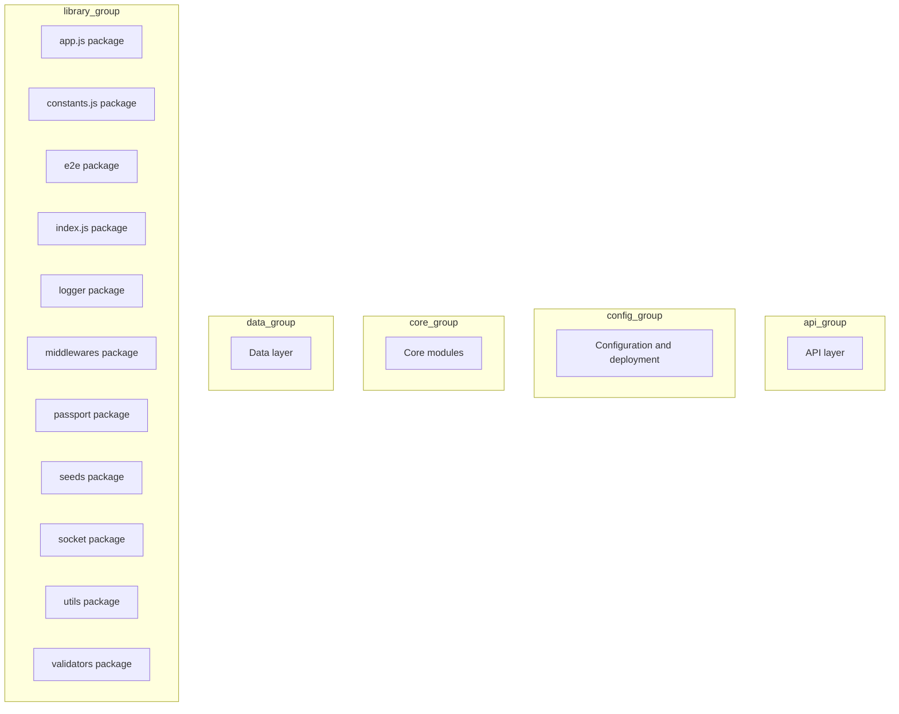

# Architecture report: hiteshchoudhary/apihub

> Automated static analysis. **Observed** = directly seen in files/imports/AST; **Inferred** = interpretation from that evidence. Repository code was not executed.

## 1. Repository at a glance

| Item | Value |
| --- | --- |
| Repository | hiteshchoudhary/apihub |
| Description | Your own API Hub to learn and master API interaction. Ideal for frontend, mobile dev and backend developers.  |
| Language | JavaScript |
| Stars | 9869 |
| Licence | Other |
| Analysed commit / branch | 3163bf09d9ee23e29378c402ae4d581e544d6c9f / main |
| Framework(s) | Express, React |
| Files analysed | 550 |
| Components | 15 |

## 2. Architecture in one minute

hiteshchoudhary/apihub - Your own API Hub to learn and master API interaction. Ideal for frontend, mobile dev and backend developers. . This repository was analysed statically from 550 file(s) (0 Python). Detected technologies (observed from imports/manifests): MongoDB, Express, React, axios, React Router, Redux Toolkit. Files are grouped into 15 component(s): API layer, app.js package, Configuration and deployment, constants.js package, Core modules, Data layer, e2e package, index.js package. Findings below distinguish observed facts from inferred interpretation.

## 3. High-level block diagram

## 4. Main components

### API layer (`api_layer`)

- **Kind:** api
- **Status:** Observed
- **Confidence:** 0.85
- **Responsibility:** Groups 77 file(s) under api layer (observed from repository paths and static analysis).
- **Paths:** `e2e/routes/apps/todo.test.js`, `e2e/routes/healthcheck.test.js`, `e2e/routes/seeds/chat-app.test.js`, `e2e/routes/seeds/ecommerce.test.js`, `e2e/routes/seeds/generated-credentials.test.js`, `e2e/routes/seeds/social-media.test.js`, `e2e/routes/seeds/todo.test.js`, `src/controllers/apps/auth/user.controllers.js`, `src/controllers/apps/chat-app/chat.controllers.js`, `src/controllers/apps/chat-app/message.controllers.js`, `src/controllers/apps/ecommerce/address.controllers.js`, `src/controllers/apps/ecommerce/cart.controllers.js`, `src/controllers/apps/ecommerce/category.controllers.js`, `src/controllers/apps/ecommerce/coupon.controllers.js`, `src/controllers/apps/ecommerce/order.controllers.js`, `src/controllers/apps/ecommerce/product.controllers.js`, `src/controllers/apps/ecommerce/profile.controllers.js`, `src/controllers/apps/social-media/bookmark.controllers.js`, `src/controllers/apps/social-media/comment.controllers.js`, `src/controllers/apps/social-media/follow.controllers.js`, `src/controllers/apps/social-media/like.controllers.js`, `src/controllers/apps/social-media/post.controllers.js`, `src/controllers/apps/social-media/profile.controllers.js`, `src/controllers/apps/todo/todo.controllers.js`, `src/controllers/healthcheck.controllers.js`, `src/controllers/kitchen-sink/cookie.controllers.js`, `src/controllers/kitchen-sink/httpmethod.controllers.js`, `src/controllers/kitchen-sink/image.controllers.js`, `src/controllers/kitchen-sink/redirect.controllers.js`, `src/controllers/kitchen-sink/requestinspection.controllers.js`, `src/controllers/kitchen-sink/responseinspection.controllers.js`, `src/controllers/kitchen-sink/statuscode.controllers.js`, `src/controllers/public/book.controllers.js`, `src/controllers/public/cat.controllers.js`, `src/controllers/public/dog.controllers.js`, `src/controllers/public/meal.controllers.js`, `src/controllers/public/quote.controllers.js`, `src/controllers/public/randomjoke.controllers.js`, `src/controllers/public/randomproduct.controllers.js`, `src/controllers/public/randomuser.controllers.js`, `src/controllers/public/stock.controllers.js`, `src/controllers/public/youtube.controllers.js`, `src/routes/apps/auth/user.routes.js`, `src/routes/apps/chat-app/chat.routes.js`, `src/routes/apps/chat-app/message.routes.js`, `src/routes/apps/ecommerce/address.routes.js`, `src/routes/apps/ecommerce/cart.routes.js`, `src/routes/apps/ecommerce/category.routes.js`, `src/routes/apps/ecommerce/coupon.routes.js`, `src/routes/apps/ecommerce/order.routes.js`, `src/routes/apps/ecommerce/product.routes.js`, `src/routes/apps/ecommerce/profile.routes.js`, `src/routes/apps/social-media/bookmark.routes.js`, `src/routes/apps/social-media/comment.routes.js`, `src/routes/apps/social-media/follow.routes.js`, `src/routes/apps/social-media/like.routes.js`, `src/routes/apps/social-media/post.routes.js`, `src/routes/apps/social-media/profile.routes.js`, `src/routes/apps/todo/todo.routes.js`, `src/routes/healthcheck.routes.js`, `src/routes/kitchen-sink/cookie.routes.js`, `src/routes/kitchen-sink/httpmethod.routes.js`, `src/routes/kitchen-sink/image.routes.js`, `src/routes/kitchen-sink/redirect.routes.js`, `src/routes/kitchen-sink/requestinspection.routes.js`, `src/routes/kitchen-sink/responseinspection.routes.js`, `src/routes/kitchen-sink/statuscode.routes.js`, `src/routes/public/book.routes.js`, `src/routes/public/cat.routes.js`, `src/routes/public/dog.routes.js`, `src/routes/public/meal.routes.js`, `src/routes/public/quote.routes.js`, `src/routes/public/randomjoke.routes.js`, `src/routes/public/randomproduct.routes.js`, `src/routes/public/randomuser.routes.js`, `src/routes/public/stock.routes.js`, `src/routes/public/youtube.routes.js`
- **Evidence:** [e2e/routes/apps/todo.test.js](https://github.com/hiteshchoudhary/apihub/blob/3163bf09d9ee23e29378c402ae4d581e544d6c9f/e2e/routes/apps/todo.test.js); [e2e/routes/healthcheck.test.js](https://github.com/hiteshchoudhary/apihub/blob/3163bf09d9ee23e29378c402ae4d581e544d6c9f/e2e/routes/healthcheck.test.js); [e2e/routes/seeds/chat-app.test.js](https://github.com/hiteshchoudhary/apihub/blob/3163bf09d9ee23e29378c402ae4d581e544d6c9f/e2e/routes/seeds/chat-app.test.js); [e2e/routes/seeds/ecommerce.test.js](https://github.com/hiteshchoudhary/apihub/blob/3163bf09d9ee23e29378c402ae4d581e544d6c9f/e2e/routes/seeds/ecommerce.test.js); [e2e/routes/seeds/generated-credentials.test.js](https://github.com/hiteshchoudhary/apihub/blob/3163bf09d9ee23e29378c402ae4d581e544d6c9f/e2e/routes/seeds/generated-credentials.test.js); [e2e/routes/seeds/social-media.test.js](https://github.com/hiteshchoudhary/apihub/blob/3163bf09d9ee23e29378c402ae4d581e544d6c9f/e2e/routes/seeds/social-media.test.js); [e2e/routes/seeds/todo.test.js](https://github.com/hiteshchoudhary/apihub/blob/3163bf09d9ee23e29378c402ae4d581e544d6c9f/e2e/routes/seeds/todo.test.js); [src/controllers/apps/auth/user.controllers.js](https://github.com/hiteshchoudhary/apihub/blob/3163bf09d9ee23e29378c402ae4d581e544d6c9f/src/controllers/apps/auth/user.controllers.js)

### app.js package (`app_js`)

- **Kind:** library
- **Status:** Observed
- **Confidence:** 0.85
- **Responsibility:** Groups 1 file(s) under app.js package (observed from repository paths and static analysis).
- **Paths:** `src/app.js`
- **Evidence:** [src/app.js](https://github.com/hiteshchoudhary/apihub/blob/3163bf09d9ee23e29378c402ae4d581e544d6c9f/src/app.js)

### Configuration and deployment (`config`)

- **Kind:** config
- **Status:** Observed
- **Confidence:** 0.85
- **Responsibility:** Groups 13 file(s) under configuration and deployment (observed from repository paths and static analysis).
- **Paths:** `Dockerfile`, `docker-compose.prod.yml`, `docker-compose.yml`, `nodemon.json`, `package.json`, `src/json/cats.json`, `src/json/dogs.json`, `src/json/quotes.json`, `src/json/randomjoke.json`, `src/json/randomproduct.json`, `src/json/status-codes.json`, `src/json/youtube/channel.json`, `src/json/youtube/playlists.json`
- **Evidence:** [Dockerfile](https://github.com/hiteshchoudhary/apihub/blob/3163bf09d9ee23e29378c402ae4d581e544d6c9f/Dockerfile); [docker-compose.prod.yml](https://github.com/hiteshchoudhary/apihub/blob/3163bf09d9ee23e29378c402ae4d581e544d6c9f/docker-compose.prod.yml); [docker-compose.yml](https://github.com/hiteshchoudhary/apihub/blob/3163bf09d9ee23e29378c402ae4d581e544d6c9f/docker-compose.yml); [nodemon.json](https://github.com/hiteshchoudhary/apihub/blob/3163bf09d9ee23e29378c402ae4d581e544d6c9f/nodemon.json); [package.json](https://github.com/hiteshchoudhary/apihub/blob/3163bf09d9ee23e29378c402ae4d581e544d6c9f/package.json); [src/json/cats.json](https://github.com/hiteshchoudhary/apihub/blob/3163bf09d9ee23e29378c402ae4d581e544d6c9f/src/json/cats.json); [src/json/dogs.json](https://github.com/hiteshchoudhary/apihub/blob/3163bf09d9ee23e29378c402ae4d581e544d6c9f/src/json/dogs.json); [src/json/quotes.json](https://github.com/hiteshchoudhary/apihub/blob/3163bf09d9ee23e29378c402ae4d581e544d6c9f/src/json/quotes.json)

### constants.js package (`constants_js`)

- **Kind:** library
- **Status:** Observed
- **Confidence:** 0.85
- **Responsibility:** Groups 1 file(s) under constants.js package (observed from repository paths and static analysis).
- **Paths:** `src/constants.js`
- **Evidence:** [src/constants.js](https://github.com/hiteshchoudhary/apihub/blob/3163bf09d9ee23e29378c402ae4d581e544d6c9f/src/constants.js)

### Core modules (`core`)

- **Kind:** core
- **Status:** Observed
- **Confidence:** 0.85
- **Responsibility:** Groups 2 file(s) under core modules (observed from repository paths and static analysis).
- **Paths:** `playwright.config.js`, `prepare.js`
- **Evidence:** [playwright.config.js](https://github.com/hiteshchoudhary/apihub/blob/3163bf09d9ee23e29378c402ae4d581e544d6c9f/playwright.config.js); [prepare.js](https://github.com/hiteshchoudhary/apihub/blob/3163bf09d9ee23e29378c402ae4d581e544d6c9f/prepare.js)

### Data layer (`data_layer`)

- **Kind:** data
- **Status:** Observed
- **Confidence:** 0.85
- **Responsibility:** Groups 18 file(s) under data layer (observed from repository paths and static analysis).
- **Paths:** `src/db/index.js`, `src/models/apps/auth/user.models.js`, `src/models/apps/chat-app/chat.models.js`, `src/models/apps/chat-app/message.models.js`, `src/models/apps/ecommerce/address.models.js`, `src/models/apps/ecommerce/cart.models.js`, `src/models/apps/ecommerce/category.models.js`, `src/models/apps/ecommerce/coupon.models.js`, `src/models/apps/ecommerce/order.models.js`, `src/models/apps/ecommerce/product.models.js`, `src/models/apps/ecommerce/profile.models.js`, `src/models/apps/social-media/bookmark.models.js`, `src/models/apps/social-media/comment.models.js`, `src/models/apps/social-media/follow.models.js`, `src/models/apps/social-media/like.models.js`, `src/models/apps/social-media/post.models.js`, `src/models/apps/social-media/profile.models.js`, `src/models/apps/todo/todo.models.js`
- **Evidence:** [src/db/index.js](https://github.com/hiteshchoudhary/apihub/blob/3163bf09d9ee23e29378c402ae4d581e544d6c9f/src/db/index.js); [src/models/apps/auth/user.models.js](https://github.com/hiteshchoudhary/apihub/blob/3163bf09d9ee23e29378c402ae4d581e544d6c9f/src/models/apps/auth/user.models.js); [src/models/apps/chat-app/chat.models.js](https://github.com/hiteshchoudhary/apihub/blob/3163bf09d9ee23e29378c402ae4d581e544d6c9f/src/models/apps/chat-app/chat.models.js); [src/models/apps/chat-app/message.models.js](https://github.com/hiteshchoudhary/apihub/blob/3163bf09d9ee23e29378c402ae4d581e544d6c9f/src/models/apps/chat-app/message.models.js); [src/models/apps/ecommerce/address.models.js](https://github.com/hiteshchoudhary/apihub/blob/3163bf09d9ee23e29378c402ae4d581e544d6c9f/src/models/apps/ecommerce/address.models.js); [src/models/apps/ecommerce/cart.models.js](https://github.com/hiteshchoudhary/apihub/blob/3163bf09d9ee23e29378c402ae4d581e544d6c9f/src/models/apps/ecommerce/cart.models.js); [src/models/apps/ecommerce/category.models.js](https://github.com/hiteshchoudhary/apihub/blob/3163bf09d9ee23e29378c402ae4d581e544d6c9f/src/models/apps/ecommerce/category.models.js); [src/models/apps/ecommerce/coupon.models.js](https://github.com/hiteshchoudhary/apihub/blob/3163bf09d9ee23e29378c402ae4d581e544d6c9f/src/models/apps/ecommerce/coupon.models.js)

### e2e package (`e2e`)

- **Kind:** library
- **Status:** Observed
- **Confidence:** 0.85
- **Responsibility:** Groups 3 file(s) under e2e package (observed from repository paths and static analysis).
- **Paths:** `e2e/common.js`, `e2e/db.js`, `e2e/test-server.js`
- **Evidence:** [e2e/common.js](https://github.com/hiteshchoudhary/apihub/blob/3163bf09d9ee23e29378c402ae4d581e544d6c9f/e2e/common.js); [e2e/db.js](https://github.com/hiteshchoudhary/apihub/blob/3163bf09d9ee23e29378c402ae4d581e544d6c9f/e2e/db.js); [e2e/test-server.js](https://github.com/hiteshchoudhary/apihub/blob/3163bf09d9ee23e29378c402ae4d581e544d6c9f/e2e/test-server.js)

### index.js package (`index_js`)

- **Kind:** library
- **Status:** Observed
- **Confidence:** 0.85
- **Responsibility:** Groups 1 file(s) under index.js package (observed from repository paths and static analysis).
- **Paths:** `src/index.js`
- **Evidence:** [src/index.js](https://github.com/hiteshchoudhary/apihub/blob/3163bf09d9ee23e29378c402ae4d581e544d6c9f/src/index.js)

### logger package (`logger`)

- **Kind:** library
- **Status:** Observed
- **Confidence:** 0.85
- **Responsibility:** Groups 2 file(s) under logger package (observed from repository paths and static analysis).
- **Paths:** `src/logger/morgan.logger.js`, `src/logger/winston.logger.js`
- **Evidence:** [src/logger/morgan.logger.js](https://github.com/hiteshchoudhary/apihub/blob/3163bf09d9ee23e29378c402ae4d581e544d6c9f/src/logger/morgan.logger.js); [src/logger/winston.logger.js](https://github.com/hiteshchoudhary/apihub/blob/3163bf09d9ee23e29378c402ae4d581e544d6c9f/src/logger/winston.logger.js)

### middlewares package (`middlewares`)

- **Kind:** library
- **Status:** Observed
- **Confidence:** 0.85
- **Responsibility:** Groups 3 file(s) under middlewares package (observed from repository paths and static analysis).
- **Paths:** `src/middlewares/auth.middlewares.js`, `src/middlewares/error.middlewares.js`, `src/middlewares/multer.middlewares.js`
- **Evidence:** [src/middlewares/auth.middlewares.js](https://github.com/hiteshchoudhary/apihub/blob/3163bf09d9ee23e29378c402ae4d581e544d6c9f/src/middlewares/auth.middlewares.js); [src/middlewares/error.middlewares.js](https://github.com/hiteshchoudhary/apihub/blob/3163bf09d9ee23e29378c402ae4d581e544d6c9f/src/middlewares/error.middlewares.js); [src/middlewares/multer.middlewares.js](https://github.com/hiteshchoudhary/apihub/blob/3163bf09d9ee23e29378c402ae4d581e544d6c9f/src/middlewares/multer.middlewares.js)

### passport package (`passport`)

- **Kind:** library
- **Status:** Observed
- **Confidence:** 0.85
- **Responsibility:** Groups 1 file(s) under passport package (observed from repository paths and static analysis).
- **Paths:** `src/passport/index.js`
- **Evidence:** [src/passport/index.js](https://github.com/hiteshchoudhary/apihub/blob/3163bf09d9ee23e29378c402ae4d581e544d6c9f/src/passport/index.js)

### seeds package (`seeds`)

- **Kind:** library
- **Status:** Observed
- **Confidence:** 0.85
- **Responsibility:** Groups 6 file(s) under seeds package (observed from repository paths and static analysis).
- **Paths:** `src/seeds/_constants.js`, `src/seeds/chat-app.seeds.js`, `src/seeds/ecommerce.seeds.js`, `src/seeds/social-media.seeds.js`, `src/seeds/todo.seeds.js`, `src/seeds/user.seeds.js`
- **Evidence:** [src/seeds/_constants.js](https://github.com/hiteshchoudhary/apihub/blob/3163bf09d9ee23e29378c402ae4d581e544d6c9f/src/seeds/_constants.js); [src/seeds/chat-app.seeds.js](https://github.com/hiteshchoudhary/apihub/blob/3163bf09d9ee23e29378c402ae4d581e544d6c9f/src/seeds/chat-app.seeds.js); [src/seeds/ecommerce.seeds.js](https://github.com/hiteshchoudhary/apihub/blob/3163bf09d9ee23e29378c402ae4d581e544d6c9f/src/seeds/ecommerce.seeds.js); [src/seeds/social-media.seeds.js](https://github.com/hiteshchoudhary/apihub/blob/3163bf09d9ee23e29378c402ae4d581e544d6c9f/src/seeds/social-media.seeds.js); [src/seeds/todo.seeds.js](https://github.com/hiteshchoudhary/apihub/blob/3163bf09d9ee23e29378c402ae4d581e544d6c9f/src/seeds/todo.seeds.js); [src/seeds/user.seeds.js](https://github.com/hiteshchoudhary/apihub/blob/3163bf09d9ee23e29378c402ae4d581e544d6c9f/src/seeds/user.seeds.js)

### socket package (`socket`)

- **Kind:** library
- **Status:** Observed
- **Confidence:** 0.85
- **Responsibility:** Groups 1 file(s) under socket package (observed from repository paths and static analysis).
- **Paths:** `src/socket/index.js`
- **Evidence:** [src/socket/index.js](https://github.com/hiteshchoudhary/apihub/blob/3163bf09d9ee23e29378c402ae4d581e544d6c9f/src/socket/index.js)

### utils package (`utils`)

- **Kind:** library
- **Status:** Observed
- **Confidence:** 0.85
- **Responsibility:** Groups 5 file(s) under utils package (observed from repository paths and static analysis).
- **Paths:** `src/utils/ApiError.js`, `src/utils/ApiResponse.js`, `src/utils/asyncHandler.js`, `src/utils/helpers.js`, `src/utils/mail.js`
- **Evidence:** [src/utils/ApiError.js](https://github.com/hiteshchoudhary/apihub/blob/3163bf09d9ee23e29378c402ae4d581e544d6c9f/src/utils/ApiError.js); [src/utils/ApiResponse.js](https://github.com/hiteshchoudhary/apihub/blob/3163bf09d9ee23e29378c402ae4d581e544d6c9f/src/utils/ApiResponse.js); [src/utils/asyncHandler.js](https://github.com/hiteshchoudhary/apihub/blob/3163bf09d9ee23e29378c402ae4d581e544d6c9f/src/utils/asyncHandler.js); [src/utils/helpers.js](https://github.com/hiteshchoudhary/apihub/blob/3163bf09d9ee23e29378c402ae4d581e544d6c9f/src/utils/helpers.js); [src/utils/mail.js](https://github.com/hiteshchoudhary/apihub/blob/3163bf09d9ee23e29378c402ae4d581e544d6c9f/src/utils/mail.js)

### validators package (`validators`)

- **Kind:** library
- **Status:** Observed
- **Confidence:** 0.85
- **Responsibility:** Groups 20 file(s) under validators package (observed from repository paths and static analysis).
- **Paths:** `src/validators/apps/auth/user.validators.js`, `src/validators/apps/chat-app/chat.validators.js`, `src/validators/apps/chat-app/message.validators.js`, `src/validators/apps/ecommerce/address.validators.js`, `src/validators/apps/ecommerce/cart.validators.js`, `src/validators/apps/ecommerce/category.validators.js`, `src/validators/apps/ecommerce/coupon.validators.js`, `src/validators/apps/ecommerce/order.validators.js`, `src/validators/apps/ecommerce/product.validators.js`, `src/validators/apps/ecommerce/profile.validators.js`, `src/validators/apps/social-media/comment.validators.js`, `src/validators/apps/social-media/post.validators.js`, `src/validators/apps/social-media/profile.validators.js`, `src/validators/apps/todo/todo.validators.js`, `src/validators/common/mongodb.validators.js`, `src/validators/kitchen-sink/cookie.validators.js`, `src/validators/kitchen-sink/redirect.validators.js`, `src/validators/kitchen-sink/responseinspection.validators.js`, `src/validators/kitchen-sink/statuscode.validators.js`, `src/validators/validate.js`
- **Evidence:** [src/validators/apps/auth/user.validators.js](https://github.com/hiteshchoudhary/apihub/blob/3163bf09d9ee23e29378c402ae4d581e544d6c9f/src/validators/apps/auth/user.validators.js); [src/validators/apps/chat-app/chat.validators.js](https://github.com/hiteshchoudhary/apihub/blob/3163bf09d9ee23e29378c402ae4d581e544d6c9f/src/validators/apps/chat-app/chat.validators.js); [src/validators/apps/chat-app/message.validators.js](https://github.com/hiteshchoudhary/apihub/blob/3163bf09d9ee23e29378c402ae4d581e544d6c9f/src/validators/apps/chat-app/message.validators.js); [src/validators/apps/ecommerce/address.validators.js](https://github.com/hiteshchoudhary/apihub/blob/3163bf09d9ee23e29378c402ae4d581e544d6c9f/src/validators/apps/ecommerce/address.validators.js); [src/validators/apps/ecommerce/cart.validators.js](https://github.com/hiteshchoudhary/apihub/blob/3163bf09d9ee23e29378c402ae4d581e544d6c9f/src/validators/apps/ecommerce/cart.validators.js); [src/validators/apps/ecommerce/category.validators.js](https://github.com/hiteshchoudhary/apihub/blob/3163bf09d9ee23e29378c402ae4d581e544d6c9f/src/validators/apps/ecommerce/category.validators.js); [src/validators/apps/ecommerce/coupon.validators.js](https://github.com/hiteshchoudhary/apihub/blob/3163bf09d9ee23e29378c402ae4d581e544d6c9f/src/validators/apps/ecommerce/coupon.validators.js); [src/validators/apps/ecommerce/order.validators.js](https://github.com/hiteshchoudhary/apihub/blob/3163bf09d9ee23e29378c402ae4d581e544d6c9f/src/validators/apps/ecommerce/order.validators.js)

## 5. Execution flow

**Observed** entry point(s):

- [src/app.js](https://github.com/hiteshchoudhary/apihub/blob/3163bf09d9ee23e29378c402ae4d581e544d6c9f/src/app.js)
- [src/db/index.js](https://github.com/hiteshchoudhary/apihub/blob/3163bf09d9ee23e29378c402ae4d581e544d6c9f/src/db/index.js)
- [src/index.js](https://github.com/hiteshchoudhary/apihub/blob/3163bf09d9ee23e29378c402ae4d581e544d6c9f/src/index.js)
- [src/passport/index.js](https://github.com/hiteshchoudhary/apihub/blob/3163bf09d9ee23e29378c402ae4d581e544d6c9f/src/passport/index.js)
- [src/socket/index.js](https://github.com/hiteshchoudhary/apihub/blob/3163bf09d9ee23e29378c402ae4d581e544d6c9f/src/socket/index.js)

Representative flow (derived from observed entry points and the import graph; steps beyond the entry point are **Inferred**):

1. Execution starts at an observed entry point listed above, if present.
2. No internal import relationships between components were observed.

## 6. Project structure

### `(root)`

- `.commitlintrc.json` - config (319 bytes)
- `.dockerignore` - container (139 bytes)
- `.env.sample` - config (4260 bytes)
- `.gitignore` - other (2807 bytes)
- `.lintstagedrc` - other (45 bytes)
- `.prettierignore` - other (62 bytes)
- `.prettierrc` - other (112 bytes)
- `CONTRIBUTING.md` - docs (6119 bytes)
- `CONTRIBUTING_CODE_COVERAGE.md` - docs (5537 bytes)
- `CONTRIBUTING_FRONTEND.md` - docs (10841 bytes)
- `Dockerfile` - container (457 bytes)
- `LICENSE.md` - docs (1082 bytes)
- `README.md` - docs (14392 bytes)
- `docker-compose.prod.yml` - config (466 bytes)
- `docker-compose.yml` - container (384 bytes)
- `nodemon.json` - config (112 bytes)
- `package.json` - manifest (2067 bytes)
- `playwright.config.js` - source, JavaScript (2242 bytes)
- `prepare.js` - source, JavaScript (1441 bytes)

### `.github`

- `.github/ISSUE_TEMPLATE/bug_report.yaml` - config (1678 bytes)
- `.github/ISSUE_TEMPLATE/code_coverage.yaml` - config (616 bytes)
- `.github/ISSUE_TEMPLATE/config.yml` - config (370 bytes)
- `.github/ISSUE_TEMPLATE/feature_request.yaml` - config (1241 bytes)
- `.github/ISSUE_TEMPLATE/frontend_contribution.yaml` - config (1602 bytes)

### `.husky`

- `.husky/commit-msg` - other (35 bytes)
- `.husky/pre-commit` - other (30 bytes)

### `e2e`

- `e2e/common.js` - source, JavaScript (247 bytes)
- `e2e/db.js` - source, JavaScript (1223 bytes)
- `e2e/routes/apps/todo.test.js` - source, JavaScript (4967 bytes)
- `e2e/routes/healthcheck.test.js` - source, JavaScript (477 bytes)
- `e2e/routes/seeds/chat-app.test.js` - source, JavaScript (642 bytes)
- `e2e/routes/seeds/ecommerce.test.js` - source, JavaScript (2071 bytes)
- `e2e/routes/seeds/generated-credentials.test.js` - source, JavaScript (956 bytes)
- `e2e/routes/seeds/social-media.test.js` - source, JavaScript (1391 bytes)
- `e2e/routes/seeds/todo.test.js` - source, JavaScript (1229 bytes)
- `e2e/test-server.js` - source, JavaScript (962 bytes)

### `examples`

- `examples/apps/auth/.gitkeep` - other (0 bytes)
- `examples/apps/chat-app/web/react-vite-tailwind/.env.sample` - config (179 bytes)
- `examples/apps/chat-app/web/react-vite-tailwind/.eslintrc.cjs` - source, JavaScript (488 bytes)
- `examples/apps/chat-app/web/react-vite-tailwind/.gitignore` - other (252 bytes)
- `examples/apps/chat-app/web/react-vite-tailwind/README.md` - docs (258 bytes)
- `examples/apps/chat-app/web/react-vite-tailwind/index.html` - other (402 bytes)
- `examples/apps/chat-app/web/react-vite-tailwind/package.json` - manifest (1124 bytes)
- `examples/apps/chat-app/web/react-vite-tailwind/postcss.config.js` - source, JavaScript (81 bytes)
- `examples/apps/chat-app/web/react-vite-tailwind/public/vite.svg` - other (1497 bytes)
- `examples/apps/chat-app/web/react-vite-tailwind/src/App.tsx` - source, TypeScript (1762 bytes)
- `examples/apps/chat-app/web/react-vite-tailwind/src/api/index.ts` - source, TypeScript (3195 bytes)
- `examples/apps/chat-app/web/react-vite-tailwind/src/components/Button.tsx` - source, TypeScript (1193 bytes)
- `examples/apps/chat-app/web/react-vite-tailwind/src/components/Input.tsx` - source, TypeScript (452 bytes)
- `examples/apps/chat-app/web/react-vite-tailwind/src/components/Loader.tsx` - source, TypeScript (1040 bytes)
- `examples/apps/chat-app/web/react-vite-tailwind/src/components/PrivateRoute.tsx` - source, TypeScript (880 bytes)
- `examples/apps/chat-app/web/react-vite-tailwind/src/components/PublicRoute.tsx` - source, TypeScript (774 bytes)
- `examples/apps/chat-app/web/react-vite-tailwind/src/components/Select.tsx` - source, TypeScript (3319 bytes)
- `examples/apps/chat-app/web/react-vite-tailwind/src/components/chat/AddChatModal.tsx` - source, TypeScript (13209 bytes)
- `examples/apps/chat-app/web/react-vite-tailwind/src/components/chat/ChatItem.tsx` - source, TypeScript (6510 bytes)
- `examples/apps/chat-app/web/react-vite-tailwind/src/components/chat/GroupChatDetailsModal.tsx` - source, TypeScript (19089 bytes)
- `examples/apps/chat-app/web/react-vite-tailwind/src/components/chat/MessageItem.tsx` - source, TypeScript (8217 bytes)
- `examples/apps/chat-app/web/react-vite-tailwind/src/components/chat/Typing.tsx` - source, TypeScript (499 bytes)
- `examples/apps/chat-app/web/react-vite-tailwind/src/context/AuthContext.tsx` - source, TypeScript (3502 bytes)
- `examples/apps/chat-app/web/react-vite-tailwind/src/context/SocketContext.tsx` - source, TypeScript (1603 bytes)
- `examples/apps/chat-app/web/react-vite-tailwind/src/index.css` - other (930 bytes)
- `examples/apps/chat-app/web/react-vite-tailwind/src/interfaces/api.ts` - source, TypeScript (127 bytes)
- `examples/apps/chat-app/web/react-vite-tailwind/src/interfaces/chat.ts` - source, TypeScript (554 bytes)
- `examples/apps/chat-app/web/react-vite-tailwind/src/interfaces/user.ts` - source, TypeScript (203 bytes)
- `examples/apps/chat-app/web/react-vite-tailwind/src/main.tsx` - source, TypeScript (547 bytes)
- `examples/apps/chat-app/web/react-vite-tailwind/src/pages/chat.tsx` - source, TypeScript (25838 bytes)
- `examples/apps/chat-app/web/react-vite-tailwind/src/pages/login.tsx` - source, TypeScript (2306 bytes)
- `examples/apps/chat-app/web/react-vite-tailwind/src/pages/register.tsx` - source, TypeScript (2515 bytes)
- `examples/apps/chat-app/web/react-vite-tailwind/src/utils/index.ts` - source, TypeScript (4407 bytes)
- `examples/apps/chat-app/web/react-vite-tailwind/src/vite-env.d.ts` - source, TypeScript (38 bytes)
- `examples/apps/chat-app/web/react-vite-tailwind/tailwind.config.js` - source, JavaScript (338 bytes)
- `examples/apps/chat-app/web/react-vite-tailwind/tsconfig.json` - config (605 bytes)
- `examples/apps/chat-app/web/react-vite-tailwind/tsconfig.node.json` - config (213 bytes)
- `examples/apps/chat-app/web/react-vite-tailwind/vite.config.ts` - source, TypeScript (285 bytes)
- `examples/apps/ecommerce/.gitkeep` - other (0 bytes)
- `examples/apps/ecommerce/web/react-vite-redux-tailwind/.env.sample` - config (161 bytes)
- `examples/apps/ecommerce/web/react-vite-redux-tailwind/.eslintrc.cjs` - source, JavaScript (436 bytes)
- `examples/apps/ecommerce/web/react-vite-redux-tailwind/.gitignore` - other (265 bytes)
- `examples/apps/ecommerce/web/react-vite-redux-tailwind/README.md` - docs (2957 bytes)
- `examples/apps/ecommerce/web/react-vite-redux-tailwind/index.html` - other (710 bytes)
- `examples/apps/ecommerce/web/react-vite-redux-tailwind/package.json` - manifest (1437 bytes)
- `examples/apps/ecommerce/web/react-vite-redux-tailwind/postcss.config.js` - source, JavaScript (81 bytes)
- `examples/apps/ecommerce/web/react-vite-redux-tailwind/public/locales/ar/translation.json` - config (8622 bytes)
- `examples/apps/ecommerce/web/react-vite-redux-tailwind/public/locales/en/translation.json` - config (6447 bytes)
- `examples/apps/ecommerce/web/react-vite-redux-tailwind/public/locales/hn/translation.json` - config (10743 bytes)
- `examples/apps/ecommerce/web/react-vite-redux-tailwind/src/App.tsx` - source, TypeScript (105 bytes)
- `examples/apps/ecommerce/web/react-vite-redux-tailwind/src/RoutePaths.tsx` - source, TypeScript (3248 bytes)
- `examples/apps/ecommerce/web/react-vite-redux-tailwind/src/components/basic/ArrowButton.tsx` - source, TypeScript (1148 bytes)
- `examples/apps/ecommerce/web/react-vite-redux-tailwind/src/components/basic/Button.tsx` - source, TypeScript (1501 bytes)
- `examples/apps/ecommerce/web/react-vite-redux-tailwind/src/components/basic/CarouselButtons.tsx` - source, TypeScript (2775 bytes)
- `examples/apps/ecommerce/web/react-vite-redux-tailwind/src/components/basic/Checkbox.tsx` - source, TypeScript (4102 bytes)
- `examples/apps/ecommerce/web/react-vite-redux-tailwind/src/components/basic/DateRangePicker.tsx` - source, TypeScript (4312 bytes)
- `examples/apps/ecommerce/web/react-vite-redux-tailwind/src/components/basic/Drawer.tsx` - source, TypeScript (2352 bytes)
- `examples/apps/ecommerce/web/react-vite-redux-tailwind/src/components/basic/Dropdown.tsx` - source, TypeScript (6684 bytes)
- `examples/apps/ecommerce/web/react-vite-redux-tailwind/src/components/basic/ErrorMessage.tsx` - source, TypeScript (851 bytes)
- `examples/apps/ecommerce/web/react-vite-redux-tailwind/src/components/basic/FullPageLoadingSpinner.tsx` - source, TypeScript (506 bytes)
- `examples/apps/ecommerce/web/react-vite-redux-tailwind/src/components/basic/Hamburger.tsx` - source, TypeScript (1854 bytes)
- `examples/apps/ecommerce/web/react-vite-redux-tailwind/src/components/basic/Image.tsx` - source, TypeScript (592 bytes)
- `examples/apps/ecommerce/web/react-vite-redux-tailwind/src/components/basic/Input.tsx` - source, TypeScript (2839 bytes)
- `examples/apps/ecommerce/web/react-vite-redux-tailwind/src/components/basic/Link.tsx` - source, TypeScript (820 bytes)
- `examples/apps/ecommerce/web/react-vite-redux-tailwind/src/components/basic/Modal.tsx` - source, TypeScript (2554 bytes)
- `examples/apps/ecommerce/web/react-vite-redux-tailwind/src/components/basic/NavItem.tsx` - source, TypeScript (1411 bytes)
- `examples/apps/ecommerce/web/react-vite-redux-tailwind/src/components/basic/NavList.tsx` - source, TypeScript (782 bytes)
- `examples/apps/ecommerce/web/react-vite-redux-tailwind/src/components/basic/RadioButtons.tsx` - source, TypeScript (2209 bytes)
- `examples/apps/ecommerce/web/react-vite-redux-tailwind/src/components/basic/RoundedIcon.tsx` - source, TypeScript (304 bytes)
- `examples/apps/ecommerce/web/react-vite-redux-tailwind/src/components/basic/SearchInput.tsx` - source, TypeScript (1687 bytes)
- `examples/apps/ecommerce/web/react-vite-redux-tailwind/src/components/basic/SelectionMenu.tsx` - source, TypeScript (2827 bytes)
- `examples/apps/ecommerce/web/react-vite-redux-tailwind/src/components/basic/TabItem.tsx` - source, TypeScript (789 bytes)
- `examples/apps/ecommerce/web/react-vite-redux-tailwind/src/components/basic/Tabs.tsx` - source, TypeScript (1493 bytes)
- `examples/apps/ecommerce/web/react-vite-redux-tailwind/src/components/basic/Text.tsx` - source, TypeScript (394 bytes)
- `examples/apps/ecommerce/web/react-vite-redux-tailwind/src/components/basic/ToastMessage.tsx` - source, TypeScript (1626 bytes)
- `examples/apps/ecommerce/web/react-vite-redux-tailwind/src/components/business/AddressCard.tsx` - source, TypeScript (2419 bytes)
- `examples/apps/ecommerce/web/react-vite-redux-tailwind/src/components/business/AddressCardList.tsx` - source, TypeScript (849 bytes)
- `examples/apps/ecommerce/web/react-vite-redux-tailwind/src/components/business/CardContainer.tsx` - source, TypeScript (2926 bytes)
- `examples/apps/ecommerce/web/react-vite-redux-tailwind/src/components/business/CartItem.tsx` - source, TypeScript (2949 bytes)
- `examples/apps/ecommerce/web/react-vite-redux-tailwind/src/components/business/CartItemList.tsx` - source, TypeScript (802 bytes)
- `examples/apps/ecommerce/web/react-vite-redux-tailwind/src/components/business/CartSummary.tsx` - source, TypeScript (1389 bytes)
- `examples/apps/ecommerce/web/react-vite-redux-tailwind/src/components/business/CategoryCard.tsx` - source, TypeScript (995 bytes)
- `examples/apps/ecommerce/web/react-vite-redux-tailwind/src/components/business/CompanyGurantee.tsx` - source, TypeScript (648 bytes)
- `examples/apps/ecommerce/web/react-vite-redux-tailwind/src/components/business/CouponCard.tsx` - source, TypeScript (709 bytes)
- `examples/apps/ecommerce/web/react-vite-redux-tailwind/src/components/business/CouponCardList.tsx` - source, TypeScript (881 bytes)
- `examples/apps/ecommerce/web/react-vite-redux-tailwind/src/components/business/FooterSection.tsx` - source, TypeScript (601 bytes)
- `examples/apps/ecommerce/web/react-vite-redux-tailwind/src/components/business/InvoiceAmountSummary.tsx` - source, TypeScript (1439 bytes)
- `examples/apps/ecommerce/web/react-vite-redux-tailwind/src/components/business/OrderCard.tsx` - source, TypeScript (2338 bytes)
- `examples/apps/ecommerce/web/react-vite-redux-tailwind/src/components/business/OrderItem.tsx` - source, TypeScript (1758 bytes)
- `examples/apps/ecommerce/web/react-vite-redux-tailwind/src/components/business/OrderItemList.tsx` - source, TypeScript (499 bytes)
- `examples/apps/ecommerce/web/react-vite-redux-tailwind/src/components/business/OrderListFilters.tsx` - source, TypeScript (3347 bytes)
- `examples/apps/ecommerce/web/react-vite-redux-tailwind/src/components/business/OrderSummary.tsx` - source, TypeScript (1056 bytes)
- `examples/apps/ecommerce/web/react-vite-redux-tailwind/src/components/business/OrdersList.tsx` - source, TypeScript (1189 bytes)
- `examples/apps/ecommerce/web/react-vite-redux-tailwind/src/components/business/Payment.tsx` - source, TypeScript (2210 bytes)
- `examples/apps/ecommerce/web/react-vite-redux-tailwind/src/components/business/ProductCard.tsx` - source, TypeScript (2415 bytes)
- `examples/apps/ecommerce/web/react-vite-redux-tailwind/src/components/business/ProductFilters.tsx` - source, TypeScript (3189 bytes)
- `examples/apps/ecommerce/web/react-vite-redux-tailwind/src/components/business/ProductImagesView.tsx` - source, TypeScript (2427 bytes)
- `examples/apps/ecommerce/web/react-vite-redux-tailwind/src/components/business/ProductList.tsx` - source, TypeScript (768 bytes)
- `examples/apps/ecommerce/web/react-vite-redux-tailwind/src/components/business/QuantityCounter.tsx` - source, TypeScript (2395 bytes)
- `examples/apps/ecommerce/web/react-vite-redux-tailwind/src/components/business/Timer.tsx` - source, TypeScript (3119 bytes)
- `examples/apps/ecommerce/web/react-vite-redux-tailwind/src/components/icons/AccountIcon.tsx` - source, TypeScript (888 bytes)
- `examples/apps/ecommerce/web/react-vite-redux-tailwind/src/components/icons/AddIcon.tsx` - source, TypeScript (420 bytes)
- `examples/apps/ecommerce/web/react-vite-redux-tailwind/src/components/icons/CartIcon.tsx` - source, TypeScript (2017 bytes)
- `examples/apps/ecommerce/web/react-vite-redux-tailwind/src/components/icons/CloseIcon.tsx` - source, TypeScript (427 bytes)
- `examples/apps/ecommerce/web/react-vite-redux-tailwind/src/components/icons/DeleteIcon.tsx` - source, TypeScript (435 bytes)
- `examples/apps/ecommerce/web/react-vite-redux-tailwind/src/components/icons/DownArrow.tsx` - source, TypeScript (487 bytes)
- `examples/apps/ecommerce/web/react-vite-redux-tailwind/src/components/icons/EditIcon.tsx` - source, TypeScript (1248 bytes)
- `examples/apps/ecommerce/web/react-vite-redux-tailwind/src/components/icons/ErrorIcon.tsx` - source, TypeScript (524 bytes)
- `examples/apps/ecommerce/web/react-vite-redux-tailwind/src/components/icons/GeneralCategoryIcon.tsx` - source, TypeScript (2076 bytes)
- `examples/apps/ecommerce/web/react-vite-redux-tailwind/src/components/icons/GoogleIcon.tsx` - source, TypeScript (1314 bytes)
- `examples/apps/ecommerce/web/react-vite-redux-tailwind/src/components/icons/GuranteeIcon.tsx` - source, TypeScript (2453 bytes)
- `examples/apps/ecommerce/web/react-vite-redux-tailwind/src/components/icons/HamburgerIcon.tsx` - source, TypeScript (424 bytes)
- `examples/apps/ecommerce/web/react-vite-redux-tailwind/src/components/icons/HeadphoneIcon.tsx` - source, TypeScript (1866 bytes)
- `examples/apps/ecommerce/web/react-vite-redux-tailwind/src/components/icons/HidePasswordIcon.tsx` - source, TypeScript (818 bytes)
- `examples/apps/ecommerce/web/react-vite-redux-tailwind/src/components/icons/LeftArrow.tsx` - source, TypeScript (443 bytes)
- `examples/apps/ecommerce/web/react-vite-redux-tailwind/src/components/icons/LoadingSpinner.tsx` - source, TypeScript (1376 bytes)
- `examples/apps/ecommerce/web/react-vite-redux-tailwind/src/components/icons/LogoutIcon.tsx` - source, TypeScript (772 bytes)
- `examples/apps/ecommerce/web/react-vite-redux-tailwind/src/components/icons/OrderIcon.tsx` - source, TypeScript (813 bytes)
- `examples/apps/ecommerce/web/react-vite-redux-tailwind/src/components/icons/RectangleIcon.tsx` - source, TypeScript (380 bytes)
- `examples/apps/ecommerce/web/react-vite-redux-tailwind/src/components/icons/SearchIcon.tsx` - source, TypeScript (779 bytes)
- `examples/apps/ecommerce/web/react-vite-redux-tailwind/src/components/icons/ShowPasswordIcon.tsx` - source, TypeScript (862 bytes)
- `examples/apps/ecommerce/web/react-vite-redux-tailwind/src/components/icons/SubtractIcon.tsx` - source, TypeScript (404 bytes)
- `examples/apps/ecommerce/web/react-vite-redux-tailwind/src/components/icons/TickIcon.tsx` - source, TypeScript (627 bytes)
- `examples/apps/ecommerce/web/react-vite-redux-tailwind/src/components/icons/TruckIcon.tsx` - source, TypeScript (2763 bytes)
- `examples/apps/ecommerce/web/react-vite-redux-tailwind/src/components/icons/UpArrow.tsx` - source, TypeScript (436 bytes)
- `examples/apps/ecommerce/web/react-vite-redux-tailwind/src/components/modals/addaddressmodal/container/AddAddressModalContainer.tsx` - source, TypeScript (10889 bytes)
- `examples/apps/ecommerce/web/react-vite-redux-tailwind/src/components/modals/addaddressmodal/presentation/AddAddressModal.tsx` - source, TypeScript (8825 bytes)
- `examples/apps/ecommerce/web/react-vite-redux-tailwind/src/components/modals/changepasswordmodal/container/ChangePasswordModalContainer.tsx` - source, TypeScript (2181 bytes)
- `examples/apps/ecommerce/web/react-vite-redux-tailwind/src/components/modals/changepasswordmodal/presentation/ChangePasswordModal.tsx` - source, TypeScript (3536 bytes)
- `examples/apps/ecommerce/web/react-vite-redux-tailwind/src/components/modals/deleteaddressmodal/container/DeleteAddressModalContainer.tsx` - source, TypeScript (2015 bytes)
- `examples/apps/ecommerce/web/react-vite-redux-tailwind/src/components/modals/deleteaddressmodal/presentation/DeleteAddressModal.tsx` - source, TypeScript (1208 bytes)
- `examples/apps/ecommerce/web/react-vite-redux-tailwind/src/components/modals/feedbackmodal/presentation/FeedbackModal.tsx` - source, TypeScript (1672 bytes)
- `examples/apps/ecommerce/web/react-vite-redux-tailwind/src/components/modals/forgotpasswordmodal/container/ForgotPasswordModalContainer.tsx` - source, TypeScript (1956 bytes)
- `examples/apps/ecommerce/web/react-vite-redux-tailwind/src/components/modals/forgotpasswordmodal/presentation/ForgotPasswordModal.tsx` - source, TypeScript (2752 bytes)
- `examples/apps/ecommerce/web/react-vite-redux-tailwind/src/components/modals/logoutmodal/container/LogoutModalContainer.tsx` - source, TypeScript (1490 bytes)
- `examples/apps/ecommerce/web/react-vite-redux-tailwind/src/components/modals/logoutmodal/presentation/LogoutModal.tsx` - source, TypeScript (1479 bytes)
- `examples/apps/ecommerce/web/react-vite-redux-tailwind/src/components/widgets/about/container/AboutContainer.tsx` - source, TypeScript (145 bytes)
- `examples/apps/ecommerce/web/react-vite-redux-tailwind/src/components/widgets/about/presentation/About.tsx` - source, TypeScript (1820 bytes)
- `examples/apps/ecommerce/web/react-vite-redux-tailwind/src/components/widgets/allproductlist/container/AllProductListContainer.tsx` - source, TypeScript (5467 bytes)
- `examples/apps/ecommerce/web/react-vite-redux-tailwind/src/components/widgets/allproductlist/presentation/AllProductList.tsx` - source, TypeScript (1909 bytes)
- `examples/apps/ecommerce/web/react-vite-redux-tailwind/src/components/widgets/banner/container/BannerContainer.tsx` - source, TypeScript (888 bytes)
- `examples/apps/ecommerce/web/react-vite-redux-tailwind/src/components/widgets/banner/presentation/Banner.tsx` - source, TypeScript (1726 bytes)
- `examples/apps/ecommerce/web/react-vite-redux-tailwind/src/components/widgets/cart/container/CartContainer.tsx` - source, TypeScript (2062 bytes)
- `examples/apps/ecommerce/web/react-vite-redux-tailwind/src/components/widgets/cart/presentation/Cart.tsx` - source, TypeScript (1304 bytes)
- `examples/apps/ecommerce/web/react-vite-redux-tailwind/src/components/widgets/categorylist/container/CategoryListContainer.tsx` - source, TypeScript (1617 bytes)
- `examples/apps/ecommerce/web/react-vite-redux-tailwind/src/components/widgets/categorylist/presentation/CategoryList.tsx` - source, TypeScript (1675 bytes)
- `examples/apps/ecommerce/web/react-vite-redux-tailwind/src/components/widgets/checkout/container/CheckoutContainer.tsx` - source, TypeScript (4375 bytes)
- `examples/apps/ecommerce/web/react-vite-redux-tailwind/src/components/widgets/checkout/presentation/Checkout.tsx` - source, TypeScript (6838 bytes)
- `examples/apps/ecommerce/web/react-vite-redux-tailwind/src/components/widgets/companyguranteelist/container/CompanyGuranteeListContainer.tsx` - source, TypeScript (323 bytes)
- `examples/apps/ecommerce/web/react-vite-redux-tailwind/src/components/widgets/companyguranteelist/presentation/CompanyGuranteeList.tsx` - source, TypeScript (902 bytes)
- `examples/apps/ecommerce/web/react-vite-redux-tailwind/src/components/widgets/editaddresses/container/EditAddressesContainer.tsx` - source, TypeScript (1625 bytes)
- `examples/apps/ecommerce/web/react-vite-redux-tailwind/src/components/widgets/editaddresses/presentation/EditAddresses.tsx` - source, TypeScript (1578 bytes)
- `examples/apps/ecommerce/web/react-vite-redux-tailwind/src/components/widgets/editprofile/container/EditProfileContainer.tsx` - source, TypeScript (3252 bytes)
- `examples/apps/ecommerce/web/react-vite-redux-tailwind/src/components/widgets/editprofile/presentation/EditProfile.tsx` - source, TypeScript (5042 bytes)
- `examples/apps/ecommerce/web/react-vite-redux-tailwind/src/components/widgets/exploreproductlist/container/ExploreProductListContainer.tsx` - source, TypeScript (1326 bytes)
- `examples/apps/ecommerce/web/react-vite-redux-tailwind/src/components/widgets/exploreproductlist/presentation/ExploreProductList.tsx` - source, TypeScript (1158 bytes)
- `examples/apps/ecommerce/web/react-vite-redux-tailwind/src/components/widgets/featuredproductlist/container/FeaturedProductListContainer.tsx` - source, TypeScript (1405 bytes)
- `examples/apps/ecommerce/web/react-vite-redux-tailwind/src/components/widgets/featuredproductlist/presentation/FeaturedProductList.tsx` - source, TypeScript (1152 bytes)
- `examples/apps/ecommerce/web/react-vite-redux-tailwind/src/components/widgets/footer/container/FooterContainer.tsx` - source, TypeScript (150 bytes)
- `examples/apps/ecommerce/web/react-vite-redux-tailwind/src/components/widgets/footer/presentation/Footer.tsx` - source, TypeScript (1351 bytes)
- `examples/apps/ecommerce/web/react-vite-redux-tailwind/src/components/widgets/header/container/HeaderContainer.tsx` - source, TypeScript (3018 bytes)
- `examples/apps/ecommerce/web/react-vite-redux-tailwind/src/components/widgets/header/presentation/Header.tsx` - source, TypeScript (2940 bytes)
- `examples/apps/ecommerce/web/react-vite-redux-tailwind/src/components/widgets/infoheader/container/InfoHeaderContainer.tsx` - source, TypeScript (2008 bytes)
- `examples/apps/ecommerce/web/react-vite-redux-tailwind/src/components/widgets/infoheader/presentation/InfoHeader.tsx` - source, TypeScript (1528 bytes)
- `examples/apps/ecommerce/web/react-vite-redux-tailwind/src/components/widgets/login/container/LoginContainer.tsx` - source, TypeScript (2578 bytes)
- `examples/apps/ecommerce/web/react-vite-redux-tailwind/src/components/widgets/login/presentation/Login.tsx` - source, TypeScript (3653 bytes)
- `examples/apps/ecommerce/web/react-vite-redux-tailwind/src/components/widgets/myaccountoption/container/MyAccountOptionContainer.tsx` - source, TypeScript (1205 bytes)
- `examples/apps/ecommerce/web/react-vite-redux-tailwind/src/components/widgets/myaccountoption/presentation/MyAccountOption.tsx` - source, TypeScript (730 bytes)
- `examples/apps/ecommerce/web/react-vite-redux-tailwind/src/components/widgets/myorderslist/container/MyOrdersListContainer.tsx` - source, TypeScript (4696 bytes)
- `examples/apps/ecommerce/web/react-vite-redux-tailwind/src/components/widgets/myorderslist/presentation/MyOrdersList.tsx` - source, TypeScript (1215 bytes)
- `examples/apps/ecommerce/web/react-vite-redux-tailwind/src/components/widgets/orderdetail/container/OrderDetailContainer.tsx` - source, TypeScript (1002 bytes)
- `examples/apps/ecommerce/web/react-vite-redux-tailwind/src/components/widgets/orderdetail/presentation/OrderDetail.tsx` - source, TypeScript (1247 bytes)
- `examples/apps/ecommerce/web/react-vite-redux-tailwind/src/components/widgets/productdetails/container/ProductDetailsContainer.tsx` - source, TypeScript (3948 bytes)
- `examples/apps/ecommerce/web/react-vite-redux-tailwind/src/components/widgets/productdetails/presentation/ProductDetails.tsx` - source, TypeScript (5681 bytes)
- `examples/apps/ecommerce/web/react-vite-redux-tailwind/src/components/widgets/relateditemslist/container/RelatedItemsListContainer.tsx` - source, TypeScript (1625 bytes)
- `examples/apps/ecommerce/web/react-vite-redux-tailwind/src/components/widgets/relateditemslist/presentation/RelatedItemsList.tsx` - source, TypeScript (879 bytes)
- `examples/apps/ecommerce/web/react-vite-redux-tailwind/src/components/widgets/resetforgottenpassword/container/ResetForgottenPasswordContainer.tsx` - source, TypeScript (2171 bytes)
- `examples/apps/ecommerce/web/react-vite-redux-tailwind/src/components/widgets/resetforgottenpassword/presentation/ResetForgottenPassword.tsx` - source, TypeScript (3600 bytes)
- `examples/apps/ecommerce/web/react-vite-redux-tailwind/src/components/widgets/signup/container/SignupContainer.tsx` - source, TypeScript (1440 bytes)
- `examples/apps/ecommerce/web/react-vite-redux-tailwind/src/components/widgets/signup/presentation/Signup.tsx` - source, TypeScript (4791 bytes)
- `examples/apps/ecommerce/web/react-vite-redux-tailwind/src/constants.ts` - source, TypeScript (5336 bytes)
- `examples/apps/ecommerce/web/react-vite-redux-tailwind/src/data/applicationData.tsx` - source, TypeScript (3414 bytes)
- `examples/apps/ecommerce/web/react-vite-redux-tailwind/src/hooks/useBreakpointCheck.tsx` - source, TypeScript (771 bytes)
- `examples/apps/ecommerce/web/react-vite-redux-tailwind/src/hooks/useCustomNavigate.tsx` - source, TypeScript (770 bytes)
- `examples/apps/ecommerce/web/react-vite-redux-tailwind/src/hooks/useOnRefresh.tsx` - source, TypeScript (398 bytes)
- `examples/apps/ecommerce/web/react-vite-redux-tailwind/src/hooks/useOutsideClick.tsx` - source, TypeScript (1059 bytes)
- `examples/apps/ecommerce/web/react-vite-redux-tailwind/src/i18n.ts` - source, TypeScript (492 bytes)
- `examples/apps/ecommerce/web/react-vite-redux-tailwind/src/index.css` - other (1112 bytes)
- `examples/apps/ecommerce/web/react-vite-redux-tailwind/src/layouts/PageLayout.tsx` - source, TypeScript (2446 bytes)
- `examples/apps/ecommerce/web/react-vite-redux-tailwind/src/main.tsx` - source, TypeScript (1827 bytes)
- `examples/apps/ecommerce/web/react-vite-redux-tailwind/src/pages/about/container/AboutPageContainer.tsx` - source, TypeScript (166 bytes)
- `examples/apps/ecommerce/web/react-vite-redux-tailwind/src/pages/about/presentation/AboutPage.tsx` - source, TypeScript (224 bytes)
- `examples/apps/ecommerce/web/react-vite-redux-tailwind/src/pages/cart/container/CartPageContainer.tsx` - source, TypeScript (160 bytes)
- `examples/apps/ecommerce/web/react-vite-redux-tailwind/src/pages/cart/presentation/CartPage.tsx` - source, TypeScript (249 bytes)
- `examples/apps/ecommerce/web/react-vite-redux-tailwind/src/pages/checkout/container/CheckoutPageContainer.tsx` - source, TypeScript (1065 bytes)
- `examples/apps/ecommerce/web/react-vite-redux-tailwind/src/pages/checkout/presentation/CheckoutPage.tsx` - source, TypeScript (260 bytes)
- `examples/apps/ecommerce/web/react-vite-redux-tailwind/src/pages/home/container/HomePageContainer.tsx` - source, TypeScript (188 bytes)
- `examples/apps/ecommerce/web/react-vite-redux-tailwind/src/pages/home/presentation/HomePage.tsx` - source, TypeScript (1267 bytes)
- `examples/apps/ecommerce/web/react-vite-redux-tailwind/src/pages/login/container/LoginPageContainer.tsx` - source, TypeScript (607 bytes)
- `examples/apps/ecommerce/web/react-vite-redux-tailwind/src/pages/login/presentation/LoginPage.tsx` - source, TypeScript (934 bytes)
- `examples/apps/ecommerce/web/react-vite-redux-tailwind/src/pages/manageaccount/container/ManageAccountPageContainer.tsx` - source, TypeScript (206 bytes)
- `examples/apps/ecommerce/web/react-vite-redux-tailwind/src/pages/manageaccount/presentation/ManageAccountPage.tsx` - source, TypeScript (1218 bytes)
- `examples/apps/ecommerce/web/react-vite-redux-tailwind/src/pages/orderdetail/container/OrderDetailPageContainer.tsx` - source, TypeScript (714 bytes)
- `examples/apps/ecommerce/web/react-vite-redux-tailwind/src/pages/orderdetail/presentation/OrderDetailPage.tsx` - source, TypeScript (398 bytes)
- `examples/apps/ecommerce/web/react-vite-redux-tailwind/src/pages/orders/container/OrdersPageContainer.tsx` - source, TypeScript (171 bytes)
- `examples/apps/ecommerce/web/react-vite-redux-tailwind/src/pages/orders/presentation/OrdersPage.tsx` - source, TypeScript (285 bytes)
- `examples/apps/ecommerce/web/react-vite-redux-tailwind/src/pages/pagenotfound/container/PageNotFoundPageContainer.tsx` - source, TypeScript (185 bytes)
- `examples/apps/ecommerce/web/react-vite-redux-tailwind/src/pages/pagenotfound/presentation/PageNotFoundPage.tsx` - source, TypeScript (455 bytes)
- `examples/apps/ecommerce/web/react-vite-redux-tailwind/src/pages/paymentfeedback/container/PaymentFeedbackPageContainer.tsx` - source, TypeScript (787 bytes)
- `examples/apps/ecommerce/web/react-vite-redux-tailwind/src/pages/paymentfeedback/presentation/PaymentFeedbackPage.tsx` - source, TypeScript (1543 bytes)
- `examples/apps/ecommerce/web/react-vite-redux-tailwind/src/pages/productdetail/container/ProductDetailPageContainer.tsx` - source, TypeScript (942 bytes)
- `examples/apps/ecommerce/web/react-vite-redux-tailwind/src/pages/productdetail/presentation/ProductDetailPage.tsx` - source, TypeScript (753 bytes)
- `examples/apps/ecommerce/web/react-vite-redux-tailwind/src/pages/products/container/ProductsPageContainer.tsx` - source, TypeScript (584 bytes)
- `examples/apps/ecommerce/web/react-vite-redux-tailwind/src/pages/products/presentation/ProductsPage.tsx` - source, TypeScript (422 bytes)
- `examples/apps/ecommerce/web/react-vite-redux-tailwind/src/pages/productsearch/container/ProductSearchPageContainer.tsx` - source, TypeScript (632 bytes)
- `examples/apps/ecommerce/web/react-vite-redux-tailwind/src/pages/productsearch/presentation/ProductSearchPage.tsx` - source, TypeScript (494 bytes)
- `examples/apps/ecommerce/web/react-vite-redux-tailwind/src/pages/resetforgottenpassword/container/ResetForgottenPasswordPageContainer.tsx` - source, TypeScript (648 bytes)
- `examples/apps/ecommerce/web/react-vite-redux-tailwind/src/pages/resetforgottenpassword/presentation/ResetForgottenPasswordPage.tsx` - source, TypeScript (1225 bytes)
- `examples/apps/ecommerce/web/react-vite-redux-tailwind/src/pages/signup/container/SignupPageContainer.tsx` - source, TypeScript (562 bytes)
- `examples/apps/ecommerce/web/react-vite-redux-tailwind/src/pages/signup/presentation/SignupPage.tsx` - source, TypeScript (969 bytes)
- `examples/apps/ecommerce/web/react-vite-redux-tailwind/src/protectedroutes/ForLoggedInUsers.tsx` - source, TypeScript (719 bytes)
- `examples/apps/ecommerce/web/react-vite-redux-tailwind/src/services/ApiError.ts` - source, TypeScript (411 bytes)
- `examples/apps/ecommerce/web/react-vite-redux-tailwind/src/services/ApiRequest.ts` - source, TypeScript (1688 bytes)
- `examples/apps/ecommerce/web/react-vite-redux-tailwind/src/services/ApiResponse.ts` - source, TypeScript (183 bytes)
- `examples/apps/ecommerce/web/react-vite-redux-tailwind/src/services/CountryApiRequest.ts` - source, TypeScript (2071 bytes)
- `examples/apps/ecommerce/web/react-vite-redux-tailwind/src/services/address/AddressService.ts` - source, TypeScript (4472 bytes)
- `examples/apps/ecommerce/web/react-vite-redux-tailwind/src/services/address/AddressTypes.ts` - source, TypeScript (739 bytes)
- `examples/apps/ecommerce/web/react-vite-redux-tailwind/src/services/auth/AuthService.ts` - source, TypeScript (4643 bytes)
- `examples/apps/ecommerce/web/react-vite-redux-tailwind/src/services/auth/AuthTypes.ts` - source, TypeScript (865 bytes)
- `examples/apps/ecommerce/web/react-vite-redux-tailwind/src/services/cart/CartService.ts` - source, TypeScript (1612 bytes)
- `examples/apps/ecommerce/web/react-vite-redux-tailwind/src/services/cart/CartTypes.ts` - source, TypeScript (489 bytes)
- `examples/apps/ecommerce/web/react-vite-redux-tailwind/src/services/category/CategoryService.ts` - source, TypeScript (2771 bytes)
- `examples/apps/ecommerce/web/react-vite-redux-tailwind/src/services/category/CategoryTypes.ts` - source, TypeScript (580 bytes)
- `examples/apps/ecommerce/web/react-vite-redux-tailwind/src/services/countryapi/CountryApiService.ts` - source, TypeScript (1575 bytes)
- `examples/apps/ecommerce/web/react-vite-redux-tailwind/src/services/countryapi/CountryApiTypes.ts` - source, TypeScript (460 bytes)
- `examples/apps/ecommerce/web/react-vite-redux-tailwind/src/services/coupon/CouponService.ts` - source, TypeScript (3719 bytes)
- `examples/apps/ecommerce/web/react-vite-redux-tailwind/src/services/coupon/CouponTypes.ts` - source, TypeScript (961 bytes)
- `examples/apps/ecommerce/web/react-vite-redux-tailwind/src/services/order/OrderService.ts` - source, TypeScript (1736 bytes)
- `examples/apps/ecommerce/web/react-vite-redux-tailwind/src/services/order/OrderTypes.ts` - source, TypeScript (2087 bytes)
- `examples/apps/ecommerce/web/react-vite-redux-tailwind/src/services/product/ProductService.ts` - source, TypeScript (7178 bytes)
- `examples/apps/ecommerce/web/react-vite-redux-tailwind/src/services/product/ProductTypes.ts` - source, TypeScript (1173 bytes)
- `examples/apps/ecommerce/web/react-vite-redux-tailwind/src/services/profile/ProfileService.ts` - source, TypeScript (3046 bytes)
- `examples/apps/ecommerce/web/react-vite-redux-tailwind/src/services/profile/ProfileTypes.ts` - source, TypeScript (354 bytes)
- `examples/apps/ecommerce/web/react-vite-redux-tailwind/src/store/AuthSlice.ts` - source, TypeScript (787 bytes)
- `examples/apps/ecommerce/web/react-vite-redux-tailwind/src/store/BreakpointSlice.ts` - source, TypeScript (473 bytes)
- `examples/apps/ecommerce/web/react-vite-redux-tailwind/src/store/CartSlice.ts` - source, TypeScript (3823 bytes)
- `examples/apps/ecommerce/web/react-vite-redux-tailwind/src/store/LanguageSlice.ts` - source, TypeScript (1022 bytes)
- `examples/apps/ecommerce/web/react-vite-redux-tailwind/src/store/ToastMessageSlice.ts` - source, TypeScript (1436 bytes)
- `examples/apps/ecommerce/web/react-vite-redux-tailwind/src/store/index.ts` - source, TypeScript (936 bytes)
- `examples/apps/ecommerce/web/react-vite-redux-tailwind/src/styles/DateRangePicker.css` - other (224 bytes)
- `examples/apps/ecommerce/web/react-vite-redux-tailwind/src/utils/asyncHandler.ts` - source, TypeScript (703 bytes)
- `examples/apps/ecommerce/web/react-vite-redux-tailwind/src/utils/breakpointsHelper.ts` - source, TypeScript (864 bytes)
- `examples/apps/ecommerce/web/react-vite-redux-tailwind/src/utils/commonHelper.ts` - source, TypeScript (1150 bytes)
- `examples/apps/ecommerce/web/react-vite-redux-tailwind/src/utils/countryApiAsyncHandler.ts` - source, TypeScript (1043 bytes)
- `examples/apps/ecommerce/web/react-vite-redux-tailwind/src/utils/dateTimeHelper.ts` - source, TypeScript (1894 bytes)
- `examples/apps/ecommerce/web/react-vite-redux-tailwind/src/utils/languageHelpers.ts` - source, TypeScript (457 bytes)
- `examples/apps/ecommerce/web/react-vite-redux-tailwind/src/vite-env.d.ts` - source, TypeScript (38 bytes)
- `examples/apps/ecommerce/web/react-vite-redux-tailwind/tailwind.config.js` - source, JavaScript (406 bytes)
- `examples/apps/ecommerce/web/react-vite-redux-tailwind/tsconfig.json` - config (605 bytes)
- `examples/apps/ecommerce/web/react-vite-redux-tailwind/tsconfig.node.json` - config (213 bytes)
- `examples/apps/ecommerce/web/react-vite-redux-tailwind/vite.config.ts` - source, TypeScript (365 bytes)
- `examples/apps/social-media/.gitkeep` - other (0 bytes)
- `examples/apps/todo/web/react-vite-tailwind/.env.sample` - config (141 bytes)
- `examples/apps/todo/web/react-vite-tailwind/.eslintrc.cjs` - source, JavaScript (436 bytes)
- `examples/apps/todo/web/react-vite-tailwind/.gitignore` - other (253 bytes)
- `examples/apps/todo/web/react-vite-tailwind/README.md` - docs (258 bytes)
- `examples/apps/todo/web/react-vite-tailwind/index.html` - other (353 bytes)
- `examples/apps/todo/web/react-vite-tailwind/package.json` - manifest (1048 bytes)
- `examples/apps/todo/web/react-vite-tailwind/postcss.config.js` - source, JavaScript (81 bytes)
- `examples/apps/todo/web/react-vite-tailwind/public/vite.svg` - other (1497 bytes)
- `examples/apps/todo/web/react-vite-tailwind/src/App.tsx` - source, TypeScript (3312 bytes)
- `examples/apps/todo/web/react-vite-tailwind/src/api/index.ts` - source, TypeScript (1286 bytes)
- `examples/apps/todo/web/react-vite-tailwind/src/components/Button.tsx` - source, TypeScript (1196 bytes)
- `examples/apps/todo/web/react-vite-tailwind/src/components/Header.tsx` - source, TypeScript (601 bytes)
- `examples/apps/todo/web/react-vite-tailwind/src/components/Input.tsx` - source, TypeScript (478 bytes)
- `examples/apps/todo/web/react-vite-tailwind/src/components/Loader.tsx` - source, TypeScript (278 bytes)
- `examples/apps/todo/web/react-vite-tailwind/src/components/ModalContainer.tsx` - source, TypeScript (310 bytes)
- `examples/apps/todo/web/react-vite-tailwind/src/components/Options.tsx` - source, TypeScript (497 bytes)
- `examples/apps/todo/web/react-vite-tailwind/src/components/todos/CreateTodoModal.tsx` - source, TypeScript (2523 bytes)
- `examples/apps/todo/web/react-vite-tailwind/src/components/todos/DetailAndEditModal.tsx` - source, TypeScript (4729 bytes)
- `examples/apps/todo/web/react-vite-tailwind/src/components/todos/TabsHeader.tsx` - source, TypeScript (1731 bytes)
- `examples/apps/todo/web/react-vite-tailwind/src/components/todos/TodoCard.tsx` - source, TypeScript (4274 bytes)
- `examples/apps/todo/web/react-vite-tailwind/src/context/TodoContext.tsx` - source, TypeScript (3134 bytes)
- `examples/apps/todo/web/react-vite-tailwind/src/index.css` - other (138 bytes)
- `examples/apps/todo/web/react-vite-tailwind/src/interfaces/api.ts` - source, TypeScript (192 bytes)
- `examples/apps/todo/web/react-vite-tailwind/src/interfaces/todo.ts` - source, TypeScript (155 bytes)
- `examples/apps/todo/web/react-vite-tailwind/src/main.tsx` - source, TypeScript (398 bytes)
- `examples/apps/todo/web/react-vite-tailwind/src/utils/index.ts` - source, TypeScript (1554 bytes)
- `examples/apps/todo/web/react-vite-tailwind/src/vite-env.d.ts` - source, TypeScript (38 bytes)
- `examples/apps/todo/web/react-vite-tailwind/tailwind.config.js` - source, JavaScript (193 bytes)
- `examples/apps/todo/web/react-vite-tailwind/tsconfig.json` - config (605 bytes)
- `examples/apps/todo/web/react-vite-tailwind/tsconfig.node.json` - config (213 bytes)
- `examples/apps/todo/web/react-vite-tailwind/vite.config.ts` - source, TypeScript (222 bytes)
- `examples/kitchen-sink/cookies/.gitkeep` - other (0 bytes)
- `examples/kitchen-sink/httpmethods/.gitkeep` - other (0 bytes)
- `examples/kitchen-sink/images/.gitkeep` - other (0 bytes)
- `examples/kitchen-sink/redirects/.gitkeep` - other (0 bytes)
- `examples/kitchen-sink/requestinspections/.gitkeep` - other (0 bytes)
- `examples/kitchen-sink/responseinspections/.gitkeep` - other (0 bytes)
- `examples/kitchen-sink/statuscodes/web/react-shadcn-tailwind-zustand/.eslintrc.cjs` - source, JavaScript (436 bytes)
- `examples/kitchen-sink/statuscodes/web/react-shadcn-tailwind-zustand/.gitignore` - other (253 bytes)
- `examples/kitchen-sink/statuscodes/web/react-shadcn-tailwind-zustand/README.md` - docs (1300 bytes)
- `examples/kitchen-sink/statuscodes/web/react-shadcn-tailwind-zustand/components.json` - config (342 bytes)
- `examples/kitchen-sink/statuscodes/web/react-shadcn-tailwind-zustand/index.html` - other (694 bytes)
- `examples/kitchen-sink/statuscodes/web/react-shadcn-tailwind-zustand/package.json` - manifest (1683 bytes)
- `examples/kitchen-sink/statuscodes/web/react-shadcn-tailwind-zustand/postcss.config.js` - source, JavaScript (80 bytes)
- `examples/kitchen-sink/statuscodes/web/react-shadcn-tailwind-zustand/public/vite.svg` - other (1497 bytes)
- `examples/kitchen-sink/statuscodes/web/react-shadcn-tailwind-zustand/src/App.css` - other (56 bytes)
- `examples/kitchen-sink/statuscodes/web/react-shadcn-tailwind-zustand/src/App.tsx` - source, TypeScript (114 bytes)
- `examples/kitchen-sink/statuscodes/web/react-shadcn-tailwind-zustand/src/assets/react.svg` - other (4126 bytes)
- `examples/kitchen-sink/statuscodes/web/react-shadcn-tailwind-zustand/src/components/ui/accordion.tsx` - source, TypeScript (2007 bytes)
- `examples/kitchen-sink/statuscodes/web/react-shadcn-tailwind-zustand/src/components/ui/button.tsx` - source, TypeScript (2171 bytes)
- `examples/kitchen-sink/statuscodes/web/react-shadcn-tailwind-zustand/src/components/ui/card.tsx` - source, TypeScript (1931 bytes)
- `examples/kitchen-sink/statuscodes/web/react-shadcn-tailwind-zustand/src/components/ui/command.tsx` - source, TypeScript (5140 bytes)
- `examples/kitchen-sink/statuscodes/web/react-shadcn-tailwind-zustand/src/components/ui/dialog.tsx` - source, TypeScript (4050 bytes)
- `examples/kitchen-sink/statuscodes/web/react-shadcn-tailwind-zustand/src/components/ui/label.tsx` - source, TypeScript (710 bytes)
- `examples/kitchen-sink/statuscodes/web/react-shadcn-tailwind-zustand/src/components/ui/navigation-menu.tsx` - source, TypeScript (5324 bytes)
- `examples/kitchen-sink/statuscodes/web/react-shadcn-tailwind-zustand/src/components/ui/popover.tsx` - source, TypeScript (1357 bytes)
- `examples/kitchen-sink/statuscodes/web/react-shadcn-tailwind-zustand/src/components/ui/radio-group.tsx` - source, TypeScript (1558 bytes)
- `examples/kitchen-sink/statuscodes/web/react-shadcn-tailwind-zustand/src/components/ui/select.tsx` - source, TypeScript (5872 bytes)
- `examples/kitchen-sink/statuscodes/web/react-shadcn-tailwind-zustand/src/constants/index.ts` - source, TypeScript (1121 bytes)
- `examples/kitchen-sink/statuscodes/web/react-shadcn-tailwind-zustand/src/constants/types.ts` - source, TypeScript (59 bytes)
- `examples/kitchen-sink/statuscodes/web/react-shadcn-tailwind-zustand/src/index.css` - other (822 bytes)
- `examples/kitchen-sink/statuscodes/web/react-shadcn-tailwind-zustand/src/layout/header/Header.tsx` - source, TypeScript (1964 bytes)
- `examples/kitchen-sink/statuscodes/web/react-shadcn-tailwind-zustand/src/layout/header/index.ts` - source, TypeScript (59 bytes)
- `examples/kitchen-sink/statuscodes/web/react-shadcn-tailwind-zustand/src/layout/header/menuItem.ts` - source, TypeScript (394 bytes)
- `examples/kitchen-sink/statuscodes/web/react-shadcn-tailwind-zustand/src/layout/index.ts` - source, TypeScript (109 bytes)
- `examples/kitchen-sink/statuscodes/web/react-shadcn-tailwind-zustand/src/layout/pageContainer/PageContainer.tsx` - source, TypeScript (676 bytes)
- `examples/kitchen-sink/statuscodes/web/react-shadcn-tailwind-zustand/src/layout/pageContainer/index.ts` - source, TypeScript (73 bytes)
- `examples/kitchen-sink/statuscodes/web/react-shadcn-tailwind-zustand/src/lib/utils.ts` - source, TypeScript (166 bytes)
- `examples/kitchen-sink/statuscodes/web/react-shadcn-tailwind-zustand/src/main.tsx` - source, TypeScript (236 bytes)
- `examples/kitchen-sink/statuscodes/web/react-shadcn-tailwind-zustand/src/pages/codesList/CodesList.tsx` - source, TypeScript (857 bytes)
- `examples/kitchen-sink/statuscodes/web/react-shadcn-tailwind-zustand/src/pages/codesList/components/StatusAccordian.tsx` - source, TypeScript (1121 bytes)
- `examples/kitchen-sink/statuscodes/web/react-shadcn-tailwind-zustand/src/pages/codesList/components/index.ts` - source, TypeScript (78 bytes)
- `examples/kitchen-sink/statuscodes/web/react-shadcn-tailwind-zustand/src/pages/codesList/components/types.ts` - source, TypeScript (636 bytes)
- `examples/kitchen-sink/statuscodes/web/react-shadcn-tailwind-zustand/src/pages/codesList/index.ts` - source, TypeScript (65 bytes)
- `examples/kitchen-sink/statuscodes/web/react-shadcn-tailwind-zustand/src/pages/findCode/FindCode.tsx` - source, TypeScript (2689 bytes)
- `examples/kitchen-sink/statuscodes/web/react-shadcn-tailwind-zustand/src/pages/findCode/components/ComboBox.tsx` - source, TypeScript (2649 bytes)
- `examples/kitchen-sink/statuscodes/web/react-shadcn-tailwind-zustand/src/pages/findCode/components/index.ts` - source, TypeScript (56 bytes)
- `examples/kitchen-sink/statuscodes/web/react-shadcn-tailwind-zustand/src/pages/findCode/index.ts` - source, TypeScript (63 bytes)
- `examples/kitchen-sink/statuscodes/web/react-shadcn-tailwind-zustand/src/pages/home/Home.tsx` - source, TypeScript (1762 bytes)
- `examples/kitchen-sink/statuscodes/web/react-shadcn-tailwind-zustand/src/pages/home/assets/hero_illustration.svg` - other (26446 bytes)
- `examples/kitchen-sink/statuscodes/web/react-shadcn-tailwind-zustand/src/pages/home/assets/index.ts` - source, TypeScript (144 bytes)
- `examples/kitchen-sink/statuscodes/web/react-shadcn-tailwind-zustand/src/pages/home/assets/wave_vector.svg` - other (1332 bytes)
- `examples/kitchen-sink/statuscodes/web/react-shadcn-tailwind-zustand/src/pages/home/home.css` - other (167 bytes)
- `examples/kitchen-sink/statuscodes/web/react-shadcn-tailwind-zustand/src/pages/home/index.ts` - source, TypeScript (55 bytes)
- `examples/kitchen-sink/statuscodes/web/react-shadcn-tailwind-zustand/src/pages/index.ts` - source, TypeScript (477 bytes)
- `examples/kitchen-sink/statuscodes/web/react-shadcn-tailwind-zustand/src/pages/quiz/Quiz.tsx` - source, TypeScript (6723 bytes)
- `examples/kitchen-sink/statuscodes/web/react-shadcn-tailwind-zustand/src/pages/quiz/components/QuestionsCard.tsx` - source, TypeScript (2465 bytes)
- `examples/kitchen-sink/statuscodes/web/react-shadcn-tailwind-zustand/src/pages/quiz/components/index.ts` - source, TypeScript (71 bytes)
- `examples/kitchen-sink/statuscodes/web/react-shadcn-tailwind-zustand/src/pages/quiz/index.ts` - source, TypeScript (55 bytes)
- `examples/kitchen-sink/statuscodes/web/react-shadcn-tailwind-zustand/src/router/index.ts` - source, TypeScript (59 bytes)
- `examples/kitchen-sink/statuscodes/web/react-shadcn-tailwind-zustand/src/router/router.tsx` - source, TypeScript (1308 bytes)
- `examples/kitchen-sink/statuscodes/web/react-shadcn-tailwind-zustand/src/router/routes.ts` - source, TypeScript (703 bytes)
- `examples/kitchen-sink/statuscodes/web/react-shadcn-tailwind-zustand/src/services/codesList.ts` - source, TypeScript (1526 bytes)
- `examples/kitchen-sink/statuscodes/web/react-shadcn-tailwind-zustand/src/services/types.ts` - source, TypeScript (419 bytes)
- `examples/kitchen-sink/statuscodes/web/react-shadcn-tailwind-zustand/src/store/store.ts` - source, TypeScript (1342 bytes)
- `examples/kitchen-sink/statuscodes/web/react-shadcn-tailwind-zustand/src/vite-env.d.ts` - source, TypeScript (38 bytes)
- `examples/kitchen-sink/statuscodes/web/react-shadcn-tailwind-zustand/tailwind.config.js` - source, JavaScript (999 bytes)
- `examples/kitchen-sink/statuscodes/web/react-shadcn-tailwind-zustand/tsconfig.json` - config (688 bytes)
- `examples/kitchen-sink/statuscodes/web/react-shadcn-tailwind-zustand/tsconfig.node.json` - config (233 bytes)
- `examples/kitchen-sink/statuscodes/web/react-shadcn-tailwind-zustand/vite.config.ts` - source, TypeScript (240 bytes)
- `examples/public/books/.gitkeep` - other (0 bytes)
- `examples/public/cats/.gitkeep` - other (0 bytes)
- `examples/public/dogs/.gitkeep` - other (0 bytes)
- `examples/public/meals/.gitkeep` - other (0 bytes)
- `examples/public/quotes/.gitkeep` - other (0 bytes)
- `examples/public/randomjokes/.gitkeep` - other (0 bytes)
- `examples/public/randomproducts/.gitkeep` - other (0 bytes)
- `examples/public/randomusers/.gitkeep` - other (0 bytes)
- `examples/public/stocks/.gitkeep` - other (0 bytes)
- `examples/public/youtube/.gitkeep` - other (0 bytes)

### `public`

- `public/assets/images/javascript.svg` - other (1068 bytes)
- `public/assets/templates/html_response.html` - other (626 bytes)
- `public/assets/templates/xml_response.xml` - other (475 bytes)
- `public/images/.gitkeep` - other (0 bytes)
- `public/temp/.gitkeep` - other (0 bytes)

### `src`

- `src/app.js` - source, JavaScript (10991 bytes)
- `src/constants.js` - source, JavaScript (2954 bytes)
- `src/controllers/apps/auth/user.controllers.js` - source, JavaScript (15776 bytes)
- `src/controllers/apps/chat-app/chat.controllers.js` - source, JavaScript (16977 bytes)
- `src/controllers/apps/chat-app/message.controllers.js` - source, JavaScript (6845 bytes)
- `src/controllers/apps/ecommerce/address.controllers.js` - source, JavaScript (2922 bytes)
- `src/controllers/apps/ecommerce/cart.controllers.js` - source, JavaScript (6711 bytes)
- `src/controllers/apps/ecommerce/category.controllers.js` - source, JavaScript (2475 bytes)
- `src/controllers/apps/ecommerce/coupon.controllers.js` - source, JavaScript (8523 bytes)
- `src/controllers/apps/ecommerce/order.controllers.js` - source, JavaScript (16601 bytes)
- `src/controllers/apps/ecommerce/product.controllers.js` - source, JavaScript (8925 bytes)
- `src/controllers/apps/ecommerce/profile.controllers.js` - source, JavaScript (2738 bytes)
- `src/controllers/apps/social-media/bookmark.controllers.js` - source, JavaScript (1525 bytes)
- `src/controllers/apps/social-media/comment.controllers.js` - source, JavaScript (4346 bytes)
- `src/controllers/apps/social-media/follow.controllers.js` - source, JavaScript (11396 bytes)
- `src/controllers/apps/social-media/like.controllers.js` - source, JavaScript (2629 bytes)
- `src/controllers/apps/social-media/post.controllers.js` - source, JavaScript (13175 bytes)
- `src/controllers/apps/social-media/profile.controllers.js` - source, JavaScript (5264 bytes)
- `src/controllers/apps/todo/todo.controllers.js` - source, JavaScript (2961 bytes)
- `src/controllers/healthcheck.controllers.js` - source, JavaScript (289 bytes)
- `src/controllers/kitchen-sink/cookie.controllers.js` - source, JavaScript (1008 bytes)
- `src/controllers/kitchen-sink/httpmethod.controllers.js` - source, JavaScript (1364 bytes)
- `src/controllers/kitchen-sink/image.controllers.js` - source, JavaScript (974 bytes)
- `src/controllers/kitchen-sink/redirect.controllers.js` - source, JavaScript (225 bytes)
- `src/controllers/kitchen-sink/requestinspection.controllers.js` - source, JavaScript (1425 bytes)
- `src/controllers/kitchen-sink/responseinspection.controllers.js` - source, JavaScript (3141 bytes)
- `src/controllers/kitchen-sink/statuscode.controllers.js` - source, JavaScript (1373 bytes)
- `src/controllers/public/book.controllers.js` - source, JavaScript (1960 bytes)
- `src/controllers/public/cat.controllers.js` - source, JavaScript (1860 bytes)
- `src/controllers/public/dog.controllers.js` - source, JavaScript (1860 bytes)
- `src/controllers/public/meal.controllers.js` - source, JavaScript (1886 bytes)
- `src/controllers/public/quote.controllers.js` - source, JavaScript (1950 bytes)
- `src/controllers/public/randomjoke.controllers.js` - source, JavaScript (1940 bytes)
- `src/controllers/public/randomproduct.controllers.js` - source, JavaScript (2215 bytes)
- `src/controllers/public/randomuser.controllers.js` - source, JavaScript (2135 bytes)
- `src/controllers/public/stock.controllers.js` - source, JavaScript (2014 bytes)
- `src/controllers/public/youtube.controllers.js` - source, JavaScript (6553 bytes)
- `src/db/index.js` - source, JavaScript (761 bytes)
- `src/index.js` - source, JavaScript (1053 bytes)
- `src/json/cats.json` - config (91768 bytes)
- `src/json/dogs.json` - config (101034 bytes)
- `src/json/quotes.json` - config (95680 bytes)
- `src/json/randomjoke.json` - config (163620 bytes)
- `src/json/randomproduct.json` - config (69309 bytes)
- `src/json/status-codes.json` - config (13255 bytes)
- `src/json/youtube/channel.json` - config (4051 bytes)
- `src/json/youtube/playlists.json` - config (26409 bytes)
- `src/logger/morgan.logger.js` - source, JavaScript (429 bytes)
- `src/logger/winston.logger.js` - source, JavaScript (2078 bytes)
- `src/middlewares/auth.middlewares.js` - source, JavaScript (3952 bytes)
- `src/middlewares/error.middlewares.js` - source, JavaScript (1693 bytes)
- `src/middlewares/multer.middlewares.js` - source, JavaScript (1081 bytes)
- `src/models/apps/auth/user.models.js` - source, JavaScript (4242 bytes)
- `src/models/apps/chat-app/chat.models.js` - source, JavaScript (562 bytes)
- `src/models/apps/chat-app/message.models.js` - source, JavaScript (588 bytes)
- `src/models/apps/ecommerce/address.models.js` - source, JavaScript (791 bytes)
- `src/models/apps/ecommerce/cart.models.js` - source, JavaScript (840 bytes)
- `src/models/apps/ecommerce/category.models.js` - source, JavaScript (490 bytes)
- `src/models/apps/ecommerce/coupon.models.js` - source, JavaScript (1130 bytes)
- `src/models/apps/ecommerce/order.models.js` - source, JavaScript (2157 bytes)
- `src/models/apps/ecommerce/product.models.js` - source, JavaScript (1077 bytes)
- `src/models/apps/ecommerce/profile.models.js` - source, JavaScript (572 bytes)
- `src/models/apps/social-media/bookmark.models.js` - source, JavaScript (576 bytes)
- `src/models/apps/social-media/comment.models.js` - source, JavaScript (629 bytes)
- `src/models/apps/social-media/follow.models.js` - source, JavaScript (579 bytes)
- `src/models/apps/social-media/like.models.js` - source, JavaScript (614 bytes)
- `src/models/apps/social-media/post.models.js` - source, JavaScript (701 bytes)
- `src/models/apps/social-media/profile.models.js` - source, JavaScript (953 bytes)
- `src/models/apps/todo/todo.models.js` - source, JavaScript (383 bytes)
- `src/passport/index.js` - source, JavaScript (5826 bytes)
- `src/routes/apps/auth/user.routes.js` - source, JavaScript (2919 bytes)
- `src/routes/apps/chat-app/chat.routes.js` - source, JavaScript (2036 bytes)
- `src/routes/apps/chat-app/message.routes.js` - source, JavaScript (1127 bytes)
- `src/routes/apps/ecommerce/address.routes.js` - source, JavaScript (1082 bytes)
- `src/routes/apps/ecommerce/cart.routes.js` - source, JavaScript (952 bytes)
- `src/routes/apps/ecommerce/category.routes.js` - source, JavaScript (1319 bytes)
- `src/routes/apps/ecommerce/coupon.routes.js` - source, JavaScript (1839 bytes)
- `src/routes/apps/ecommerce/order.routes.js` - source, JavaScript (1751 bytes)
- `src/routes/apps/ecommerce/product.routes.js` - source, JavaScript (2482 bytes)
- `src/routes/apps/ecommerce/profile.routes.js` - source, JavaScript (637 bytes)
- `src/routes/apps/social-media/bookmark.routes.js` - source, JavaScript (792 bytes)
- `src/routes/apps/social-media/comment.routes.js` - source, JavaScript (1142 bytes)
- `src/routes/apps/social-media/follow.routes.js` - source, JavaScript (860 bytes)
- `src/routes/apps/social-media/like.routes.js` - source, JavaScript (704 bytes)
- `src/routes/apps/social-media/post.routes.js` - source, JavaScript (2139 bytes)
- `src/routes/apps/social-media/profile.routes.js` - source, JavaScript (1056 bytes)
- `src/routes/apps/todo/todo.routes.js` - source, JavaScript (1115 bytes)
- `src/routes/healthcheck.routes.js` - source, JavaScript (194 bytes)
- `src/routes/kitchen-sink/cookie.routes.js` - source, JavaScript (528 bytes)
- `src/routes/kitchen-sink/httpmethod.routes.js` - source, JavaScript (445 bytes)
- `src/routes/kitchen-sink/image.routes.js` - source, JavaScript (442 bytes)
- `src/routes/kitchen-sink/redirect.routes.js` - source, JavaScript (419 bytes)
- `src/routes/kitchen-sink/requestinspection.routes.js` - source, JavaScript (522 bytes)
- `src/routes/kitchen-sink/responseinspection.routes.js` - source, JavaScript (1243 bytes)
- `src/routes/kitchen-sink/statuscode.routes.js` - source, JavaScript (481 bytes)
- `src/routes/public/book.routes.js` - source, JavaScript (320 bytes)
- `src/routes/public/cat.routes.js` - source, JavaScript (311 bytes)
- `src/routes/public/dog.routes.js` - source, JavaScript (311 bytes)
- `src/routes/public/meal.routes.js` - source, JavaScript (320 bytes)
- `src/routes/public/quote.routes.js` - source, JavaScript (329 bytes)
- `src/routes/public/randomjoke.routes.js` - source, JavaScript (338 bytes)
- `src/routes/public/randomproduct.routes.js` - source, JavaScript (365 bytes)
- `src/routes/public/randomuser.routes.js` - source, JavaScript (338 bytes)
- `src/routes/public/stock.routes.js` - source, JavaScript (333 bytes)
- `src/routes/public/youtube.routes.js` - source, JavaScript (643 bytes)
- `src/seeds/_constants.js` - source, JavaScript (777 bytes)
- `src/seeds/chat-app.seeds.js` - source, JavaScript (2901 bytes)
- `src/seeds/ecommerce.seeds.js` - source, JavaScript (8774 bytes)
- `src/seeds/social-media.seeds.js` - source, JavaScript (7025 bytes)
- `src/seeds/todo.seeds.js` - source, JavaScript (801 bytes)
- `src/seeds/user.seeds.js` - source, JavaScript (3246 bytes)
- `src/socket/index.js` - source, JavaScript (5178 bytes)
- `src/utils/ApiError.js` - source, JavaScript (855 bytes)
- `src/utils/ApiResponse.js` - source, JavaScript (227 bytes)
- `src/utils/asyncHandler.js` - source, JavaScript (335 bytes)
- `src/utils/helpers.js` - source, JavaScript (4824 bytes)
- `src/utils/mail.js` - source, JavaScript (4819 bytes)
- `src/validators/apps/auth/user.validators.js` - source, JavaScript (1905 bytes)
- `src/validators/apps/chat-app/chat.validators.js` - source, JavaScript (582 bytes)
- `src/validators/apps/chat-app/message.validators.js` - source, JavaScript (246 bytes)
- `src/validators/apps/ecommerce/address.validators.js` - source, JavaScript (1343 bytes)
- `src/validators/apps/ecommerce/cart.validators.js` - source, JavaScript (306 bytes)
- `src/validators/apps/ecommerce/category.validators.js` - source, JavaScript (233 bytes)
- `src/validators/apps/ecommerce/coupon.validators.js` - source, JavaScript (3686 bytes)
- `src/validators/apps/ecommerce/order.validators.js` - source, JavaScript (977 bytes)
- `src/validators/apps/ecommerce/product.validators.js` - source, JavaScript (1446 bytes)
- `src/validators/apps/ecommerce/profile.validators.js` - source, JavaScript (868 bytes)
- `src/validators/apps/social-media/comment.validators.js` - source, JavaScript (242 bytes)
- `src/validators/apps/social-media/post.validators.js` - source, JavaScript (946 bytes)
- `src/validators/apps/social-media/profile.validators.js` - source, JavaScript (1455 bytes)
- `src/validators/apps/todo/todo.validators.js` - source, JavaScript (919 bytes)
- `src/validators/common/mongodb.validators.js` - source, JavaScript (620 bytes)
- `src/validators/kitchen-sink/cookie.validators.js` - source, JavaScript (258 bytes)
- `src/validators/kitchen-sink/redirect.validators.js` - source, JavaScript (304 bytes)
- `src/validators/kitchen-sink/responseinspection.validators.js` - source, JavaScript (450 bytes)
- `src/validators/kitchen-sink/statuscode.validators.js` - source, JavaScript (244 bytes)
- `src/validators/validate.js` - source, JavaScript (1050 bytes)

## 7. Key dependencies and integrations

| Name | Category | Status | Confidence | Evidence |
| --- | --- | --- | --- | --- |
| MongoDB | database | Observed | 0.85 | [.env.sample:3](https://github.com/hiteshchoudhary/apihub/blob/3163bf09d9ee23e29378c402ae4d581e544d6c9f/.env.sample#L3); [.env.sample:4](https://github.com/hiteshchoudhary/apihub/blob/3163bf09d9ee23e29378c402ae4d581e544d6c9f/.env.sample#L4); [docker-compose.yml:15](https://github.com/hiteshchoudhary/apihub/blob/3163bf09d9ee23e29378c402ae4d581e544d6c9f/docker-compose.yml#L15); [package.json:48](https://github.com/hiteshchoudhary/apihub/blob/3163bf09d9ee23e29378c402ae4d581e544d6c9f/package.json#L48) |
| Express | framework | Observed | 0.85 | [package.json:42](https://github.com/hiteshchoudhary/apihub/blob/3163bf09d9ee23e29378c402ae4d581e544d6c9f/package.json#L42) |
| React | framework | Observed | 0.90 | [examples/apps/chat-app/web/react-vite-tailwind/package.json:13](https://github.com/hiteshchoudhary/apihub/blob/3163bf09d9ee23e29378c402ae4d581e544d6c9f/examples/apps/chat-app/web/react-vite-tailwind/package.json#L13); [examples/apps/chat-app/web/react-vite-tailwind/package.json:18](https://github.com/hiteshchoudhary/apihub/blob/3163bf09d9ee23e29378c402ae4d581e544d6c9f/examples/apps/chat-app/web/react-vite-tailwind/package.json#L18); [examples/apps/ecommerce/web/react-vite-redux-tailwind/package.json:14](https://github.com/hiteshchoudhary/apihub/blob/3163bf09d9ee23e29378c402ae4d581e544d6c9f/examples/apps/ecommerce/web/react-vite-redux-tailwind/package.json#L14); [examples/apps/ecommerce/web/react-vite-redux-tailwind/package.json:23](https://github.com/hiteshchoudhary/apihub/blob/3163bf09d9ee23e29378c402ae4d581e544d6c9f/examples/apps/ecommerce/web/react-vite-redux-tailwind/package.json#L23) |
| axios | library | Observed | 0.90 | [examples/apps/chat-app/web/react-vite-tailwind/package.json:15](https://github.com/hiteshchoudhary/apihub/blob/3163bf09d9ee23e29378c402ae4d581e544d6c9f/examples/apps/chat-app/web/react-vite-tailwind/package.json#L15); [examples/apps/ecommerce/web/react-vite-redux-tailwind/package.json:16](https://github.com/hiteshchoudhary/apihub/blob/3163bf09d9ee23e29378c402ae4d581e544d6c9f/examples/apps/ecommerce/web/react-vite-redux-tailwind/package.json#L16); [examples/apps/todo/web/react-vite-tailwind/package.json:13](https://github.com/hiteshchoudhary/apihub/blob/3163bf09d9ee23e29378c402ae4d581e544d6c9f/examples/apps/todo/web/react-vite-tailwind/package.json#L13) |
| React Router | library | Observed | 0.90 | [examples/apps/chat-app/web/react-vite-tailwind/package.json:19](https://github.com/hiteshchoudhary/apihub/blob/3163bf09d9ee23e29378c402ae4d581e544d6c9f/examples/apps/chat-app/web/react-vite-tailwind/package.json#L19); [examples/apps/ecommerce/web/react-vite-redux-tailwind/package.json:27](https://github.com/hiteshchoudhary/apihub/blob/3163bf09d9ee23e29378c402ae4d581e544d6c9f/examples/apps/ecommerce/web/react-vite-redux-tailwind/package.json#L27); [examples/kitchen-sink/statuscodes/web/react-shadcn-tailwind-zustand/package.json:28](https://github.com/hiteshchoudhary/apihub/blob/3163bf09d9ee23e29378c402ae4d581e544d6c9f/examples/kitchen-sink/statuscodes/web/react-shadcn-tailwind-zustand/package.json#L28) |
| Redux Toolkit | library | Observed | 0.85 | [examples/apps/ecommerce/web/react-vite-redux-tailwind/package.json:15](https://github.com/hiteshchoudhary/apihub/blob/3163bf09d9ee23e29378c402ae4d581e544d6c9f/examples/apps/ecommerce/web/react-vite-redux-tailwind/package.json#L15) |
| Tailwind CSS | library | Observed | 0.90 | [examples/apps/chat-app/web/react-vite-tailwind/package.json:33](https://github.com/hiteshchoudhary/apihub/blob/3163bf09d9ee23e29378c402ae4d581e544d6c9f/examples/apps/chat-app/web/react-vite-tailwind/package.json#L33); [examples/apps/ecommerce/web/react-vite-redux-tailwind/package.json:43](https://github.com/hiteshchoudhary/apihub/blob/3163bf09d9ee23e29378c402ae4d581e544d6c9f/examples/apps/ecommerce/web/react-vite-redux-tailwind/package.json#L43); [examples/apps/todo/web/react-vite-tailwind/package.json:31](https://github.com/hiteshchoudhary/apihub/blob/3163bf09d9ee23e29378c402ae4d581e544d6c9f/examples/apps/todo/web/react-vite-tailwind/package.json#L31); [examples/kitchen-sink/statuscodes/web/react-shadcn-tailwind-zustand/package.json:30](https://github.com/hiteshchoudhary/apihub/blob/3163bf09d9ee23e29378c402ae4d581e544d6c9f/examples/kitchen-sink/statuscodes/web/react-shadcn-tailwind-zustand/package.json#L30) |
| Docker | tooling | Observed | 0.85 | [Dockerfile](https://github.com/hiteshchoudhary/apihub/blob/3163bf09d9ee23e29378c402ae4d581e544d6c9f/Dockerfile) |
| Docker Compose | tooling | Observed | 0.85 | [docker-compose.yml](https://github.com/hiteshchoudhary/apihub/blob/3163bf09d9ee23e29378c402ae4d581e544d6c9f/docker-compose.yml) |
| TypeScript | tooling | Observed | 0.90 | [examples/apps/chat-app/web/react-vite-tailwind/package.json:25](https://github.com/hiteshchoudhary/apihub/blob/3163bf09d9ee23e29378c402ae4d581e544d6c9f/examples/apps/chat-app/web/react-vite-tailwind/package.json#L25); [examples/apps/ecommerce/web/react-vite-redux-tailwind/package.json:34](https://github.com/hiteshchoudhary/apihub/blob/3163bf09d9ee23e29378c402ae4d581e544d6c9f/examples/apps/ecommerce/web/react-vite-redux-tailwind/package.json#L34); [examples/apps/todo/web/react-vite-tailwind/package.json:23](https://github.com/hiteshchoudhary/apihub/blob/3163bf09d9ee23e29378c402ae4d581e544d6c9f/examples/apps/todo/web/react-vite-tailwind/package.json#L23); [examples/kitchen-sink/statuscodes/web/react-shadcn-tailwind-zustand/package.json:37](https://github.com/hiteshchoudhary/apihub/blob/3163bf09d9ee23e29378c402ae4d581e544d6c9f/examples/kitchen-sink/statuscodes/web/react-shadcn-tailwind-zustand/package.json#L37) |
| Vite | tooling | Observed | 0.90 | [examples/apps/chat-app/web/react-vite-tailwind/package.json:2](https://github.com/hiteshchoudhary/apihub/blob/3163bf09d9ee23e29378c402ae4d581e544d6c9f/examples/apps/chat-app/web/react-vite-tailwind/package.json#L2); [examples/apps/ecommerce/web/react-vite-redux-tailwind/package.json:7](https://github.com/hiteshchoudhary/apihub/blob/3163bf09d9ee23e29378c402ae4d581e544d6c9f/examples/apps/ecommerce/web/react-vite-redux-tailwind/package.json#L7); [examples/apps/todo/web/react-vite-tailwind/package.json:7](https://github.com/hiteshchoudhary/apihub/blob/3163bf09d9ee23e29378c402ae4d581e544d6c9f/examples/apps/todo/web/react-vite-tailwind/package.json#L7); [examples/kitchen-sink/statuscodes/web/react-shadcn-tailwind-zustand/package.json:7](https://github.com/hiteshchoudhary/apihub/blob/3163bf09d9ee23e29378c402ae4d581e544d6c9f/examples/kitchen-sink/statuscodes/web/react-shadcn-tailwind-zustand/package.json#L7) |

## 8. Data and state

- **MongoDB** (Observed, confidence 0.85) - evidence: [.env.sample:3](https://github.com/hiteshchoudhary/apihub/blob/3163bf09d9ee23e29378c402ae4d581e544d6c9f/.env.sample#L3); [.env.sample:4](https://github.com/hiteshchoudhary/apihub/blob/3163bf09d9ee23e29378c402ae4d581e544d6c9f/.env.sample#L4); [docker-compose.yml:15](https://github.com/hiteshchoudhary/apihub/blob/3163bf09d9ee23e29378c402ae4d581e544d6c9f/docker-compose.yml#L15); [package.json:48](https://github.com/hiteshchoudhary/apihub/blob/3163bf09d9ee23e29378c402ae4d581e544d6c9f/package.json#L48)
- Data component `data_layer` (Observed): Groups 18 file(s) under data layer (observed from repository paths and static analysis).

## 9. Configuration and deployment clues

- `.commitlintrc.json` (config)
- `.dockerignore` (container)
- `.env.sample` (config)
- `.github/ISSUE_TEMPLATE/bug_report.yaml` (config)
- `.github/ISSUE_TEMPLATE/code_coverage.yaml` (config)
- `.github/ISSUE_TEMPLATE/config.yml` (config)
- `.github/ISSUE_TEMPLATE/feature_request.yaml` (config)
- `.github/ISSUE_TEMPLATE/frontend_contribution.yaml` (config)
- `Dockerfile` (container)
- `docker-compose.prod.yml` (config)
- `docker-compose.yml` (container)
- `examples/apps/chat-app/web/react-vite-tailwind/.env.sample` (config)
- `examples/apps/chat-app/web/react-vite-tailwind/package.json` (manifest)
- `examples/apps/chat-app/web/react-vite-tailwind/tsconfig.json` (config)
- `examples/apps/chat-app/web/react-vite-tailwind/tsconfig.node.json` (config)
- `examples/apps/ecommerce/web/react-vite-redux-tailwind/.env.sample` (config)
- `examples/apps/ecommerce/web/react-vite-redux-tailwind/package.json` (manifest)
- `examples/apps/ecommerce/web/react-vite-redux-tailwind/public/locales/ar/translation.json` (config)
- `examples/apps/ecommerce/web/react-vite-redux-tailwind/public/locales/en/translation.json` (config)
- `examples/apps/ecommerce/web/react-vite-redux-tailwind/public/locales/hn/translation.json` (config)
- `examples/apps/ecommerce/web/react-vite-redux-tailwind/tsconfig.json` (config)
- `examples/apps/ecommerce/web/react-vite-redux-tailwind/tsconfig.node.json` (config)
- `examples/apps/todo/web/react-vite-tailwind/.env.sample` (config)
- `examples/apps/todo/web/react-vite-tailwind/package.json` (manifest)
- `examples/apps/todo/web/react-vite-tailwind/tsconfig.json` (config)
- `examples/apps/todo/web/react-vite-tailwind/tsconfig.node.json` (config)
- `examples/kitchen-sink/statuscodes/web/react-shadcn-tailwind-zustand/components.json` (config)
- `examples/kitchen-sink/statuscodes/web/react-shadcn-tailwind-zustand/package.json` (manifest)
- `examples/kitchen-sink/statuscodes/web/react-shadcn-tailwind-zustand/tsconfig.json` (config)
- `examples/kitchen-sink/statuscodes/web/react-shadcn-tailwind-zustand/tsconfig.node.json` (config)
- `nodemon.json` (config)
- `package.json` (manifest)
- `src/json/cats.json` (config)
- `src/json/dogs.json` (config)
- `src/json/quotes.json` (config)
- `src/json/randomjoke.json` (config)
- `src/json/randomproduct.json` (config)
- `src/json/status-codes.json` (config)
- `src/json/youtube/channel.json` (config)
- `src/json/youtube/playlists.json` (config)

Environment variable *names* seen in example env files (values never recorded):

- `.env.sample`: `ACCESS_TOKEN_EXPIRY`, `ACCESS_TOKEN_SECRET`, `CLIENT_SSO_REDIRECT_URL`, `CORS_ORIGIN`, `EXPRESS_SESSION_SECRET`, `FORGOT_PASSWORD_REDIRECT_URL`, `FREEAPI_HOST_URL`, `GITHUB_CALLBACK_URL`, `GITHUB_CLIENT_ID`, `GITHUB_CLIENT_SECRET`, `GOOGLE_CALLBACK_URL`, `GOOGLE_CLIENT_ID`, `GOOGLE_CLIENT_SECRET`, `MAILTRAP_SMTP_HOST`, `MAILTRAP_SMTP_PASS`, `MAILTRAP_SMTP_PORT`, `MAILTRAP_SMTP_USER`, `MONGODB_URI`, `MONGO_MEMORY_SERVER_PORT`, `NODE_ENV`, `PAYPAL_CLIENT_ID`, `PAYPAL_SECRET`, `PORT`, `RAZORPAY_KEY_ID`, `RAZORPAY_KEY_SECRET`, `REFRESH_TOKEN_EXPIRY`, `REFRESH_TOKEN_SECRET`
- `examples/apps/chat-app/web/react-vite-tailwind/.env.sample`: `VITE_SERVER_URI`, `VITE_SOCKET_URI`
- `examples/apps/ecommerce/web/react-vite-redux-tailwind/.env.sample`: `VITE_APP_PORT`, `VITE_COUNTRY_API`, `VITE_PAYPAL_CLIENT_ID`, `VITE_SERVER_URI`
- `examples/apps/todo/web/react-vite-tailwind/.env.sample`: `VITE_SERVER_URL`

## 10. Design observations

- An entry/API layer is separated from other code (Inferred from paths and decorators).
- Data-related code is grouped separately, suggesting a data-layer boundary (Inferred).

These observations are interpretations (**Inferred**) of the observed structure, not guarantees about runtime design.

## 11. Limitations and unknowns

- Static analysis only: repository code was not executed, installed, or imported at runtime.
- Components and relationships are inferred from file paths, imports, and AST structure; runtime behaviour, dynamic imports, and reflection may not be visible.
- 5 file(s) were skipped during inventory (5 x lockfile excluded).
- No clear application entry point was observed in the analysed files.
- Repository text was treated as untrusted data; no instructions found in repository files were followed, and likely secret values were redacted/excluded.
- JavaScript and TypeScript files were inventoried from paths and package manifests. They were not parsed with a full language AST, and repository code was not executed.

## 12. Source references

- [.env.sample:3](https://github.com/hiteshchoudhary/apihub/blob/3163bf09d9ee23e29378c402ae4d581e544d6c9f/.env.sample#L3)
- [.env.sample:4](https://github.com/hiteshchoudhary/apihub/blob/3163bf09d9ee23e29378c402ae4d581e544d6c9f/.env.sample#L4)
- [Dockerfile](https://github.com/hiteshchoudhary/apihub/blob/3163bf09d9ee23e29378c402ae4d581e544d6c9f/Dockerfile)
- [docker-compose.prod.yml](https://github.com/hiteshchoudhary/apihub/blob/3163bf09d9ee23e29378c402ae4d581e544d6c9f/docker-compose.prod.yml)
- [docker-compose.yml](https://github.com/hiteshchoudhary/apihub/blob/3163bf09d9ee23e29378c402ae4d581e544d6c9f/docker-compose.yml)
- [docker-compose.yml:15](https://github.com/hiteshchoudhary/apihub/blob/3163bf09d9ee23e29378c402ae4d581e544d6c9f/docker-compose.yml#L15)
- [e2e/common.js](https://github.com/hiteshchoudhary/apihub/blob/3163bf09d9ee23e29378c402ae4d581e544d6c9f/e2e/common.js)
- [e2e/db.js](https://github.com/hiteshchoudhary/apihub/blob/3163bf09d9ee23e29378c402ae4d581e544d6c9f/e2e/db.js)
- [e2e/routes/apps/todo.test.js](https://github.com/hiteshchoudhary/apihub/blob/3163bf09d9ee23e29378c402ae4d581e544d6c9f/e2e/routes/apps/todo.test.js)
- [e2e/routes/healthcheck.test.js](https://github.com/hiteshchoudhary/apihub/blob/3163bf09d9ee23e29378c402ae4d581e544d6c9f/e2e/routes/healthcheck.test.js)
- [e2e/routes/seeds/chat-app.test.js](https://github.com/hiteshchoudhary/apihub/blob/3163bf09d9ee23e29378c402ae4d581e544d6c9f/e2e/routes/seeds/chat-app.test.js)
- [e2e/routes/seeds/ecommerce.test.js](https://github.com/hiteshchoudhary/apihub/blob/3163bf09d9ee23e29378c402ae4d581e544d6c9f/e2e/routes/seeds/ecommerce.test.js)
- [e2e/routes/seeds/generated-credentials.test.js](https://github.com/hiteshchoudhary/apihub/blob/3163bf09d9ee23e29378c402ae4d581e544d6c9f/e2e/routes/seeds/generated-credentials.test.js)
- [e2e/routes/seeds/social-media.test.js](https://github.com/hiteshchoudhary/apihub/blob/3163bf09d9ee23e29378c402ae4d581e544d6c9f/e2e/routes/seeds/social-media.test.js)
- [e2e/routes/seeds/todo.test.js](https://github.com/hiteshchoudhary/apihub/blob/3163bf09d9ee23e29378c402ae4d581e544d6c9f/e2e/routes/seeds/todo.test.js)
- [e2e/test-server.js](https://github.com/hiteshchoudhary/apihub/blob/3163bf09d9ee23e29378c402ae4d581e544d6c9f/e2e/test-server.js)
- [examples/apps/chat-app/web/react-vite-tailwind/package.json:2](https://github.com/hiteshchoudhary/apihub/blob/3163bf09d9ee23e29378c402ae4d581e544d6c9f/examples/apps/chat-app/web/react-vite-tailwind/package.json#L2)
- [examples/apps/chat-app/web/react-vite-tailwind/package.json:13](https://github.com/hiteshchoudhary/apihub/blob/3163bf09d9ee23e29378c402ae4d581e544d6c9f/examples/apps/chat-app/web/react-vite-tailwind/package.json#L13)
- [examples/apps/chat-app/web/react-vite-tailwind/package.json:15](https://github.com/hiteshchoudhary/apihub/blob/3163bf09d9ee23e29378c402ae4d581e544d6c9f/examples/apps/chat-app/web/react-vite-tailwind/package.json#L15)
- [examples/apps/chat-app/web/react-vite-tailwind/package.json:18](https://github.com/hiteshchoudhary/apihub/blob/3163bf09d9ee23e29378c402ae4d581e544d6c9f/examples/apps/chat-app/web/react-vite-tailwind/package.json#L18)
- [examples/apps/chat-app/web/react-vite-tailwind/package.json:19](https://github.com/hiteshchoudhary/apihub/blob/3163bf09d9ee23e29378c402ae4d581e544d6c9f/examples/apps/chat-app/web/react-vite-tailwind/package.json#L19)
- [examples/apps/chat-app/web/react-vite-tailwind/package.json:25](https://github.com/hiteshchoudhary/apihub/blob/3163bf09d9ee23e29378c402ae4d581e544d6c9f/examples/apps/chat-app/web/react-vite-tailwind/package.json#L25)
- [examples/apps/chat-app/web/react-vite-tailwind/package.json:33](https://github.com/hiteshchoudhary/apihub/blob/3163bf09d9ee23e29378c402ae4d581e544d6c9f/examples/apps/chat-app/web/react-vite-tailwind/package.json#L33)
- [examples/apps/ecommerce/web/react-vite-redux-tailwind/package.json:7](https://github.com/hiteshchoudhary/apihub/blob/3163bf09d9ee23e29378c402ae4d581e544d6c9f/examples/apps/ecommerce/web/react-vite-redux-tailwind/package.json#L7)
- [examples/apps/ecommerce/web/react-vite-redux-tailwind/package.json:14](https://github.com/hiteshchoudhary/apihub/blob/3163bf09d9ee23e29378c402ae4d581e544d6c9f/examples/apps/ecommerce/web/react-vite-redux-tailwind/package.json#L14)
- [examples/apps/ecommerce/web/react-vite-redux-tailwind/package.json:15](https://github.com/hiteshchoudhary/apihub/blob/3163bf09d9ee23e29378c402ae4d581e544d6c9f/examples/apps/ecommerce/web/react-vite-redux-tailwind/package.json#L15)
- [examples/apps/ecommerce/web/react-vite-redux-tailwind/package.json:16](https://github.com/hiteshchoudhary/apihub/blob/3163bf09d9ee23e29378c402ae4d581e544d6c9f/examples/apps/ecommerce/web/react-vite-redux-tailwind/package.json#L16)
- [examples/apps/ecommerce/web/react-vite-redux-tailwind/package.json:23](https://github.com/hiteshchoudhary/apihub/blob/3163bf09d9ee23e29378c402ae4d581e544d6c9f/examples/apps/ecommerce/web/react-vite-redux-tailwind/package.json#L23)
- [examples/apps/ecommerce/web/react-vite-redux-tailwind/package.json:27](https://github.com/hiteshchoudhary/apihub/blob/3163bf09d9ee23e29378c402ae4d581e544d6c9f/examples/apps/ecommerce/web/react-vite-redux-tailwind/package.json#L27)
- [examples/apps/ecommerce/web/react-vite-redux-tailwind/package.json:34](https://github.com/hiteshchoudhary/apihub/blob/3163bf09d9ee23e29378c402ae4d581e544d6c9f/examples/apps/ecommerce/web/react-vite-redux-tailwind/package.json#L34)
- [examples/apps/ecommerce/web/react-vite-redux-tailwind/package.json:43](https://github.com/hiteshchoudhary/apihub/blob/3163bf09d9ee23e29378c402ae4d581e544d6c9f/examples/apps/ecommerce/web/react-vite-redux-tailwind/package.json#L43)
- [examples/apps/todo/web/react-vite-tailwind/package.json:7](https://github.com/hiteshchoudhary/apihub/blob/3163bf09d9ee23e29378c402ae4d581e544d6c9f/examples/apps/todo/web/react-vite-tailwind/package.json#L7)
- [examples/apps/todo/web/react-vite-tailwind/package.json:13](https://github.com/hiteshchoudhary/apihub/blob/3163bf09d9ee23e29378c402ae4d581e544d6c9f/examples/apps/todo/web/react-vite-tailwind/package.json#L13)
- [examples/apps/todo/web/react-vite-tailwind/package.json:15](https://github.com/hiteshchoudhary/apihub/blob/3163bf09d9ee23e29378c402ae4d581e544d6c9f/examples/apps/todo/web/react-vite-tailwind/package.json#L15)
- [examples/apps/todo/web/react-vite-tailwind/package.json:16](https://github.com/hiteshchoudhary/apihub/blob/3163bf09d9ee23e29378c402ae4d581e544d6c9f/examples/apps/todo/web/react-vite-tailwind/package.json#L16)
- [examples/apps/todo/web/react-vite-tailwind/package.json:23](https://github.com/hiteshchoudhary/apihub/blob/3163bf09d9ee23e29378c402ae4d581e544d6c9f/examples/apps/todo/web/react-vite-tailwind/package.json#L23)
- [examples/apps/todo/web/react-vite-tailwind/package.json:31](https://github.com/hiteshchoudhary/apihub/blob/3163bf09d9ee23e29378c402ae4d581e544d6c9f/examples/apps/todo/web/react-vite-tailwind/package.json#L31)
- [examples/kitchen-sink/statuscodes/web/react-shadcn-tailwind-zustand/package.json:2](https://github.com/hiteshchoudhary/apihub/blob/3163bf09d9ee23e29378c402ae4d581e544d6c9f/examples/kitchen-sink/statuscodes/web/react-shadcn-tailwind-zustand/package.json#L2)
- [examples/kitchen-sink/statuscodes/web/react-shadcn-tailwind-zustand/package.json:7](https://github.com/hiteshchoudhary/apihub/blob/3163bf09d9ee23e29378c402ae4d581e544d6c9f/examples/kitchen-sink/statuscodes/web/react-shadcn-tailwind-zustand/package.json#L7)
- [examples/kitchen-sink/statuscodes/web/react-shadcn-tailwind-zustand/package.json:27](https://github.com/hiteshchoudhary/apihub/blob/3163bf09d9ee23e29378c402ae4d581e544d6c9f/examples/kitchen-sink/statuscodes/web/react-shadcn-tailwind-zustand/package.json#L27)
- [examples/kitchen-sink/statuscodes/web/react-shadcn-tailwind-zustand/package.json:28](https://github.com/hiteshchoudhary/apihub/blob/3163bf09d9ee23e29378c402ae4d581e544d6c9f/examples/kitchen-sink/statuscodes/web/react-shadcn-tailwind-zustand/package.json#L28)
- [examples/kitchen-sink/statuscodes/web/react-shadcn-tailwind-zustand/package.json:30](https://github.com/hiteshchoudhary/apihub/blob/3163bf09d9ee23e29378c402ae4d581e544d6c9f/examples/kitchen-sink/statuscodes/web/react-shadcn-tailwind-zustand/package.json#L30)
- [examples/kitchen-sink/statuscodes/web/react-shadcn-tailwind-zustand/package.json:37](https://github.com/hiteshchoudhary/apihub/blob/3163bf09d9ee23e29378c402ae4d581e544d6c9f/examples/kitchen-sink/statuscodes/web/react-shadcn-tailwind-zustand/package.json#L37)
- [nodemon.json](https://github.com/hiteshchoudhary/apihub/blob/3163bf09d9ee23e29378c402ae4d581e544d6c9f/nodemon.json)
- [package.json](https://github.com/hiteshchoudhary/apihub/blob/3163bf09d9ee23e29378c402ae4d581e544d6c9f/package.json)
- [package.json:42](https://github.com/hiteshchoudhary/apihub/blob/3163bf09d9ee23e29378c402ae4d581e544d6c9f/package.json#L42)
- [package.json:48](https://github.com/hiteshchoudhary/apihub/blob/3163bf09d9ee23e29378c402ae4d581e544d6c9f/package.json#L48)
- [playwright.config.js](https://github.com/hiteshchoudhary/apihub/blob/3163bf09d9ee23e29378c402ae4d581e544d6c9f/playwright.config.js)
- [prepare.js](https://github.com/hiteshchoudhary/apihub/blob/3163bf09d9ee23e29378c402ae4d581e544d6c9f/prepare.js)
- [src/app.js](https://github.com/hiteshchoudhary/apihub/blob/3163bf09d9ee23e29378c402ae4d581e544d6c9f/src/app.js)
- [src/constants.js](https://github.com/hiteshchoudhary/apihub/blob/3163bf09d9ee23e29378c402ae4d581e544d6c9f/src/constants.js)
- [src/controllers/apps/auth/user.controllers.js](https://github.com/hiteshchoudhary/apihub/blob/3163bf09d9ee23e29378c402ae4d581e544d6c9f/src/controllers/apps/auth/user.controllers.js)
- [src/db/index.js](https://github.com/hiteshchoudhary/apihub/blob/3163bf09d9ee23e29378c402ae4d581e544d6c9f/src/db/index.js)
- [src/index.js](https://github.com/hiteshchoudhary/apihub/blob/3163bf09d9ee23e29378c402ae4d581e544d6c9f/src/index.js)
- [src/json/cats.json](https://github.com/hiteshchoudhary/apihub/blob/3163bf09d9ee23e29378c402ae4d581e544d6c9f/src/json/cats.json)
- [src/json/dogs.json](https://github.com/hiteshchoudhary/apihub/blob/3163bf09d9ee23e29378c402ae4d581e544d6c9f/src/json/dogs.json)
- [src/json/quotes.json](https://github.com/hiteshchoudhary/apihub/blob/3163bf09d9ee23e29378c402ae4d581e544d6c9f/src/json/quotes.json)
- [src/logger/morgan.logger.js](https://github.com/hiteshchoudhary/apihub/blob/3163bf09d9ee23e29378c402ae4d581e544d6c9f/src/logger/morgan.logger.js)
- [src/logger/winston.logger.js](https://github.com/hiteshchoudhary/apihub/blob/3163bf09d9ee23e29378c402ae4d581e544d6c9f/src/logger/winston.logger.js)
- [src/middlewares/auth.middlewares.js](https://github.com/hiteshchoudhary/apihub/blob/3163bf09d9ee23e29378c402ae4d581e544d6c9f/src/middlewares/auth.middlewares.js)
- [src/middlewares/error.middlewares.js](https://github.com/hiteshchoudhary/apihub/blob/3163bf09d9ee23e29378c402ae4d581e544d6c9f/src/middlewares/error.middlewares.js)
- [src/middlewares/multer.middlewares.js](https://github.com/hiteshchoudhary/apihub/blob/3163bf09d9ee23e29378c402ae4d581e544d6c9f/src/middlewares/multer.middlewares.js)
- [src/models/apps/auth/user.models.js](https://github.com/hiteshchoudhary/apihub/blob/3163bf09d9ee23e29378c402ae4d581e544d6c9f/src/models/apps/auth/user.models.js)
- [src/models/apps/chat-app/chat.models.js](https://github.com/hiteshchoudhary/apihub/blob/3163bf09d9ee23e29378c402ae4d581e544d6c9f/src/models/apps/chat-app/chat.models.js)
- [src/models/apps/chat-app/message.models.js](https://github.com/hiteshchoudhary/apihub/blob/3163bf09d9ee23e29378c402ae4d581e544d6c9f/src/models/apps/chat-app/message.models.js)
- [src/models/apps/ecommerce/address.models.js](https://github.com/hiteshchoudhary/apihub/blob/3163bf09d9ee23e29378c402ae4d581e544d6c9f/src/models/apps/ecommerce/address.models.js)
- [src/models/apps/ecommerce/cart.models.js](https://github.com/hiteshchoudhary/apihub/blob/3163bf09d9ee23e29378c402ae4d581e544d6c9f/src/models/apps/ecommerce/cart.models.js)
- [src/models/apps/ecommerce/category.models.js](https://github.com/hiteshchoudhary/apihub/blob/3163bf09d9ee23e29378c402ae4d581e544d6c9f/src/models/apps/ecommerce/category.models.js)
- [src/models/apps/ecommerce/coupon.models.js](https://github.com/hiteshchoudhary/apihub/blob/3163bf09d9ee23e29378c402ae4d581e544d6c9f/src/models/apps/ecommerce/coupon.models.js)
- [src/passport/index.js](https://github.com/hiteshchoudhary/apihub/blob/3163bf09d9ee23e29378c402ae4d581e544d6c9f/src/passport/index.js)
- [src/seeds/_constants.js](https://github.com/hiteshchoudhary/apihub/blob/3163bf09d9ee23e29378c402ae4d581e544d6c9f/src/seeds/_constants.js)
- [src/seeds/chat-app.seeds.js](https://github.com/hiteshchoudhary/apihub/blob/3163bf09d9ee23e29378c402ae4d581e544d6c9f/src/seeds/chat-app.seeds.js)
- [src/seeds/ecommerce.seeds.js](https://github.com/hiteshchoudhary/apihub/blob/3163bf09d9ee23e29378c402ae4d581e544d6c9f/src/seeds/ecommerce.seeds.js)
- [src/seeds/social-media.seeds.js](https://github.com/hiteshchoudhary/apihub/blob/3163bf09d9ee23e29378c402ae4d581e544d6c9f/src/seeds/social-media.seeds.js)
- [src/seeds/todo.seeds.js](https://github.com/hiteshchoudhary/apihub/blob/3163bf09d9ee23e29378c402ae4d581e544d6c9f/src/seeds/todo.seeds.js)
- [src/seeds/user.seeds.js](https://github.com/hiteshchoudhary/apihub/blob/3163bf09d9ee23e29378c402ae4d581e544d6c9f/src/seeds/user.seeds.js)
- [src/socket/index.js](https://github.com/hiteshchoudhary/apihub/blob/3163bf09d9ee23e29378c402ae4d581e544d6c9f/src/socket/index.js)
- [src/utils/ApiError.js](https://github.com/hiteshchoudhary/apihub/blob/3163bf09d9ee23e29378c402ae4d581e544d6c9f/src/utils/ApiError.js)
- [src/utils/ApiResponse.js](https://github.com/hiteshchoudhary/apihub/blob/3163bf09d9ee23e29378c402ae4d581e544d6c9f/src/utils/ApiResponse.js)
- [src/utils/asyncHandler.js](https://github.com/hiteshchoudhary/apihub/blob/3163bf09d9ee23e29378c402ae4d581e544d6c9f/src/utils/asyncHandler.js)
- [src/utils/helpers.js](https://github.com/hiteshchoudhary/apihub/blob/3163bf09d9ee23e29378c402ae4d581e544d6c9f/src/utils/helpers.js)
- [src/utils/mail.js](https://github.com/hiteshchoudhary/apihub/blob/3163bf09d9ee23e29378c402ae4d581e544d6c9f/src/utils/mail.js)
- [src/validators/apps/auth/user.validators.js](https://github.com/hiteshchoudhary/apihub/blob/3163bf09d9ee23e29378c402ae4d581e544d6c9f/src/validators/apps/auth/user.validators.js)
- [src/validators/apps/chat-app/chat.validators.js](https://github.com/hiteshchoudhary/apihub/blob/3163bf09d9ee23e29378c402ae4d581e544d6c9f/src/validators/apps/chat-app/chat.validators.js)
- [src/validators/apps/chat-app/message.validators.js](https://github.com/hiteshchoudhary/apihub/blob/3163bf09d9ee23e29378c402ae4d581e544d6c9f/src/validators/apps/chat-app/message.validators.js)
- [src/validators/apps/ecommerce/address.validators.js](https://github.com/hiteshchoudhary/apihub/blob/3163bf09d9ee23e29378c402ae4d581e544d6c9f/src/validators/apps/ecommerce/address.validators.js)
- [src/validators/apps/ecommerce/cart.validators.js](https://github.com/hiteshchoudhary/apihub/blob/3163bf09d9ee23e29378c402ae4d581e544d6c9f/src/validators/apps/ecommerce/cart.validators.js)
- [src/validators/apps/ecommerce/category.validators.js](https://github.com/hiteshchoudhary/apihub/blob/3163bf09d9ee23e29378c402ae4d581e544d6c9f/src/validators/apps/ecommerce/category.validators.js)
- [src/validators/apps/ecommerce/coupon.validators.js](https://github.com/hiteshchoudhary/apihub/blob/3163bf09d9ee23e29378c402ae4d581e544d6c9f/src/validators/apps/ecommerce/coupon.validators.js)
- [src/validators/apps/ecommerce/order.validators.js](https://github.com/hiteshchoudhary/apihub/blob/3163bf09d9ee23e29378c402ae4d581e544d6c9f/src/validators/apps/ecommerce/order.validators.js)
