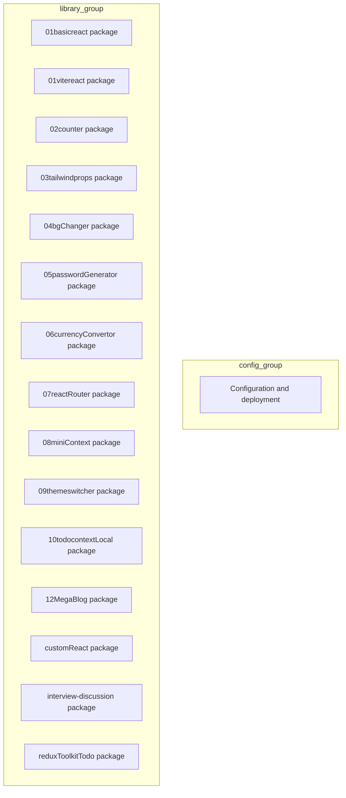

# Architecture report: hiteshchoudhary/chai-aur-react

> Automated static analysis. **Observed** = directly seen in files/imports/AST; **Inferred** = interpretation from that evidence. Repository code was not executed.

## 1. Repository at a glance

| Item | Value |
| --- | --- |
| Repository | hiteshchoudhary/chai-aur-react |
| Description | chai aur react series on youtube |
| Language | JavaScript |
| Stars | 13133 |
| Licence | Not detected |
| Analysed commit / branch | 651285bff5badfe7ab31fc9f18d2a6b97fc37949 / main |
| Framework(s) | React |
| Files analysed | 246 |
| Components | 16 |

## 2. Architecture in one minute

hiteshchoudhary/chai-aur-react - chai aur react series on youtube. This repository was analysed statically from 246 file(s) (0 Python). Detected technologies (observed from imports/manifests): React, React Router, Redux Toolkit, Tailwind CSS, Vite. Files are grouped into 16 component(s): 01basicreact package, 01vitereact package, 02counter package, 03tailwindprops package, 04bgChanger package, 05passwordGenerator package, 06currencyConvertor package, 07reactRouter package. Findings below distinguish observed facts from inferred interpretation.

## 3. High-level block diagram

## 4. Main components

### 01basicreact package (`c_01basicreact`)

- **Kind:** library
- **Status:** Observed
- **Confidence:** 0.85
- **Responsibility:** Groups 3 file(s) under 01basicreact package (observed from repository paths and static analysis).
- **Paths:** `01basicreact/src/App.js`, `01basicreact/src/Chai.jsx`, `01basicreact/src/index.js`
- **Evidence:** [01basicreact/src/App.js](https://github.com/hiteshchoudhary/chai-aur-react/blob/651285bff5badfe7ab31fc9f18d2a6b97fc37949/01basicreact/src/App.js); [01basicreact/src/Chai.jsx](https://github.com/hiteshchoudhary/chai-aur-react/blob/651285bff5badfe7ab31fc9f18d2a6b97fc37949/01basicreact/src/Chai.jsx); [01basicreact/src/index.js](https://github.com/hiteshchoudhary/chai-aur-react/blob/651285bff5badfe7ab31fc9f18d2a6b97fc37949/01basicreact/src/index.js)

### 01vitereact package (`c_01vitereact`)

- **Kind:** library
- **Status:** Observed
- **Confidence:** 0.85
- **Responsibility:** Groups 5 file(s) under 01vitereact package (observed from repository paths and static analysis).
- **Paths:** `01vitereact/.eslintrc.cjs`, `01vitereact/src/App.jsx`, `01vitereact/src/chai.jsx`, `01vitereact/src/main.jsx`, `01vitereact/vite.config.js`
- **Evidence:** [01vitereact/.eslintrc.cjs](https://github.com/hiteshchoudhary/chai-aur-react/blob/651285bff5badfe7ab31fc9f18d2a6b97fc37949/01vitereact/.eslintrc.cjs); [01vitereact/src/App.jsx](https://github.com/hiteshchoudhary/chai-aur-react/blob/651285bff5badfe7ab31fc9f18d2a6b97fc37949/01vitereact/src/App.jsx); [01vitereact/src/chai.jsx](https://github.com/hiteshchoudhary/chai-aur-react/blob/651285bff5badfe7ab31fc9f18d2a6b97fc37949/01vitereact/src/chai.jsx); [01vitereact/src/main.jsx](https://github.com/hiteshchoudhary/chai-aur-react/blob/651285bff5badfe7ab31fc9f18d2a6b97fc37949/01vitereact/src/main.jsx); [01vitereact/vite.config.js](https://github.com/hiteshchoudhary/chai-aur-react/blob/651285bff5badfe7ab31fc9f18d2a6b97fc37949/01vitereact/vite.config.js)

### 02counter package (`c_02counter`)

- **Kind:** library
- **Status:** Observed
- **Confidence:** 0.85
- **Responsibility:** Groups 4 file(s) under 02counter package (observed from repository paths and static analysis).
- **Paths:** `02counter/.eslintrc.cjs`, `02counter/src/App.jsx`, `02counter/src/main.jsx`, `02counter/vite.config.js`
- **Evidence:** [02counter/.eslintrc.cjs](https://github.com/hiteshchoudhary/chai-aur-react/blob/651285bff5badfe7ab31fc9f18d2a6b97fc37949/02counter/.eslintrc.cjs); [02counter/src/App.jsx](https://github.com/hiteshchoudhary/chai-aur-react/blob/651285bff5badfe7ab31fc9f18d2a6b97fc37949/02counter/src/App.jsx); [02counter/src/main.jsx](https://github.com/hiteshchoudhary/chai-aur-react/blob/651285bff5badfe7ab31fc9f18d2a6b97fc37949/02counter/src/main.jsx); [02counter/vite.config.js](https://github.com/hiteshchoudhary/chai-aur-react/blob/651285bff5badfe7ab31fc9f18d2a6b97fc37949/02counter/vite.config.js)

### 03tailwindprops package (`c_03tailwindprops`)

- **Kind:** library
- **Status:** Observed
- **Confidence:** 0.85
- **Responsibility:** Groups 7 file(s) under 03tailwindprops package (observed from repository paths and static analysis).
- **Paths:** `03tailwindprops/.eslintrc.cjs`, `03tailwindprops/postcss.config.js`, `03tailwindprops/src/App.jsx`, `03tailwindprops/src/components/Card.jsx`, `03tailwindprops/src/main.jsx`, `03tailwindprops/tailwind.config.js`, `03tailwindprops/vite.config.js`
- **Evidence:** [03tailwindprops/.eslintrc.cjs](https://github.com/hiteshchoudhary/chai-aur-react/blob/651285bff5badfe7ab31fc9f18d2a6b97fc37949/03tailwindprops/.eslintrc.cjs); [03tailwindprops/postcss.config.js](https://github.com/hiteshchoudhary/chai-aur-react/blob/651285bff5badfe7ab31fc9f18d2a6b97fc37949/03tailwindprops/postcss.config.js); [03tailwindprops/src/App.jsx](https://github.com/hiteshchoudhary/chai-aur-react/blob/651285bff5badfe7ab31fc9f18d2a6b97fc37949/03tailwindprops/src/App.jsx); [03tailwindprops/src/components/Card.jsx](https://github.com/hiteshchoudhary/chai-aur-react/blob/651285bff5badfe7ab31fc9f18d2a6b97fc37949/03tailwindprops/src/components/Card.jsx); [03tailwindprops/src/main.jsx](https://github.com/hiteshchoudhary/chai-aur-react/blob/651285bff5badfe7ab31fc9f18d2a6b97fc37949/03tailwindprops/src/main.jsx); [03tailwindprops/tailwind.config.js](https://github.com/hiteshchoudhary/chai-aur-react/blob/651285bff5badfe7ab31fc9f18d2a6b97fc37949/03tailwindprops/tailwind.config.js); [03tailwindprops/vite.config.js](https://github.com/hiteshchoudhary/chai-aur-react/blob/651285bff5badfe7ab31fc9f18d2a6b97fc37949/03tailwindprops/vite.config.js)

### 04bgChanger package (`c_04bgchanger`)

- **Kind:** library
- **Status:** Observed
- **Confidence:** 0.85
- **Responsibility:** Groups 6 file(s) under 04bgchanger package (observed from repository paths and static analysis).
- **Paths:** `04bgChanger/.eslintrc.cjs`, `04bgChanger/postcss.config.js`, `04bgChanger/src/App.jsx`, `04bgChanger/src/main.jsx`, `04bgChanger/tailwind.config.js`, `04bgChanger/vite.config.js`
- **Evidence:** [04bgChanger/.eslintrc.cjs](https://github.com/hiteshchoudhary/chai-aur-react/blob/651285bff5badfe7ab31fc9f18d2a6b97fc37949/04bgChanger/.eslintrc.cjs); [04bgChanger/postcss.config.js](https://github.com/hiteshchoudhary/chai-aur-react/blob/651285bff5badfe7ab31fc9f18d2a6b97fc37949/04bgChanger/postcss.config.js); [04bgChanger/src/App.jsx](https://github.com/hiteshchoudhary/chai-aur-react/blob/651285bff5badfe7ab31fc9f18d2a6b97fc37949/04bgChanger/src/App.jsx); [04bgChanger/src/main.jsx](https://github.com/hiteshchoudhary/chai-aur-react/blob/651285bff5badfe7ab31fc9f18d2a6b97fc37949/04bgChanger/src/main.jsx); [04bgChanger/tailwind.config.js](https://github.com/hiteshchoudhary/chai-aur-react/blob/651285bff5badfe7ab31fc9f18d2a6b97fc37949/04bgChanger/tailwind.config.js); [04bgChanger/vite.config.js](https://github.com/hiteshchoudhary/chai-aur-react/blob/651285bff5badfe7ab31fc9f18d2a6b97fc37949/04bgChanger/vite.config.js)

### 05passwordGenerator package (`c_05passwordgenerator`)

- **Kind:** library
- **Status:** Observed
- **Confidence:** 0.85
- **Responsibility:** Groups 6 file(s) under 05passwordgenerator package (observed from repository paths and static analysis).
- **Paths:** `05passwordGenerator/.eslintrc.cjs`, `05passwordGenerator/postcss.config.js`, `05passwordGenerator/src/App.jsx`, `05passwordGenerator/src/main.jsx`, `05passwordGenerator/tailwind.config.js`, `05passwordGenerator/vite.config.js`
- **Evidence:** [05passwordGenerator/.eslintrc.cjs](https://github.com/hiteshchoudhary/chai-aur-react/blob/651285bff5badfe7ab31fc9f18d2a6b97fc37949/05passwordGenerator/.eslintrc.cjs); [05passwordGenerator/postcss.config.js](https://github.com/hiteshchoudhary/chai-aur-react/blob/651285bff5badfe7ab31fc9f18d2a6b97fc37949/05passwordGenerator/postcss.config.js); [05passwordGenerator/src/App.jsx](https://github.com/hiteshchoudhary/chai-aur-react/blob/651285bff5badfe7ab31fc9f18d2a6b97fc37949/05passwordGenerator/src/App.jsx); [05passwordGenerator/src/main.jsx](https://github.com/hiteshchoudhary/chai-aur-react/blob/651285bff5badfe7ab31fc9f18d2a6b97fc37949/05passwordGenerator/src/main.jsx); [05passwordGenerator/tailwind.config.js](https://github.com/hiteshchoudhary/chai-aur-react/blob/651285bff5badfe7ab31fc9f18d2a6b97fc37949/05passwordGenerator/tailwind.config.js); [05passwordGenerator/vite.config.js](https://github.com/hiteshchoudhary/chai-aur-react/blob/651285bff5badfe7ab31fc9f18d2a6b97fc37949/05passwordGenerator/vite.config.js)

### 06currencyConvertor package (`c_06currencyconvertor`)

- **Kind:** library
- **Status:** Observed
- **Confidence:** 0.85
- **Responsibility:** Groups 9 file(s) under 06currencyconvertor package (observed from repository paths and static analysis).
- **Paths:** `06currencyConvertor/.eslintrc.cjs`, `06currencyConvertor/postcss.config.js`, `06currencyConvertor/src/App.jsx`, `06currencyConvertor/src/components/InputBox.jsx`, `06currencyConvertor/src/components/index.js`, `06currencyConvertor/src/hooks/useCurrencyInfo.js`, `06currencyConvertor/src/main.jsx`, `06currencyConvertor/tailwind.config.js`, `06currencyConvertor/vite.config.js`
- **Evidence:** [06currencyConvertor/.eslintrc.cjs](https://github.com/hiteshchoudhary/chai-aur-react/blob/651285bff5badfe7ab31fc9f18d2a6b97fc37949/06currencyConvertor/.eslintrc.cjs); [06currencyConvertor/postcss.config.js](https://github.com/hiteshchoudhary/chai-aur-react/blob/651285bff5badfe7ab31fc9f18d2a6b97fc37949/06currencyConvertor/postcss.config.js); [06currencyConvertor/src/App.jsx](https://github.com/hiteshchoudhary/chai-aur-react/blob/651285bff5badfe7ab31fc9f18d2a6b97fc37949/06currencyConvertor/src/App.jsx); [06currencyConvertor/src/components/InputBox.jsx](https://github.com/hiteshchoudhary/chai-aur-react/blob/651285bff5badfe7ab31fc9f18d2a6b97fc37949/06currencyConvertor/src/components/InputBox.jsx); [06currencyConvertor/src/components/index.js](https://github.com/hiteshchoudhary/chai-aur-react/blob/651285bff5badfe7ab31fc9f18d2a6b97fc37949/06currencyConvertor/src/components/index.js); [06currencyConvertor/src/hooks/useCurrencyInfo.js](https://github.com/hiteshchoudhary/chai-aur-react/blob/651285bff5badfe7ab31fc9f18d2a6b97fc37949/06currencyConvertor/src/hooks/useCurrencyInfo.js); [06currencyConvertor/src/main.jsx](https://github.com/hiteshchoudhary/chai-aur-react/blob/651285bff5badfe7ab31fc9f18d2a6b97fc37949/06currencyConvertor/src/main.jsx); [06currencyConvertor/tailwind.config.js](https://github.com/hiteshchoudhary/chai-aur-react/blob/651285bff5badfe7ab31fc9f18d2a6b97fc37949/06currencyConvertor/tailwind.config.js)

### 07reactRouter package (`c_07reactrouter`)

- **Kind:** library
- **Status:** Observed
- **Confidence:** 0.85
- **Responsibility:** Groups 14 file(s) under 07reactrouter package (observed from repository paths and static analysis).
- **Paths:** `07reactRouter/.eslintrc.cjs`, `07reactRouter/postcss.config.js`, `07reactRouter/src/App.jsx`, `07reactRouter/src/Layout.jsx`, `07reactRouter/src/components/About/About.jsx`, `07reactRouter/src/components/Contact/Contact.jsx`, `07reactRouter/src/components/Footer/Footer.jsx`, `07reactRouter/src/components/Github/Github.jsx`, `07reactRouter/src/components/Header/Header.jsx`, `07reactRouter/src/components/Home/Home.jsx`, `07reactRouter/src/components/User/User.jsx`, `07reactRouter/src/main.jsx`, `07reactRouter/tailwind.config.js`, `07reactRouter/vite.config.js`
- **Evidence:** [07reactRouter/.eslintrc.cjs](https://github.com/hiteshchoudhary/chai-aur-react/blob/651285bff5badfe7ab31fc9f18d2a6b97fc37949/07reactRouter/.eslintrc.cjs); [07reactRouter/postcss.config.js](https://github.com/hiteshchoudhary/chai-aur-react/blob/651285bff5badfe7ab31fc9f18d2a6b97fc37949/07reactRouter/postcss.config.js); [07reactRouter/src/App.jsx](https://github.com/hiteshchoudhary/chai-aur-react/blob/651285bff5badfe7ab31fc9f18d2a6b97fc37949/07reactRouter/src/App.jsx); [07reactRouter/src/Layout.jsx](https://github.com/hiteshchoudhary/chai-aur-react/blob/651285bff5badfe7ab31fc9f18d2a6b97fc37949/07reactRouter/src/Layout.jsx); [07reactRouter/src/components/About/About.jsx](https://github.com/hiteshchoudhary/chai-aur-react/blob/651285bff5badfe7ab31fc9f18d2a6b97fc37949/07reactRouter/src/components/About/About.jsx); [07reactRouter/src/components/Contact/Contact.jsx](https://github.com/hiteshchoudhary/chai-aur-react/blob/651285bff5badfe7ab31fc9f18d2a6b97fc37949/07reactRouter/src/components/Contact/Contact.jsx); [07reactRouter/src/components/Footer/Footer.jsx](https://github.com/hiteshchoudhary/chai-aur-react/blob/651285bff5badfe7ab31fc9f18d2a6b97fc37949/07reactRouter/src/components/Footer/Footer.jsx); [07reactRouter/src/components/Github/Github.jsx](https://github.com/hiteshchoudhary/chai-aur-react/blob/651285bff5badfe7ab31fc9f18d2a6b97fc37949/07reactRouter/src/components/Github/Github.jsx)

### 08miniContext package (`c_08minicontext`)

- **Kind:** library
- **Status:** Observed
- **Confidence:** 0.85
- **Responsibility:** Groups 8 file(s) under 08minicontext package (observed from repository paths and static analysis).
- **Paths:** `08miniContext/.eslintrc.cjs`, `08miniContext/src/App.jsx`, `08miniContext/src/components/Login.jsx`, `08miniContext/src/components/Profile.jsx`, `08miniContext/src/context/UserContext.js`, `08miniContext/src/context/UserContextProvider.jsx`, `08miniContext/src/main.jsx`, `08miniContext/vite.config.js`
- **Evidence:** [08miniContext/.eslintrc.cjs](https://github.com/hiteshchoudhary/chai-aur-react/blob/651285bff5badfe7ab31fc9f18d2a6b97fc37949/08miniContext/.eslintrc.cjs); [08miniContext/src/App.jsx](https://github.com/hiteshchoudhary/chai-aur-react/blob/651285bff5badfe7ab31fc9f18d2a6b97fc37949/08miniContext/src/App.jsx); [08miniContext/src/components/Login.jsx](https://github.com/hiteshchoudhary/chai-aur-react/blob/651285bff5badfe7ab31fc9f18d2a6b97fc37949/08miniContext/src/components/Login.jsx); [08miniContext/src/components/Profile.jsx](https://github.com/hiteshchoudhary/chai-aur-react/blob/651285bff5badfe7ab31fc9f18d2a6b97fc37949/08miniContext/src/components/Profile.jsx); [08miniContext/src/context/UserContext.js](https://github.com/hiteshchoudhary/chai-aur-react/blob/651285bff5badfe7ab31fc9f18d2a6b97fc37949/08miniContext/src/context/UserContext.js); [08miniContext/src/context/UserContextProvider.jsx](https://github.com/hiteshchoudhary/chai-aur-react/blob/651285bff5badfe7ab31fc9f18d2a6b97fc37949/08miniContext/src/context/UserContextProvider.jsx); [08miniContext/src/main.jsx](https://github.com/hiteshchoudhary/chai-aur-react/blob/651285bff5badfe7ab31fc9f18d2a6b97fc37949/08miniContext/src/main.jsx); [08miniContext/vite.config.js](https://github.com/hiteshchoudhary/chai-aur-react/blob/651285bff5badfe7ab31fc9f18d2a6b97fc37949/08miniContext/vite.config.js)

### 09themeswitcher package (`c_09themeswitcher`)

- **Kind:** library
- **Status:** Observed
- **Confidence:** 0.85
- **Responsibility:** Groups 9 file(s) under 09themeswitcher package (observed from repository paths and static analysis).
- **Paths:** `09themeswitcher/.eslintrc.cjs`, `09themeswitcher/postcss.config.js`, `09themeswitcher/src/App.jsx`, `09themeswitcher/src/components/Card.jsx`, `09themeswitcher/src/components/ThemeBtn.jsx`, `09themeswitcher/src/contexts/theme.js`, `09themeswitcher/src/main.jsx`, `09themeswitcher/tailwind.config.js`, `09themeswitcher/vite.config.js`
- **Evidence:** [09themeswitcher/.eslintrc.cjs](https://github.com/hiteshchoudhary/chai-aur-react/blob/651285bff5badfe7ab31fc9f18d2a6b97fc37949/09themeswitcher/.eslintrc.cjs); [09themeswitcher/postcss.config.js](https://github.com/hiteshchoudhary/chai-aur-react/blob/651285bff5badfe7ab31fc9f18d2a6b97fc37949/09themeswitcher/postcss.config.js); [09themeswitcher/src/App.jsx](https://github.com/hiteshchoudhary/chai-aur-react/blob/651285bff5badfe7ab31fc9f18d2a6b97fc37949/09themeswitcher/src/App.jsx); [09themeswitcher/src/components/Card.jsx](https://github.com/hiteshchoudhary/chai-aur-react/blob/651285bff5badfe7ab31fc9f18d2a6b97fc37949/09themeswitcher/src/components/Card.jsx); [09themeswitcher/src/components/ThemeBtn.jsx](https://github.com/hiteshchoudhary/chai-aur-react/blob/651285bff5badfe7ab31fc9f18d2a6b97fc37949/09themeswitcher/src/components/ThemeBtn.jsx); [09themeswitcher/src/contexts/theme.js](https://github.com/hiteshchoudhary/chai-aur-react/blob/651285bff5badfe7ab31fc9f18d2a6b97fc37949/09themeswitcher/src/contexts/theme.js); [09themeswitcher/src/main.jsx](https://github.com/hiteshchoudhary/chai-aur-react/blob/651285bff5badfe7ab31fc9f18d2a6b97fc37949/09themeswitcher/src/main.jsx); [09themeswitcher/tailwind.config.js](https://github.com/hiteshchoudhary/chai-aur-react/blob/651285bff5badfe7ab31fc9f18d2a6b97fc37949/09themeswitcher/tailwind.config.js)

### 10todocontextLocal package (`c_10todocontextlocal`)

- **Kind:** library
- **Status:** Observed
- **Confidence:** 0.85
- **Responsibility:** Groups 11 file(s) under 10todocontextlocal package (observed from repository paths and static analysis).
- **Paths:** `10todocontextLocal/.eslintrc.cjs`, `10todocontextLocal/postcss.config.js`, `10todocontextLocal/src/App.jsx`, `10todocontextLocal/src/components/TodoForm.jsx`, `10todocontextLocal/src/components/TodoItem.jsx`, `10todocontextLocal/src/components/index.js`, `10todocontextLocal/src/contexts/TodoContext.js`, `10todocontextLocal/src/contexts/index.js`, `10todocontextLocal/src/main.jsx`, `10todocontextLocal/tailwind.config.js`, `10todocontextLocal/vite.config.js`
- **Evidence:** [10todocontextLocal/.eslintrc.cjs](https://github.com/hiteshchoudhary/chai-aur-react/blob/651285bff5badfe7ab31fc9f18d2a6b97fc37949/10todocontextLocal/.eslintrc.cjs); [10todocontextLocal/postcss.config.js](https://github.com/hiteshchoudhary/chai-aur-react/blob/651285bff5badfe7ab31fc9f18d2a6b97fc37949/10todocontextLocal/postcss.config.js); [10todocontextLocal/src/App.jsx](https://github.com/hiteshchoudhary/chai-aur-react/blob/651285bff5badfe7ab31fc9f18d2a6b97fc37949/10todocontextLocal/src/App.jsx); [10todocontextLocal/src/components/TodoForm.jsx](https://github.com/hiteshchoudhary/chai-aur-react/blob/651285bff5badfe7ab31fc9f18d2a6b97fc37949/10todocontextLocal/src/components/TodoForm.jsx); [10todocontextLocal/src/components/TodoItem.jsx](https://github.com/hiteshchoudhary/chai-aur-react/blob/651285bff5badfe7ab31fc9f18d2a6b97fc37949/10todocontextLocal/src/components/TodoItem.jsx); [10todocontextLocal/src/components/index.js](https://github.com/hiteshchoudhary/chai-aur-react/blob/651285bff5badfe7ab31fc9f18d2a6b97fc37949/10todocontextLocal/src/components/index.js); [10todocontextLocal/src/contexts/TodoContext.js](https://github.com/hiteshchoudhary/chai-aur-react/blob/651285bff5badfe7ab31fc9f18d2a6b97fc37949/10todocontextLocal/src/contexts/TodoContext.js); [10todocontextLocal/src/contexts/index.js](https://github.com/hiteshchoudhary/chai-aur-react/blob/651285bff5badfe7ab31fc9f18d2a6b97fc37949/10todocontextLocal/src/contexts/index.js)

### 12MegaBlog package (`c_12megablog`)

- **Kind:** library
- **Status:** Observed
- **Confidence:** 0.85
- **Responsibility:** Groups 32 file(s) under 12megablog package (observed from repository paths and static analysis).
- **Paths:** `12MegaBlog/.eslintrc.cjs`, `12MegaBlog/postcss.config.js`, `12MegaBlog/src/App.jsx`, `12MegaBlog/src/appwrite/auth.js`, `12MegaBlog/src/appwrite/config.js`, `12MegaBlog/src/components/AuthLayout.jsx`, `12MegaBlog/src/components/Button.jsx`, `12MegaBlog/src/components/Footer/Footer.jsx`, `12MegaBlog/src/components/Header/Header.jsx`, `12MegaBlog/src/components/Header/LogoutBtn.jsx`, `12MegaBlog/src/components/Input.jsx`, `12MegaBlog/src/components/Login.jsx`, `12MegaBlog/src/components/Logo.jsx`, `12MegaBlog/src/components/PostCard.jsx`, `12MegaBlog/src/components/RTE.jsx`, `12MegaBlog/src/components/Select.jsx`, `12MegaBlog/src/components/Signup.jsx`, `12MegaBlog/src/components/container/Container.jsx`, `12MegaBlog/src/components/index.js`, `12MegaBlog/src/components/post-form/PostForm.jsx`, `12MegaBlog/src/main.jsx`, `12MegaBlog/src/pages/AddPost.jsx`, `12MegaBlog/src/pages/AllPosts.jsx`, `12MegaBlog/src/pages/EditPost.jsx`, `12MegaBlog/src/pages/Home.jsx`, `12MegaBlog/src/pages/Login.jsx`, `12MegaBlog/src/pages/Post.jsx`, `12MegaBlog/src/pages/Signup.jsx`, `12MegaBlog/src/store/authSlice.js`, `12MegaBlog/src/store/store.js`, `12MegaBlog/tailwind.config.js`, `12MegaBlog/vite.config.js`
- **Evidence:** [12MegaBlog/.eslintrc.cjs](https://github.com/hiteshchoudhary/chai-aur-react/blob/651285bff5badfe7ab31fc9f18d2a6b97fc37949/12MegaBlog/.eslintrc.cjs); [12MegaBlog/postcss.config.js](https://github.com/hiteshchoudhary/chai-aur-react/blob/651285bff5badfe7ab31fc9f18d2a6b97fc37949/12MegaBlog/postcss.config.js); [12MegaBlog/src/App.jsx](https://github.com/hiteshchoudhary/chai-aur-react/blob/651285bff5badfe7ab31fc9f18d2a6b97fc37949/12MegaBlog/src/App.jsx); [12MegaBlog/src/appwrite/auth.js](https://github.com/hiteshchoudhary/chai-aur-react/blob/651285bff5badfe7ab31fc9f18d2a6b97fc37949/12MegaBlog/src/appwrite/auth.js); [12MegaBlog/src/appwrite/config.js](https://github.com/hiteshchoudhary/chai-aur-react/blob/651285bff5badfe7ab31fc9f18d2a6b97fc37949/12MegaBlog/src/appwrite/config.js); [12MegaBlog/src/components/AuthLayout.jsx](https://github.com/hiteshchoudhary/chai-aur-react/blob/651285bff5badfe7ab31fc9f18d2a6b97fc37949/12MegaBlog/src/components/AuthLayout.jsx); [12MegaBlog/src/components/Button.jsx](https://github.com/hiteshchoudhary/chai-aur-react/blob/651285bff5badfe7ab31fc9f18d2a6b97fc37949/12MegaBlog/src/components/Button.jsx); [12MegaBlog/src/components/Footer/Footer.jsx](https://github.com/hiteshchoudhary/chai-aur-react/blob/651285bff5badfe7ab31fc9f18d2a6b97fc37949/12MegaBlog/src/components/Footer/Footer.jsx)

### Configuration and deployment (`config`)

- **Kind:** config
- **Status:** Observed
- **Confidence:** 0.85
- **Responsibility:** Groups 17 file(s) under configuration and deployment (observed from repository paths and static analysis).
- **Paths:** `01basicreact/package.json`, `01basicreact/public/manifest.json`, `01vitereact/package.json`, `02counter/package.json`, `03tailwindprops/package.json`, `04bgChanger/package.json`, `05passwordGenerator/package.json`, `06currencyConvertor/package.json`, `07reactRouter/package.json`, `08miniContext/package.json`, `09themeswitcher/package.json`, `10todocontextLocal/package.json`, `12MegaBlog/.env.sample`, `12MegaBlog/package.json`, `12MegaBlog/src/conf/conf.js`, `interview-discussion/package.json`, `reduxToolkitTodo/package.json`
- **Evidence:** [01basicreact/package.json](https://github.com/hiteshchoudhary/chai-aur-react/blob/651285bff5badfe7ab31fc9f18d2a6b97fc37949/01basicreact/package.json); [01basicreact/public/manifest.json](https://github.com/hiteshchoudhary/chai-aur-react/blob/651285bff5badfe7ab31fc9f18d2a6b97fc37949/01basicreact/public/manifest.json); [01vitereact/package.json](https://github.com/hiteshchoudhary/chai-aur-react/blob/651285bff5badfe7ab31fc9f18d2a6b97fc37949/01vitereact/package.json); [02counter/package.json](https://github.com/hiteshchoudhary/chai-aur-react/blob/651285bff5badfe7ab31fc9f18d2a6b97fc37949/02counter/package.json); [03tailwindprops/package.json](https://github.com/hiteshchoudhary/chai-aur-react/blob/651285bff5badfe7ab31fc9f18d2a6b97fc37949/03tailwindprops/package.json); [04bgChanger/package.json](https://github.com/hiteshchoudhary/chai-aur-react/blob/651285bff5badfe7ab31fc9f18d2a6b97fc37949/04bgChanger/package.json); [05passwordGenerator/package.json](https://github.com/hiteshchoudhary/chai-aur-react/blob/651285bff5badfe7ab31fc9f18d2a6b97fc37949/05passwordGenerator/package.json); [06currencyConvertor/package.json](https://github.com/hiteshchoudhary/chai-aur-react/blob/651285bff5badfe7ab31fc9f18d2a6b97fc37949/06currencyConvertor/package.json)

### customReact package (`customreact`)

- **Kind:** library
- **Status:** Observed
- **Confidence:** 0.85
- **Responsibility:** Groups 1 file(s) under customreact package (observed from repository paths and static analysis).
- **Paths:** `customReact/customreact.js`
- **Evidence:** [customReact/customreact.js](https://github.com/hiteshchoudhary/chai-aur-react/blob/651285bff5badfe7ab31fc9f18d2a6b97fc37949/customReact/customreact.js)

### interview-discussion package (`interview_discussion`)

- **Kind:** library
- **Status:** Observed
- **Confidence:** 0.85
- **Responsibility:** Groups 4 file(s) under interview-discussion package (observed from repository paths and static analysis).
- **Paths:** `interview-discussion/.eslintrc.cjs`, `interview-discussion/src/App.jsx`, `interview-discussion/src/main.jsx`, `interview-discussion/vite.config.js`
- **Evidence:** [interview-discussion/.eslintrc.cjs](https://github.com/hiteshchoudhary/chai-aur-react/blob/651285bff5badfe7ab31fc9f18d2a6b97fc37949/interview-discussion/.eslintrc.cjs); [interview-discussion/src/App.jsx](https://github.com/hiteshchoudhary/chai-aur-react/blob/651285bff5badfe7ab31fc9f18d2a6b97fc37949/interview-discussion/src/App.jsx); [interview-discussion/src/main.jsx](https://github.com/hiteshchoudhary/chai-aur-react/blob/651285bff5badfe7ab31fc9f18d2a6b97fc37949/interview-discussion/src/main.jsx); [interview-discussion/vite.config.js](https://github.com/hiteshchoudhary/chai-aur-react/blob/651285bff5badfe7ab31fc9f18d2a6b97fc37949/interview-discussion/vite.config.js)

### reduxToolkitTodo package (`reduxtoolkittodo`)

- **Kind:** library
- **Status:** Observed
- **Confidence:** 0.85
- **Responsibility:** Groups 10 file(s) under reduxtoolkittodo package (observed from repository paths and static analysis).
- **Paths:** `reduxToolkitTodo/.eslintrc.cjs`, `reduxToolkitTodo/postcss.config.js`, `reduxToolkitTodo/src/App.jsx`, `reduxToolkitTodo/src/app/store.js`, `reduxToolkitTodo/src/components/AddTodo.jsx`, `reduxToolkitTodo/src/components/Todos.jsx`, `reduxToolkitTodo/src/features/todo/todoSlice.js`, `reduxToolkitTodo/src/main.jsx`, `reduxToolkitTodo/tailwind.config.js`, `reduxToolkitTodo/vite.config.js`
- **Evidence:** [reduxToolkitTodo/.eslintrc.cjs](https://github.com/hiteshchoudhary/chai-aur-react/blob/651285bff5badfe7ab31fc9f18d2a6b97fc37949/reduxToolkitTodo/.eslintrc.cjs); [reduxToolkitTodo/postcss.config.js](https://github.com/hiteshchoudhary/chai-aur-react/blob/651285bff5badfe7ab31fc9f18d2a6b97fc37949/reduxToolkitTodo/postcss.config.js); [reduxToolkitTodo/src/App.jsx](https://github.com/hiteshchoudhary/chai-aur-react/blob/651285bff5badfe7ab31fc9f18d2a6b97fc37949/reduxToolkitTodo/src/App.jsx); [reduxToolkitTodo/src/app/store.js](https://github.com/hiteshchoudhary/chai-aur-react/blob/651285bff5badfe7ab31fc9f18d2a6b97fc37949/reduxToolkitTodo/src/app/store.js); [reduxToolkitTodo/src/components/AddTodo.jsx](https://github.com/hiteshchoudhary/chai-aur-react/blob/651285bff5badfe7ab31fc9f18d2a6b97fc37949/reduxToolkitTodo/src/components/AddTodo.jsx); [reduxToolkitTodo/src/components/Todos.jsx](https://github.com/hiteshchoudhary/chai-aur-react/blob/651285bff5badfe7ab31fc9f18d2a6b97fc37949/reduxToolkitTodo/src/components/Todos.jsx); [reduxToolkitTodo/src/features/todo/todoSlice.js](https://github.com/hiteshchoudhary/chai-aur-react/blob/651285bff5badfe7ab31fc9f18d2a6b97fc37949/reduxToolkitTodo/src/features/todo/todoSlice.js); [reduxToolkitTodo/src/main.jsx](https://github.com/hiteshchoudhary/chai-aur-react/blob/651285bff5badfe7ab31fc9f18d2a6b97fc37949/reduxToolkitTodo/src/main.jsx)

## 5. Execution flow

**Observed** entry point(s):

- [01basicreact/src/App.js](https://github.com/hiteshchoudhary/chai-aur-react/blob/651285bff5badfe7ab31fc9f18d2a6b97fc37949/01basicreact/src/App.js)
- [01basicreact/src/index.js](https://github.com/hiteshchoudhary/chai-aur-react/blob/651285bff5badfe7ab31fc9f18d2a6b97fc37949/01basicreact/src/index.js)
- [01vitereact/src/App.jsx](https://github.com/hiteshchoudhary/chai-aur-react/blob/651285bff5badfe7ab31fc9f18d2a6b97fc37949/01vitereact/src/App.jsx)
- [01vitereact/src/main.jsx](https://github.com/hiteshchoudhary/chai-aur-react/blob/651285bff5badfe7ab31fc9f18d2a6b97fc37949/01vitereact/src/main.jsx)
- [02counter/src/App.jsx](https://github.com/hiteshchoudhary/chai-aur-react/blob/651285bff5badfe7ab31fc9f18d2a6b97fc37949/02counter/src/App.jsx)
- [02counter/src/main.jsx](https://github.com/hiteshchoudhary/chai-aur-react/blob/651285bff5badfe7ab31fc9f18d2a6b97fc37949/02counter/src/main.jsx)
- [03tailwindprops/src/App.jsx](https://github.com/hiteshchoudhary/chai-aur-react/blob/651285bff5badfe7ab31fc9f18d2a6b97fc37949/03tailwindprops/src/App.jsx)
- [03tailwindprops/src/main.jsx](https://github.com/hiteshchoudhary/chai-aur-react/blob/651285bff5badfe7ab31fc9f18d2a6b97fc37949/03tailwindprops/src/main.jsx)
- [04bgChanger/src/App.jsx](https://github.com/hiteshchoudhary/chai-aur-react/blob/651285bff5badfe7ab31fc9f18d2a6b97fc37949/04bgChanger/src/App.jsx)
- [04bgChanger/src/main.jsx](https://github.com/hiteshchoudhary/chai-aur-react/blob/651285bff5badfe7ab31fc9f18d2a6b97fc37949/04bgChanger/src/main.jsx)
- [05passwordGenerator/src/App.jsx](https://github.com/hiteshchoudhary/chai-aur-react/blob/651285bff5badfe7ab31fc9f18d2a6b97fc37949/05passwordGenerator/src/App.jsx)
- [05passwordGenerator/src/main.jsx](https://github.com/hiteshchoudhary/chai-aur-react/blob/651285bff5badfe7ab31fc9f18d2a6b97fc37949/05passwordGenerator/src/main.jsx)

Representative flow (derived from observed entry points and the import graph; steps beyond the entry point are **Inferred**):

1. Execution starts at an observed entry point listed above, if present.
2. No internal import relationships between components were observed.

## 6. Project structure

### `(root)`

- `.gitignore` - other (26 bytes)
- `contextNotes.md` - docs (6662 bytes)
- `currency.md` - docs (3153 bytes)
- `reactRouterNotes.md` - docs (24973 bytes)
- `readme.md` - docs (2635 bytes)
- `todoContextapiNotes.md` - docs (3081 bytes)

### `.vscode`

- `.vscode/settings.json` - config (84 bytes)

### `01basicreact`

- `01basicreact/.gitignore` - other (310 bytes)
- `01basicreact/README.md` - docs (3359 bytes)
- `01basicreact/package.json` - manifest (815 bytes)
- `01basicreact/public/index.html` - other (659 bytes)
- `01basicreact/public/manifest.json` - config (492 bytes)
- `01basicreact/public/robots.txt` - docs (67 bytes)
- `01basicreact/src/App.js` - source, JavaScript (117 bytes)
- `01basicreact/src/Chai.jsx` - source, JavaScript (88 bytes)
- `01basicreact/src/index.js` - source, JavaScript (196 bytes)

### `01vitereact`

- `01vitereact/.eslintrc.cjs` - source, JavaScript (526 bytes)
- `01vitereact/.gitignore` - other (253 bytes)
- `01vitereact/README.md` - docs (451 bytes)
- `01vitereact/index.html` - other (361 bytes)
- `01vitereact/package.json` - manifest (655 bytes)
- `01vitereact/public/vite.svg` - other (1497 bytes)
- `01vitereact/src/App.jsx` - source, JavaScript (206 bytes)
- `01vitereact/src/chai.jsx` - source, JavaScript (88 bytes)
- `01vitereact/src/main.jsx` - source, JavaScript (769 bytes)
- `01vitereact/vite.config.js` - source, JavaScript (163 bytes)

### `02counter`

- `02counter/.eslintrc.cjs` - source, JavaScript (526 bytes)
- `02counter/.gitignore` - other (253 bytes)
- `02counter/README.md` - docs (451 bytes)
- `02counter/index.html` - other (361 bytes)
- `02counter/package.json` - manifest (653 bytes)
- `02counter/public/vite.svg` - other (1497 bytes)
- `02counter/src/App.css` - other (606 bytes)
- `02counter/src/App.jsx` - source, JavaScript (859 bytes)
- `02counter/src/assets/react.svg` - other (4126 bytes)
- `02counter/src/index.css` - other (1195 bytes)
- `02counter/src/main.jsx` - source, JavaScript (235 bytes)
- `02counter/vite.config.js` - source, JavaScript (163 bytes)

### `03tailwindprops`

- `03tailwindprops/.eslintrc.cjs` - source, JavaScript (526 bytes)
- `03tailwindprops/.gitignore` - other (253 bytes)
- `03tailwindprops/README.md` - docs (451 bytes)
- `03tailwindprops/index.html` - other (361 bytes)
- `03tailwindprops/package.json` - manifest (746 bytes)
- `03tailwindprops/postcss.config.js` - source, JavaScript (80 bytes)
- `03tailwindprops/public/vite.svg` - other (1497 bytes)
- `03tailwindprops/src/App.css` - other (606 bytes)
- `03tailwindprops/src/App.jsx` - source, JavaScript (532 bytes)
- `03tailwindprops/src/assets/react.svg` - other (4126 bytes)
- `03tailwindprops/src/components/Card.jsx` - source, JavaScript (994 bytes)
- `03tailwindprops/src/index.css` - other (1255 bytes)
- `03tailwindprops/src/main.jsx` - source, JavaScript (235 bytes)
- `03tailwindprops/tailwind.config.js` - source, JavaScript (183 bytes)
- `03tailwindprops/vite.config.js` - source, JavaScript (163 bytes)

### `04bgChanger`

- `04bgChanger/.eslintrc.cjs` - source, JavaScript (526 bytes)
- `04bgChanger/.gitignore` - other (253 bytes)
- `04bgChanger/README.md` - docs (451 bytes)
- `04bgChanger/index.html` - other (361 bytes)
- `04bgChanger/package.json` - manifest (742 bytes)
- `04bgChanger/postcss.config.js` - source, JavaScript (80 bytes)
- `04bgChanger/public/vite.svg` - other (1497 bytes)
- `04bgChanger/src/App.css` - other (606 bytes)
- `04bgChanger/src/App.jsx` - source, JavaScript (1083 bytes)
- `04bgChanger/src/assets/react.svg` - other (4126 bytes)
- `04bgChanger/src/index.css` - other (59 bytes)
- `04bgChanger/src/main.jsx` - source, JavaScript (235 bytes)
- `04bgChanger/tailwind.config.js` - source, JavaScript (183 bytes)
- `04bgChanger/vite.config.js` - source, JavaScript (163 bytes)

### `05passwordGenerator`

- `05passwordGenerator/.eslintrc.cjs` - source, JavaScript (526 bytes)
- `05passwordGenerator/.gitignore` - other (253 bytes)
- `05passwordGenerator/README.md` - docs (451 bytes)
- `05passwordGenerator/index.html` - other (393 bytes)
- `05passwordGenerator/package.json` - manifest (750 bytes)
- `05passwordGenerator/postcss.config.js` - source, JavaScript (80 bytes)
- `05passwordGenerator/public/vite.svg` - other (1497 bytes)
- `05passwordGenerator/src/App.css` - other (0 bytes)
- `05passwordGenerator/src/App.jsx` - source, JavaScript (2853 bytes)
- `05passwordGenerator/src/assets/react.svg` - other (4126 bytes)
- `05passwordGenerator/src/index.css` - other (58 bytes)
- `05passwordGenerator/src/main.jsx` - source, JavaScript (235 bytes)
- `05passwordGenerator/tailwind.config.js` - source, JavaScript (183 bytes)
- `05passwordGenerator/vite.config.js` - source, JavaScript (163 bytes)

### `06currencyConvertor`

- `06currencyConvertor/.eslintrc.cjs` - source, JavaScript (526 bytes)
- `06currencyConvertor/.gitignore` - other (253 bytes)
- `06currencyConvertor/README.md` - docs (451 bytes)
- `06currencyConvertor/index.html` - other (361 bytes)
- `06currencyConvertor/package.json` - manifest (750 bytes)
- `06currencyConvertor/postcss.config.js` - source, JavaScript (80 bytes)
- `06currencyConvertor/public/vite.svg` - other (1497 bytes)
- `06currencyConvertor/src/App.css` - other (606 bytes)
- `06currencyConvertor/src/App.jsx` - source, JavaScript (2988 bytes)
- `06currencyConvertor/src/assets/react.svg` - other (4126 bytes)
- `06currencyConvertor/src/components/InputBox.jsx` - source, JavaScript (1819 bytes)
- `06currencyConvertor/src/components/index.js` - source, JavaScript (52 bytes)
- `06currencyConvertor/src/hooks/useCurrencyInfo.js` - source, JavaScript (451 bytes)
- `06currencyConvertor/src/index.css` - other (58 bytes)
- `06currencyConvertor/src/main.jsx` - source, JavaScript (235 bytes)
- `06currencyConvertor/tailwind.config.js` - source, JavaScript (183 bytes)
- `06currencyConvertor/vite.config.js` - source, JavaScript (163 bytes)

### `07reactRouter`

- `07reactRouter/.eslintrc.cjs` - source, JavaScript (526 bytes)
- `07reactRouter/.gitignore` - other (253 bytes)
- `07reactRouter/README.md` - docs (451 bytes)
- `07reactRouter/index.html` - other (361 bytes)
- `07reactRouter/package.json` - manifest (779 bytes)
- `07reactRouter/postcss.config.js` - source, JavaScript (80 bytes)
- `07reactRouter/public/vite.svg` - other (1497 bytes)
- `07reactRouter/src/App.css` - other (606 bytes)
- `07reactRouter/src/App.jsx` - source, JavaScript (390 bytes)
- `07reactRouter/src/Layout.jsx` - source, JavaScript (283 bytes)
- `07reactRouter/src/assets/react.svg` - other (4126 bytes)
- `07reactRouter/src/components/About/About.jsx` - source, JavaScript (1588 bytes)
- `07reactRouter/src/components/Contact/Contact.jsx` - source, JavaScript (7767 bytes)
- `07reactRouter/src/components/Footer/Footer.jsx` - source, JavaScript (10640 bytes)
- `07reactRouter/src/components/Github/Github.jsx` - source, JavaScript (816 bytes)
- `07reactRouter/src/components/Header/Header.jsx` - source, JavaScript (4369 bytes)
- `07reactRouter/src/components/Home/Home.jsx` - source, JavaScript (2443 bytes)
- `07reactRouter/src/components/User/User.jsx` - source, JavaScript (238 bytes)
- `07reactRouter/src/index.css` - other (58 bytes)
- `07reactRouter/src/main.jsx` - source, JavaScript (1468 bytes)
- `07reactRouter/tailwind.config.js` - source, JavaScript (183 bytes)
- `07reactRouter/vite.config.js` - source, JavaScript (163 bytes)

### `08miniContext`

- `08miniContext/.eslintrc.cjs` - source, JavaScript (526 bytes)
- `08miniContext/.gitignore` - other (253 bytes)
- `08miniContext/README.md` - docs (451 bytes)
- `08miniContext/index.html` - other (361 bytes)
- `08miniContext/package.json` - manifest (657 bytes)
- `08miniContext/public/vite.svg` - other (1497 bytes)
- `08miniContext/src/App.css` - other (606 bytes)
- `08miniContext/src/App.jsx` - source, JavaScript (366 bytes)
- `08miniContext/src/assets/react.svg` - other (4126 bytes)
- `08miniContext/src/components/Login.jsx` - source, JavaScript (806 bytes)
- `08miniContext/src/components/Profile.jsx` - source, JavaScript (277 bytes)
- `08miniContext/src/context/UserContext.js` - source, JavaScript (99 bytes)
- `08miniContext/src/context/UserContextProvider.jsx` - source, JavaScript (325 bytes)
- `08miniContext/src/index.css` - other (1195 bytes)
- `08miniContext/src/main.jsx` - source, JavaScript (235 bytes)
- `08miniContext/vite.config.js` - source, JavaScript (163 bytes)

### `09themeswitcher`

- `09themeswitcher/.eslintrc.cjs` - source, JavaScript (526 bytes)
- `09themeswitcher/.gitignore` - other (253 bytes)
- `09themeswitcher/README.md` - docs (451 bytes)
- `09themeswitcher/index.html` - other (361 bytes)
- `09themeswitcher/package.json` - manifest (746 bytes)
- `09themeswitcher/postcss.config.js` - source, JavaScript (80 bytes)
- `09themeswitcher/public/vite.svg` - other (1497 bytes)
- `09themeswitcher/src/App.css` - other (0 bytes)
- `09themeswitcher/src/App.jsx` - source, JavaScript (1072 bytes)
- `09themeswitcher/src/assets/react.svg` - other (4126 bytes)
- `09themeswitcher/src/components/Card.jsx` - source, JavaScript (5044 bytes)
- `09themeswitcher/src/components/ThemeBtn.jsx` - source, JavaScript (1270 bytes)
- `09themeswitcher/src/contexts/theme.js` - source, JavaScript (300 bytes)
- `09themeswitcher/src/index.css` - other (58 bytes)
- `09themeswitcher/src/main.jsx` - source, JavaScript (235 bytes)
- `09themeswitcher/tailwind.config.js` - source, JavaScript (204 bytes)
- `09themeswitcher/vite.config.js` - source, JavaScript (163 bytes)

### `10todocontextLocal`

- `10todocontextLocal/.eslintrc.cjs` - source, JavaScript (526 bytes)
- `10todocontextLocal/.gitignore` - other (253 bytes)
- `10todocontextLocal/README.md` - docs (451 bytes)
- `10todocontextLocal/index.html` - other (361 bytes)
- `10todocontextLocal/package.json` - manifest (749 bytes)
- `10todocontextLocal/postcss.config.js` - source, JavaScript (80 bytes)
- `10todocontextLocal/public/vite.svg` - other (1497 bytes)
- `10todocontextLocal/src/App.css` - other (1 bytes)
- `10todocontextLocal/src/App.jsx` - source, JavaScript (2073 bytes)
- `10todocontextLocal/src/assets/react.svg` - other (4126 bytes)
- `10todocontextLocal/src/components/TodoForm.jsx` - source, JavaScript (872 bytes)
- `10todocontextLocal/src/components/TodoItem.jsx` - source, JavaScript (2269 bytes)
- `10todocontextLocal/src/components/index.js` - source, JavaScript (98 bytes)
- `10todocontextLocal/src/contexts/TodoContext.js` - source, JavaScript (454 bytes)
- `10todocontextLocal/src/contexts/index.js` - source, JavaScript (64 bytes)
- `10todocontextLocal/src/index.css` - other (58 bytes)
- `10todocontextLocal/src/main.jsx` - source, JavaScript (235 bytes)
- `10todocontextLocal/tailwind.config.js` - source, JavaScript (183 bytes)
- `10todocontextLocal/vite.config.js` - source, JavaScript (163 bytes)

### `12MegaBlog`

- `12MegaBlog/.env.sample` - config (151 bytes)
- `12MegaBlog/.eslintrc.cjs` - source, JavaScript (526 bytes)
- `12MegaBlog/.gitignore` - other (253 bytes)
- `12MegaBlog/README.md` - docs (451 bytes)
- `12MegaBlog/index.html` - other (382 bytes)
- `12MegaBlog/package.json` - manifest (975 bytes)
- `12MegaBlog/postcss.config.js` - source, JavaScript (80 bytes)
- `12MegaBlog/public/vite.svg` - other (1497 bytes)
- `12MegaBlog/src/App.css` - other (606 bytes)
- `12MegaBlog/src/App.jsx` - source, JavaScript (922 bytes)
- `12MegaBlog/src/appwrite/auth.js` - source, JavaScript (1472 bytes)
- `12MegaBlog/src/appwrite/config.js` - source, JavaScript (3570 bytes)
- `12MegaBlog/src/assets/react.svg` - other (4126 bytes)
- `12MegaBlog/src/components/AuthLayout.jsx` - source, JavaScript (982 bytes)
- `12MegaBlog/src/components/Button.jsx` - source, JavaScript (356 bytes)
- `12MegaBlog/src/components/Footer/Footer.jsx` - source, JavaScript (6962 bytes)
- `12MegaBlog/src/components/Header/Header.jsx` - source, JavaScript (1609 bytes)
- `12MegaBlog/src/components/Header/LogoutBtn.jsx` - source, JavaScript (525 bytes)
- `12MegaBlog/src/components/Input.jsx` - source, JavaScript (710 bytes)
- `12MegaBlog/src/components/Login.jsx` - source, JavaScript (2900 bytes)
- `12MegaBlog/src/components/Logo.jsx` - source, JavaScript (119 bytes)
- `12MegaBlog/src/components/PostCard.jsx` - source, JavaScript (616 bytes)
- `12MegaBlog/src/components/RTE.jsx` - source, JavaScript (1570 bytes)
- `12MegaBlog/src/components/Select.jsx` - source, JavaScript (707 bytes)
- `12MegaBlog/src/components/Signup.jsx` - source, JavaScript (3383 bytes)
- `12MegaBlog/src/components/container/Container.jsx` - source, JavaScript (164 bytes)
- `12MegaBlog/src/components/index.js` - source, JavaScript (675 bytes)
- `12MegaBlog/src/components/post-form/PostForm.jsx` - source, JavaScript (4311 bytes)
- `12MegaBlog/src/conf/conf.js` - source, JavaScript (503 bytes)
- `12MegaBlog/src/index.css` - other (58 bytes)
- `12MegaBlog/src/main.jsx` - source, JavaScript (2085 bytes)
- `12MegaBlog/src/pages/AddPost.jsx` - source, JavaScript (244 bytes)
- `12MegaBlog/src/pages/AllPosts.jsx` - source, JavaScript (763 bytes)
- `12MegaBlog/src/pages/EditPost.jsx` - source, JavaScript (789 bytes)
- `12MegaBlog/src/pages/Home.jsx` - source, JavaScript (1356 bytes)
- `12MegaBlog/src/pages/Login.jsx` - source, JavaScript (204 bytes)
- `12MegaBlog/src/pages/Post.jsx` - source, JavaScript (2397 bytes)
- `12MegaBlog/src/pages/Signup.jsx` - source, JavaScript (210 bytes)
- `12MegaBlog/src/store/authSlice.js` - source, JavaScript (535 bytes)
- `12MegaBlog/src/store/store.js` - source, JavaScript (239 bytes)
- `12MegaBlog/tailwind.config.js` - source, JavaScript (183 bytes)
- `12MegaBlog/vite.config.js` - source, JavaScript (163 bytes)

### `customReact`

- `customReact/customreact.js` - source, JavaScript (914 bytes)
- `customReact/index.html` - other (279 bytes)

### `interview-discussion`

- `interview-discussion/.eslintrc.cjs` - source, JavaScript (526 bytes)
- `interview-discussion/.gitignore` - other (253 bytes)
- `interview-discussion/README.md` - docs (451 bytes)
- `interview-discussion/index.html` - other (361 bytes)
- `interview-discussion/package.json` - manifest (664 bytes)
- `interview-discussion/public/vite.svg` - other (1497 bytes)
- `interview-discussion/src/App.css` - other (606 bytes)
- `interview-discussion/src/App.jsx` - source, JavaScript (807 bytes)
- `interview-discussion/src/assets/react.svg` - other (4126 bytes)
- `interview-discussion/src/index.css` - other (1195 bytes)
- `interview-discussion/src/main.jsx` - source, JavaScript (235 bytes)
- `interview-discussion/vite.config.js` - source, JavaScript (163 bytes)

### `reduxToolkitTodo`

- `reduxToolkitTodo/.eslintrc.cjs` - source, JavaScript (526 bytes)
- `reduxToolkitTodo/.gitignore` - other (253 bytes)
- `reduxToolkitTodo/README.md` - docs (451 bytes)
- `reduxToolkitTodo/index.html` - other (381 bytes)
- `reduxToolkitTodo/package.json` - manifest (810 bytes)
- `reduxToolkitTodo/postcss.config.js` - source, JavaScript (80 bytes)
- `reduxToolkitTodo/public/vite.svg` - other (1497 bytes)
- `reduxToolkitTodo/src/App.css` - other (606 bytes)
- `reduxToolkitTodo/src/App.jsx` - source, JavaScript (358 bytes)
- `reduxToolkitTodo/src/app/store.js` - source, JavaScript (169 bytes)
- `reduxToolkitTodo/src/assets/react.svg` - other (4126 bytes)
- `reduxToolkitTodo/src/components/AddTodo.jsx` - source, JavaScript (1044 bytes)
- `reduxToolkitTodo/src/components/Todos.jsx` - source, JavaScript (1687 bytes)
- `reduxToolkitTodo/src/features/todo/todoSlice.js` - source, JavaScript (644 bytes)
- `reduxToolkitTodo/src/index.css` - other (58 bytes)
- `reduxToolkitTodo/src/main.jsx` - source, JavaScript (306 bytes)
- `reduxToolkitTodo/tailwind.config.js` - source, JavaScript (183 bytes)
- `reduxToolkitTodo/vite.config.js` - source, JavaScript (163 bytes)

## 7. Key dependencies and integrations

| Name | Category | Status | Confidence | Evidence |
| --- | --- | --- | --- | --- |
| React | framework | Observed | 0.90 | [01basicreact/package.json:2](https://github.com/hiteshchoudhary/chai-aur-react/blob/651285bff5badfe7ab31fc9f18d2a6b97fc37949/01basicreact/package.json#L2); [01basicreact/package.json:10](https://github.com/hiteshchoudhary/chai-aur-react/blob/651285bff5badfe7ab31fc9f18d2a6b97fc37949/01basicreact/package.json#L10); [01vitereact/package.json:2](https://github.com/hiteshchoudhary/chai-aur-react/blob/651285bff5badfe7ab31fc9f18d2a6b97fc37949/01vitereact/package.json#L2); [01vitereact/package.json:14](https://github.com/hiteshchoudhary/chai-aur-react/blob/651285bff5badfe7ab31fc9f18d2a6b97fc37949/01vitereact/package.json#L14) |
| React Router | library | Observed | 0.90 | [07reactRouter/package.json:15](https://github.com/hiteshchoudhary/chai-aur-react/blob/651285bff5badfe7ab31fc9f18d2a6b97fc37949/07reactRouter/package.json#L15); [12MegaBlog/package.json:21](https://github.com/hiteshchoudhary/chai-aur-react/blob/651285bff5badfe7ab31fc9f18d2a6b97fc37949/12MegaBlog/package.json#L21) |
| Redux Toolkit | library | Observed | 0.90 | [12MegaBlog/package.json:13](https://github.com/hiteshchoudhary/chai-aur-react/blob/651285bff5badfe7ab31fc9f18d2a6b97fc37949/12MegaBlog/package.json#L13); [reduxToolkitTodo/package.json:13](https://github.com/hiteshchoudhary/chai-aur-react/blob/651285bff5badfe7ab31fc9f18d2a6b97fc37949/reduxToolkitTodo/package.json#L13) |
| Tailwind CSS | library | Observed | 0.90 | [03tailwindprops/package.json:26](https://github.com/hiteshchoudhary/chai-aur-react/blob/651285bff5badfe7ab31fc9f18d2a6b97fc37949/03tailwindprops/package.json#L26); [04bgChanger/package.json:26](https://github.com/hiteshchoudhary/chai-aur-react/blob/651285bff5badfe7ab31fc9f18d2a6b97fc37949/04bgChanger/package.json#L26); [05passwordGenerator/package.json:26](https://github.com/hiteshchoudhary/chai-aur-react/blob/651285bff5badfe7ab31fc9f18d2a6b97fc37949/05passwordGenerator/package.json#L26); [06currencyConvertor/package.json:26](https://github.com/hiteshchoudhary/chai-aur-react/blob/651285bff5badfe7ab31fc9f18d2a6b97fc37949/06currencyConvertor/package.json#L26) |
| Vite | tooling | Observed | 0.90 | [01vitereact/package.json:2](https://github.com/hiteshchoudhary/chai-aur-react/blob/651285bff5badfe7ab31fc9f18d2a6b97fc37949/01vitereact/package.json#L2); [02counter/package.json:7](https://github.com/hiteshchoudhary/chai-aur-react/blob/651285bff5badfe7ab31fc9f18d2a6b97fc37949/02counter/package.json#L7); [03tailwindprops/package.json:7](https://github.com/hiteshchoudhary/chai-aur-react/blob/651285bff5badfe7ab31fc9f18d2a6b97fc37949/03tailwindprops/package.json#L7); [04bgChanger/package.json:7](https://github.com/hiteshchoudhary/chai-aur-react/blob/651285bff5badfe7ab31fc9f18d2a6b97fc37949/04bgChanger/package.json#L7) |

## 8. Data and state

No database, cache, queue, or persistent-state usage was observed in the analysed files. State handling, if any, may be in-memory or in files that were not analysed.

## 9. Configuration and deployment clues

- `.vscode/settings.json` (config)
- `01basicreact/package.json` (manifest)
- `01basicreact/public/manifest.json` (config)
- `01vitereact/package.json` (manifest)
- `02counter/package.json` (manifest)
- `03tailwindprops/package.json` (manifest)
- `04bgChanger/package.json` (manifest)
- `05passwordGenerator/package.json` (manifest)
- `06currencyConvertor/package.json` (manifest)
- `07reactRouter/package.json` (manifest)
- `08miniContext/package.json` (manifest)
- `09themeswitcher/package.json` (manifest)
- `10todocontextLocal/package.json` (manifest)
- `12MegaBlog/.env.sample` (config)
- `12MegaBlog/package.json` (manifest)
- `interview-discussion/package.json` (manifest)
- `reduxToolkitTodo/package.json` (manifest)

Environment variable *names* seen in example env files (values never recorded):

- `12MegaBlog/.env.sample`: `VITE_APPWRITE_BUCKET_ID`, `VITE_APPWRITE_COLLECTION_ID`, `VITE_APPWRITE_DATABASE_ID`, `VITE_APPWRITE_PROJECT_ID`, `VITE_APPWRITE_URL`

## 10. Design observations

- No strong design patterns could be established from the available evidence.

These observations are interpretations (**Inferred**) of the observed structure, not guarantees about runtime design.

## 11. Limitations and unknowns

- Static analysis only: repository code was not executed, installed, or imported at runtime.
- Components and relationships are inferred from file paths, imports, and AST structure; runtime behaviour, dynamic imports, and reflection may not be visible.
- 13 file(s) were skipped during inventory (13 x lockfile excluded).
- No clear application entry point was observed in the analysed files.
- Repository text was treated as untrusted data; no instructions found in repository files were followed, and likely secret values were redacted/excluded.
- JavaScript and TypeScript files were inventoried from paths and package manifests. They were not parsed with a full language AST, and repository code was not executed.

## 12. Source references

- [01basicreact/package.json](https://github.com/hiteshchoudhary/chai-aur-react/blob/651285bff5badfe7ab31fc9f18d2a6b97fc37949/01basicreact/package.json)
- [01basicreact/package.json:2](https://github.com/hiteshchoudhary/chai-aur-react/blob/651285bff5badfe7ab31fc9f18d2a6b97fc37949/01basicreact/package.json#L2)
- [01basicreact/package.json:10](https://github.com/hiteshchoudhary/chai-aur-react/blob/651285bff5badfe7ab31fc9f18d2a6b97fc37949/01basicreact/package.json#L10)
- [01basicreact/public/manifest.json](https://github.com/hiteshchoudhary/chai-aur-react/blob/651285bff5badfe7ab31fc9f18d2a6b97fc37949/01basicreact/public/manifest.json)
- [01basicreact/src/App.js](https://github.com/hiteshchoudhary/chai-aur-react/blob/651285bff5badfe7ab31fc9f18d2a6b97fc37949/01basicreact/src/App.js)
- [01basicreact/src/Chai.jsx](https://github.com/hiteshchoudhary/chai-aur-react/blob/651285bff5badfe7ab31fc9f18d2a6b97fc37949/01basicreact/src/Chai.jsx)
- [01basicreact/src/index.js](https://github.com/hiteshchoudhary/chai-aur-react/blob/651285bff5badfe7ab31fc9f18d2a6b97fc37949/01basicreact/src/index.js)
- [01vitereact/.eslintrc.cjs](https://github.com/hiteshchoudhary/chai-aur-react/blob/651285bff5badfe7ab31fc9f18d2a6b97fc37949/01vitereact/.eslintrc.cjs)
- [01vitereact/package.json](https://github.com/hiteshchoudhary/chai-aur-react/blob/651285bff5badfe7ab31fc9f18d2a6b97fc37949/01vitereact/package.json)
- [01vitereact/package.json:2](https://github.com/hiteshchoudhary/chai-aur-react/blob/651285bff5badfe7ab31fc9f18d2a6b97fc37949/01vitereact/package.json#L2)
- [01vitereact/package.json:14](https://github.com/hiteshchoudhary/chai-aur-react/blob/651285bff5badfe7ab31fc9f18d2a6b97fc37949/01vitereact/package.json#L14)
- [01vitereact/src/App.jsx](https://github.com/hiteshchoudhary/chai-aur-react/blob/651285bff5badfe7ab31fc9f18d2a6b97fc37949/01vitereact/src/App.jsx)
- [01vitereact/src/chai.jsx](https://github.com/hiteshchoudhary/chai-aur-react/blob/651285bff5badfe7ab31fc9f18d2a6b97fc37949/01vitereact/src/chai.jsx)
- [01vitereact/src/main.jsx](https://github.com/hiteshchoudhary/chai-aur-react/blob/651285bff5badfe7ab31fc9f18d2a6b97fc37949/01vitereact/src/main.jsx)
- [01vitereact/vite.config.js](https://github.com/hiteshchoudhary/chai-aur-react/blob/651285bff5badfe7ab31fc9f18d2a6b97fc37949/01vitereact/vite.config.js)
- [02counter/.eslintrc.cjs](https://github.com/hiteshchoudhary/chai-aur-react/blob/651285bff5badfe7ab31fc9f18d2a6b97fc37949/02counter/.eslintrc.cjs)
- [02counter/package.json](https://github.com/hiteshchoudhary/chai-aur-react/blob/651285bff5badfe7ab31fc9f18d2a6b97fc37949/02counter/package.json)
- [02counter/package.json:7](https://github.com/hiteshchoudhary/chai-aur-react/blob/651285bff5badfe7ab31fc9f18d2a6b97fc37949/02counter/package.json#L7)
- [02counter/package.json:13](https://github.com/hiteshchoudhary/chai-aur-react/blob/651285bff5badfe7ab31fc9f18d2a6b97fc37949/02counter/package.json#L13)
- [02counter/package.json:14](https://github.com/hiteshchoudhary/chai-aur-react/blob/651285bff5badfe7ab31fc9f18d2a6b97fc37949/02counter/package.json#L14)
- [02counter/src/App.jsx](https://github.com/hiteshchoudhary/chai-aur-react/blob/651285bff5badfe7ab31fc9f18d2a6b97fc37949/02counter/src/App.jsx)
- [02counter/src/main.jsx](https://github.com/hiteshchoudhary/chai-aur-react/blob/651285bff5badfe7ab31fc9f18d2a6b97fc37949/02counter/src/main.jsx)
- [02counter/vite.config.js](https://github.com/hiteshchoudhary/chai-aur-react/blob/651285bff5badfe7ab31fc9f18d2a6b97fc37949/02counter/vite.config.js)
- [03tailwindprops/.eslintrc.cjs](https://github.com/hiteshchoudhary/chai-aur-react/blob/651285bff5badfe7ab31fc9f18d2a6b97fc37949/03tailwindprops/.eslintrc.cjs)
- [03tailwindprops/package.json](https://github.com/hiteshchoudhary/chai-aur-react/blob/651285bff5badfe7ab31fc9f18d2a6b97fc37949/03tailwindprops/package.json)
- [03tailwindprops/package.json:7](https://github.com/hiteshchoudhary/chai-aur-react/blob/651285bff5badfe7ab31fc9f18d2a6b97fc37949/03tailwindprops/package.json#L7)
- [03tailwindprops/package.json:13](https://github.com/hiteshchoudhary/chai-aur-react/blob/651285bff5badfe7ab31fc9f18d2a6b97fc37949/03tailwindprops/package.json#L13)
- [03tailwindprops/package.json:14](https://github.com/hiteshchoudhary/chai-aur-react/blob/651285bff5badfe7ab31fc9f18d2a6b97fc37949/03tailwindprops/package.json#L14)
- [03tailwindprops/package.json:26](https://github.com/hiteshchoudhary/chai-aur-react/blob/651285bff5badfe7ab31fc9f18d2a6b97fc37949/03tailwindprops/package.json#L26)
- [03tailwindprops/postcss.config.js](https://github.com/hiteshchoudhary/chai-aur-react/blob/651285bff5badfe7ab31fc9f18d2a6b97fc37949/03tailwindprops/postcss.config.js)
- [03tailwindprops/src/App.jsx](https://github.com/hiteshchoudhary/chai-aur-react/blob/651285bff5badfe7ab31fc9f18d2a6b97fc37949/03tailwindprops/src/App.jsx)
- [03tailwindprops/src/components/Card.jsx](https://github.com/hiteshchoudhary/chai-aur-react/blob/651285bff5badfe7ab31fc9f18d2a6b97fc37949/03tailwindprops/src/components/Card.jsx)
- [03tailwindprops/src/main.jsx](https://github.com/hiteshchoudhary/chai-aur-react/blob/651285bff5badfe7ab31fc9f18d2a6b97fc37949/03tailwindprops/src/main.jsx)
- [03tailwindprops/tailwind.config.js](https://github.com/hiteshchoudhary/chai-aur-react/blob/651285bff5badfe7ab31fc9f18d2a6b97fc37949/03tailwindprops/tailwind.config.js)
- [03tailwindprops/vite.config.js](https://github.com/hiteshchoudhary/chai-aur-react/blob/651285bff5badfe7ab31fc9f18d2a6b97fc37949/03tailwindprops/vite.config.js)
- [04bgChanger/.eslintrc.cjs](https://github.com/hiteshchoudhary/chai-aur-react/blob/651285bff5badfe7ab31fc9f18d2a6b97fc37949/04bgChanger/.eslintrc.cjs)
- [04bgChanger/package.json](https://github.com/hiteshchoudhary/chai-aur-react/blob/651285bff5badfe7ab31fc9f18d2a6b97fc37949/04bgChanger/package.json)
- [04bgChanger/package.json:7](https://github.com/hiteshchoudhary/chai-aur-react/blob/651285bff5badfe7ab31fc9f18d2a6b97fc37949/04bgChanger/package.json#L7)
- [04bgChanger/package.json:26](https://github.com/hiteshchoudhary/chai-aur-react/blob/651285bff5badfe7ab31fc9f18d2a6b97fc37949/04bgChanger/package.json#L26)
- [04bgChanger/postcss.config.js](https://github.com/hiteshchoudhary/chai-aur-react/blob/651285bff5badfe7ab31fc9f18d2a6b97fc37949/04bgChanger/postcss.config.js)
- [04bgChanger/src/App.jsx](https://github.com/hiteshchoudhary/chai-aur-react/blob/651285bff5badfe7ab31fc9f18d2a6b97fc37949/04bgChanger/src/App.jsx)
- [04bgChanger/src/main.jsx](https://github.com/hiteshchoudhary/chai-aur-react/blob/651285bff5badfe7ab31fc9f18d2a6b97fc37949/04bgChanger/src/main.jsx)
- [04bgChanger/tailwind.config.js](https://github.com/hiteshchoudhary/chai-aur-react/blob/651285bff5badfe7ab31fc9f18d2a6b97fc37949/04bgChanger/tailwind.config.js)
- [04bgChanger/vite.config.js](https://github.com/hiteshchoudhary/chai-aur-react/blob/651285bff5badfe7ab31fc9f18d2a6b97fc37949/04bgChanger/vite.config.js)
- [05passwordGenerator/.eslintrc.cjs](https://github.com/hiteshchoudhary/chai-aur-react/blob/651285bff5badfe7ab31fc9f18d2a6b97fc37949/05passwordGenerator/.eslintrc.cjs)
- [05passwordGenerator/package.json](https://github.com/hiteshchoudhary/chai-aur-react/blob/651285bff5badfe7ab31fc9f18d2a6b97fc37949/05passwordGenerator/package.json)
- [05passwordGenerator/package.json:7](https://github.com/hiteshchoudhary/chai-aur-react/blob/651285bff5badfe7ab31fc9f18d2a6b97fc37949/05passwordGenerator/package.json#L7)
- [05passwordGenerator/package.json:26](https://github.com/hiteshchoudhary/chai-aur-react/blob/651285bff5badfe7ab31fc9f18d2a6b97fc37949/05passwordGenerator/package.json#L26)
- [05passwordGenerator/postcss.config.js](https://github.com/hiteshchoudhary/chai-aur-react/blob/651285bff5badfe7ab31fc9f18d2a6b97fc37949/05passwordGenerator/postcss.config.js)
- [05passwordGenerator/src/App.jsx](https://github.com/hiteshchoudhary/chai-aur-react/blob/651285bff5badfe7ab31fc9f18d2a6b97fc37949/05passwordGenerator/src/App.jsx)
- [05passwordGenerator/src/main.jsx](https://github.com/hiteshchoudhary/chai-aur-react/blob/651285bff5badfe7ab31fc9f18d2a6b97fc37949/05passwordGenerator/src/main.jsx)
- [05passwordGenerator/tailwind.config.js](https://github.com/hiteshchoudhary/chai-aur-react/blob/651285bff5badfe7ab31fc9f18d2a6b97fc37949/05passwordGenerator/tailwind.config.js)
- [05passwordGenerator/vite.config.js](https://github.com/hiteshchoudhary/chai-aur-react/blob/651285bff5badfe7ab31fc9f18d2a6b97fc37949/05passwordGenerator/vite.config.js)
- [06currencyConvertor/.eslintrc.cjs](https://github.com/hiteshchoudhary/chai-aur-react/blob/651285bff5badfe7ab31fc9f18d2a6b97fc37949/06currencyConvertor/.eslintrc.cjs)
- [06currencyConvertor/package.json](https://github.com/hiteshchoudhary/chai-aur-react/blob/651285bff5badfe7ab31fc9f18d2a6b97fc37949/06currencyConvertor/package.json)
- [06currencyConvertor/package.json:7](https://github.com/hiteshchoudhary/chai-aur-react/blob/651285bff5badfe7ab31fc9f18d2a6b97fc37949/06currencyConvertor/package.json#L7)
- [06currencyConvertor/package.json:26](https://github.com/hiteshchoudhary/chai-aur-react/blob/651285bff5badfe7ab31fc9f18d2a6b97fc37949/06currencyConvertor/package.json#L26)
- [06currencyConvertor/postcss.config.js](https://github.com/hiteshchoudhary/chai-aur-react/blob/651285bff5badfe7ab31fc9f18d2a6b97fc37949/06currencyConvertor/postcss.config.js)
- [06currencyConvertor/src/App.jsx](https://github.com/hiteshchoudhary/chai-aur-react/blob/651285bff5badfe7ab31fc9f18d2a6b97fc37949/06currencyConvertor/src/App.jsx)
- [06currencyConvertor/src/components/InputBox.jsx](https://github.com/hiteshchoudhary/chai-aur-react/blob/651285bff5badfe7ab31fc9f18d2a6b97fc37949/06currencyConvertor/src/components/InputBox.jsx)
- [06currencyConvertor/src/components/index.js](https://github.com/hiteshchoudhary/chai-aur-react/blob/651285bff5badfe7ab31fc9f18d2a6b97fc37949/06currencyConvertor/src/components/index.js)
- [06currencyConvertor/src/hooks/useCurrencyInfo.js](https://github.com/hiteshchoudhary/chai-aur-react/blob/651285bff5badfe7ab31fc9f18d2a6b97fc37949/06currencyConvertor/src/hooks/useCurrencyInfo.js)
- [06currencyConvertor/src/main.jsx](https://github.com/hiteshchoudhary/chai-aur-react/blob/651285bff5badfe7ab31fc9f18d2a6b97fc37949/06currencyConvertor/src/main.jsx)
- [06currencyConvertor/tailwind.config.js](https://github.com/hiteshchoudhary/chai-aur-react/blob/651285bff5badfe7ab31fc9f18d2a6b97fc37949/06currencyConvertor/tailwind.config.js)
- [07reactRouter/.eslintrc.cjs](https://github.com/hiteshchoudhary/chai-aur-react/blob/651285bff5badfe7ab31fc9f18d2a6b97fc37949/07reactRouter/.eslintrc.cjs)
- [07reactRouter/package.json:7](https://github.com/hiteshchoudhary/chai-aur-react/blob/651285bff5badfe7ab31fc9f18d2a6b97fc37949/07reactRouter/package.json#L7)
- [07reactRouter/package.json:15](https://github.com/hiteshchoudhary/chai-aur-react/blob/651285bff5badfe7ab31fc9f18d2a6b97fc37949/07reactRouter/package.json#L15)
- [07reactRouter/package.json:27](https://github.com/hiteshchoudhary/chai-aur-react/blob/651285bff5badfe7ab31fc9f18d2a6b97fc37949/07reactRouter/package.json#L27)
- [07reactRouter/postcss.config.js](https://github.com/hiteshchoudhary/chai-aur-react/blob/651285bff5badfe7ab31fc9f18d2a6b97fc37949/07reactRouter/postcss.config.js)
- [07reactRouter/src/App.jsx](https://github.com/hiteshchoudhary/chai-aur-react/blob/651285bff5badfe7ab31fc9f18d2a6b97fc37949/07reactRouter/src/App.jsx)
- [07reactRouter/src/Layout.jsx](https://github.com/hiteshchoudhary/chai-aur-react/blob/651285bff5badfe7ab31fc9f18d2a6b97fc37949/07reactRouter/src/Layout.jsx)
- [07reactRouter/src/components/About/About.jsx](https://github.com/hiteshchoudhary/chai-aur-react/blob/651285bff5badfe7ab31fc9f18d2a6b97fc37949/07reactRouter/src/components/About/About.jsx)
- [07reactRouter/src/components/Contact/Contact.jsx](https://github.com/hiteshchoudhary/chai-aur-react/blob/651285bff5badfe7ab31fc9f18d2a6b97fc37949/07reactRouter/src/components/Contact/Contact.jsx)
- [07reactRouter/src/components/Footer/Footer.jsx](https://github.com/hiteshchoudhary/chai-aur-react/blob/651285bff5badfe7ab31fc9f18d2a6b97fc37949/07reactRouter/src/components/Footer/Footer.jsx)
- [07reactRouter/src/components/Github/Github.jsx](https://github.com/hiteshchoudhary/chai-aur-react/blob/651285bff5badfe7ab31fc9f18d2a6b97fc37949/07reactRouter/src/components/Github/Github.jsx)
- [08miniContext/.eslintrc.cjs](https://github.com/hiteshchoudhary/chai-aur-react/blob/651285bff5badfe7ab31fc9f18d2a6b97fc37949/08miniContext/.eslintrc.cjs)
- [08miniContext/package.json:7](https://github.com/hiteshchoudhary/chai-aur-react/blob/651285bff5badfe7ab31fc9f18d2a6b97fc37949/08miniContext/package.json#L7)
- [08miniContext/src/App.jsx](https://github.com/hiteshchoudhary/chai-aur-react/blob/651285bff5badfe7ab31fc9f18d2a6b97fc37949/08miniContext/src/App.jsx)
- [08miniContext/src/components/Login.jsx](https://github.com/hiteshchoudhary/chai-aur-react/blob/651285bff5badfe7ab31fc9f18d2a6b97fc37949/08miniContext/src/components/Login.jsx)
- [08miniContext/src/components/Profile.jsx](https://github.com/hiteshchoudhary/chai-aur-react/blob/651285bff5badfe7ab31fc9f18d2a6b97fc37949/08miniContext/src/components/Profile.jsx)
- [08miniContext/src/context/UserContext.js](https://github.com/hiteshchoudhary/chai-aur-react/blob/651285bff5badfe7ab31fc9f18d2a6b97fc37949/08miniContext/src/context/UserContext.js)
- [08miniContext/src/context/UserContextProvider.jsx](https://github.com/hiteshchoudhary/chai-aur-react/blob/651285bff5badfe7ab31fc9f18d2a6b97fc37949/08miniContext/src/context/UserContextProvider.jsx)
- [08miniContext/src/main.jsx](https://github.com/hiteshchoudhary/chai-aur-react/blob/651285bff5badfe7ab31fc9f18d2a6b97fc37949/08miniContext/src/main.jsx)
- [08miniContext/vite.config.js](https://github.com/hiteshchoudhary/chai-aur-react/blob/651285bff5badfe7ab31fc9f18d2a6b97fc37949/08miniContext/vite.config.js)
- [09themeswitcher/.eslintrc.cjs](https://github.com/hiteshchoudhary/chai-aur-react/blob/651285bff5badfe7ab31fc9f18d2a6b97fc37949/09themeswitcher/.eslintrc.cjs)
- [09themeswitcher/package.json:26](https://github.com/hiteshchoudhary/chai-aur-react/blob/651285bff5badfe7ab31fc9f18d2a6b97fc37949/09themeswitcher/package.json#L26)
- [09themeswitcher/postcss.config.js](https://github.com/hiteshchoudhary/chai-aur-react/blob/651285bff5badfe7ab31fc9f18d2a6b97fc37949/09themeswitcher/postcss.config.js)
- [09themeswitcher/src/App.jsx](https://github.com/hiteshchoudhary/chai-aur-react/blob/651285bff5badfe7ab31fc9f18d2a6b97fc37949/09themeswitcher/src/App.jsx)
- [09themeswitcher/src/components/Card.jsx](https://github.com/hiteshchoudhary/chai-aur-react/blob/651285bff5badfe7ab31fc9f18d2a6b97fc37949/09themeswitcher/src/components/Card.jsx)
- [09themeswitcher/src/components/ThemeBtn.jsx](https://github.com/hiteshchoudhary/chai-aur-react/blob/651285bff5badfe7ab31fc9f18d2a6b97fc37949/09themeswitcher/src/components/ThemeBtn.jsx)
- [09themeswitcher/src/contexts/theme.js](https://github.com/hiteshchoudhary/chai-aur-react/blob/651285bff5badfe7ab31fc9f18d2a6b97fc37949/09themeswitcher/src/contexts/theme.js)
- [09themeswitcher/src/main.jsx](https://github.com/hiteshchoudhary/chai-aur-react/blob/651285bff5badfe7ab31fc9f18d2a6b97fc37949/09themeswitcher/src/main.jsx)
- [09themeswitcher/tailwind.config.js](https://github.com/hiteshchoudhary/chai-aur-react/blob/651285bff5badfe7ab31fc9f18d2a6b97fc37949/09themeswitcher/tailwind.config.js)
- [10todocontextLocal/.eslintrc.cjs](https://github.com/hiteshchoudhary/chai-aur-react/blob/651285bff5badfe7ab31fc9f18d2a6b97fc37949/10todocontextLocal/.eslintrc.cjs)
- [10todocontextLocal/package.json:26](https://github.com/hiteshchoudhary/chai-aur-react/blob/651285bff5badfe7ab31fc9f18d2a6b97fc37949/10todocontextLocal/package.json#L26)
- [10todocontextLocal/postcss.config.js](https://github.com/hiteshchoudhary/chai-aur-react/blob/651285bff5badfe7ab31fc9f18d2a6b97fc37949/10todocontextLocal/postcss.config.js)
- [10todocontextLocal/src/App.jsx](https://github.com/hiteshchoudhary/chai-aur-react/blob/651285bff5badfe7ab31fc9f18d2a6b97fc37949/10todocontextLocal/src/App.jsx)
- [10todocontextLocal/src/components/TodoForm.jsx](https://github.com/hiteshchoudhary/chai-aur-react/blob/651285bff5badfe7ab31fc9f18d2a6b97fc37949/10todocontextLocal/src/components/TodoForm.jsx)
- [10todocontextLocal/src/components/TodoItem.jsx](https://github.com/hiteshchoudhary/chai-aur-react/blob/651285bff5badfe7ab31fc9f18d2a6b97fc37949/10todocontextLocal/src/components/TodoItem.jsx)
- [10todocontextLocal/src/components/index.js](https://github.com/hiteshchoudhary/chai-aur-react/blob/651285bff5badfe7ab31fc9f18d2a6b97fc37949/10todocontextLocal/src/components/index.js)
- [10todocontextLocal/src/contexts/TodoContext.js](https://github.com/hiteshchoudhary/chai-aur-react/blob/651285bff5badfe7ab31fc9f18d2a6b97fc37949/10todocontextLocal/src/contexts/TodoContext.js)
- [10todocontextLocal/src/contexts/index.js](https://github.com/hiteshchoudhary/chai-aur-react/blob/651285bff5badfe7ab31fc9f18d2a6b97fc37949/10todocontextLocal/src/contexts/index.js)
- [12MegaBlog/.eslintrc.cjs](https://github.com/hiteshchoudhary/chai-aur-react/blob/651285bff5badfe7ab31fc9f18d2a6b97fc37949/12MegaBlog/.eslintrc.cjs)
- [12MegaBlog/package.json:13](https://github.com/hiteshchoudhary/chai-aur-react/blob/651285bff5badfe7ab31fc9f18d2a6b97fc37949/12MegaBlog/package.json#L13)
- [12MegaBlog/package.json:21](https://github.com/hiteshchoudhary/chai-aur-react/blob/651285bff5badfe7ab31fc9f18d2a6b97fc37949/12MegaBlog/package.json#L21)
- [12MegaBlog/package.json:33](https://github.com/hiteshchoudhary/chai-aur-react/blob/651285bff5badfe7ab31fc9f18d2a6b97fc37949/12MegaBlog/package.json#L33)
- [12MegaBlog/postcss.config.js](https://github.com/hiteshchoudhary/chai-aur-react/blob/651285bff5badfe7ab31fc9f18d2a6b97fc37949/12MegaBlog/postcss.config.js)
- [12MegaBlog/src/App.jsx](https://github.com/hiteshchoudhary/chai-aur-react/blob/651285bff5badfe7ab31fc9f18d2a6b97fc37949/12MegaBlog/src/App.jsx)
- [12MegaBlog/src/appwrite/auth.js](https://github.com/hiteshchoudhary/chai-aur-react/blob/651285bff5badfe7ab31fc9f18d2a6b97fc37949/12MegaBlog/src/appwrite/auth.js)
- [12MegaBlog/src/appwrite/config.js](https://github.com/hiteshchoudhary/chai-aur-react/blob/651285bff5badfe7ab31fc9f18d2a6b97fc37949/12MegaBlog/src/appwrite/config.js)
- [12MegaBlog/src/components/AuthLayout.jsx](https://github.com/hiteshchoudhary/chai-aur-react/blob/651285bff5badfe7ab31fc9f18d2a6b97fc37949/12MegaBlog/src/components/AuthLayout.jsx)
- [12MegaBlog/src/components/Button.jsx](https://github.com/hiteshchoudhary/chai-aur-react/blob/651285bff5badfe7ab31fc9f18d2a6b97fc37949/12MegaBlog/src/components/Button.jsx)
- [12MegaBlog/src/components/Footer/Footer.jsx](https://github.com/hiteshchoudhary/chai-aur-react/blob/651285bff5badfe7ab31fc9f18d2a6b97fc37949/12MegaBlog/src/components/Footer/Footer.jsx)
- [customReact/customreact.js](https://github.com/hiteshchoudhary/chai-aur-react/blob/651285bff5badfe7ab31fc9f18d2a6b97fc37949/customReact/customreact.js)
- [interview-discussion/.eslintrc.cjs](https://github.com/hiteshchoudhary/chai-aur-react/blob/651285bff5badfe7ab31fc9f18d2a6b97fc37949/interview-discussion/.eslintrc.cjs)
- [interview-discussion/src/App.jsx](https://github.com/hiteshchoudhary/chai-aur-react/blob/651285bff5badfe7ab31fc9f18d2a6b97fc37949/interview-discussion/src/App.jsx)
- [interview-discussion/src/main.jsx](https://github.com/hiteshchoudhary/chai-aur-react/blob/651285bff5badfe7ab31fc9f18d2a6b97fc37949/interview-discussion/src/main.jsx)
- [interview-discussion/vite.config.js](https://github.com/hiteshchoudhary/chai-aur-react/blob/651285bff5badfe7ab31fc9f18d2a6b97fc37949/interview-discussion/vite.config.js)
- [reduxToolkitTodo/.eslintrc.cjs](https://github.com/hiteshchoudhary/chai-aur-react/blob/651285bff5badfe7ab31fc9f18d2a6b97fc37949/reduxToolkitTodo/.eslintrc.cjs)
- [reduxToolkitTodo/package.json:13](https://github.com/hiteshchoudhary/chai-aur-react/blob/651285bff5badfe7ab31fc9f18d2a6b97fc37949/reduxToolkitTodo/package.json#L13)
- [reduxToolkitTodo/postcss.config.js](https://github.com/hiteshchoudhary/chai-aur-react/blob/651285bff5badfe7ab31fc9f18d2a6b97fc37949/reduxToolkitTodo/postcss.config.js)
- [reduxToolkitTodo/src/App.jsx](https://github.com/hiteshchoudhary/chai-aur-react/blob/651285bff5badfe7ab31fc9f18d2a6b97fc37949/reduxToolkitTodo/src/App.jsx)
- [reduxToolkitTodo/src/app/store.js](https://github.com/hiteshchoudhary/chai-aur-react/blob/651285bff5badfe7ab31fc9f18d2a6b97fc37949/reduxToolkitTodo/src/app/store.js)
- [reduxToolkitTodo/src/components/AddTodo.jsx](https://github.com/hiteshchoudhary/chai-aur-react/blob/651285bff5badfe7ab31fc9f18d2a6b97fc37949/reduxToolkitTodo/src/components/AddTodo.jsx)
- [reduxToolkitTodo/src/components/Todos.jsx](https://github.com/hiteshchoudhary/chai-aur-react/blob/651285bff5badfe7ab31fc9f18d2a6b97fc37949/reduxToolkitTodo/src/components/Todos.jsx)
- [reduxToolkitTodo/src/features/todo/todoSlice.js](https://github.com/hiteshchoudhary/chai-aur-react/blob/651285bff5badfe7ab31fc9f18d2a6b97fc37949/reduxToolkitTodo/src/features/todo/todoSlice.js)
- [reduxToolkitTodo/src/main.jsx](https://github.com/hiteshchoudhary/chai-aur-react/blob/651285bff5badfe7ab31fc9f18d2a6b97fc37949/reduxToolkitTodo/src/main.jsx)
