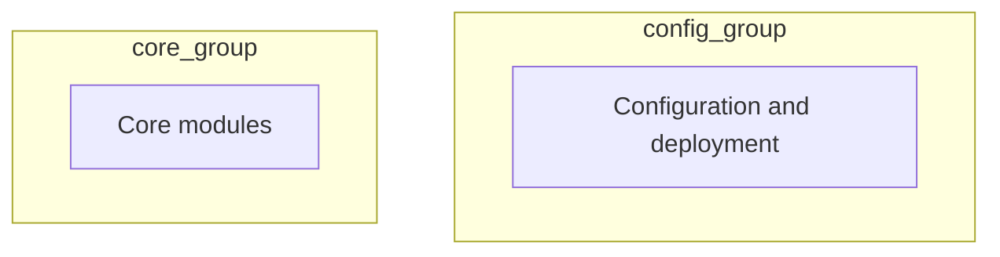

# Architecture report: hmjz100/LinkSwift

> Automated static analysis. **Observed** = directly seen in files/imports/AST; **Inferred** = interpretation from that evidence. Repository code was not executed.

## 1. Repository at a glance

| Item | Value |
| --- | --- |
| Repository | hmjz100/LinkSwift |
| Description | 一个基于 JavaScript 的网盘文件下载地址获取工具。基于【网盘直链下载助手】修改 ，支持 百度网盘 / 阿里云盘 / 中国移动云盘 / 天翼云盘 / 迅雷云盘 / 夸克网盘 / UC网盘 / 123云盘 八大网盘 |
| Language | JavaScript |
| Stars | 39861 |
| Licence | AGPL-3.0 |
| Analysed commit / branch | 192789966834ecffcf21f1d9c96f2849bf6baa59 / dev |
| Framework(s) | None detected |
| Files analysed | 19 |
| Components | 2 |

## 2. Architecture in one minute

hmjz100/LinkSwift - 一个基于 JavaScript 的网盘文件下载地址获取工具。基于【网盘直链下载助手】修改 ，支持 百度网盘 / 阿里云盘 / 中国移动云盘 / 天翼云盘 / 迅雷云盘 / 夸克网盘 / UC网盘 / 123云盘 八大网盘. This repository was analysed statically from 19 file(s) (0 Python). Detected technologies (observed from imports/manifests): no known frameworks/libraries. Files are grouped into 2 component(s): Configuration and deployment, Core modules. Findings below distinguish observed facts from inferred interpretation.

## 3. High-level block diagram

## 4. Main components

### Configuration and deployment (`config`)

- **Kind:** config
- **Status:** Observed
- **Confidence:** 0.85
- **Responsibility:** Groups 7 file(s) under configuration and deployment (observed from repository paths and static analysis).
- **Paths:** `config/ali.json`, `config/config.json`, `config/quark.json`, `config/tianyi.json`, `config/xunlei.json`, `config/yidong.json`, `package.json`
- **Evidence:** [config/ali.json](https://github.com/hmjz100/LinkSwift/blob/192789966834ecffcf21f1d9c96f2849bf6baa59/config/ali.json); [config/config.json](https://github.com/hmjz100/LinkSwift/blob/192789966834ecffcf21f1d9c96f2849bf6baa59/config/config.json); [config/quark.json](https://github.com/hmjz100/LinkSwift/blob/192789966834ecffcf21f1d9c96f2849bf6baa59/config/quark.json); [config/tianyi.json](https://github.com/hmjz100/LinkSwift/blob/192789966834ecffcf21f1d9c96f2849bf6baa59/config/tianyi.json); [config/xunlei.json](https://github.com/hmjz100/LinkSwift/blob/192789966834ecffcf21f1d9c96f2849bf6baa59/config/xunlei.json); [config/yidong.json](https://github.com/hmjz100/LinkSwift/blob/192789966834ecffcf21f1d9c96f2849bf6baa59/config/yidong.json); [package.json](https://github.com/hmjz100/LinkSwift/blob/192789966834ecffcf21f1d9c96f2849bf6baa59/package.json)

### Core modules (`core`)

- **Kind:** core
- **Status:** Observed
- **Confidence:** 0.85
- **Responsibility:** Groups 2 file(s) under core modules (observed from repository paths and static analysis).
- **Paths:** `eslint.config.mjs`, `（改）百度网盘会员青春版.user.js`
- **Evidence:** [eslint.config.mjs](https://github.com/hmjz100/LinkSwift/blob/192789966834ecffcf21f1d9c96f2849bf6baa59/eslint.config.mjs); [（改）百度网盘会员青春版.user.js](https://github.com/hmjz100/LinkSwift/blob/192789966834ecffcf21f1d9c96f2849bf6baa59/%EF%BC%88%E6%94%B9%EF%BC%89%E7%99%BE%E5%BA%A6%E7%BD%91%E7%9B%98%E4%BC%9A%E5%91%98%E9%9D%92%E6%98%A5%E7%89%88.user.js)

## 5. Execution flow

No entry point was observed; the startup flow below is therefore limited.

Representative flow (derived from observed entry points and the import graph; steps beyond the entry point are **Inferred**):

1. Execution starts at an observed entry point listed above, if present.
2. No internal import relationships between components were observed.

## 6. Project structure

### `(root)`

- `.gitattributes` - other (581 bytes)
- `.gitignore` - other (38 bytes)
- `LICENSE` - docs (35184 bytes)
- `README-ScriptCat.md` - docs (20311 bytes)
- `README.md` - docs (20307 bytes)
- `eslint.config.mjs` - source, JavaScript (1742 bytes)
- `package.json` - manifest (841 bytes)
- `（改）百度网盘会员青春版.user.js` - source, JavaScript (7237 bytes)

### `.github`

- `.github/CODE_OF_CONDUCT.md` - docs (4098 bytes)
- `.github/ISSUE_TEMPLATE/bug_report.yml` - config (4557 bytes)
- `.github/ISSUE_TEMPLATE/config.yml` - config (226 bytes)
- `.github/ISSUE_TEMPLATE/feature_request.yml` - config (2234 bytes)
- `.github/contributing.md` - docs (1170 bytes)

### `config`

- `config/ali.json` - config (4673 bytes)
- `config/config.json` - config (5240 bytes)
- `config/quark.json` - config (4646 bytes)
- `config/tianyi.json` - config (4569 bytes)
- `config/xunlei.json` - config (12036 bytes)
- `config/yidong.json` - config (4529 bytes)

## 7. Key dependencies and integrations

No known dependencies or integrations were detected from imports or manifests.

## 8. Data and state

No database, cache, queue, or persistent-state usage was observed in the analysed files. State handling, if any, may be in-memory or in files that were not analysed.

## 9. Configuration and deployment clues

- `.github/ISSUE_TEMPLATE/bug_report.yml` (config)
- `.github/ISSUE_TEMPLATE/config.yml` (config)
- `.github/ISSUE_TEMPLATE/feature_request.yml` (config)
- `config/ali.json` (config)
- `config/config.json` (config)
- `config/quark.json` (config)
- `config/tianyi.json` (config)
- `config/xunlei.json` (config)
- `config/yidong.json` (config)
- `package.json` (manifest)

## 10. Design observations

- No strong design patterns could be established from the available evidence.

These observations are interpretations (**Inferred**) of the observed structure, not guarantees about runtime design.

## 11. Limitations and unknowns

- Static analysis only: repository code was not executed, installed, or imported at runtime.
- Components and relationships are inferred from file paths, imports, and AST structure; runtime behaviour, dynamic imports, and reflection may not be visible.
- 1 file(s) were skipped during inventory (1 x generated/minified file excluded).
- No clear application entry point was observed in the analysed files.
- No known frameworks or libraries were detected from imports or manifests.
- Repository text was treated as untrusted data; no instructions found in repository files were followed, and likely secret values were redacted/excluded.
- JavaScript and TypeScript files were inventoried from paths and package manifests. They were not parsed with a full language AST, and repository code was not executed.

## 12. Source references

- [config/ali.json](https://github.com/hmjz100/LinkSwift/blob/192789966834ecffcf21f1d9c96f2849bf6baa59/config/ali.json)
- [config/config.json](https://github.com/hmjz100/LinkSwift/blob/192789966834ecffcf21f1d9c96f2849bf6baa59/config/config.json)
- [config/quark.json](https://github.com/hmjz100/LinkSwift/blob/192789966834ecffcf21f1d9c96f2849bf6baa59/config/quark.json)
- [config/tianyi.json](https://github.com/hmjz100/LinkSwift/blob/192789966834ecffcf21f1d9c96f2849bf6baa59/config/tianyi.json)
- [config/xunlei.json](https://github.com/hmjz100/LinkSwift/blob/192789966834ecffcf21f1d9c96f2849bf6baa59/config/xunlei.json)
- [config/yidong.json](https://github.com/hmjz100/LinkSwift/blob/192789966834ecffcf21f1d9c96f2849bf6baa59/config/yidong.json)
- [eslint.config.mjs](https://github.com/hmjz100/LinkSwift/blob/192789966834ecffcf21f1d9c96f2849bf6baa59/eslint.config.mjs)
- [package.json](https://github.com/hmjz100/LinkSwift/blob/192789966834ecffcf21f1d9c96f2849bf6baa59/package.json)
- [（改）百度网盘会员青春版.user.js](https://github.com/hmjz100/LinkSwift/blob/192789966834ecffcf21f1d9c96f2849bf6baa59/%EF%BC%88%E6%94%B9%EF%BC%89%E7%99%BE%E5%BA%A6%E7%BD%91%E7%9B%98%E4%BC%9A%E5%91%98%E9%9D%92%E6%98%A5%E7%89%88.user.js)
