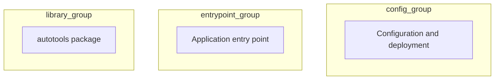

# Architecture report: horsicq/Detect-It-Easy

> Automated static analysis. **Observed** = directly seen in files/imports/AST; **Inferred** = interpretation from that evidence. Repository code was not executed.

## 1. Repository at a glance

| Item | Value |
| --- | --- |
| Repository | horsicq/Detect-It-Easy |
| Description | Program for determining types of files for Windows, Linux and MacOS. |
| Language | JavaScript |
| Stars | 11950 |
| Licence | MIT |
| Analysed commit / branch | ed70c31e6a5e9655d1d94e717b9378ecc8019fed / master |
| Framework(s) | None detected |
| Files analysed | 447 |
| Components | 3 |

## 2. Architecture in one minute

horsicq/Detect-It-Easy - Program for determining types of files for Windows, Linux and MacOS.. This repository was analysed statically from 447 file(s) (1 Python). Detected technologies (observed from imports/manifests): GitHub Actions, Docker. Files are grouped into 3 component(s): autotools package, Configuration and deployment, Application entry point. Observed entry point(s): autotools/dbupdater/task.py. Findings below distinguish observed facts from inferred interpretation.

## 3. High-level block diagram

## 4. Main components

### autotools package (`autotools`)

- **Kind:** library
- **Status:** Observed
- **Confidence:** 0.85
- **Responsibility:** Groups 3 file(s) under autotools package (observed from repository paths and static analysis).
- **Paths:** `autotools/dbcompiler/node_modules_clean.sh`, `autotools/dbcompiler/task.js`, `autotools/dbcompiler/worker.js`
- **Evidence:** [autotools/dbcompiler/node_modules_clean.sh](https://github.com/horsicq/Detect-It-Easy/blob/ed70c31e6a5e9655d1d94e717b9378ecc8019fed/autotools/dbcompiler/node_modules_clean.sh); [autotools/dbcompiler/task.js](https://github.com/horsicq/Detect-It-Easy/blob/ed70c31e6a5e9655d1d94e717b9378ecc8019fed/autotools/dbcompiler/task.js); [autotools/dbcompiler/worker.js](https://github.com/horsicq/Detect-It-Easy/blob/ed70c31e6a5e9655d1d94e717b9378ecc8019fed/autotools/dbcompiler/worker.js)

### Configuration and deployment (`config`)

- **Kind:** config
- **Status:** Observed
- **Confidence:** 0.85
- **Responsibility:** Groups 3 file(s) under configuration and deployment (observed from repository paths and static analysis).
- **Paths:** `Dockerfile`, `autotools/dbcompiler/package.json`, `db/.vscode/settings.json`
- **Evidence:** [Dockerfile](https://github.com/horsicq/Detect-It-Easy/blob/ed70c31e6a5e9655d1d94e717b9378ecc8019fed/Dockerfile); [autotools/dbcompiler/package.json](https://github.com/horsicq/Detect-It-Easy/blob/ed70c31e6a5e9655d1d94e717b9378ecc8019fed/autotools/dbcompiler/package.json); [db/.vscode/settings.json](https://github.com/horsicq/Detect-It-Easy/blob/ed70c31e6a5e9655d1d94e717b9378ecc8019fed/db/.vscode/settings.json)

### Application entry point (`entrypoint`)

- **Kind:** entrypoint
- **Status:** Observed
- **Confidence:** 0.85
- **Responsibility:** Groups 1 file(s) under application entry point (observed from repository paths and static analysis). Observed top-level functions: count_signatures.
- **Paths:** `autotools/dbupdater/task.py`
- **Evidence:** [autotools/dbupdater/task.py:4](https://github.com/horsicq/Detect-It-Easy/blob/ed70c31e6a5e9655d1d94e717b9378ecc8019fed/autotools/dbupdater/task.py#L4)

## 5. Execution flow

**Observed** entry point(s):

- [autotools/dbcompiler/task.js](https://github.com/horsicq/Detect-It-Easy/blob/ed70c31e6a5e9655d1d94e717b9378ecc8019fed/autotools/dbcompiler/task.js)
- [autotools/dbupdater/task.py:30](https://github.com/horsicq/Detect-It-Easy/blob/ed70c31e6a5e9655d1d94e717b9378ecc8019fed/autotools/dbupdater/task.py#L30)

Representative flow (derived from observed entry points and the import graph; steps beyond the entry point are **Inferred**):

1. Execution starts at an observed entry point listed above, if present.
2. No internal import relationships between components were observed.

## 6. Project structure

### `(root)`

- `.gitattributes` - other (52 bytes)
- `.gitignore` - other (45 bytes)
- `.prettierrc` - other (205 bytes)
- `CODE-FORMATTING.md` - docs (19380 bytes)
- `CONTRIBUTING.md` - docs (6600 bytes)
- `Dockerfile` - container (495 bytes)
- `LICENSE` - docs (1085 bytes)
- `README.md` - docs (30837 bytes)
- `changelog.txt` - docs (16316 bytes)

### `.github`

- `.github/FUNDING.yml` - config (63 bytes)
- `.github/workflows/create_beta.yml` - ci, YAML (1284 bytes)
- `.github/workflows/db-release.yml` - ci, YAML (1485 bytes)
- `.github/workflows/format-js.yml` - ci, YAML (2880 bytes)
- `.github/workflows/update_db.yml` - ci, YAML (3592 bytes)

### `autotools`

- `autotools/dbcompiler/node_licenses/LICENSE.archiver-utils.txt` - docs (1060 bytes)
- `autotools/dbcompiler/node_licenses/LICENSE.archiver.txt` - docs (1079 bytes)
- `autotools/dbcompiler/node_licenses/LICENSE.async.txt` - docs (1063 bytes)
- `autotools/dbcompiler/node_licenses/LICENSE.balanced-match.txt` - docs (1096 bytes)
- `autotools/dbcompiler/node_licenses/LICENSE.base64-js.txt` - docs (1081 bytes)
- `autotools/dbcompiler/node_licenses/LICENSE.bl.txt` - docs (1216 bytes)
- `autotools/dbcompiler/node_licenses/LICENSE.brace-expansion.txt` - docs (1096 bytes)
- `autotools/dbcompiler/node_licenses/LICENSE.buffer-crc32.txt` - docs (1085 bytes)
- `autotools/dbcompiler/node_licenses/LICENSE.buffer.txt` - docs (1106 bytes)
- `autotools/dbcompiler/node_licenses/LICENSE.compress-commons.txt` - docs (1074 bytes)
- `autotools/dbcompiler/node_licenses/LICENSE.concat-map.txt` - docs (1073 bytes)
- `autotools/dbcompiler/node_licenses/LICENSE.core-util-is.txt` - docs (1077 bytes)
- `autotools/dbcompiler/node_licenses/LICENSE.crc-32.txt` - docs (11355 bytes)
- `autotools/dbcompiler/node_licenses/LICENSE.crc32-stream.txt` - docs (1074 bytes)
- `autotools/dbcompiler/node_licenses/LICENSE.end-of-stream.txt` - docs (1078 bytes)
- `autotools/dbcompiler/node_licenses/LICENSE.fs-constants.txt` - docs (1079 bytes)
- `autotools/dbcompiler/node_licenses/LICENSE.fs.realpath.txt` - docs (2125 bytes)
- `autotools/dbcompiler/node_licenses/LICENSE.glob.txt` - docs (976 bytes)
- `autotools/dbcompiler/node_licenses/LICENSE.graceful-fs.txt` - docs (791 bytes)
- `autotools/dbcompiler/node_licenses/LICENSE.ieee754.txt` - docs (1465 bytes)
- `autotools/dbcompiler/node_licenses/LICENSE.inflight.txt` - docs (748 bytes)
- `autotools/dbcompiler/node_licenses/LICENSE.inherits.txt` - docs (749 bytes)
- `autotools/dbcompiler/node_licenses/LICENSE.lazystream.txt` - docs (1074 bytes)
- `autotools/dbcompiler/node_licenses/LICENSE.lodash.defaults.txt` - docs (1951 bytes)
- `autotools/dbcompiler/node_licenses/LICENSE.lodash.difference.txt` - docs (1951 bytes)
- `autotools/dbcompiler/node_licenses/LICENSE.lodash.flatten.txt` - docs (1951 bytes)
- `autotools/dbcompiler/node_licenses/LICENSE.lodash.isplainobject.txt` - docs (1951 bytes)
- `autotools/dbcompiler/node_licenses/LICENSE.lodash.union.txt` - docs (1951 bytes)
- `autotools/dbcompiler/node_licenses/LICENSE.minimatch.txt` - docs (775 bytes)
- `autotools/dbcompiler/node_licenses/LICENSE.normalize-path.txt` - docs (1088 bytes)
- `autotools/dbcompiler/node_licenses/LICENSE.once.txt` - docs (765 bytes)
- `autotools/dbcompiler/node_licenses/LICENSE.path-is-absolute.txt` - docs (1119 bytes)
- `autotools/dbcompiler/node_licenses/LICENSE.process-nextick-args.txt` - docs (1064 bytes)
- `autotools/dbcompiler/node_licenses/LICENSE.readable-stream.txt` - docs (2337 bytes)
- `autotools/dbcompiler/node_licenses/LICENSE.readdir-glob.txt` - docs (11341 bytes)
- `autotools/dbcompiler/node_licenses/LICENSE.safe-buffer.txt` - docs (1081 bytes)
- `autotools/dbcompiler/node_licenses/LICENSE.string_decoder.txt` - docs (2338 bytes)
- `autotools/dbcompiler/node_licenses/LICENSE.tar-stream.txt` - docs (1078 bytes)
- `autotools/dbcompiler/node_licenses/LICENSE.util-deprecate.txt` - docs (1102 bytes)
- `autotools/dbcompiler/node_licenses/LICENSE.wrappy.txt` - docs (765 bytes)
- `autotools/dbcompiler/node_licenses/LICENSE.zip-stream.txt` - docs (1074 bytes)
- `autotools/dbcompiler/node_modules_clean.cmd` - other (468 bytes)
- `autotools/dbcompiler/node_modules_clean.sh` - source, Shell (522 bytes)
- `autotools/dbcompiler/package.json` - manifest (188 bytes)
- `autotools/dbcompiler/task.js` - source, JavaScript (14912 bytes)
- `autotools/dbcompiler/worker.js` - source, JavaScript (28007 bytes)
- `autotools/dbupdater/task.py` - source, Python (1112 bytes)
- `autotools/partner/CONFIG` - other (302 bytes)

### `db`

- `db/.vscode/about.txt` - docs (130 bytes)
- `db/.vscode/settings.json` - config (66 bytes)
- `db/ACE` - other (1528 bytes)
- `db/APK/_APK.0.sg` - other (385 bytes)
- `db/APK/_init` - other (675 bytes)
- `db/APK/library_IL2CPP.4.sg` - other (313 bytes)
- `db/APK/library_SandHook.4.sg` - other (532 bytes)
- `db/APK/library_UnicomSDK.4.sg` - other (878 bytes)
- `db/APK/library_Unity.4.sg` - other (292 bytes)
- `db/APK/package_PackageName.1.sg` - other (364 bytes)
- `db/APK/packer_Kony.2.sg` - other (277 bytes)
- `db/APK/protector_APKProtect.2.sg` - other (446 bytes)
- `db/APK/protector_APKProtector.2.sg` - other (813 bytes)
- `db/APK/protector_AlibabaProtection.2.sg` - other (446 bytes)
- `db/APK/protector_AndroidRepublic.2.sg` - other (514 bytes)
- `db/APK/protector_AppGuard.2.sg` - other (571 bytes)
- `db/APK/protector_AppSolid.2.sg` - other (296 bytes)
- `db/APK/protector_BaiduProtection.2.sg` - other (664 bytes)
- `db/APK/protector_BangBangReinforcement.2.sg` - other (1147 bytes)
- `db/APK/protector_BangcleProtection.2.sg` - other (373 bytes)
- `db/APK/protector_DXShield.2.sg` - other (294 bytes)
- `db/APK/protector_DexProtector.2.sg` - other (977 bytes)
- `db/APK/protector_DingXiangReinforcement.2.sg` - other (388 bytes)
- `db/APK/protector_EasyShield.2.sg` - other (703 bytes)
- `db/APK/protector_ExTrus_AppDefence.2.sg` - other (351 bytes)
- `db/APK/protector_Gemalto.2.sg` - other (680 bytes)
- `db/APK/protector_Hdus-Wjus.2.sg` - other (365 bytes)
- `db/APK/protector_Ijiami.2.sg` - other (1048 bytes)
- `db/APK/protector_Jiagu.2.sg` - other (548 bytes)
- `db/APK/protector_Kiro.2.sg` - other (290 bytes)
- `db/APK/protector_Kiwi.2.sg` - other (937 bytes)
- `db/APK/protector_LIAPP.2.sg` - other (487 bytes)
- `db/APK/protector_MedusaH.2.sg` - other (293 bytes)
- `db/APK/protector_MobileTencentProtect.2.sg` - other (374 bytes)
- `db/APK/protector_NQShield.2.sg` - other (425 bytes)
- `db/APK/protector_NagaPTProtection.2.sg` - other (372 bytes)
- `db/APK/protector_OLLVM-TTL.2.sg` - other (375 bytes)
- `db/APK/protector_Obfuscapk.2.sg` - other (414 bytes)
- `db/APK/protector_PangXie.2.sg` - other (373 bytes)
- `db/APK/protector_ProGuard.2.sg` - other (312 bytes)
- `db/APK/protector_QDBH.2.sg` - other (277 bytes)
- `db/APK/protector_Qihoo360Protection.2.sg` - other (462 bytes)
- `db/APK/protector_SecNeo.2.sg` - other (740 bytes)
- `db/APK/protector_SecShell.2.sg` - other (437 bytes)
- `db/APK/protector_TPRT.2.sg` - other (2324 bytes)
- `db/APK/protector_TencentLegu.2.sg` - other (652 bytes)
- `db/APK/protector_TencentProtection.2.sg` - other (358 bytes)
- `db/APK/protector_TencentSecurity.2.sg` - other (511 bytes)
- `db/APK/protector_TongfuShield.2.sg` - other (744 bytes)
- `db/APK/protector_VDog.2.sg` - other (508 bytes)
- `db/APK/protector_Virbox.2.sg` - other (536 bytes)
- `db/APK/protector_Yidun.2.sg` - other (495 bytes)
- `db/APK/protector_build38.2.sg` - other (350 bytes)
- `db/APK/protector_iCrypt.2.sg` - other (935 bytes)
- `db/APK/tool_ApktoolPlus.6.sg` - other (307 bytes)
- `db/APK/tool_SingleJar.3.sg` - other (229 bytes)
- `db/Amiga/_Amiga.0.sg` - other (393 bytes)
- `db/Amiga/_init` - other (146 bytes)
- `db/Amiga/compiler_ABasic.4.sg` - other (699 bytes)
- `db/Amiga/compiler_AMOS_Basic.4.sg` - other (531 bytes)
- `db/Amiga/compiler_Absoft_AC_Basic.4.sg` - other (299 bytes)
- `db/Amiga/compiler_Absoft_Fortran.4.sg` - other (346 bytes)
- `db/Amiga/compiler_AmigaBasic.4.sg` - other (347 bytes)
- `db/Amiga/compiler_Amiga_E.4.sg` - other (664 bytes)
- `db/Amiga/compiler_Aztec_C.4.sg` - other (1447 bytes)
- `db/Amiga/compiler_Blitz_BASIC.4.sg` - other (303 bytes)
- `db/Amiga/compiler_DICE_C.4.sg` - other (308 bytes)
- `db/Amiga/compiler_Free_Pascal.4.sg` - other (484 bytes)
- `db/Amiga/compiler_GFA-Basic.4.sg` - other (2210 bytes)
- `db/Amiga/compiler_GNU_C.4.sg` - other (1931 bytes)
- `db/Amiga/compiler_HiSoft_Basic.4.sg` - other (513 bytes)
- `db/Amiga/compiler_JForth.4.sg` - other (961 bytes)
- `db/Amiga/compiler_Lattice_C.4.sg` - other (979 bytes)
- `db/Amiga/compiler_Maxon_C++.4.sg` - other (271 bytes)
- `db/Amiga/compiler_Multi-Forth.4.sg` - other (517 bytes)
- `db/Amiga/compiler_Oberon-A.4.sg` - other (763 bytes)
- `db/Amiga/compiler_PureBasic.4.sg` - other (471 bytes)
- `db/Amiga/compiler_Storm_C.4.sg` - other (398 bytes)
- `db/Amiga/compiler_VBCC.4.sg` - other (412 bytes)
- `db/Amiga/cruncher_AMOS_Compiler_Cruncher.1.sg` - other (290 bytes)
- `db/Amiga/cruncher_AddressHead.1.sg` - other (269 bytes)
- `db/Amiga/cruncher_BHC3_Relocatable.1.sg` - other (278 bytes)
- `db/Amiga/cruncher_ByteKiller.1.sg` - other (1210 bytes)
- `db/Amiga/cruncher_ByteKiller_Clone.1.sg` - other (750 bytes)
- `db/Amiga/cruncher_Chryseis_Cruncher.1.sg` - other (297 bytes)
- `db/Amiga/cruncher_CopyCat.1.sg` - other (304 bytes)
- `db/Amiga/cruncher_Cranker.1.sg` - other (269 bytes)
- `db/Amiga/cruncher_Crunch-Mania.1.sg` - other (2933 bytes)
- `db/Amiga/cruncher_Crunch-O-Matic.1.sg` - other (480 bytes)
- `db/Amiga/cruncher_Crunch.1.sg` - other (275 bytes)
- `db/Amiga/cruncher_Crunch_Master.1.sg` - other (301 bytes)
- `db/Amiga/cruncher_CrunchyDat.1.sg` - other (254 bytes)
- `db/Amiga/cruncher_Defjam.1.sg` - other (1295 bytes)
- `db/Amiga/cruncher_Deluxe_Cruncher.1.sg` - other (299 bytes)
- `db/Amiga/cruncher_DoubleAction.1.sg` - other (528 bytes)
- `db/Amiga/cruncher_DragPack.1.sg` - other (419 bytes)
- `db/Amiga/cruncher_FileShield.1.sg` - other (266 bytes)
- `db/Amiga/cruncher_FlashSpeed.1.sg` - other (292 bytes)
- `db/Amiga/cruncher_GnuPacker.1.sg` - other (327 bytes)
- `db/Amiga/cruncher_HQC_Cruncher.1.sg` - other (332 bytes)
- `db/Amiga/cruncher_High_Pressure_Cruncher.1.sg` - other (284 bytes)
- `db/Amiga/cruncher_House.1.sg` - other (326 bytes)
- `db/Amiga/cruncher_ISC.1.sg` - other (1172 bytes)
- `db/Amiga/cruncher_Imploder.1.sg` - other (1354 bytes)
- `db/Amiga/cruncher_Jan_Heweliusz_Cruncher.1.sg` - other (306 bytes)
- `db/Amiga/cruncher_MOPacker.1.sg` - other (292 bytes)
- `db/Amiga/cruncher_Master_Cruncher.1.sg` - other (485 bytes)
- `db/Amiga/cruncher_MaxPacker.1.sg` - other (301 bytes)
- `db/Amiga/cruncher_MegaCruncher.1.sg` - other (446 bytes)
- `db/Amiga/cruncher_PackIt.1.sg` - other (290 bytes)
- `db/Amiga/cruncher_Pak.1.sg` - other (283 bytes)
- `db/Amiga/cruncher_PowerPacker.1.sg` - other (1963 bytes)
- `db/Amiga/cruncher_ProPack.1.sg` - other (445 bytes)
- `db/Amiga/cruncher_ReXXMaSHeR.1.sg` - other (285 bytes)
- `db/Amiga/cruncher_Relokit.1.sg` - other (295 bytes)
- `db/Amiga/cruncher_RexxMasher_(jrms).1.sg` - other (705 bytes)
- `db/Amiga/cruncher_S-Exec.1.sg` - other (324 bytes)
- `db/Amiga/cruncher_Shrinkler.1.sg` - other (814 bytes)
- `db/Amiga/cruncher_Sound-Tracker_Cruncher.1.sg` - other (318 bytes)
- `db/Amiga/cruncher_Spike.1.sg` - other (273 bytes)
- `db/Amiga/cruncher_StoneCracker.1.sg` - other (2505 bytes)
- `db/Amiga/cruncher_Super-Cruncher.1.sg` - other (304 bytes)
- `db/Amiga/cruncher_SyncroPacker.1.sg` - other (446 bytes)
- `db/Amiga/cruncher_TNM_Cruncher.1.sg` - other (492 bytes)
- `db/Amiga/cruncher_TSK_Cruncher.1.sg` - other (278 bytes)
- `db/Amiga/cruncher_TUC.1.sg` - other (483 bytes)
- `db/Amiga/cruncher_TetraCrunch.1.sg` - other (310 bytes)
- `db/Amiga/cruncher_TetraPack.1.sg` - other (825 bytes)
- `db/Amiga/cruncher_Time_Cruncher.1.sg` - other (488 bytes)
- `db/Amiga/cruncher_Titanics_Cruncher.1.sg` - other (445 bytes)
- `db/Amiga/cruncher_TryIt.1.sg` - other (855 bytes)
- `db/Amiga/cruncher_TurboSqueezer.1.sg` - other (425 bytes)
- `db/Amiga/cruncher_Turtle_Smasher.1.sg` - other (454 bytes)
- `db/Amiga/cruncher_Ultimate_Packer.1.sg` - other (307 bytes)
- `db/Amiga/cruncher_xpkmaster.1.sg` - other (267 bytes)
- `db/Amiga/font_Amiga_font.1.sg` - other (248 bytes)
- `db/Amiga/joiner_ETA.1.sg` - other (462 bytes)
- `db/Amiga/joiner_EXP.1.sg` - other (352 bytes)
- `db/Amiga/joiner_Glue.1.sg` - other (350 bytes)
- `db/Amiga/library_library.1.sg` - other (236 bytes)
- `db/Amiga/module_DeliTracker.1.sg` - other (373 bytes)
- `db/Amiga/other_other.1.sg` - other (385 bytes)
- `db/Amiga/self-displayer_DPS.1.sg` - other (352 bytes)
- `db/Amiga/self-displayer_Iff2ex.1.sg` - other (367 bytes)
- `db/Amiga/self-displayer_S-Anim.1.sg` - other (334 bytes)
- `db/Amiga/self-displayer_S-Pic.1.sg` - other (333 bytes)
- `db/Amiga/sfx_BPack_SFX.1.sg` - other (266 bytes)
- `db/Amiga/sfx_DIMP.1.sg` - other (300 bytes)
- `db/Amiga/sfx_DMSSFX.1.sg` - other (284 bytes)
- `db/Amiga/sfx_DMS_FMS-Masher.1.sg` - other (294 bytes)
- `db/Amiga/sfx_LHASFX.1.sg` - other (263 bytes)
- `db/Amiga/sfx_LHSFX.1.sg` - other (329 bytes)
- `db/Amiga/sfx_LhPak_SFX.1.sg` - other (300 bytes)
- `db/Amiga/tool_EFFECT-loader.1.sg` - other (309 bytes)
- `db/Amiga/tool_VideoTracker.1.sg` - other (313 bytes)
- `db/Archive/_Archive.0.sg` - other (421 bytes)
- `db/Archive/_init` - other (150 bytes)
- `db/AtariST/_AtariST.0.sg` - other (402 bytes)
- `db/AtariST/_init` - other (150 bytes)
- `db/Binary/Certificate_cert.WinAuth.1.sg` - other (302 bytes)
- `db/Binary/ROM_1.sg` - other (92952 bytes)
- `db/Binary/__MiniBatchHeuristic_By_DosX.7.sg` - other (1403 bytes)
- `db/Binary/__MiniExtensionsHeuristic_By_DosX.7.sg` - other (21952 bytes)
- `db/Binary/__MiniJavaScriptHeuristic_By_DosX.7.sg` - other (978 bytes)
- `db/Binary/__MiniVsProjMalwareHeuristic_by_DosX.7.sg` - other (4226 bytes)
- `db/Binary/_init` - other (367 bytes)
- `db/Binary/archive_7z.1.sg` - other (359 bytes)
- `db/Binary/archive_ACE.1.sg` - other (169 bytes)
- `db/Binary/archive_ANC-Cruncher.1.sg` - other (382 bytes)
- `db/Binary/archive_AR.1.sg` - other (2440 bytes)
- `db/Binary/archive_ARC.1.sg` - other (285 bytes)
- `db/Binary/archive_ARCV4.1.sg` - other (347 bytes)
- `db/Binary/archive_ARJ.1.sg` - other (164 bytes)
- `db/Binary/archive_ASAR.1.sg` - other (455 bytes)
- `db/Binary/archive_ASD.1.sg` - other (353 bytes)
- `db/Binary/archive_Apple_Hardware_Test_LOC.1.sg` - other (625 bytes)
- `db/Binary/archive_Audials_CMP.1.sg` - other (488 bytes)
- `db/Binary/archive_BCSAR.1.sg` - other (797 bytes)
- `db/Binary/archive_BZip.1.sg` - other (741 bytes)
- `db/Binary/archive_Birdies.1.sg` - other (418 bytes)
- `db/Binary/archive_Build_GRP.1.sg` - other (577 bytes)
- `db/Binary/archive_CCA.1.sg` - other (294 bytes)
- `db/Binary/archive_CFL3.1.sg` - other (776 bytes)
- `db/Binary/archive_CKP.1.sg` - other (324 bytes)
- `db/Binary/archive_CMP_container.1.sg` - other (856 bytes)
- `db/Binary/archive_CPX.1.sg` - other (429 bytes)
- `db/Binary/archive_CSQ.1.sg` - other (353 bytes)
- `db/Binary/archive_Cab.1.sg` - other (686 bytes)
- `db/Binary/archive_CodeBase_FLD.1.sg` - other (1220 bytes)
- `db/Binary/archive_DAA.1.sg` - other (391 bytes)
- `db/Binary/archive_DCP.1.sg` - other (467 bytes)
- `db/Binary/archive_DEFLATE.1.sg` - other (7183 bytes)
- `db/Binary/archive_DXA.1.sg` - other (2531 bytes)
- `db/Binary/archive_DatPack.1.sg` - other (307 bytes)
- `db/Binary/archive_DiskDoubler_DDAR.1.sg` - other (828 bytes)
- `db/Binary/archive_DotBundle.sg` - other (286 bytes)
- `db/Binary/archive_EA_container.1.sg` - other (453 bytes)
- `db/Binary/archive_EID.1.sg` - other (1034 bytes)
- `db/Binary/archive_ELM_theme.1.sg` - other (542 bytes)
- `db/Binary/archive_EdgeDataPak.1.sg` - other (402 bytes)
- `db/Binary/archive_FPAK.1.sg` - other (469 bytes)
- `db/Binary/archive_Flatpak.1.sg` - other (444 bytes)
- `db/Binary/archive_FoxSQZ.1.sg` - other (326 bytes)
- `db/Binary/archive_GameResources.1.sg` - other (13107 bytes)
- `db/Binary/archive_GhidraZipFile.1.sg` - other (373 bytes)
- `db/Binary/archive_GodotPCK.1.sg` - other (319 bytes)
- `db/Binary/archive_HA.1.sg` - other (869 bytes)
- `db/Binary/archive_HIP.1.sg` - other (537 bytes)
- `db/Binary/archive_IBM_SaveRam_FLS.1.sg` - other (722 bytes)
- `db/Binary/archive_IFP.1.sg` - other (471 bytes)
- `db/Binary/archive_INTEDU.1.sg` - other (376 bytes)
- `db/Binary/archive_IPW.1.sg` - other (278 bytes)
- `db/Binary/archive_InnoSetup.1.sg` - other (291 bytes)
- `db/Binary/archive_InstallShield_OBL.1.sg` - other (606 bytes)
- `db/Binary/archive_InstallerData.1.sg` - other (12790 bytes)
- `db/Binary/archive_JAM.1.sg` - other (280 bytes)
- `db/Binary/archive_KiriKiri_XP3.1.sg` - other (369 bytes)
- `db/Binary/archive_LAB.1.sg` - other (305 bytes)
- `db/Binary/archive_LDS.1.sg` - other (367 bytes)
- `db/Binary/archive_LIF_KD.1.sg` - other (1174 bytes)
- `db/Binary/archive_LRZ.1.sg` - other (1106 bytes)
- `db/Binary/archive_LZ4.1.sg` - other (1291 bytes)
- `db/Binary/archive_LZOP.1.sg` - other (285 bytes)
- `db/Binary/archive_LingvoArc.1.sg` - other (659 bytes)
- `db/Binary/archive_MCS.1.sg` - other (428 bytes)
- `db/Binary/archive_MLB.1.sg` - other (819 bytes)
- `db/Binary/archive_MS-WIM.1.sg` - other (1086 bytes)
- `db/Binary/archive_MS_Compound.1.sg` - other (1741 bytes)
- `db/Binary/archive_MWD.1.sg` - other (646 bytes)
- `db/Binary/archive_NID.1.sg` - other (306 bytes)
- `db/Binary/archive_NetWare_Packed.1.sg` - other (447 bytes)
- `db/Binary/archive_OSL2000.1.sg` - other (1172 bytes)
- `db/Binary/archive_P2L.1.sg` - other (450 bytes)
- `db/Binary/archive_PAK.1.sg` - other (1254 bytes)
- `db/Binary/archive_PBO.1.sg` - other (3225 bytes)
- `db/Binary/archive_PBP.1.sg` - other (424 bytes)
- `db/Binary/archive_PC_Secure.sg` - other (252 bytes)
- `db/Binary/archive_PEA.1.sg` - other (1403 bytes)
- `db/Binary/archive_PKG.1.sg` - other (507 bytes)
- `db/Binary/archive_PPMd.1.sg` - other (1160 bytes)
- `db/Binary/archive_PSARC.1.sg` - other (802 bytes)
- `db/Binary/archive_PUP.1.sg` - other (465 bytes)
- `db/Binary/archive_PackageForTheWeb_PKG.1.sg` - other (2998 bytes)
- `db/Binary/archive_Phar.1.sg` - other (4883 bytes)
- `db/Binary/archive_Quantum.1.sg` - other (778 bytes)
- `db/Binary/archive_RAR.1.sg` - other (169 bytes)
- `db/Binary/archive_RDC.1.sg` - other (3190 bytes)
- `db/Binary/archive_RDFZ.1.sg` - other (417 bytes)
- `db/Binary/archive_RED_KDC.1.sg` - other (721 bytes)
- `db/Binary/archive_RTPatch.1.sg` - other (676 bytes)
- `db/Binary/archive_RVZ.1.sg` - other (490 bytes)
- `db/Binary/archive_SEAARC.1.sg` - other (3195 bytes)
- `db/Binary/archive_STK.1.sg` - other (778 bytes)
- `db/Binary/archive_Shaped.1.sg` - other (452 bytes)
- `db/Binary/archive_SpearOfDestiny_installer.1.sg` - other (1212 bytes)
- `db/Binary/archive_TRE.1.sg` - other (285 bytes)
- `db/Binary/archive_TitanQuest_ARC.1.sg` - other (548 bytes)
- `db/Binary/archive_Unity.1.sg` - other (2964 bytes)
- `db/Binary/archive_UnrealEngine.1.sg` - other (1069 bytes)
- `db/Binary/archive_ViseInstaller.1.sg` - other (308 bytes)
- `db/Binary/archive_XZP.1.sg` - other (317 bytes)
- `db/Binary/archive_ZIP.1.sg` - other (174 bytes)
- `db/Binary/archive_ZLIB.1.sg` - other (233 bytes)
- `db/Binary/archive_ZPAQ.1.sg` - other (320 bytes)
- `db/Binary/archive_archives.1.sg` - other (20616 bytes)
- `db/Binary/archive_archives.ancient.sg` - other (23054 bytes)
- `db/Binary/archive_btoa.1.sg` - other (250 bytes)
- `db/Binary/archive_cPoint_installer.1.sg` - other (850 bytes)
- `db/Binary/archive_cad.DWG.1.sg` - other (1242 bytes)
- `db/Binary/archive_gp7bank.1.sg` - other (508 bytes)
- `db/Binary/archive_streams_legacy.1.sg` - other (8905 bytes)
- `db/Binary/audio.AIFF.1.sg` - other (2111 bytes)
- `db/Binary/audio_8svx.1.sg` - other (394 bytes)
- `db/Binary/audio_ACM.1.sg` - other (720 bytes)
- `db/Binary/audio_ADX.1.sg` - other (1277 bytes)
- `db/Binary/audio_AHX.1.sg` - other (1028 bytes)
- `db/Binary/audio_AU.1.sg` - other (2441 bytes)
- `db/Binary/audio_BCSTM.1.sg` - other (987 bytes)
- `db/Binary/audio_BCWAV.1.sg` - other (1151 bytes)
- `db/Binary/audio_CXT.1.sg` - other (1521 bytes)
- `db/Binary/audio_DSS.1.sg` - other (2537 bytes)
- `db/Binary/audio_EXA.1.sg` - other (6373 bytes)
- `db/Binary/audio_FLAC.1.sg` - other (4752 bytes)
- `db/Binary/audio_FSB.1.sg` - other (4027 bytes)
- `db/Binary/audio_HMI.1.sg` - other (429 bytes)
- `db/Binary/audio_OGG.1.sg` - other (285 bytes)
- `db/Binary/audio_PAF.1.sg` - other (325 bytes)
- `db/Binary/audio_PVF.1.sg` - other (448 bytes)
- `db/Binary/audio_RIFF-IMA.1.sg` - other (720 bytes)
- `db/Binary/audio_SOU.1.sg` - other (317 bytes)
- `db/Binary/audio_STRM.1.sg` - other (1023 bytes)
- `db/Binary/audio_STRM.2.sg` - other (919 bytes)
- `db/Binary/audio_ShockwaveAudio.1.sg` - other (300 bytes)
- `db/Binary/audio_TUN.1.sg` - other (441 bytes)
- `db/Binary/audio_VOC.1.sg` - other (3957 bytes)
- `db/Binary/audio_WAV.1.sg` - other (22411 bytes)
- `db/Binary/audio_WEM.1.sg` - other (5127 bytes)
- `db/Binary/audio_mp3.2.sg` - other (6115 bytes)
- `db/Binary/backup_images.1.sg` - other (683 bytes)
- `db/Binary/bin.Atari_ST.1.sg` - other (254 bytes)
- `db/Binary/bin.IDA.1.sg` - other (2653 bytes)
- `db/Binary/bin.ISO_9660.1.sg` - other (382 bytes)
- `db/Binary/bin.RPGMaker2Kdata.1.sg` - other (13143 bytes)
- `db/Binary/data_overlay_null_padding.1.sg` - other (527 bytes)
- `db/Binary/data_overlays.6.sg` - other (17606 bytes)
- `db/Binary/debug_data_debugData.1.sg` - other (2465 bytes)
- `db/Binary/filesystem_APFS.1.sg` - other (1100 bytes)
- `db/Binary/filesystem_BtrfsSend.1.sg` - other (1019 bytes)
- `db/Binary/filesystem_JFFS2.1.sg` - other (1016 bytes)
- `db/Binary/filesystem_Minix.1.sg` - other (2331 bytes)
- `db/Binary/filesystem_ROMFS.1.sg` - other (941 bytes)
- `db/Binary/filesystem_SquashFS.1.sg` - other (2018 bytes)
- `db/Binary/firmware_DLinkFPKG.1.sg` - other (946 bytes)
- `db/Binary/firmware_NetGear.1.sg` - other (327 bytes)
- `db/Binary/firmware_QNAP.1.sg` - other (826 bytes)
- `db/Binary/firmware_Xiaomi.1.sg` - other (1221 bytes)
- `db/Binary/firmware_zbeos.1.sg` - other (454 bytes)
- `db/Binary/font.ADOBE.1.sg` - other (1221 bytes)
- `db/Binary/font_BMF.1.sg` - other (2479 bytes)
- `db/Binary/font_FFN.1.sg` - other (284 bytes)
- `db/Binary/font_TFM.1.sg` - other (296 bytes)
- `db/Binary/font_VTF.1.sg` - other (181 bytes)
- `db/Binary/font_XTT.1.sg` - other (444 bytes)
- `db/Binary/format_2IMG.1.sg` - other (1232 bytes)
- `db/Binary/format_AS.1.sg` - other (366 bytes)
- `db/Binary/format_AmigaIcon.1.sg` - other (3913 bytes)
- `db/Binary/format_Amiga_loadable.1.sg` - other (413 bytes)
- `db/Binary/format_BCD1.1.sg` - other (762 bytes)
- `db/Binary/format_BOU.1.sg` - other (445 bytes)
- `db/Binary/format_BSP.1.sg` - other (274 bytes)
- `db/Binary/format_BTF.1.sg` - other (239 bytes)
- `db/Binary/format_BackupMii.1.sg` - other (635 bytes)
- `db/Binary/format_CCD.1.sg` - other (436 bytes)
- `db/Binary/format_CHD.1.sg` - other (2076 bytes)
- `db/Binary/format_CSO.1.sg` - other (294 bytes)
- `db/Binary/format_CTRK.1.sg` - other (369 bytes)
- `db/Binary/format_CURE.1.sg` - other (469 bytes)
- `db/Binary/format_CVM.1.sg` - other (1274 bytes)
- `db/Binary/format_DESKTOP.1.sg` - other (434 bytes)
- `db/Binary/format_DSW.1.sg` - other (539 bytes)
- `db/Binary/format_DTA.1.sg` - other (422 bytes)
- `db/Binary/format_Director.1.sg` - other (961 bytes)
- `db/Binary/format_DocumentResources.1.sg` - other (4263 bytes)
- `db/Binary/format_DunkleSchattenConfig.1.sg` - other (301 bytes)
- `db/Binary/format_DunkleSchattenSave.1.sg` - other (299 bytes)
- `db/Binary/format_EVD_map_images.1.sg` - other (857 bytes)
- `db/Binary/format_EWF.1.sg` - other (912 bytes)
- `db/Binary/format_EWF2.1.sg` - other (1532 bytes)
- `db/Binary/format_Empty.1.sg` - other (229 bytes)
- `db/Binary/format_FAS.1.sg` - other (328 bytes)
- `db/Binary/format_FLDB.1.sg` - other (248 bytes)
- `db/Binary/format_FNX.1.sg` - other (396 bytes)
- `db/Binary/format_FST.1.sg` - other (231 bytes)
- `db/Binary/format_GAL.1.sg` - other (433 bytes)
- `db/Binary/format_GBI.1.sg` - other (281 bytes)
- `db/Binary/format_GME.1.sg` - other (394 bytes)
- `db/Binary/format_GameMaps.1.sg` - other (365 bytes)
- `db/Binary/format_GamingRoot.1.sg` - other (439 bytes)
- `db/Binary/format_HIV.1.sg` - other (324 bytes)
- `db/Binary/format_HNM.1.sg` - other (302 bytes)
- `db/Binary/format_HSM.1.sg` - other (361 bytes)
- `db/Binary/format_ILK.1.sg` - other (364 bytes)
- `db/Binary/format_IPCH.1.sg` - other (460 bytes)
- `db/Binary/format_ITL.1.sg` - other (469 bytes)
- `db/Binary/format_IVF.1.sg` - other (452 bytes)
- `db/Binary/format_Img.UDIF.1.sg` - other (512 bytes)
- `db/Binary/format_InnoSetupUninstall.1.sg` - other (573 bytes)
- `db/Binary/format_InterleafFile.1.sg` - other (454 bytes)
- `db/Binary/format_LCA.1.sg` - other (428 bytes)
- `db/Binary/format_LGX.1.sg` - other (481 bytes)
- `db/Binary/format_LIXS.1.sg` - other (459 bytes)
- `db/Binary/format_LVL.1.sg` - other (482 bytes)
- `db/Binary/format_MAT.1.sg` - other (435 bytes)
- `db/Binary/format_MDL.1.sg` - other (429 bytes)
- `db/Binary/format_MDS.1.sg` - other (722 bytes)
- `db/Binary/format_MS-DBG.1.sg` - other (364 bytes)
- `db/Binary/format_MS-PST.sg` - other (404 bytes)
- `db/Binary/format_MS-VHD.1.sg` - other (2220 bytes)
- `db/Binary/format_MS-VHDX.sg` - other (485 bytes)
- `db/Binary/format_MS-XNA.1.sg` - other (2598 bytes)
- `db/Binary/format_Mac_resource_fork.1.sg` - other (1002 bytes)
- `db/Binary/format_NRO.1.sg` - other (321 bytes)
- `db/Binary/format_OBC.1.sg` - other (894 bytes)
- `db/Binary/format_OpenSSH.1.sg` - other (530 bytes)
- `db/Binary/format_P7X.1.sg` - other (331 bytes)

## 7. Key dependencies and integrations

| Name | Category | Status | Confidence | Evidence |
| --- | --- | --- | --- | --- |
| GitHub Actions | ci | Observed | 0.90 | [.github/workflows/create_beta.yml](https://github.com/horsicq/Detect-It-Easy/blob/ed70c31e6a5e9655d1d94e717b9378ecc8019fed/.github/workflows/create_beta.yml); [.github/workflows/db-release.yml](https://github.com/horsicq/Detect-It-Easy/blob/ed70c31e6a5e9655d1d94e717b9378ecc8019fed/.github/workflows/db-release.yml); [.github/workflows/format-js.yml](https://github.com/horsicq/Detect-It-Easy/blob/ed70c31e6a5e9655d1d94e717b9378ecc8019fed/.github/workflows/format-js.yml); [.github/workflows/update_db.yml](https://github.com/horsicq/Detect-It-Easy/blob/ed70c31e6a5e9655d1d94e717b9378ecc8019fed/.github/workflows/update_db.yml) |
| Docker | tooling | Observed | 0.85 | [Dockerfile](https://github.com/horsicq/Detect-It-Easy/blob/ed70c31e6a5e9655d1d94e717b9378ecc8019fed/Dockerfile) |

## 8. Data and state

No database, cache, queue, or persistent-state usage was observed in the analysed files. State handling, if any, may be in-memory or in files that were not analysed.

## 9. Configuration and deployment clues

- `.github/FUNDING.yml` (config)
- `.github/workflows/create_beta.yml` (ci)
- `.github/workflows/db-release.yml` (ci)
- `.github/workflows/format-js.yml` (ci)
- `.github/workflows/update_db.yml` (ci)
- `Dockerfile` (container)
- `autotools/dbcompiler/package.json` (manifest)
- `db/.vscode/settings.json` (config)

## 10. Design observations

- An entry/API layer is separated from other code (Inferred from paths and decorators).

These observations are interpretations (**Inferred**) of the observed structure, not guarantees about runtime design.

## 11. Limitations and unknowns

- Static analysis only: repository code was not executed, installed, or imported at runtime.
- Components and relationships are inferred from file paths, imports, and AST structure; runtime behaviour, dynamic imports, and reflection may not be visible.
- 353 file(s) were skipped during inventory (1 x lockfile excluded; 352 x vendored/generated directory excluded).
- Repository text was treated as untrusted data; no instructions found in repository files were followed, and likely secret values were redacted/excluded.

## 12. Source references

- [.github/workflows/create_beta.yml](https://github.com/horsicq/Detect-It-Easy/blob/ed70c31e6a5e9655d1d94e717b9378ecc8019fed/.github/workflows/create_beta.yml)
- [.github/workflows/db-release.yml](https://github.com/horsicq/Detect-It-Easy/blob/ed70c31e6a5e9655d1d94e717b9378ecc8019fed/.github/workflows/db-release.yml)
- [.github/workflows/format-js.yml](https://github.com/horsicq/Detect-It-Easy/blob/ed70c31e6a5e9655d1d94e717b9378ecc8019fed/.github/workflows/format-js.yml)
- [.github/workflows/update_db.yml](https://github.com/horsicq/Detect-It-Easy/blob/ed70c31e6a5e9655d1d94e717b9378ecc8019fed/.github/workflows/update_db.yml)
- [Dockerfile](https://github.com/horsicq/Detect-It-Easy/blob/ed70c31e6a5e9655d1d94e717b9378ecc8019fed/Dockerfile)
- [autotools/dbcompiler/node_modules_clean.sh](https://github.com/horsicq/Detect-It-Easy/blob/ed70c31e6a5e9655d1d94e717b9378ecc8019fed/autotools/dbcompiler/node_modules_clean.sh)
- [autotools/dbcompiler/package.json](https://github.com/horsicq/Detect-It-Easy/blob/ed70c31e6a5e9655d1d94e717b9378ecc8019fed/autotools/dbcompiler/package.json)
- [autotools/dbcompiler/task.js](https://github.com/horsicq/Detect-It-Easy/blob/ed70c31e6a5e9655d1d94e717b9378ecc8019fed/autotools/dbcompiler/task.js)
- [autotools/dbcompiler/worker.js](https://github.com/horsicq/Detect-It-Easy/blob/ed70c31e6a5e9655d1d94e717b9378ecc8019fed/autotools/dbcompiler/worker.js)
- [autotools/dbupdater/task.py:4](https://github.com/horsicq/Detect-It-Easy/blob/ed70c31e6a5e9655d1d94e717b9378ecc8019fed/autotools/dbupdater/task.py#L4)
- [autotools/dbupdater/task.py:30](https://github.com/horsicq/Detect-It-Easy/blob/ed70c31e6a5e9655d1d94e717b9378ecc8019fed/autotools/dbupdater/task.py#L30)
- [db/.vscode/settings.json](https://github.com/horsicq/Detect-It-Easy/blob/ed70c31e6a5e9655d1d94e717b9378ecc8019fed/db/.vscode/settings.json)
