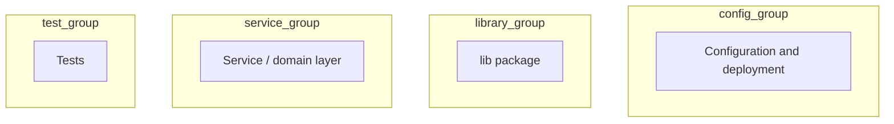

# Architecture report: http-party/http-server

> Automated static analysis. **Observed** = directly seen in files/imports/AST; **Inferred** = interpretation from that evidence. Repository code was not executed.

## 1. Repository at a glance

| Item | Value |
| --- | --- |
| Repository | http-party/http-server |
| Description | A simple, zero-configuration, command-line http server |
| Language | JavaScript |
| Stars | 14239 |
| Licence | MIT |
| Analysed commit / branch | 0d3b7bb5b6e8a59fd450ae2dca65870009cfcd8b / master |
| Framework(s) | Express |
| Files analysed | 121 |
| Components | 4 |

## 2. Architecture in one minute

http-party/http-server - A simple, zero-configuration, command-line http server. This repository was analysed statically from 121 file(s) (0 Python). Detected technologies (observed from imports/manifests): GitHub Actions, Express, Docker. Files are grouped into 4 component(s): Configuration and deployment, lib package, Service / domain layer, Tests. Findings below distinguish observed facts from inferred interpretation.

## 3. High-level block diagram

## 4. Main components

### Configuration and deployment (`config`)

- **Kind:** config
- **Status:** Observed
- **Confidence:** 0.85
- **Responsibility:** Groups 4 file(s) under configuration and deployment (observed from repository paths and static analysis).
- **Paths:** `Dockerfile`, `lib/core/aliases.json`, `lib/core/show-dir/icons.json`, `package.json`
- **Evidence:** [Dockerfile](https://github.com/http-party/http-server/blob/0d3b7bb5b6e8a59fd450ae2dca65870009cfcd8b/Dockerfile); [lib/core/aliases.json](https://github.com/http-party/http-server/blob/0d3b7bb5b6e8a59fd450ae2dca65870009cfcd8b/lib/core/aliases.json); [lib/core/show-dir/icons.json](https://github.com/http-party/http-server/blob/0d3b7bb5b6e8a59fd450ae2dca65870009cfcd8b/lib/core/show-dir/icons.json); [package.json](https://github.com/http-party/http-server/blob/0d3b7bb5b6e8a59fd450ae2dca65870009cfcd8b/package.json)

### lib package (`lib`)

- **Kind:** library
- **Status:** Observed
- **Confidence:** 0.85
- **Responsibility:** Groups 2 file(s) under lib package (observed from repository paths and static analysis).
- **Paths:** `lib/http-server.js`, `lib/shims/https-server-shim.js`
- **Evidence:** [lib/http-server.js](https://github.com/http-party/http-server/blob/0d3b7bb5b6e8a59fd450ae2dca65870009cfcd8b/lib/http-server.js); [lib/shims/https-server-shim.js](https://github.com/http-party/http-server/blob/0d3b7bb5b6e8a59fd450ae2dca65870009cfcd8b/lib/shims/https-server-shim.js)

### Service / domain layer (`service_layer`)

- **Kind:** service
- **Status:** Observed
- **Confidence:** 0.85
- **Responsibility:** Groups 10 file(s) under service / domain layer (observed from repository paths and static analysis).
- **Paths:** `lib/core/etag.js`, `lib/core/index.js`, `lib/core/opts.js`, `lib/core/show-dir/index.js`, `lib/core/show-dir/last-modified-to-string.js`, `lib/core/show-dir/perms-to-string.js`, `lib/core/show-dir/size-to-string.js`, `lib/core/show-dir/sort-files.js`, `lib/core/show-dir/styles.js`, `lib/core/status-handlers.js`
- **Evidence:** [lib/core/etag.js](https://github.com/http-party/http-server/blob/0d3b7bb5b6e8a59fd450ae2dca65870009cfcd8b/lib/core/etag.js); [lib/core/index.js](https://github.com/http-party/http-server/blob/0d3b7bb5b6e8a59fd450ae2dca65870009cfcd8b/lib/core/index.js); [lib/core/opts.js](https://github.com/http-party/http-server/blob/0d3b7bb5b6e8a59fd450ae2dca65870009cfcd8b/lib/core/opts.js); [lib/core/show-dir/index.js](https://github.com/http-party/http-server/blob/0d3b7bb5b6e8a59fd450ae2dca65870009cfcd8b/lib/core/show-dir/index.js); [lib/core/show-dir/last-modified-to-string.js](https://github.com/http-party/http-server/blob/0d3b7bb5b6e8a59fd450ae2dca65870009cfcd8b/lib/core/show-dir/last-modified-to-string.js); [lib/core/show-dir/perms-to-string.js](https://github.com/http-party/http-server/blob/0d3b7bb5b6e8a59fd450ae2dca65870009cfcd8b/lib/core/show-dir/perms-to-string.js); [lib/core/show-dir/size-to-string.js](https://github.com/http-party/http-server/blob/0d3b7bb5b6e8a59fd450ae2dca65870009cfcd8b/lib/core/show-dir/size-to-string.js); [lib/core/show-dir/sort-files.js](https://github.com/http-party/http-server/blob/0d3b7bb5b6e8a59fd450ae2dca65870009cfcd8b/lib/core/show-dir/sort-files.js)

### Tests (`tests`)

- **Kind:** test
- **Status:** Observed
- **Confidence:** 0.85
- **Responsibility:** Groups 85 file(s) under tests (observed from repository paths and static analysis).
- **Paths:** `test/304.test.js`, `test/accept-encoding.test.js`, `test/allowed-hosts.test.js`, `test/cache.test.js`, `test/check-headers.js`, `test/cli.test.js`, `test/compression.test.js`, `test/content-type.test.js`, `test/coop.test.js`, `test/core-error.test.js`, `test/core.test.js`, `test/cors.test.js`, `test/custom-content-type-file-secret.test.js`, `test/custom-content-type-file.test.js`, `test/custom-content-type.test.js`, `test/default-default-ext.test.js`, `test/dir-overrides-404.test.js`, `test/enotdir.test.js`, `test/escaping.test.js`, `test/express-error.test.js`, `test/express.test.js`, `test/fixtures/common-cases-error.js`, `test/fixtures/common-cases.js`, `test/fixtures/custom_mime_type.types`, `test/fixtures/proxy-all-local/does-not-exist`, `test/fixtures/proxy-all-local/file`, `test/fixtures/root/canYouSeeMe`, `test/fixtures/root/compression/index.html`, `test/fixtures/root/compression/index.html.br`, `test/fixtures/root/file`, `test/fixtures/root/htmlButNot`, `test/force-content-encoding.test.js`, `test/headers.test.js`, `test/illegal-access-date.test.js`, `test/localhost.test.js`, `test/main.test.js`, `test/malformed-dir.test.js`, `test/malformed.test.js`, `test/mime.test.js`, `test/network-interfaces.test.js`, `test/pathname-encoding.test.js`, `test/private-network-access.test.js`, `test/process-env-port.test.js`, `test/proxy-all.test.js`, `test/proxy-config.test.js`, `test/proxy-options.test.js`, `test/public/404.html`, `test/public/a.txt`, `test/public/another-subdir/scripts.js`, `test/public/b.txt`, `test/public/brotli/fake_ecstatic`, `test/public/brotli/index.html`, `test/public/brotli/index.html.br`, `test/public/brotli/not_actually_brotli.br`, `test/public/brotli/real_ecstatic`, `test/public/brotli/real_ecstatic.br`, `test/public/c.js`, `test/public/charset/arabic.html`, `test/public/charset/shift_jis.html`, `test/public/compress/foo.js`, `test/public/compress/foo_2.js`, `test/public/curimit@gmail.com (40%)/index.html`, `test/public/custom_mime_type.opml`, `test/public/custom_mime_type.types`, `test/public/d.js`, `test/public/dir-overrides-404/404.html`, `test/public/dir-overrides-404/directory/file.txt`, `test/public/e.js`, `test/public/f_f`, `test/public/gzip/fake_ecstatic`, `test/public/gzip/index.html`, `test/public/gzip/real_ecstatic`, `test/public/show-dir$$href_encoding$$/aname+aplus.txt`, `test/public/subdir/e.html`, `test/public/subdir/index.html`, `test/public/subdir_with space/file_with space.html`, `test/public/subdir_with space/index.html`, `test/public/中文/檔案.html`, `test/range.test.js`, `test/showdir-href-encoding.test.js`, `test/showdir-search-encoding.test.js`, `test/showdir-with-spaces.test.js`, `test/timeout.test.js`, `test/trailing-slash.test.js`, `test/websocket-proxy.test.js`
- **Evidence:** [test/304.test.js](https://github.com/http-party/http-server/blob/0d3b7bb5b6e8a59fd450ae2dca65870009cfcd8b/test/304.test.js); [test/accept-encoding.test.js](https://github.com/http-party/http-server/blob/0d3b7bb5b6e8a59fd450ae2dca65870009cfcd8b/test/accept-encoding.test.js); [test/allowed-hosts.test.js](https://github.com/http-party/http-server/blob/0d3b7bb5b6e8a59fd450ae2dca65870009cfcd8b/test/allowed-hosts.test.js); [test/cache.test.js](https://github.com/http-party/http-server/blob/0d3b7bb5b6e8a59fd450ae2dca65870009cfcd8b/test/cache.test.js); [test/check-headers.js](https://github.com/http-party/http-server/blob/0d3b7bb5b6e8a59fd450ae2dca65870009cfcd8b/test/check-headers.js); [test/cli.test.js](https://github.com/http-party/http-server/blob/0d3b7bb5b6e8a59fd450ae2dca65870009cfcd8b/test/cli.test.js); [test/compression.test.js](https://github.com/http-party/http-server/blob/0d3b7bb5b6e8a59fd450ae2dca65870009cfcd8b/test/compression.test.js); [test/content-type.test.js](https://github.com/http-party/http-server/blob/0d3b7bb5b6e8a59fd450ae2dca65870009cfcd8b/test/content-type.test.js)

## 5. Execution flow

**Observed** entry point(s):

- [bin/http-server](https://github.com/http-party/http-server/blob/0d3b7bb5b6e8a59fd450ae2dca65870009cfcd8b/bin/http-server)
- [lib/core/index.js](https://github.com/http-party/http-server/blob/0d3b7bb5b6e8a59fd450ae2dca65870009cfcd8b/lib/core/index.js)
- [lib/core/show-dir/index.js](https://github.com/http-party/http-server/blob/0d3b7bb5b6e8a59fd450ae2dca65870009cfcd8b/lib/core/show-dir/index.js)

Representative flow (derived from observed entry points and the import graph; steps beyond the entry point are **Inferred**):

1. Execution starts at an observed entry point listed above, if present.
2. No internal import relationships between components were observed.

## 6. Project structure

### `(root)`

- `.dockerignore` - container (103 bytes)
- `.eslintrc.json` - config (234 bytes)
- `.gitignore` - other (80 bytes)
- `CODE_OF_CONDUCT.md` - docs (5230 bytes)
- `Dockerfile` - container (190 bytes)
- `LICENSE` - docs (1124 bytes)
- `README.md` - docs (8537 bytes)
- `SECURITY.md` - docs (410 bytes)
- `package.json` - manifest (2705 bytes)

### `.github`

- `.github/CONTRIBUTING.md` - docs (4348 bytes)
- `.github/FUNDING.yml` - config (17 bytes)
- `.github/ISSUE_TEMPLATE/bug-report.md` - docs (535 bytes)
- `.github/ISSUE_TEMPLATE/feature-request.md` - docs (736 bytes)
- `.github/PULL_REQUEST_TEMPLATE.md` - docs (772 bytes)
- `.github/release-drafter.yml` - config (734 bytes)
- `.github/workflows/node.js.yml` - ci, YAML (867 bytes)
- `.github/workflows/release-drafter.yml` - ci, YAML (512 bytes)
- `.github/workflows/stale.yml` - ci, YAML (758 bytes)

### `bin`

- `bin/http-server` - other (16145 bytes)

### `doc`

- `doc/http-server.1` - other (5864 bytes)

### `lib`

- `lib/core/aliases.json` - config (1233 bytes)
- `lib/core/etag.js` - source, JavaScript (197 bytes)
- `lib/core/index.js` - source, JavaScript (15091 bytes)
- `lib/core/opts.js` - source, JavaScript (6820 bytes)
- `lib/core/show-dir/icons.json` - config (61907 bytes)
- `lib/core/show-dir/index.js` - source, JavaScript (8494 bytes)
- `lib/core/show-dir/last-modified-to-string.js` - source, JavaScript (442 bytes)
- `lib/core/show-dir/perms-to-string.js` - source, JavaScript (393 bytes)
- `lib/core/show-dir/size-to-string.js` - source, JavaScript (763 bytes)
- `lib/core/show-dir/sort-files.js` - source, JavaScript (768 bytes)
- `lib/core/show-dir/styles.js` - source, JavaScript (740 bytes)
- `lib/core/status-handlers.js` - source, JavaScript (2337 bytes)
- `lib/http-server.js` - source, JavaScript (9510 bytes)
- `lib/shims/https-server-shim.js` - source, JavaScript (1701 bytes)

### `public`

- `public/404.html` - other (148 bytes)
- `public/index.html` - other (210 bytes)

### `test`

- `test/304.test.js` - test, JavaScript (5642 bytes)
- `test/accept-encoding.test.js` - test, JavaScript (1396 bytes)
- `test/allowed-hosts.test.js` - test, JavaScript (1877 bytes)
- `test/cache.test.js` - test, JavaScript (3129 bytes)
- `test/check-headers.js` - test, JavaScript (393 bytes)
- `test/cli.test.js` - test, JavaScript (6662 bytes)
- `test/compression.test.js` - test, JavaScript (3954 bytes)
- `test/content-type.test.js` - test, JavaScript (1599 bytes)
- `test/coop.test.js` - test, JavaScript (2792 bytes)
- `test/core-error.test.js` - test, JavaScript (1835 bytes)
- `test/core.test.js` - test, JavaScript (1796 bytes)
- `test/cors.test.js` - test, JavaScript (2936 bytes)
- `test/custom-content-type-file-secret.test.js` - test, JavaScript (831 bytes)
- `test/custom-content-type-file.test.js` - test, JavaScript (1105 bytes)
- `test/custom-content-type.test.js` - test, JavaScript (811 bytes)
- `test/default-default-ext.test.js` - test, JavaScript (601 bytes)
- `test/dir-overrides-404.test.js` - test, JavaScript (2090 bytes)
- `test/enotdir.test.js` - test, JavaScript (601 bytes)
- `test/escaping.test.js` - test, JavaScript (620 bytes)
- `test/express-error.test.js` - test, JavaScript (1871 bytes)
- `test/express.test.js` - test, JavaScript (1817 bytes)
- `test/fixtures/common-cases-error.js` - test, JavaScript (237 bytes)
- `test/fixtures/common-cases.js` - test, JavaScript (3908 bytes)
- `test/fixtures/custom_mime_type.types` - test (214 bytes)
- `test/fixtures/proxy-all-local/does-not-exist` - test (59 bytes)
- `test/fixtures/proxy-all-local/file` - test (29 bytes)
- `test/fixtures/root/canYouSeeMe` - test (35 bytes)
- `test/fixtures/root/compression/index.html` - test (20 bytes)
- `test/fixtures/root/compression/index.html.br` - test (30 bytes)
- `test/fixtures/root/file` - test (25 bytes)
- `test/fixtures/root/htmlButNot` - test (65 bytes)
- `test/force-content-encoding.test.js` - test, JavaScript (2476 bytes)
- `test/headers.test.js` - test, JavaScript (2082 bytes)
- `test/illegal-access-date.test.js` - test, JavaScript (677 bytes)
- `test/localhost.test.js` - test, JavaScript (723 bytes)
- `test/main.test.js` - test, JavaScript (12418 bytes)
- `test/malformed-dir.test.js` - test, JavaScript (508 bytes)
- `test/malformed.test.js` - test, JavaScript (481 bytes)
- `test/mime.test.js` - test, JavaScript (1133 bytes)
- `test/network-interfaces.test.js` - test, JavaScript (3058 bytes)
- `test/pathname-encoding.test.js` - test, JavaScript (1781 bytes)
- `test/private-network-access.test.js` - test, JavaScript (2031 bytes)
- `test/process-env-port.test.js` - test, JavaScript (1546 bytes)
- `test/proxy-all.test.js` - test, JavaScript (2507 bytes)
- `test/proxy-config.test.js` - test, JavaScript (3154 bytes)
- `test/proxy-options.test.js` - test, JavaScript (3179 bytes)
- `test/public/404.html` - test (13 bytes)
- `test/public/a.txt` - test (5 bytes)
- `test/public/another-subdir/scripts.js` - test, JavaScript (15 bytes)
- `test/public/b.txt` - test (5 bytes)
- `test/public/brotli/fake_ecstatic` - test (9 bytes)
- `test/public/brotli/index.html` - test (34 bytes)
- `test/public/brotli/index.html.br` - test (27 bytes)
- `test/public/brotli/not_actually_brotli.br` - test (43 bytes)
- `test/public/brotli/real_ecstatic` - test (9 bytes)
- `test/public/brotli/real_ecstatic.br` - test (15 bytes)
- `test/public/c.js` - test, JavaScript (21 bytes)
- `test/public/charset/arabic.html` - test (1195 bytes)
- `test/public/charset/shift_jis.html` - test (1008 bytes)
- `test/public/compress/foo.js` - test, JavaScript (21 bytes)
- `test/public/compress/foo_2.js` - test, JavaScript (21 bytes)
- `test/public/curimit@gmail.com (40%)/index.html` - test (9 bytes)
- `test/public/custom_mime_type.opml` - test (917 bytes)
- `test/public/custom_mime_type.types` - test (211 bytes)
- `test/public/d.js` - test, JavaScript (5 bytes)
- `test/public/dir-overrides-404/404.html` - test (7 bytes)
- `test/public/dir-overrides-404/directory/file.txt` - test (0 bytes)
- `test/public/e.js` - test, JavaScript (22 bytes)
- `test/public/f_f` - test (4 bytes)
- `test/public/gzip/fake_ecstatic` - test (9 bytes)
- `test/public/gzip/index.html` - test (7 bytes)
- `test/public/gzip/real_ecstatic` - test (9 bytes)
- `test/public/show-dir$$href_encoding$$/aname+aplus.txt` - test (161 bytes)
- `test/public/subdir/e.html` - test (11 bytes)
- `test/public/subdir/index.html` - test (9 bytes)
- `test/public/subdir_with space/file_with space.html` - test (18 bytes)
- `test/public/subdir_with space/index.html` - test (9 bytes)
- `test/public/中文/檔案.html` - test (14 bytes)
- `test/range.test.js` - test, JavaScript (5053 bytes)
- `test/showdir-href-encoding.test.js` - test, JavaScript (789 bytes)
- `test/showdir-search-encoding.test.js` - test, JavaScript (938 bytes)
- `test/showdir-with-spaces.test.js` - test, JavaScript (856 bytes)
- `test/timeout.test.js` - test, JavaScript (4858 bytes)
- `test/trailing-slash.test.js` - test, JavaScript (693 bytes)
- `test/websocket-proxy.test.js` - test, JavaScript (7798 bytes)

## 7. Key dependencies and integrations

| Name | Category | Status | Confidence | Evidence |
| --- | --- | --- | --- | --- |
| GitHub Actions | ci | Observed | 0.90 | [.github/workflows/node.js.yml](https://github.com/http-party/http-server/blob/0d3b7bb5b6e8a59fd450ae2dca65870009cfcd8b/.github/workflows/node.js.yml); [.github/workflows/release-drafter.yml](https://github.com/http-party/http-server/blob/0d3b7bb5b6e8a59fd450ae2dca65870009cfcd8b/.github/workflows/release-drafter.yml); [.github/workflows/stale.yml](https://github.com/http-party/http-server/blob/0d3b7bb5b6e8a59fd450ae2dca65870009cfcd8b/.github/workflows/stale.yml) |
| Express | framework | Observed | 0.85 | [package.json:111](https://github.com/http-party/http-server/blob/0d3b7bb5b6e8a59fd450ae2dca65870009cfcd8b/package.json#L111) |
| Docker | tooling | Observed | 0.85 | [Dockerfile](https://github.com/http-party/http-server/blob/0d3b7bb5b6e8a59fd450ae2dca65870009cfcd8b/Dockerfile) |

## 8. Data and state

No database, cache, queue, or persistent-state usage was observed in the analysed files. State handling, if any, may be in-memory or in files that were not analysed.

## 9. Configuration and deployment clues

- `.dockerignore` (container)
- `.eslintrc.json` (config)
- `.github/FUNDING.yml` (config)
- `.github/release-drafter.yml` (config)
- `.github/workflows/node.js.yml` (ci)
- `.github/workflows/release-drafter.yml` (ci)
- `.github/workflows/stale.yml` (ci)
- `Dockerfile` (container)
- `lib/core/aliases.json` (config)
- `lib/core/show-dir/icons.json` (config)
- `package.json` (manifest)

## 10. Design observations

- Service/domain code is distinct from entry and data code, suggesting layered separation (Inferred).
- Tests are present alongside source code (Observed from test file paths).

These observations are interpretations (**Inferred**) of the observed structure, not guarantees about runtime design.

## 11. Limitations and unknowns

- Static analysis only: repository code was not executed, installed, or imported at runtime.
- Components and relationships are inferred from file paths, imports, and AST structure; runtime behaviour, dynamic imports, and reflection may not be visible.
- 2 file(s) were skipped during inventory (2 x likely secret file excluded).
- No clear application entry point was observed in the analysed files.
- Repository text was treated as untrusted data; no instructions found in repository files were followed, and likely secret values were redacted/excluded.
- JavaScript and TypeScript files were inventoried from paths and package manifests. They were not parsed with a full language AST, and repository code was not executed.

## 12. Source references

- [.github/workflows/node.js.yml](https://github.com/http-party/http-server/blob/0d3b7bb5b6e8a59fd450ae2dca65870009cfcd8b/.github/workflows/node.js.yml)
- [.github/workflows/release-drafter.yml](https://github.com/http-party/http-server/blob/0d3b7bb5b6e8a59fd450ae2dca65870009cfcd8b/.github/workflows/release-drafter.yml)
- [.github/workflows/stale.yml](https://github.com/http-party/http-server/blob/0d3b7bb5b6e8a59fd450ae2dca65870009cfcd8b/.github/workflows/stale.yml)
- [Dockerfile](https://github.com/http-party/http-server/blob/0d3b7bb5b6e8a59fd450ae2dca65870009cfcd8b/Dockerfile)
- [bin/http-server](https://github.com/http-party/http-server/blob/0d3b7bb5b6e8a59fd450ae2dca65870009cfcd8b/bin/http-server)
- [lib/core/aliases.json](https://github.com/http-party/http-server/blob/0d3b7bb5b6e8a59fd450ae2dca65870009cfcd8b/lib/core/aliases.json)
- [lib/core/etag.js](https://github.com/http-party/http-server/blob/0d3b7bb5b6e8a59fd450ae2dca65870009cfcd8b/lib/core/etag.js)
- [lib/core/index.js](https://github.com/http-party/http-server/blob/0d3b7bb5b6e8a59fd450ae2dca65870009cfcd8b/lib/core/index.js)
- [lib/core/opts.js](https://github.com/http-party/http-server/blob/0d3b7bb5b6e8a59fd450ae2dca65870009cfcd8b/lib/core/opts.js)
- [lib/core/show-dir/icons.json](https://github.com/http-party/http-server/blob/0d3b7bb5b6e8a59fd450ae2dca65870009cfcd8b/lib/core/show-dir/icons.json)
- [lib/core/show-dir/index.js](https://github.com/http-party/http-server/blob/0d3b7bb5b6e8a59fd450ae2dca65870009cfcd8b/lib/core/show-dir/index.js)
- [lib/core/show-dir/last-modified-to-string.js](https://github.com/http-party/http-server/blob/0d3b7bb5b6e8a59fd450ae2dca65870009cfcd8b/lib/core/show-dir/last-modified-to-string.js)
- [lib/core/show-dir/perms-to-string.js](https://github.com/http-party/http-server/blob/0d3b7bb5b6e8a59fd450ae2dca65870009cfcd8b/lib/core/show-dir/perms-to-string.js)
- [lib/core/show-dir/size-to-string.js](https://github.com/http-party/http-server/blob/0d3b7bb5b6e8a59fd450ae2dca65870009cfcd8b/lib/core/show-dir/size-to-string.js)
- [lib/core/show-dir/sort-files.js](https://github.com/http-party/http-server/blob/0d3b7bb5b6e8a59fd450ae2dca65870009cfcd8b/lib/core/show-dir/sort-files.js)
- [lib/http-server.js](https://github.com/http-party/http-server/blob/0d3b7bb5b6e8a59fd450ae2dca65870009cfcd8b/lib/http-server.js)
- [lib/shims/https-server-shim.js](https://github.com/http-party/http-server/blob/0d3b7bb5b6e8a59fd450ae2dca65870009cfcd8b/lib/shims/https-server-shim.js)
- [package.json](https://github.com/http-party/http-server/blob/0d3b7bb5b6e8a59fd450ae2dca65870009cfcd8b/package.json)
- [package.json:111](https://github.com/http-party/http-server/blob/0d3b7bb5b6e8a59fd450ae2dca65870009cfcd8b/package.json#L111)
- [test/304.test.js](https://github.com/http-party/http-server/blob/0d3b7bb5b6e8a59fd450ae2dca65870009cfcd8b/test/304.test.js)
- [test/accept-encoding.test.js](https://github.com/http-party/http-server/blob/0d3b7bb5b6e8a59fd450ae2dca65870009cfcd8b/test/accept-encoding.test.js)
- [test/allowed-hosts.test.js](https://github.com/http-party/http-server/blob/0d3b7bb5b6e8a59fd450ae2dca65870009cfcd8b/test/allowed-hosts.test.js)
- [test/cache.test.js](https://github.com/http-party/http-server/blob/0d3b7bb5b6e8a59fd450ae2dca65870009cfcd8b/test/cache.test.js)
- [test/check-headers.js](https://github.com/http-party/http-server/blob/0d3b7bb5b6e8a59fd450ae2dca65870009cfcd8b/test/check-headers.js)
- [test/cli.test.js](https://github.com/http-party/http-server/blob/0d3b7bb5b6e8a59fd450ae2dca65870009cfcd8b/test/cli.test.js)
- [test/compression.test.js](https://github.com/http-party/http-server/blob/0d3b7bb5b6e8a59fd450ae2dca65870009cfcd8b/test/compression.test.js)
- [test/content-type.test.js](https://github.com/http-party/http-server/blob/0d3b7bb5b6e8a59fd450ae2dca65870009cfcd8b/test/content-type.test.js)
