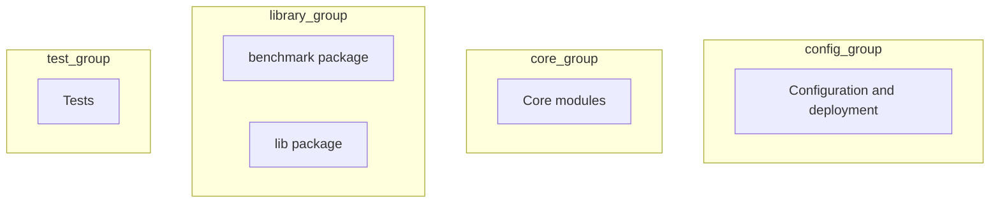

# Architecture report: http-party/node-http-proxy

> Automated static analysis. **Observed** = directly seen in files/imports/AST; **Inferred** = interpretation from that evidence. Repository code was not executed.

## 1. Repository at a glance

| Item | Value |
| --- | --- |
| Repository | http-party/node-http-proxy |
| Description | A full-featured http proxy for node.js |
| Language | JavaScript |
| Stars | 14119 |
| Licence | Other |
| Analysed commit / branch | 9b96cd725127a024dabebec6c7ea8c807272223d / master |
| Framework(s) | None detected |
| Files analysed | 55 |
| Components | 5 |

## 2. Architecture in one minute

http-party/node-http-proxy - A full-featured http proxy for node.js. This repository was analysed statically from 55 file(s) (0 Python). Detected technologies (observed from imports/manifests): no known frameworks/libraries. Files are grouped into 5 component(s): benchmark package, Configuration and deployment, Core modules, lib package, Tests. Findings below distinguish observed facts from inferred interpretation.

## 3. High-level block diagram

## 4. Main components

### benchmark package (`benchmark`)

- **Kind:** library
- **Status:** Observed
- **Confidence:** 0.85
- **Responsibility:** Groups 3 file(s) under benchmark package (observed from repository paths and static analysis).
- **Paths:** `benchmark/scripts/hello.js`, `benchmark/scripts/proxy.js`, `benchmark/scripts/websockets-throughput.js`
- **Evidence:** [benchmark/scripts/hello.js](https://github.com/http-party/node-http-proxy/blob/9b96cd725127a024dabebec6c7ea8c807272223d/benchmark/scripts/hello.js); [benchmark/scripts/proxy.js](https://github.com/http-party/node-http-proxy/blob/9b96cd725127a024dabebec6c7ea8c807272223d/benchmark/scripts/proxy.js); [benchmark/scripts/websockets-throughput.js](https://github.com/http-party/node-http-proxy/blob/9b96cd725127a024dabebec6c7ea8c807272223d/benchmark/scripts/websockets-throughput.js)

### Configuration and deployment (`config`)

- **Kind:** config
- **Status:** Observed
- **Confidence:** 0.85
- **Responsibility:** Groups 3 file(s) under configuration and deployment (observed from repository paths and static analysis).
- **Paths:** `codecov.yml`, `package.json`, `renovate.json`
- **Evidence:** [codecov.yml](https://github.com/http-party/node-http-proxy/blob/9b96cd725127a024dabebec6c7ea8c807272223d/codecov.yml); [package.json](https://github.com/http-party/node-http-proxy/blob/9b96cd725127a024dabebec6c7ea8c807272223d/package.json); [renovate.json](https://github.com/http-party/node-http-proxy/blob/9b96cd725127a024dabebec6c7ea8c807272223d/renovate.json)

### Core modules (`core`)

- **Kind:** core
- **Status:** Observed
- **Confidence:** 0.85
- **Responsibility:** Groups 1 file(s) under core modules (observed from repository paths and static analysis).
- **Paths:** `index.js`
- **Evidence:** [index.js](https://github.com/http-party/node-http-proxy/blob/9b96cd725127a024dabebec6c7ea8c807272223d/index.js)

### lib package (`lib`)

- **Kind:** library
- **Status:** Observed
- **Confidence:** 0.85
- **Responsibility:** Groups 6 file(s) under lib package (observed from repository paths and static analysis).
- **Paths:** `lib/http-proxy.js`, `lib/http-proxy/common.js`, `lib/http-proxy/index.js`, `lib/http-proxy/passes/web-incoming.js`, `lib/http-proxy/passes/web-outgoing.js`, `lib/http-proxy/passes/ws-incoming.js`
- **Evidence:** [lib/http-proxy.js](https://github.com/http-party/node-http-proxy/blob/9b96cd725127a024dabebec6c7ea8c807272223d/lib/http-proxy.js); [lib/http-proxy/common.js](https://github.com/http-party/node-http-proxy/blob/9b96cd725127a024dabebec6c7ea8c807272223d/lib/http-proxy/common.js); [lib/http-proxy/index.js](https://github.com/http-party/node-http-proxy/blob/9b96cd725127a024dabebec6c7ea8c807272223d/lib/http-proxy/index.js); [lib/http-proxy/passes/web-incoming.js](https://github.com/http-party/node-http-proxy/blob/9b96cd725127a024dabebec6c7ea8c807272223d/lib/http-proxy/passes/web-incoming.js); [lib/http-proxy/passes/web-outgoing.js](https://github.com/http-party/node-http-proxy/blob/9b96cd725127a024dabebec6c7ea8c807272223d/lib/http-proxy/passes/web-outgoing.js); [lib/http-proxy/passes/ws-incoming.js](https://github.com/http-party/node-http-proxy/blob/9b96cd725127a024dabebec6c7ea8c807272223d/lib/http-proxy/passes/ws-incoming.js)

### Tests (`tests`)

- **Kind:** test
- **Status:** Observed
- **Confidence:** 0.85
- **Responsibility:** Groups 7 file(s) under tests (observed from repository paths and static analysis).
- **Paths:** `test/examples-test.js`, `test/lib-http-proxy-common-test.js`, `test/lib-http-proxy-passes-web-incoming-test.js`, `test/lib-http-proxy-passes-web-outgoing-test.js`, `test/lib-http-proxy-passes-ws-incoming-test.js`, `test/lib-http-proxy-test.js`, `test/lib-https-proxy-test.js`
- **Evidence:** [test/examples-test.js](https://github.com/http-party/node-http-proxy/blob/9b96cd725127a024dabebec6c7ea8c807272223d/test/examples-test.js); [test/lib-http-proxy-common-test.js](https://github.com/http-party/node-http-proxy/blob/9b96cd725127a024dabebec6c7ea8c807272223d/test/lib-http-proxy-common-test.js); [test/lib-http-proxy-passes-web-incoming-test.js](https://github.com/http-party/node-http-proxy/blob/9b96cd725127a024dabebec6c7ea8c807272223d/test/lib-http-proxy-passes-web-incoming-test.js); [test/lib-http-proxy-passes-web-outgoing-test.js](https://github.com/http-party/node-http-proxy/blob/9b96cd725127a024dabebec6c7ea8c807272223d/test/lib-http-proxy-passes-web-outgoing-test.js); [test/lib-http-proxy-passes-ws-incoming-test.js](https://github.com/http-party/node-http-proxy/blob/9b96cd725127a024dabebec6c7ea8c807272223d/test/lib-http-proxy-passes-ws-incoming-test.js); [test/lib-http-proxy-test.js](https://github.com/http-party/node-http-proxy/blob/9b96cd725127a024dabebec6c7ea8c807272223d/test/lib-http-proxy-test.js); [test/lib-https-proxy-test.js](https://github.com/http-party/node-http-proxy/blob/9b96cd725127a024dabebec6c7ea8c807272223d/test/lib-https-proxy-test.js)

## 5. Execution flow

**Observed** entry point(s):

- [index.js](https://github.com/http-party/node-http-proxy/blob/9b96cd725127a024dabebec6c7ea8c807272223d/index.js)
- [lib/http-proxy/index.js](https://github.com/http-party/node-http-proxy/blob/9b96cd725127a024dabebec6c7ea8c807272223d/lib/http-proxy/index.js)

Representative flow (derived from observed entry points and the import graph; steps beyond the entry point are **Inferred**):

1. Execution starts at an observed entry point listed above, if present.
2. No internal import relationships between components were observed.

## 6. Project structure

### `(root)`

- `.auto-changelog` - other (113 bytes)
- `.gitattributes` - other (25 bytes)
- `.gitignore` - other (96 bytes)
- `.npmignore` - other (87 bytes)
- `.travis.yml` - ci, YAML (173 bytes)
- `CHANGELOG.md` - docs (176531 bytes)
- `CODE_OF_CONDUCT.md` - docs (3255 bytes)
- `LICENSE` - docs (1154 bytes)
- `README.md` - docs (19405 bytes)
- `UPGRADING.md` - docs (2749 bytes)
- `codecov.yml` - config (156 bytes)
- `index.js` - source, JavaScript (375 bytes)
- `package.json` - manifest (1017 bytes)
- `renovate.json` - config (369 bytes)

### `benchmark`

- `benchmark/README.md` - docs (1661 bytes)
- `benchmark/scripts/hello.js` - source, JavaScript (93 bytes)
- `benchmark/scripts/proxy.js` - source, JavaScript (175 bytes)
- `benchmark/scripts/websockets-throughput.js` - source, JavaScript (1944 bytes)

### `examples`

- `examples/balancer/simple-balancer-with-websockets.js` - source, JavaScript (2256 bytes)
- `examples/balancer/simple-balancer.js` - source, JavaScript (2020 bytes)
- `examples/helpers/store.js` - source, JavaScript (1668 bytes)
- `examples/http/basic-proxy.js` - source, JavaScript (2384 bytes)
- `examples/http/concurrent-proxy.js` - source, JavaScript (2304 bytes)
- `examples/http/custom-proxy-error.js` - source, JavaScript (1928 bytes)
- `examples/http/error-handling.js` - source, JavaScript (2243 bytes)
- `examples/http/forward-and-target-proxy.js` - source, JavaScript (2483 bytes)
- `examples/http/forward-proxy.js` - source, JavaScript (2065 bytes)
- `examples/http/latent-proxy.js` - source, JavaScript (2080 bytes)
- `examples/http/ntlm-authentication.js` - source, JavaScript (741 bytes)
- `examples/http/proxy-http-to-https.js` - source, JavaScript (1759 bytes)
- `examples/http/proxy-https-to-http.js` - source, JavaScript (2250 bytes)
- `examples/http/proxy-https-to-https.js` - source, JavaScript (2277 bytes)
- `examples/http/reverse-proxy.js` - source, JavaScript (2232 bytes)
- `examples/http/sse.js` - source, JavaScript (2223 bytes)
- `examples/http/standalone-proxy.js` - source, JavaScript (2153 bytes)
- `examples/middleware/bodyDecoder-middleware.js` - source, JavaScript (3387 bytes)
- `examples/middleware/gzip-middleware.js` - source, JavaScript (2249 bytes)
- `examples/middleware/modifyResponse-middleware.js` - source, JavaScript (2196 bytes)
- `examples/package.json` - manifest (341 bytes)
- `examples/websocket/latent-websocket-proxy.js` - source, JavaScript (2640 bytes)
- `examples/websocket/standalone-websocket-proxy.js` - source, JavaScript (2598 bytes)
- `examples/websocket/websocket-proxy.js` - source, JavaScript (2245 bytes)

### `lib`

- `lib/http-proxy.js` - source, JavaScript (2578 bytes)
- `lib/http-proxy/common.js` - source, JavaScript (6606 bytes)
- `lib/http-proxy/index.js` - source, JavaScript (4794 bytes)
- `lib/http-proxy/passes/web-incoming.js` - source, JavaScript (5906 bytes)
- `lib/http-proxy/passes/web-outgoing.js` - source, JavaScript (4960 bytes)
- `lib/http-proxy/passes/ws-incoming.js` - source, JavaScript (4568 bytes)

### `test`

- `test/examples-test.js` - test, JavaScript (2217 bytes)
- `test/lib-http-proxy-common-test.js` - test, JavaScript (11945 bytes)
- `test/lib-http-proxy-passes-web-incoming-test.js` - test, JavaScript (15004 bytes)
- `test/lib-http-proxy-passes-web-outgoing-test.js` - test, JavaScript (14105 bytes)
- `test/lib-http-proxy-passes-ws-incoming-test.js` - test, JavaScript (3701 bytes)
- `test/lib-http-proxy-test.js` - test, JavaScript (19067 bytes)
- `test/lib-https-proxy-test.js` - test, JavaScript (7862 bytes)

## 7. Key dependencies and integrations

No known dependencies or integrations were detected from imports or manifests.

## 8. Data and state

No database, cache, queue, or persistent-state usage was observed in the analysed files. State handling, if any, may be in-memory or in files that were not analysed.

## 9. Configuration and deployment clues

- `.travis.yml` (ci)
- `codecov.yml` (config)
- `examples/package.json` (manifest)
- `package.json` (manifest)
- `renovate.json` (config)

## 10. Design observations

- Tests are present alongside source code (Observed from test file paths).

These observations are interpretations (**Inferred**) of the observed structure, not guarantees about runtime design.

## 11. Limitations and unknowns

- Static analysis only: repository code was not executed, installed, or imported at runtime.
- Components and relationships are inferred from file paths, imports, and AST structure; runtime behaviour, dynamic imports, and reflection may not be visible.
- 3 file(s) were skipped during inventory (2 x likely secret file excluded; 1 x lockfile excluded).
- No clear application entry point was observed in the analysed files.
- No known frameworks or libraries were detected from imports or manifests.
- Repository text was treated as untrusted data; no instructions found in repository files were followed, and likely secret values were redacted/excluded.
- JavaScript and TypeScript files were inventoried from paths and package manifests. They were not parsed with a full language AST, and repository code was not executed.

## 12. Source references

- [benchmark/scripts/hello.js](https://github.com/http-party/node-http-proxy/blob/9b96cd725127a024dabebec6c7ea8c807272223d/benchmark/scripts/hello.js)
- [benchmark/scripts/proxy.js](https://github.com/http-party/node-http-proxy/blob/9b96cd725127a024dabebec6c7ea8c807272223d/benchmark/scripts/proxy.js)
- [benchmark/scripts/websockets-throughput.js](https://github.com/http-party/node-http-proxy/blob/9b96cd725127a024dabebec6c7ea8c807272223d/benchmark/scripts/websockets-throughput.js)
- [codecov.yml](https://github.com/http-party/node-http-proxy/blob/9b96cd725127a024dabebec6c7ea8c807272223d/codecov.yml)
- [index.js](https://github.com/http-party/node-http-proxy/blob/9b96cd725127a024dabebec6c7ea8c807272223d/index.js)
- [lib/http-proxy.js](https://github.com/http-party/node-http-proxy/blob/9b96cd725127a024dabebec6c7ea8c807272223d/lib/http-proxy.js)
- [lib/http-proxy/common.js](https://github.com/http-party/node-http-proxy/blob/9b96cd725127a024dabebec6c7ea8c807272223d/lib/http-proxy/common.js)
- [lib/http-proxy/index.js](https://github.com/http-party/node-http-proxy/blob/9b96cd725127a024dabebec6c7ea8c807272223d/lib/http-proxy/index.js)
- [lib/http-proxy/passes/web-incoming.js](https://github.com/http-party/node-http-proxy/blob/9b96cd725127a024dabebec6c7ea8c807272223d/lib/http-proxy/passes/web-incoming.js)
- [lib/http-proxy/passes/web-outgoing.js](https://github.com/http-party/node-http-proxy/blob/9b96cd725127a024dabebec6c7ea8c807272223d/lib/http-proxy/passes/web-outgoing.js)
- [lib/http-proxy/passes/ws-incoming.js](https://github.com/http-party/node-http-proxy/blob/9b96cd725127a024dabebec6c7ea8c807272223d/lib/http-proxy/passes/ws-incoming.js)
- [package.json](https://github.com/http-party/node-http-proxy/blob/9b96cd725127a024dabebec6c7ea8c807272223d/package.json)
- [renovate.json](https://github.com/http-party/node-http-proxy/blob/9b96cd725127a024dabebec6c7ea8c807272223d/renovate.json)
- [test/examples-test.js](https://github.com/http-party/node-http-proxy/blob/9b96cd725127a024dabebec6c7ea8c807272223d/test/examples-test.js)
- [test/lib-http-proxy-common-test.js](https://github.com/http-party/node-http-proxy/blob/9b96cd725127a024dabebec6c7ea8c807272223d/test/lib-http-proxy-common-test.js)
- [test/lib-http-proxy-passes-web-incoming-test.js](https://github.com/http-party/node-http-proxy/blob/9b96cd725127a024dabebec6c7ea8c807272223d/test/lib-http-proxy-passes-web-incoming-test.js)
- [test/lib-http-proxy-passes-web-outgoing-test.js](https://github.com/http-party/node-http-proxy/blob/9b96cd725127a024dabebec6c7ea8c807272223d/test/lib-http-proxy-passes-web-outgoing-test.js)
- [test/lib-http-proxy-passes-ws-incoming-test.js](https://github.com/http-party/node-http-proxy/blob/9b96cd725127a024dabebec6c7ea8c807272223d/test/lib-http-proxy-passes-ws-incoming-test.js)
- [test/lib-http-proxy-test.js](https://github.com/http-party/node-http-proxy/blob/9b96cd725127a024dabebec6c7ea8c807272223d/test/lib-http-proxy-test.js)
- [test/lib-https-proxy-test.js](https://github.com/http-party/node-http-proxy/blob/9b96cd725127a024dabebec6c7ea8c807272223d/test/lib-https-proxy-test.js)
