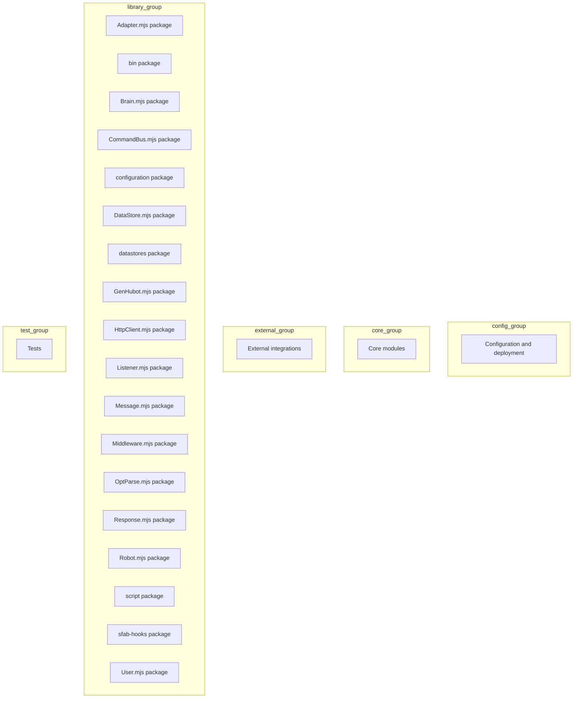

# Architecture report: hubotio/hubot

> Automated static analysis. **Observed** = directly seen in files/imports/AST; **Inferred** = interpretation from that evidence. Repository code was not executed.

## 1. Repository at a glance

| Item | Value |
| --- | --- |
| Repository | hubotio/hubot |
| Description | A customizable life embetterment robot. |
| Language | JavaScript |
| Stars | 16796 |
| Licence | MIT |
| Analysed commit / branch | 1e66cb44b0b7fcea686f0018d2d3fb41cd1194ca / main |
| Framework(s) | Express |
| Files analysed | 101 |
| Components | 22 |

## 2. Architecture in one minute

hubotio/hubot - A customizable life embetterment robot.. This repository was analysed statically from 101 file(s) (0 Python). Detected technologies (observed from imports/manifests): GitHub Actions, Express. Files are grouped into 22 component(s): Adapter.mjs package, bin package, Brain.mjs package, CommandBus.mjs package, Configuration and deployment, configuration package, Core modules, DataStore.mjs package. Findings below distinguish observed facts from inferred interpretation.

## 3. High-level block diagram

## 4. Main components

### Adapter.mjs package (`adapter_mjs`)

- **Kind:** library
- **Status:** Observed
- **Confidence:** 0.85
- **Responsibility:** Groups 1 file(s) under adapter.mjs package (observed from repository paths and static analysis).
- **Paths:** `src/Adapter.mjs`
- **Evidence:** [src/Adapter.mjs](https://github.com/hubotio/hubot/blob/1e66cb44b0b7fcea686f0018d2d3fb41cd1194ca/src/Adapter.mjs)

### bin package (`bin`)

- **Kind:** library
- **Status:** Observed
- **Confidence:** 0.85
- **Responsibility:** Groups 2 file(s) under bin package (observed from repository paths and static analysis).
- **Paths:** `bin/Hubot.mjs`, `bin/e2e-test.sh`
- **Evidence:** [bin/Hubot.mjs](https://github.com/hubotio/hubot/blob/1e66cb44b0b7fcea686f0018d2d3fb41cd1194ca/bin/Hubot.mjs); [bin/e2e-test.sh](https://github.com/hubotio/hubot/blob/1e66cb44b0b7fcea686f0018d2d3fb41cd1194ca/bin/e2e-test.sh)

### Brain.mjs package (`brain_mjs`)

- **Kind:** library
- **Status:** Observed
- **Confidence:** 0.85
- **Responsibility:** Groups 1 file(s) under brain.mjs package (observed from repository paths and static analysis).
- **Paths:** `src/Brain.mjs`
- **Evidence:** [src/Brain.mjs](https://github.com/hubotio/hubot/blob/1e66cb44b0b7fcea686f0018d2d3fb41cd1194ca/src/Brain.mjs)

### CommandBus.mjs package (`commandbus_mjs`)

- **Kind:** library
- **Status:** Observed
- **Confidence:** 0.85
- **Responsibility:** Groups 1 file(s) under commandbus.mjs package (observed from repository paths and static analysis).
- **Paths:** `src/CommandBus.mjs`
- **Evidence:** [src/CommandBus.mjs](https://github.com/hubotio/hubot/blob/1e66cb44b0b7fcea686f0018d2d3fb41cd1194ca/src/CommandBus.mjs)

### Configuration and deployment (`config`)

- **Kind:** config
- **Status:** Observed
- **Confidence:** 0.85
- **Responsibility:** Groups 1 file(s) under configuration and deployment (observed from repository paths and static analysis).
- **Paths:** `package.json`
- **Evidence:** [package.json](https://github.com/hubotio/hubot/blob/1e66cb44b0b7fcea686f0018d2d3fb41cd1194ca/package.json)

### configuration package (`configuration`)

- **Kind:** library
- **Status:** Observed
- **Confidence:** 0.85
- **Responsibility:** Groups 1 file(s) under configuration package (observed from repository paths and static analysis).
- **Paths:** `configuration/Config.mjs`
- **Evidence:** [configuration/Config.mjs](https://github.com/hubotio/hubot/blob/1e66cb44b0b7fcea686f0018d2d3fb41cd1194ca/configuration/Config.mjs)

### Core modules (`core`)

- **Kind:** core
- **Status:** Observed
- **Confidence:** 0.85
- **Responsibility:** Groups 1 file(s) under core modules (observed from repository paths and static analysis).
- **Paths:** `index.mjs`
- **Evidence:** [index.mjs](https://github.com/hubotio/hubot/blob/1e66cb44b0b7fcea686f0018d2d3fb41cd1194ca/index.mjs)

### DataStore.mjs package (`datastore_mjs`)

- **Kind:** library
- **Status:** Observed
- **Confidence:** 0.85
- **Responsibility:** Groups 1 file(s) under datastore.mjs package (observed from repository paths and static analysis).
- **Paths:** `src/DataStore.mjs`
- **Evidence:** [src/DataStore.mjs](https://github.com/hubotio/hubot/blob/1e66cb44b0b7fcea686f0018d2d3fb41cd1194ca/src/DataStore.mjs)

### datastores package (`datastores`)

- **Kind:** library
- **Status:** Observed
- **Confidence:** 0.85
- **Responsibility:** Groups 1 file(s) under datastores package (observed from repository paths and static analysis).
- **Paths:** `src/datastores/Memory.mjs`
- **Evidence:** [src/datastores/Memory.mjs](https://github.com/hubotio/hubot/blob/1e66cb44b0b7fcea686f0018d2d3fb41cd1194ca/src/datastores/Memory.mjs)

### External integrations (`external_integrations`)

- **Kind:** external
- **Status:** Observed
- **Confidence:** 0.85
- **Responsibility:** Groups 2 file(s) under external integrations (observed from repository paths and static analysis).
- **Paths:** `src/adapters/Campfire.mjs`, `src/adapters/Shell.mjs`
- **Evidence:** [src/adapters/Campfire.mjs](https://github.com/hubotio/hubot/blob/1e66cb44b0b7fcea686f0018d2d3fb41cd1194ca/src/adapters/Campfire.mjs); [src/adapters/Shell.mjs](https://github.com/hubotio/hubot/blob/1e66cb44b0b7fcea686f0018d2d3fb41cd1194ca/src/adapters/Shell.mjs)

### GenHubot.mjs package (`genhubot_mjs`)

- **Kind:** library
- **Status:** Observed
- **Confidence:** 0.85
- **Responsibility:** Groups 1 file(s) under genhubot.mjs package (observed from repository paths and static analysis).
- **Paths:** `src/GenHubot.mjs`
- **Evidence:** [src/GenHubot.mjs](https://github.com/hubotio/hubot/blob/1e66cb44b0b7fcea686f0018d2d3fb41cd1194ca/src/GenHubot.mjs)

### HttpClient.mjs package (`httpclient_mjs`)

- **Kind:** library
- **Status:** Observed
- **Confidence:** 0.85
- **Responsibility:** Groups 1 file(s) under httpclient.mjs package (observed from repository paths and static analysis).
- **Paths:** `src/HttpClient.mjs`
- **Evidence:** [src/HttpClient.mjs](https://github.com/hubotio/hubot/blob/1e66cb44b0b7fcea686f0018d2d3fb41cd1194ca/src/HttpClient.mjs)

### Listener.mjs package (`listener_mjs`)

- **Kind:** library
- **Status:** Observed
- **Confidence:** 0.85
- **Responsibility:** Groups 1 file(s) under listener.mjs package (observed from repository paths and static analysis).
- **Paths:** `src/Listener.mjs`
- **Evidence:** [src/Listener.mjs](https://github.com/hubotio/hubot/blob/1e66cb44b0b7fcea686f0018d2d3fb41cd1194ca/src/Listener.mjs)

### Message.mjs package (`message_mjs`)

- **Kind:** library
- **Status:** Observed
- **Confidence:** 0.85
- **Responsibility:** Groups 1 file(s) under message.mjs package (observed from repository paths and static analysis).
- **Paths:** `src/Message.mjs`
- **Evidence:** [src/Message.mjs](https://github.com/hubotio/hubot/blob/1e66cb44b0b7fcea686f0018d2d3fb41cd1194ca/src/Message.mjs)

### Middleware.mjs package (`middleware_mjs`)

- **Kind:** library
- **Status:** Observed
- **Confidence:** 0.85
- **Responsibility:** Groups 1 file(s) under middleware.mjs package (observed from repository paths and static analysis).
- **Paths:** `src/Middleware.mjs`
- **Evidence:** [src/Middleware.mjs](https://github.com/hubotio/hubot/blob/1e66cb44b0b7fcea686f0018d2d3fb41cd1194ca/src/Middleware.mjs)

### OptParse.mjs package (`optparse_mjs`)

- **Kind:** library
- **Status:** Observed
- **Confidence:** 0.85
- **Responsibility:** Groups 1 file(s) under optparse.mjs package (observed from repository paths and static analysis).
- **Paths:** `src/OptParse.mjs`
- **Evidence:** [src/OptParse.mjs](https://github.com/hubotio/hubot/blob/1e66cb44b0b7fcea686f0018d2d3fb41cd1194ca/src/OptParse.mjs)

### Response.mjs package (`response_mjs`)

- **Kind:** library
- **Status:** Observed
- **Confidence:** 0.85
- **Responsibility:** Groups 1 file(s) under response.mjs package (observed from repository paths and static analysis).
- **Paths:** `src/Response.mjs`
- **Evidence:** [src/Response.mjs](https://github.com/hubotio/hubot/blob/1e66cb44b0b7fcea686f0018d2d3fb41cd1194ca/src/Response.mjs)

### Robot.mjs package (`robot_mjs`)

- **Kind:** library
- **Status:** Observed
- **Confidence:** 0.85
- **Responsibility:** Groups 1 file(s) under robot.mjs package (observed from repository paths and static analysis).
- **Paths:** `src/Robot.mjs`
- **Evidence:** [src/Robot.mjs](https://github.com/hubotio/hubot/blob/1e66cb44b0b7fcea686f0018d2d3fb41cd1194ca/src/Robot.mjs)

### script package (`script`)

- **Kind:** library
- **Status:** Observed
- **Confidence:** 0.85
- **Responsibility:** Groups 1 file(s) under script package (observed from repository paths and static analysis).
- **Paths:** `script/simple-lint.mjs`
- **Evidence:** [script/simple-lint.mjs](https://github.com/hubotio/hubot/blob/1e66cb44b0b7fcea686f0018d2d3fb41cd1194ca/script/simple-lint.mjs)

### sfab-hooks package (`sfab_hooks`)

- **Kind:** library
- **Status:** Observed
- **Confidence:** 0.85
- **Responsibility:** Groups 1 file(s) under sfab-hooks package (observed from repository paths and static analysis).
- **Paths:** `sfab-hooks/SfabHook.mjs`
- **Evidence:** [sfab-hooks/SfabHook.mjs](https://github.com/hubotio/hubot/blob/1e66cb44b0b7fcea686f0018d2d3fb41cd1194ca/sfab-hooks/SfabHook.mjs)

### Tests (`tests`)

- **Kind:** test
- **Status:** Observed
- **Confidence:** 0.85
- **Responsibility:** Groups 29 file(s) under tests (observed from repository paths and static analysis).
- **Paths:** `script/test`, `test/AdapterName_test.mjs`, `test/Adapter_test.mjs`, `test/Brain_test.mjs`, `test/CommandBus_test.mjs`, `test/Configuration_test.mjs`, `test/DataStore_test.mjs`, `test/GenHubot_test.mjs`, `test/Hubot_test.mjs`, `test/Listener_test.mjs`, `test/Message_test.mjs`, `test/Middleware_test.mjs`, `test/OptParse-test.mjs`, `test/Robot_test.mjs`, `test/Shell_test.mjs`, `test/User_test.mjs`, `test/XampleTest.mjs`, `test/doubles/DummyAdapter.mjs`, `test/fixtures/MockAdapter.mjs`, `test/fixtures/TestScript.js`, `test/fixtures/TestScript.mjs`, `test/fixtures/TestScript.ts`, `test/fixtures/TestScriptIncorrectApi.js`, `test/fixtures/TestScriptIncorrectApi.mjs`, `test/index_test.mjs`, `test/ordered-scripts/01-PFirst.mjs`, `test/ordered-scripts/02-SetupBotConfig.mjs`, `test/ordered-scripts/WebSetup.mjs`, `test/scripts/Xample.mjs`
- **Evidence:** [script/test](https://github.com/hubotio/hubot/blob/1e66cb44b0b7fcea686f0018d2d3fb41cd1194ca/script/test); [test/AdapterName_test.mjs](https://github.com/hubotio/hubot/blob/1e66cb44b0b7fcea686f0018d2d3fb41cd1194ca/test/AdapterName_test.mjs); [test/Adapter_test.mjs](https://github.com/hubotio/hubot/blob/1e66cb44b0b7fcea686f0018d2d3fb41cd1194ca/test/Adapter_test.mjs); [test/Brain_test.mjs](https://github.com/hubotio/hubot/blob/1e66cb44b0b7fcea686f0018d2d3fb41cd1194ca/test/Brain_test.mjs); [test/CommandBus_test.mjs](https://github.com/hubotio/hubot/blob/1e66cb44b0b7fcea686f0018d2d3fb41cd1194ca/test/CommandBus_test.mjs); [test/Configuration_test.mjs](https://github.com/hubotio/hubot/blob/1e66cb44b0b7fcea686f0018d2d3fb41cd1194ca/test/Configuration_test.mjs); [test/DataStore_test.mjs](https://github.com/hubotio/hubot/blob/1e66cb44b0b7fcea686f0018d2d3fb41cd1194ca/test/DataStore_test.mjs); [test/GenHubot_test.mjs](https://github.com/hubotio/hubot/blob/1e66cb44b0b7fcea686f0018d2d3fb41cd1194ca/test/GenHubot_test.mjs)

### User.mjs package (`user_mjs`)

- **Kind:** library
- **Status:** Observed
- **Confidence:** 0.85
- **Responsibility:** Groups 1 file(s) under user.mjs package (observed from repository paths and static analysis).
- **Paths:** `src/User.mjs`
- **Evidence:** [src/User.mjs](https://github.com/hubotio/hubot/blob/1e66cb44b0b7fcea686f0018d2d3fb41cd1194ca/src/User.mjs)

## 5. Execution flow

**Observed** entry point(s):

- [bin/hubot](https://github.com/hubotio/hubot/blob/1e66cb44b0b7fcea686f0018d2d3fb41cd1194ca/bin/hubot)
- [index.mjs](https://github.com/hubotio/hubot/blob/1e66cb44b0b7fcea686f0018d2d3fb41cd1194ca/index.mjs)

Representative flow (derived from observed entry points and the import graph; steps beyond the entry point are **Inferred**):

1. Execution starts at an observed entry point listed above, if present.
2. No internal import relationships between components were observed.

## 6. Project structure

### `(root)`

- `.editorconfig` - config (314 bytes)
- `.gitignore` - other (112 bytes)
- `.npmignore` - other (109 bytes)
- `CODE_OF_CONDUCT.md` - docs (3215 bytes)
- `CONTRIBUTING.md` - docs (4662 bytes)
- `LICENSE.md` - docs (1060 bytes)
- `README.md` - docs (6514 bytes)
- `index.mjs` - source, JavaScript (1166 bytes)
- `package.json` - manifest (1167 bytes)

### `.github`

- `.github/stale.yml` - config (1041 bytes)
- `.github/workflows/nodejs-macos.yml` - ci, YAML (525 bytes)
- `.github/workflows/nodejs-ubuntu.yml` - ci, YAML (629 bytes)
- `.github/workflows/nodejs-windows.yml` - ci, YAML (589 bytes)
- `.github/workflows/pipeline.yml` - ci, YAML (2548 bytes)
- `.github/workflows/sfab-gh-pages.yml` - ci, YAML (1417 bytes)

### `bin`

- `bin/Hubot.mjs` - source, JavaScript (4265 bytes)
- `bin/e2e-test.sh` - source, Shell (1234 bytes)
- `bin/hubot` - other (81 bytes)

### `configuration`

- `configuration/Config.mjs` - source, JavaScript (150 bytes)

### `docs`

- `docs/adapters.md` - docs (1406 bytes)
- `docs/adapters/campfire.md` - docs (1901 bytes)
- `docs/adapters/development.md` - docs (3937 bytes)
- `docs/adapters/shell.md` - docs (674 bytes)
- `docs/assets/fonts/svg/handsean-webfont.svg` - docs (101696 bytes)
- `docs/assets/fonts/svg/octicons-regular-webfont.svg` - docs (142882 bytes)
- `docs/assets/fonts/svg/style_154042.svg` - docs (133743 bytes)
- `docs/assets/fonts/svg/style_154044.svg` - docs (133827 bytes)
- `docs/assets/fonts/svg/style_154045.svg` - docs (122966 bytes)
- `docs/assets/fonts/svg/style_154046.svg` - docs (122767 bytes)
- `docs/assets/fonts/svg/style_154048.svg` - docs (132447 bytes)
- `docs/assets/fonts/svg/style_154049.svg` - docs (129710 bytes)
- `docs/assets/fonts/svg/style_154051.svg` - docs (121665 bytes)
- `docs/assets/fonts/svg/style_154053.svg` - docs (120569 bytes)
- `docs/assets/images/layout/schematic.svg` - docs (148876 bytes)
- `docs/assets/stylesheets/application.css` - docs (25525 bytes)
- `docs/deploying.md` - docs (234 bytes)
- `docs/deploying/azure.md` - docs (5635 bytes)
- `docs/deploying/bluemix.md` - docs (4273 bytes)
- `docs/deploying/unix.md` - docs (3290 bytes)
- `docs/deploying/windows.md` - docs (3299 bytes)
- `docs/designs/commands.md` - docs (6804 bytes)
- `docs/docs.md` - docs (5067 bytes)
- `docs/implementation.md` - docs (3653 bytes)
- `docs/index.html` - docs (3780 bytes)
- `docs/layouts/docs.html` - docs (4688 bytes)
- `docs/layouts/main.html` - docs (2535 bytes)
- `docs/patterns.md` - docs (13087 bytes)
- `docs/scripting.md` - docs (42616 bytes)

### `examples`

- `examples/hubot-start.ps1` - other (344 bytes)
- `examples/hubot.service` - other (695 bytes)

### `script`

- `script/bootstrap` - other (33 bytes)
- `script/release` - other (819 bytes)
- `script/server` - other (39 bytes)
- `script/simple-lint.mjs` - source, JavaScript (2362 bytes)
- `script/smoke-test` - other (40 bytes)
- `script/test` - test (38 bytes)

### `sfab-hooks`

- `sfab-hooks/SfabHook.mjs` - source, JavaScript (147 bytes)

### `src`

- `src/Adapter.mjs` - source, JavaScript (4727 bytes)
- `src/Brain.mjs` - source, JavaScript (6193 bytes)
- `src/CommandBus.mjs` - source, JavaScript (23646 bytes)
- `src/DataStore.mjs` - source, JavaScript (3178 bytes)
- `src/GenHubot.mjs` - source, JavaScript (7558 bytes)
- `src/HttpClient.mjs` - source, JavaScript (8673 bytes)
- `src/Listener.mjs` - source, JavaScript (3528 bytes)
- `src/Message.mjs` - source, JavaScript (2111 bytes)
- `src/Middleware.mjs` - source, JavaScript (1402 bytes)
- `src/OptParse.mjs` - source, JavaScript (1352 bytes)
- `src/Response.mjs` - source, JavaScript (3748 bytes)
- `src/Robot.mjs` - source, JavaScript (31845 bytes)
- `src/User.mjs` - source, JavaScript (1463 bytes)
- `src/adapters/Campfire.mjs` - source, JavaScript (11704 bytes)
- `src/adapters/Shell.mjs` - source, JavaScript (4997 bytes)
- `src/datastores/Memory.mjs` - source, JavaScript (424 bytes)

### `test`

- `test/AdapterName_test.mjs` - test, JavaScript (1075 bytes)
- `test/Adapter_test.mjs` - test, JavaScript (2838 bytes)
- `test/Brain_test.mjs` - test, JavaScript (14231 bytes)
- `test/CommandBus_test.mjs` - test, JavaScript (29855 bytes)
- `test/Configuration_test.mjs` - test, JavaScript (581 bytes)
- `test/DataStore_test.mjs` - test, JavaScript (4279 bytes)
- `test/GenHubot_test.mjs` - test, JavaScript (2160 bytes)
- `test/Hubot_test.mjs` - test, JavaScript (4288 bytes)
- `test/Listener_test.mjs` - test, JavaScript (10661 bytes)
- `test/Message_test.mjs` - test, JavaScript (940 bytes)
- `test/Middleware_test.mjs` - test, JavaScript (5246 bytes)
- `test/OptParse-test.mjs` - test, JavaScript (1726 bytes)
- `test/Robot_test.mjs` - test, JavaScript (34107 bytes)
- `test/Shell_test.mjs` - test, JavaScript (9435 bytes)
- `test/User_test.mjs` - test, JavaScript (1028 bytes)
- `test/XampleTest.mjs` - test, JavaScript (1861 bytes)
- `test/doubles/DummyAdapter.mjs` - test, JavaScript (1210 bytes)
- `test/fixtures/MockAdapter.mjs` - test, JavaScript (737 bytes)
- `test/fixtures/TestScript.js` - test, JavaScript (280 bytes)
- `test/fixtures/TestScript.mjs` - test, JavaScript (327 bytes)
- `test/fixtures/TestScript.ts` - test, TypeScript (322 bytes)
- `test/fixtures/TestScriptIncorrectApi.js` - test, JavaScript (154 bytes)
- `test/fixtures/TestScriptIncorrectApi.mjs` - test, JavaScript (180 bytes)
- `test/index_test.mjs` - test, JavaScript (4947 bytes)
- `test/ordered-scripts/01-PFirst.mjs` - test, JavaScript (192 bytes)
- `test/ordered-scripts/02-SetupBotConfig.mjs` - test, JavaScript (180 bytes)
- `test/ordered-scripts/WebSetup.mjs` - test, JavaScript (165 bytes)
- `test/scripts/Xample.mjs` - test, JavaScript (475 bytes)

## 7. Key dependencies and integrations

| Name | Category | Status | Confidence | Evidence |
| --- | --- | --- | --- | --- |
| GitHub Actions | ci | Observed | 0.90 | [.github/workflows/nodejs-macos.yml](https://github.com/hubotio/hubot/blob/1e66cb44b0b7fcea686f0018d2d3fb41cd1194ca/.github/workflows/nodejs-macos.yml); [.github/workflows/nodejs-ubuntu.yml](https://github.com/hubotio/hubot/blob/1e66cb44b0b7fcea686f0018d2d3fb41cd1194ca/.github/workflows/nodejs-ubuntu.yml); [.github/workflows/nodejs-windows.yml](https://github.com/hubotio/hubot/blob/1e66cb44b0b7fcea686f0018d2d3fb41cd1194ca/.github/workflows/nodejs-windows.yml); [.github/workflows/pipeline.yml](https://github.com/hubotio/hubot/blob/1e66cb44b0b7fcea686f0018d2d3fb41cd1194ca/.github/workflows/pipeline.yml) |
| Express | framework | Observed | 0.85 | [package.json:43](https://github.com/hubotio/hubot/blob/1e66cb44b0b7fcea686f0018d2d3fb41cd1194ca/package.json#L43) |

## 8. Data and state

No database, cache, queue, or persistent-state usage was observed in the analysed files. State handling, if any, may be in-memory or in files that were not analysed.

## 9. Configuration and deployment clues

- `.editorconfig` (config)
- `.github/stale.yml` (config)
- `.github/workflows/nodejs-macos.yml` (ci)
- `.github/workflows/nodejs-ubuntu.yml` (ci)
- `.github/workflows/nodejs-windows.yml` (ci)
- `.github/workflows/pipeline.yml` (ci)
- `.github/workflows/sfab-gh-pages.yml` (ci)
- `package.json` (manifest)

## 10. Design observations

- Tests are present alongside source code (Observed from test file paths).
- External integrations appear isolated behind a boundary component (Inferred from imports/paths).

These observations are interpretations (**Inferred**) of the observed structure, not guarantees about runtime design.

## 11. Limitations and unknowns

- Static analysis only: repository code was not executed, installed, or imported at runtime.
- Components and relationships are inferred from file paths, imports, and AST structure; runtime behaviour, dynamic imports, and reflection may not be visible.
- 2 file(s) were skipped during inventory (1 x lockfile excluded; 1 x vendored/generated directory excluded).
- No clear application entry point was observed in the analysed files.
- Repository text was treated as untrusted data; no instructions found in repository files were followed, and likely secret values were redacted/excluded.
- JavaScript and TypeScript files were inventoried from paths and package manifests. They were not parsed with a full language AST, and repository code was not executed.

## 12. Source references

- [.github/workflows/nodejs-macos.yml](https://github.com/hubotio/hubot/blob/1e66cb44b0b7fcea686f0018d2d3fb41cd1194ca/.github/workflows/nodejs-macos.yml)
- [.github/workflows/nodejs-ubuntu.yml](https://github.com/hubotio/hubot/blob/1e66cb44b0b7fcea686f0018d2d3fb41cd1194ca/.github/workflows/nodejs-ubuntu.yml)
- [.github/workflows/nodejs-windows.yml](https://github.com/hubotio/hubot/blob/1e66cb44b0b7fcea686f0018d2d3fb41cd1194ca/.github/workflows/nodejs-windows.yml)
- [.github/workflows/pipeline.yml](https://github.com/hubotio/hubot/blob/1e66cb44b0b7fcea686f0018d2d3fb41cd1194ca/.github/workflows/pipeline.yml)
- [.github/workflows/sfab-gh-pages.yml](https://github.com/hubotio/hubot/blob/1e66cb44b0b7fcea686f0018d2d3fb41cd1194ca/.github/workflows/sfab-gh-pages.yml)
- [bin/Hubot.mjs](https://github.com/hubotio/hubot/blob/1e66cb44b0b7fcea686f0018d2d3fb41cd1194ca/bin/Hubot.mjs)
- [bin/e2e-test.sh](https://github.com/hubotio/hubot/blob/1e66cb44b0b7fcea686f0018d2d3fb41cd1194ca/bin/e2e-test.sh)
- [bin/hubot](https://github.com/hubotio/hubot/blob/1e66cb44b0b7fcea686f0018d2d3fb41cd1194ca/bin/hubot)
- [configuration/Config.mjs](https://github.com/hubotio/hubot/blob/1e66cb44b0b7fcea686f0018d2d3fb41cd1194ca/configuration/Config.mjs)
- [index.mjs](https://github.com/hubotio/hubot/blob/1e66cb44b0b7fcea686f0018d2d3fb41cd1194ca/index.mjs)
- [package.json](https://github.com/hubotio/hubot/blob/1e66cb44b0b7fcea686f0018d2d3fb41cd1194ca/package.json)
- [package.json:43](https://github.com/hubotio/hubot/blob/1e66cb44b0b7fcea686f0018d2d3fb41cd1194ca/package.json#L43)
- [script/simple-lint.mjs](https://github.com/hubotio/hubot/blob/1e66cb44b0b7fcea686f0018d2d3fb41cd1194ca/script/simple-lint.mjs)
- [script/test](https://github.com/hubotio/hubot/blob/1e66cb44b0b7fcea686f0018d2d3fb41cd1194ca/script/test)
- [sfab-hooks/SfabHook.mjs](https://github.com/hubotio/hubot/blob/1e66cb44b0b7fcea686f0018d2d3fb41cd1194ca/sfab-hooks/SfabHook.mjs)
- [src/Adapter.mjs](https://github.com/hubotio/hubot/blob/1e66cb44b0b7fcea686f0018d2d3fb41cd1194ca/src/Adapter.mjs)
- [src/Brain.mjs](https://github.com/hubotio/hubot/blob/1e66cb44b0b7fcea686f0018d2d3fb41cd1194ca/src/Brain.mjs)
- [src/CommandBus.mjs](https://github.com/hubotio/hubot/blob/1e66cb44b0b7fcea686f0018d2d3fb41cd1194ca/src/CommandBus.mjs)
- [src/DataStore.mjs](https://github.com/hubotio/hubot/blob/1e66cb44b0b7fcea686f0018d2d3fb41cd1194ca/src/DataStore.mjs)
- [src/GenHubot.mjs](https://github.com/hubotio/hubot/blob/1e66cb44b0b7fcea686f0018d2d3fb41cd1194ca/src/GenHubot.mjs)
- [src/HttpClient.mjs](https://github.com/hubotio/hubot/blob/1e66cb44b0b7fcea686f0018d2d3fb41cd1194ca/src/HttpClient.mjs)
- [src/Listener.mjs](https://github.com/hubotio/hubot/blob/1e66cb44b0b7fcea686f0018d2d3fb41cd1194ca/src/Listener.mjs)
- [src/Message.mjs](https://github.com/hubotio/hubot/blob/1e66cb44b0b7fcea686f0018d2d3fb41cd1194ca/src/Message.mjs)
- [src/Middleware.mjs](https://github.com/hubotio/hubot/blob/1e66cb44b0b7fcea686f0018d2d3fb41cd1194ca/src/Middleware.mjs)
- [src/OptParse.mjs](https://github.com/hubotio/hubot/blob/1e66cb44b0b7fcea686f0018d2d3fb41cd1194ca/src/OptParse.mjs)
- [src/Response.mjs](https://github.com/hubotio/hubot/blob/1e66cb44b0b7fcea686f0018d2d3fb41cd1194ca/src/Response.mjs)
- [src/Robot.mjs](https://github.com/hubotio/hubot/blob/1e66cb44b0b7fcea686f0018d2d3fb41cd1194ca/src/Robot.mjs)
- [src/User.mjs](https://github.com/hubotio/hubot/blob/1e66cb44b0b7fcea686f0018d2d3fb41cd1194ca/src/User.mjs)
- [src/adapters/Campfire.mjs](https://github.com/hubotio/hubot/blob/1e66cb44b0b7fcea686f0018d2d3fb41cd1194ca/src/adapters/Campfire.mjs)
- [src/adapters/Shell.mjs](https://github.com/hubotio/hubot/blob/1e66cb44b0b7fcea686f0018d2d3fb41cd1194ca/src/adapters/Shell.mjs)
- [src/datastores/Memory.mjs](https://github.com/hubotio/hubot/blob/1e66cb44b0b7fcea686f0018d2d3fb41cd1194ca/src/datastores/Memory.mjs)
- [test/AdapterName_test.mjs](https://github.com/hubotio/hubot/blob/1e66cb44b0b7fcea686f0018d2d3fb41cd1194ca/test/AdapterName_test.mjs)
- [test/Adapter_test.mjs](https://github.com/hubotio/hubot/blob/1e66cb44b0b7fcea686f0018d2d3fb41cd1194ca/test/Adapter_test.mjs)
- [test/Brain_test.mjs](https://github.com/hubotio/hubot/blob/1e66cb44b0b7fcea686f0018d2d3fb41cd1194ca/test/Brain_test.mjs)
- [test/CommandBus_test.mjs](https://github.com/hubotio/hubot/blob/1e66cb44b0b7fcea686f0018d2d3fb41cd1194ca/test/CommandBus_test.mjs)
- [test/Configuration_test.mjs](https://github.com/hubotio/hubot/blob/1e66cb44b0b7fcea686f0018d2d3fb41cd1194ca/test/Configuration_test.mjs)
- [test/DataStore_test.mjs](https://github.com/hubotio/hubot/blob/1e66cb44b0b7fcea686f0018d2d3fb41cd1194ca/test/DataStore_test.mjs)
- [test/GenHubot_test.mjs](https://github.com/hubotio/hubot/blob/1e66cb44b0b7fcea686f0018d2d3fb41cd1194ca/test/GenHubot_test.mjs)
