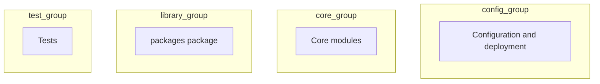

# Architecture report: hyperapp/hyperapp

> Automated static analysis. **Observed** = directly seen in files/imports/AST; **Inferred** = interpretation from that evidence. Repository code was not executed.

## 1. Repository at a glance

| Item | Value |
| --- | --- |
| Repository | hyperapp/hyperapp |
| Description | 1kB-ish JavaScript framework for building hypertext applications |
| Language | JavaScript |
| Stars | 19190 |
| Licence | MIT |
| Analysed commit / branch | 5a113fa00450302be9234e0a74ee634ed5574243 / main |
| Framework(s) | None detected |
| Files analysed | 36 |
| Components | 4 |

## 2. Architecture in one minute

hyperapp/hyperapp - 1kB-ish JavaScript framework for building hypertext applications. This repository was analysed statically from 36 file(s) (0 Python). Detected technologies (observed from imports/manifests): GitHub Actions. Files are grouped into 4 component(s): Configuration and deployment, Core modules, packages package, Tests. Findings below distinguish observed facts from inferred interpretation.

## 3. High-level block diagram

## 4. Main components

### Configuration and deployment (`config`)

- **Kind:** config
- **Status:** Observed
- **Confidence:** 0.85
- **Responsibility:** Groups 6 file(s) under configuration and deployment (observed from repository paths and static analysis).
- **Paths:** `package.json`, `packages/dom/package.json`, `packages/events/package.json`, `packages/html/package.json`, `packages/svg/package.json`, `packages/time/package.json`
- **Evidence:** [package.json](https://github.com/hyperapp/hyperapp/blob/5a113fa00450302be9234e0a74ee634ed5574243/package.json); [packages/dom/package.json](https://github.com/hyperapp/hyperapp/blob/5a113fa00450302be9234e0a74ee634ed5574243/packages/dom/package.json); [packages/events/package.json](https://github.com/hyperapp/hyperapp/blob/5a113fa00450302be9234e0a74ee634ed5574243/packages/events/package.json); [packages/html/package.json](https://github.com/hyperapp/hyperapp/blob/5a113fa00450302be9234e0a74ee634ed5574243/packages/html/package.json); [packages/svg/package.json](https://github.com/hyperapp/hyperapp/blob/5a113fa00450302be9234e0a74ee634ed5574243/packages/svg/package.json); [packages/time/package.json](https://github.com/hyperapp/hyperapp/blob/5a113fa00450302be9234e0a74ee634ed5574243/packages/time/package.json)

### Core modules (`core`)

- **Kind:** core
- **Status:** Observed
- **Confidence:** 0.85
- **Responsibility:** Groups 2 file(s) under core modules (observed from repository paths and static analysis).
- **Paths:** `index.d.ts`, `index.js`
- **Evidence:** [index.d.ts](https://github.com/hyperapp/hyperapp/blob/5a113fa00450302be9234e0a74ee634ed5574243/index.d.ts); [index.js](https://github.com/hyperapp/hyperapp/blob/5a113fa00450302be9234e0a74ee634ed5574243/index.js)

### packages package (`packages`)

- **Kind:** library
- **Status:** Observed
- **Confidence:** 0.85
- **Responsibility:** Groups 5 file(s) under packages package (observed from repository paths and static analysis).
- **Paths:** `packages/dom/index.js`, `packages/events/index.js`, `packages/html/index.js`, `packages/svg/index.js`, `packages/time/index.js`
- **Evidence:** [packages/dom/index.js](https://github.com/hyperapp/hyperapp/blob/5a113fa00450302be9234e0a74ee634ed5574243/packages/dom/index.js); [packages/events/index.js](https://github.com/hyperapp/hyperapp/blob/5a113fa00450302be9234e0a74ee634ed5574243/packages/events/index.js); [packages/html/index.js](https://github.com/hyperapp/hyperapp/blob/5a113fa00450302be9234e0a74ee634ed5574243/packages/html/index.js); [packages/svg/index.js](https://github.com/hyperapp/hyperapp/blob/5a113fa00450302be9234e0a74ee634ed5574243/packages/svg/index.js); [packages/time/index.js](https://github.com/hyperapp/hyperapp/blob/5a113fa00450302be9234e0a74ee634ed5574243/packages/time/index.js)

### Tests (`tests`)

- **Kind:** test
- **Status:** Observed
- **Confidence:** 0.85
- **Responsibility:** Groups 1 file(s) under tests (observed from repository paths and static analysis).
- **Paths:** `tests/index.test.js`
- **Evidence:** [tests/index.test.js](https://github.com/hyperapp/hyperapp/blob/5a113fa00450302be9234e0a74ee634ed5574243/tests/index.test.js)

## 5. Execution flow

**Observed** entry point(s):

- [index.js](https://github.com/hyperapp/hyperapp/blob/5a113fa00450302be9234e0a74ee634ed5574243/index.js)
- [packages/dom/index.js](https://github.com/hyperapp/hyperapp/blob/5a113fa00450302be9234e0a74ee634ed5574243/packages/dom/index.js)
- [packages/events/index.js](https://github.com/hyperapp/hyperapp/blob/5a113fa00450302be9234e0a74ee634ed5574243/packages/events/index.js)
- [packages/html/index.js](https://github.com/hyperapp/hyperapp/blob/5a113fa00450302be9234e0a74ee634ed5574243/packages/html/index.js)
- [packages/svg/index.js](https://github.com/hyperapp/hyperapp/blob/5a113fa00450302be9234e0a74ee634ed5574243/packages/svg/index.js)
- [packages/time/index.js](https://github.com/hyperapp/hyperapp/blob/5a113fa00450302be9234e0a74ee634ed5574243/packages/time/index.js)

Representative flow (derived from observed entry points and the import graph; steps beyond the entry point are **Inferred**):

1. Execution starts at an observed entry point listed above, if present.
2. No internal import relationships between components were observed.

## 6. Project structure

### `(root)`

- `.gitignore` - other (73 bytes)
- `LICENSE.md` - docs (1080 bytes)
- `README.md` - docs (6606 bytes)
- `index.d.ts` - source, TypeScript (8393 bytes)
- `index.js` - source, JavaScript (10181 bytes)
- `package.json` - manifest (921 bytes)

### `.github`

- `.github/workflows/ci.yml` - ci, YAML (478 bytes)

### `docs`

- `docs/api/app.md` - docs (6041 bytes)
- `docs/api/h.md` - docs (7790 bytes)
- `docs/api/memo.md` - docs (3698 bytes)
- `docs/api/text.md` - docs (2050 bytes)
- `docs/architecture/actions.md` - docs (8602 bytes)
- `docs/architecture/dispatch.md` - docs (5163 bytes)
- `docs/architecture/effects.md` - docs (8308 bytes)
- `docs/architecture/flowchart.md` - docs (1386 bytes)
- `docs/architecture/state.md` - docs (3295 bytes)
- `docs/architecture/subscriptions.md` - docs (8504 bytes)
- `docs/architecture/views.md` - docs (8584 bytes)
- `docs/reference.md` - docs (2969 bytes)
- `docs/tutorial.md` - docs (53627 bytes)

### `packages`

- `packages/dom/README.md` - docs (373 bytes)
- `packages/dom/index.js` - source, JavaScript (318 bytes)
- `packages/dom/package.json` - manifest (322 bytes)
- `packages/events/README.md` - docs (177 bytes)
- `packages/events/index.js` - source, JavaScript (1191 bytes)
- `packages/events/package.json` - manifest (372 bytes)
- `packages/html/README.md` - docs (1928 bytes)
- `packages/html/index.js` - source, JavaScript (3447 bytes)
- `packages/html/package.json` - manifest (354 bytes)
- `packages/svg/README.md` - docs (1632 bytes)
- `packages/svg/index.js` - source, JavaScript (3111 bytes)
- `packages/svg/package.json` - manifest (349 bytes)
- `packages/time/README.md` - docs (398 bytes)
- `packages/time/index.js` - source, JavaScript (841 bytes)
- `packages/time/package.json` - manifest (349 bytes)

### `tests`

- `tests/index.test.js` - test, JavaScript (652 bytes)

## 7. Key dependencies and integrations

| Name | Category | Status | Confidence | Evidence |
| --- | --- | --- | --- | --- |
| GitHub Actions | ci | Observed | 0.85 | [.github/workflows/ci.yml](https://github.com/hyperapp/hyperapp/blob/5a113fa00450302be9234e0a74ee634ed5574243/.github/workflows/ci.yml) |

## 8. Data and state

No database, cache, queue, or persistent-state usage was observed in the analysed files. State handling, if any, may be in-memory or in files that were not analysed.

## 9. Configuration and deployment clues

- `.github/workflows/ci.yml` (ci)
- `package.json` (manifest)
- `packages/dom/package.json` (manifest)
- `packages/events/package.json` (manifest)
- `packages/html/package.json` (manifest)
- `packages/svg/package.json` (manifest)
- `packages/time/package.json` (manifest)

## 10. Design observations

- Tests are present alongside source code (Observed from test file paths).

These observations are interpretations (**Inferred**) of the observed structure, not guarantees about runtime design.

## 11. Limitations and unknowns

- Static analysis only: repository code was not executed, installed, or imported at runtime.
- Components and relationships are inferred from file paths, imports, and AST structure; runtime behaviour, dynamic imports, and reflection may not be visible.
- No clear application entry point was observed in the analysed files.
- Repository text was treated as untrusted data; no instructions found in repository files were followed, and likely secret values were redacted/excluded.
- JavaScript and TypeScript files were inventoried from paths and package manifests. They were not parsed with a full language AST, and repository code was not executed.

## 12. Source references

- [.github/workflows/ci.yml](https://github.com/hyperapp/hyperapp/blob/5a113fa00450302be9234e0a74ee634ed5574243/.github/workflows/ci.yml)
- [index.d.ts](https://github.com/hyperapp/hyperapp/blob/5a113fa00450302be9234e0a74ee634ed5574243/index.d.ts)
- [index.js](https://github.com/hyperapp/hyperapp/blob/5a113fa00450302be9234e0a74ee634ed5574243/index.js)
- [package.json](https://github.com/hyperapp/hyperapp/blob/5a113fa00450302be9234e0a74ee634ed5574243/package.json)
- [packages/dom/index.js](https://github.com/hyperapp/hyperapp/blob/5a113fa00450302be9234e0a74ee634ed5574243/packages/dom/index.js)
- [packages/dom/package.json](https://github.com/hyperapp/hyperapp/blob/5a113fa00450302be9234e0a74ee634ed5574243/packages/dom/package.json)
- [packages/events/index.js](https://github.com/hyperapp/hyperapp/blob/5a113fa00450302be9234e0a74ee634ed5574243/packages/events/index.js)
- [packages/events/package.json](https://github.com/hyperapp/hyperapp/blob/5a113fa00450302be9234e0a74ee634ed5574243/packages/events/package.json)
- [packages/html/index.js](https://github.com/hyperapp/hyperapp/blob/5a113fa00450302be9234e0a74ee634ed5574243/packages/html/index.js)
- [packages/html/package.json](https://github.com/hyperapp/hyperapp/blob/5a113fa00450302be9234e0a74ee634ed5574243/packages/html/package.json)
- [packages/svg/index.js](https://github.com/hyperapp/hyperapp/blob/5a113fa00450302be9234e0a74ee634ed5574243/packages/svg/index.js)
- [packages/svg/package.json](https://github.com/hyperapp/hyperapp/blob/5a113fa00450302be9234e0a74ee634ed5574243/packages/svg/package.json)
- [packages/time/index.js](https://github.com/hyperapp/hyperapp/blob/5a113fa00450302be9234e0a74ee634ed5574243/packages/time/index.js)
- [packages/time/package.json](https://github.com/hyperapp/hyperapp/blob/5a113fa00450302be9234e0a74ee634ed5574243/packages/time/package.json)
- [tests/index.test.js](https://github.com/hyperapp/hyperapp/blob/5a113fa00450302be9234e0a74ee634ed5574243/tests/index.test.js)
