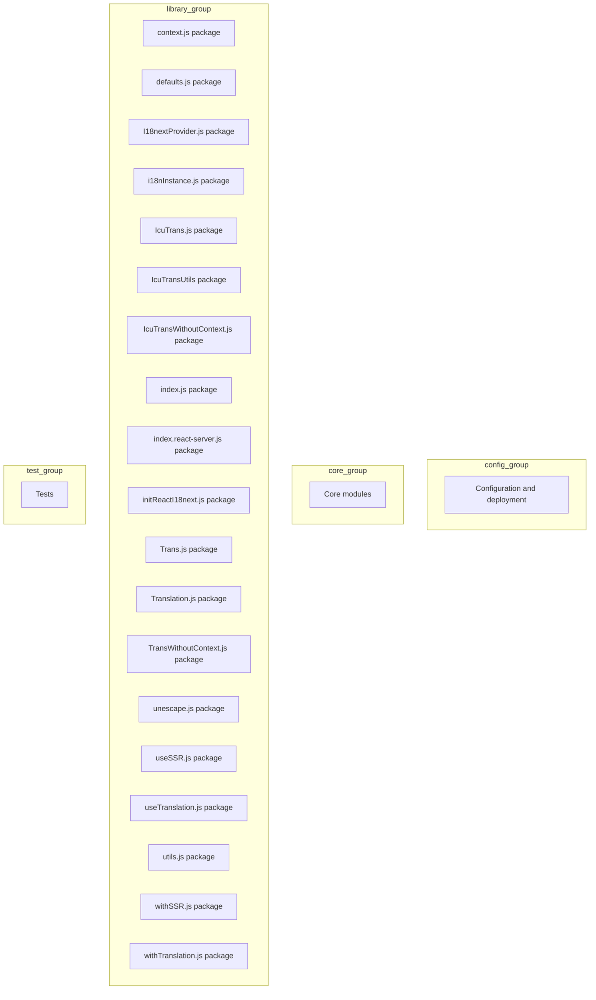

# Architecture report: i18next/react-i18next

> Automated static analysis. **Observed** = directly seen in files/imports/AST; **Inferred** = interpretation from that evidence. Repository code was not executed.

## 1. Repository at a glance

| Item | Value |
| --- | --- |
| Repository | i18next/react-i18next |
| Description | Internationalization for react done right. Using the i18next i18n ecosystem. |
| Language | JavaScript |
| Stars | 10066 |
| Licence | MIT |
| Analysed commit / branch | f97f5f82605c0ddd3ae3af6c0112c33cf7c0ab70 / master |
| Framework(s) | Express, React |
| Files analysed | 453 |
| Components | 22 |

## 2. Architecture in one minute

i18next/react-i18next - Internationalization for react done right. Using the i18next i18n ecosystem.. This repository was analysed statically from 453 file(s) (0 Python). Detected technologies (observed from imports/manifests): GitHub Actions, Express, React, React Router, Jest, TypeScript. Files are grouped into 22 component(s): Configuration and deployment, context.js package, Core modules, defaults.js package, I18nextProvider.js package, i18nInstance.js package, IcuTrans.js package, IcuTransUtils package. Findings below distinguish observed facts from inferred interpretation.

## 3. High-level block diagram

## 4. Main components

### Configuration and deployment (`config`)

- **Kind:** config
- **Status:** Observed
- **Confidence:** 0.85
- **Responsibility:** Groups 2 file(s) under configuration and deployment (observed from repository paths and static analysis).
- **Paths:** `package.json`, `tsconfig.json`
- **Evidence:** [package.json](https://github.com/i18next/react-i18next/blob/f97f5f82605c0ddd3ae3af6c0112c33cf7c0ab70/package.json); [tsconfig.json](https://github.com/i18next/react-i18next/blob/f97f5f82605c0ddd3ae3af6c0112c33cf7c0ab70/tsconfig.json)

### context.js package (`context_js`)

- **Kind:** library
- **Status:** Observed
- **Confidence:** 0.85
- **Responsibility:** Groups 1 file(s) under context.js package (observed from repository paths and static analysis).
- **Paths:** `src/context.js`
- **Evidence:** [src/context.js](https://github.com/i18next/react-i18next/blob/f97f5f82605c0ddd3ae3af6c0112c33cf7c0ab70/src/context.js)

### Core modules (`core`)

- **Kind:** core
- **Status:** Observed
- **Confidence:** 0.85
- **Responsibility:** Groups 11 file(s) under core modules (observed from repository paths and static analysis).
- **Paths:** `IcuTransWithoutContext.d.ts`, `TransWithoutContext.d.ts`, `augment-react.d.ts`, `augment-react.js`, `eslint.config.mjs`, `helpers.d.ts`, `index.d.ts`, `initReactI18next.d.ts`, `lint-staged.config.mjs`, `react-i18next.js`, `rollup.config.mjs`
- **Evidence:** [IcuTransWithoutContext.d.ts](https://github.com/i18next/react-i18next/blob/f97f5f82605c0ddd3ae3af6c0112c33cf7c0ab70/IcuTransWithoutContext.d.ts); [TransWithoutContext.d.ts](https://github.com/i18next/react-i18next/blob/f97f5f82605c0ddd3ae3af6c0112c33cf7c0ab70/TransWithoutContext.d.ts); [augment-react.d.ts](https://github.com/i18next/react-i18next/blob/f97f5f82605c0ddd3ae3af6c0112c33cf7c0ab70/augment-react.d.ts); [augment-react.js](https://github.com/i18next/react-i18next/blob/f97f5f82605c0ddd3ae3af6c0112c33cf7c0ab70/augment-react.js); [eslint.config.mjs](https://github.com/i18next/react-i18next/blob/f97f5f82605c0ddd3ae3af6c0112c33cf7c0ab70/eslint.config.mjs); [helpers.d.ts](https://github.com/i18next/react-i18next/blob/f97f5f82605c0ddd3ae3af6c0112c33cf7c0ab70/helpers.d.ts); [index.d.ts](https://github.com/i18next/react-i18next/blob/f97f5f82605c0ddd3ae3af6c0112c33cf7c0ab70/index.d.ts); [initReactI18next.d.ts](https://github.com/i18next/react-i18next/blob/f97f5f82605c0ddd3ae3af6c0112c33cf7c0ab70/initReactI18next.d.ts)

### defaults.js package (`defaults_js`)

- **Kind:** library
- **Status:** Observed
- **Confidence:** 0.85
- **Responsibility:** Groups 1 file(s) under defaults.js package (observed from repository paths and static analysis).
- **Paths:** `src/defaults.js`
- **Evidence:** [src/defaults.js](https://github.com/i18next/react-i18next/blob/f97f5f82605c0ddd3ae3af6c0112c33cf7c0ab70/src/defaults.js)

### I18nextProvider.js package (`i18nextprovider_js`)

- **Kind:** library
- **Status:** Observed
- **Confidence:** 0.85
- **Responsibility:** Groups 1 file(s) under i18nextprovider.js package (observed from repository paths and static analysis).
- **Paths:** `src/I18nextProvider.js`
- **Evidence:** [src/I18nextProvider.js](https://github.com/i18next/react-i18next/blob/f97f5f82605c0ddd3ae3af6c0112c33cf7c0ab70/src/I18nextProvider.js)

### i18nInstance.js package (`i18ninstance_js`)

- **Kind:** library
- **Status:** Observed
- **Confidence:** 0.85
- **Responsibility:** Groups 1 file(s) under i18ninstance.js package (observed from repository paths and static analysis).
- **Paths:** `src/i18nInstance.js`
- **Evidence:** [src/i18nInstance.js](https://github.com/i18next/react-i18next/blob/f97f5f82605c0ddd3ae3af6c0112c33cf7c0ab70/src/i18nInstance.js)

### IcuTrans.js package (`icutrans_js`)

- **Kind:** library
- **Status:** Observed
- **Confidence:** 0.85
- **Responsibility:** Groups 1 file(s) under icutrans.js package (observed from repository paths and static analysis).
- **Paths:** `src/IcuTrans.js`
- **Evidence:** [src/IcuTrans.js](https://github.com/i18next/react-i18next/blob/f97f5f82605c0ddd3ae3af6c0112c33cf7c0ab70/src/IcuTrans.js)

### IcuTransUtils package (`icutransutils`)

- **Kind:** library
- **Status:** Observed
- **Confidence:** 0.85
- **Responsibility:** Groups 5 file(s) under icutransutils package (observed from repository paths and static analysis).
- **Paths:** `src/IcuTransUtils/TranslationParserError.js`, `src/IcuTransUtils/htmlEntityDecoder.js`, `src/IcuTransUtils/index.js`, `src/IcuTransUtils/renderTranslation.js`, `src/IcuTransUtils/tokenizer.js`
- **Evidence:** [src/IcuTransUtils/TranslationParserError.js](https://github.com/i18next/react-i18next/blob/f97f5f82605c0ddd3ae3af6c0112c33cf7c0ab70/src/IcuTransUtils/TranslationParserError.js); [src/IcuTransUtils/htmlEntityDecoder.js](https://github.com/i18next/react-i18next/blob/f97f5f82605c0ddd3ae3af6c0112c33cf7c0ab70/src/IcuTransUtils/htmlEntityDecoder.js); [src/IcuTransUtils/index.js](https://github.com/i18next/react-i18next/blob/f97f5f82605c0ddd3ae3af6c0112c33cf7c0ab70/src/IcuTransUtils/index.js); [src/IcuTransUtils/renderTranslation.js](https://github.com/i18next/react-i18next/blob/f97f5f82605c0ddd3ae3af6c0112c33cf7c0ab70/src/IcuTransUtils/renderTranslation.js); [src/IcuTransUtils/tokenizer.js](https://github.com/i18next/react-i18next/blob/f97f5f82605c0ddd3ae3af6c0112c33cf7c0ab70/src/IcuTransUtils/tokenizer.js)

### IcuTransWithoutContext.js package (`icutranswithoutcontext_js`)

- **Kind:** library
- **Status:** Observed
- **Confidence:** 0.85
- **Responsibility:** Groups 1 file(s) under icutranswithoutcontext.js package (observed from repository paths and static analysis).
- **Paths:** `src/IcuTransWithoutContext.js`
- **Evidence:** [src/IcuTransWithoutContext.js](https://github.com/i18next/react-i18next/blob/f97f5f82605c0ddd3ae3af6c0112c33cf7c0ab70/src/IcuTransWithoutContext.js)

### index.js package (`index_js`)

- **Kind:** library
- **Status:** Observed
- **Confidence:** 0.85
- **Responsibility:** Groups 1 file(s) under index.js package (observed from repository paths and static analysis).
- **Paths:** `src/index.js`
- **Evidence:** [src/index.js](https://github.com/i18next/react-i18next/blob/f97f5f82605c0ddd3ae3af6c0112c33cf7c0ab70/src/index.js)

### index.react-server.js package (`index_react_server_js`)

- **Kind:** library
- **Status:** Observed
- **Confidence:** 0.85
- **Responsibility:** Groups 1 file(s) under index.react-server.js package (observed from repository paths and static analysis).
- **Paths:** `src/index.react-server.js`
- **Evidence:** [src/index.react-server.js](https://github.com/i18next/react-i18next/blob/f97f5f82605c0ddd3ae3af6c0112c33cf7c0ab70/src/index.react-server.js)

### initReactI18next.js package (`initreacti18next_js`)

- **Kind:** library
- **Status:** Observed
- **Confidence:** 0.85
- **Responsibility:** Groups 1 file(s) under initreacti18next.js package (observed from repository paths and static analysis).
- **Paths:** `src/initReactI18next.js`
- **Evidence:** [src/initReactI18next.js](https://github.com/i18next/react-i18next/blob/f97f5f82605c0ddd3ae3af6c0112c33cf7c0ab70/src/initReactI18next.js)

### Tests (`tests`)

- **Kind:** test
- **Status:** Observed
- **Confidence:** 0.85
- **Responsibility:** Groups 102 file(s) under tests (observed from repository paths and static analysis).
- **Paths:** `test/I18nextProvider.spec.jsx`, `test/IcuTrans/IcuTrans.spec.jsx`, `test/IcuTrans/IcuTransWithoutContext.spec.jsx`, `test/IcuTrans/utils/htmlEntityDecoder.spec.js`, `test/IcuTrans/utils/renderTranslation.spec.js`, `test/IcuTrans/utils/tokenizer.spec.js`, `test/Translation.spec.jsx`, `test/backendLngAwareMock.js`, `test/backendMock.js`, `test/hasLoadedNamespaceMock.js`, `test/i18n.js`, `test/i18nNoLng.js`, `test/index.react-server.spec.js`, `test/initReactI18next.spec.js`, `test/setup.js`, `test/trans.languageChange.spec.jsx`, `test/trans.nodeToString.spec.jsx`, `test/trans.render.childValues.spec.jsx`, `test/trans.render.dynamic.spec.jsx`, `test/trans.render.icu.spec.jsx`, `test/trans.render.noLng.spec.jsx`, `test/trans.render.object.spec.jsx`, `test/trans.render.spec.jsx`, `test/typescript/_stub.js`, `test/typescript/augment-react-not-imported/augment.test.tsx`, `test/typescript/augment-react-not-imported/i18next.d.ts`, `test/typescript/augment-react-not-imported/tsconfig.json`, `test/typescript/custom-types/IcuTrans.test.tsx`, `test/typescript/custom-types/Trans.test.tsx`, `test/typescript/custom-types/TransWithoutContext.test.tsx`, `test/typescript/custom-types/Translation.test.ts`, `test/typescript/custom-types/i18next.d.ts`, `test/typescript/custom-types/issue1913-jsx.test.tsx`, `test/typescript/custom-types/tsconfig.json`, `test/typescript/custom-types/useTranslation.test.ts`, `test/typescript/icu-arguments/i18next.d.ts`, `test/typescript/icu-arguments/icu.test.tsx`, `test/typescript/icu-arguments/tsconfig.json`, `test/typescript/issue-1899/check-types.sh`, `test/typescript/issue-1899/i18next.d.ts`, `test/typescript/issue-1899/import-check.ts`, `test/typescript/issue-1899/tsconfig.json`, `test/typescript/key-separator-false/i18next.d.ts`, `test/typescript/key-separator-false/keyPrefix.test.tsx`, `test/typescript/key-separator-false/tsconfig.json`, `test/typescript/mf2-arguments/i18next.d.ts`, `test/typescript/mf2-arguments/mf2.test.tsx`, `test/typescript/mf2-arguments/tsconfig.json`, `test/typescript/misc/I18nextProvider.test.tsx`, `test/typescript/misc/IcuTrans.test.tsx`, `test/typescript/misc/IcuTransWithoutContext.test.tsx`, `test/typescript/misc/ReactOptions.test.ts`, `test/typescript/misc/Trans.test.tsx`, `test/typescript/misc/TransWithoutContext.test.tsx`, `test/typescript/misc/Translation.test.tsx`, `test/typescript/misc/context.test.tsx`, `test/typescript/misc/tsconfig.json`, `test/typescript/misc/tsconfig.nonEsModuleInterop.json`, `test/typescript/misc/useSSR.test.tsx`, `test/typescript/misc/useTranslation.test.ts`, `test/typescript/misc/withSSR.test.tsx`, `test/typescript/misc/withTranslation.test.tsx`, `test/typescript/selector-custom-types/IcuTrans.test.tsx`, `test/typescript/selector-custom-types/IcuTransWithoutContext.test.tsx`, `test/typescript/selector-custom-types/Trans.test.tsx`, `test/typescript/selector-custom-types/TransWithoutContext.test.tsx`, `test/typescript/selector-custom-types/Translation.test.tsx`, `test/typescript/selector-custom-types/i18next.d.ts`, `test/typescript/selector-custom-types/tsconfig.json`, `test/typescript/selector-custom-types/useTranslation.test.ts`, `test/typescript/selector-default-ns-false/i18next.d.ts`, `test/typescript/selector-default-ns-false/tsconfig.json`, `test/typescript/selector-default-ns-false/useTranslation.test.ts`, `test/typescript/selector-optimize/IcuTrans.test.tsx`, `test/typescript/selector-optimize/IcuTransWithoutContext.test.tsx`, `test/typescript/selector-optimize/Trans.test.tsx`, `test/typescript/selector-optimize/TransWithoutContext.test.tsx`, `test/typescript/selector-optimize/Translation.test.tsx`, `test/typescript/selector-optimize/i18next.d.ts`, `test/typescript/selector-optimize/tsconfig.json`, `test/typescript/selector-optimize/useTranslation.test.ts`, `test/typescript/selector-strict/Trans.test.tsx`, `test/typescript/selector-strict/i18next.d.ts`, `test/typescript/selector-strict/tsconfig.json`, `test/typescript/selector-strict/useTranslation.test.ts`, `test/typescript/strict-interpolation/i18next.d.ts`, `test/typescript/strict-interpolation/strict.test.tsx`, `test/typescript/strict-interpolation/tsconfig.json`, `test/unescape.spec.js`, `test/useSSR.spec.js`, `test/useTranslation.advanced.spec.js`, `test/useTranslation.bindI18nStore.spec.jsx`, `test/useTranslation.loading.spec.js`, `test/useTranslation.loadingLng.spec.js`, `test/useTranslation.ready.spec.jsx`, `test/useTranslation.spec.jsx`, `test/useTranslation.subscribe.spec.jsx`, `test/useTranslation.usedNamespaces.spec.js`, `test/utils.spec.js`, `test/withSSR.spec.jsx`, `test/withTranslation.keyPrefix.spec.jsx`, `test/withTranslation.spec.jsx`
- **Evidence:** [test/I18nextProvider.spec.jsx](https://github.com/i18next/react-i18next/blob/f97f5f82605c0ddd3ae3af6c0112c33cf7c0ab70/test/I18nextProvider.spec.jsx); [test/IcuTrans/IcuTrans.spec.jsx](https://github.com/i18next/react-i18next/blob/f97f5f82605c0ddd3ae3af6c0112c33cf7c0ab70/test/IcuTrans/IcuTrans.spec.jsx); [test/IcuTrans/IcuTransWithoutContext.spec.jsx](https://github.com/i18next/react-i18next/blob/f97f5f82605c0ddd3ae3af6c0112c33cf7c0ab70/test/IcuTrans/IcuTransWithoutContext.spec.jsx); [test/IcuTrans/utils/htmlEntityDecoder.spec.js](https://github.com/i18next/react-i18next/blob/f97f5f82605c0ddd3ae3af6c0112c33cf7c0ab70/test/IcuTrans/utils/htmlEntityDecoder.spec.js); [test/IcuTrans/utils/renderTranslation.spec.js](https://github.com/i18next/react-i18next/blob/f97f5f82605c0ddd3ae3af6c0112c33cf7c0ab70/test/IcuTrans/utils/renderTranslation.spec.js); [test/IcuTrans/utils/tokenizer.spec.js](https://github.com/i18next/react-i18next/blob/f97f5f82605c0ddd3ae3af6c0112c33cf7c0ab70/test/IcuTrans/utils/tokenizer.spec.js); [test/Translation.spec.jsx](https://github.com/i18next/react-i18next/blob/f97f5f82605c0ddd3ae3af6c0112c33cf7c0ab70/test/Translation.spec.jsx); [test/backendLngAwareMock.js](https://github.com/i18next/react-i18next/blob/f97f5f82605c0ddd3ae3af6c0112c33cf7c0ab70/test/backendLngAwareMock.js)

### Trans.js package (`trans_js`)

- **Kind:** library
- **Status:** Observed
- **Confidence:** 0.85
- **Responsibility:** Groups 1 file(s) under trans.js package (observed from repository paths and static analysis).
- **Paths:** `src/Trans.js`
- **Evidence:** [src/Trans.js](https://github.com/i18next/react-i18next/blob/f97f5f82605c0ddd3ae3af6c0112c33cf7c0ab70/src/Trans.js)

### Translation.js package (`translation_js`)

- **Kind:** library
- **Status:** Observed
- **Confidence:** 0.85
- **Responsibility:** Groups 1 file(s) under translation.js package (observed from repository paths and static analysis).
- **Paths:** `src/Translation.js`
- **Evidence:** [src/Translation.js](https://github.com/i18next/react-i18next/blob/f97f5f82605c0ddd3ae3af6c0112c33cf7c0ab70/src/Translation.js)

### TransWithoutContext.js package (`transwithoutcontext_js`)

- **Kind:** library
- **Status:** Observed
- **Confidence:** 0.85
- **Responsibility:** Groups 1 file(s) under transwithoutcontext.js package (observed from repository paths and static analysis).
- **Paths:** `src/TransWithoutContext.js`
- **Evidence:** [src/TransWithoutContext.js](https://github.com/i18next/react-i18next/blob/f97f5f82605c0ddd3ae3af6c0112c33cf7c0ab70/src/TransWithoutContext.js)

### unescape.js package (`unescape_js`)

- **Kind:** library
- **Status:** Observed
- **Confidence:** 0.85
- **Responsibility:** Groups 1 file(s) under unescape.js package (observed from repository paths and static analysis).
- **Paths:** `src/unescape.js`
- **Evidence:** [src/unescape.js](https://github.com/i18next/react-i18next/blob/f97f5f82605c0ddd3ae3af6c0112c33cf7c0ab70/src/unescape.js)

### useSSR.js package (`usessr_js`)

- **Kind:** library
- **Status:** Observed
- **Confidence:** 0.85
- **Responsibility:** Groups 1 file(s) under usessr.js package (observed from repository paths and static analysis).
- **Paths:** `src/useSSR.js`
- **Evidence:** [src/useSSR.js](https://github.com/i18next/react-i18next/blob/f97f5f82605c0ddd3ae3af6c0112c33cf7c0ab70/src/useSSR.js)

### useTranslation.js package (`usetranslation_js`)

- **Kind:** library
- **Status:** Observed
- **Confidence:** 0.85
- **Responsibility:** Groups 1 file(s) under usetranslation.js package (observed from repository paths and static analysis).
- **Paths:** `src/useTranslation.js`
- **Evidence:** [src/useTranslation.js](https://github.com/i18next/react-i18next/blob/f97f5f82605c0ddd3ae3af6c0112c33cf7c0ab70/src/useTranslation.js)

### utils.js package (`utils_js`)

- **Kind:** library
- **Status:** Observed
- **Confidence:** 0.85
- **Responsibility:** Groups 1 file(s) under utils.js package (observed from repository paths and static analysis).
- **Paths:** `src/utils.js`
- **Evidence:** [src/utils.js](https://github.com/i18next/react-i18next/blob/f97f5f82605c0ddd3ae3af6c0112c33cf7c0ab70/src/utils.js)

### withSSR.js package (`withssr_js`)

- **Kind:** library
- **Status:** Observed
- **Confidence:** 0.85
- **Responsibility:** Groups 1 file(s) under withssr.js package (observed from repository paths and static analysis).
- **Paths:** `src/withSSR.js`
- **Evidence:** [src/withSSR.js](https://github.com/i18next/react-i18next/blob/f97f5f82605c0ddd3ae3af6c0112c33cf7c0ab70/src/withSSR.js)

### withTranslation.js package (`withtranslation_js`)

- **Kind:** library
- **Status:** Observed
- **Confidence:** 0.85
- **Responsibility:** Groups 1 file(s) under withtranslation.js package (observed from repository paths and static analysis).
- **Paths:** `src/withTranslation.js`
- **Evidence:** [src/withTranslation.js](https://github.com/i18next/react-i18next/blob/f97f5f82605c0ddd3ae3af6c0112c33cf7c0ab70/src/withTranslation.js)

## 5. Execution flow

**Observed** entry point(s):

- [src/IcuTransUtils/index.js](https://github.com/i18next/react-i18next/blob/f97f5f82605c0ddd3ae3af6c0112c33cf7c0ab70/src/IcuTransUtils/index.js)
- [src/index.js](https://github.com/i18next/react-i18next/blob/f97f5f82605c0ddd3ae3af6c0112c33cf7c0ab70/src/index.js)

Representative flow (derived from observed entry points and the import graph; steps beyond the entry point are **Inferred**):

1. Execution starts at an observed entry point listed above, if present.
2. No internal import relationships between components were observed.

## 6. Project structure

### `(root)`

- `.all-contributorsrc` - other (1245 bytes)
- `.babelrc` - other (313 bytes)
- `.codeclimate.yml` - config (620 bytes)
- `.coveralls.yml` - config (46 bytes)
- `.editorconfig` - config (198 bytes)
- `.gitignore` - other (473 bytes)
- `.prettierignore` - other (65 bytes)
- `.prettierrc.json` - config (204 bytes)
- `CHANGELOG.md` - docs (91993 bytes)
- `IcuTransWithoutContext.d.mts` - other (45 bytes)
- `IcuTransWithoutContext.d.ts` - source, TypeScript (152 bytes)
- `LICENSE` - docs (1083 bytes)
- `README.md` - docs (13447 bytes)
- `TransWithoutContext.d.mts` - other (42 bytes)
- `TransWithoutContext.d.ts` - source, TypeScript (4990 bytes)
- `augment-react.d.mts` - other (36 bytes)
- `augment-react.d.ts` - source, TypeScript (1399 bytes)
- `augment-react.js` - source, JavaScript (100 bytes)
- `eslint.config.mjs` - source, JavaScript (1439 bytes)
- `helpers.d.ts` - source, TypeScript (125 bytes)
- `index.d.mts` - other (28 bytes)
- `index.d.ts` - source, TypeScript (12964 bytes)
- `initReactI18next.d.mts` - other (39 bytes)
- `initReactI18next.d.ts` - source, TypeScript (99 bytes)
- `lint-staged.config.mjs` - source, JavaScript (184 bytes)
- `package.json` - manifest (6017 bytes)
- `react-i18next.js` - source, JavaScript (59081 bytes)
- `rollup.config.mjs` - source, JavaScript (1504 bytes)
- `tsconfig.json` - config (431 bytes)
- `vitest.config.mts` - other (514 bytes)
- `vitest.workspace.typescript.mts` - other (2160 bytes)

### `.github`

- `.github/stale.yml` - config (805 bytes)
- `.github/workflows/CI.yml` - ci, YAML (2370 bytes)
- `.github/workflows/types-compat.yml` - ci, YAML (1783 bytes)

### `.husky`

- `.husky/pre-commit` - other (21 bytes)

### `example`

- `example/ReactNativeLocizeProject/.bundle/config` - other (59 bytes)
- `example/ReactNativeLocizeProject/.gitignore` - other (1085 bytes)
- `example/ReactNativeLocizeProject/.prettierrc.js` - source, JavaScript (91 bytes)
- `example/ReactNativeLocizeProject/.watchmanconfig` - other (3 bytes)
- `example/ReactNativeLocizeProject/App.tsx` - source, TypeScript (1423 bytes)
- `example/ReactNativeLocizeProject/Gemfile` - other (579 bytes)
- `example/ReactNativeLocizeProject/README.md` - docs (3582 bytes)
- `example/ReactNativeLocizeProject/__tests__/App.test.tsx` - source, TypeScript (254 bytes)
- `example/ReactNativeLocizeProject/android/app/build.gradle` - manifest (4748 bytes)
- `example/ReactNativeLocizeProject/android/app/proguard-rules.pro` - other (435 bytes)
- `example/ReactNativeLocizeProject/android/app/src/main/AndroidManifest.xml` - other (1065 bytes)
- `example/ReactNativeLocizeProject/android/app/src/main/java/com/reactnativelocizeproject/MainActivity.kt` - other (879 bytes)
- `example/ReactNativeLocizeProject/android/app/src/main/java/com/reactnativelocizeproject/MainApplication.kt` - other (800 bytes)
- `example/ReactNativeLocizeProject/android/app/src/main/res/drawable/rn_edit_text_material.xml` - other (1917 bytes)
- `example/ReactNativeLocizeProject/android/app/src/main/res/values/strings.xml` - other (87 bytes)
- `example/ReactNativeLocizeProject/android/app/src/main/res/values/styles.xml` - other (282 bytes)
- `example/ReactNativeLocizeProject/android/build.gradle` - manifest (546 bytes)
- `example/ReactNativeLocizeProject/android/gradle.properties` - other (2153 bytes)
- `example/ReactNativeLocizeProject/android/gradle/wrapper/gradle-wrapper.properties` - other (252 bytes)
- `example/ReactNativeLocizeProject/android/gradlew` - other (8654 bytes)
- `example/ReactNativeLocizeProject/android/gradlew.bat` - other (3093 bytes)
- `example/ReactNativeLocizeProject/android/settings.gradle` - other (355 bytes)
- `example/ReactNativeLocizeProject/app.json` - config (86 bytes)
- `example/ReactNativeLocizeProject/babel.config.js` - source, JavaScript (72 bytes)
- `example/ReactNativeLocizeProject/i18n.js` - source, JavaScript (820 bytes)
- `example/ReactNativeLocizeProject/index.js` - source, JavaScript (245 bytes)
- `example/ReactNativeLocizeProject/ios/.xcode.env` - other (482 bytes)
- `example/ReactNativeLocizeProject/ios/Podfile` - other (934 bytes)
- `example/ReactNativeLocizeProject/ios/ReactNativeLocizeProject.xcodeproj/project.pbxproj` - other (19595 bytes)
- `example/ReactNativeLocizeProject/ios/ReactNativeLocizeProject.xcodeproj/xcshareddata/xcschemes/ReactNativeLocizeProject.xcscheme` - other (3474 bytes)
- `example/ReactNativeLocizeProject/ios/ReactNativeLocizeProject/AppDelegate.swift` - other (253 bytes)
- `example/ReactNativeLocizeProject/ios/ReactNativeLocizeProject/Images.xcassets/AppIcon.appiconset/Contents.json` - config (849 bytes)
- `example/ReactNativeLocizeProject/ios/ReactNativeLocizeProject/Images.xcassets/Contents.json` - config (63 bytes)
- `example/ReactNativeLocizeProject/ios/ReactNativeLocizeProject/Info.plist` - other (2358 bytes)
- `example/ReactNativeLocizeProject/ios/ReactNativeLocizeProject/LaunchScreen.storyboard` - other (4248 bytes)
- `example/ReactNativeLocizeProject/ios/ReactNativeLocizeProject/PrivacyInfo.xcprivacy` - other (986 bytes)
- `example/ReactNativeLocizeProject/ios/ReactNativeLocizeProject/SceneDelegate.swift` - other (1578 bytes)
- `example/ReactNativeLocizeProject/jest.config.js` - source, JavaScript (61 bytes)
- `example/ReactNativeLocizeProject/metro.config.js` - source, JavaScript (301 bytes)
- `example/ReactNativeLocizeProject/package.json` - manifest (1557 bytes)
- `example/ReactNativeLocizeProject/tsconfig.json` - config (134 bytes)
- `example/ReactNativeProject/.bundle/config` - other (59 bytes)
- `example/ReactNativeProject/.gitignore` - other (1085 bytes)
- `example/ReactNativeProject/.prettierrc.js` - source, JavaScript (91 bytes)
- `example/ReactNativeProject/.watchmanconfig` - other (3 bytes)
- `example/ReactNativeProject/App.tsx` - source, TypeScript (1423 bytes)
- `example/ReactNativeProject/Gemfile` - other (579 bytes)
- `example/ReactNativeProject/README.md` - docs (3582 bytes)
- `example/ReactNativeProject/__tests__/App.test.tsx` - source, TypeScript (254 bytes)
- `example/ReactNativeProject/android/app/build.gradle` - manifest (4736 bytes)
- `example/ReactNativeProject/android/app/proguard-rules.pro` - other (435 bytes)
- `example/ReactNativeProject/android/app/src/main/AndroidManifest.xml` - other (1065 bytes)
- `example/ReactNativeProject/android/app/src/main/java/com/reactnativeproject/MainActivity.kt` - other (867 bytes)
- `example/ReactNativeProject/android/app/src/main/java/com/reactnativeproject/MainApplication.kt` - other (794 bytes)
- `example/ReactNativeProject/android/app/src/main/res/drawable/rn_edit_text_material.xml` - other (1917 bytes)
- `example/ReactNativeProject/android/app/src/main/res/values/strings.xml` - other (81 bytes)
- `example/ReactNativeProject/android/app/src/main/res/values/styles.xml` - other (282 bytes)
- `example/ReactNativeProject/android/build.gradle` - manifest (546 bytes)
- `example/ReactNativeProject/android/gradle.properties` - other (2153 bytes)
- `example/ReactNativeProject/android/gradle/wrapper/gradle-wrapper.properties` - other (252 bytes)
- `example/ReactNativeProject/android/gradlew` - other (8654 bytes)
- `example/ReactNativeProject/android/gradlew.bat` - other (3093 bytes)
- `example/ReactNativeProject/android/settings.gradle` - other (349 bytes)
- `example/ReactNativeProject/app.json` - config (74 bytes)
- `example/ReactNativeProject/babel.config.js` - source, JavaScript (72 bytes)
- `example/ReactNativeProject/i18n.js` - source, JavaScript (589 bytes)
- `example/ReactNativeProject/index.js` - source, JavaScript (245 bytes)
- `example/ReactNativeProject/ios/.xcode.env` - other (482 bytes)
- `example/ReactNativeProject/ios/Podfile` - other (928 bytes)
- `example/ReactNativeProject/ios/ReactNativeProject.xcodeproj/project.pbxproj` - other (19259 bytes)
- `example/ReactNativeProject/ios/ReactNativeProject.xcodeproj/xcshareddata/xcschemes/ReactNativeProject.xcscheme` - other (3402 bytes)
- `example/ReactNativeProject/ios/ReactNativeProject/AppDelegate.swift` - other (253 bytes)
- `example/ReactNativeProject/ios/ReactNativeProject/Images.xcassets/AppIcon.appiconset/Contents.json` - config (849 bytes)
- `example/ReactNativeProject/ios/ReactNativeProject/Images.xcassets/Contents.json` - config (63 bytes)
- `example/ReactNativeProject/ios/ReactNativeProject/Info.plist` - other (2352 bytes)
- `example/ReactNativeProject/ios/ReactNativeProject/LaunchScreen.storyboard` - other (4242 bytes)
- `example/ReactNativeProject/ios/ReactNativeProject/PrivacyInfo.xcprivacy` - other (986 bytes)
- `example/ReactNativeProject/ios/ReactNativeProject/SceneDelegate.swift` - other (1572 bytes)
- `example/ReactNativeProject/jest.config.js` - source, JavaScript (61 bytes)
- `example/ReactNativeProject/locales/de/translation.json` - config (307 bytes)
- `example/ReactNativeProject/locales/en/translation.json` - config (277 bytes)
- `example/ReactNativeProject/metro.config.js` - source, JavaScript (301 bytes)
- `example/ReactNativeProject/package.json` - manifest (1423 bytes)
- `example/ReactNativeProject/tsconfig.json` - config (134 bytes)
- `example/devserver-save-missing/.gitignore` - other (284 bytes)
- `example/devserver-save-missing/README.md` - docs (1105 bytes)
- `example/devserver-save-missing/index.html` - other (537 bytes)
- `example/devserver-save-missing/package.json` - manifest (626 bytes)
- `example/devserver-save-missing/public/locales/de/translation.json` - config (265 bytes)
- `example/devserver-save-missing/public/locales/en/translation.json` - config (232 bytes)
- `example/devserver-save-missing/public/manifest.json` - config (298 bytes)
- `example/devserver-save-missing/src/App.css` - other (353 bytes)
- `example/devserver-save-missing/src/App.jsx` - source, JavaScript (1708 bytes)
- `example/devserver-save-missing/src/i18n.js` - source, JavaScript (898 bytes)
- `example/devserver-save-missing/src/index.css` - other (63 bytes)
- `example/devserver-save-missing/src/logo.svg` - other (2671 bytes)
- `example/devserver-save-missing/src/main.jsx` - source, JavaScript (310 bytes)
- `example/devserver-save-missing/vite.config.js` - source, JavaScript (1055 bytes)
- `example/locize/.eslintrc.js` - source, JavaScript (36 bytes)
- `example/locize/.gitignore` - other (296 bytes)
- `example/locize/README.md` - docs (1610 bytes)
- `example/locize/index.html` - other (537 bytes)
- `example/locize/package.json` - manifest (571 bytes)
- `example/locize/public/manifest.json` - config (298 bytes)
- `example/locize/src/App.css` - other (353 bytes)
- `example/locize/src/App.jsx` - source, JavaScript (1678 bytes)
- `example/locize/src/i18n.js` - source, JavaScript (2271 bytes)
- `example/locize/src/index.css` - other (63 bytes)
- `example/locize/src/logo.svg` - other (2671 bytes)
- `example/locize/src/main.jsx` - source, JavaScript (260 bytes)
- `example/locize/vite.config.js` - source, JavaScript (136 bytes)
- `example/razzle-ssr/.gitignore` - other (152 bytes)
- `example/razzle-ssr/README.md` - docs (995 bytes)
- `example/razzle-ssr/index.html` - other (351 bytes)
- `example/razzle-ssr/package.json` - manifest (815 bytes)
- `example/razzle-ssr/public/robots.txt` - docs (15 bytes)
- `example/razzle-ssr/server.js` - source, JavaScript (2567 bytes)
- `example/razzle-ssr/src/App.css` - other (63 bytes)
- `example/razzle-ssr/src/App.jsx` - source, JavaScript (252 bytes)
- `example/razzle-ssr/src/Home.css` - other (488 bytes)
- `example/razzle-ssr/src/Home.jsx` - source, JavaScript (976 bytes)
- `example/razzle-ssr/src/entry-client.jsx` - source, JavaScript (520 bytes)
- `example/razzle-ssr/src/entry-server.jsx` - source, JavaScript (1153 bytes)
- `example/razzle-ssr/src/i18n.js` - source, JavaScript (1138 bytes)
- `example/razzle-ssr/src/locales/de/translations.json` - config (203 bytes)
- `example/razzle-ssr/src/locales/en/translations.json` - config (167 bytes)
- `example/razzle-ssr/src/react.svg` - other (7909 bytes)
- `example/razzle-ssr/vite.config.js` - source, JavaScript (136 bytes)
- `example/react-component-lib/.gitignore` - other (284 bytes)
- `example/react-component-lib/README.md` - docs (1039 bytes)
- `example/react-component-lib/index.html` - other (537 bytes)
- `example/react-component-lib/package.json` - manifest (522 bytes)
- `example/react-component-lib/public/locales/de/translation.json` - config (265 bytes)
- `example/react-component-lib/public/locales/en/translation.json` - config (232 bytes)
- `example/react-component-lib/public/logo.svg` - other (2671 bytes)
- `example/react-component-lib/public/manifest.json` - config (298 bytes)
- `example/react-component-lib/src/App.css` - other (353 bytes)
- `example/react-component-lib/src/App.jsx` - source, JavaScript (1717 bytes)
- `example/react-component-lib/src/i18n.js` - source, JavaScript (952 bytes)
- `example/react-component-lib/src/index.css` - other (63 bytes)
- `example/react-component-lib/src/main.jsx` - source, JavaScript (310 bytes)
- `example/react-component-lib/src/other-lib/component.jsx` - source, JavaScript (345 bytes)
- `example/react-component-lib/src/other-lib/i18n.js` - source, JavaScript (466 bytes)
- `example/react-component-lib/vite.config.js` - source, JavaScript (136 bytes)
- `example/react-fluent/.gitignore` - other (284 bytes)
- `example/react-fluent/index.html` - other (537 bytes)
- `example/react-fluent/package.json` - manifest (559 bytes)
- `example/react-fluent/public/locales/de/translations.ftl` - other (400 bytes)
- `example/react-fluent/public/locales/en/translations.ftl` - other (364 bytes)
- `example/react-fluent/public/manifest.json` - config (298 bytes)
- `example/react-fluent/src/App.css` - other (353 bytes)
- `example/react-fluent/src/App.jsx` - source, JavaScript (1424 bytes)
- `example/react-fluent/src/i18n.js` - source, JavaScript (1623 bytes)
- `example/react-fluent/src/index.css` - other (63 bytes)
- `example/react-fluent/src/logo.svg` - other (2671 bytes)
- `example/react-fluent/src/main.jsx` - source, JavaScript (310 bytes)
- `example/react-fluent/vite.config.js` - source, JavaScript (136 bytes)
- `example/react-icu/.gitignore` - other (309 bytes)
- `example/react-icu/README.md` - docs (339 bytes)
- `example/react-icu/index.html` - other (648 bytes)
- `example/react-icu/package.json` - manifest (846 bytes)
- `example/react-icu/public/locales/de/translations.json` - config (2185 bytes)
- `example/react-icu/public/locales/en/translations.json` - config (2036 bytes)
- `example/react-icu/public/locales/ru/translations.json` - config (2857 bytes)
- `example/react-icu/public/manifest.json` - config (492 bytes)
- `example/react-icu/public/robots.txt` - docs (67 bytes)
- `example/react-icu/src/App.css` - other (564 bytes)
- `example/react-icu/src/App.jsx` - source, JavaScript (1738 bytes)
- `example/react-icu/src/App.test.jsx` - source, JavaScript (248 bytes)
- `example/react-icu/src/ComponentUsingMacro.jsx` - source, JavaScript (2725 bytes)
- `example/react-icu/src/ComponentUsingMacroInterpolated.jsx` - source, JavaScript (2564 bytes)
- `example/react-icu/src/i18n.js` - source, JavaScript (673 bytes)
- `example/react-icu/src/index.css` - other (362 bytes)
- `example/react-icu/src/logo.svg` - other (2671 bytes)
- `example/react-icu/src/main.jsx` - source, JavaScript (270 bytes)
- `example/react-icu/src/setupTests.js` - source, JavaScript (243 bytes)
- `example/react-icu/vite.config.js` - source, JavaScript (422 bytes)
- `example/react-localstorage/.gitignore` - other (284 bytes)
- `example/react-localstorage/README.md` - docs (1035 bytes)
- `example/react-localstorage/index.html` - other (537 bytes)
- `example/react-localstorage/package.json` - manifest (609 bytes)
- `example/react-localstorage/public/locales/de/translation.json` - config (265 bytes)
- `example/react-localstorage/public/locales/en/translation.json` - config (232 bytes)
- `example/react-localstorage/public/manifest.json` - config (298 bytes)
- `example/react-localstorage/src/App.css` - other (353 bytes)
- `example/react-localstorage/src/App.jsx` - source, JavaScript (1637 bytes)
- `example/react-localstorage/src/i18n.js` - source, JavaScript (1148 bytes)
- `example/react-localstorage/src/index.css` - other (63 bytes)
- `example/react-localstorage/src/logo.svg` - other (2671 bytes)
- `example/react-localstorage/src/main.jsx` - source, JavaScript (310 bytes)
- `example/react-localstorage/vite.config.js` - source, JavaScript (136 bytes)
- `example/react-typescript/public/locales/sv/translation.json` - config (751 bytes)
- `example/react-typescript/simple-multi-namespaces/.gitignore` - other (309 bytes)
- `example/react-typescript/simple-multi-namespaces/README.md` - docs (428 bytes)
- `example/react-typescript/simple-multi-namespaces/index.html` - other (648 bytes)
- `example/react-typescript/simple-multi-namespaces/package.json` - manifest (735 bytes)
- `example/react-typescript/simple-multi-namespaces/public/manifest.json` - config (492 bytes)
- `example/react-typescript/simple-multi-namespaces/public/robots.txt` - docs (67 bytes)
- `example/react-typescript/simple-multi-namespaces/src/@types/i18next.d.ts` - source, TypeScript (213 bytes)
- `example/react-typescript/simple-multi-namespaces/src/@types/resources.ts` - source, TypeScript (152 bytes)
- `example/react-typescript/simple-multi-namespaces/src/App.tsx` - source, TypeScript (312 bytes)
- `example/react-typescript/simple-multi-namespaces/src/components/Comp1.tsx` - source, TypeScript (283 bytes)
- `example/react-typescript/simple-multi-namespaces/src/components/Comp2.tsx` - source, TypeScript (262 bytes)
- `example/react-typescript/simple-multi-namespaces/src/components/Comp3.tsx` - source, TypeScript (301 bytes)
- `example/react-typescript/simple-multi-namespaces/src/i18n/config.ts` - source, TypeScript (391 bytes)
- `example/react-typescript/simple-multi-namespaces/src/i18n/en/ns1.json` - config (156 bytes)
- `example/react-typescript/simple-multi-namespaces/src/i18n/en/ns2.json` - config (226 bytes)
- `example/react-typescript/simple-multi-namespaces/src/index.css` - other (362 bytes)
- `example/react-typescript/simple-multi-namespaces/src/main.tsx` - source, TypeScript (270 bytes)
- `example/react-typescript/simple-multi-namespaces/src/vite-env.d.ts` - source, TypeScript (38 bytes)
- `example/react-typescript/simple-multi-namespaces/tsconfig.json` - config (446 bytes)
- `example/react-typescript/simple-multi-namespaces/vite.config.ts` - source, TypeScript (136 bytes)
- `example/react-typescript/simple/.gitignore` - other (309 bytes)
- `example/react-typescript/simple/README.md` - docs (768 bytes)
- `example/react-typescript/simple/index.html` - other (648 bytes)
- `example/react-typescript/simple/package.json` - manifest (718 bytes)
- `example/react-typescript/simple/public/manifest.json` - config (492 bytes)
- `example/react-typescript/simple/public/robots.txt` - docs (67 bytes)
- `example/react-typescript/simple/src/@types/i18next.d.ts` - source, TypeScript (348 bytes)
- `example/react-typescript/simple/src/@types/resources.ts` - source, TypeScript (130 bytes)
- `example/react-typescript/simple/src/App.tsx` - source, TypeScript (465 bytes)
- `example/react-typescript/simple/src/i18n/config.ts` - source, TypeScript (531 bytes)
- `example/react-typescript/simple/src/i18n/en/translation.json` - config (301 bytes)
- `example/react-typescript/simple/src/index.css` - other (362 bytes)
- `example/react-typescript/simple/src/main.tsx` - source, TypeScript (270 bytes)
- `example/react-typescript/simple/src/vite-env.d.ts` - source, TypeScript (38 bytes)
- `example/react-typescript/simple/tsconfig.json` - config (446 bytes)
- `example/react-typescript/simple/vite.config.ts` - source, TypeScript (136 bytes)
- `example/react/.gitignore` - other (284 bytes)
- `example/react/README.md` - docs (983 bytes)
- `example/react/index.html` - other (537 bytes)
- `example/react/package.json` - manifest (522 bytes)
- `example/react/public/locales/de/translation.json` - config (265 bytes)
- `example/react/public/locales/en/translation.json` - config (232 bytes)
- `example/react/public/locales/sv/translation.json` - config (259 bytes)
- `example/react/public/manifest.json` - config (298 bytes)
- `example/react/src/App.css` - other (353 bytes)
- `example/react/src/App.jsx` - source, JavaScript (1736 bytes)
- `example/react/src/i18n.js` - source, JavaScript (707 bytes)
- `example/react/src/index.css` - other (63 bytes)
- `example/react/src/logo.svg` - other (2671 bytes)
- `example/react/src/main.jsx` - source, JavaScript (310 bytes)
- `example/react/vite.config.js` - source, JavaScript (136 bytes)
- `example/storybook/.gitignore` - other (327 bytes)
- `example/storybook/.storybook/main.js` - source, JavaScript (201 bytes)
- `example/storybook/.storybook/preview.jsx` - source, JavaScript (1641 bytes)
- `example/storybook/README.md` - docs (1050 bytes)
- `example/storybook/index.html` - other (537 bytes)
- `example/storybook/package.json` - manifest (780 bytes)
- `example/storybook/public/locales/ar/translation.json` - config (382 bytes)
- `example/storybook/public/locales/de/translation.json` - config (262 bytes)
- `example/storybook/public/locales/en/translation.json` - config (241 bytes)
- `example/storybook/public/manifest.json` - config (306 bytes)
- `example/storybook/src/App.css` - other (491 bytes)
- `example/storybook/src/App.jsx` - source, JavaScript (1640 bytes)
- `example/storybook/src/i18n.js` - source, JavaScript (810 bytes)
- `example/storybook/src/index.css` - other (376 bytes)
- `example/storybook/src/logo.svg` - other (2671 bytes)
- `example/storybook/src/main.jsx` - source, JavaScript (241 bytes)
- `example/storybook/src/stories/app.stories.jsx` - source, JavaScript (379 bytes)
- `example/storybook/src/stories/components.stories.jsx` - source, JavaScript (918 bytes)
- `example/storybook/vite.config.js` - source, JavaScript (136 bytes)
- `example/test-jest/.gitignore` - other (284 bytes)
- `example/test-jest/README.md` - docs (613 bytes)
- `example/test-jest/babel.config.js` - source, JavaScript (154 bytes)
- `example/test-jest/index.html` - other (537 bytes)
- `example/test-jest/jest.config.js` - source, JavaScript (360 bytes)
- `example/test-jest/package.json` - manifest (888 bytes)
- `example/test-jest/public/locales/de/translations.json` - config (262 bytes)
- `example/test-jest/public/locales/en/translations.json` - config (232 bytes)
- `example/test-jest/public/locales/sv/translations.json` - config (483 bytes)
- `example/test-jest/public/manifest.json` - config (317 bytes)
- `example/test-jest/src/App.css` - other (389 bytes)
- `example/test-jest/src/App.jsx` - source, JavaScript (1223 bytes)
- `example/test-jest/src/App.test.jsx` - source, JavaScript (243 bytes)
- `example/test-jest/src/Trans.jsx` - source, JavaScript (296 bytes)
- `example/test-jest/src/Trans.test.jsx` - source, JavaScript (281 bytes)
- `example/test-jest/src/Translation.jsx` - source, JavaScript (201 bytes)
- `example/test-jest/src/Translation.test.jsx` - source, JavaScript (297 bytes)
- `example/test-jest/src/UseTranslation.jsx` - source, JavaScript (203 bytes)
- `example/test-jest/src/UseTranslation.test.jsx` - source, JavaScript (306 bytes)
- `example/test-jest/src/UseTranslationWithInterpolation.jsx` - source, JavaScript (216 bytes)
- `example/test-jest/src/UseTranslationWithInterpolation.test.jsx` - source, JavaScript (918 bytes)
- `example/test-jest/src/WithTranslation.jsx` - source, JavaScript (218 bytes)
- `example/test-jest/src/WithTranslation.test.jsx` - source, JavaScript (309 bytes)
- `example/test-jest/src/__mocks__/react-i18next.js` - source, JavaScript (1793 bytes)
- `example/test-jest/src/i18n.js` - source, JavaScript (533 bytes)
- `example/test-jest/src/index.css` - other (63 bytes)
- `example/test-jest/src/logo.svg` - other (2671 bytes)
- `example/test-jest/src/main.jsx` - source, JavaScript (220 bytes)
- `example/test-jest/src/setupTests.js` - source, JavaScript (505 bytes)
- `example/test-jest/src/test-utils/fileMock.js` - source, JavaScript (71 bytes)
- `example/test-jest/vite.config.js` - source, JavaScript (136 bytes)

### `src`

- `src/I18nextProvider.js` - source, JavaScript (300 bytes)
- `src/IcuTrans.js` - source, JavaScript (3562 bytes)
- `src/IcuTransUtils/TranslationParserError.js` - source, JavaScript (734 bytes)
- `src/IcuTransUtils/htmlEntityDecoder.js` - source, JavaScript (5451 bytes)
- `src/IcuTransUtils/index.js` - source, JavaScript (157 bytes)
- `src/IcuTransUtils/renderTranslation.js` - source, JavaScript (6707 bytes)
- `src/IcuTransUtils/tokenizer.js` - source, JavaScript (1846 bytes)
- `src/IcuTransWithoutContext.js` - source, JavaScript (5766 bytes)
- `src/Trans.js` - source, JavaScript (1202 bytes)
- `src/TransWithoutContext.js` - source, JavaScript (25470 bytes)
- `src/Translation.js` - source, JavaScript (272 bytes)
- `src/context.js` - source, JavaScript (1555 bytes)
- `src/defaults.js` - source, JavaScript (752 bytes)
- `src/i18nInstance.js` - source, JavaScript (132 bytes)
- `src/index.js` - source, JavaScript (811 bytes)
- `src/index.react-server.js` - source, JavaScript (1739 bytes)
- `src/initReactI18next.js` - source, JavaScript (330 bytes)
- `src/unescape.js` - source, JavaScript (675 bytes)
- `src/useSSR.js` - source, JavaScript (1513 bytes)
- `src/useTranslation.js` - source, JavaScript (9942 bytes)
- `src/utils.js` - source, JavaScript (4140 bytes)
- `src/withSSR.js` - source, JavaScript (704 bytes)
- `src/withTranslation.js` - source, JavaScript (1197 bytes)

### `test`

- `test/I18nextProvider.spec.jsx` - test, JavaScript (2014 bytes)
- `test/IcuTrans/IcuTrans.spec.jsx` - test, JavaScript (28913 bytes)
- `test/IcuTrans/IcuTransWithoutContext.spec.jsx` - test, JavaScript (10435 bytes)
- `test/IcuTrans/utils/htmlEntityDecoder.spec.js` - test, JavaScript (19934 bytes)
- `test/IcuTrans/utils/renderTranslation.spec.js` - test, JavaScript (19778 bytes)
- `test/IcuTrans/utils/tokenizer.spec.js` - test, JavaScript (20498 bytes)
- `test/Translation.spec.jsx` - test, JavaScript (648 bytes)
- `test/backendLngAwareMock.js` - test, JavaScript (983 bytes)
- `test/backendMock.js` - test, JavaScript (489 bytes)
- `test/hasLoadedNamespaceMock.js` - test, JavaScript (1333 bytes)
- `test/i18n.js` - test, JavaScript (4110 bytes)
- `test/i18nNoLng.js` - test, JavaScript (306 bytes)
- `test/index.react-server.spec.js` - test, JavaScript (3472 bytes)
- `test/initReactI18next.spec.js` - test, JavaScript (1680 bytes)
- `test/setup.js` - test, JavaScript (43 bytes)
- `test/trans.languageChange.spec.jsx` - test, JavaScript (5941 bytes)
- `test/trans.nodeToString.spec.jsx` - test, JavaScript (7737 bytes)
- `test/trans.render.childValues.spec.jsx` - test, JavaScript (4179 bytes)
- `test/trans.render.dynamic.spec.jsx` - test, JavaScript (4059 bytes)
- `test/trans.render.icu.spec.jsx` - test, JavaScript (3201 bytes)
- `test/trans.render.noLng.spec.jsx` - test, JavaScript (879 bytes)
- `test/trans.render.object.spec.jsx` - test, JavaScript (13823 bytes)
- `test/trans.render.spec.jsx` - test, JavaScript (54632 bytes)
- `test/typescript/_stub.js` - test, JavaScript (109 bytes)
- `test/typescript/augment-react-not-imported/augment.test.tsx` - test, TypeScript (512 bytes)
- `test/typescript/augment-react-not-imported/i18next.d.ts` - test, TypeScript (217 bytes)
- `test/typescript/augment-react-not-imported/tsconfig.json` - test (84 bytes)
- `test/typescript/custom-types/IcuTrans.test.tsx` - test, TypeScript (5394 bytes)
- `test/typescript/custom-types/Trans.test.tsx` - test, TypeScript (4301 bytes)
- `test/typescript/custom-types/TransWithoutContext.test.tsx` - test, TypeScript (6142 bytes)
- `test/typescript/custom-types/Translation.test.ts` - test, TypeScript (1395 bytes)
- `test/typescript/custom-types/i18next.d.ts` - test, TypeScript (1095 bytes)
- `test/typescript/custom-types/issue1913-jsx.test.tsx` - test, TypeScript (1824 bytes)
- `test/typescript/custom-types/tsconfig.json` - test (84 bytes)
- `test/typescript/custom-types/useTranslation.test.ts` - test, TypeScript (3719 bytes)
- `test/typescript/icu-arguments/i18next.d.ts` - test, TypeScript (456 bytes)
- `test/typescript/icu-arguments/icu.test.tsx` - test, TypeScript (2756 bytes)
- `test/typescript/icu-arguments/tsconfig.json` - test (84 bytes)
- `test/typescript/issue-1899/check-types.sh` - test, Shell (677 bytes)
- `test/typescript/issue-1899/i18next.d.ts` - test, TypeScript (427 bytes)
- `test/typescript/issue-1899/import-check.ts` - test, TypeScript (413 bytes)
- `test/typescript/issue-1899/tsconfig.json` - test (138 bytes)
- `test/typescript/key-separator-false/i18next.d.ts` - test, TypeScript (318 bytes)
- `test/typescript/key-separator-false/keyPrefix.test.tsx` - test, TypeScript (1084 bytes)
- `test/typescript/key-separator-false/tsconfig.json` - test (84 bytes)
- `test/typescript/mf2-arguments/i18next.d.ts` - test, TypeScript (371 bytes)
- `test/typescript/mf2-arguments/mf2.test.tsx` - test, TypeScript (877 bytes)
- `test/typescript/mf2-arguments/tsconfig.json` - test (84 bytes)
- `test/typescript/misc/I18nextProvider.test.tsx` - test, TypeScript (501 bytes)
- `test/typescript/misc/IcuTrans.test.tsx` - test, TypeScript (5128 bytes)
- `test/typescript/misc/IcuTransWithoutContext.test.tsx` - test, TypeScript (3708 bytes)
- `test/typescript/misc/ReactOptions.test.ts` - test, TypeScript (1153 bytes)
- `test/typescript/misc/Trans.test.tsx` - test, TypeScript (3748 bytes)
- `test/typescript/misc/TransWithoutContext.test.tsx` - test, TypeScript (2845 bytes)
- `test/typescript/misc/Translation.test.tsx` - test, TypeScript (1277 bytes)
- `test/typescript/misc/context.test.tsx` - test, TypeScript (436 bytes)
- `test/typescript/misc/tsconfig.json` - test (84 bytes)
- `test/typescript/misc/tsconfig.nonEsModuleInterop.json` - test (161 bytes)
- `test/typescript/misc/useSSR.test.tsx` - test, TypeScript (401 bytes)
- `test/typescript/misc/useTranslation.test.ts` - test, TypeScript (2748 bytes)
- `test/typescript/misc/withSSR.test.tsx` - test, TypeScript (2286 bytes)
- `test/typescript/misc/withTranslation.test.tsx` - test, TypeScript (3001 bytes)
- `test/typescript/selector-custom-types/IcuTrans.test.tsx` - test, TypeScript (2180 bytes)
- `test/typescript/selector-custom-types/IcuTransWithoutContext.test.tsx` - test, TypeScript (1338 bytes)
- `test/typescript/selector-custom-types/Trans.test.tsx` - test, TypeScript (5394 bytes)
- `test/typescript/selector-custom-types/TransWithoutContext.test.tsx` - test, TypeScript (5262 bytes)
- `test/typescript/selector-custom-types/Translation.test.tsx` - test, TypeScript (1240 bytes)
- `test/typescript/selector-custom-types/i18next.d.ts` - test, TypeScript (1081 bytes)
- `test/typescript/selector-custom-types/tsconfig.json` - test (84 bytes)
- `test/typescript/selector-custom-types/useTranslation.test.ts` - test, TypeScript (4658 bytes)
- `test/typescript/selector-default-ns-false/i18next.d.ts` - test, TypeScript (270 bytes)
- `test/typescript/selector-default-ns-false/tsconfig.json` - test (84 bytes)
- `test/typescript/selector-default-ns-false/useTranslation.test.ts` - test, TypeScript (1283 bytes)
- `test/typescript/selector-optimize/IcuTrans.test.tsx` - test, TypeScript (2180 bytes)
- `test/typescript/selector-optimize/IcuTransWithoutContext.test.tsx` - test, TypeScript (1338 bytes)
- `test/typescript/selector-optimize/Trans.test.tsx` - test, TypeScript (4046 bytes)
- `test/typescript/selector-optimize/TransWithoutContext.test.tsx` - test, TypeScript (4397 bytes)
- `test/typescript/selector-optimize/Translation.test.tsx` - test, TypeScript (1240 bytes)
- `test/typescript/selector-optimize/i18next.d.ts` - test, TypeScript (882 bytes)
- `test/typescript/selector-optimize/tsconfig.json` - test (84 bytes)
- `test/typescript/selector-optimize/useTranslation.test.ts` - test, TypeScript (3494 bytes)
- `test/typescript/selector-strict/Trans.test.tsx` - test, TypeScript (3368 bytes)
- `test/typescript/selector-strict/i18next.d.ts` - test, TypeScript (597 bytes)
- `test/typescript/selector-strict/tsconfig.json` - test (84 bytes)
- `test/typescript/selector-strict/useTranslation.test.ts` - test, TypeScript (2414 bytes)
- `test/typescript/strict-interpolation/i18next.d.ts` - test, TypeScript (384 bytes)
- `test/typescript/strict-interpolation/strict.test.tsx` - test, TypeScript (1177 bytes)
- `test/typescript/strict-interpolation/tsconfig.json` - test (84 bytes)
- `test/unescape.spec.js` - test, JavaScript (981 bytes)
- `test/useSSR.spec.js` - test, JavaScript (2934 bytes)
- `test/useTranslation.advanced.spec.js` - test, JavaScript (4398 bytes)
- `test/useTranslation.bindI18nStore.spec.jsx` - test, JavaScript (1274 bytes)
- `test/useTranslation.loading.spec.js` - test, JavaScript (4088 bytes)
- `test/useTranslation.loadingLng.spec.js` - test, JavaScript (3265 bytes)
- `test/useTranslation.ready.spec.jsx` - test, JavaScript (5865 bytes)
- `test/useTranslation.spec.jsx` - test, JavaScript (17981 bytes)
- `test/useTranslation.subscribe.spec.jsx` - test, JavaScript (2017 bytes)
- `test/useTranslation.usedNamespaces.spec.js` - test, JavaScript (1060 bytes)
- `test/utils.spec.js` - test, JavaScript (4738 bytes)
- `test/withSSR.spec.jsx` - test, JavaScript (1902 bytes)
- `test/withTranslation.keyPrefix.spec.jsx` - test, JavaScript (985 bytes)
- `test/withTranslation.spec.jsx` - test, JavaScript (1418 bytes)

## 7. Key dependencies and integrations

| Name | Category | Status | Confidence | Evidence |
| --- | --- | --- | --- | --- |
| GitHub Actions | ci | Observed | 0.90 | [.github/workflows/CI.yml](https://github.com/i18next/react-i18next/blob/f97f5f82605c0ddd3ae3af6c0112c33cf7c0ab70/.github/workflows/CI.yml); [.github/workflows/types-compat.yml](https://github.com/i18next/react-i18next/blob/f97f5f82605c0ddd3ae3af6c0112c33cf7c0ab70/.github/workflows/types-compat.yml) |
| Express | framework | Observed | 0.90 | [example/devserver-save-missing/package.json:16](https://github.com/i18next/react-i18next/blob/f97f5f82605c0ddd3ae3af6c0112c33cf7c0ab70/example/devserver-save-missing/package.json#L16); [example/razzle-ssr/package.json:14](https://github.com/i18next/react-i18next/blob/f97f5f82605c0ddd3ae3af6c0112c33cf7c0ab70/example/razzle-ssr/package.json#L14) |
| React | framework | Observed | 0.90 | [example/ReactNativeLocizeProject/package.json:2](https://github.com/i18next/react-i18next/blob/f97f5f82605c0ddd3ae3af6c0112c33cf7c0ab70/example/ReactNativeLocizeProject/package.json#L2); [example/ReactNativeProject/package.json:2](https://github.com/i18next/react-i18next/blob/f97f5f82605c0ddd3ae3af6c0112c33cf7c0ab70/example/ReactNativeProject/package.json#L2); [example/devserver-save-missing/package.json:2](https://github.com/i18next/react-i18next/blob/f97f5f82605c0ddd3ae3af6c0112c33cf7c0ab70/example/devserver-save-missing/package.json#L2); [example/devserver-save-missing/package.json:11](https://github.com/i18next/react-i18next/blob/f97f5f82605c0ddd3ae3af6c0112c33cf7c0ab70/example/devserver-save-missing/package.json#L11) |
| React Router | library | Observed | 0.85 | [example/razzle-ssr/package.json:23](https://github.com/i18next/react-i18next/blob/f97f5f82605c0ddd3ae3af6c0112c33cf7c0ab70/example/razzle-ssr/package.json#L23) |
| Jest | tooling | Observed | 0.90 | [example/ReactNativeLocizeProject/package.json:9](https://github.com/i18next/react-i18next/blob/f97f5f82605c0ddd3ae3af6c0112c33cf7c0ab70/example/ReactNativeLocizeProject/package.json#L9); [example/ReactNativeProject/package.json:9](https://github.com/i18next/react-i18next/blob/f97f5f82605c0ddd3ae3af6c0112c33cf7c0ab70/example/ReactNativeProject/package.json#L9); [example/test-jest/package.json:2](https://github.com/i18next/react-i18next/blob/f97f5f82605c0ddd3ae3af6c0112c33cf7c0ab70/example/test-jest/package.json#L2) |
| TypeScript | tooling | Observed | 0.90 | [example/ReactNativeLocizeProject/package.json:33](https://github.com/i18next/react-i18next/blob/f97f5f82605c0ddd3ae3af6c0112c33cf7c0ab70/example/ReactNativeLocizeProject/package.json#L33); [example/ReactNativeProject/package.json:30](https://github.com/i18next/react-i18next/blob/f97f5f82605c0ddd3ae3af6c0112c33cf7c0ab70/example/ReactNativeProject/package.json#L30); [example/react-typescript/simple-multi-namespaces/package.json:17](https://github.com/i18next/react-i18next/blob/f97f5f82605c0ddd3ae3af6c0112c33cf7c0ab70/example/react-typescript/simple-multi-namespaces/package.json#L17); [example/react-typescript/simple/package.json:17](https://github.com/i18next/react-i18next/blob/f97f5f82605c0ddd3ae3af6c0112c33cf7c0ab70/example/react-typescript/simple/package.json#L17) |
| Vite | tooling | Observed | 0.90 | [example/devserver-save-missing/package.json:15](https://github.com/i18next/react-i18next/blob/f97f5f82605c0ddd3ae3af6c0112c33cf7c0ab70/example/devserver-save-missing/package.json#L15); [example/locize/package.json:17](https://github.com/i18next/react-i18next/blob/f97f5f82605c0ddd3ae3af6c0112c33cf7c0ab70/example/locize/package.json#L17); [example/razzle-ssr/package.json:2](https://github.com/i18next/react-i18next/blob/f97f5f82605c0ddd3ae3af6c0112c33cf7c0ab70/example/razzle-ssr/package.json#L2); [example/react-component-lib/package.json:15](https://github.com/i18next/react-i18next/blob/f97f5f82605c0ddd3ae3af6c0112c33cf7c0ab70/example/react-component-lib/package.json#L15) |
| Vitest | tooling | Observed | 0.90 | [example/react-icu/package.json:25](https://github.com/i18next/react-i18next/blob/f97f5f82605c0ddd3ae3af6c0112c33cf7c0ab70/example/react-icu/package.json#L25); [package.json:123](https://github.com/i18next/react-i18next/blob/f97f5f82605c0ddd3ae3af6c0112c33cf7c0ab70/package.json#L123) |

## 8. Data and state

No database, cache, queue, or persistent-state usage was observed in the analysed files. State handling, if any, may be in-memory or in files that were not analysed.

## 9. Configuration and deployment clues

- `.codeclimate.yml` (config)
- `.coveralls.yml` (config)
- `.editorconfig` (config)
- `.github/stale.yml` (config)
- `.github/workflows/CI.yml` (ci)
- `.github/workflows/types-compat.yml` (ci)
- `.prettierrc.json` (config)
- `example/ReactNativeLocizeProject/android/app/build.gradle` (manifest)
- `example/ReactNativeLocizeProject/android/build.gradle` (manifest)
- `example/ReactNativeLocizeProject/app.json` (config)
- `example/ReactNativeLocizeProject/ios/ReactNativeLocizeProject/Images.xcassets/AppIcon.appiconset/Contents.json` (config)
- `example/ReactNativeLocizeProject/ios/ReactNativeLocizeProject/Images.xcassets/Contents.json` (config)
- `example/ReactNativeLocizeProject/package.json` (manifest)
- `example/ReactNativeLocizeProject/tsconfig.json` (config)
- `example/ReactNativeProject/android/app/build.gradle` (manifest)
- `example/ReactNativeProject/android/build.gradle` (manifest)
- `example/ReactNativeProject/app.json` (config)
- `example/ReactNativeProject/ios/ReactNativeProject/Images.xcassets/AppIcon.appiconset/Contents.json` (config)
- `example/ReactNativeProject/ios/ReactNativeProject/Images.xcassets/Contents.json` (config)
- `example/ReactNativeProject/locales/de/translation.json` (config)
- `example/ReactNativeProject/locales/en/translation.json` (config)
- `example/ReactNativeProject/package.json` (manifest)
- `example/ReactNativeProject/tsconfig.json` (config)
- `example/devserver-save-missing/package.json` (manifest)
- `example/devserver-save-missing/public/locales/de/translation.json` (config)
- `example/devserver-save-missing/public/locales/en/translation.json` (config)
- `example/devserver-save-missing/public/manifest.json` (config)
- `example/locize/package.json` (manifest)
- `example/locize/public/manifest.json` (config)
- `example/razzle-ssr/package.json` (manifest)
- `example/razzle-ssr/src/locales/de/translations.json` (config)
- `example/razzle-ssr/src/locales/en/translations.json` (config)
- `example/react-component-lib/package.json` (manifest)
- `example/react-component-lib/public/locales/de/translation.json` (config)
- `example/react-component-lib/public/locales/en/translation.json` (config)
- `example/react-component-lib/public/manifest.json` (config)
- `example/react-fluent/package.json` (manifest)
- `example/react-fluent/public/manifest.json` (config)
- `example/react-icu/package.json` (manifest)
- `example/react-icu/public/locales/de/translations.json` (config)
- `example/react-icu/public/locales/en/translations.json` (config)
- `example/react-icu/public/locales/ru/translations.json` (config)
- `example/react-icu/public/manifest.json` (config)
- `example/react-localstorage/package.json` (manifest)
- `example/react-localstorage/public/locales/de/translation.json` (config)
- `example/react-localstorage/public/locales/en/translation.json` (config)
- `example/react-localstorage/public/manifest.json` (config)
- `example/react-typescript/public/locales/sv/translation.json` (config)
- `example/react-typescript/simple-multi-namespaces/package.json` (manifest)
- `example/react-typescript/simple-multi-namespaces/public/manifest.json` (config)
- `example/react-typescript/simple-multi-namespaces/src/i18n/en/ns1.json` (config)
- `example/react-typescript/simple-multi-namespaces/src/i18n/en/ns2.json` (config)
- `example/react-typescript/simple-multi-namespaces/tsconfig.json` (config)
- `example/react-typescript/simple/package.json` (manifest)
- `example/react-typescript/simple/public/manifest.json` (config)
- `example/react-typescript/simple/src/i18n/en/translation.json` (config)
- `example/react-typescript/simple/tsconfig.json` (config)
- `example/react/package.json` (manifest)
- `example/react/public/locales/de/translation.json` (config)
- `example/react/public/locales/en/translation.json` (config)
- `example/react/public/locales/sv/translation.json` (config)
- `example/react/public/manifest.json` (config)
- `example/storybook/package.json` (manifest)
- `example/storybook/public/locales/ar/translation.json` (config)
- `example/storybook/public/locales/de/translation.json` (config)
- `example/storybook/public/locales/en/translation.json` (config)
- `example/storybook/public/manifest.json` (config)
- `example/test-jest/package.json` (manifest)
- `example/test-jest/public/locales/de/translations.json` (config)
- `example/test-jest/public/locales/en/translations.json` (config)
- `example/test-jest/public/locales/sv/translations.json` (config)
- `example/test-jest/public/manifest.json` (config)
- `package.json` (manifest)
- `tsconfig.json` (config)

## 10. Design observations

- Tests are present alongside source code (Observed from test file paths).

These observations are interpretations (**Inferred**) of the observed structure, not guarantees about runtime design.

## 11. Limitations and unknowns

- Static analysis only: repository code was not executed, installed, or imported at runtime.
- Components and relationships are inferred from file paths, imports, and AST structure; runtime behaviour, dynamic imports, and reflection may not be visible.
- 11 file(s) were skipped during inventory (11 x lockfile excluded).
- No clear application entry point was observed in the analysed files.
- Repository text was treated as untrusted data; no instructions found in repository files were followed, and likely secret values were redacted/excluded.
- JavaScript and TypeScript files were inventoried from paths and package manifests. They were not parsed with a full language AST, and repository code was not executed.

## 12. Source references

- [.github/workflows/CI.yml](https://github.com/i18next/react-i18next/blob/f97f5f82605c0ddd3ae3af6c0112c33cf7c0ab70/.github/workflows/CI.yml)
- [.github/workflows/types-compat.yml](https://github.com/i18next/react-i18next/blob/f97f5f82605c0ddd3ae3af6c0112c33cf7c0ab70/.github/workflows/types-compat.yml)
- [IcuTransWithoutContext.d.ts](https://github.com/i18next/react-i18next/blob/f97f5f82605c0ddd3ae3af6c0112c33cf7c0ab70/IcuTransWithoutContext.d.ts)
- [TransWithoutContext.d.ts](https://github.com/i18next/react-i18next/blob/f97f5f82605c0ddd3ae3af6c0112c33cf7c0ab70/TransWithoutContext.d.ts)
- [augment-react.d.ts](https://github.com/i18next/react-i18next/blob/f97f5f82605c0ddd3ae3af6c0112c33cf7c0ab70/augment-react.d.ts)
- [augment-react.js](https://github.com/i18next/react-i18next/blob/f97f5f82605c0ddd3ae3af6c0112c33cf7c0ab70/augment-react.js)
- [eslint.config.mjs](https://github.com/i18next/react-i18next/blob/f97f5f82605c0ddd3ae3af6c0112c33cf7c0ab70/eslint.config.mjs)
- [example/ReactNativeLocizeProject/package.json:2](https://github.com/i18next/react-i18next/blob/f97f5f82605c0ddd3ae3af6c0112c33cf7c0ab70/example/ReactNativeLocizeProject/package.json#L2)
- [example/ReactNativeLocizeProject/package.json:9](https://github.com/i18next/react-i18next/blob/f97f5f82605c0ddd3ae3af6c0112c33cf7c0ab70/example/ReactNativeLocizeProject/package.json#L9)
- [example/ReactNativeLocizeProject/package.json:33](https://github.com/i18next/react-i18next/blob/f97f5f82605c0ddd3ae3af6c0112c33cf7c0ab70/example/ReactNativeLocizeProject/package.json#L33)
- [example/ReactNativeProject/package.json:2](https://github.com/i18next/react-i18next/blob/f97f5f82605c0ddd3ae3af6c0112c33cf7c0ab70/example/ReactNativeProject/package.json#L2)
- [example/ReactNativeProject/package.json:9](https://github.com/i18next/react-i18next/blob/f97f5f82605c0ddd3ae3af6c0112c33cf7c0ab70/example/ReactNativeProject/package.json#L9)
- [example/ReactNativeProject/package.json:30](https://github.com/i18next/react-i18next/blob/f97f5f82605c0ddd3ae3af6c0112c33cf7c0ab70/example/ReactNativeProject/package.json#L30)
- [example/devserver-save-missing/package.json:2](https://github.com/i18next/react-i18next/blob/f97f5f82605c0ddd3ae3af6c0112c33cf7c0ab70/example/devserver-save-missing/package.json#L2)
- [example/devserver-save-missing/package.json:11](https://github.com/i18next/react-i18next/blob/f97f5f82605c0ddd3ae3af6c0112c33cf7c0ab70/example/devserver-save-missing/package.json#L11)
- [example/devserver-save-missing/package.json:15](https://github.com/i18next/react-i18next/blob/f97f5f82605c0ddd3ae3af6c0112c33cf7c0ab70/example/devserver-save-missing/package.json#L15)
- [example/devserver-save-missing/package.json:16](https://github.com/i18next/react-i18next/blob/f97f5f82605c0ddd3ae3af6c0112c33cf7c0ab70/example/devserver-save-missing/package.json#L16)
- [example/locize/package.json:12](https://github.com/i18next/react-i18next/blob/f97f5f82605c0ddd3ae3af6c0112c33cf7c0ab70/example/locize/package.json#L12)
- [example/locize/package.json:13](https://github.com/i18next/react-i18next/blob/f97f5f82605c0ddd3ae3af6c0112c33cf7c0ab70/example/locize/package.json#L13)
- [example/locize/package.json:17](https://github.com/i18next/react-i18next/blob/f97f5f82605c0ddd3ae3af6c0112c33cf7c0ab70/example/locize/package.json#L17)
- [example/razzle-ssr/package.json:2](https://github.com/i18next/react-i18next/blob/f97f5f82605c0ddd3ae3af6c0112c33cf7c0ab70/example/razzle-ssr/package.json#L2)
- [example/razzle-ssr/package.json:14](https://github.com/i18next/react-i18next/blob/f97f5f82605c0ddd3ae3af6c0112c33cf7c0ab70/example/razzle-ssr/package.json#L14)
- [example/razzle-ssr/package.json:21](https://github.com/i18next/react-i18next/blob/f97f5f82605c0ddd3ae3af6c0112c33cf7c0ab70/example/razzle-ssr/package.json#L21)
- [example/razzle-ssr/package.json:23](https://github.com/i18next/react-i18next/blob/f97f5f82605c0ddd3ae3af6c0112c33cf7c0ab70/example/razzle-ssr/package.json#L23)
- [example/react-component-lib/package.json:15](https://github.com/i18next/react-i18next/blob/f97f5f82605c0ddd3ae3af6c0112c33cf7c0ab70/example/react-component-lib/package.json#L15)
- [example/react-fluent/package.json:16](https://github.com/i18next/react-i18next/blob/f97f5f82605c0ddd3ae3af6c0112c33cf7c0ab70/example/react-fluent/package.json#L16)
- [example/react-icu/package.json:21](https://github.com/i18next/react-i18next/blob/f97f5f82605c0ddd3ae3af6c0112c33cf7c0ab70/example/react-icu/package.json#L21)
- [example/react-icu/package.json:25](https://github.com/i18next/react-i18next/blob/f97f5f82605c0ddd3ae3af6c0112c33cf7c0ab70/example/react-icu/package.json#L25)
- [example/react-localstorage/package.json:17](https://github.com/i18next/react-i18next/blob/f97f5f82605c0ddd3ae3af6c0112c33cf7c0ab70/example/react-localstorage/package.json#L17)
- [example/react-typescript/simple-multi-namespaces/package.json:15](https://github.com/i18next/react-i18next/blob/f97f5f82605c0ddd3ae3af6c0112c33cf7c0ab70/example/react-typescript/simple-multi-namespaces/package.json#L15)
- [example/react-typescript/simple-multi-namespaces/package.json:17](https://github.com/i18next/react-i18next/blob/f97f5f82605c0ddd3ae3af6c0112c33cf7c0ab70/example/react-typescript/simple-multi-namespaces/package.json#L17)
- [example/react-typescript/simple/package.json:17](https://github.com/i18next/react-i18next/blob/f97f5f82605c0ddd3ae3af6c0112c33cf7c0ab70/example/react-typescript/simple/package.json#L17)
- [example/test-jest/package.json:2](https://github.com/i18next/react-i18next/blob/f97f5f82605c0ddd3ae3af6c0112c33cf7c0ab70/example/test-jest/package.json#L2)
- [helpers.d.ts](https://github.com/i18next/react-i18next/blob/f97f5f82605c0ddd3ae3af6c0112c33cf7c0ab70/helpers.d.ts)
- [index.d.ts](https://github.com/i18next/react-i18next/blob/f97f5f82605c0ddd3ae3af6c0112c33cf7c0ab70/index.d.ts)
- [initReactI18next.d.ts](https://github.com/i18next/react-i18next/blob/f97f5f82605c0ddd3ae3af6c0112c33cf7c0ab70/initReactI18next.d.ts)
- [package.json](https://github.com/i18next/react-i18next/blob/f97f5f82605c0ddd3ae3af6c0112c33cf7c0ab70/package.json)
- [package.json:98](https://github.com/i18next/react-i18next/blob/f97f5f82605c0ddd3ae3af6c0112c33cf7c0ab70/package.json#L98)
- [package.json:123](https://github.com/i18next/react-i18next/blob/f97f5f82605c0ddd3ae3af6c0112c33cf7c0ab70/package.json#L123)
- [src/I18nextProvider.js](https://github.com/i18next/react-i18next/blob/f97f5f82605c0ddd3ae3af6c0112c33cf7c0ab70/src/I18nextProvider.js)
- [src/IcuTrans.js](https://github.com/i18next/react-i18next/blob/f97f5f82605c0ddd3ae3af6c0112c33cf7c0ab70/src/IcuTrans.js)
- [src/IcuTransUtils/TranslationParserError.js](https://github.com/i18next/react-i18next/blob/f97f5f82605c0ddd3ae3af6c0112c33cf7c0ab70/src/IcuTransUtils/TranslationParserError.js)
- [src/IcuTransUtils/htmlEntityDecoder.js](https://github.com/i18next/react-i18next/blob/f97f5f82605c0ddd3ae3af6c0112c33cf7c0ab70/src/IcuTransUtils/htmlEntityDecoder.js)
- [src/IcuTransUtils/index.js](https://github.com/i18next/react-i18next/blob/f97f5f82605c0ddd3ae3af6c0112c33cf7c0ab70/src/IcuTransUtils/index.js)
- [src/IcuTransUtils/renderTranslation.js](https://github.com/i18next/react-i18next/blob/f97f5f82605c0ddd3ae3af6c0112c33cf7c0ab70/src/IcuTransUtils/renderTranslation.js)
- [src/IcuTransUtils/tokenizer.js](https://github.com/i18next/react-i18next/blob/f97f5f82605c0ddd3ae3af6c0112c33cf7c0ab70/src/IcuTransUtils/tokenizer.js)
- [src/IcuTransWithoutContext.js](https://github.com/i18next/react-i18next/blob/f97f5f82605c0ddd3ae3af6c0112c33cf7c0ab70/src/IcuTransWithoutContext.js)
- [src/Trans.js](https://github.com/i18next/react-i18next/blob/f97f5f82605c0ddd3ae3af6c0112c33cf7c0ab70/src/Trans.js)
- [src/TransWithoutContext.js](https://github.com/i18next/react-i18next/blob/f97f5f82605c0ddd3ae3af6c0112c33cf7c0ab70/src/TransWithoutContext.js)
- [src/Translation.js](https://github.com/i18next/react-i18next/blob/f97f5f82605c0ddd3ae3af6c0112c33cf7c0ab70/src/Translation.js)
- [src/context.js](https://github.com/i18next/react-i18next/blob/f97f5f82605c0ddd3ae3af6c0112c33cf7c0ab70/src/context.js)
- [src/defaults.js](https://github.com/i18next/react-i18next/blob/f97f5f82605c0ddd3ae3af6c0112c33cf7c0ab70/src/defaults.js)
- [src/i18nInstance.js](https://github.com/i18next/react-i18next/blob/f97f5f82605c0ddd3ae3af6c0112c33cf7c0ab70/src/i18nInstance.js)
- [src/index.js](https://github.com/i18next/react-i18next/blob/f97f5f82605c0ddd3ae3af6c0112c33cf7c0ab70/src/index.js)
- [src/index.react-server.js](https://github.com/i18next/react-i18next/blob/f97f5f82605c0ddd3ae3af6c0112c33cf7c0ab70/src/index.react-server.js)
- [src/initReactI18next.js](https://github.com/i18next/react-i18next/blob/f97f5f82605c0ddd3ae3af6c0112c33cf7c0ab70/src/initReactI18next.js)
- [src/unescape.js](https://github.com/i18next/react-i18next/blob/f97f5f82605c0ddd3ae3af6c0112c33cf7c0ab70/src/unescape.js)
- [src/useSSR.js](https://github.com/i18next/react-i18next/blob/f97f5f82605c0ddd3ae3af6c0112c33cf7c0ab70/src/useSSR.js)
- [src/useTranslation.js](https://github.com/i18next/react-i18next/blob/f97f5f82605c0ddd3ae3af6c0112c33cf7c0ab70/src/useTranslation.js)
- [src/utils.js](https://github.com/i18next/react-i18next/blob/f97f5f82605c0ddd3ae3af6c0112c33cf7c0ab70/src/utils.js)
- [src/withSSR.js](https://github.com/i18next/react-i18next/blob/f97f5f82605c0ddd3ae3af6c0112c33cf7c0ab70/src/withSSR.js)
- [src/withTranslation.js](https://github.com/i18next/react-i18next/blob/f97f5f82605c0ddd3ae3af6c0112c33cf7c0ab70/src/withTranslation.js)
- [test/I18nextProvider.spec.jsx](https://github.com/i18next/react-i18next/blob/f97f5f82605c0ddd3ae3af6c0112c33cf7c0ab70/test/I18nextProvider.spec.jsx)
- [test/IcuTrans/IcuTrans.spec.jsx](https://github.com/i18next/react-i18next/blob/f97f5f82605c0ddd3ae3af6c0112c33cf7c0ab70/test/IcuTrans/IcuTrans.spec.jsx)
- [test/IcuTrans/IcuTransWithoutContext.spec.jsx](https://github.com/i18next/react-i18next/blob/f97f5f82605c0ddd3ae3af6c0112c33cf7c0ab70/test/IcuTrans/IcuTransWithoutContext.spec.jsx)
- [test/IcuTrans/utils/htmlEntityDecoder.spec.js](https://github.com/i18next/react-i18next/blob/f97f5f82605c0ddd3ae3af6c0112c33cf7c0ab70/test/IcuTrans/utils/htmlEntityDecoder.spec.js)
- [test/IcuTrans/utils/renderTranslation.spec.js](https://github.com/i18next/react-i18next/blob/f97f5f82605c0ddd3ae3af6c0112c33cf7c0ab70/test/IcuTrans/utils/renderTranslation.spec.js)
- [test/IcuTrans/utils/tokenizer.spec.js](https://github.com/i18next/react-i18next/blob/f97f5f82605c0ddd3ae3af6c0112c33cf7c0ab70/test/IcuTrans/utils/tokenizer.spec.js)
- [test/Translation.spec.jsx](https://github.com/i18next/react-i18next/blob/f97f5f82605c0ddd3ae3af6c0112c33cf7c0ab70/test/Translation.spec.jsx)
- [test/backendLngAwareMock.js](https://github.com/i18next/react-i18next/blob/f97f5f82605c0ddd3ae3af6c0112c33cf7c0ab70/test/backendLngAwareMock.js)
- [tsconfig.json](https://github.com/i18next/react-i18next/blob/f97f5f82605c0ddd3ae3af6c0112c33cf7c0ab70/tsconfig.json)
