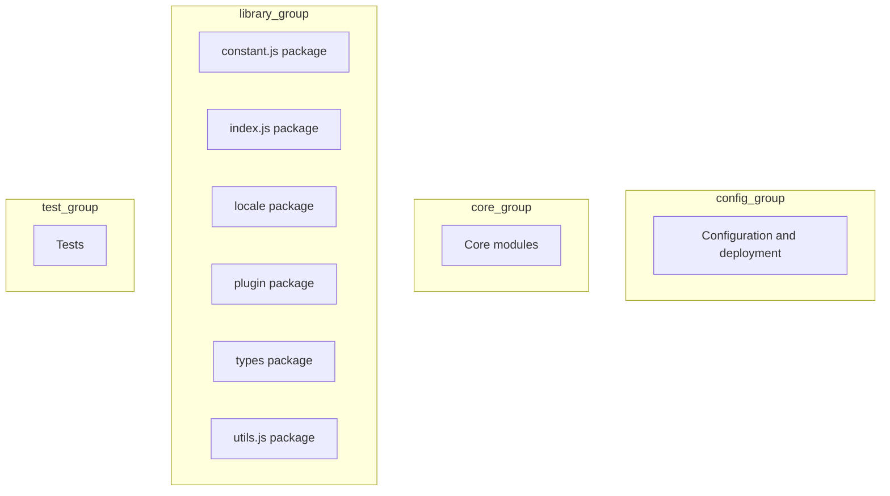

# Architecture report: iamkun/dayjs

> Automated static analysis. **Observed** = directly seen in files/imports/AST; **Inferred** = interpretation from that evidence. Repository code was not executed.

## 1. Repository at a glance

| Item | Value |
| --- | --- |
| Repository | iamkun/dayjs |
| Description | ⏰ Day.js 2kB immutable date-time library alternative to Moment.js with the same modern API |
| Language | JavaScript |
| Stars | 48648 |
| Licence | MIT |
| Analysed commit / branch | d3e43be0489ff1d010aca42b3115b6059215ed60 / dev |
| Framework(s) | None detected |
| Files analysed | 375 |
| Components | 9 |

## 2. Architecture in one minute

iamkun/dayjs - ⏰ Day.js 2kB immutable date-time library alternative to Moment.js with the same modern API. This repository was analysed statically from 375 file(s) (0 Python). Detected technologies (observed from imports/manifests): GitHub Actions, Jest, TypeScript. Files are grouped into 9 component(s): Configuration and deployment, constant.js package, Core modules, index.js package, locale package, plugin package, Tests, types package. Findings below distinguish observed facts from inferred interpretation.

## 3. High-level block diagram

## 4. Main components

### Configuration and deployment (`config`)

- **Kind:** config
- **Status:** Observed
- **Confidence:** 0.85
- **Responsibility:** Groups 1 file(s) under configuration and deployment (observed from repository paths and static analysis).
- **Paths:** `package.json`
- **Evidence:** [package.json](https://github.com/iamkun/dayjs/blob/d3e43be0489ff1d010aca42b3115b6059215ed60/package.json)

### constant.js package (`constant_js`)

- **Kind:** library
- **Status:** Observed
- **Confidence:** 0.85
- **Responsibility:** Groups 1 file(s) under constant.js package (observed from repository paths and static analysis).
- **Paths:** `src/constant.js`
- **Evidence:** [src/constant.js](https://github.com/iamkun/dayjs/blob/d3e43be0489ff1d010aca42b3115b6059215ed60/src/constant.js)

### Core modules (`core`)

- **Kind:** core
- **Status:** Observed
- **Confidence:** 0.85
- **Responsibility:** Groups 3 file(s) under core modules (observed from repository paths and static analysis).
- **Paths:** `babel.config.js`, `karma.sauce.conf.js`, `prettier.config.js`
- **Evidence:** [babel.config.js](https://github.com/iamkun/dayjs/blob/d3e43be0489ff1d010aca42b3115b6059215ed60/babel.config.js); [karma.sauce.conf.js](https://github.com/iamkun/dayjs/blob/d3e43be0489ff1d010aca42b3115b6059215ed60/karma.sauce.conf.js); [prettier.config.js](https://github.com/iamkun/dayjs/blob/d3e43be0489ff1d010aca42b3115b6059215ed60/prettier.config.js)

### index.js package (`index_js`)

- **Kind:** library
- **Status:** Observed
- **Confidence:** 0.85
- **Responsibility:** Groups 1 file(s) under index.js package (observed from repository paths and static analysis).
- **Paths:** `src/index.js`
- **Evidence:** [src/index.js](https://github.com/iamkun/dayjs/blob/d3e43be0489ff1d010aca42b3115b6059215ed60/src/index.js)

### locale package (`locale`)

- **Kind:** library
- **Status:** Observed
- **Confidence:** 0.85
- **Responsibility:** Groups 143 file(s) under locale package (observed from repository paths and static analysis).
- **Paths:** `src/locale/af.js`, `src/locale/am.js`, `src/locale/ar-dz.js`, `src/locale/ar-iq.js`, `src/locale/ar-kw.js`, `src/locale/ar-ly.js`, `src/locale/ar-ma.js`, `src/locale/ar-sa.js`, `src/locale/ar-tn.js`, `src/locale/ar.js`, `src/locale/az.js`, `src/locale/be.js`, `src/locale/bg.js`, `src/locale/bi.js`, `src/locale/bm.js`, `src/locale/bn-bd.js`, `src/locale/bn.js`, `src/locale/bo.js`, `src/locale/br.js`, `src/locale/bs.js`, `src/locale/ca.js`, `src/locale/cs.js`, `src/locale/cv.js`, `src/locale/cy.js`, `src/locale/da.js`, `src/locale/de-at.js`, `src/locale/de-ch.js`, `src/locale/de.js`, `src/locale/dv.js`, `src/locale/el.js`, `src/locale/en-au.js`, `src/locale/en-ca.js`, `src/locale/en-gb.js`, `src/locale/en-ie.js`, `src/locale/en-il.js`, `src/locale/en-in.js`, `src/locale/en-nz.js`, `src/locale/en-sg.js`, `src/locale/en-tt.js`, `src/locale/en.js`, `src/locale/eo.js`, `src/locale/es-do.js`, `src/locale/es-mx.js`, `src/locale/es-pr.js`, `src/locale/es-us.js`, `src/locale/es.js`, `src/locale/et.js`, `src/locale/eu.js`, `src/locale/fa.js`, `src/locale/fi.js`, `src/locale/fo.js`, `src/locale/fr-ca.js`, `src/locale/fr-ch.js`, `src/locale/fr.js`, `src/locale/fy.js`, `src/locale/ga.js`, `src/locale/gd.js`, `src/locale/gl.js`, `src/locale/gom-latn.js`, `src/locale/gu.js`, `src/locale/he.js`, `src/locale/hi.js`, `src/locale/hr.js`, `src/locale/ht.js`, `src/locale/hu.js`, `src/locale/hy-am.js`, `src/locale/id.js`, `src/locale/is.js`, `src/locale/it-ch.js`, `src/locale/it.js`, `src/locale/ja.js`, `src/locale/jv.js`, `src/locale/ka.js`, `src/locale/kk.js`, `src/locale/km.js`, `src/locale/kn.js`, `src/locale/ko.js`, `src/locale/ku.js`, `src/locale/ky.js`, `src/locale/lb.js`, `src/locale/lo.js`, `src/locale/lt.js`, `src/locale/lv.js`, `src/locale/me.js`, `src/locale/mi.js`, `src/locale/mk.js`, `src/locale/ml.js`, `src/locale/mn.js`, `src/locale/mr.js`, `src/locale/ms-my.js`, `src/locale/ms.js`, `src/locale/mt.js`, `src/locale/my.js`, `src/locale/nb.js`, `src/locale/ne.js`, `src/locale/nl-be.js`, `src/locale/nl.js`, `src/locale/nn.js`, `src/locale/oc-lnc.js`, `src/locale/pa-in.js`, `src/locale/pl.js`, `src/locale/pt-br.js`, `src/locale/pt.js`, `src/locale/rn.js`, `src/locale/ro.js`, `src/locale/ru.js`, `src/locale/rw.js`, `src/locale/sd.js`, `src/locale/se.js`, `src/locale/si.js`, `src/locale/sk.js`, `src/locale/sl.js`, `src/locale/sq.js`, `src/locale/sr-cyrl.js`, `src/locale/sr.js`, `src/locale/ss.js`, `src/locale/sv-fi.js`, `src/locale/sv.js`, `src/locale/sw.js`, `src/locale/ta.js`, `src/locale/te.js`, `src/locale/tet.js`, `src/locale/tg.js`, `src/locale/th.js`, `src/locale/tk.js`, `src/locale/tl-ph.js`, `src/locale/tlh.js`, `src/locale/tr.js`, `src/locale/tzl.js`, `src/locale/tzm-latn.js`, `src/locale/tzm.js`, `src/locale/ug-cn.js`, `src/locale/uk.js`, `src/locale/ur.js`, `src/locale/uz-latn.js`, `src/locale/uz.js`, `src/locale/vi.js`, `src/locale/x-pseudo.js`, `src/locale/yo.js`, `src/locale/zh-cn.js`, `src/locale/zh-hk.js`, `src/locale/zh-tw.js`, `src/locale/zh.js`
- **Evidence:** [src/locale/af.js](https://github.com/iamkun/dayjs/blob/d3e43be0489ff1d010aca42b3115b6059215ed60/src/locale/af.js); [src/locale/am.js](https://github.com/iamkun/dayjs/blob/d3e43be0489ff1d010aca42b3115b6059215ed60/src/locale/am.js); [src/locale/ar-dz.js](https://github.com/iamkun/dayjs/blob/d3e43be0489ff1d010aca42b3115b6059215ed60/src/locale/ar-dz.js); [src/locale/ar-iq.js](https://github.com/iamkun/dayjs/blob/d3e43be0489ff1d010aca42b3115b6059215ed60/src/locale/ar-iq.js); [src/locale/ar-kw.js](https://github.com/iamkun/dayjs/blob/d3e43be0489ff1d010aca42b3115b6059215ed60/src/locale/ar-kw.js); [src/locale/ar-ly.js](https://github.com/iamkun/dayjs/blob/d3e43be0489ff1d010aca42b3115b6059215ed60/src/locale/ar-ly.js); [src/locale/ar-ma.js](https://github.com/iamkun/dayjs/blob/d3e43be0489ff1d010aca42b3115b6059215ed60/src/locale/ar-ma.js); [src/locale/ar-sa.js](https://github.com/iamkun/dayjs/blob/d3e43be0489ff1d010aca42b3115b6059215ed60/src/locale/ar-sa.js)

### plugin package (`plugin`)

- **Kind:** library
- **Status:** Observed
- **Confidence:** 0.85
- **Responsibility:** Groups 38 file(s) under plugin package (observed from repository paths and static analysis).
- **Paths:** `src/plugin/advancedFormat/index.js`, `src/plugin/arraySupport/index.js`, `src/plugin/badMutable/index.js`, `src/plugin/bigIntSupport/index.js`, `src/plugin/buddhistEra/index.js`, `src/plugin/calendar/index.js`, `src/plugin/customParseFormat/index.js`, `src/plugin/dayOfYear/index.js`, `src/plugin/devHelper/index.js`, `src/plugin/duration/index.js`, `src/plugin/isBetween/index.js`, `src/plugin/isLeapYear/index.js`, `src/plugin/isMoment/index.js`, `src/plugin/isSameOrAfter/index.js`, `src/plugin/isSameOrBefore/index.js`, `src/plugin/isToday/index.js`, `src/plugin/isTomorrow/index.js`, `src/plugin/isYesterday/index.js`, `src/plugin/isoWeek/index.js`, `src/plugin/isoWeeksInYear/index.js`, `src/plugin/localeData/index.js`, `src/plugin/localizedFormat/index.js`, `src/plugin/localizedFormat/utils.js`, `src/plugin/minMax/index.js`, `src/plugin/negativeYear/index.js`, `src/plugin/objectSupport/index.js`, `src/plugin/pluralGetSet/index.js`, `src/plugin/preParsePostFormat/index.js`, `src/plugin/quarterOfYear/index.js`, `src/plugin/relativeTime/index.js`, `src/plugin/timezone/index.js`, `src/plugin/toArray/index.js`, `src/plugin/toObject/index.js`, `src/plugin/updateLocale/index.js`, `src/plugin/utc/index.js`, `src/plugin/weekOfYear/index.js`, `src/plugin/weekYear/index.js`, `src/plugin/weekday/index.js`
- **Evidence:** [src/plugin/advancedFormat/index.js](https://github.com/iamkun/dayjs/blob/d3e43be0489ff1d010aca42b3115b6059215ed60/src/plugin/advancedFormat/index.js); [src/plugin/arraySupport/index.js](https://github.com/iamkun/dayjs/blob/d3e43be0489ff1d010aca42b3115b6059215ed60/src/plugin/arraySupport/index.js); [src/plugin/badMutable/index.js](https://github.com/iamkun/dayjs/blob/d3e43be0489ff1d010aca42b3115b6059215ed60/src/plugin/badMutable/index.js); [src/plugin/bigIntSupport/index.js](https://github.com/iamkun/dayjs/blob/d3e43be0489ff1d010aca42b3115b6059215ed60/src/plugin/bigIntSupport/index.js); [src/plugin/buddhistEra/index.js](https://github.com/iamkun/dayjs/blob/d3e43be0489ff1d010aca42b3115b6059215ed60/src/plugin/buddhistEra/index.js); [src/plugin/calendar/index.js](https://github.com/iamkun/dayjs/blob/d3e43be0489ff1d010aca42b3115b6059215ed60/src/plugin/calendar/index.js); [src/plugin/customParseFormat/index.js](https://github.com/iamkun/dayjs/blob/d3e43be0489ff1d010aca42b3115b6059215ed60/src/plugin/customParseFormat/index.js); [src/plugin/dayOfYear/index.js](https://github.com/iamkun/dayjs/blob/d3e43be0489ff1d010aca42b3115b6059215ed60/src/plugin/dayOfYear/index.js)

### Tests (`tests`)

- **Kind:** test
- **Status:** Observed
- **Confidence:** 0.85
- **Responsibility:** Groups 95 file(s) under tests (observed from repository paths and static analysis).
- **Paths:** `test/__mocks__/dayjs.js`, `test/browser.spec.js`, `test/comparison.test.js`, `test/constructor.test.js`, `test/display.test.js`, `test/get-set.test.js`, `test/issues/issue2027.correct-order.test.js`, `test/issues/issue2027.swapped-order.test.js`, `test/locale.test.js`, `test/locale/ar-dz.test.js`, `test/locale/ar-iq.test.js`, `test/locale/ar-kw.test.js`, `test/locale/ar-ly.test.js`, `test/locale/ar-ma.test.js`, `test/locale/ar-sa.test.js`, `test/locale/ar-tn.test.js`, `test/locale/ar.test.js`, `test/locale/be.test.js`, `test/locale/bg.test.js`, `test/locale/bn-bd.test.js`, `test/locale/bn.test.js`, `test/locale/br.test.js`, `test/locale/cs.test.js`, `test/locale/de.test.js`, `test/locale/en.test.js`, `test/locale/et.test.js`, `test/locale/fi.test.js`, `test/locale/he.test.js`, `test/locale/hr.test.js`, `test/locale/hu.test.js`, `test/locale/is.test.js`, `test/locale/it-ch.test.js`, `test/locale/it.test.js`, `test/locale/ja.test.js`, `test/locale/keys.test.js`, `test/locale/ku.test.js`, `test/locale/lt.test.js`, `test/locale/pl.test.js`, `test/locale/ru.test.js`, `test/locale/sk.test.js`, `test/locale/sl.test.js`, `test/locale/sr-cyrl.test.js`, `test/locale/sr.test.js`, `test/locale/sv-fi.test.js`, `test/locale/sv.test.js`, `test/locale/uk.test.js`, `test/locale/zh-cn.test.js`, `test/locale/zh-hk.test.js`, `test/locale/zh-tw.test.js`, `test/locale/zh.test.js`, `test/manipulate.test.js`, `test/parse.test.js`, `test/plugin.test.js`, `test/plugin/advancedFormat.test.js`, `test/plugin/arraySupport.test.js`, `test/plugin/badMutable.test.js`, `test/plugin/bigIntSupport.test.js`, `test/plugin/buddhistEra.test.js`, `test/plugin/calendar.test.js`, `test/plugin/customParseFormat.test.js`, `test/plugin/dayOfYear.test.js`, `test/plugin/declarations.test.js`, `test/plugin/devHelper.test.js`, `test/plugin/duration.test.js`, `test/plugin/isBetween.test.js`, `test/plugin/isLeapYear.test.js`, `test/plugin/isMoment.test.js`, `test/plugin/isSameOrAfter.test.js`, `test/plugin/isSameOrBefore.test.js`, `test/plugin/isToday.test.js`, `test/plugin/isTomorrow.test.js`, `test/plugin/isYesterday.test.js`, `test/plugin/isoWeek.test.js`, `test/plugin/isoWeeksInYear.test.js`, `test/plugin/localeData.test.js`, `test/plugin/localizedFormat.test.js`, `test/plugin/minMax.test.js`, `test/plugin/negativeYear.test.js`, `test/plugin/objectSupport.test.js`, `test/plugin/pluralGetSet.test.js`, `test/plugin/preParsePostFormat.test.js`, `test/plugin/quarterOfYear.test.js`, `test/plugin/relativeTime.test.js`, `test/plugin/timezone.test.js`, `test/plugin/toArray.test.js`, `test/plugin/toObject.test.js`, `test/plugin/updateLocale.test.js`, `test/plugin/utc-utcOffset.test.js`, `test/plugin/utc.test.js`, `test/plugin/weekOfYear.test.js`, `test/plugin/weekYear.test.js`, `test/plugin/weekday.test.js`, `test/query.test.js`, `test/timezone.test.js`, `test/utils.test.js`
- **Evidence:** [test/__mocks__/dayjs.js](https://github.com/iamkun/dayjs/blob/d3e43be0489ff1d010aca42b3115b6059215ed60/test/__mocks__/dayjs.js); [test/browser.spec.js](https://github.com/iamkun/dayjs/blob/d3e43be0489ff1d010aca42b3115b6059215ed60/test/browser.spec.js); [test/comparison.test.js](https://github.com/iamkun/dayjs/blob/d3e43be0489ff1d010aca42b3115b6059215ed60/test/comparison.test.js); [test/constructor.test.js](https://github.com/iamkun/dayjs/blob/d3e43be0489ff1d010aca42b3115b6059215ed60/test/constructor.test.js); [test/display.test.js](https://github.com/iamkun/dayjs/blob/d3e43be0489ff1d010aca42b3115b6059215ed60/test/display.test.js); [test/get-set.test.js](https://github.com/iamkun/dayjs/blob/d3e43be0489ff1d010aca42b3115b6059215ed60/test/get-set.test.js); [test/issues/issue2027.correct-order.test.js](https://github.com/iamkun/dayjs/blob/d3e43be0489ff1d010aca42b3115b6059215ed60/test/issues/issue2027.correct-order.test.js); [test/issues/issue2027.swapped-order.test.js](https://github.com/iamkun/dayjs/blob/d3e43be0489ff1d010aca42b3115b6059215ed60/test/issues/issue2027.swapped-order.test.js)

### types package (`types`)

- **Kind:** library
- **Status:** Observed
- **Confidence:** 0.85
- **Responsibility:** Groups 40 file(s) under types package (observed from repository paths and static analysis).
- **Paths:** `types/index.d.ts`, `types/locale/index.d.ts`, `types/locale/types.d.ts`, `types/plugin/advancedFormat.d.ts`, `types/plugin/arraySupport.d.ts`, `types/plugin/badMutable.d.ts`, `types/plugin/bigIntSupport.d.ts`, `types/plugin/buddhistEra.d.ts`, `types/plugin/calendar.d.ts`, `types/plugin/customParseFormat.d.ts`, `types/plugin/dayOfYear.d.ts`, `types/plugin/devHelper.d.ts`, `types/plugin/duration.d.ts`, `types/plugin/isBetween.d.ts`, `types/plugin/isLeapYear.d.ts`, `types/plugin/isMoment.d.ts`, `types/plugin/isSameOrAfter.d.ts`, `types/plugin/isSameOrBefore.d.ts`, `types/plugin/isToday.d.ts`, `types/plugin/isTomorrow.d.ts`, `types/plugin/isYesterday.d.ts`, `types/plugin/isoWeek.d.ts`, `types/plugin/isoWeeksInYear.d.ts`, `types/plugin/localeData.d.ts`, `types/plugin/localizedFormat.d.ts`, `types/plugin/minMax.d.ts`, `types/plugin/negativeYear.d.ts`, `types/plugin/objectSupport.d.ts`, `types/plugin/pluralGetSet.d.ts`, `types/plugin/preParsePostFormat.d.ts`, `types/plugin/quarterOfYear.d.ts`, `types/plugin/relativeTime.d.ts`, `types/plugin/timezone.d.ts`, `types/plugin/toArray.d.ts`, `types/plugin/toObject.d.ts`, `types/plugin/updateLocale.d.ts`, `types/plugin/utc.d.ts`, `types/plugin/weekOfYear.d.ts`, `types/plugin/weekYear.d.ts`, `types/plugin/weekday.d.ts`
- **Evidence:** [types/index.d.ts](https://github.com/iamkun/dayjs/blob/d3e43be0489ff1d010aca42b3115b6059215ed60/types/index.d.ts); [types/locale/index.d.ts](https://github.com/iamkun/dayjs/blob/d3e43be0489ff1d010aca42b3115b6059215ed60/types/locale/index.d.ts); [types/locale/types.d.ts](https://github.com/iamkun/dayjs/blob/d3e43be0489ff1d010aca42b3115b6059215ed60/types/locale/types.d.ts); [types/plugin/advancedFormat.d.ts](https://github.com/iamkun/dayjs/blob/d3e43be0489ff1d010aca42b3115b6059215ed60/types/plugin/advancedFormat.d.ts); [types/plugin/arraySupport.d.ts](https://github.com/iamkun/dayjs/blob/d3e43be0489ff1d010aca42b3115b6059215ed60/types/plugin/arraySupport.d.ts); [types/plugin/badMutable.d.ts](https://github.com/iamkun/dayjs/blob/d3e43be0489ff1d010aca42b3115b6059215ed60/types/plugin/badMutable.d.ts); [types/plugin/bigIntSupport.d.ts](https://github.com/iamkun/dayjs/blob/d3e43be0489ff1d010aca42b3115b6059215ed60/types/plugin/bigIntSupport.d.ts); [types/plugin/buddhistEra.d.ts](https://github.com/iamkun/dayjs/blob/d3e43be0489ff1d010aca42b3115b6059215ed60/types/plugin/buddhistEra.d.ts)

### utils.js package (`utils_js`)

- **Kind:** library
- **Status:** Observed
- **Confidence:** 0.85
- **Responsibility:** Groups 1 file(s) under utils.js package (observed from repository paths and static analysis).
- **Paths:** `src/utils.js`
- **Evidence:** [src/utils.js](https://github.com/iamkun/dayjs/blob/d3e43be0489ff1d010aca42b3115b6059215ed60/src/utils.js)

## 5. Execution flow

**Observed** entry point(s):

- [src/index.js](https://github.com/iamkun/dayjs/blob/d3e43be0489ff1d010aca42b3115b6059215ed60/src/index.js)
- [src/plugin/advancedFormat/index.js](https://github.com/iamkun/dayjs/blob/d3e43be0489ff1d010aca42b3115b6059215ed60/src/plugin/advancedFormat/index.js)
- [src/plugin/arraySupport/index.js](https://github.com/iamkun/dayjs/blob/d3e43be0489ff1d010aca42b3115b6059215ed60/src/plugin/arraySupport/index.js)
- [src/plugin/badMutable/index.js](https://github.com/iamkun/dayjs/blob/d3e43be0489ff1d010aca42b3115b6059215ed60/src/plugin/badMutable/index.js)
- [src/plugin/bigIntSupport/index.js](https://github.com/iamkun/dayjs/blob/d3e43be0489ff1d010aca42b3115b6059215ed60/src/plugin/bigIntSupport/index.js)
- [src/plugin/buddhistEra/index.js](https://github.com/iamkun/dayjs/blob/d3e43be0489ff1d010aca42b3115b6059215ed60/src/plugin/buddhistEra/index.js)
- [src/plugin/calendar/index.js](https://github.com/iamkun/dayjs/blob/d3e43be0489ff1d010aca42b3115b6059215ed60/src/plugin/calendar/index.js)
- [src/plugin/customParseFormat/index.js](https://github.com/iamkun/dayjs/blob/d3e43be0489ff1d010aca42b3115b6059215ed60/src/plugin/customParseFormat/index.js)
- [src/plugin/dayOfYear/index.js](https://github.com/iamkun/dayjs/blob/d3e43be0489ff1d010aca42b3115b6059215ed60/src/plugin/dayOfYear/index.js)
- [src/plugin/devHelper/index.js](https://github.com/iamkun/dayjs/blob/d3e43be0489ff1d010aca42b3115b6059215ed60/src/plugin/devHelper/index.js)
- [src/plugin/duration/index.js](https://github.com/iamkun/dayjs/blob/d3e43be0489ff1d010aca42b3115b6059215ed60/src/plugin/duration/index.js)
- [src/plugin/isBetween/index.js](https://github.com/iamkun/dayjs/blob/d3e43be0489ff1d010aca42b3115b6059215ed60/src/plugin/isBetween/index.js)

Representative flow (derived from observed entry points and the import graph; steps beyond the entry point are **Inferred**):

1. Execution starts at an observed entry point listed above, if present.
2. No internal import relationships between components were observed.

## 6. Project structure

### `(root)`

- `.editorconfig` - config (94 bytes)
- `.eslintrc.json` - config (582 bytes)
- `.gitignore` - other (166 bytes)
- `.npmignore` - other (266 bytes)
- `.releaserc` - other (220 bytes)
- `CHANGELOG.md` - docs (83788 bytes)
- `CONTRIBUTING.md` - docs (1124 bytes)
- `LICENSE` - docs (1072 bytes)
- `README.md` - docs (7598 bytes)
- `babel.config.js` - source, JavaScript (277 bytes)
- `karma.sauce.conf.js` - source, JavaScript (2113 bytes)
- `package.json` - manifest (2984 bytes)
- `prettier.config.js` - source, JavaScript (117 bytes)

### `.github`

- `.github/FUNDING.yml` - config (599 bytes)
- `.github/ISSUE_TEMPLATE/--bug-report.md` - docs (430 bytes)
- `.github/workflows/check.yml` - ci, YAML (178 bytes)
- `.github/workflows/lint-test.yml` - ci, YAML (725 bytes)
- `.github/workflows/release.yml` - ci, YAML (1051 bytes)

### `docs`

- `docs/demo/index.js` - docs (867 bytes)
- `docs/en/API-reference.md` - docs (79 bytes)
- `docs/en/I18n.md` - docs (79 bytes)
- `docs/en/Installation.md` - docs (79 bytes)
- `docs/en/Plugin.md` - docs (79 bytes)
- `docs/es-es/API-reference.md` - docs (80 bytes)
- `docs/es-es/I18n.md` - docs (80 bytes)
- `docs/es-es/Installation.md` - docs (80 bytes)
- `docs/es-es/Plugin.md` - docs (80 bytes)
- `docs/es-es/README-es-es.md` - docs (5286 bytes)
- `docs/fr/README-fr.md` - docs (4703 bytes)
- `docs/he/README-he.md` - docs (5163 bytes)
- `docs/ja/API-reference.md` - docs (80 bytes)
- `docs/ja/I18n.md` - docs (80 bytes)
- `docs/ja/Installation.md` - docs (80 bytes)
- `docs/ja/Plugin.md` - docs (80 bytes)
- `docs/ja/README-ja.md` - docs (4475 bytes)
- `docs/ko/API-reference.md` - docs (80 bytes)
- `docs/ko/I18n.md` - docs (80 bytes)
- `docs/ko/Installation.md` - docs (80 bytes)
- `docs/ko/Plugin.md` - docs (80 bytes)
- `docs/ko/README-ko.md` - docs (4285 bytes)
- `docs/pt-br/API-reference.md` - docs (80 bytes)
- `docs/pt-br/I18n.md` - docs (80 bytes)
- `docs/pt-br/Installation.md` - docs (80 bytes)
- `docs/pt-br/Plugin.md` - docs (80 bytes)
- `docs/pt-br/README-pt-br.md` - docs (4707 bytes)
- `docs/ru/LICENSE-ru` - docs (2367 bytes)
- `docs/ru/README-ru.md` - docs (6216 bytes)
- `docs/si/README-si.md` - docs (6821 bytes)
- `docs/sw/README-sw.md` - docs (5049 bytes)
- `docs/tr/README-tr.md` - docs (4945 bytes)
- `docs/zh-cn/API-reference.md` - docs (75 bytes)
- `docs/zh-cn/I18n.md` - docs (75 bytes)
- `docs/zh-cn/Installation.md` - docs (75 bytes)
- `docs/zh-cn/Plugin.md` - docs (75 bytes)
- `docs/zh-cn/README.zh-CN.md` - docs (3882 bytes)

### `patches`

- `patches/@semantic-release+github+11.0.4.patch` - other (722 bytes)

### `src`

- `src/constant.js` - source, JavaScript (1154 bytes)
- `src/index.js` - source, JavaScript (11768 bytes)
- `src/locale/af.js` - source, JavaScript (1004 bytes)
- `src/locale/am.js` - source, JavaScript (1345 bytes)
- `src/locale/ar-dz.js` - source, JavaScript (1280 bytes)
- `src/locale/ar-iq.js` - source, JavaScript (1355 bytes)
- `src/locale/ar-kw.js` - source, JavaScript (1259 bytes)
- `src/locale/ar-ly.js` - source, JavaScript (999 bytes)
- `src/locale/ar-ma.js` - source, JavaScript (1276 bytes)
- `src/locale/ar-sa.js` - source, JavaScript (1285 bytes)
- `src/locale/ar-tn.js` - source, JavaScript (1281 bytes)
- `src/locale/ar.js` - source, JavaScript (1974 bytes)
- `src/locale/az.js` - source, JavaScript (1051 bytes)
- `src/locale/be.js` - source, JavaScript (3597 bytes)
- `src/locale/bg.js` - source, JavaScript (1602 bytes)
- `src/locale/bi.js` - source, JavaScript (974 bytes)
- `src/locale/bm.js` - source, JavaScript (1126 bytes)
- `src/locale/bn-bd.js` - source, JavaScript (2869 bytes)
- `src/locale/bn.js` - source, JavaScript (2160 bytes)
- `src/locale/bo.js` - source, JavaScript (2189 bytes)
- `src/locale/br.js` - source, JavaScript (1977 bytes)
- `src/locale/bs.js` - source, JavaScript (732 bytes)
- `src/locale/ca.js` - source, JavaScript (1279 bytes)
- `src/locale/cs.js` - source, JavaScript (2985 bytes)
- `src/locale/cv.js` - source, JavaScript (995 bytes)
- `src/locale/cy.js` - source, JavaScript (1012 bytes)
- `src/locale/da.js` - source, JavaScript (1055 bytes)
- `src/locale/de-at.js` - source, JavaScript (1688 bytes)
- `src/locale/de-ch.js` - source, JavaScript (1683 bytes)
- `src/locale/de.js` - source, JavaScript (1687 bytes)
- `src/locale/dv.js` - source, JavaScript (1536 bytes)
- `src/locale/el.js` - source, JavaScript (1344 bytes)
- `src/locale/en-au.js` - source, JavaScript (1136 bytes)
- `src/locale/en-ca.js` - source, JavaScript (996 bytes)
- `src/locale/en-gb.js` - source, JavaScript (1153 bytes)
- `src/locale/en-ie.js` - source, JavaScript (1005 bytes)
- `src/locale/en-il.js` - source, JavaScript (989 bytes)
- `src/locale/en-in.js` - source, JavaScript (1144 bytes)
- `src/locale/en-nz.js` - source, JavaScript (1136 bytes)
- `src/locale/en-sg.js` - source, JavaScript (1008 bytes)
- `src/locale/en-tt.js` - source, JavaScript (1156 bytes)
- `src/locale/en.js` - source, JavaScript (457 bytes)
- `src/locale/eo.js` - source, JavaScript (1023 bytes)
- `src/locale/es-do.js` - source, JavaScript (1074 bytes)
- `src/locale/es-mx.js` - source, JavaScript (1038 bytes)
- `src/locale/es-pr.js` - source, JavaScript (1067 bytes)
- `src/locale/es-us.js` - source, JavaScript (1053 bytes)
- `src/locale/es.js` - source, JavaScript (1039 bytes)
- `src/locale/et.js` - source, JavaScript (2067 bytes)
- `src/locale/eu.js` - source, JavaScript (1199 bytes)
- `src/locale/fa.js` - source, JavaScript (1277 bytes)
- `src/locale/fi.js` - source, JavaScript (2575 bytes)
- `src/locale/fo.js` - source, JavaScript (1041 bytes)
- `src/locale/fr-ca.js` - source, JavaScript (1021 bytes)
- `src/locale/fr-ch.js` - source, JavaScript (1042 bytes)
- `src/locale/fr.js` - source, JavaScript (1099 bytes)
- `src/locale/fy.js` - source, JavaScript (1023 bytes)
- `src/locale/ga.js` - source, JavaScript (1093 bytes)
- `src/locale/gd.js` - source, JavaScript (1110 bytes)
- `src/locale/gl.js` - source, JavaScript (1046 bytes)
- `src/locale/gom-latn.js` - source, JavaScript (828 bytes)
- `src/locale/gu.js` - source, JavaScript (1633 bytes)
- `src/locale/he.js` - source, JavaScript (2131 bytes)
- `src/locale/hi.js` - source, JavaScript (1514 bytes)
- `src/locale/hr.js` - source, JavaScript (1466 bytes)
- `src/locale/ht.js` - source, JavaScript (980 bytes)
- `src/locale/hu.js` - source, JavaScript (1661 bytes)
- `src/locale/hy-am.js` - source, JavaScript (1310 bytes)
- `src/locale/id.js` - source, JavaScript (1006 bytes)
- `src/locale/is.js` - source, JavaScript (2304 bytes)
- `src/locale/it-ch.js` - source, JavaScript (1025 bytes)
- `src/locale/it.js` - source, JavaScript (1013 bytes)
- `src/locale/ja.js` - source, JavaScript (1156 bytes)
- `src/locale/jv.js` - source, JavaScript (1032 bytes)
- `src/locale/ka.js` - source, JavaScript (1565 bytes)
- `src/locale/kk.js` - source, JavaScript (1254 bytes)
- `src/locale/km.js` - source, JavaScript (1549 bytes)
- `src/locale/kn.js` - source, JavaScript (1664 bytes)
- `src/locale/ko.js` - source, JavaScript (1182 bytes)
- `src/locale/ku.js` - source, JavaScript (1985 bytes)
- `src/locale/ky.js` - source, JavaScript (1252 bytes)
- `src/locale/lb.js` - source, JavaScript (777 bytes)
- `src/locale/lo.js` - source, JavaScript (1491 bytes)
- `src/locale/lt.js` - source, JavaScript (2160 bytes)
- `src/locale/lv.js` - source, JavaScript (1063 bytes)
- `src/locale/me.js` - source, JavaScript (731 bytes)
- `src/locale/mi.js` - source, JavaScript (1082 bytes)
- `src/locale/mk.js` - source, JavaScript (1239 bytes)
- `src/locale/ml.js` - source, JavaScript (1756 bytes)
- `src/locale/mn.js` - source, JavaScript (1346 bytes)
- `src/locale/mr.js` - source, JavaScript (1217 bytes)
- `src/locale/ms-my.js` - source, JavaScript (996 bytes)
- `src/locale/ms.js` - source, JavaScript (979 bytes)
- `src/locale/mt.js` - source, JavaScript (1018 bytes)
- `src/locale/my.js` - source, JavaScript (1559 bytes)
- `src/locale/nb.js` - source, JavaScript (1054 bytes)
- `src/locale/ne.js` - source, JavaScript (1673 bytes)
- `src/locale/nl-be.js` - source, JavaScript (1044 bytes)
- `src/locale/nl.js` - source, JavaScript (1077 bytes)
- `src/locale/nn.js` - source, JavaScript (1019 bytes)
- `src/locale/oc-lnc.js` - source, JavaScript (1049 bytes)
- `src/locale/pa-in.js` - source, JavaScript (1598 bytes)
- `src/locale/pl.js` - source, JavaScript (2143 bytes)
- `src/locale/pt-br.js` - source, JavaScript (1078 bytes)
- `src/locale/pt.js` - source, JavaScript (1093 bytes)
- `src/locale/rn.js` - source, JavaScript (1056 bytes)
- `src/locale/ro.js` - source, JavaScript (1006 bytes)
- `src/locale/ru.js` - source, JavaScript (3207 bytes)
- `src/locale/rw.js` - source, JavaScript (835 bytes)
- `src/locale/sd.js` - source, JavaScript (1251 bytes)
- `src/locale/se.js` - source, JavaScript (1183 bytes)
- `src/locale/si.js` - source, JavaScript (1452 bytes)
- `src/locale/sk.js` - source, JavaScript (3043 bytes)
- `src/locale/sl.js` - source, JavaScript (3769 bytes)
- `src/locale/sq.js` - source, JavaScript (1008 bytes)
- `src/locale/sr-cyrl.js` - source, JavaScript (2844 bytes)
- `src/locale/sr.js` - source, JavaScript (2426 bytes)
- `src/locale/ss.js` - source, JavaScript (1057 bytes)
- `src/locale/sv-fi.js` - source, JavaScript (1277 bytes)
- `src/locale/sv.js` - source, JavaScript (1198 bytes)
- `src/locale/sw.js` - source, JavaScript (1018 bytes)
- `src/locale/ta.js` - source, JavaScript (1910 bytes)
- `src/locale/te.js` - source, JavaScript (1614 bytes)
- `src/locale/tet.js` - source, JavaScript (1019 bytes)
- `src/locale/tg.js` - source, JavaScript (1211 bytes)
- `src/locale/th.js` - source, JavaScript (1572 bytes)
- `src/locale/tk.js` - source, JavaScript (1021 bytes)
- `src/locale/tl-ph.js` - source, JavaScript (1048 bytes)
- `src/locale/tlh.js` - source, JavaScript (1010 bytes)
- `src/locale/tr.js` - source, JavaScript (1001 bytes)
- `src/locale/tzl.js` - source, JavaScript (767 bytes)
- `src/locale/tzm-latn.js` - source, JavaScript (1121 bytes)
- `src/locale/tzm.js` - source, JavaScript (1710 bytes)
- `src/locale/ug-cn.js` - source, JavaScript (1407 bytes)
- `src/locale/uk.js` - source, JavaScript (2874 bytes)
- `src/locale/ur.js` - source, JavaScript (1241 bytes)
- `src/locale/uz-latn.js` - source, JavaScript (1006 bytes)
- `src/locale/uz.js` - source, JavaScript (1215 bytes)
- `src/locale/vi.js` - source, JavaScript (1194 bytes)
- `src/locale/x-pseudo.js` - source, JavaScript (1215 bytes)
- `src/locale/yo.js` - source, JavaScript (1202 bytes)
- `src/locale/zh-cn.js` - source, JavaScript (1686 bytes)
- `src/locale/zh-hk.js` - source, JavaScript (1655 bytes)
- `src/locale/zh-tw.js` - source, JavaScript (1646 bytes)
- `src/locale/zh.js` - source, JavaScript (1671 bytes)
- `src/plugin/advancedFormat/index.js` - source, JavaScript (1530 bytes)
- `src/plugin/arraySupport/index.js` - source, JavaScript (628 bytes)
- `src/plugin/badMutable/index.js` - source, JavaScript (1354 bytes)
- `src/plugin/bigIntSupport/index.js` - source, JavaScript (589 bytes)
- `src/plugin/buddhistEra/index.js` - source, JavaScript (582 bytes)
- `src/plugin/calendar/index.js` - source, JavaScript (1136 bytes)
- `src/plugin/customParseFormat/index.js` - source, JavaScript (7697 bytes)
- `src/plugin/dayOfYear/index.js` - source, JavaScript (307 bytes)
- `src/plugin/devHelper/index.js` - source, JavaScript (1862 bytes)
- `src/plugin/duration/index.js` - source, JavaScript (7964 bytes)
- `src/plugin/isBetween/index.js` - source, JavaScript (465 bytes)
- `src/plugin/isLeapYear/index.js` - source, JavaScript (180 bytes)
- `src/plugin/isMoment/index.js` - source, JavaScript (99 bytes)
- `src/plugin/isSameOrAfter/index.js` - source, JavaScript (153 bytes)
- `src/plugin/isSameOrBefore/index.js` - source, JavaScript (155 bytes)
- `src/plugin/isToday/index.js` - source, JavaScript (239 bytes)
- `src/plugin/isTomorrow/index.js` - source, JavaScript (280 bytes)
- `src/plugin/isYesterday/index.js` - source, JavaScript (288 bytes)
- `src/plugin/isoWeek/index.js` - source, JavaScript (1603 bytes)
- `src/plugin/isoWeeksInYear/index.js` - source, JavaScript (287 bytes)
- `src/plugin/localeData/index.js` - source, JavaScript (2740 bytes)
- `src/plugin/localizedFormat/index.js` - source, JavaScript (406 bytes)
- `src/plugin/localizedFormat/utils.js` - source, JavaScript (554 bytes)
- `src/plugin/minMax/index.js` - source, JavaScript (898 bytes)
- `src/plugin/negativeYear/index.js` - source, JavaScript (730 bytes)
- `src/plugin/objectSupport/index.js` - source, JavaScript (2356 bytes)
- `src/plugin/pluralGetSet/index.js` - source, JavaScript (340 bytes)
- `src/plugin/preParsePostFormat/index.js` - source, JavaScript (1290 bytes)
- `src/plugin/quarterOfYear/index.js` - source, JavaScript (1050 bytes)
- `src/plugin/relativeTime/index.js` - source, JavaScript (2509 bytes)
- `src/plugin/timezone/index.js` - source, JavaScript (5172 bytes)
- `src/plugin/toArray/index.js` - source, JavaScript (218 bytes)
- `src/plugin/toObject/index.js` - source, JavaScript (279 bytes)
- `src/plugin/updateLocale/index.js` - source, JavaScript (729 bytes)
- `src/plugin/utc/index.js` - source, JavaScript (4052 bytes)
- `src/plugin/weekOfYear/index.js` - source, JavaScript (941 bytes)
- `src/plugin/weekYear/index.js` - source, JavaScript (348 bytes)
- `src/plugin/weekday/index.js` - source, JavaScript (358 bytes)
- `src/utils.js` - source, JavaScript (1480 bytes)

### `test`

- `test/__mocks__/dayjs.js` - test, JavaScript (59 bytes)
- `test/browser.spec.js` - test, JavaScript (1016 bytes)
- `test/comparison.test.js` - test, JavaScript (40537 bytes)
- `test/constructor.test.js` - test, JavaScript (539 bytes)
- `test/display.test.js` - test, JavaScript (10098 bytes)
- `test/get-set.test.js` - test, JavaScript (4305 bytes)
- `test/issues/issue2027.correct-order.test.js` - test, JavaScript (2546 bytes)
- `test/issues/issue2027.swapped-order.test.js` - test, JavaScript (2547 bytes)
- `test/locale.test.js` - test, JavaScript (3983 bytes)
- `test/locale/ar-dz.test.js` - test, JavaScript (685 bytes)
- `test/locale/ar-iq.test.js` - test, JavaScript (685 bytes)
- `test/locale/ar-kw.test.js` - test, JavaScript (685 bytes)
- `test/locale/ar-ly.test.js` - test, JavaScript (685 bytes)
- `test/locale/ar-ma.test.js` - test, JavaScript (685 bytes)
- `test/locale/ar-sa.test.js` - test, JavaScript (685 bytes)
- `test/locale/ar-tn.test.js` - test, JavaScript (685 bytes)
- `test/locale/ar.test.js` - test, JavaScript (1775 bytes)
- `test/locale/be.test.js` - test, JavaScript (4085 bytes)
- `test/locale/bg.test.js` - test, JavaScript (1907 bytes)
- `test/locale/bn-bd.test.js` - test, JavaScript (2336 bytes)
- `test/locale/bn.test.js` - test, JavaScript (2309 bytes)
- `test/locale/br.test.js` - test, JavaScript (1566 bytes)
- `test/locale/cs.test.js` - test, JavaScript (1353 bytes)
- `test/locale/de.test.js` - test, JavaScript (2983 bytes)
- `test/locale/en.test.js` - test, JavaScript (780 bytes)
- `test/locale/et.test.js` - test, JavaScript (986 bytes)
- `test/locale/fi.test.js` - test, JavaScript (1375 bytes)
- `test/locale/he.test.js` - test, JavaScript (1214 bytes)
- `test/locale/hr.test.js` - test, JavaScript (751 bytes)
- `test/locale/hu.test.js` - test, JavaScript (1214 bytes)
- `test/locale/is.test.js` - test, JavaScript (3304 bytes)
- `test/locale/it-ch.test.js` - test, JavaScript (2285 bytes)
- `test/locale/it.test.js` - test, JavaScript (2615 bytes)
- `test/locale/ja.test.js` - test, JavaScript (1181 bytes)
- `test/locale/keys.test.js` - test, JavaScript (3480 bytes)
- `test/locale/ku.test.js` - test, JavaScript (994 bytes)
- `test/locale/lt.test.js` - test, JavaScript (751 bytes)
- `test/locale/pl.test.js` - test, JavaScript (1850 bytes)
- `test/locale/ru.test.js` - test, JavaScript (1780 bytes)
- `test/locale/sk.test.js` - test, JavaScript (1353 bytes)
- `test/locale/sl.test.js` - test, JavaScript (3106 bytes)
- `test/locale/sr-cyrl.test.js` - test, JavaScript (2373 bytes)
- `test/locale/sr.test.js` - test, JavaScript (1891 bytes)
- `test/locale/sv-fi.test.js` - test, JavaScript (1202 bytes)
- `test/locale/sv.test.js` - test, JavaScript (524 bytes)
- `test/locale/uk.test.js` - test, JavaScript (1749 bytes)
- `test/locale/zh-cn.test.js` - test, JavaScript (633 bytes)
- `test/locale/zh-hk.test.js` - test, JavaScript (1424 bytes)
- `test/locale/zh-tw.test.js` - test, JavaScript (622 bytes)
- `test/locale/zh.test.js` - test, JavaScript (560 bytes)
- `test/manipulate.test.js` - test, JavaScript (3529 bytes)
- `test/parse.test.js` - test, JavaScript (7961 bytes)
- `test/plugin.test.js` - test, JavaScript (799 bytes)
- `test/plugin/advancedFormat.test.js` - test, JavaScript (4891 bytes)
- `test/plugin/arraySupport.test.js` - test, JavaScript (1034 bytes)
- `test/plugin/badMutable.test.js` - test, JavaScript (5041 bytes)
- `test/plugin/bigIntSupport.test.js` - test, JavaScript (768 bytes)
- `test/plugin/buddhistEra.test.js` - test, JavaScript (976 bytes)
- `test/plugin/calendar.test.js` - test, JavaScript (3588 bytes)
- `test/plugin/customParseFormat.test.js` - test, JavaScript (16451 bytes)
- `test/plugin/dayOfYear.test.js` - test, JavaScript (1398 bytes)
- `test/plugin/declarations.test.js` - test, JavaScript (340 bytes)
- `test/plugin/devHelper.test.js` - test, JavaScript (3309 bytes)
- `test/plugin/duration.test.js` - test, JavaScript (10731 bytes)
- `test/plugin/isBetween.test.js` - test, JavaScript (21129 bytes)
- `test/plugin/isLeapYear.test.js` - test, JavaScript (368 bytes)
- `test/plugin/isMoment.test.js` - test, JavaScript (349 bytes)
- `test/plugin/isSameOrAfter.test.js` - test, JavaScript (15534 bytes)
- `test/plugin/isSameOrBefore.test.js` - test, JavaScript (15676 bytes)
- `test/plugin/isToday.test.js` - test, JavaScript (353 bytes)
- `test/plugin/isTomorrow.test.js` - test, JavaScript (401 bytes)
- `test/plugin/isYesterday.test.js` - test, JavaScript (386 bytes)
- `test/plugin/isoWeek.test.js` - test, JavaScript (5258 bytes)
- `test/plugin/isoWeeksInYear.test.js` - test, JavaScript (955 bytes)
- `test/plugin/localeData.test.js` - test, JavaScript (4632 bytes)
- `test/plugin/localizedFormat.test.js` - test, JavaScript (3694 bytes)
- `test/plugin/minMax.test.js` - test, JavaScript (1719 bytes)
- `test/plugin/negativeYear.test.js` - test, JavaScript (1734 bytes)
- `test/plugin/objectSupport.test.js` - test, JavaScript (10898 bytes)
- `test/plugin/pluralGetSet.test.js` - test, JavaScript (4826 bytes)
- `test/plugin/preParsePostFormat.test.js` - test, JavaScript (3918 bytes)
- `test/plugin/quarterOfYear.test.js` - test, JavaScript (1721 bytes)
- `test/plugin/relativeTime.test.js` - test, JavaScript (5056 bytes)
- `test/plugin/timezone.test.js` - test, JavaScript (20799 bytes)
- `test/plugin/toArray.test.js` - test, JavaScript (345 bytes)
- `test/plugin/toObject.test.js` - test, JavaScript (352 bytes)
- `test/plugin/updateLocale.test.js` - test, JavaScript (3166 bytes)
- `test/plugin/utc-utcOffset.test.js` - test, JavaScript (5514 bytes)
- `test/plugin/utc.test.js` - test, JavaScript (12023 bytes)
- `test/plugin/weekOfYear.test.js` - test, JavaScript (1579 bytes)
- `test/plugin/weekYear.test.js` - test, JavaScript (1125 bytes)
- `test/plugin/weekday.test.js` - test, JavaScript (1591 bytes)
- `test/query.test.js` - test, JavaScript (1076 bytes)
- `test/timezone.test.js` - test, JavaScript (2660 bytes)
- `test/utils.test.js` - test, JavaScript (1450 bytes)

### `types`

- `types/index.d.ts` - source, TypeScript (13872 bytes)
- `types/locale/index.d.ts` - source, TypeScript (190 bytes)
- `types/locale/types.d.ts` - source, TypeScript (573 bytes)
- `types/plugin/advancedFormat.d.ts` - source, TypeScript (85 bytes)
- `types/plugin/arraySupport.d.ts` - source, TypeScript (227 bytes)
- `types/plugin/badMutable.d.ts` - source, TypeScript (85 bytes)
- `types/plugin/bigIntSupport.d.ts` - source, TypeScript (212 bytes)
- `types/plugin/buddhistEra.d.ts` - source, TypeScript (85 bytes)
- `types/plugin/calendar.d.ts` - source, TypeScript (216 bytes)
- `types/plugin/customParseFormat.d.ts` - source, TypeScript (192 bytes)
- `types/plugin/dayOfYear.d.ts` - source, TypeScript (197 bytes)
- `types/plugin/devHelper.d.ts` - source, TypeScript (85 bytes)
- `types/plugin/duration.d.ts` - source, TypeScript (2022 bytes)
- `types/plugin/isBetween.d.ts` - source, TypeScript (268 bytes)
- `types/plugin/isLeapYear.d.ts` - source, TypeScript (163 bytes)
- `types/plugin/isMoment.d.ts` - source, TypeScript (163 bytes)
- `types/plugin/isSameOrAfter.d.ts` - source, TypeScript (226 bytes)
- `types/plugin/isSameOrBefore.d.ts` - source, TypeScript (227 bytes)
- `types/plugin/isToday.d.ts` - source, TypeScript (160 bytes)
- `types/plugin/isTomorrow.d.ts` - source, TypeScript (163 bytes)
- `types/plugin/isYesterday.d.ts` - source, TypeScript (164 bytes)
- `types/plugin/isoWeek.d.ts` - source, TypeScript (609 bytes)
- `types/plugin/isoWeeksInYear.d.ts` - source, TypeScript (166 bytes)
- `types/plugin/localeData.d.ts` - source, TypeScript (1554 bytes)
- `types/plugin/localizedFormat.d.ts` - source, TypeScript (85 bytes)
- `types/plugin/minMax.d.ts` - source, TypeScript (774 bytes)
- `types/plugin/negativeYear.d.ts` - source, TypeScript (82 bytes)
- `types/plugin/objectSupport.d.ts` - source, TypeScript (1207 bytes)
- `types/plugin/pluralGetSet.d.ts` - source, TypeScript (666 bytes)
- `types/plugin/preParsePostFormat.d.ts` - source, TypeScript (85 bytes)
- `types/plugin/quarterOfYear.d.ts` - source, TypeScript (607 bytes)
- `types/plugin/relativeTime.d.ts` - source, TypeScript (586 bytes)
- `types/plugin/timezone.d.ts` - source, TypeScript (502 bytes)
- `types/plugin/toArray.d.ts` - source, TypeScript (161 bytes)
- `types/plugin/toObject.d.ts` - source, TypeScript (315 bytes)
- `types/plugin/updateLocale.d.ts` - source, TypeScript (228 bytes)
- `types/plugin/utc.d.ts` - source, TypeScript (398 bytes)
- `types/plugin/weekOfYear.d.ts` - source, TypeScript (189 bytes)
- `types/plugin/weekYear.d.ts` - source, TypeScript (160 bytes)
- `types/plugin/weekday.d.ts` - source, TypeScript (194 bytes)

## 7. Key dependencies and integrations

| Name | Category | Status | Confidence | Evidence |
| --- | --- | --- | --- | --- |
| GitHub Actions | ci | Observed | 0.90 | [.github/workflows/check.yml](https://github.com/iamkun/dayjs/blob/d3e43be0489ff1d010aca42b3115b6059215ed60/.github/workflows/check.yml); [.github/workflows/lint-test.yml](https://github.com/iamkun/dayjs/blob/d3e43be0489ff1d010aca42b3115b6059215ed60/.github/workflows/lint-test.yml); [.github/workflows/release.yml](https://github.com/iamkun/dayjs/blob/d3e43be0489ff1d010aca42b3115b6059215ed60/.github/workflows/release.yml) |
| Jest | tooling | Observed | 0.85 | [package.json:8](https://github.com/iamkun/dayjs/blob/d3e43be0489ff1d010aca42b3115b6059215ed60/package.json#L8) |
| TypeScript | tooling | Observed | 0.85 | [package.json:84](https://github.com/iamkun/dayjs/blob/d3e43be0489ff1d010aca42b3115b6059215ed60/package.json#L84) |

## 8. Data and state

No database, cache, queue, or persistent-state usage was observed in the analysed files. State handling, if any, may be in-memory or in files that were not analysed.

## 9. Configuration and deployment clues

- `.editorconfig` (config)
- `.eslintrc.json` (config)
- `.github/FUNDING.yml` (config)
- `.github/workflows/check.yml` (ci)
- `.github/workflows/lint-test.yml` (ci)
- `.github/workflows/release.yml` (ci)
- `package.json` (manifest)

## 10. Design observations

- Tests are present alongside source code (Observed from test file paths).

These observations are interpretations (**Inferred**) of the observed structure, not guarantees about runtime design.

## 11. Limitations and unknowns

- Static analysis only: repository code was not executed, installed, or imported at runtime.
- Components and relationships are inferred from file paths, imports, and AST structure; runtime behaviour, dynamic imports, and reflection may not be visible.
- 3 file(s) were skipped during inventory (3 x vendored/generated directory excluded).
- No clear application entry point was observed in the analysed files.
- Repository text was treated as untrusted data; no instructions found in repository files were followed, and likely secret values were redacted/excluded.
- JavaScript and TypeScript files were inventoried from paths and package manifests. They were not parsed with a full language AST, and repository code was not executed.

## 12. Source references

- [.github/workflows/check.yml](https://github.com/iamkun/dayjs/blob/d3e43be0489ff1d010aca42b3115b6059215ed60/.github/workflows/check.yml)
- [.github/workflows/lint-test.yml](https://github.com/iamkun/dayjs/blob/d3e43be0489ff1d010aca42b3115b6059215ed60/.github/workflows/lint-test.yml)
- [.github/workflows/release.yml](https://github.com/iamkun/dayjs/blob/d3e43be0489ff1d010aca42b3115b6059215ed60/.github/workflows/release.yml)
- [babel.config.js](https://github.com/iamkun/dayjs/blob/d3e43be0489ff1d010aca42b3115b6059215ed60/babel.config.js)
- [karma.sauce.conf.js](https://github.com/iamkun/dayjs/blob/d3e43be0489ff1d010aca42b3115b6059215ed60/karma.sauce.conf.js)
- [package.json](https://github.com/iamkun/dayjs/blob/d3e43be0489ff1d010aca42b3115b6059215ed60/package.json)
- [package.json:8](https://github.com/iamkun/dayjs/blob/d3e43be0489ff1d010aca42b3115b6059215ed60/package.json#L8)
- [package.json:84](https://github.com/iamkun/dayjs/blob/d3e43be0489ff1d010aca42b3115b6059215ed60/package.json#L84)
- [prettier.config.js](https://github.com/iamkun/dayjs/blob/d3e43be0489ff1d010aca42b3115b6059215ed60/prettier.config.js)
- [src/constant.js](https://github.com/iamkun/dayjs/blob/d3e43be0489ff1d010aca42b3115b6059215ed60/src/constant.js)
- [src/index.js](https://github.com/iamkun/dayjs/blob/d3e43be0489ff1d010aca42b3115b6059215ed60/src/index.js)
- [src/locale/af.js](https://github.com/iamkun/dayjs/blob/d3e43be0489ff1d010aca42b3115b6059215ed60/src/locale/af.js)
- [src/locale/am.js](https://github.com/iamkun/dayjs/blob/d3e43be0489ff1d010aca42b3115b6059215ed60/src/locale/am.js)
- [src/locale/ar-dz.js](https://github.com/iamkun/dayjs/blob/d3e43be0489ff1d010aca42b3115b6059215ed60/src/locale/ar-dz.js)
- [src/locale/ar-iq.js](https://github.com/iamkun/dayjs/blob/d3e43be0489ff1d010aca42b3115b6059215ed60/src/locale/ar-iq.js)
- [src/locale/ar-kw.js](https://github.com/iamkun/dayjs/blob/d3e43be0489ff1d010aca42b3115b6059215ed60/src/locale/ar-kw.js)
- [src/locale/ar-ly.js](https://github.com/iamkun/dayjs/blob/d3e43be0489ff1d010aca42b3115b6059215ed60/src/locale/ar-ly.js)
- [src/locale/ar-ma.js](https://github.com/iamkun/dayjs/blob/d3e43be0489ff1d010aca42b3115b6059215ed60/src/locale/ar-ma.js)
- [src/locale/ar-sa.js](https://github.com/iamkun/dayjs/blob/d3e43be0489ff1d010aca42b3115b6059215ed60/src/locale/ar-sa.js)
- [src/plugin/advancedFormat/index.js](https://github.com/iamkun/dayjs/blob/d3e43be0489ff1d010aca42b3115b6059215ed60/src/plugin/advancedFormat/index.js)
- [src/plugin/arraySupport/index.js](https://github.com/iamkun/dayjs/blob/d3e43be0489ff1d010aca42b3115b6059215ed60/src/plugin/arraySupport/index.js)
- [src/plugin/badMutable/index.js](https://github.com/iamkun/dayjs/blob/d3e43be0489ff1d010aca42b3115b6059215ed60/src/plugin/badMutable/index.js)
- [src/plugin/bigIntSupport/index.js](https://github.com/iamkun/dayjs/blob/d3e43be0489ff1d010aca42b3115b6059215ed60/src/plugin/bigIntSupport/index.js)
- [src/plugin/buddhistEra/index.js](https://github.com/iamkun/dayjs/blob/d3e43be0489ff1d010aca42b3115b6059215ed60/src/plugin/buddhistEra/index.js)
- [src/plugin/calendar/index.js](https://github.com/iamkun/dayjs/blob/d3e43be0489ff1d010aca42b3115b6059215ed60/src/plugin/calendar/index.js)
- [src/plugin/customParseFormat/index.js](https://github.com/iamkun/dayjs/blob/d3e43be0489ff1d010aca42b3115b6059215ed60/src/plugin/customParseFormat/index.js)
- [src/plugin/dayOfYear/index.js](https://github.com/iamkun/dayjs/blob/d3e43be0489ff1d010aca42b3115b6059215ed60/src/plugin/dayOfYear/index.js)
- [src/plugin/devHelper/index.js](https://github.com/iamkun/dayjs/blob/d3e43be0489ff1d010aca42b3115b6059215ed60/src/plugin/devHelper/index.js)
- [src/plugin/duration/index.js](https://github.com/iamkun/dayjs/blob/d3e43be0489ff1d010aca42b3115b6059215ed60/src/plugin/duration/index.js)
- [src/plugin/isBetween/index.js](https://github.com/iamkun/dayjs/blob/d3e43be0489ff1d010aca42b3115b6059215ed60/src/plugin/isBetween/index.js)
- [src/utils.js](https://github.com/iamkun/dayjs/blob/d3e43be0489ff1d010aca42b3115b6059215ed60/src/utils.js)
- [test/__mocks__/dayjs.js](https://github.com/iamkun/dayjs/blob/d3e43be0489ff1d010aca42b3115b6059215ed60/test/__mocks__/dayjs.js)
- [test/browser.spec.js](https://github.com/iamkun/dayjs/blob/d3e43be0489ff1d010aca42b3115b6059215ed60/test/browser.spec.js)
- [test/comparison.test.js](https://github.com/iamkun/dayjs/blob/d3e43be0489ff1d010aca42b3115b6059215ed60/test/comparison.test.js)
- [test/constructor.test.js](https://github.com/iamkun/dayjs/blob/d3e43be0489ff1d010aca42b3115b6059215ed60/test/constructor.test.js)
- [test/display.test.js](https://github.com/iamkun/dayjs/blob/d3e43be0489ff1d010aca42b3115b6059215ed60/test/display.test.js)
- [test/get-set.test.js](https://github.com/iamkun/dayjs/blob/d3e43be0489ff1d010aca42b3115b6059215ed60/test/get-set.test.js)
- [test/issues/issue2027.correct-order.test.js](https://github.com/iamkun/dayjs/blob/d3e43be0489ff1d010aca42b3115b6059215ed60/test/issues/issue2027.correct-order.test.js)
- [test/issues/issue2027.swapped-order.test.js](https://github.com/iamkun/dayjs/blob/d3e43be0489ff1d010aca42b3115b6059215ed60/test/issues/issue2027.swapped-order.test.js)
- [types/index.d.ts](https://github.com/iamkun/dayjs/blob/d3e43be0489ff1d010aca42b3115b6059215ed60/types/index.d.ts)
- [types/locale/index.d.ts](https://github.com/iamkun/dayjs/blob/d3e43be0489ff1d010aca42b3115b6059215ed60/types/locale/index.d.ts)
- [types/locale/types.d.ts](https://github.com/iamkun/dayjs/blob/d3e43be0489ff1d010aca42b3115b6059215ed60/types/locale/types.d.ts)
- [types/plugin/advancedFormat.d.ts](https://github.com/iamkun/dayjs/blob/d3e43be0489ff1d010aca42b3115b6059215ed60/types/plugin/advancedFormat.d.ts)
- [types/plugin/arraySupport.d.ts](https://github.com/iamkun/dayjs/blob/d3e43be0489ff1d010aca42b3115b6059215ed60/types/plugin/arraySupport.d.ts)
- [types/plugin/badMutable.d.ts](https://github.com/iamkun/dayjs/blob/d3e43be0489ff1d010aca42b3115b6059215ed60/types/plugin/badMutable.d.ts)
- [types/plugin/bigIntSupport.d.ts](https://github.com/iamkun/dayjs/blob/d3e43be0489ff1d010aca42b3115b6059215ed60/types/plugin/bigIntSupport.d.ts)
- [types/plugin/buddhistEra.d.ts](https://github.com/iamkun/dayjs/blob/d3e43be0489ff1d010aca42b3115b6059215ed60/types/plugin/buddhistEra.d.ts)
