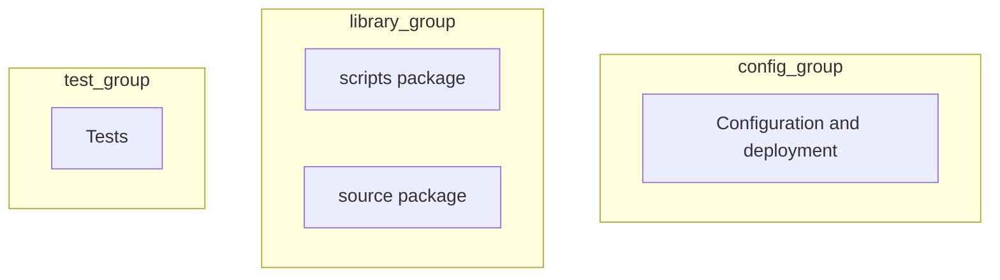

# Architecture report: iissnan/hexo-theme-next

> Automated static analysis. **Observed** = directly seen in files/imports/AST; **Inferred** = interpretation from that evidence. Repository code was not executed.

## 1. Repository at a glance

| Item | Value |
| --- | --- |
| Repository | iissnan/hexo-theme-next |
| Description | Elegant theme for Hexo.  |
| Language | JavaScript |
| Stars | 15737 |
| Licence | MIT |
| Analysed commit / branch | 9c8cea69bf0d4f91c07779d71b01814b27bbb6a1 / master |
| Framework(s) | None detected |
| Files analysed | 292 |
| Components | 4 |

## 2. Architecture in one minute

iissnan/hexo-theme-next - Elegant theme for Hexo. . This repository was analysed statically from 292 file(s) (0 Python). Detected technologies (observed from imports/manifests): no known frameworks/libraries. Files are grouped into 4 component(s): Configuration and deployment, scripts package, source package, Tests. Findings below distinguish observed facts from inferred interpretation.

## 3. High-level block diagram

## 4. Main components

### Configuration and deployment (`config`)

- **Kind:** config
- **Status:** Observed
- **Confidence:** 0.85
- **Responsibility:** Groups 29 file(s) under configuration and deployment (observed from repository paths and static analysis).
- **Paths:** `_config.yml`, `bower.json`, `languages/de.yml`, `languages/default.yml`, `languages/en.yml`, `languages/fr-FR.yml`, `languages/id.yml`, `languages/it.yml`, `languages/ja.yml`, `languages/ko.yml`, `languages/nl-NL.yml`, `languages/pt-BR.yml`, `languages/pt.yml`, `languages/ru.yml`, `languages/vi.yml`, `languages/zh-Hans.yml`, `languages/zh-hk.yml`, `languages/zh-tw.yml`, `package.json`, `source/lib/fancybox/.bower.json`, `source/lib/fastclick/.bower.json`, `source/lib/fastclick/bower.json`, `source/lib/font-awesome/.bower.json`, `source/lib/font-awesome/bower.json`, `source/lib/jquery/.bower.json`, `source/lib/jquery_lazyload/.bower.json`, `source/lib/jquery_lazyload/bower.json`, `source/lib/velocity/.bower.json`, `source/lib/velocity/bower.json`
- **Evidence:** [_config.yml](https://github.com/iissnan/hexo-theme-next/blob/9c8cea69bf0d4f91c07779d71b01814b27bbb6a1/_config.yml); [bower.json](https://github.com/iissnan/hexo-theme-next/blob/9c8cea69bf0d4f91c07779d71b01814b27bbb6a1/bower.json); [languages/de.yml](https://github.com/iissnan/hexo-theme-next/blob/9c8cea69bf0d4f91c07779d71b01814b27bbb6a1/languages/de.yml); [languages/default.yml](https://github.com/iissnan/hexo-theme-next/blob/9c8cea69bf0d4f91c07779d71b01814b27bbb6a1/languages/default.yml); [languages/en.yml](https://github.com/iissnan/hexo-theme-next/blob/9c8cea69bf0d4f91c07779d71b01814b27bbb6a1/languages/en.yml); [languages/fr-FR.yml](https://github.com/iissnan/hexo-theme-next/blob/9c8cea69bf0d4f91c07779d71b01814b27bbb6a1/languages/fr-FR.yml); [languages/id.yml](https://github.com/iissnan/hexo-theme-next/blob/9c8cea69bf0d4f91c07779d71b01814b27bbb6a1/languages/id.yml); [languages/it.yml](https://github.com/iissnan/hexo-theme-next/blob/9c8cea69bf0d4f91c07779d71b01814b27bbb6a1/languages/it.yml)

### scripts package (`scripts`)

- **Kind:** library
- **Status:** Observed
- **Confidence:** 0.85
- **Responsibility:** Groups 11 file(s) under scripts package (observed from repository paths and static analysis).
- **Paths:** `scripts/merge-configs.js`, `scripts/merge.js`, `scripts/tags/button.js`, `scripts/tags/center-quote.js`, `scripts/tags/exturl.js`, `scripts/tags/full-image.js`, `scripts/tags/group-pictures.js`, `scripts/tags/label.js`, `scripts/tags/lazy-image.js`, `scripts/tags/note.js`, `scripts/tags/tabs.js`
- **Evidence:** [scripts/merge-configs.js](https://github.com/iissnan/hexo-theme-next/blob/9c8cea69bf0d4f91c07779d71b01814b27bbb6a1/scripts/merge-configs.js); [scripts/merge.js](https://github.com/iissnan/hexo-theme-next/blob/9c8cea69bf0d4f91c07779d71b01814b27bbb6a1/scripts/merge.js); [scripts/tags/button.js](https://github.com/iissnan/hexo-theme-next/blob/9c8cea69bf0d4f91c07779d71b01814b27bbb6a1/scripts/tags/button.js); [scripts/tags/center-quote.js](https://github.com/iissnan/hexo-theme-next/blob/9c8cea69bf0d4f91c07779d71b01814b27bbb6a1/scripts/tags/center-quote.js); [scripts/tags/exturl.js](https://github.com/iissnan/hexo-theme-next/blob/9c8cea69bf0d4f91c07779d71b01814b27bbb6a1/scripts/tags/exturl.js); [scripts/tags/full-image.js](https://github.com/iissnan/hexo-theme-next/blob/9c8cea69bf0d4f91c07779d71b01814b27bbb6a1/scripts/tags/full-image.js); [scripts/tags/group-pictures.js](https://github.com/iissnan/hexo-theme-next/blob/9c8cea69bf0d4f91c07779d71b01814b27bbb6a1/scripts/tags/group-pictures.js); [scripts/tags/label.js](https://github.com/iissnan/hexo-theme-next/blob/9c8cea69bf0d4f91c07779d71b01814b27bbb6a1/scripts/tags/label.js)

### source package (`source`)

- **Kind:** library
- **Status:** Observed
- **Confidence:** 0.85
- **Responsibility:** Groups 24 file(s) under source package (observed from repository paths and static analysis).
- **Paths:** `source/js/src/affix.js`, `source/js/src/algolia-search.js`, `source/js/src/bootstrap.js`, `source/js/src/exturl.js`, `source/js/src/hook-duoshuo.js`, `source/js/src/js.cookie.js`, `source/js/src/motion.js`, `source/js/src/post-details.js`, `source/js/src/schemes/pisces.js`, `source/js/src/scroll-cookie.js`, `source/js/src/scrollspy.js`, `source/js/src/utils.js`, `source/lib/canvas-ribbon/canvas-ribbon.js`, `source/lib/fancybox/source/helpers/jquery.fancybox-buttons.js`, `source/lib/fancybox/source/helpers/jquery.fancybox-media.js`, `source/lib/fancybox/source/helpers/jquery.fancybox-thumbs.js`, `source/lib/fancybox/source/jquery.fancybox.js`, `source/lib/fancybox/source/jquery.fancybox.pack.js`, `source/lib/fastclick/lib/fastclick.js`, `source/lib/jquery/index.js`, `source/lib/jquery_lazyload/jquery.lazyload.js`, `source/lib/jquery_lazyload/jquery.scrollstop.js`, `source/lib/needsharebutton/needsharebutton.js`, `source/lib/velocity/velocity.ui.js`
- **Evidence:** [source/js/src/affix.js](https://github.com/iissnan/hexo-theme-next/blob/9c8cea69bf0d4f91c07779d71b01814b27bbb6a1/source/js/src/affix.js); [source/js/src/algolia-search.js](https://github.com/iissnan/hexo-theme-next/blob/9c8cea69bf0d4f91c07779d71b01814b27bbb6a1/source/js/src/algolia-search.js); [source/js/src/bootstrap.js](https://github.com/iissnan/hexo-theme-next/blob/9c8cea69bf0d4f91c07779d71b01814b27bbb6a1/source/js/src/bootstrap.js); [source/js/src/exturl.js](https://github.com/iissnan/hexo-theme-next/blob/9c8cea69bf0d4f91c07779d71b01814b27bbb6a1/source/js/src/exturl.js); [source/js/src/hook-duoshuo.js](https://github.com/iissnan/hexo-theme-next/blob/9c8cea69bf0d4f91c07779d71b01814b27bbb6a1/source/js/src/hook-duoshuo.js); [source/js/src/js.cookie.js](https://github.com/iissnan/hexo-theme-next/blob/9c8cea69bf0d4f91c07779d71b01814b27bbb6a1/source/js/src/js.cookie.js); [source/js/src/motion.js](https://github.com/iissnan/hexo-theme-next/blob/9c8cea69bf0d4f91c07779d71b01814b27bbb6a1/source/js/src/motion.js); [source/js/src/post-details.js](https://github.com/iissnan/hexo-theme-next/blob/9c8cea69bf0d4f91c07779d71b01814b27bbb6a1/source/js/src/post-details.js)

### Tests (`tests`)

- **Kind:** test
- **Status:** Observed
- **Confidence:** 0.85
- **Responsibility:** Groups 3 file(s) under tests (observed from repository paths and static analysis).
- **Paths:** `test/.jshintrc`, `test/helpers.js`, `test/intern.js`
- **Evidence:** [test/.jshintrc](https://github.com/iissnan/hexo-theme-next/blob/9c8cea69bf0d4f91c07779d71b01814b27bbb6a1/test/.jshintrc); [test/helpers.js](https://github.com/iissnan/hexo-theme-next/blob/9c8cea69bf0d4f91c07779d71b01814b27bbb6a1/test/helpers.js); [test/intern.js](https://github.com/iissnan/hexo-theme-next/blob/9c8cea69bf0d4f91c07779d71b01814b27bbb6a1/test/intern.js)

## 5. Execution flow

**Observed** entry point(s):

- [source/lib/jquery/index.js](https://github.com/iissnan/hexo-theme-next/blob/9c8cea69bf0d4f91c07779d71b01814b27bbb6a1/source/lib/jquery/index.js)

Representative flow (derived from observed entry points and the import graph; steps beyond the entry point are **Inferred**):

1. Execution starts at an observed entry point listed above, if present.
2. No internal import relationships between components were observed.

## 6. Project structure

### `(root)`

- `.bowerrc` - other (32 bytes)
- `.editorconfig` - config (191 bytes)
- `.gitattributes` - other (66 bytes)
- `.gitignore` - other (313 bytes)
- `.hound.yml` - config (87 bytes)
- `.javascript_ignore` - other (107 bytes)
- `.jshintrc` - other (399 bytes)
- `.stylintrc` - other (1085 bytes)
- `.travis.yml` - ci, YAML (905 bytes)
- `LICENSE` - docs (1069 bytes)
- `README.cn.md` - docs (13143 bytes)
- `README.md` - docs (12200 bytes)
- `_config.yml` - config (24231 bytes)
- `bower.json` - config (808 bytes)
- `gulpfile.coffee` - other (1345 bytes)
- `package.json` - manifest (853 bytes)

### `.github`

- `.github/CONTRIBUTING.md` - docs (374 bytes)
- `.github/ISSUE_TEMPLATE.md` - docs (1369 bytes)
- `.github/PULL_REQUEST_TEMPLATE.md` - docs (3053 bytes)

### `languages`

- `languages/de.yml` - config (1601 bytes)
- `languages/default.yml` - config (1669 bytes)
- `languages/en.yml` - config (1712 bytes)
- `languages/fr-FR.yml` - config (1553 bytes)
- `languages/id.yml` - config (1507 bytes)
- `languages/it.yml` - config (1688 bytes)
- `languages/ja.yml` - config (1573 bytes)
- `languages/ko.yml` - config (1596 bytes)
- `languages/nl-NL.yml` - config (1729 bytes)
- `languages/pt-BR.yml` - config (1545 bytes)
- `languages/pt.yml` - config (1583 bytes)
- `languages/ru.yml` - config (2632 bytes)
- `languages/vi.yml` - config (1997 bytes)
- `languages/zh-Hans.yml` - config (1781 bytes)
- `languages/zh-hk.yml` - config (1763 bytes)
- `languages/zh-tw.yml` - config (1763 bytes)

### `layout`

- `layout/_custom/header.swig` - other (1 bytes)
- `layout/_custom/sidebar.swig` - other (1 bytes)
- `layout/_layout.swig` - other (3035 bytes)
- `layout/_macro/post-collapse.swig` - other (1271 bytes)
- `layout/_macro/post-copyright.swig` - other (685 bytes)
- `layout/_macro/post.swig` - other (19115 bytes)
- `layout/_macro/reward.swig` - other (1210 bytes)
- `layout/_macro/sidebar.swig` - other (7497 bytes)
- `layout/_macro/wechat-subscriber.swig` - other (338 bytes)
- `layout/_partials/comments.swig` - other (2286 bytes)
- `layout/_partials/footer.swig` - other (1637 bytes)
- `layout/_partials/head.swig` - other (5760 bytes)
- `layout/_partials/head/custom-head.swig` - other (19 bytes)
- `layout/_partials/head/external-fonts.swig` - other (1605 bytes)
- `layout/_partials/header.swig` - other (2573 bytes)
- `layout/_partials/page-header.swig` - other (327 bytes)
- `layout/_partials/pagination.swig` - other (252 bytes)
- `layout/_partials/search.swig` - other (335 bytes)
- `layout/_partials/search/localsearch.swig` - other (533 bytes)
- `layout/_partials/search/swiftype.swig` - other (529 bytes)
- `layout/_partials/search/tinysou.swig` - other (110 bytes)
- `layout/_partials/share/add-this.swig` - other (257 bytes)
- `layout/_partials/share/baidushare.swig` - other (1976 bytes)
- `layout/_partials/share/duoshuo_share.swig` - other (793 bytes)
- `layout/_partials/share/jiathis.swig` - other (954 bytes)
- `layout/_scripts/boostrap.swig` - other (203 bytes)
- `layout/_scripts/commons.swig` - other (224 bytes)
- `layout/_scripts/pages/post-details.swig` - other (223 bytes)
- `layout/_scripts/schemes/gemini.swig` - other (226 bytes)
- `layout/_scripts/schemes/mist.swig` - other (0 bytes)
- `layout/_scripts/schemes/muse.swig` - other (0 bytes)
- `layout/_scripts/schemes/pisces.swig` - other (226 bytes)
- `layout/_scripts/vendors.swig` - other (2112 bytes)
- `layout/_third-party/analytics/analytics-with-widget.swig` - other (145 bytes)
- `layout/_third-party/analytics/application-insights.swig` - other (1075 bytes)
- `layout/_third-party/analytics/baidu-analytics.swig` - other (364 bytes)
- `layout/_third-party/analytics/busuanzi-counter.swig` - other (703 bytes)
- `layout/_third-party/analytics/cnzz-analytics.swig` - other (215 bytes)
- `layout/_third-party/analytics/facebook-sdk.swig` - other (566 bytes)
- `layout/_third-party/analytics/firestore.swig` - other (3248 bytes)
- `layout/_third-party/analytics/google-analytics.swig` - other (489 bytes)
- `layout/_third-party/analytics/index.swig` - other (186 bytes)
- `layout/_third-party/analytics/lean-analytics.swig` - other (3666 bytes)
- `layout/_third-party/analytics/tencent-analytics.swig` - other (338 bytes)
- `layout/_third-party/analytics/tencent-mta.swig` - other (398 bytes)
- `layout/_third-party/analytics/vkontakte-api.swig` - other (798 bytes)
- `layout/_third-party/comments/changyan.swig` - other (1495 bytes)
- `layout/_third-party/comments/disqus.swig` - other (854 bytes)
- `layout/_third-party/comments/duoshuo.swig` - other (1482 bytes)
- `layout/_third-party/comments/gitment.swig` - other (2397 bytes)
- `layout/_third-party/comments/hypercomments.swig` - other (1094 bytes)
- `layout/_third-party/comments/index.swig` - other (235 bytes)
- `layout/_third-party/comments/livere.swig` - other (624 bytes)
- `layout/_third-party/comments/valine.swig` - other (852 bytes)
- `layout/_third-party/comments/youyan.swig` - other (436 bytes)
- `layout/_third-party/duoshuo-hot-articles.swig` - other (186 bytes)
- `layout/_third-party/exturl.swig` - other (143 bytes)
- `layout/_third-party/mathjax.swig` - other (760 bytes)
- `layout/_third-party/needsharebutton.swig` - other (1187 bytes)
- `layout/_third-party/rating.swig` - other (642 bytes)
- `layout/_third-party/schedule.swig` - other (5561 bytes)
- `layout/_third-party/scroll-cookie.swig` - other (267 bytes)
- `layout/_third-party/search/algolia-search/assets.swig` - other (847 bytes)
- `layout/_third-party/search/algolia-search/dom.swig` - other (597 bytes)
- `layout/_third-party/search/index.swig` - other (105 bytes)
- `layout/_third-party/search/localsearch.swig` - other (12748 bytes)
- `layout/_third-party/search/tinysou.swig` - other (676 bytes)
- `layout/_third-party/seo/baidu-push.swig` - other (468 bytes)
- `layout/archive.swig` - other (1923 bytes)
- `layout/category.swig` - other (1020 bytes)
- `layout/index.swig` - other (661 bytes)
- `layout/page.swig` - other (2225 bytes)
- `layout/post.swig` - other (1000 bytes)
- `layout/schedule.swig` - other (636 bytes)
- `layout/tag.swig` - other (964 bytes)

### `scripts`

- `scripts/merge-configs.js` - source, JavaScript (1121 bytes)
- `scripts/merge.js` - source, JavaScript (58317 bytes)
- `scripts/tags/button.js` - source, JavaScript (839 bytes)
- `scripts/tags/center-quote.js` - source, JavaScript (441 bytes)
- `scripts/tags/exturl.js` - source, JavaScript (2915 bytes)
- `scripts/tags/full-image.js` - source, JavaScript (866 bytes)
- `scripts/tags/group-pictures.js` - source, JavaScript (13377 bytes)
- `scripts/tags/label.js` - source, JavaScript (570 bytes)
- `scripts/tags/lazy-image.js` - source, JavaScript (902 bytes)
- `scripts/tags/note.js` - source, JavaScript (564 bytes)
- `scripts/tags/tabs.js` - source, JavaScript (3176 bytes)

### `source`

- `source/css/_common/components/back-to-top-sidebar.styl` - other (562 bytes)
- `source/css/_common/components/back-to-top.styl` - other (766 bytes)
- `source/css/_common/components/buttons.styl` - other (753 bytes)
- `source/css/_common/components/comments.styl` - other (35 bytes)
- `source/css/_common/components/components.styl` - other (309 bytes)
- `source/css/_common/components/footer/footer.styl` - other (415 bytes)
- `source/css/_common/components/header/header.styl` - other (154 bytes)
- `source/css/_common/components/header/headerband.styl` - other (70 bytes)
- `source/css/_common/components/header/menu.styl` - other (606 bytes)
- `source/css/_common/components/header/site-meta.styl` - other (808 bytes)
- `source/css/_common/components/header/site-nav.styl` - other (471 bytes)
- `source/css/_common/components/highlight/diff.styl` - other (226 bytes)
- `source/css/_common/components/highlight/highlight.styl` - other (2760 bytes)
- `source/css/_common/components/highlight/theme.styl` - other (2961 bytes)
- `source/css/_common/components/pages/archive.styl` - other (419 bytes)
- `source/css/_common/components/pages/categories.styl` - other (453 bytes)
- `source/css/_common/components/pages/pages.styl` - other (109 bytes)
- `source/css/_common/components/pages/post-detail.styl` - other (117 bytes)
- `source/css/_common/components/pages/schedule.styl` - other (2161 bytes)
- `source/css/_common/components/pagination.styl` - other (1156 bytes)
- `source/css/_common/components/post/post-button.styl` - other (37 bytes)
- `source/css/_common/components/post/post-collapse.styl` - other (1881 bytes)
- `source/css/_common/components/post/post-copyright.styl` - other (253 bytes)
- `source/css/_common/components/post/post-eof.styl` - other (282 bytes)
- `source/css/_common/components/post/post-expand.styl` - other (972 bytes)
- `source/css/_common/components/post/post-gallery.styl` - other (424 bytes)
- `source/css/_common/components/post/post-meta.styl` - other (808 bytes)
- `source/css/_common/components/post/post-nav.styl` - other (770 bytes)
- `source/css/_common/components/post/post-reward.styl` - other (1336 bytes)
- `source/css/_common/components/post/post-rtl.styl` - other (185 bytes)
- `source/css/_common/components/post/post-tags.styl` - other (154 bytes)
- `source/css/_common/components/post/post-title.styl` - other (622 bytes)
- `source/css/_common/components/post/post-type.styl` - other (198 bytes)
- `source/css/_common/components/post/post-widgets.styl` - other (602 bytes)
- `source/css/_common/components/post/post.styl` - other (1713 bytes)
- `source/css/_common/components/sidebar/sidebar-author-links.styl` - other (493 bytes)
- `source/css/_common/components/sidebar/sidebar-author.styl` - other (610 bytes)
- `source/css/_common/components/sidebar/sidebar-blogroll.styl` - other (432 bytes)
- `source/css/_common/components/sidebar/sidebar-dimmer.styl` - other (381 bytes)
- `source/css/_common/components/sidebar/sidebar-feed-link.styl` - other (363 bytes)
- `source/css/_common/components/sidebar/sidebar-nav.styl` - other (628 bytes)
- `source/css/_common/components/sidebar/sidebar-toc.styl` - other (1169 bytes)
- `source/css/_common/components/sidebar/sidebar-toggle.styl` - other (701 bytes)
- `source/css/_common/components/sidebar/sidebar.styl` - other (1032 bytes)
- `source/css/_common/components/sidebar/site-state.styl` - other (602 bytes)
- `source/css/_common/components/tag-cloud.styl` - other (92 bytes)
- `source/css/_common/components/tags/blockquote-center.styl` - other (720 bytes)
- `source/css/_common/components/tags/exturl.styl` - other (381 bytes)
- `source/css/_common/components/tags/full-image.styl` - other (334 bytes)
- `source/css/_common/components/tags/group-pictures.styl` - other (634 bytes)
- `source/css/_common/components/tags/label.styl` - other (379 bytes)
- `source/css/_common/components/tags/note-modern.styl` - other (4879 bytes)
- `source/css/_common/components/tags/note.styl` - other (3564 bytes)
- `source/css/_common/components/tags/tabs.styl` - other (2410 bytes)
- `source/css/_common/components/tags/tags.styl` - other (367 bytes)
- `source/css/_common/components/third-party/algolia-search.styl` - other (2121 bytes)
- `source/css/_common/components/third-party/baidushare.styl` - other (177 bytes)
- `source/css/_common/components/third-party/busuanzi-counter.styl` - other (439 bytes)
- `source/css/_common/components/third-party/duoshuo.styl` - other (5618 bytes)
- `source/css/_common/components/third-party/gitment.styl` - other (266 bytes)
- `source/css/_common/components/third-party/han.styl` - other (46 bytes)
- `source/css/_common/components/third-party/jiathis.styl` - other (126 bytes)
- `source/css/_common/components/third-party/localsearch.styl` - other (1833 bytes)
- `source/css/_common/components/third-party/needsharebutton.styl` - other (481 bytes)
- `source/css/_common/components/third-party/third-party.styl` - other (311 bytes)
- `source/css/_common/outline/outline.styl` - other (1133 bytes)
- `source/css/_common/scaffolding/base.styl` - other (1984 bytes)
- `source/css/_common/scaffolding/helpers.styl` - other (1169 bytes)
- `source/css/_common/scaffolding/mobile.styl` - other (2054 bytes)
- `source/css/_common/scaffolding/normalize.styl` - other (7797 bytes)
- `source/css/_common/scaffolding/scaffolding.styl` - other (204 bytes)
- `source/css/_common/scaffolding/tables.styl` - other (759 bytes)
- `source/css/_custom/custom.styl` - other (18 bytes)
- `source/css/_mixins/Gemini.styl` - other (23 bytes)
- `source/css/_mixins/Mist.styl` - other (0 bytes)
- `source/css/_mixins/Muse.styl` - other (0 bytes)
- `source/css/_mixins/Pisces.styl` - other (409 bytes)
- `source/css/_mixins/base.styl` - other (1350 bytes)
- `source/css/_mixins/custom.styl` - other (0 bytes)
- `source/css/_schemes/Gemini/index.styl` - other (5542 bytes)
- `source/css/_schemes/Mist/_base.styl` - other (219 bytes)
- `source/css/_schemes/Mist/_header.styl` - other (954 bytes)
- `source/css/_schemes/Mist/_logo.styl` - other (34 bytes)
- `source/css/_schemes/Mist/_menu.styl` - other (659 bytes)
- `source/css/_schemes/Mist/_posts-expanded.styl` - other (1391 bytes)
- `source/css/_schemes/Mist/_search.styl` - other (102 bytes)
- `source/css/_schemes/Mist/index.styl` - other (1547 bytes)
- `source/css/_schemes/Mist/outline/outline.styl` - other (34 bytes)
- `source/css/_schemes/Mist/sidebar/sidebar-blogroll.styl` - other (77 bytes)
- `source/css/_schemes/Muse/_layout.styl` - other (161 bytes)
- `source/css/_schemes/Muse/_logo.styl` - other (311 bytes)
- `source/css/_schemes/Muse/_menu.styl` - other (492 bytes)
- `source/css/_schemes/Muse/_search.styl` - other (102 bytes)
- `source/css/_schemes/Muse/index.styl` - other (128 bytes)
- `source/css/_schemes/Muse/sidebar/sidebar-blogroll.styl` - other (77 bytes)
- `source/css/_schemes/Pisces/_brand.styl` - other (425 bytes)
- `source/css/_schemes/Pisces/_layout.styl` - other (1960 bytes)
- `source/css/_schemes/Pisces/_menu.styl` - other (969 bytes)
- `source/css/_schemes/Pisces/_posts.styl` - other (58 bytes)
- `source/css/_schemes/Pisces/_sidebar.styl` - other (2064 bytes)
- `source/css/_schemes/Pisces/index.styl` - other (92 bytes)
- `source/css/_variables/Gemini.styl` - other (915 bytes)
- `source/css/_variables/Mist.styl` - other (335 bytes)
- `source/css/_variables/Muse.styl` - other (0 bytes)
- `source/css/_variables/Pisces.styl` - other (2530 bytes)
- `source/css/_variables/base.styl` - other (13724 bytes)
- `source/css/_variables/custom.styl` - other (0 bytes)
- `source/css/main.styl` - other (856 bytes)
- `source/fonts/.gitkeep` - other (0 bytes)
- `source/images/algolia_logo.svg` - other (4401 bytes)
- `source/images/cc-by-nc-nd.svg` - other (10922 bytes)
- `source/images/cc-by-nc-sa.svg` - other (11659 bytes)
- `source/images/cc-by-nc.svg` - other (9673 bytes)
- `source/images/cc-by-nd.svg` - other (9383 bytes)
- `source/images/cc-by-sa.svg` - other (10261 bytes)
- `source/images/cc-by.svg` - other (8279 bytes)
- `source/images/cc-zero.svg` - other (6215 bytes)
- `source/images/logo.svg` - other (1036 bytes)
- `source/images/quote-l.svg` - other (879 bytes)
- `source/images/quote-r.svg` - other (868 bytes)
- `source/js/src/affix.js` - source, JavaScript (4838 bytes)
- `source/js/src/algolia-search.js` - source, JavaScript (3303 bytes)
- `source/js/src/bootstrap.js` - source, JavaScript (1466 bytes)
- `source/js/src/exturl.js` - source, JavaScript (1850 bytes)
- `source/js/src/hook-duoshuo.js` - source, JavaScript (3365 bytes)
- `source/js/src/js.cookie.js` - source, JavaScript (3872 bytes)
- `source/js/src/motion.js` - source, JavaScript (10489 bytes)
- `source/js/src/post-details.js` - source, JavaScript (3264 bytes)
- `source/js/src/schemes/pisces.js` - source, JavaScript (1570 bytes)
- `source/js/src/scroll-cookie.js` - source, JavaScript (655 bytes)
- `source/js/src/scrollspy.js` - source, JavaScript (4925 bytes)
- `source/js/src/utils.js` - source, JavaScript (10822 bytes)
- `source/lib/canvas-ribbon/canvas-ribbon.js` - source, JavaScript (2745 bytes)
- `source/lib/fancybox/.bower.json` - config (380 bytes)
- `source/lib/fancybox/.gitattributes` - other (174 bytes)
- `source/lib/fancybox/source/helpers/jquery.fancybox-buttons.css` - other (2447 bytes)
- `source/lib/fancybox/source/helpers/jquery.fancybox-buttons.js` - source, JavaScript (3041 bytes)
- `source/lib/fancybox/source/helpers/jquery.fancybox-media.js` - source, JavaScript (5305 bytes)
- `source/lib/fancybox/source/helpers/jquery.fancybox-thumbs.css` - other (735 bytes)
- `source/lib/fancybox/source/helpers/jquery.fancybox-thumbs.js` - source, JavaScript (3836 bytes)
- `source/lib/fancybox/source/jquery.fancybox.css` - other (4895 bytes)
- `source/lib/fancybox/source/jquery.fancybox.js` - source, JavaScript (48706 bytes)
- `source/lib/fancybox/source/jquery.fancybox.pack.js` - source, JavaScript (23135 bytes)
- `source/lib/fastclick/.bower.json` - config (526 bytes)
- `source/lib/fastclick/LICENSE` - docs (1068 bytes)
- `source/lib/fastclick/README.md` - docs (6908 bytes)
- `source/lib/fastclick/bower.json` - config (174 bytes)
- `source/lib/fastclick/lib/fastclick.js` - source, JavaScript (25965 bytes)
- `source/lib/font-awesome/.bower.json` - config (706 bytes)
- `source/lib/font-awesome/.gitignore` - other (301 bytes)
- `source/lib/font-awesome/.npmignore` - other (427 bytes)
- `source/lib/font-awesome/HELP-US-OUT.txt` - docs (323 bytes)
- `source/lib/font-awesome/bower.json` - config (403 bytes)
- `source/lib/font-awesome/css/font-awesome.css` - other (37414 bytes)
- `source/lib/jquery/.bower.json` - config (432 bytes)
- `source/lib/jquery/index.js` - source, JavaScript (84320 bytes)
- `source/lib/jquery_lazyload/.bower.json` - config (838 bytes)
- `source/lib/jquery_lazyload/CONTRIBUTING.md` - docs (1848 bytes)
- `source/lib/jquery_lazyload/README.md` - docs (1850 bytes)
- `source/lib/jquery_lazyload/bower.json` - config (549 bytes)
- `source/lib/jquery_lazyload/jquery.lazyload.js` - source, JavaScript (9058 bytes)
- `source/lib/jquery_lazyload/jquery.scrollstop.js` - source, JavaScript (2168 bytes)
- `source/lib/needsharebutton/font-embedded.css` - other (43455 bytes)
- `source/lib/needsharebutton/needsharebutton.css` - other (7112 bytes)
- `source/lib/needsharebutton/needsharebutton.js` - source, JavaScript (19873 bytes)
- `source/lib/velocity/.bower.json` - config (972 bytes)
- `source/lib/velocity/bower.json` - config (700 bytes)
- `source/lib/velocity/velocity.ui.js` - source, JavaScript (34762 bytes)

### `test`

- `test/.jshintrc` - test (356 bytes)
- `test/helpers.js` - test, JavaScript (3363 bytes)
- `test/intern.js` - test, JavaScript (3099 bytes)

## 7. Key dependencies and integrations

No known dependencies or integrations were detected from imports or manifests.

## 8. Data and state

No database, cache, queue, or persistent-state usage was observed in the analysed files. State handling, if any, may be in-memory or in files that were not analysed.

## 9. Configuration and deployment clues

- `.editorconfig` (config)
- `.hound.yml` (config)
- `.travis.yml` (ci)
- `_config.yml` (config)
- `bower.json` (config)
- `languages/de.yml` (config)
- `languages/default.yml` (config)
- `languages/en.yml` (config)
- `languages/fr-FR.yml` (config)
- `languages/id.yml` (config)
- `languages/it.yml` (config)
- `languages/ja.yml` (config)
- `languages/ko.yml` (config)
- `languages/nl-NL.yml` (config)
- `languages/pt-BR.yml` (config)
- `languages/pt.yml` (config)
- `languages/ru.yml` (config)
- `languages/vi.yml` (config)
- `languages/zh-Hans.yml` (config)
- `languages/zh-hk.yml` (config)
- `languages/zh-tw.yml` (config)
- `package.json` (manifest)
- `source/lib/fancybox/.bower.json` (config)
- `source/lib/fastclick/.bower.json` (config)
- `source/lib/fastclick/bower.json` (config)
- `source/lib/font-awesome/.bower.json` (config)
- `source/lib/font-awesome/bower.json` (config)
- `source/lib/jquery/.bower.json` (config)
- `source/lib/jquery_lazyload/.bower.json` (config)
- `source/lib/jquery_lazyload/bower.json` (config)
- `source/lib/velocity/.bower.json` (config)
- `source/lib/velocity/bower.json` (config)

## 10. Design observations

- Tests are present alongside source code (Observed from test file paths).

These observations are interpretations (**Inferred**) of the observed structure, not guarantees about runtime design.

## 11. Limitations and unknowns

- Static analysis only: repository code was not executed, installed, or imported at runtime.
- Components and relationships are inferred from file paths, imports, and AST structure; runtime behaviour, dynamic imports, and reflection may not be visible.
- 19 file(s) were skipped during inventory (15 x generated/minified file excluded; 4 x vendored/generated directory excluded).
- No clear application entry point was observed in the analysed files.
- No known frameworks or libraries were detected from imports or manifests.
- Repository text was treated as untrusted data; no instructions found in repository files were followed, and likely secret values were redacted/excluded.
- JavaScript and TypeScript files were inventoried from paths and package manifests. They were not parsed with a full language AST, and repository code was not executed.

## 12. Source references

- [_config.yml](https://github.com/iissnan/hexo-theme-next/blob/9c8cea69bf0d4f91c07779d71b01814b27bbb6a1/_config.yml)
- [bower.json](https://github.com/iissnan/hexo-theme-next/blob/9c8cea69bf0d4f91c07779d71b01814b27bbb6a1/bower.json)
- [languages/de.yml](https://github.com/iissnan/hexo-theme-next/blob/9c8cea69bf0d4f91c07779d71b01814b27bbb6a1/languages/de.yml)
- [languages/default.yml](https://github.com/iissnan/hexo-theme-next/blob/9c8cea69bf0d4f91c07779d71b01814b27bbb6a1/languages/default.yml)
- [languages/en.yml](https://github.com/iissnan/hexo-theme-next/blob/9c8cea69bf0d4f91c07779d71b01814b27bbb6a1/languages/en.yml)
- [languages/fr-FR.yml](https://github.com/iissnan/hexo-theme-next/blob/9c8cea69bf0d4f91c07779d71b01814b27bbb6a1/languages/fr-FR.yml)
- [languages/id.yml](https://github.com/iissnan/hexo-theme-next/blob/9c8cea69bf0d4f91c07779d71b01814b27bbb6a1/languages/id.yml)
- [languages/it.yml](https://github.com/iissnan/hexo-theme-next/blob/9c8cea69bf0d4f91c07779d71b01814b27bbb6a1/languages/it.yml)
- [scripts/merge-configs.js](https://github.com/iissnan/hexo-theme-next/blob/9c8cea69bf0d4f91c07779d71b01814b27bbb6a1/scripts/merge-configs.js)
- [scripts/merge.js](https://github.com/iissnan/hexo-theme-next/blob/9c8cea69bf0d4f91c07779d71b01814b27bbb6a1/scripts/merge.js)
- [scripts/tags/button.js](https://github.com/iissnan/hexo-theme-next/blob/9c8cea69bf0d4f91c07779d71b01814b27bbb6a1/scripts/tags/button.js)
- [scripts/tags/center-quote.js](https://github.com/iissnan/hexo-theme-next/blob/9c8cea69bf0d4f91c07779d71b01814b27bbb6a1/scripts/tags/center-quote.js)
- [scripts/tags/exturl.js](https://github.com/iissnan/hexo-theme-next/blob/9c8cea69bf0d4f91c07779d71b01814b27bbb6a1/scripts/tags/exturl.js)
- [scripts/tags/full-image.js](https://github.com/iissnan/hexo-theme-next/blob/9c8cea69bf0d4f91c07779d71b01814b27bbb6a1/scripts/tags/full-image.js)
- [scripts/tags/group-pictures.js](https://github.com/iissnan/hexo-theme-next/blob/9c8cea69bf0d4f91c07779d71b01814b27bbb6a1/scripts/tags/group-pictures.js)
- [scripts/tags/label.js](https://github.com/iissnan/hexo-theme-next/blob/9c8cea69bf0d4f91c07779d71b01814b27bbb6a1/scripts/tags/label.js)
- [source/js/src/affix.js](https://github.com/iissnan/hexo-theme-next/blob/9c8cea69bf0d4f91c07779d71b01814b27bbb6a1/source/js/src/affix.js)
- [source/js/src/algolia-search.js](https://github.com/iissnan/hexo-theme-next/blob/9c8cea69bf0d4f91c07779d71b01814b27bbb6a1/source/js/src/algolia-search.js)
- [source/js/src/bootstrap.js](https://github.com/iissnan/hexo-theme-next/blob/9c8cea69bf0d4f91c07779d71b01814b27bbb6a1/source/js/src/bootstrap.js)
- [source/js/src/exturl.js](https://github.com/iissnan/hexo-theme-next/blob/9c8cea69bf0d4f91c07779d71b01814b27bbb6a1/source/js/src/exturl.js)
- [source/js/src/hook-duoshuo.js](https://github.com/iissnan/hexo-theme-next/blob/9c8cea69bf0d4f91c07779d71b01814b27bbb6a1/source/js/src/hook-duoshuo.js)
- [source/js/src/js.cookie.js](https://github.com/iissnan/hexo-theme-next/blob/9c8cea69bf0d4f91c07779d71b01814b27bbb6a1/source/js/src/js.cookie.js)
- [source/js/src/motion.js](https://github.com/iissnan/hexo-theme-next/blob/9c8cea69bf0d4f91c07779d71b01814b27bbb6a1/source/js/src/motion.js)
- [source/js/src/post-details.js](https://github.com/iissnan/hexo-theme-next/blob/9c8cea69bf0d4f91c07779d71b01814b27bbb6a1/source/js/src/post-details.js)
- [source/lib/jquery/index.js](https://github.com/iissnan/hexo-theme-next/blob/9c8cea69bf0d4f91c07779d71b01814b27bbb6a1/source/lib/jquery/index.js)
- [test/.jshintrc](https://github.com/iissnan/hexo-theme-next/blob/9c8cea69bf0d4f91c07779d71b01814b27bbb6a1/test/.jshintrc)
- [test/helpers.js](https://github.com/iissnan/hexo-theme-next/blob/9c8cea69bf0d4f91c07779d71b01814b27bbb6a1/test/helpers.js)
- [test/intern.js](https://github.com/iissnan/hexo-theme-next/blob/9c8cea69bf0d4f91c07779d71b01814b27bbb6a1/test/intern.js)
