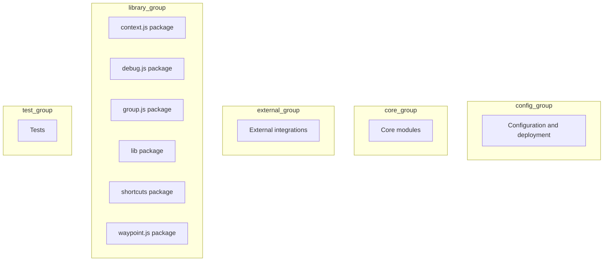

# Architecture report: imakewebthings/waypoints

> Automated static analysis. **Observed** = directly seen in files/imports/AST; **Inferred** = interpretation from that evidence. Repository code was not executed.

## 1. Repository at a glance

| Item | Value |
| --- | --- |
| Repository | imakewebthings/waypoints |
| Description | Waypoints is a library that makes it easy to execute a function whenever you scroll to an element. |
| Language | JavaScript |
| Stars | 10294 |
| Licence | Not detected |
| Analysed commit / branch | 34d9f6d77016cb9ed7884963c522e140fb8f8dc3 / master |
| Framework(s) | None detected |
| Files analysed | 48 |
| Components | 10 |

## 2. Architecture in one minute

imakewebthings/waypoints - Waypoints is a library that makes it easy to execute a function whenever you scroll to an element.. This repository was analysed statically from 48 file(s) (0 Python). Detected technologies (observed from imports/manifests): no known frameworks/libraries. Files are grouped into 10 component(s): Configuration and deployment, context.js package, Core modules, debug.js package, External integrations, group.js package, lib package, shortcuts package. Findings below distinguish observed facts from inferred interpretation.

## 3. High-level block diagram

## 4. Main components

### Configuration and deployment (`config`)

- **Kind:** config
- **Status:** Observed
- **Confidence:** 0.85
- **Responsibility:** Groups 3 file(s) under configuration and deployment (observed from repository paths and static analysis).
- **Paths:** `bower.json`, `package.json`, `testem.json`
- **Evidence:** [bower.json](https://github.com/imakewebthings/waypoints/blob/34d9f6d77016cb9ed7884963c522e140fb8f8dc3/bower.json); [package.json](https://github.com/imakewebthings/waypoints/blob/34d9f6d77016cb9ed7884963c522e140fb8f8dc3/package.json); [testem.json](https://github.com/imakewebthings/waypoints/blob/34d9f6d77016cb9ed7884963c522e140fb8f8dc3/testem.json)

### context.js package (`context_js`)

- **Kind:** library
- **Status:** Observed
- **Confidence:** 0.85
- **Responsibility:** Groups 1 file(s) under context.js package (observed from repository paths and static analysis).
- **Paths:** `src/context.js`
- **Evidence:** [src/context.js](https://github.com/imakewebthings/waypoints/blob/34d9f6d77016cb9ed7884963c522e140fb8f8dc3/src/context.js)

### Core modules (`core`)

- **Kind:** core
- **Status:** Observed
- **Confidence:** 0.85
- **Responsibility:** Groups 1 file(s) under core modules (observed from repository paths and static analysis).
- **Paths:** `gulpfile.js`
- **Evidence:** [gulpfile.js](https://github.com/imakewebthings/waypoints/blob/34d9f6d77016cb9ed7884963c522e140fb8f8dc3/gulpfile.js)

### debug.js package (`debug_js`)

- **Kind:** library
- **Status:** Observed
- **Confidence:** 0.85
- **Responsibility:** Groups 1 file(s) under debug.js package (observed from repository paths and static analysis).
- **Paths:** `src/debug.js`
- **Evidence:** [src/debug.js](https://github.com/imakewebthings/waypoints/blob/34d9f6d77016cb9ed7884963c522e140fb8f8dc3/src/debug.js)

### External integrations (`external_integrations`)

- **Kind:** external
- **Status:** Observed
- **Confidence:** 0.85
- **Responsibility:** Groups 4 file(s) under external integrations (observed from repository paths and static analysis).
- **Paths:** `src/adapters/jquery-zepto-fn-extension.js`, `src/adapters/jquery.js`, `src/adapters/noframework.js`, `src/adapters/zepto.js`
- **Evidence:** [src/adapters/jquery-zepto-fn-extension.js](https://github.com/imakewebthings/waypoints/blob/34d9f6d77016cb9ed7884963c522e140fb8f8dc3/src/adapters/jquery-zepto-fn-extension.js); [src/adapters/jquery.js](https://github.com/imakewebthings/waypoints/blob/34d9f6d77016cb9ed7884963c522e140fb8f8dc3/src/adapters/jquery.js); [src/adapters/noframework.js](https://github.com/imakewebthings/waypoints/blob/34d9f6d77016cb9ed7884963c522e140fb8f8dc3/src/adapters/noframework.js); [src/adapters/zepto.js](https://github.com/imakewebthings/waypoints/blob/34d9f6d77016cb9ed7884963c522e140fb8f8dc3/src/adapters/zepto.js)

### group.js package (`group_js`)

- **Kind:** library
- **Status:** Observed
- **Confidence:** 0.85
- **Responsibility:** Groups 1 file(s) under group.js package (observed from repository paths and static analysis).
- **Paths:** `src/group.js`
- **Evidence:** [src/group.js](https://github.com/imakewebthings/waypoints/blob/34d9f6d77016cb9ed7884963c522e140fb8f8dc3/src/group.js)

### lib package (`lib`)

- **Kind:** library
- **Status:** Observed
- **Confidence:** 0.85
- **Responsibility:** Groups 7 file(s) under lib package (observed from repository paths and static analysis).
- **Paths:** `lib/jquery.waypoints.js`, `lib/noframework.waypoints.js`, `lib/shortcuts/infinite.js`, `lib/shortcuts/inview.js`, `lib/shortcuts/sticky.js`, `lib/waypoints.debug.js`, `lib/zepto.waypoints.js`
- **Evidence:** [lib/jquery.waypoints.js](https://github.com/imakewebthings/waypoints/blob/34d9f6d77016cb9ed7884963c522e140fb8f8dc3/lib/jquery.waypoints.js); [lib/noframework.waypoints.js](https://github.com/imakewebthings/waypoints/blob/34d9f6d77016cb9ed7884963c522e140fb8f8dc3/lib/noframework.waypoints.js); [lib/shortcuts/infinite.js](https://github.com/imakewebthings/waypoints/blob/34d9f6d77016cb9ed7884963c522e140fb8f8dc3/lib/shortcuts/infinite.js); [lib/shortcuts/inview.js](https://github.com/imakewebthings/waypoints/blob/34d9f6d77016cb9ed7884963c522e140fb8f8dc3/lib/shortcuts/inview.js); [lib/shortcuts/sticky.js](https://github.com/imakewebthings/waypoints/blob/34d9f6d77016cb9ed7884963c522e140fb8f8dc3/lib/shortcuts/sticky.js); [lib/waypoints.debug.js](https://github.com/imakewebthings/waypoints/blob/34d9f6d77016cb9ed7884963c522e140fb8f8dc3/lib/waypoints.debug.js); [lib/zepto.waypoints.js](https://github.com/imakewebthings/waypoints/blob/34d9f6d77016cb9ed7884963c522e140fb8f8dc3/lib/zepto.waypoints.js)

### shortcuts package (`shortcuts`)

- **Kind:** library
- **Status:** Observed
- **Confidence:** 0.85
- **Responsibility:** Groups 3 file(s) under shortcuts package (observed from repository paths and static analysis).
- **Paths:** `src/shortcuts/infinite.js`, `src/shortcuts/inview.js`, `src/shortcuts/sticky.js`
- **Evidence:** [src/shortcuts/infinite.js](https://github.com/imakewebthings/waypoints/blob/34d9f6d77016cb9ed7884963c522e140fb8f8dc3/src/shortcuts/infinite.js); [src/shortcuts/inview.js](https://github.com/imakewebthings/waypoints/blob/34d9f6d77016cb9ed7884963c522e140fb8f8dc3/src/shortcuts/inview.js); [src/shortcuts/sticky.js](https://github.com/imakewebthings/waypoints/blob/34d9f6d77016cb9ed7884963c522e140fb8f8dc3/src/shortcuts/sticky.js)

### Tests (`tests`)

- **Kind:** test
- **Status:** Observed
- **Confidence:** 0.85
- **Responsibility:** Groups 19 file(s) under tests (observed from repository paths and static analysis).
- **Paths:** `test/adapter-fn-spec.js`, `test/context-spec.js`, `test/debug-spec.js`, `test/fixtures/infinite.html`, `test/fixtures/standard.html`, `test/fixtures/sticky.html`, `test/group-spec.js`, `test/infinite-spec.js`, `test/inview-spec.js`, `test/lib/coffee-script.js`, `test/lib/jasmine-html.js`, `test/lib/jasmine-jquery.js`, `test/lib/jasmine.css`, `test/lib/jasmine.js`, `test/lib/require.js`, `test/lib/testloader.js`, `test/settings.js`, `test/sticky-spec.js`, `test/waypoint-spec.js`
- **Evidence:** [test/adapter-fn-spec.js](https://github.com/imakewebthings/waypoints/blob/34d9f6d77016cb9ed7884963c522e140fb8f8dc3/test/adapter-fn-spec.js); [test/context-spec.js](https://github.com/imakewebthings/waypoints/blob/34d9f6d77016cb9ed7884963c522e140fb8f8dc3/test/context-spec.js); [test/debug-spec.js](https://github.com/imakewebthings/waypoints/blob/34d9f6d77016cb9ed7884963c522e140fb8f8dc3/test/debug-spec.js); [test/fixtures/infinite.html](https://github.com/imakewebthings/waypoints/blob/34d9f6d77016cb9ed7884963c522e140fb8f8dc3/test/fixtures/infinite.html); [test/fixtures/standard.html](https://github.com/imakewebthings/waypoints/blob/34d9f6d77016cb9ed7884963c522e140fb8f8dc3/test/fixtures/standard.html); [test/fixtures/sticky.html](https://github.com/imakewebthings/waypoints/blob/34d9f6d77016cb9ed7884963c522e140fb8f8dc3/test/fixtures/sticky.html); [test/group-spec.js](https://github.com/imakewebthings/waypoints/blob/34d9f6d77016cb9ed7884963c522e140fb8f8dc3/test/group-spec.js); [test/infinite-spec.js](https://github.com/imakewebthings/waypoints/blob/34d9f6d77016cb9ed7884963c522e140fb8f8dc3/test/infinite-spec.js)

### waypoint.js package (`waypoint_js`)

- **Kind:** library
- **Status:** Observed
- **Confidence:** 0.85
- **Responsibility:** Groups 1 file(s) under waypoint.js package (observed from repository paths and static analysis).
- **Paths:** `src/waypoint.js`
- **Evidence:** [src/waypoint.js](https://github.com/imakewebthings/waypoints/blob/34d9f6d77016cb9ed7884963c522e140fb8f8dc3/src/waypoint.js)

## 5. Execution flow

No entry point was observed; the startup flow below is therefore limited.

Representative flow (derived from observed entry points and the import graph; steps beyond the entry point are **Inferred**):

1. Execution starts at an observed entry point listed above, if present.
2. No internal import relationships between components were observed.

## 6. Project structure

### `(root)`

- `.eslintrc` - other (567 bytes)
- `.gitignore` - other (75 bytes)
- `.travis.yml` - ci, YAML (108 bytes)
- `CHANGELOG.md` - docs (6588 bytes)
- `CONTRIBUTING.md` - docs (1722 bytes)
- `README.md` - docs (1674 bytes)
- `bower.json` - config (375 bytes)
- `gulpfile.js` - source, JavaScript (2682 bytes)
- `licenses.txt` - docs (1153 bytes)
- `package.json` - manifest (834 bytes)
- `testem.json` - config (463 bytes)

### `lib`

- `lib/jquery.waypoints.js` - source, JavaScript (17946 bytes)
- `lib/noframework.waypoints.js` - source, JavaScript (21112 bytes)
- `lib/shortcuts/infinite.js` - source, JavaScript (2219 bytes)
- `lib/shortcuts/inview.js` - source, JavaScript (2804 bytes)
- `lib/shortcuts/sticky.js` - source, JavaScript (1902 bytes)
- `lib/waypoints.debug.js` - source, JavaScript (1413 bytes)
- `lib/zepto.waypoints.js` - source, JavaScript (19217 bytes)

### `src`

- `src/adapters/jquery-zepto-fn-extension.js` - source, JavaScript (867 bytes)
- `src/adapters/jquery.js` - source, JavaScript (771 bytes)
- `src/adapters/noframework.js` - source, JavaScript (4805 bytes)
- `src/adapters/zepto.js` - source, JavaScript (2042 bytes)
- `src/context.js` - source, JavaScript (9097 bytes)
- `src/debug.js` - source, JavaScript (1241 bytes)
- `src/group.js` - source, JavaScript (2727 bytes)
- `src/shortcuts/infinite.js` - source, JavaScript (2028 bytes)
- `src/shortcuts/inview.js` - source, JavaScript (2622 bytes)
- `src/shortcuts/sticky.js` - source, JavaScript (1712 bytes)
- `src/waypoint.js` - source, JavaScript (4314 bytes)

### `test`

- `test/adapter-fn-spec.js` - test, JavaScript (1739 bytes)
- `test/context-spec.js` - test, JavaScript (2849 bytes)
- `test/debug-spec.js` - test, JavaScript (1733 bytes)
- `test/fixtures/infinite.html` - test (525 bytes)
- `test/fixtures/standard.html` - test (1139 bytes)
- `test/fixtures/sticky.html` - test (235 bytes)
- `test/group-spec.js` - test, JavaScript (2227 bytes)
- `test/infinite-spec.js` - test, JavaScript (2115 bytes)
- `test/inview-spec.js` - test, JavaScript (10093 bytes)
- `test/lib/coffee-script.js` - test, JavaScript (177228 bytes)
- `test/lib/jasmine-html.js` - test, JavaScript (20765 bytes)
- `test/lib/jasmine-jquery.js` - test, JavaScript (21648 bytes)
- `test/lib/jasmine.css` - test (6537 bytes)
- `test/lib/jasmine.js` - test, JavaScript (70892 bytes)
- `test/lib/require.js` - test, JavaScript (79623 bytes)
- `test/lib/testloader.js` - test, JavaScript (915 bytes)
- `test/settings.js` - test, JavaScript (215 bytes)
- `test/sticky-spec.js` - test, JavaScript (3083 bytes)
- `test/waypoint-spec.js` - test, JavaScript (16582 bytes)

## 7. Key dependencies and integrations

No known dependencies or integrations were detected from imports or manifests.

## 8. Data and state

No database, cache, queue, or persistent-state usage was observed in the analysed files. State handling, if any, may be in-memory or in files that were not analysed.

## 9. Configuration and deployment clues

- `.travis.yml` (ci)
- `bower.json` (config)
- `package.json` (manifest)
- `testem.json` (config)

## 10. Design observations

- Tests are present alongside source code (Observed from test file paths).
- External integrations appear isolated behind a boundary component (Inferred from imports/paths).

These observations are interpretations (**Inferred**) of the observed structure, not guarantees about runtime design.

## 11. Limitations and unknowns

- Static analysis only: repository code was not executed, installed, or imported at runtime.
- Components and relationships are inferred from file paths, imports, and AST structure; runtime behaviour, dynamic imports, and reflection may not be visible.
- No clear application entry point was observed in the analysed files.
- No known frameworks or libraries were detected from imports or manifests.
- Repository text was treated as untrusted data; no instructions found in repository files were followed, and likely secret values were redacted/excluded.
- JavaScript and TypeScript files were inventoried from paths and package manifests. They were not parsed with a full language AST, and repository code was not executed.

## 12. Source references

- [bower.json](https://github.com/imakewebthings/waypoints/blob/34d9f6d77016cb9ed7884963c522e140fb8f8dc3/bower.json)
- [gulpfile.js](https://github.com/imakewebthings/waypoints/blob/34d9f6d77016cb9ed7884963c522e140fb8f8dc3/gulpfile.js)
- [lib/jquery.waypoints.js](https://github.com/imakewebthings/waypoints/blob/34d9f6d77016cb9ed7884963c522e140fb8f8dc3/lib/jquery.waypoints.js)
- [lib/noframework.waypoints.js](https://github.com/imakewebthings/waypoints/blob/34d9f6d77016cb9ed7884963c522e140fb8f8dc3/lib/noframework.waypoints.js)
- [lib/shortcuts/infinite.js](https://github.com/imakewebthings/waypoints/blob/34d9f6d77016cb9ed7884963c522e140fb8f8dc3/lib/shortcuts/infinite.js)
- [lib/shortcuts/inview.js](https://github.com/imakewebthings/waypoints/blob/34d9f6d77016cb9ed7884963c522e140fb8f8dc3/lib/shortcuts/inview.js)
- [lib/shortcuts/sticky.js](https://github.com/imakewebthings/waypoints/blob/34d9f6d77016cb9ed7884963c522e140fb8f8dc3/lib/shortcuts/sticky.js)
- [lib/waypoints.debug.js](https://github.com/imakewebthings/waypoints/blob/34d9f6d77016cb9ed7884963c522e140fb8f8dc3/lib/waypoints.debug.js)
- [lib/zepto.waypoints.js](https://github.com/imakewebthings/waypoints/blob/34d9f6d77016cb9ed7884963c522e140fb8f8dc3/lib/zepto.waypoints.js)
- [package.json](https://github.com/imakewebthings/waypoints/blob/34d9f6d77016cb9ed7884963c522e140fb8f8dc3/package.json)
- [src/adapters/jquery-zepto-fn-extension.js](https://github.com/imakewebthings/waypoints/blob/34d9f6d77016cb9ed7884963c522e140fb8f8dc3/src/adapters/jquery-zepto-fn-extension.js)
- [src/adapters/jquery.js](https://github.com/imakewebthings/waypoints/blob/34d9f6d77016cb9ed7884963c522e140fb8f8dc3/src/adapters/jquery.js)
- [src/adapters/noframework.js](https://github.com/imakewebthings/waypoints/blob/34d9f6d77016cb9ed7884963c522e140fb8f8dc3/src/adapters/noframework.js)
- [src/adapters/zepto.js](https://github.com/imakewebthings/waypoints/blob/34d9f6d77016cb9ed7884963c522e140fb8f8dc3/src/adapters/zepto.js)
- [src/context.js](https://github.com/imakewebthings/waypoints/blob/34d9f6d77016cb9ed7884963c522e140fb8f8dc3/src/context.js)
- [src/debug.js](https://github.com/imakewebthings/waypoints/blob/34d9f6d77016cb9ed7884963c522e140fb8f8dc3/src/debug.js)
- [src/group.js](https://github.com/imakewebthings/waypoints/blob/34d9f6d77016cb9ed7884963c522e140fb8f8dc3/src/group.js)
- [src/shortcuts/infinite.js](https://github.com/imakewebthings/waypoints/blob/34d9f6d77016cb9ed7884963c522e140fb8f8dc3/src/shortcuts/infinite.js)
- [src/shortcuts/inview.js](https://github.com/imakewebthings/waypoints/blob/34d9f6d77016cb9ed7884963c522e140fb8f8dc3/src/shortcuts/inview.js)
- [src/shortcuts/sticky.js](https://github.com/imakewebthings/waypoints/blob/34d9f6d77016cb9ed7884963c522e140fb8f8dc3/src/shortcuts/sticky.js)
- [src/waypoint.js](https://github.com/imakewebthings/waypoints/blob/34d9f6d77016cb9ed7884963c522e140fb8f8dc3/src/waypoint.js)
- [test/adapter-fn-spec.js](https://github.com/imakewebthings/waypoints/blob/34d9f6d77016cb9ed7884963c522e140fb8f8dc3/test/adapter-fn-spec.js)
- [test/context-spec.js](https://github.com/imakewebthings/waypoints/blob/34d9f6d77016cb9ed7884963c522e140fb8f8dc3/test/context-spec.js)
- [test/debug-spec.js](https://github.com/imakewebthings/waypoints/blob/34d9f6d77016cb9ed7884963c522e140fb8f8dc3/test/debug-spec.js)
- [test/fixtures/infinite.html](https://github.com/imakewebthings/waypoints/blob/34d9f6d77016cb9ed7884963c522e140fb8f8dc3/test/fixtures/infinite.html)
- [test/fixtures/standard.html](https://github.com/imakewebthings/waypoints/blob/34d9f6d77016cb9ed7884963c522e140fb8f8dc3/test/fixtures/standard.html)
- [test/fixtures/sticky.html](https://github.com/imakewebthings/waypoints/blob/34d9f6d77016cb9ed7884963c522e140fb8f8dc3/test/fixtures/sticky.html)
- [test/group-spec.js](https://github.com/imakewebthings/waypoints/blob/34d9f6d77016cb9ed7884963c522e140fb8f8dc3/test/group-spec.js)
- [test/infinite-spec.js](https://github.com/imakewebthings/waypoints/blob/34d9f6d77016cb9ed7884963c522e140fb8f8dc3/test/infinite-spec.js)
- [testem.json](https://github.com/imakewebthings/waypoints/blob/34d9f6d77016cb9ed7884963c522e140fb8f8dc3/testem.json)
