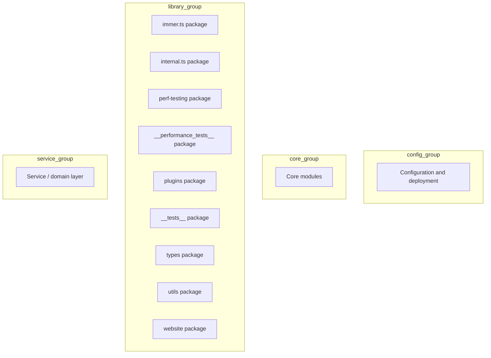

# Architecture report: immerjs/immer

> Automated static analysis. **Observed** = directly seen in files/imports/AST; **Inferred** = interpretation from that evidence. Repository code was not executed.

## 1. Repository at a glance

| Item | Value |
| --- | --- |
| Repository | immerjs/immer |
| Description | Create the next immutable state by mutating the current one |
| Language | JavaScript |
| Stars | 29003 |
| Licence | MIT |
| Analysed commit / branch | 784c86bb234e805566481c9425fcb2a3897e8bcc / main |
| Framework(s) | React |
| Files analysed | 158 |
| Components | 12 |

## 2. Architecture in one minute

immerjs/immer - Create the next immutable state by mutating the current one. This repository was analysed statically from 158 file(s) (0 Python). Detected technologies (observed from imports/manifests): GitHub Actions, React, Redux, TypeScript, Vite, Vitest. Files are grouped into 12 component(s): Configuration and deployment, Core modules, immer.ts package, internal.ts package, perf-testing package, __performance_tests__ package, plugins package, Service / domain layer. Findings below distinguish observed facts from inferred interpretation.

## 3. High-level block diagram

## 4. Main components

### Configuration and deployment (`config`)

- **Kind:** config
- **Status:** Observed
- **Confidence:** 0.85
- **Responsibility:** Groups 9 file(s) under configuration and deployment (observed from repository paths and static analysis).
- **Paths:** `__tests__/test-data.json`, `__tests__/tsconfig.json`, `package.json`, `perf-testing/package.json`, `tsconfig.json`, `website/i18n/zh-CN/docusaurus-plugin-content-docs/current.json`, `website/i18n/zh-CN/docusaurus-theme-classic/footer.json`, `website/i18n/zh-CN/docusaurus-theme-classic/navbar.json`, `website/package.json`
- **Evidence:** [__tests__/test-data.json](https://github.com/immerjs/immer/blob/784c86bb234e805566481c9425fcb2a3897e8bcc/__tests__/test-data.json); [__tests__/tsconfig.json](https://github.com/immerjs/immer/blob/784c86bb234e805566481c9425fcb2a3897e8bcc/__tests__/tsconfig.json); [package.json](https://github.com/immerjs/immer/blob/784c86bb234e805566481c9425fcb2a3897e8bcc/package.json); [perf-testing/package.json](https://github.com/immerjs/immer/blob/784c86bb234e805566481c9425fcb2a3897e8bcc/perf-testing/package.json); [tsconfig.json](https://github.com/immerjs/immer/blob/784c86bb234e805566481c9425fcb2a3897e8bcc/tsconfig.json); [website/i18n/zh-CN/docusaurus-plugin-content-docs/current.json](https://github.com/immerjs/immer/blob/784c86bb234e805566481c9425fcb2a3897e8bcc/website/i18n/zh-CN/docusaurus-plugin-content-docs/current.json); [website/i18n/zh-CN/docusaurus-theme-classic/footer.json](https://github.com/immerjs/immer/blob/784c86bb234e805566481c9425fcb2a3897e8bcc/website/i18n/zh-CN/docusaurus-theme-classic/footer.json); [website/i18n/zh-CN/docusaurus-theme-classic/navbar.json](https://github.com/immerjs/immer/blob/784c86bb234e805566481c9425fcb2a3897e8bcc/website/i18n/zh-CN/docusaurus-theme-classic/navbar.json)

### Core modules (`core`)

- **Kind:** core
- **Status:** Observed
- **Confidence:** 0.85
- **Responsibility:** Groups 4 file(s) under core modules (observed from repository paths and static analysis).
- **Paths:** `tsup.config.ts`, `vitest-custom-reporter.ts`, `vitest.config.build.ts`, `vitest.config.ts`
- **Evidence:** [tsup.config.ts](https://github.com/immerjs/immer/blob/784c86bb234e805566481c9425fcb2a3897e8bcc/tsup.config.ts); [vitest-custom-reporter.ts](https://github.com/immerjs/immer/blob/784c86bb234e805566481c9425fcb2a3897e8bcc/vitest-custom-reporter.ts); [vitest.config.build.ts](https://github.com/immerjs/immer/blob/784c86bb234e805566481c9425fcb2a3897e8bcc/vitest.config.build.ts); [vitest.config.ts](https://github.com/immerjs/immer/blob/784c86bb234e805566481c9425fcb2a3897e8bcc/vitest.config.ts)

### immer.ts package (`immer_ts`)

- **Kind:** library
- **Status:** Observed
- **Confidence:** 0.85
- **Responsibility:** Groups 1 file(s) under immer.ts package (observed from repository paths and static analysis).
- **Paths:** `src/immer.ts`
- **Evidence:** [src/immer.ts](https://github.com/immerjs/immer/blob/784c86bb234e805566481c9425fcb2a3897e8bcc/src/immer.ts)

### internal.ts package (`internal_ts`)

- **Kind:** library
- **Status:** Observed
- **Confidence:** 0.85
- **Responsibility:** Groups 1 file(s) under internal.ts package (observed from repository paths and static analysis).
- **Paths:** `src/internal.ts`
- **Evidence:** [src/internal.ts](https://github.com/immerjs/immer/blob/784c86bb234e805566481c9425fcb2a3897e8bcc/src/internal.ts)

### perf-testing package (`perf_testing`)

- **Kind:** library
- **Status:** Observed
- **Confidence:** 0.85
- **Responsibility:** Groups 4 file(s) under perf-testing package (observed from repository paths and static analysis).
- **Paths:** `perf-testing/immutability-benchmarks.mjs`, `perf-testing/immutability-profiling.mjs`, `perf-testing/read-cpuprofile.js`, `perf-testing/rolldown.config.js`
- **Evidence:** [perf-testing/immutability-benchmarks.mjs](https://github.com/immerjs/immer/blob/784c86bb234e805566481c9425fcb2a3897e8bcc/perf-testing/immutability-benchmarks.mjs); [perf-testing/immutability-profiling.mjs](https://github.com/immerjs/immer/blob/784c86bb234e805566481c9425fcb2a3897e8bcc/perf-testing/immutability-profiling.mjs); [perf-testing/read-cpuprofile.js](https://github.com/immerjs/immer/blob/784c86bb234e805566481c9425fcb2a3897e8bcc/perf-testing/read-cpuprofile.js); [perf-testing/rolldown.config.js](https://github.com/immerjs/immer/blob/784c86bb234e805566481c9425fcb2a3897e8bcc/perf-testing/rolldown.config.js)

### __performance_tests__ package (`performance_tests`)

- **Kind:** library
- **Status:** Observed
- **Confidence:** 0.85
- **Responsibility:** Groups 5 file(s) under __performance_tests__ package (observed from repository paths and static analysis).
- **Paths:** `__performance_tests__/add-data.mjs`, `__performance_tests__/incremental.mjs`, `__performance_tests__/large-obj.mjs`, `__performance_tests__/measure.mjs`, `__performance_tests__/todo.mjs`
- **Evidence:** [__performance_tests__/add-data.mjs](https://github.com/immerjs/immer/blob/784c86bb234e805566481c9425fcb2a3897e8bcc/__performance_tests__/add-data.mjs); [__performance_tests__/incremental.mjs](https://github.com/immerjs/immer/blob/784c86bb234e805566481c9425fcb2a3897e8bcc/__performance_tests__/incremental.mjs); [__performance_tests__/large-obj.mjs](https://github.com/immerjs/immer/blob/784c86bb234e805566481c9425fcb2a3897e8bcc/__performance_tests__/large-obj.mjs); [__performance_tests__/measure.mjs](https://github.com/immerjs/immer/blob/784c86bb234e805566481c9425fcb2a3897e8bcc/__performance_tests__/measure.mjs); [__performance_tests__/todo.mjs](https://github.com/immerjs/immer/blob/784c86bb234e805566481c9425fcb2a3897e8bcc/__performance_tests__/todo.mjs)

### plugins package (`plugins`)

- **Kind:** library
- **Status:** Observed
- **Confidence:** 0.85
- **Responsibility:** Groups 3 file(s) under plugins package (observed from repository paths and static analysis).
- **Paths:** `src/plugins/arrayMethods.ts`, `src/plugins/mapset.ts`, `src/plugins/patches.ts`
- **Evidence:** [src/plugins/arrayMethods.ts](https://github.com/immerjs/immer/blob/784c86bb234e805566481c9425fcb2a3897e8bcc/src/plugins/arrayMethods.ts); [src/plugins/mapset.ts](https://github.com/immerjs/immer/blob/784c86bb234e805566481c9425fcb2a3897e8bcc/src/plugins/mapset.ts); [src/plugins/patches.ts](https://github.com/immerjs/immer/blob/784c86bb234e805566481c9425fcb2a3897e8bcc/src/plugins/patches.ts)

### Service / domain layer (`service_layer`)

- **Kind:** service
- **Status:** Observed
- **Confidence:** 0.85
- **Responsibility:** Groups 5 file(s) under service / domain layer (observed from repository paths and static analysis).
- **Paths:** `src/core/current.ts`, `src/core/finalize.ts`, `src/core/immerClass.ts`, `src/core/proxy.ts`, `src/core/scope.ts`
- **Evidence:** [src/core/current.ts](https://github.com/immerjs/immer/blob/784c86bb234e805566481c9425fcb2a3897e8bcc/src/core/current.ts); [src/core/finalize.ts](https://github.com/immerjs/immer/blob/784c86bb234e805566481c9425fcb2a3897e8bcc/src/core/finalize.ts); [src/core/immerClass.ts](https://github.com/immerjs/immer/blob/784c86bb234e805566481c9425fcb2a3897e8bcc/src/core/immerClass.ts); [src/core/proxy.ts](https://github.com/immerjs/immer/blob/784c86bb234e805566481c9425fcb2a3897e8bcc/src/core/proxy.ts); [src/core/scope.ts](https://github.com/immerjs/immer/blob/784c86bb234e805566481c9425fcb2a3897e8bcc/src/core/scope.ts)

### __tests__ package (`tests`)

- **Kind:** library
- **Status:** Observed
- **Confidence:** 0.85
- **Responsibility:** Groups 25 file(s) under __tests__ package (observed from repository paths and static analysis).
- **Paths:** `__tests__/array-methods-filter-length.js`, `__tests__/base.js`, `__tests__/current.js`, `__tests__/curry.js`, `__tests__/draft.ts`, `__tests__/empty.ts`, `__tests__/frozen.js`, `__tests__/immutable.ts`, `__tests__/isDraftable.js`, `__tests__/isModified.js`, `__tests__/manual.js`, `__tests__/map-set.js`, `__tests__/not-strict-copy.ts`, `__tests__/null.js`, `__tests__/original.js`, `__tests__/patch.js`, `__tests__/plugins.js`, `__tests__/produce.ts`, `__tests__/prototype-inspection.js`, `__tests__/readme.js`, `__tests__/redux.ts`, `__tests__/regressions.js`, `__tests__/spec_ts.ts`, `__tests__/type-external.ts`, `__tests__/updateScenarios.js`
- **Evidence:** [__tests__/array-methods-filter-length.js](https://github.com/immerjs/immer/blob/784c86bb234e805566481c9425fcb2a3897e8bcc/__tests__/array-methods-filter-length.js); [__tests__/base.js](https://github.com/immerjs/immer/blob/784c86bb234e805566481c9425fcb2a3897e8bcc/__tests__/base.js); [__tests__/current.js](https://github.com/immerjs/immer/blob/784c86bb234e805566481c9425fcb2a3897e8bcc/__tests__/current.js); [__tests__/curry.js](https://github.com/immerjs/immer/blob/784c86bb234e805566481c9425fcb2a3897e8bcc/__tests__/curry.js); [__tests__/draft.ts](https://github.com/immerjs/immer/blob/784c86bb234e805566481c9425fcb2a3897e8bcc/__tests__/draft.ts); [__tests__/empty.ts](https://github.com/immerjs/immer/blob/784c86bb234e805566481c9425fcb2a3897e8bcc/__tests__/empty.ts); [__tests__/frozen.js](https://github.com/immerjs/immer/blob/784c86bb234e805566481c9425fcb2a3897e8bcc/__tests__/frozen.js); [__tests__/immutable.ts](https://github.com/immerjs/immer/blob/784c86bb234e805566481c9425fcb2a3897e8bcc/__tests__/immutable.ts)

### types package (`types`)

- **Kind:** library
- **Status:** Observed
- **Confidence:** 0.85
- **Responsibility:** Groups 3 file(s) under types package (observed from repository paths and static analysis).
- **Paths:** `src/types/globals.d.ts`, `src/types/types-external.ts`, `src/types/types-internal.ts`
- **Evidence:** [src/types/globals.d.ts](https://github.com/immerjs/immer/blob/784c86bb234e805566481c9425fcb2a3897e8bcc/src/types/globals.d.ts); [src/types/types-external.ts](https://github.com/immerjs/immer/blob/784c86bb234e805566481c9425fcb2a3897e8bcc/src/types/types-external.ts); [src/types/types-internal.ts](https://github.com/immerjs/immer/blob/784c86bb234e805566481c9425fcb2a3897e8bcc/src/types/types-internal.ts)

### utils package (`utils`)

- **Kind:** library
- **Status:** Observed
- **Confidence:** 0.85
- **Responsibility:** Groups 4 file(s) under utils package (observed from repository paths and static analysis).
- **Paths:** `src/utils/common.ts`, `src/utils/env.ts`, `src/utils/errors.ts`, `src/utils/plugins.ts`
- **Evidence:** [src/utils/common.ts](https://github.com/immerjs/immer/blob/784c86bb234e805566481c9425fcb2a3897e8bcc/src/utils/common.ts); [src/utils/env.ts](https://github.com/immerjs/immer/blob/784c86bb234e805566481c9425fcb2a3897e8bcc/src/utils/env.ts); [src/utils/errors.ts](https://github.com/immerjs/immer/blob/784c86bb234e805566481c9425fcb2a3897e8bcc/src/utils/errors.ts); [src/utils/plugins.ts](https://github.com/immerjs/immer/blob/784c86bb234e805566481c9425fcb2a3897e8bcc/src/utils/plugins.ts)

### website package (`website`)

- **Kind:** library
- **Status:** Observed
- **Confidence:** 0.85
- **Responsibility:** Groups 2 file(s) under website package (observed from repository paths and static analysis).
- **Paths:** `website/docusaurus.config.js`, `website/sidebars.js`
- **Evidence:** [website/docusaurus.config.js](https://github.com/immerjs/immer/blob/784c86bb234e805566481c9425fcb2a3897e8bcc/website/docusaurus.config.js); [website/sidebars.js](https://github.com/immerjs/immer/blob/784c86bb234e805566481c9425fcb2a3897e8bcc/website/sidebars.js)

## 5. Execution flow

No entry point was observed; the startup flow below is therefore limited.

Representative flow (derived from observed entry points and the import graph; steps beyond the entry point are **Inferred**):

1. Execution starts at an observed entry point listed above, if present.
2. No internal import relationships between components were observed.

## 6. Project structure

### `(root)`

- `.coveralls.yml` - config (46 bytes)
- `.gitignore` - other (969 bytes)
- `.prettierrc` - other (391 bytes)
- `.watchmanconfig` - other (66 bytes)
- `LICENSE` - docs (1074 bytes)
- `SECURITY.md` - docs (233 bytes)
- `package.json` - manifest (2937 bytes)
- `readme.md` - docs (1880 bytes)
- `tsconfig.json` - config (437 bytes)
- `tsup.config.ts` - source, TypeScript (1931 bytes)
- `vitest-custom-reporter.ts` - source, TypeScript (601 bytes)
- `vitest.config.build.ts` - source, TypeScript (1498 bytes)
- `vitest.config.ts` - source, TypeScript (370 bytes)

### `.codesandbox`

- `.codesandbox/ci.json` - config (34 bytes)

### `.github`

- `.github/FUNDING.yml` - config (91 bytes)
- `.github/ISSUE_TEMPLATE/bug.md` - docs (1245 bytes)
- `.github/ISSUE_TEMPLATE/feature.md` - docs (551 bytes)
- `.github/ISSUE_TEMPLATE/question.md` - docs (685 bytes)
- `.github/lock.yml` - config (929 bytes)
- `.github/workflows/docs-public.yml` - ci, YAML (1312 bytes)
- `.github/workflows/release.yml` - ci, YAML (994 bytes)
- `.github/workflows/test.yml` - ci, YAML (1027 bytes)

### `.vscode`

- `.vscode/launch.json` - config (601 bytes)
- `.vscode/settings.json` - config (243 bytes)

### `__performance_tests__`

- `__performance_tests__/add-data.mjs` - source, JavaScript (1945 bytes)
- `__performance_tests__/incremental.mjs` - source, JavaScript (1578 bytes)
- `__performance_tests__/large-obj.mjs` - source, JavaScript (634 bytes)
- `__performance_tests__/measure.mjs` - source, JavaScript (454 bytes)
- `__performance_tests__/todo.mjs` - source, JavaScript (4523 bytes)

### `__tests__`

- `__tests__/__prod_snapshots__/base.js.snap` - other (21045 bytes)
- `__tests__/__prod_snapshots__/curry.js.snap` - other (602 bytes)
- `__tests__/__prod_snapshots__/frozen.js.snap` - other (872 bytes)
- `__tests__/__prod_snapshots__/manual.js.snap` - other (1231 bytes)
- `__tests__/__prod_snapshots__/patch.js.snap` - other (535 bytes)
- `__tests__/__prod_snapshots__/plugins.js.snap` - other (555 bytes)
- `__tests__/__prod_snapshots__/readme.js.snap` - other (184 bytes)
- `__tests__/__snapshots__/base.js.snap` - other (42956 bytes)
- `__tests__/__snapshots__/curry.js.snap` - other (617 bytes)
- `__tests__/__snapshots__/frozen.js.snap` - other (836 bytes)
- `__tests__/__snapshots__/manual.js.snap` - other (1610 bytes)
- `__tests__/__snapshots__/patch.js.snap` - other (480 bytes)
- `__tests__/__snapshots__/plugins.js.snap` - other (917 bytes)
- `__tests__/__snapshots__/readme.js.snap` - other (178 bytes)
- `__tests__/array-methods-filter-length.js` - source, JavaScript (986 bytes)
- `__tests__/base.js` - source, JavaScript (136403 bytes)
- `__tests__/current.js` - source, JavaScript (8894 bytes)
- `__tests__/curry.js` - source, JavaScript (2380 bytes)
- `__tests__/draft.ts` - source, TypeScript (6736 bytes)
- `__tests__/empty.ts` - source, TypeScript (4220 bytes)
- `__tests__/flow/.flowconfig` - other (180 bytes)
- `__tests__/flow/flow.js.flow` - other (2954 bytes)
- `__tests__/frozen.js` - source, JavaScript (6553 bytes)
- `__tests__/immutable.ts` - source, TypeScript (2409 bytes)
- `__tests__/isDraftable.js` - source, JavaScript (218 bytes)
- `__tests__/isModified.js` - source, JavaScript (3255 bytes)
- `__tests__/manual.js` - source, JavaScript (3314 bytes)
- `__tests__/map-set.js` - source, JavaScript (12670 bytes)
- `__tests__/not-strict-copy.ts` - source, TypeScript (2569 bytes)
- `__tests__/null.js` - source, JavaScript (271 bytes)
- `__tests__/original.js` - source, JavaScript (1729 bytes)
- `__tests__/patch.js` - source, JavaScript (33321 bytes)
- `__tests__/plugins.js` - source, JavaScript (624 bytes)
- `__tests__/produce.ts` - source, TypeScript (18471 bytes)
- `__tests__/prototype-inspection.js` - source, JavaScript (3070 bytes)
- `__tests__/readme.js` - source, JavaScript (5705 bytes)
- `__tests__/redux.ts` - source, TypeScript (4380 bytes)
- `__tests__/regressions.js` - source, JavaScript (7786 bytes)
- `__tests__/spec_ts.ts` - source, TypeScript (1725 bytes)
- `__tests__/test-data.json` - config (1367 bytes)
- `__tests__/tsconfig.json` - config (187 bytes)
- `__tests__/type-external.ts` - source, TypeScript (1913 bytes)
- `__tests__/updateScenarios.js` - source, JavaScript (15672 bytes)

### `_site`

- `_site/.github/ISSUE_TEMPLATE/bug/index.html` - other (629 bytes)
- `_site/.github/ISSUE_TEMPLATE/feature/index.html` - other (255 bytes)
- `_site/readme/index.html` - other (38507 bytes)

### `images`

- `images/immer-logo.svg` - other (3456 bytes)

### `perf-testing`

- `perf-testing/.gitignore` - other (371 bytes)
- `perf-testing/README.md` - docs (1725 bytes)
- `perf-testing/immutability-benchmarks.mjs` - source, JavaScript (34360 bytes)
- `perf-testing/immutability-profiling.mjs` - source, JavaScript (14592 bytes)
- `perf-testing/package.json` - manifest (1161 bytes)
- `perf-testing/read-cpuprofile.js` - source, JavaScript (16253 bytes)
- `perf-testing/rolldown.config.js` - source, JavaScript (364 bytes)

### `src`

- `src/core/current.ts` - source, TypeScript (1421 bytes)
- `src/core/finalize.ts` - source, TypeScript (8486 bytes)
- `src/core/immerClass.ts` - source, TypeScript (7845 bytes)
- `src/core/proxy.ts` - source, TypeScript (10797 bytes)
- `src/core/scope.ts` - source, TypeScript (2172 bytes)
- `src/immer.ts` - source, TypeScript (3887 bytes)
- `src/internal.ts` - source, TypeScript (355 bytes)
- `src/plugins/arrayMethods.ts` - source, TypeScript (16685 bytes)
- `src/plugins/mapset.ts` - source, TypeScript (8771 bytes)
- `src/plugins/patches.ts` - source, TypeScript (11258 bytes)
- `src/types/globals.d.ts` - source, TypeScript (31 bytes)
- `src/types/index.js.flow` - other (4464 bytes)
- `src/types/types-external.ts` - source, TypeScript (8767 bytes)
- `src/types/types-internal.ts` - source, TypeScript (1193 bytes)
- `src/utils/common.ts` - source, TypeScript (8626 bytes)
- `src/utils/env.ts` - source, TypeScript (666 bytes)
- `src/utils/errors.ts` - source, TypeScript (2214 bytes)
- `src/utils/plugins.ts` - source, TypeScript (2332 bytes)

### `website`

- `website/docs/api.md` - docs (4481 bytes)
- `website/docs/array-methods.md` - docs (9920 bytes)
- `website/docs/async.mdx` - docs (2042 bytes)
- `website/docs/built-with.md` - docs (2690 bytes)
- `website/docs/complex-objects.md` - docs (3014 bytes)
- `website/docs/current.md` - docs (1827 bytes)
- `website/docs/curried-produce.mdx` - docs (2353 bytes)
- `website/docs/example-setstate.mdx` - docs (5737 bytes)
- `website/docs/faq.md` - docs (953 bytes)
- `website/docs/freezing.mdx` - docs (1630 bytes)
- `website/docs/installation.mdx` - docs (4324 bytes)
- `website/docs/introduction.md` - docs (6055 bytes)
- `website/docs/map-set.md` - docs (2006 bytes)
- `website/docs/original.md` - docs (1119 bytes)
- `website/docs/other-lang.md` - docs (314 bytes)
- `website/docs/patches.mdx` - docs (7006 bytes)
- `website/docs/performance.mdx` - docs (5735 bytes)
- `website/docs/pitfalls.md` - docs (5358 bytes)
- `website/docs/produce.mdx` - docs (3185 bytes)
- `website/docs/resources.md` - docs (1818 bytes)
- `website/docs/return.mdx` - docs (4943 bytes)
- `website/docs/support.md` - docs (669 bytes)
- `website/docs/typescript.mdx` - docs (8154 bytes)
- `website/docs/update-patterns.md` - docs (4430 bytes)
- `website/docusaurus.config.js` - source, JavaScript (2267 bytes)
- `website/i18n/zh-CN/docusaurus-plugin-content-docs/current.json` - config (536 bytes)
- `website/i18n/zh-CN/docusaurus-plugin-content-docs/current/api.md` - docs (3946 bytes)
- `website/i18n/zh-CN/docusaurus-plugin-content-docs/current/array-methods.md` - docs (10486 bytes)
- `website/i18n/zh-CN/docusaurus-plugin-content-docs/current/async.mdx` - other (1863 bytes)
- `website/i18n/zh-CN/docusaurus-plugin-content-docs/current/built-with.md` - docs (2055 bytes)
- `website/i18n/zh-CN/docusaurus-plugin-content-docs/current/complex-objects.md` - docs (2209 bytes)
- `website/i18n/zh-CN/docusaurus-plugin-content-docs/current/current.md` - docs (1738 bytes)
- `website/i18n/zh-CN/docusaurus-plugin-content-docs/current/curried-produce.mdx` - other (2252 bytes)
- `website/i18n/zh-CN/docusaurus-plugin-content-docs/current/example-setstate.mdx` - other (5645 bytes)
- `website/i18n/zh-CN/docusaurus-plugin-content-docs/current/faq.md` - docs (964 bytes)
- `website/i18n/zh-CN/docusaurus-plugin-content-docs/current/freezing.mdx` - other (1531 bytes)
- `website/i18n/zh-CN/docusaurus-plugin-content-docs/current/installation.mdx` - other (4192 bytes)
- `website/i18n/zh-CN/docusaurus-plugin-content-docs/current/introduction.md` - docs (5306 bytes)
- `website/i18n/zh-CN/docusaurus-plugin-content-docs/current/map-set.md` - docs (1933 bytes)
- `website/i18n/zh-CN/docusaurus-plugin-content-docs/current/original.md` - docs (1072 bytes)
- `website/i18n/zh-CN/docusaurus-plugin-content-docs/current/other-lang.md` - docs (307 bytes)
- `website/i18n/zh-CN/docusaurus-plugin-content-docs/current/patches.mdx` - other (6655 bytes)
- `website/i18n/zh-CN/docusaurus-plugin-content-docs/current/performance.mdx` - other (5372 bytes)
- `website/i18n/zh-CN/docusaurus-plugin-content-docs/current/pitfalls.md` - docs (3775 bytes)
- `website/i18n/zh-CN/docusaurus-plugin-content-docs/current/produce.mdx` - other (2944 bytes)
- `website/i18n/zh-CN/docusaurus-plugin-content-docs/current/resources.md` - docs (1625 bytes)
- `website/i18n/zh-CN/docusaurus-plugin-content-docs/current/return.mdx` - other (4767 bytes)
- `website/i18n/zh-CN/docusaurus-plugin-content-docs/current/support.md` - docs (609 bytes)
- `website/i18n/zh-CN/docusaurus-plugin-content-docs/current/typescript.mdx` - other (6535 bytes)
- `website/i18n/zh-CN/docusaurus-plugin-content-docs/current/update-patterns.md` - docs (3353 bytes)
- `website/i18n/zh-CN/docusaurus-theme-classic/footer.json` - config (121 bytes)
- `website/i18n/zh-CN/docusaurus-theme-classic/navbar.json` - config (442 bytes)
- `website/package.json` - manifest (698 bytes)
- `website/sidebars.js` - source, JavaScript (489 bytes)
- `website/src/css/immer-infima.css` - other (1564 bytes)
- `website/static/.nojekyll` - other (0 bytes)
- `website/static/img/immer-logo.svg` - other (3456 bytes)

## 7. Key dependencies and integrations

| Name | Category | Status | Confidence | Evidence |
| --- | --- | --- | --- | --- |
| GitHub Actions | ci | Observed | 0.90 | [.github/workflows/docs-public.yml](https://github.com/immerjs/immer/blob/784c86bb234e805566481c9425fcb2a3897e8bcc/.github/workflows/docs-public.yml); [.github/workflows/release.yml](https://github.com/immerjs/immer/blob/784c86bb234e805566481c9425fcb2a3897e8bcc/.github/workflows/release.yml); [.github/workflows/test.yml](https://github.com/immerjs/immer/blob/784c86bb234e805566481c9425fcb2a3897e8bcc/.github/workflows/test.yml) |
| React | framework | Observed | 0.90 | [website/package.json:20](https://github.com/immerjs/immer/blob/784c86bb234e805566481c9425fcb2a3897e8bcc/website/package.json#L20); [website/package.json:21](https://github.com/immerjs/immer/blob/784c86bb234e805566481c9425fcb2a3897e8bcc/website/package.json#L21) |
| Redux | library | Observed | 0.85 | [package.json:88](https://github.com/immerjs/immer/blob/784c86bb234e805566481c9425fcb2a3897e8bcc/package.json#L88) |
| TypeScript | tooling | Observed | 0.85 | [package.json:94](https://github.com/immerjs/immer/blob/784c86bb234e805566481c9425fcb2a3897e8bcc/package.json#L94) |
| Vite | tooling | Observed | 0.85 | [package.json:29](https://github.com/immerjs/immer/blob/784c86bb234e805566481c9425fcb2a3897e8bcc/package.json#L29) |
| Vitest | tooling | Observed | 0.85 | [package.json:29](https://github.com/immerjs/immer/blob/784c86bb234e805566481c9425fcb2a3897e8bcc/package.json#L29) |

## 8. Data and state

No database, cache, queue, or persistent-state usage was observed in the analysed files. State handling, if any, may be in-memory or in files that were not analysed.

## 9. Configuration and deployment clues

- `.codesandbox/ci.json` (config)
- `.coveralls.yml` (config)
- `.github/FUNDING.yml` (config)
- `.github/lock.yml` (config)
- `.github/workflows/docs-public.yml` (ci)
- `.github/workflows/release.yml` (ci)
- `.github/workflows/test.yml` (ci)
- `.vscode/launch.json` (config)
- `.vscode/settings.json` (config)
- `__tests__/test-data.json` (config)
- `__tests__/tsconfig.json` (config)
- `package.json` (manifest)
- `perf-testing/package.json` (manifest)
- `tsconfig.json` (config)
- `website/i18n/zh-CN/docusaurus-plugin-content-docs/current.json` (config)
- `website/i18n/zh-CN/docusaurus-theme-classic/footer.json` (config)
- `website/i18n/zh-CN/docusaurus-theme-classic/navbar.json` (config)
- `website/package.json` (manifest)

## 10. Design observations

- Service/domain code is distinct from entry and data code, suggesting layered separation (Inferred).

These observations are interpretations (**Inferred**) of the observed structure, not guarantees about runtime design.

## 11. Limitations and unknowns

- Static analysis only: repository code was not executed, installed, or imported at runtime.
- Components and relationships are inferred from file paths, imports, and AST structure; runtime behaviour, dynamic imports, and reflection may not be visible.
- 1 file(s) were skipped during inventory (1 x lockfile excluded).
- No clear application entry point was observed in the analysed files.
- Repository text was treated as untrusted data; no instructions found in repository files were followed, and likely secret values were redacted/excluded.
- JavaScript and TypeScript files were inventoried from paths and package manifests. They were not parsed with a full language AST, and repository code was not executed.

## 12. Source references

- [.github/workflows/docs-public.yml](https://github.com/immerjs/immer/blob/784c86bb234e805566481c9425fcb2a3897e8bcc/.github/workflows/docs-public.yml)
- [.github/workflows/release.yml](https://github.com/immerjs/immer/blob/784c86bb234e805566481c9425fcb2a3897e8bcc/.github/workflows/release.yml)
- [.github/workflows/test.yml](https://github.com/immerjs/immer/blob/784c86bb234e805566481c9425fcb2a3897e8bcc/.github/workflows/test.yml)
- [__performance_tests__/add-data.mjs](https://github.com/immerjs/immer/blob/784c86bb234e805566481c9425fcb2a3897e8bcc/__performance_tests__/add-data.mjs)
- [__performance_tests__/incremental.mjs](https://github.com/immerjs/immer/blob/784c86bb234e805566481c9425fcb2a3897e8bcc/__performance_tests__/incremental.mjs)
- [__performance_tests__/large-obj.mjs](https://github.com/immerjs/immer/blob/784c86bb234e805566481c9425fcb2a3897e8bcc/__performance_tests__/large-obj.mjs)
- [__performance_tests__/measure.mjs](https://github.com/immerjs/immer/blob/784c86bb234e805566481c9425fcb2a3897e8bcc/__performance_tests__/measure.mjs)
- [__performance_tests__/todo.mjs](https://github.com/immerjs/immer/blob/784c86bb234e805566481c9425fcb2a3897e8bcc/__performance_tests__/todo.mjs)
- [__tests__/array-methods-filter-length.js](https://github.com/immerjs/immer/blob/784c86bb234e805566481c9425fcb2a3897e8bcc/__tests__/array-methods-filter-length.js)
- [__tests__/base.js](https://github.com/immerjs/immer/blob/784c86bb234e805566481c9425fcb2a3897e8bcc/__tests__/base.js)
- [__tests__/current.js](https://github.com/immerjs/immer/blob/784c86bb234e805566481c9425fcb2a3897e8bcc/__tests__/current.js)
- [__tests__/curry.js](https://github.com/immerjs/immer/blob/784c86bb234e805566481c9425fcb2a3897e8bcc/__tests__/curry.js)
- [__tests__/draft.ts](https://github.com/immerjs/immer/blob/784c86bb234e805566481c9425fcb2a3897e8bcc/__tests__/draft.ts)
- [__tests__/empty.ts](https://github.com/immerjs/immer/blob/784c86bb234e805566481c9425fcb2a3897e8bcc/__tests__/empty.ts)
- [__tests__/frozen.js](https://github.com/immerjs/immer/blob/784c86bb234e805566481c9425fcb2a3897e8bcc/__tests__/frozen.js)
- [__tests__/immutable.ts](https://github.com/immerjs/immer/blob/784c86bb234e805566481c9425fcb2a3897e8bcc/__tests__/immutable.ts)
- [__tests__/test-data.json](https://github.com/immerjs/immer/blob/784c86bb234e805566481c9425fcb2a3897e8bcc/__tests__/test-data.json)
- [__tests__/tsconfig.json](https://github.com/immerjs/immer/blob/784c86bb234e805566481c9425fcb2a3897e8bcc/__tests__/tsconfig.json)
- [package.json](https://github.com/immerjs/immer/blob/784c86bb234e805566481c9425fcb2a3897e8bcc/package.json)
- [package.json:29](https://github.com/immerjs/immer/blob/784c86bb234e805566481c9425fcb2a3897e8bcc/package.json#L29)
- [package.json:88](https://github.com/immerjs/immer/blob/784c86bb234e805566481c9425fcb2a3897e8bcc/package.json#L88)
- [package.json:94](https://github.com/immerjs/immer/blob/784c86bb234e805566481c9425fcb2a3897e8bcc/package.json#L94)
- [perf-testing/immutability-benchmarks.mjs](https://github.com/immerjs/immer/blob/784c86bb234e805566481c9425fcb2a3897e8bcc/perf-testing/immutability-benchmarks.mjs)
- [perf-testing/immutability-profiling.mjs](https://github.com/immerjs/immer/blob/784c86bb234e805566481c9425fcb2a3897e8bcc/perf-testing/immutability-profiling.mjs)
- [perf-testing/package.json](https://github.com/immerjs/immer/blob/784c86bb234e805566481c9425fcb2a3897e8bcc/perf-testing/package.json)
- [perf-testing/read-cpuprofile.js](https://github.com/immerjs/immer/blob/784c86bb234e805566481c9425fcb2a3897e8bcc/perf-testing/read-cpuprofile.js)
- [perf-testing/rolldown.config.js](https://github.com/immerjs/immer/blob/784c86bb234e805566481c9425fcb2a3897e8bcc/perf-testing/rolldown.config.js)
- [src/core/current.ts](https://github.com/immerjs/immer/blob/784c86bb234e805566481c9425fcb2a3897e8bcc/src/core/current.ts)
- [src/core/finalize.ts](https://github.com/immerjs/immer/blob/784c86bb234e805566481c9425fcb2a3897e8bcc/src/core/finalize.ts)
- [src/core/immerClass.ts](https://github.com/immerjs/immer/blob/784c86bb234e805566481c9425fcb2a3897e8bcc/src/core/immerClass.ts)
- [src/core/proxy.ts](https://github.com/immerjs/immer/blob/784c86bb234e805566481c9425fcb2a3897e8bcc/src/core/proxy.ts)
- [src/core/scope.ts](https://github.com/immerjs/immer/blob/784c86bb234e805566481c9425fcb2a3897e8bcc/src/core/scope.ts)
- [src/immer.ts](https://github.com/immerjs/immer/blob/784c86bb234e805566481c9425fcb2a3897e8bcc/src/immer.ts)
- [src/internal.ts](https://github.com/immerjs/immer/blob/784c86bb234e805566481c9425fcb2a3897e8bcc/src/internal.ts)
- [src/plugins/arrayMethods.ts](https://github.com/immerjs/immer/blob/784c86bb234e805566481c9425fcb2a3897e8bcc/src/plugins/arrayMethods.ts)
- [src/plugins/mapset.ts](https://github.com/immerjs/immer/blob/784c86bb234e805566481c9425fcb2a3897e8bcc/src/plugins/mapset.ts)
- [src/plugins/patches.ts](https://github.com/immerjs/immer/blob/784c86bb234e805566481c9425fcb2a3897e8bcc/src/plugins/patches.ts)
- [src/types/globals.d.ts](https://github.com/immerjs/immer/blob/784c86bb234e805566481c9425fcb2a3897e8bcc/src/types/globals.d.ts)
- [src/types/types-external.ts](https://github.com/immerjs/immer/blob/784c86bb234e805566481c9425fcb2a3897e8bcc/src/types/types-external.ts)
- [src/types/types-internal.ts](https://github.com/immerjs/immer/blob/784c86bb234e805566481c9425fcb2a3897e8bcc/src/types/types-internal.ts)
- [src/utils/common.ts](https://github.com/immerjs/immer/blob/784c86bb234e805566481c9425fcb2a3897e8bcc/src/utils/common.ts)
- [src/utils/env.ts](https://github.com/immerjs/immer/blob/784c86bb234e805566481c9425fcb2a3897e8bcc/src/utils/env.ts)
- [src/utils/errors.ts](https://github.com/immerjs/immer/blob/784c86bb234e805566481c9425fcb2a3897e8bcc/src/utils/errors.ts)
- [src/utils/plugins.ts](https://github.com/immerjs/immer/blob/784c86bb234e805566481c9425fcb2a3897e8bcc/src/utils/plugins.ts)
- [tsconfig.json](https://github.com/immerjs/immer/blob/784c86bb234e805566481c9425fcb2a3897e8bcc/tsconfig.json)
- [tsup.config.ts](https://github.com/immerjs/immer/blob/784c86bb234e805566481c9425fcb2a3897e8bcc/tsup.config.ts)
- [vitest-custom-reporter.ts](https://github.com/immerjs/immer/blob/784c86bb234e805566481c9425fcb2a3897e8bcc/vitest-custom-reporter.ts)
- [vitest.config.build.ts](https://github.com/immerjs/immer/blob/784c86bb234e805566481c9425fcb2a3897e8bcc/vitest.config.build.ts)
- [vitest.config.ts](https://github.com/immerjs/immer/blob/784c86bb234e805566481c9425fcb2a3897e8bcc/vitest.config.ts)
- [website/docusaurus.config.js](https://github.com/immerjs/immer/blob/784c86bb234e805566481c9425fcb2a3897e8bcc/website/docusaurus.config.js)
- [website/i18n/zh-CN/docusaurus-plugin-content-docs/current.json](https://github.com/immerjs/immer/blob/784c86bb234e805566481c9425fcb2a3897e8bcc/website/i18n/zh-CN/docusaurus-plugin-content-docs/current.json)
- [website/i18n/zh-CN/docusaurus-theme-classic/footer.json](https://github.com/immerjs/immer/blob/784c86bb234e805566481c9425fcb2a3897e8bcc/website/i18n/zh-CN/docusaurus-theme-classic/footer.json)
- [website/i18n/zh-CN/docusaurus-theme-classic/navbar.json](https://github.com/immerjs/immer/blob/784c86bb234e805566481c9425fcb2a3897e8bcc/website/i18n/zh-CN/docusaurus-theme-classic/navbar.json)
- [website/package.json:20](https://github.com/immerjs/immer/blob/784c86bb234e805566481c9425fcb2a3897e8bcc/website/package.json#L20)
- [website/package.json:21](https://github.com/immerjs/immer/blob/784c86bb234e805566481c9425fcb2a3897e8bcc/website/package.json#L21)
- [website/sidebars.js](https://github.com/immerjs/immer/blob/784c86bb234e805566481c9425fcb2a3897e8bcc/website/sidebars.js)
