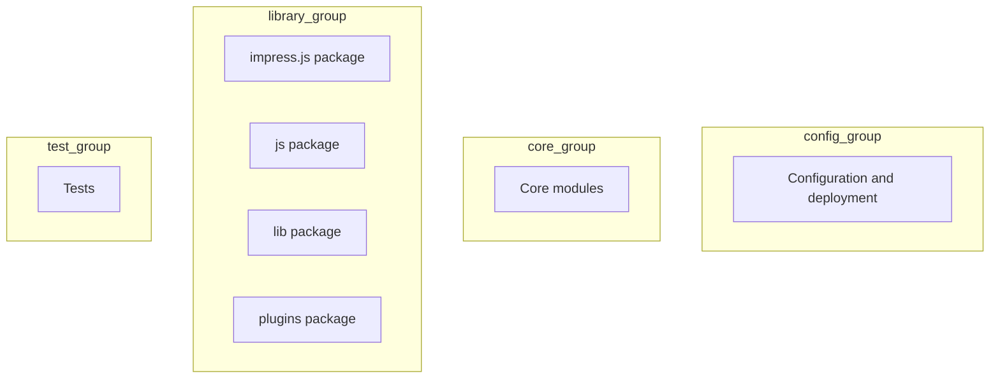

# Architecture report: impress/impress.js

> Automated static analysis. **Observed** = directly seen in files/imports/AST; **Inferred** = interpretation from that evidence. Repository code was not executed.

## 1. Repository at a glance

| Item | Value |
| --- | --- |
| Repository | impress/impress.js |
| Description | It's a presentation framework based on the power of CSS3 transforms and transitions in modern browsers and inspired by the idea behind prezi.com. |
| Language | JavaScript |
| Stars | 38155 |
| Licence | MIT |
| Analysed commit / branch | b44b9694b41fd2c076c3d1ad7a0c3e0cea9eb262 / master |
| Framework(s) | None detected |
| Files analysed | 108 |
| Components | 7 |

## 2. Architecture in one minute

impress/impress.js - It's a presentation framework based on the power of CSS3 transforms and transitions in modern browsers and inspired by the idea behind prezi.com.. This repository was analysed statically from 108 file(s) (0 Python). Detected technologies (observed from imports/manifests): GitHub Actions. Files are grouped into 7 component(s): Configuration and deployment, Core modules, impress.js package, js package, lib package, plugins package, Tests. Findings below distinguish observed facts from inferred interpretation.

## 3. High-level block diagram

## 4. Main components

### Configuration and deployment (`config`)

- **Kind:** config
- **Status:** Observed
- **Confidence:** 0.85
- **Responsibility:** Groups 1 file(s) under configuration and deployment (observed from repository paths and static analysis).
- **Paths:** `package.json`
- **Evidence:** [package.json](https://github.com/impress/impress.js/blob/b44b9694b41fd2c076c3d1ad7a0c3e0cea9eb262/package.json)

### Core modules (`core`)

- **Kind:** core
- **Status:** Observed
- **Confidence:** 0.85
- **Responsibility:** Groups 2 file(s) under core modules (observed from repository paths and static analysis).
- **Paths:** `build.js`, `karma.conf.js`
- **Evidence:** [build.js](https://github.com/impress/impress.js/blob/b44b9694b41fd2c076c3d1ad7a0c3e0cea9eb262/build.js); [karma.conf.js](https://github.com/impress/impress.js/blob/b44b9694b41fd2c076c3d1ad7a0c3e0cea9eb262/karma.conf.js)

### impress.js package (`impress_js`)

- **Kind:** library
- **Status:** Observed
- **Confidence:** 0.85
- **Responsibility:** Groups 1 file(s) under impress.js package (observed from repository paths and static analysis).
- **Paths:** `src/impress.js`
- **Evidence:** [src/impress.js](https://github.com/impress/impress.js/blob/b44b9694b41fd2c076c3d1ad7a0c3e0cea9eb262/src/impress.js)

### js package (`js`)

- **Kind:** library
- **Status:** Observed
- **Confidence:** 0.85
- **Responsibility:** Groups 1 file(s) under js package (observed from repository paths and static analysis).
- **Paths:** `js/impress.js`
- **Evidence:** [js/impress.js](https://github.com/impress/impress.js/blob/b44b9694b41fd2c076c3d1ad7a0c3e0cea9eb262/js/impress.js)

### lib package (`lib`)

- **Kind:** library
- **Status:** Observed
- **Confidence:** 0.85
- **Responsibility:** Groups 3 file(s) under lib package (observed from repository paths and static analysis).
- **Paths:** `src/lib/gc.js`, `src/lib/rotation.js`, `src/lib/util.js`
- **Evidence:** [src/lib/gc.js](https://github.com/impress/impress.js/blob/b44b9694b41fd2c076c3d1ad7a0c3e0cea9eb262/src/lib/gc.js); [src/lib/rotation.js](https://github.com/impress/impress.js/blob/b44b9694b41fd2c076c3d1ad7a0c3e0cea9eb262/src/lib/rotation.js); [src/lib/util.js](https://github.com/impress/impress.js/blob/b44b9694b41fd2c076c3d1ad7a0c3e0cea9eb262/src/lib/util.js)

### plugins package (`plugins`)

- **Kind:** library
- **Status:** Observed
- **Confidence:** 0.85
- **Responsibility:** Groups 23 file(s) under plugins package (observed from repository paths and static analysis).
- **Paths:** `src/plugins/autoplay/autoplay.js`, `src/plugins/blackout/blackout.js`, `src/plugins/bookmark/bookmark.js`, `src/plugins/extras/extras.js`, `src/plugins/form/form.js`, `src/plugins/fullscreen/fullscreen.js`, `src/plugins/goto/goto.js`, `src/plugins/help/help.js`, `src/plugins/impressConsole/impressConsole.js`, `src/plugins/media/media.js`, `src/plugins/mobile/mobile.js`, `src/plugins/mouse-timeout/mouse-timeout.js`, `src/plugins/navigation-ui/navigation-ui.js`, `src/plugins/navigation/navigation.js`, `src/plugins/navigation/navigation_tests.js`, `src/plugins/progress/progress.js`, `src/plugins/rel/rel.js`, `src/plugins/resize/resize.js`, `src/plugins/skip/skip.js`, `src/plugins/stop/stop.js`, `src/plugins/substep/substep.js`, `src/plugins/toolbar/toolbar.js`, `src/plugins/touch/touch.js`
- **Evidence:** [src/plugins/autoplay/autoplay.js](https://github.com/impress/impress.js/blob/b44b9694b41fd2c076c3d1ad7a0c3e0cea9eb262/src/plugins/autoplay/autoplay.js); [src/plugins/blackout/blackout.js](https://github.com/impress/impress.js/blob/b44b9694b41fd2c076c3d1ad7a0c3e0cea9eb262/src/plugins/blackout/blackout.js); [src/plugins/bookmark/bookmark.js](https://github.com/impress/impress.js/blob/b44b9694b41fd2c076c3d1ad7a0c3e0cea9eb262/src/plugins/bookmark/bookmark.js); [src/plugins/extras/extras.js](https://github.com/impress/impress.js/blob/b44b9694b41fd2c076c3d1ad7a0c3e0cea9eb262/src/plugins/extras/extras.js); [src/plugins/form/form.js](https://github.com/impress/impress.js/blob/b44b9694b41fd2c076c3d1ad7a0c3e0cea9eb262/src/plugins/form/form.js); [src/plugins/fullscreen/fullscreen.js](https://github.com/impress/impress.js/blob/b44b9694b41fd2c076c3d1ad7a0c3e0cea9eb262/src/plugins/fullscreen/fullscreen.js); [src/plugins/goto/goto.js](https://github.com/impress/impress.js/blob/b44b9694b41fd2c076c3d1ad7a0c3e0cea9eb262/src/plugins/goto/goto.js); [src/plugins/help/help.js](https://github.com/impress/impress.js/blob/b44b9694b41fd2c076c3d1ad7a0c3e0cea9eb262/src/plugins/help/help.js)

### Tests (`tests`)

- **Kind:** test
- **Status:** Observed
- **Confidence:** 0.85
- **Responsibility:** Groups 14 file(s) under tests (observed from repository paths and static analysis).
- **Paths:** `test/HOWTO.md`, `test/core_tests.js`, `test/core_tests_presentation.html`, `test/helpers.js`, `test/non_default.html`, `test/non_default.js`, `test/plugins/rel/padding_tests.js`, `test/plugins/rel/padding_tests_presentation.html`, `test/plugins/rel/rel_to_tests.js`, `test/plugins/rel/rel_to_tests_presentation.html`, `test/plugins/rel/relative_to_screen_size_tests.js`, `test/plugins/rel/relative_to_screen_size_tests_presentation.html`, `test/plugins/rel/rotation_tests.js`, `test/plugins/rel/rotation_tests_presentation.html`
- **Evidence:** [test/HOWTO.md](https://github.com/impress/impress.js/blob/b44b9694b41fd2c076c3d1ad7a0c3e0cea9eb262/test/HOWTO.md); [test/core_tests.js](https://github.com/impress/impress.js/blob/b44b9694b41fd2c076c3d1ad7a0c3e0cea9eb262/test/core_tests.js); [test/core_tests_presentation.html](https://github.com/impress/impress.js/blob/b44b9694b41fd2c076c3d1ad7a0c3e0cea9eb262/test/core_tests_presentation.html); [test/helpers.js](https://github.com/impress/impress.js/blob/b44b9694b41fd2c076c3d1ad7a0c3e0cea9eb262/test/helpers.js); [test/non_default.html](https://github.com/impress/impress.js/blob/b44b9694b41fd2c076c3d1ad7a0c3e0cea9eb262/test/non_default.html); [test/non_default.js](https://github.com/impress/impress.js/blob/b44b9694b41fd2c076c3d1ad7a0c3e0cea9eb262/test/non_default.js); [test/plugins/rel/padding_tests.js](https://github.com/impress/impress.js/blob/b44b9694b41fd2c076c3d1ad7a0c3e0cea9eb262/test/plugins/rel/padding_tests.js); [test/plugins/rel/padding_tests_presentation.html](https://github.com/impress/impress.js/blob/b44b9694b41fd2c076c3d1ad7a0c3e0cea9eb262/test/plugins/rel/padding_tests_presentation.html)

## 5. Execution flow

**Observed** entry point(s):

- [js/impress.js](https://github.com/impress/impress.js/blob/b44b9694b41fd2c076c3d1ad7a0c3e0cea9eb262/js/impress.js)

Representative flow (derived from observed entry points and the import graph; steps beyond the entry point are **Inferred**):

1. Execution starts at an observed entry point listed above, if present.
2. No internal import relationships between components were observed.

## 6. Project structure

### `(root)`

- `.eslintrc.js` - source, JavaScript (9159 bytes)
- `.gitattributes` - other (12 bytes)
- `.gitignore` - other (131 bytes)
- `.gitmodules` - other (85 bytes)
- `.jscsrc` - other (140 bytes)
- `.jshintrc` - other (248 bytes)
- `.npmignore` - other (41 bytes)
- `DOCUMENTATION.md` - docs (14546 bytes)
- `GettingStarted.md` - docs (10193 bytes)
- `LICENSE` - docs (1085 bytes)
- `README.md` - docs (8103 bytes)
- `build.js` - source, JavaScript (2740 bytes)
- `index.html` - other (20721 bytes)
- `karma.conf.js` - source, JavaScript (3136 bytes)
- `npm-readme.md` - docs (2621 bytes)
- `package.json` - manifest (1292 bytes)
- `qunit_test_runner.html` - other (1031 bytes)

### `.circleci`

- `.circleci/config.yml` - ci, YAML (629 bytes)

### `.github`

- `.github/workflows/pipeline.yaml` - ci, YAML (1349 bytes)

### `css`

- `css/impress-common.css` - other (4791 bytes)
- `css/impress-demo.css` - other (20239 bytes)

### `examples`

- `examples/2D-navigation/css/fonts.css` - other (21772 bytes)
- `examples/2D-navigation/css/presentation.css` - other (4822 bytes)
- `examples/2D-navigation/index.html` - other (8613 bytes)
- `examples/3D-positions/index.html` - other (5624 bytes)
- `examples/3D-rotations/css/3D-rotations.css` - other (2784 bytes)
- `examples/3D-rotations/css/fonts.css` - other (21772 bytes)
- `examples/3D-rotations/index.html` - other (3954 bytes)
- `examples/classic-slides/css/classic-slides.css` - other (8395 bytes)
- `examples/classic-slides/css/fonts.css` - other (21772 bytes)
- `examples/classic-slides/images/background-title.svg` - other (13536 bytes)
- `examples/classic-slides/images/background.svg` - other (12837 bytes)
- `examples/classic-slides/index.html` - other (23549 bytes)
- `examples/cube/css/cube.css` - other (2626 bytes)
- `examples/cube/css/fonts.css` - other (21772 bytes)
- `examples/cube/index.html` - other (4265 bytes)
- `examples/index.html` - other (422 bytes)
- `examples/markdown/css/devopsy.css` - other (684 bytes)
- `examples/markdown/css/effects.css` - other (640 bytes)
- `examples/markdown/css/fonts.css` - other (21772 bytes)
- `examples/markdown/css/markdown-slides.css` - other (3194 bytes)
- `examples/markdown/index.html` - other (6710 bytes)

### `js`

- `js/impress.js` - source, JavaScript (186005 bytes)

### `src`

- `src/impress.js` - source, JavaScript (37179 bytes)
- `src/lib/README.md` - docs (3413 bytes)
- `src/lib/gc.js` - source, JavaScript (9593 bytes)
- `src/lib/rotation.js` - source, JavaScript (14152 bytes)
- `src/lib/util.js` - source, JavaScript (4839 bytes)
- `src/plugins/README.md` - docs (15069 bytes)
- `src/plugins/autoplay/README.md` - docs (1051 bytes)
- `src/plugins/autoplay/autoplay.js` - source, JavaScript (5468 bytes)
- `src/plugins/blackout/README.md` - docs (168 bytes)
- `src/plugins/blackout/blackout.js` - source, JavaScript (3402 bytes)
- `src/plugins/bookmark/README.md` - docs (752 bytes)
- `src/plugins/bookmark/bookmark.js` - source, JavaScript (2598 bytes)
- `src/plugins/extras/README.md` - docs (887 bytes)
- `src/plugins/extras/extras.js` - source, JavaScript (3334 bytes)
- `src/plugins/form/README.md` - docs (1050 bytes)
- `src/plugins/form/form.js` - source, JavaScript (2161 bytes)
- `src/plugins/fullscreen/README.md` - docs (411 bytes)
- `src/plugins/fullscreen/fullscreen.js` - source, JavaScript (1657 bytes)
- `src/plugins/goto/README.md` - docs (1054 bytes)
- `src/plugins/goto/goto.js` - source, JavaScript (7708 bytes)
- `src/plugins/help/README.md` - docs (867 bytes)
- `src/plugins/help/help.js` - source, JavaScript (4048 bytes)
- `src/plugins/impressConsole/README.md` - docs (841 bytes)
- `src/plugins/impressConsole/impressConsole.js` - source, JavaScript (29988 bytes)
- `src/plugins/media/README.md` - docs (2077 bytes)
- `src/plugins/media/media.js` - source, JavaScript (9404 bytes)
- `src/plugins/mobile/README.md` - docs (1179 bytes)
- `src/plugins/mobile/mobile.js` - source, JavaScript (3347 bytes)
- `src/plugins/mouse-timeout/README.md` - docs (662 bytes)
- `src/plugins/mouse-timeout/mouse-timeout.js` - source, JavaScript (1932 bytes)
- `src/plugins/navigation-ui/README.md` - docs (468 bytes)
- `src/plugins/navigation-ui/navigation-ui.js` - source, JavaScript (5277 bytes)
- `src/plugins/navigation/README.md` - docs (708 bytes)
- `src/plugins/navigation/navigation.js` - source, JavaScript (7911 bytes)
- `src/plugins/navigation/navigation_tests.js` - source, JavaScript (7224 bytes)
- `src/plugins/progress/README.md` - docs (940 bytes)
- `src/plugins/progress/progress.js` - source, JavaScript (1845 bytes)
- `src/plugins/rel/README.md` - docs (6636 bytes)
- `src/plugins/rel/rel.js` - source, JavaScript (13738 bytes)
- `src/plugins/resize/README.md` - docs (188 bytes)
- `src/plugins/resize/resize.js` - source, JavaScript (956 bytes)
- `src/plugins/skip/README.md` - docs (562 bytes)
- `src/plugins/skip/skip.js` - source, JavaScript (2686 bytes)
- `src/plugins/stop/README.md` - docs (555 bytes)
- `src/plugins/stop/stop.js` - source, JavaScript (905 bytes)
- `src/plugins/substep/README.md` - docs (1875 bytes)
- `src/plugins/substep/substep.js` - source, JavaScript (6355 bytes)
- `src/plugins/toolbar/README.md` - docs (1174 bytes)
- `src/plugins/toolbar/toolbar.js` - source, JavaScript (5575 bytes)
- `src/plugins/touch/README.md` - docs (202 bytes)
- `src/plugins/touch/touch.js` - source, JavaScript (2279 bytes)

### `test`

- `test/HOWTO.md` - test (2541 bytes)
- `test/core_tests.js` - test, JavaScript (12302 bytes)
- `test/core_tests_presentation.html` - test (998 bytes)
- `test/helpers.js` - test, JavaScript (4235 bytes)
- `test/non_default.html` - test (516 bytes)
- `test/non_default.js` - test, JavaScript (5937 bytes)
- `test/plugins/rel/padding_tests.js` - test, JavaScript (8752 bytes)
- `test/plugins/rel/padding_tests_presentation.html` - test (2755 bytes)
- `test/plugins/rel/rel_to_tests.js` - test, JavaScript (10157 bytes)
- `test/plugins/rel/rel_to_tests_presentation.html` - test (3274 bytes)
- `test/plugins/rel/relative_to_screen_size_tests.js` - test, JavaScript (2036 bytes)
- `test/plugins/rel/relative_to_screen_size_tests_presentation.html` - test (1517 bytes)
- `test/plugins/rel/rotation_tests.js` - test, JavaScript (5929 bytes)
- `test/plugins/rel/rotation_tests_presentation.html` - test (2153 bytes)

## 7. Key dependencies and integrations

| Name | Category | Status | Confidence | Evidence |
| --- | --- | --- | --- | --- |
| GitHub Actions | ci | Observed | 0.85 | [.github/workflows/pipeline.yaml](https://github.com/impress/impress.js/blob/b44b9694b41fd2c076c3d1ad7a0c3e0cea9eb262/.github/workflows/pipeline.yaml) |

## 8. Data and state

No database, cache, queue, or persistent-state usage was observed in the analysed files. State handling, if any, may be in-memory or in files that were not analysed.

## 9. Configuration and deployment clues

- `.circleci/config.yml` (ci)
- `.github/workflows/pipeline.yaml` (ci)
- `package.json` (manifest)

## 10. Design observations

- Tests are present alongside source code (Observed from test file paths).

These observations are interpretations (**Inferred**) of the observed structure, not guarantees about runtime design.

## 11. Limitations and unknowns

- Static analysis only: repository code was not executed, installed, or imported at runtime.
- Components and relationships are inferred from file paths, imports, and AST structure; runtime behaviour, dynamic imports, and reflection may not be visible.
- No clear application entry point was observed in the analysed files.
- Repository text was treated as untrusted data; no instructions found in repository files were followed, and likely secret values were redacted/excluded.
- JavaScript and TypeScript files were inventoried from paths and package manifests. They were not parsed with a full language AST, and repository code was not executed.

## 12. Source references

- [.github/workflows/pipeline.yaml](https://github.com/impress/impress.js/blob/b44b9694b41fd2c076c3d1ad7a0c3e0cea9eb262/.github/workflows/pipeline.yaml)
- [build.js](https://github.com/impress/impress.js/blob/b44b9694b41fd2c076c3d1ad7a0c3e0cea9eb262/build.js)
- [js/impress.js](https://github.com/impress/impress.js/blob/b44b9694b41fd2c076c3d1ad7a0c3e0cea9eb262/js/impress.js)
- [karma.conf.js](https://github.com/impress/impress.js/blob/b44b9694b41fd2c076c3d1ad7a0c3e0cea9eb262/karma.conf.js)
- [package.json](https://github.com/impress/impress.js/blob/b44b9694b41fd2c076c3d1ad7a0c3e0cea9eb262/package.json)
- [src/impress.js](https://github.com/impress/impress.js/blob/b44b9694b41fd2c076c3d1ad7a0c3e0cea9eb262/src/impress.js)
- [src/lib/gc.js](https://github.com/impress/impress.js/blob/b44b9694b41fd2c076c3d1ad7a0c3e0cea9eb262/src/lib/gc.js)
- [src/lib/rotation.js](https://github.com/impress/impress.js/blob/b44b9694b41fd2c076c3d1ad7a0c3e0cea9eb262/src/lib/rotation.js)
- [src/lib/util.js](https://github.com/impress/impress.js/blob/b44b9694b41fd2c076c3d1ad7a0c3e0cea9eb262/src/lib/util.js)
- [src/plugins/autoplay/autoplay.js](https://github.com/impress/impress.js/blob/b44b9694b41fd2c076c3d1ad7a0c3e0cea9eb262/src/plugins/autoplay/autoplay.js)
- [src/plugins/blackout/blackout.js](https://github.com/impress/impress.js/blob/b44b9694b41fd2c076c3d1ad7a0c3e0cea9eb262/src/plugins/blackout/blackout.js)
- [src/plugins/bookmark/bookmark.js](https://github.com/impress/impress.js/blob/b44b9694b41fd2c076c3d1ad7a0c3e0cea9eb262/src/plugins/bookmark/bookmark.js)
- [src/plugins/extras/extras.js](https://github.com/impress/impress.js/blob/b44b9694b41fd2c076c3d1ad7a0c3e0cea9eb262/src/plugins/extras/extras.js)
- [src/plugins/form/form.js](https://github.com/impress/impress.js/blob/b44b9694b41fd2c076c3d1ad7a0c3e0cea9eb262/src/plugins/form/form.js)
- [src/plugins/fullscreen/fullscreen.js](https://github.com/impress/impress.js/blob/b44b9694b41fd2c076c3d1ad7a0c3e0cea9eb262/src/plugins/fullscreen/fullscreen.js)
- [src/plugins/goto/goto.js](https://github.com/impress/impress.js/blob/b44b9694b41fd2c076c3d1ad7a0c3e0cea9eb262/src/plugins/goto/goto.js)
- [src/plugins/help/help.js](https://github.com/impress/impress.js/blob/b44b9694b41fd2c076c3d1ad7a0c3e0cea9eb262/src/plugins/help/help.js)
- [test/HOWTO.md](https://github.com/impress/impress.js/blob/b44b9694b41fd2c076c3d1ad7a0c3e0cea9eb262/test/HOWTO.md)
- [test/core_tests.js](https://github.com/impress/impress.js/blob/b44b9694b41fd2c076c3d1ad7a0c3e0cea9eb262/test/core_tests.js)
- [test/core_tests_presentation.html](https://github.com/impress/impress.js/blob/b44b9694b41fd2c076c3d1ad7a0c3e0cea9eb262/test/core_tests_presentation.html)
- [test/helpers.js](https://github.com/impress/impress.js/blob/b44b9694b41fd2c076c3d1ad7a0c3e0cea9eb262/test/helpers.js)
- [test/non_default.html](https://github.com/impress/impress.js/blob/b44b9694b41fd2c076c3d1ad7a0c3e0cea9eb262/test/non_default.html)
- [test/non_default.js](https://github.com/impress/impress.js/blob/b44b9694b41fd2c076c3d1ad7a0c3e0cea9eb262/test/non_default.js)
- [test/plugins/rel/padding_tests.js](https://github.com/impress/impress.js/blob/b44b9694b41fd2c076c3d1ad7a0c3e0cea9eb262/test/plugins/rel/padding_tests.js)
- [test/plugins/rel/padding_tests_presentation.html](https://github.com/impress/impress.js/blob/b44b9694b41fd2c076c3d1ad7a0c3e0cea9eb262/test/plugins/rel/padding_tests_presentation.html)
